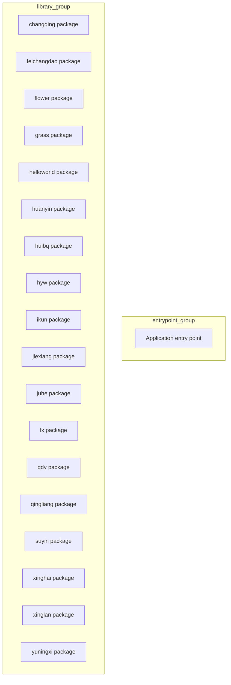

# Architecture report: pdone/lx-music-source

> Automated static analysis. **Observed** = directly seen in files/imports/AST; **Inferred** = interpretation from that evidence. Repository code was not executed.

## 1. Repository at a glance

| Item | Value |
| --- | --- |
| Repository | pdone/lx-music-source |
| Description | 洛雪音乐源 |
| Language | JavaScript |
| Stars | 11257 |
| Licence | Not detected |
| Analysed commit / branch | ed8328dbd1a77aee3ee0116d835eb9d907eeaad2 / main |
| Framework(s) | None detected |
| Files analysed | 54 |
| Components | 19 |

## 2. Architecture in one minute

pdone/lx-music-source - 洛雪音乐源. This repository was analysed statically from 54 file(s) (2 Python). Detected technologies (observed from imports/manifests): GitHub Actions. Files are grouped into 19 component(s): changqing package, Application entry point, feichangdao package, flower package, grass package, helloworld package, huanyin package, huibq package. Observed entry point(s): CreateLatest.py, probe.py. Findings below distinguish observed facts from inferred interpretation.

## 3. High-level block diagram

## 4. Main components

### changqing package (`changqing`)

- **Kind:** library
- **Status:** Observed
- **Confidence:** 0.85
- **Responsibility:** Groups 2 file(s) under changqing package (observed from repository paths and static analysis).
- **Paths:** `changqing/1.3.0.js`, `changqing/latest.js`
- **Evidence:** [changqing/1.3.0.js](https://github.com/pdone/lx-music-source/blob/ed8328dbd1a77aee3ee0116d835eb9d907eeaad2/changqing/1.3.0.js); [changqing/latest.js](https://github.com/pdone/lx-music-source/blob/ed8328dbd1a77aee3ee0116d835eb9d907eeaad2/changqing/latest.js)

### Application entry point (`entrypoint`)

- **Kind:** entrypoint
- **Status:** Observed
- **Confidence:** 0.85
- **Responsibility:** Groups 2 file(s) under application entry point (observed from repository paths and static analysis). Observed top-level functions: _decode_hex_fragments, _elapsed_ms, _iter_join_parts, _joined_ipv4_hosts, _svg_style, _svg_text.
- **Paths:** `CreateLatest.py`, `probe.py`
- **Evidence:** [CreateLatest.py:37](https://github.com/pdone/lx-music-source/blob/ed8328dbd1a77aee3ee0116d835eb9d907eeaad2/CreateLatest.py#L37); [probe.py:116](https://github.com/pdone/lx-music-source/blob/ed8328dbd1a77aee3ee0116d835eb9d907eeaad2/probe.py#L116)

### feichangdao package (`feichangdao`)

- **Kind:** library
- **Status:** Observed
- **Confidence:** 0.85
- **Responsibility:** Groups 2 file(s) under feichangdao package (observed from repository paths and static analysis).
- **Paths:** `feichangdao/5.js`, `feichangdao/latest.js`
- **Evidence:** [feichangdao/5.js](https://github.com/pdone/lx-music-source/blob/ed8328dbd1a77aee3ee0116d835eb9d907eeaad2/feichangdao/5.js); [feichangdao/latest.js](https://github.com/pdone/lx-music-source/blob/ed8328dbd1a77aee3ee0116d835eb9d907eeaad2/feichangdao/latest.js)

### flower package (`flower`)

- **Kind:** library
- **Status:** Observed
- **Confidence:** 0.85
- **Responsibility:** Groups 2 file(s) under flower package (observed from repository paths and static analysis).
- **Paths:** `flower/1.js`, `flower/latest.js`
- **Evidence:** [flower/1.js](https://github.com/pdone/lx-music-source/blob/ed8328dbd1a77aee3ee0116d835eb9d907eeaad2/flower/1.js); [flower/latest.js](https://github.com/pdone/lx-music-source/blob/ed8328dbd1a77aee3ee0116d835eb9d907eeaad2/flower/latest.js)

### grass package (`grass`)

- **Kind:** library
- **Status:** Observed
- **Confidence:** 0.85
- **Responsibility:** Groups 2 file(s) under grass package (observed from repository paths and static analysis).
- **Paths:** `grass/1.js`, `grass/latest.js`
- **Evidence:** [grass/1.js](https://github.com/pdone/lx-music-source/blob/ed8328dbd1a77aee3ee0116d835eb9d907eeaad2/grass/1.js); [grass/latest.js](https://github.com/pdone/lx-music-source/blob/ed8328dbd1a77aee3ee0116d835eb9d907eeaad2/grass/latest.js)

### helloworld package (`helloworld`)

- **Kind:** library
- **Status:** Observed
- **Confidence:** 0.85
- **Responsibility:** Groups 2 file(s) under helloworld package (observed from repository paths and static analysis).
- **Paths:** `helloworld/260925.js`, `helloworld/latest.js`
- **Evidence:** [helloworld/260925.js](https://github.com/pdone/lx-music-source/blob/ed8328dbd1a77aee3ee0116d835eb9d907eeaad2/helloworld/260925.js); [helloworld/latest.js](https://github.com/pdone/lx-music-source/blob/ed8328dbd1a77aee3ee0116d835eb9d907eeaad2/helloworld/latest.js)

### huanyin package (`huanyin`)

- **Kind:** library
- **Status:** Observed
- **Confidence:** 0.85
- **Responsibility:** Groups 2 file(s) under huanyin package (observed from repository paths and static analysis).
- **Paths:** `huanyin/3.js`, `huanyin/latest.js`
- **Evidence:** [huanyin/3.js](https://github.com/pdone/lx-music-source/blob/ed8328dbd1a77aee3ee0116d835eb9d907eeaad2/huanyin/3.js); [huanyin/latest.js](https://github.com/pdone/lx-music-source/blob/ed8328dbd1a77aee3ee0116d835eb9d907eeaad2/huanyin/latest.js)

### huibq package (`huibq`)

- **Kind:** library
- **Status:** Observed
- **Confidence:** 0.85
- **Responsibility:** Groups 2 file(s) under huibq package (observed from repository paths and static analysis).
- **Paths:** `huibq/1.2.0.js`, `huibq/latest.js`
- **Evidence:** [huibq/1.2.0.js](https://github.com/pdone/lx-music-source/blob/ed8328dbd1a77aee3ee0116d835eb9d907eeaad2/huibq/1.2.0.js); [huibq/latest.js](https://github.com/pdone/lx-music-source/blob/ed8328dbd1a77aee3ee0116d835eb9d907eeaad2/huibq/latest.js)

### hyw package (`hyw`)

- **Kind:** library
- **Status:** Observed
- **Confidence:** 0.85
- **Responsibility:** Groups 2 file(s) under hyw package (observed from repository paths and static analysis).
- **Paths:** `hyw/1.2.0.js`, `hyw/latest.js`
- **Evidence:** [hyw/1.2.0.js](https://github.com/pdone/lx-music-source/blob/ed8328dbd1a77aee3ee0116d835eb9d907eeaad2/hyw/1.2.0.js); [hyw/latest.js](https://github.com/pdone/lx-music-source/blob/ed8328dbd1a77aee3ee0116d835eb9d907eeaad2/hyw/latest.js)

### ikun package (`ikun`)

- **Kind:** library
- **Status:** Observed
- **Confidence:** 0.85
- **Responsibility:** Groups 3 file(s) under ikun package (observed from repository paths and static analysis).
- **Paths:** `ikun/22.js`, `ikun/6.js`, `ikun/latest.js`
- **Evidence:** [ikun/22.js](https://github.com/pdone/lx-music-source/blob/ed8328dbd1a77aee3ee0116d835eb9d907eeaad2/ikun/22.js); [ikun/6.js](https://github.com/pdone/lx-music-source/blob/ed8328dbd1a77aee3ee0116d835eb9d907eeaad2/ikun/6.js); [ikun/latest.js](https://github.com/pdone/lx-music-source/blob/ed8328dbd1a77aee3ee0116d835eb9d907eeaad2/ikun/latest.js)

### jiexiang package (`jiexiang`)

- **Kind:** library
- **Status:** Observed
- **Confidence:** 0.85
- **Responsibility:** Groups 2 file(s) under jiexiang package (observed from repository paths and static analysis).
- **Paths:** `jiexiang/2.3.0.js`, `jiexiang/latest.js`
- **Evidence:** [jiexiang/2.3.0.js](https://github.com/pdone/lx-music-source/blob/ed8328dbd1a77aee3ee0116d835eb9d907eeaad2/jiexiang/2.3.0.js); [jiexiang/latest.js](https://github.com/pdone/lx-music-source/blob/ed8328dbd1a77aee3ee0116d835eb9d907eeaad2/jiexiang/latest.js)

### juhe package (`juhe`)

- **Kind:** library
- **Status:** Observed
- **Confidence:** 0.85
- **Responsibility:** Groups 2 file(s) under juhe package (observed from repository paths and static analysis).
- **Paths:** `juhe/3.js`, `juhe/latest.js`
- **Evidence:** [juhe/3.js](https://github.com/pdone/lx-music-source/blob/ed8328dbd1a77aee3ee0116d835eb9d907eeaad2/juhe/3.js); [juhe/latest.js](https://github.com/pdone/lx-music-source/blob/ed8328dbd1a77aee3ee0116d835eb9d907eeaad2/juhe/latest.js)

### lx package (`lx`)

- **Kind:** library
- **Status:** Observed
- **Confidence:** 0.85
- **Responsibility:** Groups 7 file(s) under lx package (observed from repository paths and static analysis).
- **Paths:** `lx/2.js`, `lx/3.js`, `lx/4.js`, `lx/5.js`, `lx/6.js`, `lx/7.js`, `lx/latest.js`
- **Evidence:** [lx/2.js](https://github.com/pdone/lx-music-source/blob/ed8328dbd1a77aee3ee0116d835eb9d907eeaad2/lx/2.js); [lx/3.js](https://github.com/pdone/lx-music-source/blob/ed8328dbd1a77aee3ee0116d835eb9d907eeaad2/lx/3.js); [lx/4.js](https://github.com/pdone/lx-music-source/blob/ed8328dbd1a77aee3ee0116d835eb9d907eeaad2/lx/4.js); [lx/5.js](https://github.com/pdone/lx-music-source/blob/ed8328dbd1a77aee3ee0116d835eb9d907eeaad2/lx/5.js); [lx/6.js](https://github.com/pdone/lx-music-source/blob/ed8328dbd1a77aee3ee0116d835eb9d907eeaad2/lx/6.js); [lx/7.js](https://github.com/pdone/lx-music-source/blob/ed8328dbd1a77aee3ee0116d835eb9d907eeaad2/lx/7.js); [lx/latest.js](https://github.com/pdone/lx-music-source/blob/ed8328dbd1a77aee3ee0116d835eb9d907eeaad2/lx/latest.js)

### qdy package (`qdy`)

- **Kind:** library
- **Status:** Observed
- **Confidence:** 0.85
- **Responsibility:** Groups 2 file(s) under qdy package (observed from repository paths and static analysis).
- **Paths:** `qdy/9.3.js`, `qdy/latest.js`
- **Evidence:** [qdy/9.3.js](https://github.com/pdone/lx-music-source/blob/ed8328dbd1a77aee3ee0116d835eb9d907eeaad2/qdy/9.3.js); [qdy/latest.js](https://github.com/pdone/lx-music-source/blob/ed8328dbd1a77aee3ee0116d835eb9d907eeaad2/qdy/latest.js)

### qingliang package (`qingliang`)

- **Kind:** library
- **Status:** Observed
- **Confidence:** 0.85
- **Responsibility:** Groups 2 file(s) under qingliang package (observed from repository paths and static analysis).
- **Paths:** `qingliang/2.1.0.js`, `qingliang/latest.js`
- **Evidence:** [qingliang/2.1.0.js](https://github.com/pdone/lx-music-source/blob/ed8328dbd1a77aee3ee0116d835eb9d907eeaad2/qingliang/2.1.0.js); [qingliang/latest.js](https://github.com/pdone/lx-music-source/blob/ed8328dbd1a77aee3ee0116d835eb9d907eeaad2/qingliang/latest.js)

### suyin package (`suyin`)

- **Kind:** library
- **Status:** Observed
- **Confidence:** 0.85
- **Responsibility:** Groups 2 file(s) under suyin package (observed from repository paths and static analysis).
- **Paths:** `suyin/1.js`, `suyin/latest.js`
- **Evidence:** [suyin/1.js](https://github.com/pdone/lx-music-source/blob/ed8328dbd1a77aee3ee0116d835eb9d907eeaad2/suyin/1.js); [suyin/latest.js](https://github.com/pdone/lx-music-source/blob/ed8328dbd1a77aee3ee0116d835eb9d907eeaad2/suyin/latest.js)

### xinghai package (`xinghai`)

- **Kind:** library
- **Status:** Observed
- **Confidence:** 0.85
- **Responsibility:** Groups 4 file(s) under xinghai package (observed from repository paths and static analysis).
- **Paths:** `xinghai/2.3.15.js`, `xinghai/3.2.17.js`, `xinghai/3.2.18.js`, `xinghai/latest.js`
- **Evidence:** [xinghai/2.3.15.js](https://github.com/pdone/lx-music-source/blob/ed8328dbd1a77aee3ee0116d835eb9d907eeaad2/xinghai/2.3.15.js); [xinghai/3.2.17.js](https://github.com/pdone/lx-music-source/blob/ed8328dbd1a77aee3ee0116d835eb9d907eeaad2/xinghai/3.2.17.js); [xinghai/3.2.18.js](https://github.com/pdone/lx-music-source/blob/ed8328dbd1a77aee3ee0116d835eb9d907eeaad2/xinghai/3.2.18.js); [xinghai/latest.js](https://github.com/pdone/lx-music-source/blob/ed8328dbd1a77aee3ee0116d835eb9d907eeaad2/xinghai/latest.js)

### xinglan package (`xinglan`)

- **Kind:** library
- **Status:** Observed
- **Confidence:** 0.85
- **Responsibility:** Groups 2 file(s) under xinglan package (observed from repository paths and static analysis).
- **Paths:** `xinglan/4.0.2.js`, `xinglan/latest.js`
- **Evidence:** [xinglan/4.0.2.js](https://github.com/pdone/lx-music-source/blob/ed8328dbd1a77aee3ee0116d835eb9d907eeaad2/xinglan/4.0.2.js); [xinglan/latest.js](https://github.com/pdone/lx-music-source/blob/ed8328dbd1a77aee3ee0116d835eb9d907eeaad2/xinglan/latest.js)

### yuningxi package (`yuningxi`)

- **Kind:** library
- **Status:** Observed
- **Confidence:** 0.85
- **Responsibility:** Groups 3 file(s) under yuningxi package (observed from repository paths and static analysis).
- **Paths:** `yuningxi/1.2.2.js`, `yuningxi/1.2.5.js`, `yuningxi/latest.js`
- **Evidence:** [yuningxi/1.2.2.js](https://github.com/pdone/lx-music-source/blob/ed8328dbd1a77aee3ee0116d835eb9d907eeaad2/yuningxi/1.2.2.js); [yuningxi/1.2.5.js](https://github.com/pdone/lx-music-source/blob/ed8328dbd1a77aee3ee0116d835eb9d907eeaad2/yuningxi/1.2.5.js); [yuningxi/latest.js](https://github.com/pdone/lx-music-source/blob/ed8328dbd1a77aee3ee0116d835eb9d907eeaad2/yuningxi/latest.js)

## 5. Execution flow

**Observed** entry point(s):

- [CreateLatest.py:50](https://github.com/pdone/lx-music-source/blob/ed8328dbd1a77aee3ee0116d835eb9d907eeaad2/CreateLatest.py#L50)
- [probe.py:507](https://github.com/pdone/lx-music-source/blob/ed8328dbd1a77aee3ee0116d835eb9d907eeaad2/probe.py#L507)

Representative flow (derived from observed entry points and the import graph; steps beyond the entry point are **Inferred**):

1. Execution starts at an observed entry point listed above, if present.
2. No internal import relationships between components were observed.

## 6. Project structure

### `(root)`

- `.gitignore` - other (45 bytes)
- `AGENTS.md` - docs (4503 bytes)
- `CreateLatest.py` - source, Python (1244 bytes)
- `README.md` - docs (6720 bytes)
- `probe.py` - source, Python (21328 bytes)

### `.github`

- `.github/star-history/generate-star-history.mjs` - source, JavaScript (8125 bytes)
- `.github/star-history/init-star-history.mjs` - source, JavaScript (10513 bytes)
- `.github/workflows/health-check.yml` - ci, YAML (3783 bytes)
- `.github/workflows/star-history.yml` - ci, YAML (3185 bytes)

### `changqing`

- `changqing/1.3.0.js` - source, JavaScript (27645 bytes)
- `changqing/latest.js` - source, JavaScript (27645 bytes)

### `feichangdao`

- `feichangdao/5.js` - source, JavaScript (17846 bytes)
- `feichangdao/latest.js` - source, JavaScript (17846 bytes)

### `flower`

- `flower/1.js` - source, JavaScript (10057 bytes)
- `flower/latest.js` - source, JavaScript (10057 bytes)

### `grass`

- `grass/1.js` - source, JavaScript (9176 bytes)
- `grass/latest.js` - source, JavaScript (9176 bytes)

### `helloworld`

- `helloworld/260925.js` - source, JavaScript (21421 bytes)
- `helloworld/latest.js` - source, JavaScript (21421 bytes)

### `huanyin`

- `huanyin/3.js` - source, JavaScript (7316 bytes)
- `huanyin/latest.js` - source, JavaScript (7316 bytes)

### `huibq`

- `huibq/1.2.0.js` - source, JavaScript (2727 bytes)
- `huibq/latest.js` - source, JavaScript (2727 bytes)

### `hyw`

- `hyw/1.2.0.js` - source, JavaScript (12082 bytes)
- `hyw/latest.js` - source, JavaScript (12082 bytes)

### `ikun`

- `ikun/22.js` - source, JavaScript (4991 bytes)
- `ikun/6.js` - source, JavaScript (4494 bytes)
- `ikun/latest.js` - source, JavaScript (4991 bytes)

### `jiexiang`

- `jiexiang/2.3.0.js` - source, JavaScript (91493 bytes)
- `jiexiang/latest.js` - source, JavaScript (91493 bytes)

### `juhe`

- `juhe/3.js` - source, JavaScript (994 bytes)
- `juhe/latest.js` - source, JavaScript (994 bytes)

### `lx`

- `lx/2.js` - source, JavaScript (10593 bytes)
- `lx/3.js` - source, JavaScript (10595 bytes)
- `lx/4.js` - source, JavaScript (114852 bytes)
- `lx/5.js` - source, JavaScript (62829 bytes)
- `lx/6.js` - source, JavaScript (64094 bytes)
- `lx/7.js` - source, JavaScript (64094 bytes)
- `lx/latest.js` - source, JavaScript (64094 bytes)

### `qdy`

- `qdy/9.3.js` - source, JavaScript (31090 bytes)
- `qdy/latest.js` - source, JavaScript (31090 bytes)

### `qingliang`

- `qingliang/2.1.0.js` - source, JavaScript (26416 bytes)
- `qingliang/latest.js` - source, JavaScript (26416 bytes)

### `suyin`

- `suyin/1.js` - source, JavaScript (17656 bytes)
- `suyin/latest.js` - source, JavaScript (17656 bytes)

### `xinghai`

- `xinghai/2.3.15.js` - source, JavaScript (38858 bytes)
- `xinghai/3.2.17.js` - source, JavaScript (40560 bytes)
- `xinghai/3.2.18.js` - source, JavaScript (21572 bytes)
- `xinghai/latest.js` - source, JavaScript (21572 bytes)

### `xinglan`

- `xinglan/4.0.2.js` - source, JavaScript (74386 bytes)
- `xinglan/latest.js` - source, JavaScript (74386 bytes)

### `yuningxi`

- `yuningxi/1.2.2.js` - source, JavaScript (147347 bytes)
- `yuningxi/1.2.5.js` - source, JavaScript (144621 bytes)
- `yuningxi/latest.js` - source, JavaScript (144621 bytes)

## 7. Key dependencies and integrations

| Name | Category | Status | Confidence | Evidence |
| --- | --- | --- | --- | --- |
| GitHub Actions | ci | Observed | 0.90 | [.github/workflows/health-check.yml](https://github.com/pdone/lx-music-source/blob/ed8328dbd1a77aee3ee0116d835eb9d907eeaad2/.github/workflows/health-check.yml); [.github/workflows/star-history.yml](https://github.com/pdone/lx-music-source/blob/ed8328dbd1a77aee3ee0116d835eb9d907eeaad2/.github/workflows/star-history.yml) |

## 8. Data and state

No database, cache, queue, or persistent-state usage was observed in the analysed files. State handling, if any, may be in-memory or in files that were not analysed.

## 9. Configuration and deployment clues

- `.github/workflows/health-check.yml` (ci)
- `.github/workflows/star-history.yml` (ci)

## 10. Design observations

- An entry/API layer is separated from other code (Inferred from paths and decorators).

These observations are interpretations (**Inferred**) of the observed structure, not guarantees about runtime design.

## 11. Limitations and unknowns

- Static analysis only: repository code was not executed, installed, or imported at runtime.
- Components and relationships are inferred from file paths, imports, and AST structure; runtime behaviour, dynamic imports, and reflection may not be visible.
- Repository text was treated as untrusted data; no instructions found in repository files were followed, and likely secret values were redacted/excluded.

## 12. Source references

- [.github/workflows/health-check.yml](https://github.com/pdone/lx-music-source/blob/ed8328dbd1a77aee3ee0116d835eb9d907eeaad2/.github/workflows/health-check.yml)
- [.github/workflows/star-history.yml](https://github.com/pdone/lx-music-source/blob/ed8328dbd1a77aee3ee0116d835eb9d907eeaad2/.github/workflows/star-history.yml)
- [CreateLatest.py:37](https://github.com/pdone/lx-music-source/blob/ed8328dbd1a77aee3ee0116d835eb9d907eeaad2/CreateLatest.py#L37)
- [CreateLatest.py:50](https://github.com/pdone/lx-music-source/blob/ed8328dbd1a77aee3ee0116d835eb9d907eeaad2/CreateLatest.py#L50)
- [changqing/1.3.0.js](https://github.com/pdone/lx-music-source/blob/ed8328dbd1a77aee3ee0116d835eb9d907eeaad2/changqing/1.3.0.js)
- [changqing/latest.js](https://github.com/pdone/lx-music-source/blob/ed8328dbd1a77aee3ee0116d835eb9d907eeaad2/changqing/latest.js)
- [feichangdao/5.js](https://github.com/pdone/lx-music-source/blob/ed8328dbd1a77aee3ee0116d835eb9d907eeaad2/feichangdao/5.js)
- [feichangdao/latest.js](https://github.com/pdone/lx-music-source/blob/ed8328dbd1a77aee3ee0116d835eb9d907eeaad2/feichangdao/latest.js)
- [flower/1.js](https://github.com/pdone/lx-music-source/blob/ed8328dbd1a77aee3ee0116d835eb9d907eeaad2/flower/1.js)
- [flower/latest.js](https://github.com/pdone/lx-music-source/blob/ed8328dbd1a77aee3ee0116d835eb9d907eeaad2/flower/latest.js)
- [grass/1.js](https://github.com/pdone/lx-music-source/blob/ed8328dbd1a77aee3ee0116d835eb9d907eeaad2/grass/1.js)
- [grass/latest.js](https://github.com/pdone/lx-music-source/blob/ed8328dbd1a77aee3ee0116d835eb9d907eeaad2/grass/latest.js)
- [helloworld/260925.js](https://github.com/pdone/lx-music-source/blob/ed8328dbd1a77aee3ee0116d835eb9d907eeaad2/helloworld/260925.js)
- [helloworld/latest.js](https://github.com/pdone/lx-music-source/blob/ed8328dbd1a77aee3ee0116d835eb9d907eeaad2/helloworld/latest.js)
- [huanyin/3.js](https://github.com/pdone/lx-music-source/blob/ed8328dbd1a77aee3ee0116d835eb9d907eeaad2/huanyin/3.js)
- [huanyin/latest.js](https://github.com/pdone/lx-music-source/blob/ed8328dbd1a77aee3ee0116d835eb9d907eeaad2/huanyin/latest.js)
- [huibq/1.2.0.js](https://github.com/pdone/lx-music-source/blob/ed8328dbd1a77aee3ee0116d835eb9d907eeaad2/huibq/1.2.0.js)
- [huibq/latest.js](https://github.com/pdone/lx-music-source/blob/ed8328dbd1a77aee3ee0116d835eb9d907eeaad2/huibq/latest.js)
- [hyw/1.2.0.js](https://github.com/pdone/lx-music-source/blob/ed8328dbd1a77aee3ee0116d835eb9d907eeaad2/hyw/1.2.0.js)
- [hyw/latest.js](https://github.com/pdone/lx-music-source/blob/ed8328dbd1a77aee3ee0116d835eb9d907eeaad2/hyw/latest.js)
- [ikun/22.js](https://github.com/pdone/lx-music-source/blob/ed8328dbd1a77aee3ee0116d835eb9d907eeaad2/ikun/22.js)
- [ikun/6.js](https://github.com/pdone/lx-music-source/blob/ed8328dbd1a77aee3ee0116d835eb9d907eeaad2/ikun/6.js)
- [ikun/latest.js](https://github.com/pdone/lx-music-source/blob/ed8328dbd1a77aee3ee0116d835eb9d907eeaad2/ikun/latest.js)
- [jiexiang/2.3.0.js](https://github.com/pdone/lx-music-source/blob/ed8328dbd1a77aee3ee0116d835eb9d907eeaad2/jiexiang/2.3.0.js)
- [jiexiang/latest.js](https://github.com/pdone/lx-music-source/blob/ed8328dbd1a77aee3ee0116d835eb9d907eeaad2/jiexiang/latest.js)
- [juhe/3.js](https://github.com/pdone/lx-music-source/blob/ed8328dbd1a77aee3ee0116d835eb9d907eeaad2/juhe/3.js)
- [juhe/latest.js](https://github.com/pdone/lx-music-source/blob/ed8328dbd1a77aee3ee0116d835eb9d907eeaad2/juhe/latest.js)
- [lx/2.js](https://github.com/pdone/lx-music-source/blob/ed8328dbd1a77aee3ee0116d835eb9d907eeaad2/lx/2.js)
- [lx/3.js](https://github.com/pdone/lx-music-source/blob/ed8328dbd1a77aee3ee0116d835eb9d907eeaad2/lx/3.js)
- [lx/4.js](https://github.com/pdone/lx-music-source/blob/ed8328dbd1a77aee3ee0116d835eb9d907eeaad2/lx/4.js)
- [lx/5.js](https://github.com/pdone/lx-music-source/blob/ed8328dbd1a77aee3ee0116d835eb9d907eeaad2/lx/5.js)
- [lx/6.js](https://github.com/pdone/lx-music-source/blob/ed8328dbd1a77aee3ee0116d835eb9d907eeaad2/lx/6.js)
- [lx/7.js](https://github.com/pdone/lx-music-source/blob/ed8328dbd1a77aee3ee0116d835eb9d907eeaad2/lx/7.js)
- [lx/latest.js](https://github.com/pdone/lx-music-source/blob/ed8328dbd1a77aee3ee0116d835eb9d907eeaad2/lx/latest.js)
- [probe.py:116](https://github.com/pdone/lx-music-source/blob/ed8328dbd1a77aee3ee0116d835eb9d907eeaad2/probe.py#L116)
- [probe.py:507](https://github.com/pdone/lx-music-source/blob/ed8328dbd1a77aee3ee0116d835eb9d907eeaad2/probe.py#L507)
- [qdy/9.3.js](https://github.com/pdone/lx-music-source/blob/ed8328dbd1a77aee3ee0116d835eb9d907eeaad2/qdy/9.3.js)
- [qdy/latest.js](https://github.com/pdone/lx-music-source/blob/ed8328dbd1a77aee3ee0116d835eb9d907eeaad2/qdy/latest.js)
- [qingliang/2.1.0.js](https://github.com/pdone/lx-music-source/blob/ed8328dbd1a77aee3ee0116d835eb9d907eeaad2/qingliang/2.1.0.js)
- [qingliang/latest.js](https://github.com/pdone/lx-music-source/blob/ed8328dbd1a77aee3ee0116d835eb9d907eeaad2/qingliang/latest.js)
- [suyin/1.js](https://github.com/pdone/lx-music-source/blob/ed8328dbd1a77aee3ee0116d835eb9d907eeaad2/suyin/1.js)
- [suyin/latest.js](https://github.com/pdone/lx-music-source/blob/ed8328dbd1a77aee3ee0116d835eb9d907eeaad2/suyin/latest.js)
- [xinghai/2.3.15.js](https://github.com/pdone/lx-music-source/blob/ed8328dbd1a77aee3ee0116d835eb9d907eeaad2/xinghai/2.3.15.js)
- [xinghai/3.2.17.js](https://github.com/pdone/lx-music-source/blob/ed8328dbd1a77aee3ee0116d835eb9d907eeaad2/xinghai/3.2.17.js)
- [xinghai/3.2.18.js](https://github.com/pdone/lx-music-source/blob/ed8328dbd1a77aee3ee0116d835eb9d907eeaad2/xinghai/3.2.18.js)
- [xinghai/latest.js](https://github.com/pdone/lx-music-source/blob/ed8328dbd1a77aee3ee0116d835eb9d907eeaad2/xinghai/latest.js)
- [xinglan/4.0.2.js](https://github.com/pdone/lx-music-source/blob/ed8328dbd1a77aee3ee0116d835eb9d907eeaad2/xinglan/4.0.2.js)
- [xinglan/latest.js](https://github.com/pdone/lx-music-source/blob/ed8328dbd1a77aee3ee0116d835eb9d907eeaad2/xinglan/latest.js)
- [yuningxi/1.2.2.js](https://github.com/pdone/lx-music-source/blob/ed8328dbd1a77aee3ee0116d835eb9d907eeaad2/yuningxi/1.2.2.js)
- [yuningxi/1.2.5.js](https://github.com/pdone/lx-music-source/blob/ed8328dbd1a77aee3ee0116d835eb9d907eeaad2/yuningxi/1.2.5.js)
- [yuningxi/latest.js](https://github.com/pdone/lx-music-source/blob/ed8328dbd1a77aee3ee0116d835eb9d907eeaad2/yuningxi/latest.js)
