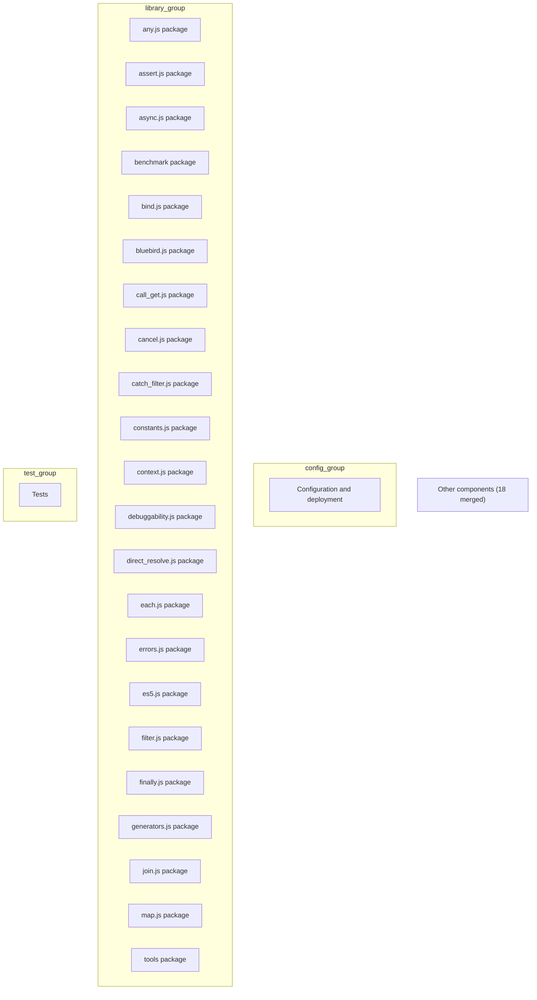

# Architecture report: petkaantonov/bluebird

> Automated static analysis. **Observed** = directly seen in files/imports/AST; **Inferred** = interpretation from that evidence. Repository code was not executed.

## 1. Repository at a glance

| Item | Value |
| --- | --- |
| Repository | petkaantonov/bluebird |
| Description | :bird: :zap: Bluebird is a full featured promise library with unmatched performance. |
| Language | JavaScript |
| Stars | 20459 |
| Licence | MIT |
| Analysed commit / branch | c220cfe480868e2f5c5de4fe8bb3b04b97588d7f / master |
| Framework(s) | None detected |
| Files analysed | 368 |
| Components | 42 |

## 2. Architecture in one minute

petkaantonov/bluebird - :bird: :zap: Bluebird is a full featured promise library with unmatched performance.. This repository was analysed statically from 368 file(s) (0 Python). Detected technologies (observed from imports/manifests): no known frameworks/libraries. Files are grouped into 42 component(s): any.js package, assert.js package, async.js package, benchmark package, bind.js package, bluebird.js package, call_get.js package, cancel.js package. Findings below distinguish observed facts from inferred interpretation.

## 3. High-level block diagram

## 4. Main components

### any.js package (`any_js`)

- **Kind:** library
- **Status:** Observed
- **Confidence:** 0.85
- **Responsibility:** Groups 1 file(s) under any.js package (observed from repository paths and static analysis).
- **Paths:** `src/any.js`
- **Evidence:** [src/any.js](https://github.com/petkaantonov/bluebird/blob/c220cfe480868e2f5c5de4fe8bb3b04b97588d7f/src/any.js)

### assert.js package (`assert_js`)

- **Kind:** library
- **Status:** Observed
- **Confidence:** 0.85
- **Responsibility:** Groups 1 file(s) under assert.js package (observed from repository paths and static analysis).
- **Paths:** `src/assert.js`
- **Evidence:** [src/assert.js](https://github.com/petkaantonov/bluebird/blob/c220cfe480868e2f5c5de4fe8bb3b04b97588d7f/src/assert.js)

### async.js package (`async_js`)

- **Kind:** library
- **Status:** Observed
- **Confidence:** 0.85
- **Responsibility:** Groups 1 file(s) under async.js package (observed from repository paths and static analysis).
- **Paths:** `src/async.js`
- **Evidence:** [src/async.js](https://github.com/petkaantonov/bluebird/blob/c220cfe480868e2f5c5de4fe8bb3b04b97588d7f/src/async.js)

### benchmark package (`benchmark`)

- **Kind:** library
- **Status:** Observed
- **Confidence:** 0.85
- **Responsibility:** Groups 73 file(s) under benchmark package (observed from repository paths and static analysis).
- **Paths:** `benchmark/analysis/promises-bluebird-parallel.js`, `benchmark/analysis/promises-bluebird.js`, `benchmark/doxbee-sequential-errors/callbacks-baseline.js`, `benchmark/doxbee-sequential-errors/callbacks-caolan-async-waterfall.js`, `benchmark/doxbee-sequential-errors/callbacks-suguru03-neo-async-waterfall.js`, `benchmark/doxbee-sequential-errors/promises-bluebird-generator.js`, `benchmark/doxbee-sequential-errors/promises-bluebird.js`, `benchmark/doxbee-sequential-errors/promises-calvinmetcalf-lie.js`, `benchmark/doxbee-sequential-errors/promises-cujojs-when.js`, `benchmark/doxbee-sequential-errors/promises-dfilatov-vow.js`, `benchmark/doxbee-sequential-errors/promises-kriskowal-q.js`, `benchmark/doxbee-sequential-errors/promises-lvivski-davy.js`, `benchmark/doxbee-sequential-errors/promises-medikoo-deferred.js`, `benchmark/doxbee-sequential-errors/promises-obvious-kew.js`, `benchmark/doxbee-sequential-errors/promises-then-promise.js`, `benchmark/doxbee-sequential-errors/promises-tildeio-rsvp.js`, `benchmark/doxbee-sequential-errors/streamline-callbacks.js`, `benchmark/doxbee-sequential-errors/streamline-generators.js`, `benchmark/doxbee-sequential/callbacks-baseline.js`, `benchmark/doxbee-sequential/callbacks-caolan-async-waterfall.js`, `benchmark/doxbee-sequential/callbacks-suguru03-neo-async-waterfall.js`, `benchmark/doxbee-sequential/generators-tj-co.js`, `benchmark/doxbee-sequential/observables-Reactive-Extensions-RxJS.js`, `benchmark/doxbee-sequential/observables-baconjs-bacon.js.js`, `benchmark/doxbee-sequential/observables-caolan-highland.js`, `benchmark/doxbee-sequential/observables-pozadi-kefir.js`, `benchmark/doxbee-sequential/promises-bluebird-generator.js`, `benchmark/doxbee-sequential/promises-bluebird.js`, `benchmark/doxbee-sequential/promises-calvinmetcalf-lie.js`, `benchmark/doxbee-sequential/promises-cujojs-when.js`, `benchmark/doxbee-sequential/promises-dfilatov-vow.js`, `benchmark/doxbee-sequential/promises-ecmascript6-native.js`, `benchmark/doxbee-sequential/promises-kriskowal-q.js`, `benchmark/doxbee-sequential/promises-lvivski-davy.js`, `benchmark/doxbee-sequential/promises-medikoo-deferred.js`, `benchmark/doxbee-sequential/promises-native-async-await.js`, `benchmark/doxbee-sequential/promises-obvious-kew.js`, `benchmark/doxbee-sequential/promises-then-promise.js`, `benchmark/doxbee-sequential/promises-tildeio-rsvp.js`, `benchmark/doxbee-sequential/streamline-callbacks.js`, `benchmark/doxbee-sequential/streamline-generators.js`, `benchmark/lib/catcher.js`, `benchmark/lib/dummy.js`, `benchmark/lib/fakemaker.js`, `benchmark/lib/fakes-ctx.js`, `benchmark/lib/fakes.js`, `benchmark/lib/fakesC.js`, `benchmark/lib/fakesO.js`, `benchmark/lib/fakesObservable.js`, `benchmark/lib/fakesP-ctx.js`, `benchmark/lib/fakesP.js`, `benchmark/lib/fakesSJS-dst.js`, `benchmark/lib/promiseSupport.js`, `benchmark/lib/timers-ctx.js`, `benchmark/madeup-parallel/callbacks-baseline.js`, `benchmark/madeup-parallel/callbacks-caolan-async-parallel.js`, `benchmark/madeup-parallel/callbacks-suguru03-neo-async-parallel.js`, `benchmark/madeup-parallel/generators-tj-co.js`, `benchmark/madeup-parallel/promises-bluebird-generator.js`, `benchmark/madeup-parallel/promises-bluebird.js`, `benchmark/madeup-parallel/promises-calvinmetcalf-lie.js`, `benchmark/madeup-parallel/promises-cujojs-when.js`, `benchmark/madeup-parallel/promises-dfilatov-vow.js`, `benchmark/madeup-parallel/promises-ecmascript6-native.js`, `benchmark/madeup-parallel/promises-lvivski-davy.js`, `benchmark/madeup-parallel/promises-medikoo-deferred.js`, `benchmark/madeup-parallel/promises-native-async-await.js`, `benchmark/madeup-parallel/promises-obvious-kew.js`, `benchmark/madeup-parallel/promises-then-promise.js`, `benchmark/madeup-parallel/promises-tildeio-rsvp.js`, `benchmark/madeup-parallel/streamline-callbacks.js`, `benchmark/madeup-parallel/streamline-generators.js`, `benchmark/performance.js`
- **Evidence:** [benchmark/analysis/promises-bluebird-parallel.js](https://github.com/petkaantonov/bluebird/blob/c220cfe480868e2f5c5de4fe8bb3b04b97588d7f/benchmark/analysis/promises-bluebird-parallel.js); [benchmark/analysis/promises-bluebird.js](https://github.com/petkaantonov/bluebird/blob/c220cfe480868e2f5c5de4fe8bb3b04b97588d7f/benchmark/analysis/promises-bluebird.js); [benchmark/doxbee-sequential-errors/callbacks-baseline.js](https://github.com/petkaantonov/bluebird/blob/c220cfe480868e2f5c5de4fe8bb3b04b97588d7f/benchmark/doxbee-sequential-errors/callbacks-baseline.js); [benchmark/doxbee-sequential-errors/callbacks-caolan-async-waterfall.js](https://github.com/petkaantonov/bluebird/blob/c220cfe480868e2f5c5de4fe8bb3b04b97588d7f/benchmark/doxbee-sequential-errors/callbacks-caolan-async-waterfall.js); [benchmark/doxbee-sequential-errors/callbacks-suguru03-neo-async-waterfall.js](https://github.com/petkaantonov/bluebird/blob/c220cfe480868e2f5c5de4fe8bb3b04b97588d7f/benchmark/doxbee-sequential-errors/callbacks-suguru03-neo-async-waterfall.js); [benchmark/doxbee-sequential-errors/promises-bluebird-generator.js](https://github.com/petkaantonov/bluebird/blob/c220cfe480868e2f5c5de4fe8bb3b04b97588d7f/benchmark/doxbee-sequential-errors/promises-bluebird-generator.js); [benchmark/doxbee-sequential-errors/promises-bluebird.js](https://github.com/petkaantonov/bluebird/blob/c220cfe480868e2f5c5de4fe8bb3b04b97588d7f/benchmark/doxbee-sequential-errors/promises-bluebird.js); [benchmark/doxbee-sequential-errors/promises-calvinmetcalf-lie.js](https://github.com/petkaantonov/bluebird/blob/c220cfe480868e2f5c5de4fe8bb3b04b97588d7f/benchmark/doxbee-sequential-errors/promises-calvinmetcalf-lie.js)

### bind.js package (`bind_js`)

- **Kind:** library
- **Status:** Observed
- **Confidence:** 0.85
- **Responsibility:** Groups 1 file(s) under bind.js package (observed from repository paths and static analysis).
- **Paths:** `src/bind.js`
- **Evidence:** [src/bind.js](https://github.com/petkaantonov/bluebird/blob/c220cfe480868e2f5c5de4fe8bb3b04b97588d7f/src/bind.js)

### bluebird.js package (`bluebird_js`)

- **Kind:** library
- **Status:** Observed
- **Confidence:** 0.85
- **Responsibility:** Groups 1 file(s) under bluebird.js package (observed from repository paths and static analysis).
- **Paths:** `src/bluebird.js`
- **Evidence:** [src/bluebird.js](https://github.com/petkaantonov/bluebird/blob/c220cfe480868e2f5c5de4fe8bb3b04b97588d7f/src/bluebird.js)

### call_get.js package (`call_get_js`)

- **Kind:** library
- **Status:** Observed
- **Confidence:** 0.85
- **Responsibility:** Groups 1 file(s) under call_get.js package (observed from repository paths and static analysis).
- **Paths:** `src/call_get.js`
- **Evidence:** [src/call_get.js](https://github.com/petkaantonov/bluebird/blob/c220cfe480868e2f5c5de4fe8bb3b04b97588d7f/src/call_get.js)

### cancel.js package (`cancel_js`)

- **Kind:** library
- **Status:** Observed
- **Confidence:** 0.85
- **Responsibility:** Groups 1 file(s) under cancel.js package (observed from repository paths and static analysis).
- **Paths:** `src/cancel.js`
- **Evidence:** [src/cancel.js](https://github.com/petkaantonov/bluebird/blob/c220cfe480868e2f5c5de4fe8bb3b04b97588d7f/src/cancel.js)

### catch_filter.js package (`catch_filter_js`)

- **Kind:** library
- **Status:** Observed
- **Confidence:** 0.85
- **Responsibility:** Groups 1 file(s) under catch_filter.js package (observed from repository paths and static analysis).
- **Paths:** `src/catch_filter.js`
- **Evidence:** [src/catch_filter.js](https://github.com/petkaantonov/bluebird/blob/c220cfe480868e2f5c5de4fe8bb3b04b97588d7f/src/catch_filter.js)

### Configuration and deployment (`config`)

- **Kind:** config
- **Status:** Observed
- **Confidence:** 0.85
- **Responsibility:** Groups 3 file(s) under configuration and deployment (observed from repository paths and static analysis).
- **Paths:** `benchmark/package.json`, `bower.json`, `package.json`
- **Evidence:** [benchmark/package.json](https://github.com/petkaantonov/bluebird/blob/c220cfe480868e2f5c5de4fe8bb3b04b97588d7f/benchmark/package.json); [bower.json](https://github.com/petkaantonov/bluebird/blob/c220cfe480868e2f5c5de4fe8bb3b04b97588d7f/bower.json); [package.json](https://github.com/petkaantonov/bluebird/blob/c220cfe480868e2f5c5de4fe8bb3b04b97588d7f/package.json)

### constants.js package (`constants_js`)

- **Kind:** library
- **Status:** Observed
- **Confidence:** 0.85
- **Responsibility:** Groups 1 file(s) under constants.js package (observed from repository paths and static analysis).
- **Paths:** `src/constants.js`
- **Evidence:** [src/constants.js](https://github.com/petkaantonov/bluebird/blob/c220cfe480868e2f5c5de4fe8bb3b04b97588d7f/src/constants.js)

### context.js package (`context_js`)

- **Kind:** library
- **Status:** Observed
- **Confidence:** 0.85
- **Responsibility:** Groups 1 file(s) under context.js package (observed from repository paths and static analysis).
- **Paths:** `src/context.js`
- **Evidence:** [src/context.js](https://github.com/petkaantonov/bluebird/blob/c220cfe480868e2f5c5de4fe8bb3b04b97588d7f/src/context.js)

### debuggability.js package (`debuggability_js`)

- **Kind:** library
- **Status:** Observed
- **Confidence:** 0.85
- **Responsibility:** Groups 1 file(s) under debuggability.js package (observed from repository paths and static analysis).
- **Paths:** `src/debuggability.js`
- **Evidence:** [src/debuggability.js](https://github.com/petkaantonov/bluebird/blob/c220cfe480868e2f5c5de4fe8bb3b04b97588d7f/src/debuggability.js)

### direct_resolve.js package (`direct_resolve_js`)

- **Kind:** library
- **Status:** Observed
- **Confidence:** 0.85
- **Responsibility:** Groups 1 file(s) under direct_resolve.js package (observed from repository paths and static analysis).
- **Paths:** `src/direct_resolve.js`
- **Evidence:** [src/direct_resolve.js](https://github.com/petkaantonov/bluebird/blob/c220cfe480868e2f5c5de4fe8bb3b04b97588d7f/src/direct_resolve.js)

### each.js package (`each_js`)

- **Kind:** library
- **Status:** Observed
- **Confidence:** 0.85
- **Responsibility:** Groups 1 file(s) under each.js package (observed from repository paths and static analysis).
- **Paths:** `src/each.js`
- **Evidence:** [src/each.js](https://github.com/petkaantonov/bluebird/blob/c220cfe480868e2f5c5de4fe8bb3b04b97588d7f/src/each.js)

### errors.js package (`errors_js`)

- **Kind:** library
- **Status:** Observed
- **Confidence:** 0.85
- **Responsibility:** Groups 1 file(s) under errors.js package (observed from repository paths and static analysis).
- **Paths:** `src/errors.js`
- **Evidence:** [src/errors.js](https://github.com/petkaantonov/bluebird/blob/c220cfe480868e2f5c5de4fe8bb3b04b97588d7f/src/errors.js)

### es5.js package (`es5_js`)

- **Kind:** library
- **Status:** Observed
- **Confidence:** 0.85
- **Responsibility:** Groups 1 file(s) under es5.js package (observed from repository paths and static analysis).
- **Paths:** `src/es5.js`
- **Evidence:** [src/es5.js](https://github.com/petkaantonov/bluebird/blob/c220cfe480868e2f5c5de4fe8bb3b04b97588d7f/src/es5.js)

### filter.js package (`filter_js`)

- **Kind:** library
- **Status:** Observed
- **Confidence:** 0.85
- **Responsibility:** Groups 1 file(s) under filter.js package (observed from repository paths and static analysis).
- **Paths:** `src/filter.js`
- **Evidence:** [src/filter.js](https://github.com/petkaantonov/bluebird/blob/c220cfe480868e2f5c5de4fe8bb3b04b97588d7f/src/filter.js)

### finally.js package (`finally_js`)

- **Kind:** library
- **Status:** Observed
- **Confidence:** 0.85
- **Responsibility:** Groups 1 file(s) under finally.js package (observed from repository paths and static analysis).
- **Paths:** `src/finally.js`
- **Evidence:** [src/finally.js](https://github.com/petkaantonov/bluebird/blob/c220cfe480868e2f5c5de4fe8bb3b04b97588d7f/src/finally.js)

### generators.js package (`generators_js`)

- **Kind:** library
- **Status:** Observed
- **Confidence:** 0.85
- **Responsibility:** Groups 1 file(s) under generators.js package (observed from repository paths and static analysis).
- **Paths:** `src/generators.js`
- **Evidence:** [src/generators.js](https://github.com/petkaantonov/bluebird/blob/c220cfe480868e2f5c5de4fe8bb3b04b97588d7f/src/generators.js)

### join.js package (`join_js`)

- **Kind:** library
- **Status:** Observed
- **Confidence:** 0.85
- **Responsibility:** Groups 1 file(s) under join.js package (observed from repository paths and static analysis).
- **Paths:** `src/join.js`
- **Evidence:** [src/join.js](https://github.com/petkaantonov/bluebird/blob/c220cfe480868e2f5c5de4fe8bb3b04b97588d7f/src/join.js)

### map.js package (`map_js`)

- **Kind:** library
- **Status:** Observed
- **Confidence:** 0.85
- **Responsibility:** Groups 1 file(s) under map.js package (observed from repository paths and static analysis).
- **Paths:** `src/map.js`
- **Evidence:** [src/map.js](https://github.com/petkaantonov/bluebird/blob/c220cfe480868e2f5c5de4fe8bb3b04b97588d7f/src/map.js)

### method.js package (`method_js`)

- **Kind:** library
- **Status:** Observed
- **Confidence:** 0.85
- **Responsibility:** Groups 1 file(s) under method.js package (observed from repository paths and static analysis).
- **Paths:** `src/method.js`
- **Evidence:** [src/method.js](https://github.com/petkaantonov/bluebird/blob/c220cfe480868e2f5c5de4fe8bb3b04b97588d7f/src/method.js)

### nodeback.js package (`nodeback_js`)

- **Kind:** library
- **Status:** Observed
- **Confidence:** 0.85
- **Responsibility:** Groups 1 file(s) under nodeback.js package (observed from repository paths and static analysis).
- **Paths:** `src/nodeback.js`
- **Evidence:** [src/nodeback.js](https://github.com/petkaantonov/bluebird/blob/c220cfe480868e2f5c5de4fe8bb3b04b97588d7f/src/nodeback.js)

### nodeify.js package (`nodeify_js`)

- **Kind:** library
- **Status:** Observed
- **Confidence:** 0.85
- **Responsibility:** Groups 1 file(s) under nodeify.js package (observed from repository paths and static analysis).
- **Paths:** `src/nodeify.js`
- **Evidence:** [src/nodeify.js](https://github.com/petkaantonov/bluebird/blob/c220cfe480868e2f5c5de4fe8bb3b04b97588d7f/src/nodeify.js)

### promise_array.js package (`promise_array_js`)

- **Kind:** library
- **Status:** Observed
- **Confidence:** 0.85
- **Responsibility:** Groups 1 file(s) under promise_array.js package (observed from repository paths and static analysis).
- **Paths:** `src/promise_array.js`
- **Evidence:** [src/promise_array.js](https://github.com/petkaantonov/bluebird/blob/c220cfe480868e2f5c5de4fe8bb3b04b97588d7f/src/promise_array.js)

### promise.js package (`promise_js`)

- **Kind:** library
- **Status:** Observed
- **Confidence:** 0.85
- **Responsibility:** Groups 1 file(s) under promise.js package (observed from repository paths and static analysis).
- **Paths:** `src/promise.js`
- **Evidence:** [src/promise.js](https://github.com/petkaantonov/bluebird/blob/c220cfe480868e2f5c5de4fe8bb3b04b97588d7f/src/promise.js)

### promisify.js package (`promisify_js`)

- **Kind:** library
- **Status:** Observed
- **Confidence:** 0.85
- **Responsibility:** Groups 1 file(s) under promisify.js package (observed from repository paths and static analysis).
- **Paths:** `src/promisify.js`
- **Evidence:** [src/promisify.js](https://github.com/petkaantonov/bluebird/blob/c220cfe480868e2f5c5de4fe8bb3b04b97588d7f/src/promisify.js)

### props.js package (`props_js`)

- **Kind:** library
- **Status:** Observed
- **Confidence:** 0.85
- **Responsibility:** Groups 1 file(s) under props.js package (observed from repository paths and static analysis).
- **Paths:** `src/props.js`
- **Evidence:** [src/props.js](https://github.com/petkaantonov/bluebird/blob/c220cfe480868e2f5c5de4fe8bb3b04b97588d7f/src/props.js)

### queue.js package (`queue_js`)

- **Kind:** library
- **Status:** Observed
- **Confidence:** 0.85
- **Responsibility:** Groups 1 file(s) under queue.js package (observed from repository paths and static analysis).
- **Paths:** `src/queue.js`
- **Evidence:** [src/queue.js](https://github.com/petkaantonov/bluebird/blob/c220cfe480868e2f5c5de4fe8bb3b04b97588d7f/src/queue.js)

### race.js package (`race_js`)

- **Kind:** library
- **Status:** Observed
- **Confidence:** 0.85
- **Responsibility:** Groups 1 file(s) under race.js package (observed from repository paths and static analysis).
- **Paths:** `src/race.js`
- **Evidence:** [src/race.js](https://github.com/petkaantonov/bluebird/blob/c220cfe480868e2f5c5de4fe8bb3b04b97588d7f/src/race.js)

### reduce.js package (`reduce_js`)

- **Kind:** library
- **Status:** Observed
- **Confidence:** 0.85
- **Responsibility:** Groups 1 file(s) under reduce.js package (observed from repository paths and static analysis).
- **Paths:** `src/reduce.js`
- **Evidence:** [src/reduce.js](https://github.com/petkaantonov/bluebird/blob/c220cfe480868e2f5c5de4fe8bb3b04b97588d7f/src/reduce.js)

### schedule.js package (`schedule_js`)

- **Kind:** library
- **Status:** Observed
- **Confidence:** 0.85
- **Responsibility:** Groups 1 file(s) under schedule.js package (observed from repository paths and static analysis).
- **Paths:** `src/schedule.js`
- **Evidence:** [src/schedule.js](https://github.com/petkaantonov/bluebird/blob/c220cfe480868e2f5c5de4fe8bb3b04b97588d7f/src/schedule.js)

### settle.js package (`settle_js`)

- **Kind:** library
- **Status:** Observed
- **Confidence:** 0.85
- **Responsibility:** Groups 1 file(s) under settle.js package (observed from repository paths and static analysis).
- **Paths:** `src/settle.js`
- **Evidence:** [src/settle.js](https://github.com/petkaantonov/bluebird/blob/c220cfe480868e2f5c5de4fe8bb3b04b97588d7f/src/settle.js)

### some.js package (`some_js`)

- **Kind:** library
- **Status:** Observed
- **Confidence:** 0.85
- **Responsibility:** Groups 1 file(s) under some.js package (observed from repository paths and static analysis).
- **Paths:** `src/some.js`
- **Evidence:** [src/some.js](https://github.com/petkaantonov/bluebird/blob/c220cfe480868e2f5c5de4fe8bb3b04b97588d7f/src/some.js)

### synchronous_inspection.js package (`synchronous_inspection_js`)

- **Kind:** library
- **Status:** Observed
- **Confidence:** 0.85
- **Responsibility:** Groups 1 file(s) under synchronous_inspection.js package (observed from repository paths and static analysis).
- **Paths:** `src/synchronous_inspection.js`
- **Evidence:** [src/synchronous_inspection.js](https://github.com/petkaantonov/bluebird/blob/c220cfe480868e2f5c5de4fe8bb3b04b97588d7f/src/synchronous_inspection.js)

### Tests (`tests`)

- **Kind:** test
- **Status:** Observed
- **Confidence:** 0.85
- **Responsibility:** Groups 97 file(s) under tests (observed from repository paths and static analysis).
- **Paths:** `test/browser/es5-sham.js`, `test/browser/es5-shim.js`, `test/browser/have_getters.js`, `test/browser/index.html`, `test/browser/json.js`, `test/browser/main.js`, `test/browser/mocha.css`, `test/browser/mocha.js`, `test/browser/package.json`, `test/browser/promise_debug.js`, `test/browser/promise_instrumented.js`, `test/browser/worker.js`, `test/mocha/2.1.2.js`, `test/mocha/2.1.3.js`, `test/mocha/2.2.1.js`, `test/mocha/2.2.2.js`, `test/mocha/2.2.3.js`, `test/mocha/2.2.4.js`, `test/mocha/2.2.5.js`, `test/mocha/2.2.6.js`, `test/mocha/2.2.7.js`, `test/mocha/2.3.1.js`, `test/mocha/2.3.2.js`, `test/mocha/2.3.3.js`, `test/mocha/2.3.4.js`, `test/mocha/3.2.1.js`, `test/mocha/3.2.2.js`, `test/mocha/3.2.3.js`, `test/mocha/3.2.4.js`, `test/mocha/3.2.5.js`, `test/mocha/3.2.6.js`, `test/mocha/any.js`, `test/mocha/api_exceptions.js`, `test/mocha/async.js`, `test/mocha/async_hooks.js`, `test/mocha/bind.js`, `test/mocha/bluebird-multiple-instances.js`, `test/mocha/call.js`, `test/mocha/cancel.js`, `test/mocha/catch_filter.js`, `test/mocha/collections_thenables.js`, `test/mocha/constructor.js`, `test/mocha/cycles.js`, `test/mocha/direct_resolving.js`, `test/mocha/domain.js`, `test/mocha/done.js`, `test/mocha/each.js`, `test/mocha/error.js`, `test/mocha/filter.js`, `test/mocha/finally.js`, `test/mocha/following.js`, `test/mocha/generator.js`, `test/mocha/get.js`, `test/mocha/getNewLibraryCopy.js`, `test/mocha/github-2xx-76.js`, `test/mocha/github-3.6.4.js`, `test/mocha/github-3.7.3.js`, `test/mocha/github-4.1.7.js`, `test/mocha/github36.js`, `test/mocha/helpers/assert_long_trace.js`, `test/mocha/helpers/bluebird0_7_0.js`, `test/mocha/helpers/error.js`, `test/mocha/helpers/reasons.js`, `test/mocha/helpers/testThreeCases.js`, `test/mocha/helpers/thenables.js`, `test/mocha/helpers/util.js`, `test/mocha/is.js`, `test/mocha/join.js`, `test/mocha/late_buffer_safety.js`, `test/mocha/long_stack_traces.js`, `test/mocha/map.js`, `test/mocha/method.js`, `test/mocha/monitoring.js`, `test/mocha/multiple-copies.js`, `test/mocha/no_conflict.js`, `test/mocha/nodeify.js`, `test/mocha/promise_array.js`, `test/mocha/promisify.js`, `test/mocha/props.js`, `test/mocha/race.js`, `test/mocha/reduce.js`, `test/mocha/reflect.js`, `test/mocha/regress.js`, `test/mocha/rejections.js`, `test/mocha/resolution.js`, `test/mocha/schedule.js`, `test/mocha/settle.js`, `test/mocha/some.js`, `test/mocha/spread.js`, `test/mocha/synchronous_inspection.js`, `test/mocha/tap.js`, `test/mocha/tapCatch.js`, `test/mocha/timers.js`, `test/mocha/try.js`, `test/mocha/unhandled_rejections.js`, `test/mocha/using.js`, `tests`
- **Evidence:** [test/browser/es5-sham.js](https://github.com/petkaantonov/bluebird/blob/c220cfe480868e2f5c5de4fe8bb3b04b97588d7f/test/browser/es5-sham.js); [test/browser/es5-shim.js](https://github.com/petkaantonov/bluebird/blob/c220cfe480868e2f5c5de4fe8bb3b04b97588d7f/test/browser/es5-shim.js); [test/browser/have_getters.js](https://github.com/petkaantonov/bluebird/blob/c220cfe480868e2f5c5de4fe8bb3b04b97588d7f/test/browser/have_getters.js); [test/browser/index.html](https://github.com/petkaantonov/bluebird/blob/c220cfe480868e2f5c5de4fe8bb3b04b97588d7f/test/browser/index.html); [test/browser/json.js](https://github.com/petkaantonov/bluebird/blob/c220cfe480868e2f5c5de4fe8bb3b04b97588d7f/test/browser/json.js); [test/browser/main.js](https://github.com/petkaantonov/bluebird/blob/c220cfe480868e2f5c5de4fe8bb3b04b97588d7f/test/browser/main.js); [test/browser/mocha.css](https://github.com/petkaantonov/bluebird/blob/c220cfe480868e2f5c5de4fe8bb3b04b97588d7f/test/browser/mocha.css); [test/browser/mocha.js](https://github.com/petkaantonov/bluebird/blob/c220cfe480868e2f5c5de4fe8bb3b04b97588d7f/test/browser/mocha.js)

### thenables.js package (`thenables_js`)

- **Kind:** library
- **Status:** Observed
- **Confidence:** 0.85
- **Responsibility:** Groups 1 file(s) under thenables.js package (observed from repository paths and static analysis).
- **Paths:** `src/thenables.js`
- **Evidence:** [src/thenables.js](https://github.com/petkaantonov/bluebird/blob/c220cfe480868e2f5c5de4fe8bb3b04b97588d7f/src/thenables.js)

### timers.js package (`timers_js`)

- **Kind:** library
- **Status:** Observed
- **Confidence:** 0.85
- **Responsibility:** Groups 1 file(s) under timers.js package (observed from repository paths and static analysis).
- **Paths:** `src/timers.js`
- **Evidence:** [src/timers.js](https://github.com/petkaantonov/bluebird/blob/c220cfe480868e2f5c5de4fe8bb3b04b97588d7f/src/timers.js)

### tools package (`tools`)

- **Kind:** library
- **Status:** Observed
- **Confidence:** 0.85
- **Responsibility:** Groups 11 file(s) under tools package (observed from repository paths and static analysis).
- **Paths:** `tools/ast_passes.js`, `tools/browser_test_generator.js`, `tools/browser_test_runner.js`, `tools/build.js`, `tools/job-runner/job-runner.js`, `tools/jshint.js`, `tools/jshintrc_generator.js`, `tools/mocha_runner.js`, `tools/saucelabs_runner.js`, `tools/test.js`, `tools/utils.js`
- **Evidence:** [tools/ast_passes.js](https://github.com/petkaantonov/bluebird/blob/c220cfe480868e2f5c5de4fe8bb3b04b97588d7f/tools/ast_passes.js); [tools/browser_test_generator.js](https://github.com/petkaantonov/bluebird/blob/c220cfe480868e2f5c5de4fe8bb3b04b97588d7f/tools/browser_test_generator.js); [tools/browser_test_runner.js](https://github.com/petkaantonov/bluebird/blob/c220cfe480868e2f5c5de4fe8bb3b04b97588d7f/tools/browser_test_runner.js); [tools/build.js](https://github.com/petkaantonov/bluebird/blob/c220cfe480868e2f5c5de4fe8bb3b04b97588d7f/tools/build.js); [tools/job-runner/job-runner.js](https://github.com/petkaantonov/bluebird/blob/c220cfe480868e2f5c5de4fe8bb3b04b97588d7f/tools/job-runner/job-runner.js); [tools/jshint.js](https://github.com/petkaantonov/bluebird/blob/c220cfe480868e2f5c5de4fe8bb3b04b97588d7f/tools/jshint.js); [tools/jshintrc_generator.js](https://github.com/petkaantonov/bluebird/blob/c220cfe480868e2f5c5de4fe8bb3b04b97588d7f/tools/jshintrc_generator.js); [tools/mocha_runner.js](https://github.com/petkaantonov/bluebird/blob/c220cfe480868e2f5c5de4fe8bb3b04b97588d7f/tools/mocha_runner.js)

### using.js package (`using_js`)

- **Kind:** library
- **Status:** Observed
- **Confidence:** 0.85
- **Responsibility:** Groups 1 file(s) under using.js package (observed from repository paths and static analysis).
- **Paths:** `src/using.js`
- **Evidence:** [src/using.js](https://github.com/petkaantonov/bluebird/blob/c220cfe480868e2f5c5de4fe8bb3b04b97588d7f/src/using.js)

### util.js package (`util_js`)

- **Kind:** library
- **Status:** Observed
- **Confidence:** 0.85
- **Responsibility:** Groups 1 file(s) under util.js package (observed from repository paths and static analysis).
- **Paths:** `src/util.js`
- **Evidence:** [src/util.js](https://github.com/petkaantonov/bluebird/blob/c220cfe480868e2f5c5de4fe8bb3b04b97588d7f/src/util.js)

## 5. Execution flow

**Observed** entry point(s):

- [test/browser/index.html](https://github.com/petkaantonov/bluebird/blob/c220cfe480868e2f5c5de4fe8bb3b04b97588d7f/test/browser/index.html)

Representative flow (derived from observed entry points and the import graph; steps beyond the entry point are **Inferred**):

1. Execution starts at an observed entry point listed above, if present.
2. No internal import relationships between components were observed.

## 6. Project structure

### `(root)`

- `.editorconfig` - config (252 bytes)
- `.gitignore` - other (163 bytes)
- `.istanbul.yml` - config (1183 bytes)
- `.jshintignore` - other (17 bytes)
- `.jshintrc` - other (4885 bytes)
- `.travis.yml` - ci, YAML (478 bytes)
- `API.md` - docs (95 bytes)
- `CONTRIBUTING.md` - docs (389 bytes)
- `LICENSE` - docs (1086 bytes)
- `README.md` - docs (3479 bytes)
- `bench` - other (1060 bytes)
- `bower.json` - config (680 bytes)
- `changelog.md` - docs (87 bytes)
- `deprecated_apis.md` - docs (99 bytes)
- `issue_template.md` - docs (520 bytes)
- `package.json` - manifest (2217 bytes)
- `tests` - test (44 bytes)

### `benchmark`

- `benchmark/README.md` - docs (3579 bytes)
- `benchmark/analysis/promises-bluebird-parallel.js` - source, JavaScript (598 bytes)
- `benchmark/analysis/promises-bluebird.js` - source, JavaScript (1876 bytes)
- `benchmark/doxbee-sequential-errors/callbacks-baseline.js` - source, JavaScript (2987 bytes)
- `benchmark/doxbee-sequential-errors/callbacks-caolan-async-waterfall.js` - source, JavaScript (2460 bytes)
- `benchmark/doxbee-sequential-errors/callbacks-suguru03-neo-async-waterfall.js` - source, JavaScript (2463 bytes)
- `benchmark/doxbee-sequential-errors/promises-bluebird-generator.js` - source, JavaScript (1652 bytes)
- `benchmark/doxbee-sequential-errors/promises-bluebird.js` - source, JavaScript (2035 bytes)
- `benchmark/doxbee-sequential-errors/promises-calvinmetcalf-lie.js` - source, JavaScript (2024 bytes)
- `benchmark/doxbee-sequential-errors/promises-cujojs-when.js` - source, JavaScript (2031 bytes)
- `benchmark/doxbee-sequential-errors/promises-dfilatov-vow.js` - source, JavaScript (1998 bytes)
- `benchmark/doxbee-sequential-errors/promises-kriskowal-q.js` - source, JavaScript (1963 bytes)
- `benchmark/doxbee-sequential-errors/promises-lvivski-davy.js` - source, JavaScript (1978 bytes)
- `benchmark/doxbee-sequential-errors/promises-medikoo-deferred.js` - source, JavaScript (2092 bytes)
- `benchmark/doxbee-sequential-errors/promises-obvious-kew.js` - source, JavaScript (2011 bytes)
- `benchmark/doxbee-sequential-errors/promises-then-promise.js` - source, JavaScript (2036 bytes)
- `benchmark/doxbee-sequential-errors/promises-tildeio-rsvp.js` - source, JavaScript (2019 bytes)
- `benchmark/doxbee-sequential-errors/streamline-callbacks.js` - source, JavaScript (4065 bytes)
- `benchmark/doxbee-sequential-errors/streamline-generators.js` - source, JavaScript (2438 bytes)
- `benchmark/doxbee-sequential-errors/streamline._js` - other (1487 bytes)
- `benchmark/doxbee-sequential/callbacks-baseline.js` - source, JavaScript (2297 bytes)
- `benchmark/doxbee-sequential/callbacks-caolan-async-waterfall.js` - source, JavaScript (2460 bytes)
- `benchmark/doxbee-sequential/callbacks-suguru03-neo-async-waterfall.js` - source, JavaScript (2463 bytes)
- `benchmark/doxbee-sequential/generators-tj-co.js` - source, JavaScript (1773 bytes)
- `benchmark/doxbee-sequential/observables-Reactive-Extensions-RxJS.js` - source, JavaScript (1900 bytes)
- `benchmark/doxbee-sequential/observables-baconjs-bacon.js.js` - source, JavaScript (1931 bytes)
- `benchmark/doxbee-sequential/observables-caolan-highland.js` - source, JavaScript (1959 bytes)
- `benchmark/doxbee-sequential/observables-pozadi-kefir.js` - source, JavaScript (1920 bytes)
- `benchmark/doxbee-sequential/promises-bluebird-generator.js` - source, JavaScript (1508 bytes)
- `benchmark/doxbee-sequential/promises-bluebird.js` - source, JavaScript (1876 bytes)
- `benchmark/doxbee-sequential/promises-calvinmetcalf-lie.js` - source, JavaScript (1873 bytes)
- `benchmark/doxbee-sequential/promises-cujojs-when.js` - source, JavaScript (1891 bytes)
- `benchmark/doxbee-sequential/promises-dfilatov-vow.js` - source, JavaScript (1847 bytes)
- `benchmark/doxbee-sequential/promises-ecmascript6-native.js` - source, JavaScript (2022 bytes)
- `benchmark/doxbee-sequential/promises-kriskowal-q.js` - source, JavaScript (1821 bytes)
- `benchmark/doxbee-sequential/promises-lvivski-davy.js` - source, JavaScript (1827 bytes)
- `benchmark/doxbee-sequential/promises-medikoo-deferred.js` - source, JavaScript (1952 bytes)
- `benchmark/doxbee-sequential/promises-native-async-await.js` - source, JavaScript (1578 bytes)
- `benchmark/doxbee-sequential/promises-obvious-kew.js` - source, JavaScript (1869 bytes)
- `benchmark/doxbee-sequential/promises-then-promise.js` - source, JavaScript (1885 bytes)
- `benchmark/doxbee-sequential/promises-tildeio-rsvp.js` - source, JavaScript (1868 bytes)
- `benchmark/doxbee-sequential/streamline-callbacks.js` - source, JavaScript (3843 bytes)
- `benchmark/doxbee-sequential/streamline-generators.js` - source, JavaScript (2267 bytes)
- `benchmark/doxbee-sequential/streamline._js` - other (1343 bytes)
- `benchmark/lib/catcher.js` - source, JavaScript (1302 bytes)
- `benchmark/lib/dummy.js` - source, JavaScript (889 bytes)
- `benchmark/lib/fakemaker.js` - source, JavaScript (1863 bytes)
- `benchmark/lib/fakes-ctx.js` - source, JavaScript (997 bytes)
- `benchmark/lib/fakes.js` - source, JavaScript (144 bytes)
- `benchmark/lib/fakesC.js` - source, JavaScript (290 bytes)
- `benchmark/lib/fakesO.js` - source, JavaScript (624 bytes)
- `benchmark/lib/fakesObservable.js` - source, JavaScript (1270 bytes)
- `benchmark/lib/fakesP-ctx.js` - source, JavaScript (2232 bytes)
- `benchmark/lib/fakesP.js` - source, JavaScript (2782 bytes)
- `benchmark/lib/fakesSJS-dst.js` - source, JavaScript (2537 bytes)
- `benchmark/lib/fakesSJS-src.sjs` - other (992 bytes)
- `benchmark/lib/promiseSupport.js` - source, JavaScript (1283 bytes)
- `benchmark/lib/timers-ctx.js` - source, JavaScript (11519 bytes)
- `benchmark/madeup-parallel/callbacks-baseline.js` - source, JavaScript (677 bytes)
- `benchmark/madeup-parallel/callbacks-caolan-async-parallel.js` - source, JavaScript (673 bytes)
- `benchmark/madeup-parallel/callbacks-suguru03-neo-async-parallel.js` - source, JavaScript (677 bytes)
- `benchmark/madeup-parallel/generators-tj-co.js` - source, JavaScript (763 bytes)
- `benchmark/madeup-parallel/promises-bluebird-generator.js` - source, JavaScript (583 bytes)
- `benchmark/madeup-parallel/promises-bluebird.js` - source, JavaScript (562 bytes)
- `benchmark/madeup-parallel/promises-calvinmetcalf-lie.js` - source, JavaScript (513 bytes)
- `benchmark/madeup-parallel/promises-cujojs-when.js` - source, JavaScript (510 bytes)
- `benchmark/madeup-parallel/promises-dfilatov-vow.js` - source, JavaScript (527 bytes)
- `benchmark/madeup-parallel/promises-ecmascript6-native.js` - source, JavaScript (648 bytes)
- `benchmark/madeup-parallel/promises-lvivski-davy.js` - source, JavaScript (509 bytes)
- `benchmark/madeup-parallel/promises-medikoo-deferred.js` - source, JavaScript (623 bytes)
- `benchmark/madeup-parallel/promises-native-async-await.js` - source, JavaScript (652 bytes)
- `benchmark/madeup-parallel/promises-obvious-kew.js` - source, JavaScript (501 bytes)
- `benchmark/madeup-parallel/promises-then-promise.js` - source, JavaScript (525 bytes)
- `benchmark/madeup-parallel/promises-tildeio-rsvp.js` - source, JavaScript (510 bytes)
- `benchmark/madeup-parallel/streamline-callbacks.js` - source, JavaScript (2904 bytes)
- `benchmark/madeup-parallel/streamline-generators.js` - source, JavaScript (1299 bytes)
- `benchmark/madeup-parallel/streamline._js` - other (673 bytes)
- `benchmark/package.json` - manifest (866 bytes)
- `benchmark/performance.js` - source, JavaScript (5087 bytes)

### `docs`

- `docs/.gitignore` - docs (31 bytes)
- `docs/Gemfile` - docs (181 bytes)
- `docs/README.md` - docs (280 bytes)
- `docs/_config.yml` - config (616 bytes)
- `docs/_layouts/api.html` - docs (115 bytes)
- `docs/_layouts/default.html` - docs (8328 bytes)
- `docs/_layouts/page.html` - docs (209 bytes)
- `docs/_plugins/mdate.rb` - docs (433 bytes)
- `docs/_plugins/plugin.rb` - docs (1820 bytes)
- `docs/css/main.css` - docs (3170 bytes)
- `docs/css/mono-blue.css` - docs (4131 bytes)
- `docs/docs/anti-patterns.md` - docs (6091 bytes)
- `docs/docs/api-reference.md` - docs (3863 bytes)
- `docs/docs/api/aggregateerror.md` - docs (1507 bytes)
- `docs/docs/api/all.md` - docs (1112 bytes)
- `docs/docs/api/any.md` - docs (876 bytes)
- `docs/docs/api/ascallback.md` - docs (3300 bytes)
- `docs/docs/api/bind.md` - docs (936 bytes)
- `docs/docs/api/built-in-error-types.md` - docs (1503 bytes)
- `docs/docs/api/call.md` - docs (2985 bytes)
- `docs/docs/api/cancel.md` - docs (1056 bytes)
- `docs/docs/api/cancellation.md` - docs (5699 bytes)
- `docs/docs/api/cancellationerror.md` - docs (1053 bytes)
- `docs/docs/api/catch.md` - docs (7305 bytes)
- `docs/docs/api/catchreturn.md` - docs (1271 bytes)
- `docs/docs/api/catchthrow.md` - docs (1267 bytes)
- `docs/docs/api/collections.md` - docs (1343 bytes)
- `docs/docs/api/core.md` - docs (899 bytes)
- `docs/docs/api/deferred-migration.md` - docs (1451 bytes)
- `docs/docs/api/delay.md` - docs (908 bytes)
- `docs/docs/api/disposer.md` - docs (5943 bytes)
- `docs/docs/api/done.md` - docs (1173 bytes)
- `docs/docs/api/each.md` - docs (2087 bytes)
- `docs/docs/api/environment-variables.md` - docs (2365 bytes)
- `docs/docs/api/error-management-configuration.md` - docs (4471 bytes)
- `docs/docs/api/error.md` - docs (3223 bytes)
- `docs/docs/api/filter.md` - docs (1022 bytes)
- `docs/docs/api/finally.md` - docs (3916 bytes)
- `docs/docs/api/generators.md` - docs (931 bytes)
- `docs/docs/api/get.md` - docs (1450 bytes)
- `docs/docs/api/iscancelled.md` - docs (934 bytes)
- `docs/docs/api/isfulfilled.md` - docs (932 bytes)
- `docs/docs/api/ispending.md` - docs (956 bytes)
- `docs/docs/api/isrejected.md` - docs (925 bytes)
- `docs/docs/api/map.md` - docs (997 bytes)
- `docs/docs/api/mapseries.md` - docs (973 bytes)
- `docs/docs/api/new-promise.md` - docs (2658 bytes)
- `docs/docs/api/operationalerror.md` - docs (1347 bytes)
- `docs/docs/api/progression-migration.md` - docs (3138 bytes)
- `docs/docs/api/promise.all.md` - docs (1999 bytes)
- `docs/docs/api/promise.any.md` - docs (1074 bytes)
- `docs/docs/api/promise.bind.md` - docs (5941 bytes)
- `docs/docs/api/promise.config.md` - docs (3632 bytes)
- `docs/docs/api/promise.coroutine.addyieldhandler.md` - docs (4186 bytes)
- `docs/docs/api/promise.coroutine.md` - docs (2378 bytes)
- `docs/docs/api/promise.delay.md` - docs (1561 bytes)
- `docs/docs/api/promise.each.md` - docs (4523 bytes)
- `docs/docs/api/promise.filter.md` - docs (2644 bytes)
- `docs/docs/api/promise.fromcallback.md` - docs (2890 bytes)
- `docs/docs/api/promise.getnewlibrarycopy.md` - docs (1993 bytes)
- `docs/docs/api/promise.join.md` - docs (3192 bytes)
- `docs/docs/api/promise.longstacktraces.md` - docs (3265 bytes)
- `docs/docs/api/promise.map.md` - docs (6020 bytes)
- `docs/docs/api/promise.mapseries.md` - docs (3989 bytes)
- `docs/docs/api/promise.method.md` - docs (2189 bytes)
- `docs/docs/api/promise.noconflict.md` - docs (1637 bytes)
- `docs/docs/api/promise.onpossiblyunhandledrejection.md` - docs (1668 bytes)
- `docs/docs/api/promise.onunhandledrejectionhandled.md` - docs (1967 bytes)
- `docs/docs/api/promise.promisify.md` - docs (2937 bytes)
- `docs/docs/api/promise.promisifyall.md` - docs (9501 bytes)
- `docs/docs/api/promise.props.md` - docs (4400 bytes)
- `docs/docs/api/promise.race.md` - docs (1769 bytes)
- `docs/docs/api/promise.reduce.md` - docs (2720 bytes)
- `docs/docs/api/promise.reject.md` - docs (974 bytes)
- `docs/docs/api/promise.resolve.md` - docs (2187 bytes)
- `docs/docs/api/promise.setscheduler.md` - docs (1991 bytes)
- `docs/docs/api/promise.some.md` - docs (2193 bytes)
- `docs/docs/api/promise.try.md` - docs (1598 bytes)
- `docs/docs/api/promise.using.md` - docs (3852 bytes)
- `docs/docs/api/promiseinspection.md` - docs (1180 bytes)
- `docs/docs/api/promisification.md` - docs (4550 bytes)
- `docs/docs/api/props.md` - docs (890 bytes)
- `docs/docs/api/race.md` - docs (883 bytes)
- `docs/docs/api/reason.md` - docs (1136 bytes)
- `docs/docs/api/reduce.md` - docs (1017 bytes)
- `docs/docs/api/reflect.md` - docs (2219 bytes)
- `docs/docs/api/resource-management.md` - docs (2645 bytes)
- `docs/docs/api/return.md` - docs (1993 bytes)
- `docs/docs/api/some.md` - docs (899 bytes)
- `docs/docs/api/spread.md` - docs (2375 bytes)
- `docs/docs/api/suppressunhandledrejections.md` - docs (2703 bytes)
- `docs/docs/api/synchronous-inspection.md` - docs (2895 bytes)
- `docs/docs/api/tap.md` - docs (1861 bytes)
- `docs/docs/api/tapcatch.md` - docs (3451 bytes)
- `docs/docs/api/then.md` - docs (1125 bytes)
- `docs/docs/api/throw.md` - docs (1186 bytes)
- `docs/docs/api/timeout.md` - docs (1630 bytes)
- `docs/docs/api/timeouterror.md` - docs (1016 bytes)
- `docs/docs/api/timers.md` - docs (909 bytes)
- `docs/docs/api/utility.md` - docs (900 bytes)
- `docs/docs/api/value.md` - docs (1134 bytes)
- `docs/docs/async-dialogs.md` - docs (20858 bytes)
- `docs/docs/beginners-guide.md` - docs (91 bytes)
- `docs/docs/benchmarks.md` - docs (5503 bytes)
- `docs/docs/changelog.md` - docs (44368 bytes)
- `docs/docs/coming-from-other-languages.md` - docs (4477 bytes)
- `docs/docs/coming-from-other-libraries.md` - docs (10539 bytes)
- `docs/docs/contribute.md` - docs (6501 bytes)
- `docs/docs/deprecated-apis.md` - docs (4489 bytes)
- `docs/docs/deprecated_apis.md` - docs (4121 bytes)
- `docs/docs/download-api-reference.md` - docs (432 bytes)
- `docs/docs/error-explanations.md` - docs (13516 bytes)
- `docs/docs/features.md` - docs (12235 bytes)
- `docs/docs/getting-started.md` - docs (1323 bytes)
- `docs/docs/install.md` - docs (2889 bytes)
- `docs/docs/new-in-bluebird-3.md` - docs (3773 bytes)
- `docs/docs/support.md` - docs (1356 bytes)
- `docs/docs/warning-explanations.md` - docs (4501 bytes)
- `docs/docs/what-about-generators.md` - docs (368 bytes)
- `docs/docs/why-bluebird.md` - docs (2611 bytes)
- `docs/docs/why-performance.md` - docs (91 bytes)
- `docs/docs/why-promises.md` - docs (3578 bytes)
- `docs/docs/working-with-callbacks.md` - docs (14788 bytes)
- `docs/helpers.rb` - docs (374 bytes)
- `docs/img/README.txt` - docs (28 bytes)
- `docs/index.html` - docs (350 bytes)

### `src`

- `src/any.js` - source, JavaScript (534 bytes)
- `src/assert.js` - source, JavaScript (1540 bytes)
- `src/async.js` - source, JavaScript (3201 bytes)
- `src/bind.js` - source, JavaScript (2013 bytes)
- `src/bluebird.js` - source, JavaScript (291 bytes)
- `src/call_get.js` - source, JavaScript (4254 bytes)
- `src/cancel.js` - source, JavaScript (4080 bytes)
- `src/catch_filter.js` - source, JavaScript (1426 bytes)
- `src/constants.js` - source, JavaScript (6068 bytes)
- `src/context.js` - source, JavaScript (2382 bytes)
- `src/debuggability.js` - source, JavaScript (33656 bytes)
- `src/direct_resolve.js` - source, JavaScript (1395 bytes)
- `src/each.js` - source, JavaScript (789 bytes)
- `src/errors.js` - source, JavaScript (3773 bytes)
- `src/es5.js` - source, JavaScript (1978 bytes)
- `src/filter.js` - source, JavaScript (314 bytes)
- `src/finally.js` - source, JavaScript (4636 bytes)
- `src/generators.js` - source, JavaScript (7990 bytes)
- `src/join.js` - source, JavaScript (8117 bytes)
- `src/map.js` - source, JavaScript (6383 bytes)
- `src/method.js` - source, JavaScript (1802 bytes)
- `src/nodeback.js` - source, JavaScript (1447 bytes)
- `src/nodeify.js` - source, JavaScript (1793 bytes)
- `src/promise.js` - source, JavaScript (26685 bytes)
- `src/promise_array.js` - source, JavaScript (6010 bytes)
- `src/promisify.js` - source, JavaScript (12619 bytes)
- `src/props.js` - source, JavaScript (3234 bytes)
- `src/queue.js` - source, JavaScript (2106 bytes)
- `src/race.js` - source, JavaScript (1293 bytes)
- `src/reduce.js` - source, JavaScript (5589 bytes)
- `src/schedule.js` - source, JavaScript (3197 bytes)
- `src/settle.js` - source, JavaScript (1612 bytes)
- `src/some.js` - source, JavaScript (4262 bytes)
- `src/synchronous_inspection.js` - source, JavaScript (2772 bytes)
- `src/thenables.js` - source, JavaScript (2259 bytes)
- `src/timers.js` - source, JavaScript (2387 bytes)
- `src/using.js` - source, JavaScript (7529 bytes)
- `src/util.js` - source, JavaScript (11869 bytes)

### `test`

- `test/browser/es5-sham.js` - test, JavaScript (16004 bytes)
- `test/browser/es5-shim.js` - test, JavaScript (45649 bytes)
- `test/browser/have_getters.js` - test, JavaScript (468 bytes)
- `test/browser/index.html` - test (657 bytes)
- `test/browser/json.js` - test, JavaScript (8104 bytes)
- `test/browser/main.js` - test, JavaScript (3860 bytes)
- `test/browser/mocha.css` - test (4242 bytes)
- `test/browser/mocha.js` - test, JavaScript (130851 bytes)
- `test/browser/package.json` - test (74 bytes)
- `test/browser/promise_debug.js` - test, JavaScript (171 bytes)
- `test/browser/promise_instrumented.js` - test, JavaScript (149 bytes)
- `test/browser/worker.js` - test, JavaScript (496 bytes)
- `test/mocha/2.1.2.js` - test, JavaScript (2293 bytes)
- `test/mocha/2.1.3.js` - test, JavaScript (2277 bytes)
- `test/mocha/2.2.1.js` - test, JavaScript (1530 bytes)
- `test/mocha/2.2.2.js` - test, JavaScript (4852 bytes)
- `test/mocha/2.2.3.js` - test, JavaScript (4881 bytes)
- `test/mocha/2.2.4.js` - test, JavaScript (6023 bytes)
- `test/mocha/2.2.5.js` - test, JavaScript (1683 bytes)
- `test/mocha/2.2.6.js` - test, JavaScript (10534 bytes)
- `test/mocha/2.2.7.js` - test, JavaScript (4697 bytes)
- `test/mocha/2.3.1.js` - test, JavaScript (1027 bytes)
- `test/mocha/2.3.2.js` - test, JavaScript (4081 bytes)
- `test/mocha/2.3.3.js` - test, JavaScript (37667 bytes)
- `test/mocha/2.3.4.js` - test, JavaScript (2309 bytes)
- `test/mocha/3.2.1.js` - test, JavaScript (1530 bytes)
- `test/mocha/3.2.2.js` - test, JavaScript (6165 bytes)
- `test/mocha/3.2.3.js` - test, JavaScript (6210 bytes)
- `test/mocha/3.2.4.js` - test, JavaScript (895 bytes)
- `test/mocha/3.2.5.js` - test, JavaScript (10526 bytes)
- `test/mocha/3.2.6.js` - test, JavaScript (13479 bytes)
- `test/mocha/any.js` - test, JavaScript (3931 bytes)
- `test/mocha/api_exceptions.js` - test, JavaScript (6467 bytes)
- `test/mocha/async.js` - test, JavaScript (7991 bytes)
- `test/mocha/async_hooks.js` - test, JavaScript (4646 bytes)
- `test/mocha/bind.js` - test, JavaScript (41248 bytes)
- `test/mocha/bluebird-multiple-instances.js` - test, JavaScript (3791 bytes)
- `test/mocha/call.js` - test, JavaScript (2046 bytes)
- `test/mocha/cancel.js` - test, JavaScript (107529 bytes)
- `test/mocha/catch_filter.js` - test, JavaScript (12178 bytes)
- `test/mocha/collections_thenables.js` - test, JavaScript (10321 bytes)
- `test/mocha/constructor.js` - test, JavaScript (5121 bytes)
- `test/mocha/cycles.js` - test, JavaScript (2045 bytes)
- `test/mocha/direct_resolving.js` - test, JavaScript (7887 bytes)
- `test/mocha/domain.js` - test, JavaScript (17678 bytes)
- `test/mocha/done.js` - test, JavaScript (4850 bytes)
- `test/mocha/each.js` - test, JavaScript (5669 bytes)
- `test/mocha/error.js` - test, JavaScript (6183 bytes)
- `test/mocha/filter.js` - test, JavaScript (3573 bytes)
- `test/mocha/finally.js` - test, JavaScript (9206 bytes)
- `test/mocha/following.js` - test, JavaScript (6107 bytes)
- `test/mocha/generator.js` - test, JavaScript (20962 bytes)
- `test/mocha/get.js` - test, JavaScript (2436 bytes)
- `test/mocha/getNewLibraryCopy.js` - test, JavaScript (1022 bytes)
- `test/mocha/github-2xx-76.js` - test, JavaScript (645 bytes)
- `test/mocha/github-3.6.4.js` - test, JavaScript (850 bytes)
- `test/mocha/github-3.7.3.js` - test, JavaScript (484 bytes)
- `test/mocha/github-4.1.7.js` - test, JavaScript (1219 bytes)
- `test/mocha/github36.js` - test, JavaScript (1416 bytes)
- `test/mocha/helpers/assert_long_trace.js` - test, JavaScript (3672 bytes)
- `test/mocha/helpers/bluebird0_7_0.js` - test, JavaScript (63204 bytes)
- `test/mocha/helpers/error.js` - test, JavaScript (1 bytes)
- `test/mocha/helpers/reasons.js` - test, JavaScript (1047 bytes)
- `test/mocha/helpers/testThreeCases.js` - test, JavaScript (1601 bytes)
- `test/mocha/helpers/thenables.js` - test, JavaScript (3928 bytes)
- `test/mocha/helpers/util.js` - test, JavaScript (8429 bytes)
- `test/mocha/is.js` - test, JavaScript (442 bytes)
- `test/mocha/join.js` - test, JavaScript (3864 bytes)
- `test/mocha/late_buffer_safety.js` - test, JavaScript (1055 bytes)
- `test/mocha/long_stack_traces.js` - test, JavaScript (17461 bytes)
- `test/mocha/map.js` - test, JavaScript (9624 bytes)
- `test/mocha/method.js` - test, JavaScript (3493 bytes)
- `test/mocha/monitoring.js` - test, JavaScript (5882 bytes)
- `test/mocha/multiple-copies.js` - test, JavaScript (554 bytes)
- `test/mocha/no_conflict.js` - test, JavaScript (750 bytes)
- `test/mocha/nodeify.js` - test, JavaScript (7257 bytes)
- `test/mocha/promise_array.js` - test, JavaScript (6050 bytes)
- `test/mocha/promisify.js` - test, JavaScript (34475 bytes)
- `test/mocha/props.js` - test, JavaScript (5924 bytes)
- `test/mocha/race.js` - test, JavaScript (3130 bytes)
- `test/mocha/reduce.js` - test, JavaScript (22954 bytes)
- `test/mocha/reflect.js` - test, JavaScript (839 bytes)
- `test/mocha/regress.js` - test, JavaScript (5301 bytes)
- `test/mocha/rejections.js` - test, JavaScript (7236 bytes)
- `test/mocha/resolution.js` - test, JavaScript (12713 bytes)
- `test/mocha/schedule.js` - test, JavaScript (1634 bytes)
- `test/mocha/settle.js` - test, JavaScript (6220 bytes)
- `test/mocha/some.js` - test, JavaScript (5767 bytes)
- `test/mocha/spread.js` - test, JavaScript (10015 bytes)
- `test/mocha/synchronous_inspection.js` - test, JavaScript (5314 bytes)
- `test/mocha/tap.js` - test, JavaScript (1923 bytes)
- `test/mocha/tapCatch.js` - test, JavaScript (3998 bytes)
- `test/mocha/timers.js` - test, JavaScript (6997 bytes)
- `test/mocha/try.js` - test, JavaScript (1623 bytes)
- `test/mocha/unhandled_rejections.js` - test, JavaScript (29168 bytes)
- `test/mocha/using.js` - test, JavaScript (13852 bytes)

### `tools`

- `tools/README.md` - docs (314 bytes)
- `tools/ast_passes.js` - source, JavaScript (24268 bytes)
- `tools/browser_test_generator.js` - source, JavaScript (2303 bytes)
- `tools/browser_test_runner.js` - source, JavaScript (3670 bytes)
- `tools/build.js` - source, JavaScript (14512 bytes)
- `tools/job-runner/job-runner.js` - source, JavaScript (16715 bytes)
- `tools/jshint.js` - source, JavaScript (490 bytes)
- `tools/jshintrc_generator.js` - source, JavaScript (1617 bytes)
- `tools/mocha_runner.js` - source, JavaScript (4358 bytes)
- `tools/saucelabs_runner.js` - source, JavaScript (5817 bytes)
- `tools/test.js` - source, JavaScript (10732 bytes)
- `tools/utils.js` - source, JavaScript (6282 bytes)

## 7. Key dependencies and integrations

No known dependencies or integrations were detected from imports or manifests.

## 8. Data and state

No database, cache, queue, or persistent-state usage was observed in the analysed files. State handling, if any, may be in-memory or in files that were not analysed.

## 9. Configuration and deployment clues

- `.editorconfig` (config)
- `.istanbul.yml` (config)
- `.travis.yml` (ci)
- `benchmark/package.json` (manifest)
- `bower.json` (config)
- `docs/_config.yml` (config)
- `package.json` (manifest)

## 10. Design observations

- Tests are present alongside source code (Observed from test file paths).

These observations are interpretations (**Inferred**) of the observed structure, not guarantees about runtime design.

## 11. Limitations and unknowns

- Static analysis only: repository code was not executed, installed, or imported at runtime.
- Components and relationships are inferred from file paths, imports, and AST structure; runtime behaviour, dynamic imports, and reflection may not be visible.
- 3 file(s) were skipped during inventory (2 x lockfile excluded; 1 x vendored/generated directory excluded).
- No clear application entry point was observed in the analysed files.
- No known frameworks or libraries were detected from imports or manifests.
- Repository text was treated as untrusted data; no instructions found in repository files were followed, and likely secret values were redacted/excluded.
- JavaScript and TypeScript files were inventoried from paths and package manifests. They were not parsed with a full language AST, and repository code was not executed.

## 12. Source references

- [benchmark/analysis/promises-bluebird-parallel.js](https://github.com/petkaantonov/bluebird/blob/c220cfe480868e2f5c5de4fe8bb3b04b97588d7f/benchmark/analysis/promises-bluebird-parallel.js)
- [benchmark/analysis/promises-bluebird.js](https://github.com/petkaantonov/bluebird/blob/c220cfe480868e2f5c5de4fe8bb3b04b97588d7f/benchmark/analysis/promises-bluebird.js)
- [benchmark/doxbee-sequential-errors/callbacks-baseline.js](https://github.com/petkaantonov/bluebird/blob/c220cfe480868e2f5c5de4fe8bb3b04b97588d7f/benchmark/doxbee-sequential-errors/callbacks-baseline.js)
- [benchmark/doxbee-sequential-errors/callbacks-caolan-async-waterfall.js](https://github.com/petkaantonov/bluebird/blob/c220cfe480868e2f5c5de4fe8bb3b04b97588d7f/benchmark/doxbee-sequential-errors/callbacks-caolan-async-waterfall.js)
- [benchmark/doxbee-sequential-errors/callbacks-suguru03-neo-async-waterfall.js](https://github.com/petkaantonov/bluebird/blob/c220cfe480868e2f5c5de4fe8bb3b04b97588d7f/benchmark/doxbee-sequential-errors/callbacks-suguru03-neo-async-waterfall.js)
- [benchmark/doxbee-sequential-errors/promises-bluebird-generator.js](https://github.com/petkaantonov/bluebird/blob/c220cfe480868e2f5c5de4fe8bb3b04b97588d7f/benchmark/doxbee-sequential-errors/promises-bluebird-generator.js)
- [benchmark/doxbee-sequential-errors/promises-bluebird.js](https://github.com/petkaantonov/bluebird/blob/c220cfe480868e2f5c5de4fe8bb3b04b97588d7f/benchmark/doxbee-sequential-errors/promises-bluebird.js)
- [benchmark/doxbee-sequential-errors/promises-calvinmetcalf-lie.js](https://github.com/petkaantonov/bluebird/blob/c220cfe480868e2f5c5de4fe8bb3b04b97588d7f/benchmark/doxbee-sequential-errors/promises-calvinmetcalf-lie.js)
- [benchmark/package.json](https://github.com/petkaantonov/bluebird/blob/c220cfe480868e2f5c5de4fe8bb3b04b97588d7f/benchmark/package.json)
- [bower.json](https://github.com/petkaantonov/bluebird/blob/c220cfe480868e2f5c5de4fe8bb3b04b97588d7f/bower.json)
- [package.json](https://github.com/petkaantonov/bluebird/blob/c220cfe480868e2f5c5de4fe8bb3b04b97588d7f/package.json)
- [src/any.js](https://github.com/petkaantonov/bluebird/blob/c220cfe480868e2f5c5de4fe8bb3b04b97588d7f/src/any.js)
- [src/assert.js](https://github.com/petkaantonov/bluebird/blob/c220cfe480868e2f5c5de4fe8bb3b04b97588d7f/src/assert.js)
- [src/async.js](https://github.com/petkaantonov/bluebird/blob/c220cfe480868e2f5c5de4fe8bb3b04b97588d7f/src/async.js)
- [src/bind.js](https://github.com/petkaantonov/bluebird/blob/c220cfe480868e2f5c5de4fe8bb3b04b97588d7f/src/bind.js)
- [src/bluebird.js](https://github.com/petkaantonov/bluebird/blob/c220cfe480868e2f5c5de4fe8bb3b04b97588d7f/src/bluebird.js)
- [src/call_get.js](https://github.com/petkaantonov/bluebird/blob/c220cfe480868e2f5c5de4fe8bb3b04b97588d7f/src/call_get.js)
- [src/cancel.js](https://github.com/petkaantonov/bluebird/blob/c220cfe480868e2f5c5de4fe8bb3b04b97588d7f/src/cancel.js)
- [src/catch_filter.js](https://github.com/petkaantonov/bluebird/blob/c220cfe480868e2f5c5de4fe8bb3b04b97588d7f/src/catch_filter.js)
- [src/constants.js](https://github.com/petkaantonov/bluebird/blob/c220cfe480868e2f5c5de4fe8bb3b04b97588d7f/src/constants.js)
- [src/context.js](https://github.com/petkaantonov/bluebird/blob/c220cfe480868e2f5c5de4fe8bb3b04b97588d7f/src/context.js)
- [src/debuggability.js](https://github.com/petkaantonov/bluebird/blob/c220cfe480868e2f5c5de4fe8bb3b04b97588d7f/src/debuggability.js)
- [src/direct_resolve.js](https://github.com/petkaantonov/bluebird/blob/c220cfe480868e2f5c5de4fe8bb3b04b97588d7f/src/direct_resolve.js)
- [src/each.js](https://github.com/petkaantonov/bluebird/blob/c220cfe480868e2f5c5de4fe8bb3b04b97588d7f/src/each.js)
- [src/errors.js](https://github.com/petkaantonov/bluebird/blob/c220cfe480868e2f5c5de4fe8bb3b04b97588d7f/src/errors.js)
- [src/es5.js](https://github.com/petkaantonov/bluebird/blob/c220cfe480868e2f5c5de4fe8bb3b04b97588d7f/src/es5.js)
- [src/filter.js](https://github.com/petkaantonov/bluebird/blob/c220cfe480868e2f5c5de4fe8bb3b04b97588d7f/src/filter.js)
- [src/finally.js](https://github.com/petkaantonov/bluebird/blob/c220cfe480868e2f5c5de4fe8bb3b04b97588d7f/src/finally.js)
- [src/generators.js](https://github.com/petkaantonov/bluebird/blob/c220cfe480868e2f5c5de4fe8bb3b04b97588d7f/src/generators.js)
- [src/join.js](https://github.com/petkaantonov/bluebird/blob/c220cfe480868e2f5c5de4fe8bb3b04b97588d7f/src/join.js)
- [src/map.js](https://github.com/petkaantonov/bluebird/blob/c220cfe480868e2f5c5de4fe8bb3b04b97588d7f/src/map.js)
- [src/method.js](https://github.com/petkaantonov/bluebird/blob/c220cfe480868e2f5c5de4fe8bb3b04b97588d7f/src/method.js)
- [src/nodeback.js](https://github.com/petkaantonov/bluebird/blob/c220cfe480868e2f5c5de4fe8bb3b04b97588d7f/src/nodeback.js)
- [src/nodeify.js](https://github.com/petkaantonov/bluebird/blob/c220cfe480868e2f5c5de4fe8bb3b04b97588d7f/src/nodeify.js)
- [src/promise.js](https://github.com/petkaantonov/bluebird/blob/c220cfe480868e2f5c5de4fe8bb3b04b97588d7f/src/promise.js)
- [src/promise_array.js](https://github.com/petkaantonov/bluebird/blob/c220cfe480868e2f5c5de4fe8bb3b04b97588d7f/src/promise_array.js)
- [src/promisify.js](https://github.com/petkaantonov/bluebird/blob/c220cfe480868e2f5c5de4fe8bb3b04b97588d7f/src/promisify.js)
- [src/props.js](https://github.com/petkaantonov/bluebird/blob/c220cfe480868e2f5c5de4fe8bb3b04b97588d7f/src/props.js)
- [src/queue.js](https://github.com/petkaantonov/bluebird/blob/c220cfe480868e2f5c5de4fe8bb3b04b97588d7f/src/queue.js)
- [src/race.js](https://github.com/petkaantonov/bluebird/blob/c220cfe480868e2f5c5de4fe8bb3b04b97588d7f/src/race.js)
- [src/reduce.js](https://github.com/petkaantonov/bluebird/blob/c220cfe480868e2f5c5de4fe8bb3b04b97588d7f/src/reduce.js)
- [src/schedule.js](https://github.com/petkaantonov/bluebird/blob/c220cfe480868e2f5c5de4fe8bb3b04b97588d7f/src/schedule.js)
- [src/settle.js](https://github.com/petkaantonov/bluebird/blob/c220cfe480868e2f5c5de4fe8bb3b04b97588d7f/src/settle.js)
- [src/some.js](https://github.com/petkaantonov/bluebird/blob/c220cfe480868e2f5c5de4fe8bb3b04b97588d7f/src/some.js)
- [src/synchronous_inspection.js](https://github.com/petkaantonov/bluebird/blob/c220cfe480868e2f5c5de4fe8bb3b04b97588d7f/src/synchronous_inspection.js)
- [src/thenables.js](https://github.com/petkaantonov/bluebird/blob/c220cfe480868e2f5c5de4fe8bb3b04b97588d7f/src/thenables.js)
- [src/timers.js](https://github.com/petkaantonov/bluebird/blob/c220cfe480868e2f5c5de4fe8bb3b04b97588d7f/src/timers.js)
- [src/using.js](https://github.com/petkaantonov/bluebird/blob/c220cfe480868e2f5c5de4fe8bb3b04b97588d7f/src/using.js)
- [src/util.js](https://github.com/petkaantonov/bluebird/blob/c220cfe480868e2f5c5de4fe8bb3b04b97588d7f/src/util.js)
- [test/browser/es5-sham.js](https://github.com/petkaantonov/bluebird/blob/c220cfe480868e2f5c5de4fe8bb3b04b97588d7f/test/browser/es5-sham.js)
- [test/browser/es5-shim.js](https://github.com/petkaantonov/bluebird/blob/c220cfe480868e2f5c5de4fe8bb3b04b97588d7f/test/browser/es5-shim.js)
- [test/browser/have_getters.js](https://github.com/petkaantonov/bluebird/blob/c220cfe480868e2f5c5de4fe8bb3b04b97588d7f/test/browser/have_getters.js)
- [test/browser/index.html](https://github.com/petkaantonov/bluebird/blob/c220cfe480868e2f5c5de4fe8bb3b04b97588d7f/test/browser/index.html)
- [test/browser/json.js](https://github.com/petkaantonov/bluebird/blob/c220cfe480868e2f5c5de4fe8bb3b04b97588d7f/test/browser/json.js)
- [test/browser/main.js](https://github.com/petkaantonov/bluebird/blob/c220cfe480868e2f5c5de4fe8bb3b04b97588d7f/test/browser/main.js)
- [test/browser/mocha.css](https://github.com/petkaantonov/bluebird/blob/c220cfe480868e2f5c5de4fe8bb3b04b97588d7f/test/browser/mocha.css)
- [test/browser/mocha.js](https://github.com/petkaantonov/bluebird/blob/c220cfe480868e2f5c5de4fe8bb3b04b97588d7f/test/browser/mocha.js)
- [tools/ast_passes.js](https://github.com/petkaantonov/bluebird/blob/c220cfe480868e2f5c5de4fe8bb3b04b97588d7f/tools/ast_passes.js)
- [tools/browser_test_generator.js](https://github.com/petkaantonov/bluebird/blob/c220cfe480868e2f5c5de4fe8bb3b04b97588d7f/tools/browser_test_generator.js)
- [tools/browser_test_runner.js](https://github.com/petkaantonov/bluebird/blob/c220cfe480868e2f5c5de4fe8bb3b04b97588d7f/tools/browser_test_runner.js)
- [tools/build.js](https://github.com/petkaantonov/bluebird/blob/c220cfe480868e2f5c5de4fe8bb3b04b97588d7f/tools/build.js)
- [tools/job-runner/job-runner.js](https://github.com/petkaantonov/bluebird/blob/c220cfe480868e2f5c5de4fe8bb3b04b97588d7f/tools/job-runner/job-runner.js)
- [tools/jshint.js](https://github.com/petkaantonov/bluebird/blob/c220cfe480868e2f5c5de4fe8bb3b04b97588d7f/tools/jshint.js)
- [tools/jshintrc_generator.js](https://github.com/petkaantonov/bluebird/blob/c220cfe480868e2f5c5de4fe8bb3b04b97588d7f/tools/jshintrc_generator.js)
- [tools/mocha_runner.js](https://github.com/petkaantonov/bluebird/blob/c220cfe480868e2f5c5de4fe8bb3b04b97588d7f/tools/mocha_runner.js)
