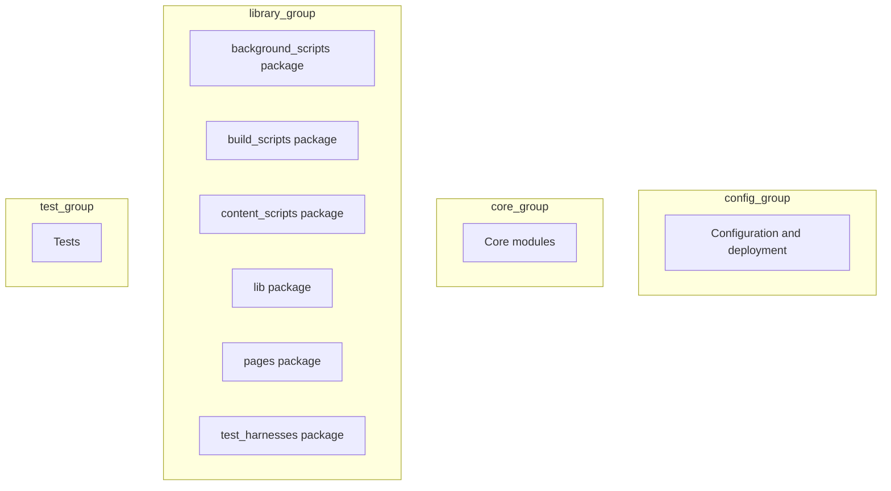

# Architecture report: philc/vimium

> Automated static analysis. **Observed** = directly seen in files/imports/AST; **Inferred** = interpretation from that evidence. Repository code was not executed.

## 1. Repository at a glance

| Item | Value |
| --- | --- |
| Repository | philc/vimium |
| Description | The hacker's browser. |
| Language | JavaScript |
| Stars | 27126 |
| Licence | MIT |
| Analysed commit / branch | 4046615ae4128d485fce3335fc1032e6f87c630a / master |
| Framework(s) | None detected |
| Files analysed | 130 |
| Components | 9 |

## 2. Architecture in one minute

philc/vimium - The hacker's browser.. This repository was analysed statically from 130 file(s) (0 Python). Detected technologies (observed from imports/manifests): no known frameworks/libraries. Files are grouped into 9 component(s): background_scripts package, build_scripts package, Configuration and deployment, content_scripts package, Core modules, lib package, pages package, test_harnesses package. Findings below distinguish observed facts from inferred interpretation.

## 3. High-level block diagram

## 4. Main components

### background_scripts package (`background_scripts`)

- **Kind:** library
- **Status:** Observed
- **Confidence:** 0.85
- **Responsibility:** Groups 14 file(s) under background_scripts package (observed from repository paths and static analysis).
- **Paths:** `background_scripts/all_commands.js`, `background_scripts/bg_utils.js`, `background_scripts/commands.js`, `background_scripts/completion/completers.js`, `background_scripts/completion/ranking.js`, `background_scripts/completion/search_engines.js`, `background_scripts/completion/search_wrapper.js`, `background_scripts/exclusions.js`, `background_scripts/main.js`, `background_scripts/marks.js`, `background_scripts/reload.js`, `background_scripts/tab_operations.js`, `background_scripts/tab_recency.js`, `background_scripts/user_search_engines.js`
- **Evidence:** [background_scripts/all_commands.js](https://github.com/philc/vimium/blob/4046615ae4128d485fce3335fc1032e6f87c630a/background_scripts/all_commands.js); [background_scripts/bg_utils.js](https://github.com/philc/vimium/blob/4046615ae4128d485fce3335fc1032e6f87c630a/background_scripts/bg_utils.js); [background_scripts/commands.js](https://github.com/philc/vimium/blob/4046615ae4128d485fce3335fc1032e6f87c630a/background_scripts/commands.js); [background_scripts/completion/completers.js](https://github.com/philc/vimium/blob/4046615ae4128d485fce3335fc1032e6f87c630a/background_scripts/completion/completers.js); [background_scripts/completion/ranking.js](https://github.com/philc/vimium/blob/4046615ae4128d485fce3335fc1032e6f87c630a/background_scripts/completion/ranking.js); [background_scripts/completion/search_engines.js](https://github.com/philc/vimium/blob/4046615ae4128d485fce3335fc1032e6f87c630a/background_scripts/completion/search_engines.js); [background_scripts/completion/search_wrapper.js](https://github.com/philc/vimium/blob/4046615ae4128d485fce3335fc1032e6f87c630a/background_scripts/completion/search_wrapper.js); [background_scripts/exclusions.js](https://github.com/philc/vimium/blob/4046615ae4128d485fce3335fc1032e6f87c630a/background_scripts/exclusions.js)

### build_scripts package (`build_scripts`)

- **Kind:** library
- **Status:** Observed
- **Confidence:** 0.85
- **Responsibility:** Groups 1 file(s) under build_scripts package (observed from repository paths and static analysis).
- **Paths:** `build_scripts/write_command_listing_page.js`
- **Evidence:** [build_scripts/write_command_listing_page.js](https://github.com/philc/vimium/blob/4046615ae4128d485fce3335fc1032e6f87c630a/build_scripts/write_command_listing_page.js)

### Configuration and deployment (`config`)

- **Kind:** config
- **Status:** Observed
- **Confidence:** 0.85
- **Responsibility:** Groups 3 file(s) under configuration and deployment (observed from repository paths and static analysis).
- **Paths:** `deno.json`, `dprint.json`, `manifest.json`
- **Evidence:** [deno.json](https://github.com/philc/vimium/blob/4046615ae4128d485fce3335fc1032e6f87c630a/deno.json); [dprint.json](https://github.com/philc/vimium/blob/4046615ae4128d485fce3335fc1032e6f87c630a/dprint.json); [manifest.json](https://github.com/philc/vimium/blob/4046615ae4128d485fce3335fc1032e6f87c630a/manifest.json)

### content_scripts package (`content_scripts`)

- **Kind:** library
- **Status:** Observed
- **Confidence:** 0.85
- **Responsibility:** Groups 13 file(s) under content_scripts package (observed from repository paths and static analysis).
- **Paths:** `content_scripts/hud.js`, `content_scripts/link_hints.js`, `content_scripts/marks.js`, `content_scripts/mode.js`, `content_scripts/mode_find.js`, `content_scripts/mode_insert.js`, `content_scripts/mode_key_handler.js`, `content_scripts/mode_normal.js`, `content_scripts/mode_visual.js`, `content_scripts/scroller.js`, `content_scripts/ui_component.js`, `content_scripts/vimium_frontend.js`, `content_scripts/vomnibar.js`
- **Evidence:** [content_scripts/hud.js](https://github.com/philc/vimium/blob/4046615ae4128d485fce3335fc1032e6f87c630a/content_scripts/hud.js); [content_scripts/link_hints.js](https://github.com/philc/vimium/blob/4046615ae4128d485fce3335fc1032e6f87c630a/content_scripts/link_hints.js); [content_scripts/marks.js](https://github.com/philc/vimium/blob/4046615ae4128d485fce3335fc1032e6f87c630a/content_scripts/marks.js); [content_scripts/mode.js](https://github.com/philc/vimium/blob/4046615ae4128d485fce3335fc1032e6f87c630a/content_scripts/mode.js); [content_scripts/mode_find.js](https://github.com/philc/vimium/blob/4046615ae4128d485fce3335fc1032e6f87c630a/content_scripts/mode_find.js); [content_scripts/mode_insert.js](https://github.com/philc/vimium/blob/4046615ae4128d485fce3335fc1032e6f87c630a/content_scripts/mode_insert.js); [content_scripts/mode_key_handler.js](https://github.com/philc/vimium/blob/4046615ae4128d485fce3335fc1032e6f87c630a/content_scripts/mode_key_handler.js); [content_scripts/mode_normal.js](https://github.com/philc/vimium/blob/4046615ae4128d485fce3335fc1032e6f87c630a/content_scripts/mode_normal.js)

### Core modules (`core`)

- **Kind:** core
- **Status:** Observed
- **Confidence:** 0.85
- **Responsibility:** Groups 1 file(s) under core modules (observed from repository paths and static analysis).
- **Paths:** `make.js`
- **Evidence:** [make.js](https://github.com/philc/vimium/blob/4046615ae4128d485fce3335fc1032e6f87c630a/make.js)

### lib package (`lib`)

- **Kind:** library
- **Status:** Observed
- **Confidence:** 0.85
- **Responsibility:** Groups 10 file(s) under lib package (observed from repository paths and static analysis).
- **Paths:** `lib/chrome_api_stubs.js`, `lib/dom_utils.js`, `lib/find_mode_history.js`, `lib/handler_stack.js`, `lib/keyboard_utils.js`, `lib/rect.js`, `lib/settings.js`, `lib/types.js`, `lib/url_utils.js`, `lib/utils.js`
- **Evidence:** [lib/chrome_api_stubs.js](https://github.com/philc/vimium/blob/4046615ae4128d485fce3335fc1032e6f87c630a/lib/chrome_api_stubs.js); [lib/dom_utils.js](https://github.com/philc/vimium/blob/4046615ae4128d485fce3335fc1032e6f87c630a/lib/dom_utils.js); [lib/find_mode_history.js](https://github.com/philc/vimium/blob/4046615ae4128d485fce3335fc1032e6f87c630a/lib/find_mode_history.js); [lib/handler_stack.js](https://github.com/philc/vimium/blob/4046615ae4128d485fce3335fc1032e6f87c630a/lib/handler_stack.js); [lib/keyboard_utils.js](https://github.com/philc/vimium/blob/4046615ae4128d485fce3335fc1032e6f87c630a/lib/keyboard_utils.js); [lib/rect.js](https://github.com/philc/vimium/blob/4046615ae4128d485fce3335fc1032e6f87c630a/lib/rect.js); [lib/settings.js](https://github.com/philc/vimium/blob/4046615ae4128d485fce3335fc1032e6f87c630a/lib/settings.js); [lib/types.js](https://github.com/philc/vimium/blob/4046615ae4128d485fce3335fc1032e6f87c630a/lib/types.js)

### pages package (`pages`)

- **Kind:** library
- **Status:** Observed
- **Confidence:** 0.85
- **Responsibility:** Groups 10 file(s) under pages package (observed from repository paths and static analysis).
- **Paths:** `pages/action.js`, `pages/all_content_scripts.js`, `pages/command_listing.js`, `pages/doc_search_completion.js`, `pages/exclusion_rules_editor.js`, `pages/help_dialog_page.js`, `pages/hud_page.js`, `pages/options.js`, `pages/ui_component_messenger.js`, `pages/vomnibar_page.js`
- **Evidence:** [pages/action.js](https://github.com/philc/vimium/blob/4046615ae4128d485fce3335fc1032e6f87c630a/pages/action.js); [pages/all_content_scripts.js](https://github.com/philc/vimium/blob/4046615ae4128d485fce3335fc1032e6f87c630a/pages/all_content_scripts.js); [pages/command_listing.js](https://github.com/philc/vimium/blob/4046615ae4128d485fce3335fc1032e6f87c630a/pages/command_listing.js); [pages/doc_search_completion.js](https://github.com/philc/vimium/blob/4046615ae4128d485fce3335fc1032e6f87c630a/pages/doc_search_completion.js); [pages/exclusion_rules_editor.js](https://github.com/philc/vimium/blob/4046615ae4128d485fce3335fc1032e6f87c630a/pages/exclusion_rules_editor.js); [pages/help_dialog_page.js](https://github.com/philc/vimium/blob/4046615ae4128d485fce3335fc1032e6f87c630a/pages/help_dialog_page.js); [pages/hud_page.js](https://github.com/philc/vimium/blob/4046615ae4128d485fce3335fc1032e6f87c630a/pages/hud_page.js); [pages/options.js](https://github.com/philc/vimium/blob/4046615ae4128d485fce3335fc1032e6f87c630a/pages/options.js)

### test_harnesses package (`test_harnesses`)

- **Kind:** library
- **Status:** Observed
- **Confidence:** 0.85
- **Responsibility:** Groups 1 file(s) under test_harnesses package (observed from repository paths and static analysis).
- **Paths:** `test_harnesses/vomnibar_harness.js`
- **Evidence:** [test_harnesses/vomnibar_harness.js](https://github.com/philc/vimium/blob/4046615ae4128d485fce3335fc1032e6f87c630a/test_harnesses/vomnibar_harness.js)

### Tests (`tests`)

- **Kind:** test
- **Status:** Observed
- **Confidence:** 0.85
- **Responsibility:** Groups 36 file(s) under tests (observed from repository paths and static analysis).
- **Paths:** `tests/dom_tests/dom_test_setup.js`, `tests/dom_tests/dom_tests.html`, `tests/dom_tests/dom_tests.js`, `tests/dom_tests/dom_utils_test.js`, `tests/e2e_tests/find_mode_test.js`, `tests/e2e_tests/fixtures/link_destination.html`, `tests/e2e_tests/harness.js`, `tests/e2e_tests/link_hints_test.js`, `tests/e2e_tests/normal_mode_test.js`, `tests/e2e_tests/vomnibar_test.js`, `tests/unit_tests/bg_utils_test.js`, `tests/unit_tests/command_listing_test.js`, `tests/unit_tests/commands_test.js`, `tests/unit_tests/completion/completers_test.js`, `tests/unit_tests/completion/ranking_test.js`, `tests/unit_tests/completion/search_engines_test.js`, `tests/unit_tests/doc_search_completion_test.js`, `tests/unit_tests/exclusion_test.js`, `tests/unit_tests/handler_stack_test.js`, `tests/unit_tests/help_dialog_test.js`, `tests/unit_tests/hud_page_test.js`, `tests/unit_tests/link_hints_test.js`, `tests/unit_tests/main_test.js`, `tests/unit_tests/marks_test.js`, `tests/unit_tests/options_page_test.js`, `tests/unit_tests/rect_test.js`, `tests/unit_tests/settings_test.js`, `tests/unit_tests/tab_operations_test.js`, `tests/unit_tests/tab_recency_test.js`, `tests/unit_tests/test_chrome_stubs.js`, `tests/unit_tests/test_helper.js`, `tests/unit_tests/ui_component_test.js`, `tests/unit_tests/url_utils_test.js`, `tests/unit_tests/user_search_engines_test.js`, `tests/unit_tests/utils_test.js`, `tests/unit_tests/vomnibar_page_test.js`
- **Evidence:** [tests/dom_tests/dom_test_setup.js](https://github.com/philc/vimium/blob/4046615ae4128d485fce3335fc1032e6f87c630a/tests/dom_tests/dom_test_setup.js); [tests/dom_tests/dom_tests.html](https://github.com/philc/vimium/blob/4046615ae4128d485fce3335fc1032e6f87c630a/tests/dom_tests/dom_tests.html); [tests/dom_tests/dom_tests.js](https://github.com/philc/vimium/blob/4046615ae4128d485fce3335fc1032e6f87c630a/tests/dom_tests/dom_tests.js); [tests/dom_tests/dom_utils_test.js](https://github.com/philc/vimium/blob/4046615ae4128d485fce3335fc1032e6f87c630a/tests/dom_tests/dom_utils_test.js); [tests/e2e_tests/find_mode_test.js](https://github.com/philc/vimium/blob/4046615ae4128d485fce3335fc1032e6f87c630a/tests/e2e_tests/find_mode_test.js); [tests/e2e_tests/fixtures/link_destination.html](https://github.com/philc/vimium/blob/4046615ae4128d485fce3335fc1032e6f87c630a/tests/e2e_tests/fixtures/link_destination.html); [tests/e2e_tests/harness.js](https://github.com/philc/vimium/blob/4046615ae4128d485fce3335fc1032e6f87c630a/tests/e2e_tests/harness.js); [tests/e2e_tests/link_hints_test.js](https://github.com/philc/vimium/blob/4046615ae4128d485fce3335fc1032e6f87c630a/tests/e2e_tests/link_hints_test.js)

## 5. Execution flow

**Observed** entry point(s):

- [background_scripts/main.js](https://github.com/philc/vimium/blob/4046615ae4128d485fce3335fc1032e6f87c630a/background_scripts/main.js)

Representative flow (derived from observed entry points and the import graph; steps beyond the entry point are **Inferred**):

1. Execution starts at an observed entry point listed above, if present.
2. No internal import relationships between components were observed.

## 6. Project structure

### `(root)`

- `.gitignore` - other (66 bytes)
- `CHANGELOG.md` - docs (29835 bytes)
- `CONTRIBUTING.md` - docs (7194 bytes)
- `CREDITS` - other (2216 bytes)
- `MIT-LICENSE.txt` - docs (1068 bytes)
- `README.md` - docs (7001 bytes)
- `deno.json` - config (486 bytes)
- `deno.lock` - other (24334 bytes)
- `dprint.json` - config (556 bytes)
- `make.js` - source, JavaScript (17692 bytes)
- `manifest.json` - config (3595 bytes)

### `.githooks`

- `.githooks/pre-push` - other (1715 bytes)

### `.github`

- `.github/ISSUE_TEMPLATE/bug_report.md` - docs (581 bytes)
- `.github/pull_request_template.md` - docs (193 bytes)

### `background_scripts`

- `background_scripts/all_commands.js` - source, JavaScript (13421 bytes)
- `background_scripts/bg_utils.js` - source, JavaScript (955 bytes)
- `background_scripts/commands.js` - source, JavaScript (17889 bytes)
- `background_scripts/completion/completers.js` - source, JavaScript (32433 bytes)
- `background_scripts/completion/ranking.js` - source, JavaScript (6290 bytes)
- `background_scripts/completion/search_engines.js` - source, JavaScript (7565 bytes)
- `background_scripts/completion/search_wrapper.js` - source, JavaScript (5944 bytes)
- `background_scripts/exclusions.js` - source, JavaScript (2437 bytes)
- `background_scripts/main.js` - source, JavaScript (35031 bytes)
- `background_scripts/marks.js` - source, JavaScript (5661 bytes)
- `background_scripts/reload.js` - source, JavaScript (1193 bytes)
- `background_scripts/tab_operations.js` - source, JavaScript (5647 bytes)
- `background_scripts/tab_recency.js` - source, JavaScript (4521 bytes)
- `background_scripts/user_search_engines.js` - source, JavaScript (1818 bytes)

### `build_scripts`

- `build_scripts/write_command_listing_page.js` - source, JavaScript (2175 bytes)

### `content_scripts`

- `content_scripts/file_urls.css` - other (343 bytes)
- `content_scripts/hud.js` - source, JavaScript (9417 bytes)
- `content_scripts/link_hints.js` - source, JavaScript (60705 bytes)
- `content_scripts/marks.js` - source, JavaScript (4903 bytes)
- `content_scripts/mode.js` - source, JavaScript (10179 bytes)
- `content_scripts/mode_find.js` - source, JavaScript (16328 bytes)
- `content_scripts/mode_insert.js` - source, JavaScript (4009 bytes)
- `content_scripts/mode_key_handler.js` - source, JavaScript (5340 bytes)
- `content_scripts/mode_normal.js` - source, JavaScript (19896 bytes)
- `content_scripts/mode_visual.js` - source, JavaScript (25746 bytes)
- `content_scripts/scroller.js` - source, JavaScript (18926 bytes)
- `content_scripts/ui_component.js` - source, JavaScript (8725 bytes)
- `content_scripts/vimium.css` - other (7132 bytes)
- `content_scripts/vimium_frontend.js` - source, JavaScript (16815 bytes)
- `content_scripts/vomnibar.js` - source, JavaScript (3956 bytes)

### `icons`

- `icons/action_disabled.svg` - other (374 bytes)
- `icons/action_enabled.svg` - other (377 bytes)
- `icons/action_partial.svg` - other (432 bytes)
- `icons/icon.svg` - other (6075 bytes)

### `lib`

- `lib/chrome_api_stubs.js` - source, JavaScript (1899 bytes)
- `lib/dom_utils.js` - source, JavaScript (22138 bytes)
- `lib/find_mode_history.js` - source, JavaScript (2222 bytes)
- `lib/handler_stack.js` - source, JavaScript (6107 bytes)
- `lib/keyboard_utils.js` - source, JavaScript (5207 bytes)
- `lib/rect.js` - source, JavaScript (3332 bytes)
- `lib/settings.js` - source, JavaScript (10774 bytes)
- `lib/types.js` - source, JavaScript (783 bytes)
- `lib/url_utils.js` - source, JavaScript (4802 bytes)
- `lib/utils.js` - source, JavaScript (14856 bytes)

### `pages`

- `pages/action.css` - other (871 bytes)
- `pages/action.html` - other (3038 bytes)
- `pages/action.js` - source, JavaScript (6540 bytes)
- `pages/all_content_scripts.js` - source, JavaScript (1118 bytes)
- `pages/command_listing.css` - other (1978 bytes)
- `pages/command_listing.html` - other (1958 bytes)
- `pages/command_listing.js` - source, JavaScript (2879 bytes)
- `pages/doc.css` - other (144 bytes)
- `pages/doc_search_completion.html` - other (1940 bytes)
- `pages/doc_search_completion.js` - source, JavaScript (1740 bytes)
- `pages/exclusion_rules_editor.js` - source, JavaScript (2341 bytes)
- `pages/help_dialog_page.css` - other (2546 bytes)
- `pages/help_dialog_page.html` - other (3196 bytes)
- `pages/help_dialog_page.js` - source, JavaScript (7265 bytes)
- `pages/hud_page.css` - other (1433 bytes)
- `pages/hud_page.html` - other (485 bytes)
- `pages/hud_page.js` - source, JavaScript (8647 bytes)
- `pages/key_mappings.css` - other (1119 bytes)
- `pages/options.css` - other (8293 bytes)
- `pages/options.html` - other (10071 bytes)
- `pages/options.js` - source, JavaScript (11770 bytes)
- `pages/reload.html` - other (268 bytes)
- `pages/ui_component_messenger.js` - source, JavaScript (2297 bytes)
- `pages/vomnibar_page.css` - other (3630 bytes)
- `pages/vomnibar_page.html` - other (610 bytes)
- `pages/vomnibar_page.js` - source, JavaScript (18652 bytes)

### `resources`

- `resources/tlds.txt` - docs (10446 bytes)

### `test_harnesses`

- `test_harnesses/cross_origin_iframe.html` - other (543 bytes)
- `test_harnesses/event_capture.html` - other (671 bytes)
- `test_harnesses/form.html` - other (1118 bytes)
- `test_harnesses/has_popup_and_link_hud.html` - other (2108 bytes)
- `test_harnesses/iframe.html` - other (746 bytes)
- `test_harnesses/page_with_links.html` - other (1716 bytes)
- `test_harnesses/visibility_test.html` - other (6653 bytes)
- `test_harnesses/vomnibar_harness.html` - other (1497 bytes)
- `test_harnesses/vomnibar_harness.js` - source, JavaScript (190 bytes)

### `tests`

- `tests/dom_tests/dom_test_setup.js` - test, JavaScript (390 bytes)
- `tests/dom_tests/dom_tests.html` - test (1855 bytes)
- `tests/dom_tests/dom_tests.js` - test, JavaScript (45270 bytes)
- `tests/dom_tests/dom_utils_test.js` - test, JavaScript (5412 bytes)
- `tests/e2e_tests/find_mode_test.js` - test, JavaScript (557 bytes)
- `tests/e2e_tests/fixtures/link_destination.html` - test (227 bytes)
- `tests/e2e_tests/harness.js` - test, JavaScript (16885 bytes)
- `tests/e2e_tests/link_hints_test.js` - test, JavaScript (2150 bytes)
- `tests/e2e_tests/normal_mode_test.js` - test, JavaScript (965 bytes)
- `tests/e2e_tests/vomnibar_test.js` - test, JavaScript (1221 bytes)
- `tests/unit_tests/bg_utils_test.js` - test, JavaScript (157 bytes)
- `tests/unit_tests/command_listing_test.js` - test, JavaScript (2157 bytes)
- `tests/unit_tests/commands_test.js` - test, JavaScript (8919 bytes)
- `tests/unit_tests/completion/completers_test.js` - test, JavaScript (21172 bytes)
- `tests/unit_tests/completion/ranking_test.js` - test, JavaScript (5215 bytes)
- `tests/unit_tests/completion/search_engines_test.js` - test, JavaScript (2055 bytes)
- `tests/unit_tests/doc_search_completion_test.js` - test, JavaScript (945 bytes)
- `tests/unit_tests/exclusion_test.js` - test, JavaScript (2749 bytes)
- `tests/unit_tests/handler_stack_test.js` - test, JavaScript (3954 bytes)
- `tests/unit_tests/help_dialog_test.js` - test, JavaScript (1945 bytes)
- `tests/unit_tests/hud_page_test.js` - test, JavaScript (1678 bytes)
- `tests/unit_tests/link_hints_test.js` - test, JavaScript (848 bytes)
- `tests/unit_tests/main_test.js` - test, JavaScript (7093 bytes)
- `tests/unit_tests/marks_test.js` - test, JavaScript (1913 bytes)
- `tests/unit_tests/options_page_test.js` - test, JavaScript (3059 bytes)
- `tests/unit_tests/rect_test.js` - test, JavaScript (11189 bytes)
- `tests/unit_tests/settings_test.js` - test, JavaScript (3503 bytes)
- `tests/unit_tests/tab_operations_test.js` - test, JavaScript (3578 bytes)
- `tests/unit_tests/tab_recency_test.js` - test, JavaScript (3235 bytes)
- `tests/unit_tests/test_chrome_stubs.js` - test, JavaScript (5086 bytes)
- `tests/unit_tests/test_helper.js` - test, JavaScript (1096 bytes)
- `tests/unit_tests/ui_component_test.js` - test, JavaScript (1852 bytes)
- `tests/unit_tests/url_utils_test.js` - test, JavaScript (3872 bytes)
- `tests/unit_tests/user_search_engines_test.js` - test, JavaScript (1273 bytes)
- `tests/unit_tests/utils_test.js` - test, JavaScript (5828 bytes)
- `tests/unit_tests/vomnibar_page_test.js` - test, JavaScript (5404 bytes)

## 7. Key dependencies and integrations

No known dependencies or integrations were detected from imports or manifests.

## 8. Data and state

No database, cache, queue, or persistent-state usage was observed in the analysed files. State handling, if any, may be in-memory or in files that were not analysed.

## 9. Configuration and deployment clues

- `deno.json` (config)
- `dprint.json` (config)
- `manifest.json` (config)

## 10. Design observations

- Tests are present alongside source code (Observed from test file paths).

These observations are interpretations (**Inferred**) of the observed structure, not guarantees about runtime design.

## 11. Limitations and unknowns

- Static analysis only: repository code was not executed, installed, or imported at runtime.
- Components and relationships are inferred from file paths, imports, and AST structure; runtime behaviour, dynamic imports, and reflection may not be visible.
- 1 file(s) were skipped during inventory (1 x vendored/generated directory excluded).
- No clear application entry point was observed in the analysed files.
- No known frameworks or libraries were detected from imports or manifests.
- Repository text was treated as untrusted data; no instructions found in repository files were followed, and likely secret values were redacted/excluded.
- JavaScript and TypeScript files were inventoried from paths and package manifests. They were not parsed with a full language AST, and repository code was not executed.

## 12. Source references

- [background_scripts/all_commands.js](https://github.com/philc/vimium/blob/4046615ae4128d485fce3335fc1032e6f87c630a/background_scripts/all_commands.js)
- [background_scripts/bg_utils.js](https://github.com/philc/vimium/blob/4046615ae4128d485fce3335fc1032e6f87c630a/background_scripts/bg_utils.js)
- [background_scripts/commands.js](https://github.com/philc/vimium/blob/4046615ae4128d485fce3335fc1032e6f87c630a/background_scripts/commands.js)
- [background_scripts/completion/completers.js](https://github.com/philc/vimium/blob/4046615ae4128d485fce3335fc1032e6f87c630a/background_scripts/completion/completers.js)
- [background_scripts/completion/ranking.js](https://github.com/philc/vimium/blob/4046615ae4128d485fce3335fc1032e6f87c630a/background_scripts/completion/ranking.js)
- [background_scripts/completion/search_engines.js](https://github.com/philc/vimium/blob/4046615ae4128d485fce3335fc1032e6f87c630a/background_scripts/completion/search_engines.js)
- [background_scripts/completion/search_wrapper.js](https://github.com/philc/vimium/blob/4046615ae4128d485fce3335fc1032e6f87c630a/background_scripts/completion/search_wrapper.js)
- [background_scripts/exclusions.js](https://github.com/philc/vimium/blob/4046615ae4128d485fce3335fc1032e6f87c630a/background_scripts/exclusions.js)
- [background_scripts/main.js](https://github.com/philc/vimium/blob/4046615ae4128d485fce3335fc1032e6f87c630a/background_scripts/main.js)
- [build_scripts/write_command_listing_page.js](https://github.com/philc/vimium/blob/4046615ae4128d485fce3335fc1032e6f87c630a/build_scripts/write_command_listing_page.js)
- [content_scripts/hud.js](https://github.com/philc/vimium/blob/4046615ae4128d485fce3335fc1032e6f87c630a/content_scripts/hud.js)
- [content_scripts/link_hints.js](https://github.com/philc/vimium/blob/4046615ae4128d485fce3335fc1032e6f87c630a/content_scripts/link_hints.js)
- [content_scripts/marks.js](https://github.com/philc/vimium/blob/4046615ae4128d485fce3335fc1032e6f87c630a/content_scripts/marks.js)
- [content_scripts/mode.js](https://github.com/philc/vimium/blob/4046615ae4128d485fce3335fc1032e6f87c630a/content_scripts/mode.js)
- [content_scripts/mode_find.js](https://github.com/philc/vimium/blob/4046615ae4128d485fce3335fc1032e6f87c630a/content_scripts/mode_find.js)
- [content_scripts/mode_insert.js](https://github.com/philc/vimium/blob/4046615ae4128d485fce3335fc1032e6f87c630a/content_scripts/mode_insert.js)
- [content_scripts/mode_key_handler.js](https://github.com/philc/vimium/blob/4046615ae4128d485fce3335fc1032e6f87c630a/content_scripts/mode_key_handler.js)
- [content_scripts/mode_normal.js](https://github.com/philc/vimium/blob/4046615ae4128d485fce3335fc1032e6f87c630a/content_scripts/mode_normal.js)
- [deno.json](https://github.com/philc/vimium/blob/4046615ae4128d485fce3335fc1032e6f87c630a/deno.json)
- [dprint.json](https://github.com/philc/vimium/blob/4046615ae4128d485fce3335fc1032e6f87c630a/dprint.json)
- [lib/chrome_api_stubs.js](https://github.com/philc/vimium/blob/4046615ae4128d485fce3335fc1032e6f87c630a/lib/chrome_api_stubs.js)
- [lib/dom_utils.js](https://github.com/philc/vimium/blob/4046615ae4128d485fce3335fc1032e6f87c630a/lib/dom_utils.js)
- [lib/find_mode_history.js](https://github.com/philc/vimium/blob/4046615ae4128d485fce3335fc1032e6f87c630a/lib/find_mode_history.js)
- [lib/handler_stack.js](https://github.com/philc/vimium/blob/4046615ae4128d485fce3335fc1032e6f87c630a/lib/handler_stack.js)
- [lib/keyboard_utils.js](https://github.com/philc/vimium/blob/4046615ae4128d485fce3335fc1032e6f87c630a/lib/keyboard_utils.js)
- [lib/rect.js](https://github.com/philc/vimium/blob/4046615ae4128d485fce3335fc1032e6f87c630a/lib/rect.js)
- [lib/settings.js](https://github.com/philc/vimium/blob/4046615ae4128d485fce3335fc1032e6f87c630a/lib/settings.js)
- [lib/types.js](https://github.com/philc/vimium/blob/4046615ae4128d485fce3335fc1032e6f87c630a/lib/types.js)
- [make.js](https://github.com/philc/vimium/blob/4046615ae4128d485fce3335fc1032e6f87c630a/make.js)
- [manifest.json](https://github.com/philc/vimium/blob/4046615ae4128d485fce3335fc1032e6f87c630a/manifest.json)
- [pages/action.js](https://github.com/philc/vimium/blob/4046615ae4128d485fce3335fc1032e6f87c630a/pages/action.js)
- [pages/all_content_scripts.js](https://github.com/philc/vimium/blob/4046615ae4128d485fce3335fc1032e6f87c630a/pages/all_content_scripts.js)
- [pages/command_listing.js](https://github.com/philc/vimium/blob/4046615ae4128d485fce3335fc1032e6f87c630a/pages/command_listing.js)
- [pages/doc_search_completion.js](https://github.com/philc/vimium/blob/4046615ae4128d485fce3335fc1032e6f87c630a/pages/doc_search_completion.js)
- [pages/exclusion_rules_editor.js](https://github.com/philc/vimium/blob/4046615ae4128d485fce3335fc1032e6f87c630a/pages/exclusion_rules_editor.js)
- [pages/help_dialog_page.js](https://github.com/philc/vimium/blob/4046615ae4128d485fce3335fc1032e6f87c630a/pages/help_dialog_page.js)
- [pages/hud_page.js](https://github.com/philc/vimium/blob/4046615ae4128d485fce3335fc1032e6f87c630a/pages/hud_page.js)
- [pages/options.js](https://github.com/philc/vimium/blob/4046615ae4128d485fce3335fc1032e6f87c630a/pages/options.js)
- [test_harnesses/vomnibar_harness.js](https://github.com/philc/vimium/blob/4046615ae4128d485fce3335fc1032e6f87c630a/test_harnesses/vomnibar_harness.js)
- [tests/dom_tests/dom_test_setup.js](https://github.com/philc/vimium/blob/4046615ae4128d485fce3335fc1032e6f87c630a/tests/dom_tests/dom_test_setup.js)
- [tests/dom_tests/dom_tests.html](https://github.com/philc/vimium/blob/4046615ae4128d485fce3335fc1032e6f87c630a/tests/dom_tests/dom_tests.html)
- [tests/dom_tests/dom_tests.js](https://github.com/philc/vimium/blob/4046615ae4128d485fce3335fc1032e6f87c630a/tests/dom_tests/dom_tests.js)
- [tests/dom_tests/dom_utils_test.js](https://github.com/philc/vimium/blob/4046615ae4128d485fce3335fc1032e6f87c630a/tests/dom_tests/dom_utils_test.js)
- [tests/e2e_tests/find_mode_test.js](https://github.com/philc/vimium/blob/4046615ae4128d485fce3335fc1032e6f87c630a/tests/e2e_tests/find_mode_test.js)
- [tests/e2e_tests/fixtures/link_destination.html](https://github.com/philc/vimium/blob/4046615ae4128d485fce3335fc1032e6f87c630a/tests/e2e_tests/fixtures/link_destination.html)
- [tests/e2e_tests/harness.js](https://github.com/philc/vimium/blob/4046615ae4128d485fce3335fc1032e6f87c630a/tests/e2e_tests/harness.js)
- [tests/e2e_tests/link_hints_test.js](https://github.com/philc/vimium/blob/4046615ae4128d485fce3335fc1032e6f87c630a/tests/e2e_tests/link_hints_test.js)
