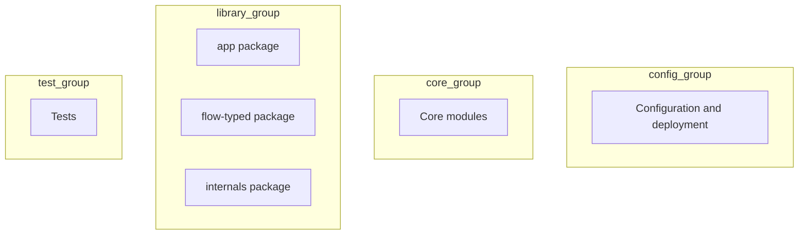

# Architecture report: phobal/ivideo

> Automated static analysis. **Observed** = directly seen in files/imports/AST; **Inferred** = interpretation from that evidence. Repository code was not executed.

## 1. Repository at a glance

| Item | Value |
| --- | --- |
| Repository | phobal/ivideo |
| Description | 一个可以观看国内主流视频平台所有视频的客户端（Mac、Windows、Linux） A client that can watch video of domestic(China) mainstream video platform |
| Language | JavaScript |
| Stars | 11816 |
| Licence | MIT |
| Analysed commit / branch | e9a26b66177a643f53bbadeb89da45dfee821abc / master |
| Framework(s) | Electron, Express, React |
| Files analysed | 66 |
| Components | 6 |

## 2. Architecture in one minute

phobal/ivideo - 一个可以观看国内主流视频平台所有视频的客户端（Mac、Windows、Linux） A client that can watch video of domestic(China) mainstream video platform. This repository was analysed statically from 66 file(s) (0 Python). Detected technologies (observed from imports/manifests): Electron, Express, React, axios, React Router, Redux. Files are grouped into 6 component(s): app package, Configuration and deployment, Core modules, flow-typed package, internals package, Tests. Findings below distinguish observed facts from inferred interpretation.

## 3. High-level block diagram

## 4. Main components

### app package (`app`)

- **Kind:** library
- **Status:** Observed
- **Confidence:** 0.85
- **Responsibility:** Groups 17 file(s) under app package (observed from repository paths and static analysis).
- **Paths:** `app/actions/source.js`, `app/containers/App.js`, `app/containers/Channel.js`, `app/containers/Frame.js`, `app/containers/Root.js`, `app/containers/ToolBar.js`, `app/containers/Video.js`, `app/index.js`, `app/main.dev.js`, `app/menu.js`, `app/reducers/index.js`, `app/reducers/source.js`, `app/routes.js`, `app/store/configureStore.dev.js`, `app/store/configureStore.js`, `app/store/configureStore.prod.js`, `app/utils/fetch.js`
- **Evidence:** [app/actions/source.js](https://github.com/phobal/ivideo/blob/e9a26b66177a643f53bbadeb89da45dfee821abc/app/actions/source.js); [app/containers/App.js](https://github.com/phobal/ivideo/blob/e9a26b66177a643f53bbadeb89da45dfee821abc/app/containers/App.js); [app/containers/Channel.js](https://github.com/phobal/ivideo/blob/e9a26b66177a643f53bbadeb89da45dfee821abc/app/containers/Channel.js); [app/containers/Frame.js](https://github.com/phobal/ivideo/blob/e9a26b66177a643f53bbadeb89da45dfee821abc/app/containers/Frame.js); [app/containers/Root.js](https://github.com/phobal/ivideo/blob/e9a26b66177a643f53bbadeb89da45dfee821abc/app/containers/Root.js); [app/containers/ToolBar.js](https://github.com/phobal/ivideo/blob/e9a26b66177a643f53bbadeb89da45dfee821abc/app/containers/ToolBar.js); [app/containers/Video.js](https://github.com/phobal/ivideo/blob/e9a26b66177a643f53bbadeb89da45dfee821abc/app/containers/Video.js); [app/index.js](https://github.com/phobal/ivideo/blob/e9a26b66177a643f53bbadeb89da45dfee821abc/app/index.js)

### Configuration and deployment (`config`)

- **Kind:** config
- **Status:** Observed
- **Confidence:** 0.85
- **Responsibility:** Groups 4 file(s) under configuration and deployment (observed from repository paths and static analysis).
- **Paths:** `app/package.json`, `appveyor.yml`, `package.json`, `resources/viplist.json`
- **Evidence:** [app/package.json](https://github.com/phobal/ivideo/blob/e9a26b66177a643f53bbadeb89da45dfee821abc/app/package.json); [appveyor.yml](https://github.com/phobal/ivideo/blob/e9a26b66177a643f53bbadeb89da45dfee821abc/appveyor.yml); [package.json](https://github.com/phobal/ivideo/blob/e9a26b66177a643f53bbadeb89da45dfee821abc/package.json); [resources/viplist.json](https://github.com/phobal/ivideo/blob/e9a26b66177a643f53bbadeb89da45dfee821abc/resources/viplist.json)

### Core modules (`core`)

- **Kind:** core
- **Status:** Observed
- **Confidence:** 0.85
- **Responsibility:** Groups 6 file(s) under core modules (observed from repository paths and static analysis).
- **Paths:** `webpack.config.base.js`, `webpack.config.eslint.js`, `webpack.config.main.prod.js`, `webpack.config.renderer.dev.dll.js`, `webpack.config.renderer.dev.js`, `webpack.config.renderer.prod.js`
- **Evidence:** [webpack.config.base.js](https://github.com/phobal/ivideo/blob/e9a26b66177a643f53bbadeb89da45dfee821abc/webpack.config.base.js); [webpack.config.eslint.js](https://github.com/phobal/ivideo/blob/e9a26b66177a643f53bbadeb89da45dfee821abc/webpack.config.eslint.js); [webpack.config.main.prod.js](https://github.com/phobal/ivideo/blob/e9a26b66177a643f53bbadeb89da45dfee821abc/webpack.config.main.prod.js); [webpack.config.renderer.dev.dll.js](https://github.com/phobal/ivideo/blob/e9a26b66177a643f53bbadeb89da45dfee821abc/webpack.config.renderer.dev.dll.js); [webpack.config.renderer.dev.js](https://github.com/phobal/ivideo/blob/e9a26b66177a643f53bbadeb89da45dfee821abc/webpack.config.renderer.dev.js); [webpack.config.renderer.prod.js](https://github.com/phobal/ivideo/blob/e9a26b66177a643f53bbadeb89da45dfee821abc/webpack.config.renderer.prod.js)

### flow-typed package (`flow_typed`)

- **Kind:** library
- **Status:** Observed
- **Confidence:** 0.85
- **Responsibility:** Groups 1 file(s) under flow-typed package (observed from repository paths and static analysis).
- **Paths:** `flow-typed/module_vx.x.x.js`
- **Evidence:** [flow-typed/module_vx.x.x.js](https://github.com/phobal/ivideo/blob/e9a26b66177a643f53bbadeb89da45dfee821abc/flow-typed/module_vx.x.x.js)

### internals package (`internals`)

- **Kind:** library
- **Status:** Observed
- **Confidence:** 0.85
- **Responsibility:** Groups 7 file(s) under internals package (observed from repository paths and static analysis).
- **Paths:** `internals/mocks/fileMock.js`, `internals/scripts/CheckBuiltsExist.js`, `internals/scripts/CheckNativeDep.js`, `internals/scripts/CheckNodeEnv.js`, `internals/scripts/CheckPortInUse.js`, `internals/scripts/ElectronRebuild.js`, `internals/scripts/RunTests.js`
- **Evidence:** [internals/mocks/fileMock.js](https://github.com/phobal/ivideo/blob/e9a26b66177a643f53bbadeb89da45dfee821abc/internals/mocks/fileMock.js); [internals/scripts/CheckBuiltsExist.js](https://github.com/phobal/ivideo/blob/e9a26b66177a643f53bbadeb89da45dfee821abc/internals/scripts/CheckBuiltsExist.js); [internals/scripts/CheckNativeDep.js](https://github.com/phobal/ivideo/blob/e9a26b66177a643f53bbadeb89da45dfee821abc/internals/scripts/CheckNativeDep.js); [internals/scripts/CheckNodeEnv.js](https://github.com/phobal/ivideo/blob/e9a26b66177a643f53bbadeb89da45dfee821abc/internals/scripts/CheckNodeEnv.js); [internals/scripts/CheckPortInUse.js](https://github.com/phobal/ivideo/blob/e9a26b66177a643f53bbadeb89da45dfee821abc/internals/scripts/CheckPortInUse.js); [internals/scripts/ElectronRebuild.js](https://github.com/phobal/ivideo/blob/e9a26b66177a643f53bbadeb89da45dfee821abc/internals/scripts/ElectronRebuild.js); [internals/scripts/RunTests.js](https://github.com/phobal/ivideo/blob/e9a26b66177a643f53bbadeb89da45dfee821abc/internals/scripts/RunTests.js)

### Tests (`tests`)

- **Kind:** test
- **Status:** Observed
- **Confidence:** 0.85
- **Responsibility:** Groups 10 file(s) under tests (observed from repository paths and static analysis).
- **Paths:** `test/.eslintrc`, `test/actions/__snapshots__/counter.spec.js.snap`, `test/actions/counter.spec.js`, `test/components/Counter.spec.js`, `test/components/__snapshots__/Counter.spec.js.snap`, `test/containers/CounterPage.spec.js`, `test/e2e/e2e.spec.js`, `test/example.js`, `test/reducers/__snapshots__/counter.spec.js.snap`, `test/reducers/counter.spec.js`
- **Evidence:** [test/.eslintrc](https://github.com/phobal/ivideo/blob/e9a26b66177a643f53bbadeb89da45dfee821abc/test/.eslintrc); [test/actions/__snapshots__/counter.spec.js.snap](https://github.com/phobal/ivideo/blob/e9a26b66177a643f53bbadeb89da45dfee821abc/test/actions/__snapshots__/counter.spec.js.snap); [test/actions/counter.spec.js](https://github.com/phobal/ivideo/blob/e9a26b66177a643f53bbadeb89da45dfee821abc/test/actions/counter.spec.js); [test/components/Counter.spec.js](https://github.com/phobal/ivideo/blob/e9a26b66177a643f53bbadeb89da45dfee821abc/test/components/Counter.spec.js); [test/components/__snapshots__/Counter.spec.js.snap](https://github.com/phobal/ivideo/blob/e9a26b66177a643f53bbadeb89da45dfee821abc/test/components/__snapshots__/Counter.spec.js.snap); [test/containers/CounterPage.spec.js](https://github.com/phobal/ivideo/blob/e9a26b66177a643f53bbadeb89da45dfee821abc/test/containers/CounterPage.spec.js); [test/e2e/e2e.spec.js](https://github.com/phobal/ivideo/blob/e9a26b66177a643f53bbadeb89da45dfee821abc/test/e2e/e2e.spec.js); [test/example.js](https://github.com/phobal/ivideo/blob/e9a26b66177a643f53bbadeb89da45dfee821abc/test/example.js)

## 5. Execution flow

**Observed** entry point(s):

- [app/containers/App.js](https://github.com/phobal/ivideo/blob/e9a26b66177a643f53bbadeb89da45dfee821abc/app/containers/App.js)
- [app/index.js](https://github.com/phobal/ivideo/blob/e9a26b66177a643f53bbadeb89da45dfee821abc/app/index.js)
- [app/reducers/index.js](https://github.com/phobal/ivideo/blob/e9a26b66177a643f53bbadeb89da45dfee821abc/app/reducers/index.js)

Representative flow (derived from observed entry points and the import graph; steps beyond the entry point are **Inferred**):

1. Execution starts at an observed entry point listed above, if present.
2. No internal import relationships between components were observed.

## 6. Project structure

### `(root)`

- `.babelrc` - other (597 bytes)
- `.dockerignore` - container (842 bytes)
- `.editorconfig` - config (188 bytes)
- `.eslintignore` - other (843 bytes)
- `.eslintrc` - other (1248 bytes)
- `.flowconfig` - other (933 bytes)
- `.gitattributes` - other (81 bytes)
- `.gitignore` - other (829 bytes)
- `.stylelintrc` - other (45 bytes)
- `.travis.yml` - ci, YAML (709 bytes)
- `CHANGELOG.md` - docs (159 bytes)
- `LICENSE` - docs (1085 bytes)
- `README.md` - docs (1919 bytes)
- `appveyor.yml` - config (490 bytes)
- `package.json` - manifest (7618 bytes)
- `webpack.config.base.js` - source, JavaScript (961 bytes)
- `webpack.config.eslint.js` - source, JavaScript (87 bytes)
- `webpack.config.main.prod.js` - source, JavaScript (1532 bytes)
- `webpack.config.renderer.dev.dll.js` - source, JavaScript (5040 bytes)
- `webpack.config.renderer.dev.js` - source, JavaScript (6835 bytes)
- `webpack.config.renderer.prod.js` - source, JavaScript (4413 bytes)

### `.vscode`

- `.vscode/settings.json` - config (438 bytes)

### `app`

- `app/.eslintrc` - other (880 bytes)
- `app/actions/source.js` - source, JavaScript (248 bytes)
- `app/app.global.css` - other (967 bytes)
- `app/app.html` - other (1579 bytes)
- `app/components/.githook` - other (0 bytes)
- `app/containers/App.js` - source, JavaScript (253 bytes)
- `app/containers/Channel.js` - source, JavaScript (301 bytes)
- `app/containers/Frame.js` - source, JavaScript (1117 bytes)
- `app/containers/Root.js` - source, JavaScript (479 bytes)
- `app/containers/ToolBar.js` - source, JavaScript (1204 bytes)
- `app/containers/Video.js` - source, JavaScript (3280 bytes)
- `app/index.js` - source, JavaScript (722 bytes)
- `app/main.dev.js` - source, JavaScript (2906 bytes)
- `app/menu.js` - source, JavaScript (5781 bytes)
- `app/package.json` - manifest (605 bytes)
- `app/reducers/index.js` - source, JavaScript (235 bytes)
- `app/reducers/source.js` - source, JavaScript (176 bytes)
- `app/routes.js` - source, JavaScript (307 bytes)
- `app/store/configureStore.dev.js` - source, JavaScript (1853 bytes)
- `app/store/configureStore.js` - source, JavaScript (246 bytes)
- `app/store/configureStore.prod.js` - source, JavaScript (597 bytes)
- `app/utils/.gitkeep` - other (0 bytes)
- `app/utils/fetch.js` - source, JavaScript (461 bytes)

### `flow-typed`

- `flow-typed/module_vx.x.x.js` - source, JavaScript (59 bytes)

### `internals`

- `internals/flow/CSSModule.js.flow` - other (58 bytes)
- `internals/flow/WebpackAsset.js.flow` - other (39 bytes)
- `internals/mocks/fileMock.js` - source, JavaScript (33 bytes)
- `internals/scripts/CheckBuiltsExist.js` - source, JavaScript (706 bytes)
- `internals/scripts/CheckNativeDep.js` - source, JavaScript (1976 bytes)
- `internals/scripts/CheckNodeEnv.js` - source, JavaScript (368 bytes)
- `internals/scripts/CheckPortInUse.js` - source, JavaScript (469 bytes)
- `internals/scripts/ElectronRebuild.js` - source, JavaScript (641 bytes)
- `internals/scripts/RunTests.js` - source, JavaScript (342 bytes)

### `resources`

- `resources/viplist.json` - config (2165 bytes)

### `test`

- `test/.eslintrc` - test (208 bytes)
- `test/actions/__snapshots__/counter.spec.js.snap` - test (281 bytes)
- `test/actions/counter.spec.js` - test, JavaScript (1341 bytes)
- `test/components/Counter.spec.js` - test, JavaScript (1950 bytes)
- `test/components/__snapshots__/Counter.spec.js.snap` - test (1115 bytes)
- `test/containers/CounterPage.spec.js` - test, JavaScript (1821 bytes)
- `test/e2e/e2e.spec.js` - test, JavaScript (3318 bytes)
- `test/example.js` - test, JavaScript (109 bytes)
- `test/reducers/__snapshots__/counter.spec.js.snap` - test (321 bytes)
- `test/reducers/counter.spec.js` - test, JavaScript (702 bytes)

## 7. Key dependencies and integrations

| Name | Category | Status | Confidence | Evidence |
| --- | --- | --- | --- | --- |
| Electron | framework | Observed | 0.85 | [package.json:12](https://github.com/phobal/ivideo/blob/e9a26b66177a643f53bbadeb89da45dfee821abc/package.json#L12) |
| Express | framework | Observed | 0.85 | [package.json:132](https://github.com/phobal/ivideo/blob/e9a26b66177a643f53bbadeb89da45dfee821abc/package.json#L132) |
| React | framework | Observed | 0.90 | [package.json:98](https://github.com/phobal/ivideo/blob/e9a26b66177a643f53bbadeb89da45dfee821abc/package.json#L98); [package.json:207](https://github.com/phobal/ivideo/blob/e9a26b66177a643f53bbadeb89da45dfee821abc/package.json#L207) |
| axios | library | Observed | 0.85 | [package.json:199](https://github.com/phobal/ivideo/blob/e9a26b66177a643f53bbadeb89da45dfee821abc/package.json#L199) |
| React Router | library | Observed | 0.90 | [package.json:210](https://github.com/phobal/ivideo/blob/e9a26b66177a643f53bbadeb89da45dfee821abc/package.json#L210); [package.json:211](https://github.com/phobal/ivideo/blob/e9a26b66177a643f53bbadeb89da45dfee821abc/package.json#L211) |
| Redux | library | Observed | 0.85 | [package.json:99](https://github.com/phobal/ivideo/blob/e9a26b66177a643f53bbadeb89da45dfee821abc/package.json#L99) |
| Jest | tooling | Observed | 0.85 | [package.json:107](https://github.com/phobal/ivideo/blob/e9a26b66177a643f53bbadeb89da45dfee821abc/package.json#L107) |
| webpack | tooling | Observed | 0.85 | [package.json:8](https://github.com/phobal/ivideo/blob/e9a26b66177a643f53bbadeb89da45dfee821abc/package.json#L8) |

## 8. Data and state

No database, cache, queue, or persistent-state usage was observed in the analysed files. State handling, if any, may be in-memory or in files that were not analysed.

## 9. Configuration and deployment clues

- `.dockerignore` (container)
- `.editorconfig` (config)
- `.travis.yml` (ci)
- `.vscode/settings.json` (config)
- `app/package.json` (manifest)
- `appveyor.yml` (config)
- `package.json` (manifest)
- `resources/viplist.json` (config)

## 10. Design observations

- Tests are present alongside source code (Observed from test file paths).

These observations are interpretations (**Inferred**) of the observed structure, not guarantees about runtime design.

## 11. Limitations and unknowns

- Static analysis only: repository code was not executed, installed, or imported at runtime.
- Components and relationships are inferred from file paths, imports, and AST structure; runtime behaviour, dynamic imports, and reflection may not be visible.
- 2 file(s) were skipped during inventory (2 x lockfile excluded).
- No clear application entry point was observed in the analysed files.
- Repository text was treated as untrusted data; no instructions found in repository files were followed, and likely secret values were redacted/excluded.
- JavaScript and TypeScript files were inventoried from paths and package manifests. They were not parsed with a full language AST, and repository code was not executed.
- The GitHub repository was marked archived at selection time.

## 12. Source references

- [app/actions/source.js](https://github.com/phobal/ivideo/blob/e9a26b66177a643f53bbadeb89da45dfee821abc/app/actions/source.js)
- [app/containers/App.js](https://github.com/phobal/ivideo/blob/e9a26b66177a643f53bbadeb89da45dfee821abc/app/containers/App.js)
- [app/containers/Channel.js](https://github.com/phobal/ivideo/blob/e9a26b66177a643f53bbadeb89da45dfee821abc/app/containers/Channel.js)
- [app/containers/Frame.js](https://github.com/phobal/ivideo/blob/e9a26b66177a643f53bbadeb89da45dfee821abc/app/containers/Frame.js)
- [app/containers/Root.js](https://github.com/phobal/ivideo/blob/e9a26b66177a643f53bbadeb89da45dfee821abc/app/containers/Root.js)
- [app/containers/ToolBar.js](https://github.com/phobal/ivideo/blob/e9a26b66177a643f53bbadeb89da45dfee821abc/app/containers/ToolBar.js)
- [app/containers/Video.js](https://github.com/phobal/ivideo/blob/e9a26b66177a643f53bbadeb89da45dfee821abc/app/containers/Video.js)
- [app/index.js](https://github.com/phobal/ivideo/blob/e9a26b66177a643f53bbadeb89da45dfee821abc/app/index.js)
- [app/package.json](https://github.com/phobal/ivideo/blob/e9a26b66177a643f53bbadeb89da45dfee821abc/app/package.json)
- [app/reducers/index.js](https://github.com/phobal/ivideo/blob/e9a26b66177a643f53bbadeb89da45dfee821abc/app/reducers/index.js)
- [appveyor.yml](https://github.com/phobal/ivideo/blob/e9a26b66177a643f53bbadeb89da45dfee821abc/appveyor.yml)
- [flow-typed/module_vx.x.x.js](https://github.com/phobal/ivideo/blob/e9a26b66177a643f53bbadeb89da45dfee821abc/flow-typed/module_vx.x.x.js)
- [internals/mocks/fileMock.js](https://github.com/phobal/ivideo/blob/e9a26b66177a643f53bbadeb89da45dfee821abc/internals/mocks/fileMock.js)
- [internals/scripts/CheckBuiltsExist.js](https://github.com/phobal/ivideo/blob/e9a26b66177a643f53bbadeb89da45dfee821abc/internals/scripts/CheckBuiltsExist.js)
- [internals/scripts/CheckNativeDep.js](https://github.com/phobal/ivideo/blob/e9a26b66177a643f53bbadeb89da45dfee821abc/internals/scripts/CheckNativeDep.js)
- [internals/scripts/CheckNodeEnv.js](https://github.com/phobal/ivideo/blob/e9a26b66177a643f53bbadeb89da45dfee821abc/internals/scripts/CheckNodeEnv.js)
- [internals/scripts/CheckPortInUse.js](https://github.com/phobal/ivideo/blob/e9a26b66177a643f53bbadeb89da45dfee821abc/internals/scripts/CheckPortInUse.js)
- [internals/scripts/ElectronRebuild.js](https://github.com/phobal/ivideo/blob/e9a26b66177a643f53bbadeb89da45dfee821abc/internals/scripts/ElectronRebuild.js)
- [internals/scripts/RunTests.js](https://github.com/phobal/ivideo/blob/e9a26b66177a643f53bbadeb89da45dfee821abc/internals/scripts/RunTests.js)
- [package.json](https://github.com/phobal/ivideo/blob/e9a26b66177a643f53bbadeb89da45dfee821abc/package.json)
- [package.json:8](https://github.com/phobal/ivideo/blob/e9a26b66177a643f53bbadeb89da45dfee821abc/package.json#L8)
- [package.json:12](https://github.com/phobal/ivideo/blob/e9a26b66177a643f53bbadeb89da45dfee821abc/package.json#L12)
- [package.json:98](https://github.com/phobal/ivideo/blob/e9a26b66177a643f53bbadeb89da45dfee821abc/package.json#L98)
- [package.json:99](https://github.com/phobal/ivideo/blob/e9a26b66177a643f53bbadeb89da45dfee821abc/package.json#L99)
- [package.json:107](https://github.com/phobal/ivideo/blob/e9a26b66177a643f53bbadeb89da45dfee821abc/package.json#L107)
- [package.json:132](https://github.com/phobal/ivideo/blob/e9a26b66177a643f53bbadeb89da45dfee821abc/package.json#L132)
- [package.json:199](https://github.com/phobal/ivideo/blob/e9a26b66177a643f53bbadeb89da45dfee821abc/package.json#L199)
- [package.json:207](https://github.com/phobal/ivideo/blob/e9a26b66177a643f53bbadeb89da45dfee821abc/package.json#L207)
- [package.json:210](https://github.com/phobal/ivideo/blob/e9a26b66177a643f53bbadeb89da45dfee821abc/package.json#L210)
- [package.json:211](https://github.com/phobal/ivideo/blob/e9a26b66177a643f53bbadeb89da45dfee821abc/package.json#L211)
- [resources/viplist.json](https://github.com/phobal/ivideo/blob/e9a26b66177a643f53bbadeb89da45dfee821abc/resources/viplist.json)
- [test/.eslintrc](https://github.com/phobal/ivideo/blob/e9a26b66177a643f53bbadeb89da45dfee821abc/test/.eslintrc)
- [test/actions/__snapshots__/counter.spec.js.snap](https://github.com/phobal/ivideo/blob/e9a26b66177a643f53bbadeb89da45dfee821abc/test/actions/__snapshots__/counter.spec.js.snap)
- [test/actions/counter.spec.js](https://github.com/phobal/ivideo/blob/e9a26b66177a643f53bbadeb89da45dfee821abc/test/actions/counter.spec.js)
- [test/components/Counter.spec.js](https://github.com/phobal/ivideo/blob/e9a26b66177a643f53bbadeb89da45dfee821abc/test/components/Counter.spec.js)
- [test/components/__snapshots__/Counter.spec.js.snap](https://github.com/phobal/ivideo/blob/e9a26b66177a643f53bbadeb89da45dfee821abc/test/components/__snapshots__/Counter.spec.js.snap)
- [test/containers/CounterPage.spec.js](https://github.com/phobal/ivideo/blob/e9a26b66177a643f53bbadeb89da45dfee821abc/test/containers/CounterPage.spec.js)
- [test/e2e/e2e.spec.js](https://github.com/phobal/ivideo/blob/e9a26b66177a643f53bbadeb89da45dfee821abc/test/e2e/e2e.spec.js)
- [test/example.js](https://github.com/phobal/ivideo/blob/e9a26b66177a643f53bbadeb89da45dfee821abc/test/example.js)
- [webpack.config.base.js](https://github.com/phobal/ivideo/blob/e9a26b66177a643f53bbadeb89da45dfee821abc/webpack.config.base.js)
- [webpack.config.eslint.js](https://github.com/phobal/ivideo/blob/e9a26b66177a643f53bbadeb89da45dfee821abc/webpack.config.eslint.js)
- [webpack.config.main.prod.js](https://github.com/phobal/ivideo/blob/e9a26b66177a643f53bbadeb89da45dfee821abc/webpack.config.main.prod.js)
- [webpack.config.renderer.dev.dll.js](https://github.com/phobal/ivideo/blob/e9a26b66177a643f53bbadeb89da45dfee821abc/webpack.config.renderer.dev.dll.js)
- [webpack.config.renderer.dev.js](https://github.com/phobal/ivideo/blob/e9a26b66177a643f53bbadeb89da45dfee821abc/webpack.config.renderer.dev.js)
- [webpack.config.renderer.prod.js](https://github.com/phobal/ivideo/blob/e9a26b66177a643f53bbadeb89da45dfee821abc/webpack.config.renderer.prod.js)
