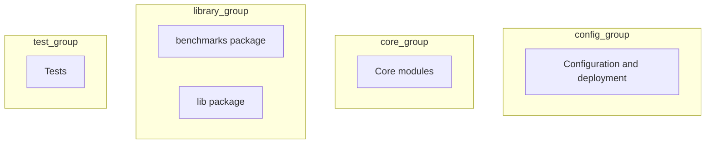

# Architecture report: pinojs/pino

> Automated static analysis. **Observed** = directly seen in files/imports/AST; **Inferred** = interpretation from that evidence. Repository code was not executed.

## 1. Repository at a glance

| Item | Value |
| --- | --- |
| Repository | pinojs/pino |
| Description | 🌲 super fast, all natural json logger |
| Language | JavaScript |
| Stars | 18301 |
| Licence | MIT |
| Analysed commit / branch | 8d6927c29777882516339d9ccd509869ca3f295e / main |
| Framework(s) | None detected |
| Files analysed | 194 |
| Components | 5 |

## 2. Architecture in one minute

pinojs/pino - 🌲 super fast, all natural json logger. This repository was analysed statically from 194 file(s) (0 Python). Detected technologies (observed from imports/manifests): GitHub Actions, Jest, TypeScript. Files are grouped into 5 component(s): benchmarks package, Configuration and deployment, Core modules, lib package, Tests. Findings below distinguish observed facts from inferred interpretation.

## 3. High-level block diagram

## 4. Main components

### benchmarks package (`benchmarks`)

- **Kind:** library
- **Status:** Observed
- **Confidence:** 0.85
- **Responsibility:** Groups 18 file(s) under benchmarks package (observed from repository paths and static analysis).
- **Paths:** `benchmarks/basic.bench.js`, `benchmarks/child-child.bench.js`, `benchmarks/child-creation.bench.js`, `benchmarks/child.bench.js`, `benchmarks/deep-object.bench.js`, `benchmarks/formatters.bench.js`, `benchmarks/internal/custom-levels.js`, `benchmarks/internal/just-pino-heavy.bench.js`, `benchmarks/internal/just-pino.bench.js`, `benchmarks/internal/parent-vs-child.bench.js`, `benchmarks/internal/redact.bench.js`, `benchmarks/long-string.bench.js`, `benchmarks/multi-arg.bench.js`, `benchmarks/multistream.js`, `benchmarks/object.bench.js`, `benchmarks/utils/generate-benchmark-doc.js`, `benchmarks/utils/runbench.js`, `benchmarks/utils/wrap-log-level.js`
- **Evidence:** [benchmarks/basic.bench.js](https://github.com/pinojs/pino/blob/8d6927c29777882516339d9ccd509869ca3f295e/benchmarks/basic.bench.js); [benchmarks/child-child.bench.js](https://github.com/pinojs/pino/blob/8d6927c29777882516339d9ccd509869ca3f295e/benchmarks/child-child.bench.js); [benchmarks/child-creation.bench.js](https://github.com/pinojs/pino/blob/8d6927c29777882516339d9ccd509869ca3f295e/benchmarks/child-creation.bench.js); [benchmarks/child.bench.js](https://github.com/pinojs/pino/blob/8d6927c29777882516339d9ccd509869ca3f295e/benchmarks/child.bench.js); [benchmarks/deep-object.bench.js](https://github.com/pinojs/pino/blob/8d6927c29777882516339d9ccd509869ca3f295e/benchmarks/deep-object.bench.js); [benchmarks/formatters.bench.js](https://github.com/pinojs/pino/blob/8d6927c29777882516339d9ccd509869ca3f295e/benchmarks/formatters.bench.js); [benchmarks/internal/custom-levels.js](https://github.com/pinojs/pino/blob/8d6927c29777882516339d9ccd509869ca3f295e/benchmarks/internal/custom-levels.js); [benchmarks/internal/just-pino-heavy.bench.js](https://github.com/pinojs/pino/blob/8d6927c29777882516339d9ccd509869ca3f295e/benchmarks/internal/just-pino-heavy.bench.js)

### Configuration and deployment (`config`)

- **Kind:** config
- **Status:** Observed
- **Confidence:** 0.85
- **Responsibility:** Groups 2 file(s) under configuration and deployment (observed from repository paths and static analysis).
- **Paths:** `package.json`, `tsconfig.json`
- **Evidence:** [package.json](https://github.com/pinojs/pino/blob/8d6927c29777882516339d9ccd509869ca3f295e/package.json); [tsconfig.json](https://github.com/pinojs/pino/blob/8d6927c29777882516339d9ccd509869ca3f295e/tsconfig.json)

### Core modules (`core`)

- **Kind:** core
- **Status:** Observed
- **Confidence:** 0.85
- **Responsibility:** Groups 7 file(s) under core modules (observed from repository paths and static analysis).
- **Paths:** `bin.js`, `browser.js`, `eslint.config.js`, `file.js`, `inc-version.sh`, `pino.d.ts`, `pino.js`
- **Evidence:** [bin.js](https://github.com/pinojs/pino/blob/8d6927c29777882516339d9ccd509869ca3f295e/bin.js); [browser.js](https://github.com/pinojs/pino/blob/8d6927c29777882516339d9ccd509869ca3f295e/browser.js); [eslint.config.js](https://github.com/pinojs/pino/blob/8d6927c29777882516339d9ccd509869ca3f295e/eslint.config.js); [file.js](https://github.com/pinojs/pino/blob/8d6927c29777882516339d9ccd509869ca3f295e/file.js); [inc-version.sh](https://github.com/pinojs/pino/blob/8d6927c29777882516339d9ccd509869ca3f295e/inc-version.sh); [pino.d.ts](https://github.com/pinojs/pino/blob/8d6927c29777882516339d9ccd509869ca3f295e/pino.d.ts); [pino.js](https://github.com/pinojs/pino/blob/8d6927c29777882516339d9ccd509869ca3f295e/pino.js)

### lib package (`lib`)

- **Kind:** library
- **Status:** Observed
- **Confidence:** 0.85
- **Responsibility:** Groups 14 file(s) under lib package (observed from repository paths and static analysis).
- **Paths:** `lib/caller.js`, `lib/constants.js`, `lib/deprecations.js`, `lib/levels.js`, `lib/meta.js`, `lib/multistream.js`, `lib/proto.js`, `lib/redaction.js`, `lib/symbols.js`, `lib/time.js`, `lib/tools.js`, `lib/transport-stream.js`, `lib/transport.js`, `lib/worker.js`
- **Evidence:** [lib/caller.js](https://github.com/pinojs/pino/blob/8d6927c29777882516339d9ccd509869ca3f295e/lib/caller.js); [lib/constants.js](https://github.com/pinojs/pino/blob/8d6927c29777882516339d9ccd509869ca3f295e/lib/constants.js); [lib/deprecations.js](https://github.com/pinojs/pino/blob/8d6927c29777882516339d9ccd509869ca3f295e/lib/deprecations.js); [lib/levels.js](https://github.com/pinojs/pino/blob/8d6927c29777882516339d9ccd509869ca3f295e/lib/levels.js); [lib/meta.js](https://github.com/pinojs/pino/blob/8d6927c29777882516339d9ccd509869ca3f295e/lib/meta.js); [lib/multistream.js](https://github.com/pinojs/pino/blob/8d6927c29777882516339d9ccd509869ca3f295e/lib/multistream.js); [lib/proto.js](https://github.com/pinojs/pino/blob/8d6927c29777882516339d9ccd509869ca3f295e/lib/proto.js); [lib/redaction.js](https://github.com/pinojs/pino/blob/8d6927c29777882516339d9ccd509869ca3f295e/lib/redaction.js)

### Tests (`tests`)

- **Kind:** test
- **Status:** Observed
- **Confidence:** 0.85
- **Responsibility:** Groups 121 file(s) under tests (observed from repository paths and static analysis).
- **Paths:** `test/basic.test.js`, `test/broken-pipe.test.js`, `test/browser-bindings.test.js`, `test/browser-child.test.js`, `test/browser-disabled.test.js`, `test/browser-early-console-freeze.test.js`, `test/browser-is-level-enabled.test.js`, `test/browser-levels.test.js`, `test/browser-redaction.test.js`, `test/browser-serializers.test.js`, `test/browser-set-bindings.test.js`, `test/browser-timestamp.test.js`, `test/browser-transmit.test.js`, `test/browser.test.js`, `test/caller.test.js`, `test/complex-objects.test.js`, `test/crlf.test.js`, `test/custom-levels.test.js`, `test/diagnostics.test.js`, `test/error-key.test.js`, `test/error.test.js`, `test/escaping.test.js`, `test/esm/esm.mjs`, `test/esm/index.test.js`, `test/esm/named-exports.mjs`, `test/exit.test.js`, `test/fixtures/broken-pipe/basic.js`, `test/fixtures/broken-pipe/destination.js`, `test/fixtures/broken-pipe/syncfalse.js`, `test/fixtures/caller-loop.js`, `test/fixtures/console-transport.js`, `test/fixtures/crashing-transport.js`, `test/fixtures/default-exit.js`, `test/fixtures/destination-exit.js`, `test/fixtures/eval/index.js`, `test/fixtures/noop-transport.js`, `test/fixtures/pretty/null-prototype.js`, `test/fixtures/stdout-hack-protection.js`, `test/fixtures/syncfalse-child.js`, `test/fixtures/syncfalse-exit.js`, `test/fixtures/syncfalse-flush-exit.js`, `test/fixtures/syncfalse.js`, `test/fixtures/syntax-error-esm.mjs`, `test/fixtures/to-file-transport-with-transform.js`, `test/fixtures/to-file-transport.js`, `test/fixtures/to-file-transport.mjs`, `test/fixtures/transport-exit-immediately-with-async-dest.js`, `test/fixtures/transport-exit-immediately.js`, `test/fixtures/transport-exit-on-ready.js`, `test/fixtures/transport-invalid-node-options.js`, `test/fixtures/transport-main.js`, `test/fixtures/transport-many-lines.js`, `test/fixtures/transport-preload-main.mjs`, `test/fixtures/transport-preload.mjs`, `test/fixtures/transport-string-stdout.js`, `test/fixtures/transport-transform.js`, `test/fixtures/transport-uses-pino-config.js`, `test/fixtures/transport-with-on-exit.js`, `test/fixtures/transport-worker-data.js`, `test/fixtures/transport-worker-name.js`, `test/fixtures/transport-worker.js`, `test/fixtures/transport-wrong-export-type.js`, `test/fixtures/transport/index.js`, `test/fixtures/transport/package.json`, `test/fixtures/ts/to-file-transport-native.mts`, `test/fixtures/ts/to-file-transport-with-transform.ts`, `test/fixtures/ts/to-file-transport.ts`, `test/fixtures/ts/transpile.cjs`, `test/fixtures/ts/transport-exit-immediately-with-async-dest.ts`, `test/fixtures/ts/transport-exit-immediately.ts`, `test/fixtures/ts/transport-exit-on-ready.ts`, `test/fixtures/ts/transport-main.ts`, `test/fixtures/ts/transport-string-stdout.ts`, `test/fixtures/ts/transport-worker.ts`, `test/fixtures/unready-exit.js`, `test/formatters.test.js`, `test/helper.d.ts`, `test/helper.js`, `test/hooks.test.js`, `test/http.test.js`, `test/internals/version.test.js`, `test/is-level-enabled.test.js`, `test/jest/basic.spec.js`, `test/levels.test.js`, `test/metadata.test.js`, `test/mixin-merge-strategy.test.js`, `test/mixin.test.js`, `test/multistream.test.js`, `test/redact.test.js`, `test/serializers.test.js`, `test/smoke.js`, `test/stdout-protection.test.js`, `test/syncfalse.test.js`, `test/timestamp-nano.test.js`, `test/timestamp.test.js`, `test/transport-stream.test.js`, `test/transport/big.test.js`, `test/transport/bundlers-support.test.js`, `test/transport/caller.test.js`, `test/transport/core.test.js`, `test/transport/core.transpiled.test.ts`, `test/transport/crash.test.js`, `test/transport/module-link.test.js`, `test/transport/native-type-stripping.test.mjs`, `test/transport/node-options.test.js`, `test/transport/pipeline.test.js`, `test/transport/preload.test.js`, `test/transport/repl.test.js`, `test/transport/sync-false.test.js`, `test/transport/sync-true.test.js`, `test/transport/targets.test.js`, `test/transport/uses-pino-config.test.js`, `test/types/pino-import.tst.cts`, `test/types/pino-import.tst.js`, `test/types/pino-multistream.tst.ts`, `test/types/pino-top-export.tst.ts`, `test/types/pino-transport.tst.ts`, `test/types/pino-type-only.tst.ts`, `test/types/pino.ts`, `test/types/pino.tst.ts`, `test/types/tsconfig.json`
- **Evidence:** [test/basic.test.js](https://github.com/pinojs/pino/blob/8d6927c29777882516339d9ccd509869ca3f295e/test/basic.test.js); [test/broken-pipe.test.js](https://github.com/pinojs/pino/blob/8d6927c29777882516339d9ccd509869ca3f295e/test/broken-pipe.test.js); [test/browser-bindings.test.js](https://github.com/pinojs/pino/blob/8d6927c29777882516339d9ccd509869ca3f295e/test/browser-bindings.test.js); [test/browser-child.test.js](https://github.com/pinojs/pino/blob/8d6927c29777882516339d9ccd509869ca3f295e/test/browser-child.test.js); [test/browser-disabled.test.js](https://github.com/pinojs/pino/blob/8d6927c29777882516339d9ccd509869ca3f295e/test/browser-disabled.test.js); [test/browser-early-console-freeze.test.js](https://github.com/pinojs/pino/blob/8d6927c29777882516339d9ccd509869ca3f295e/test/browser-early-console-freeze.test.js); [test/browser-is-level-enabled.test.js](https://github.com/pinojs/pino/blob/8d6927c29777882516339d9ccd509869ca3f295e/test/browser-is-level-enabled.test.js); [test/browser-levels.test.js](https://github.com/pinojs/pino/blob/8d6927c29777882516339d9ccd509869ca3f295e/test/browser-levels.test.js)

## 5. Execution flow

**Observed** entry point(s):

- [bin.js](https://github.com/pinojs/pino/blob/8d6927c29777882516339d9ccd509869ca3f295e/bin.js)
- [pino.js](https://github.com/pinojs/pino/blob/8d6927c29777882516339d9ccd509869ca3f295e/pino.js)
- [test/fixtures/transport/index.js](https://github.com/pinojs/pino/blob/8d6927c29777882516339d9ccd509869ca3f295e/test/fixtures/transport/index.js)

Representative flow (derived from observed entry points and the import graph; steps beyond the entry point are **Inferred**):

1. Execution starts at an observed entry point listed above, if present.
2. No internal import relationships between components were observed.

## 6. Project structure

### `(root)`

- `.gitignore` - other (2391 bytes)
- `.nojekyll` - other (0 bytes)
- `.npmignore` - other (47 bytes)
- `.prettierignore` - other (2 bytes)
- `CNAME` - other (10 bytes)
- `CONTRIBUTING.md` - docs (1746 bytes)
- `LICENSE` - docs (1212 bytes)
- `README.md` - docs (4895 bytes)
- `SECURITY.md` - docs (4622 bytes)
- `bin.js` - source, JavaScript (170 bytes)
- `browser.js` - source, JavaScript (17532 bytes)
- `eslint.config.js` - source, JavaScript (779 bytes)
- `file.js` - source, JavaScript (358 bytes)
- `inc-version.sh` - source, Shell (821 bytes)
- `index.html` - other (1826 bytes)
- `package.json` - manifest (3964 bytes)
- `pino.d.ts` - source, TypeScript (38039 bytes)
- `pino.js` - source, JavaScript (7203 bytes)
- `tsconfig.json` - config (232 bytes)

### `.github`

- `.github/workflows/bench.yml` - ci, YAML (1437 bytes)
- `.github/workflows/ci.yml` - ci, YAML (2213 bytes)
- `.github/workflows/lock-threads.yml` - ci, YAML (809 bytes)
- `.github/workflows/publish-release.yml` - ci, YAML (1493 bytes)
- `.github/workflows/target-main.yml` - ci, YAML (549 bytes)

### `benchmarks`

- `benchmarks/basic.bench.js` - source, JavaScript (2200 bytes)
- `benchmarks/child-child.bench.js` - source, JavaScript (1463 bytes)
- `benchmarks/child-creation.bench.js` - source, JavaScript (1905 bytes)
- `benchmarks/child.bench.js` - source, JavaScript (1579 bytes)
- `benchmarks/deep-object.bench.js` - source, JavaScript (2065 bytes)
- `benchmarks/formatters.bench.js` - source, JavaScript (1009 bytes)
- `benchmarks/internal/custom-levels.js` - source, JavaScript (1555 bytes)
- `benchmarks/internal/just-pino-heavy.bench.js` - source, JavaScript (1920 bytes)
- `benchmarks/internal/just-pino.bench.js` - source, JavaScript (5037 bytes)
- `benchmarks/internal/parent-vs-child.bench.js` - source, JavaScript (1966 bytes)
- `benchmarks/internal/redact.bench.js` - source, JavaScript (2748 bytes)
- `benchmarks/long-string.bench.js` - source, JavaScript (1813 bytes)
- `benchmarks/multi-arg.bench.js` - source, JavaScript (5386 bytes)
- `benchmarks/multistream.js` - source, JavaScript (2397 bytes)
- `benchmarks/object.bench.js` - source, JavaScript (2012 bytes)
- `benchmarks/utils/generate-benchmark-doc.js` - source, JavaScript (722 bytes)
- `benchmarks/utils/runbench.js` - source, JavaScript (3779 bytes)
- `benchmarks/utils/wrap-log-level.js` - source, JavaScript (1480 bytes)

### `docs`

- `docs/api.md` - docs (56563 bytes)
- `docs/asynchronous.md` - docs (2542 bytes)
- `docs/benchmarks.md` - docs (1136 bytes)
- `docs/browser.md` - docs (11529 bytes)
- `docs/bundling.md` - docs (2936 bytes)
- `docs/child-loggers.md` - docs (3930 bytes)
- `docs/diagnostics.md` - docs (839 bytes)
- `docs/ecosystem.md` - docs (5839 bytes)
- `docs/help.md` - docs (12435 bytes)
- `docs/lts.md` - docs (4281 bytes)
- `docs/pretty.md` - docs (1095 bytes)
- `docs/redaction.md` - docs (4187 bytes)
- `docs/transports.md` - docs (45589 bytes)
- `docs/web.md` - docs (6114 bytes)

### `docsify`

- `docsify/sidebar.md` - docs (1214 bytes)

### `examples`

- `examples/basic.js` - source, JavaScript (1193 bytes)
- `examples/transport.js` - source, JavaScript (1500 bytes)

### `lib`

- `lib/caller.js` - source, JavaScript (835 bytes)
- `lib/constants.js` - source, JavaScript (375 bytes)
- `lib/deprecations.js` - source, JavaScript (183 bytes)
- `lib/levels.js` - source, JavaScript (6707 bytes)
- `lib/meta.js` - source, JavaScript (53 bytes)
- `lib/multistream.js` - source, JavaScript (5175 bytes)
- `lib/proto.js` - source, JavaScript (7340 bytes)
- `lib/redaction.js` - source, JavaScript (3587 bytes)
- `lib/symbols.js` - source, JavaScript (2207 bytes)
- `lib/time.js` - source, JavaScript (1387 bytes)
- `lib/tools.js` - source, JavaScript (12851 bytes)
- `lib/transport-stream.js` - source, JavaScript (2246 bytes)
- `lib/transport.js` - source, JavaScript (7728 bytes)
- `lib/worker.js` - source, JavaScript (9151 bytes)

### `test`

- `test/basic.test.js` - test, JavaScript (26483 bytes)
- `test/broken-pipe.test.js` - test, JavaScript (1705 bytes)
- `test/browser-bindings.test.js` - test, JavaScript (2548 bytes)
- `test/browser-child.test.js` - test, JavaScript (2724 bytes)
- `test/browser-disabled.test.js` - test, JavaScript (1697 bytes)
- `test/browser-early-console-freeze.test.js` - test, JavaScript (212 bytes)
- `test/browser-is-level-enabled.test.js` - test, JavaScript (3190 bytes)
- `test/browser-levels.test.js` - test, JavaScript (4451 bytes)
- `test/browser-redaction.test.js` - test, JavaScript (5914 bytes)
- `test/browser-serializers.test.js` - test, JavaScript (8475 bytes)
- `test/browser-set-bindings.test.js` - test, JavaScript (2058 bytes)
- `test/browser-timestamp.test.js` - test, JavaScript (1759 bytes)
- `test/browser-transmit.test.js` - test, JavaScript (9243 bytes)
- `test/browser.test.js` - test, JavaScript (16692 bytes)
- `test/caller.test.js` - test, JavaScript (886 bytes)
- `test/complex-objects.test.js` - test, JavaScript (1045 bytes)
- `test/crlf.test.js` - test, JavaScript (750 bytes)
- `test/custom-levels.test.js` - test, JavaScript (6108 bytes)
- `test/diagnostics.test.js` - test, JavaScript (2961 bytes)
- `test/error-key.test.js` - test, JavaScript (1155 bytes)
- `test/error.test.js` - test, JavaScript (8973 bytes)
- `test/escaping.test.js` - test, JavaScript (2884 bytes)
- `test/esm/esm.mjs` - test, JavaScript (362 bytes)
- `test/esm/index.test.js` - test, JavaScript (649 bytes)
- `test/esm/named-exports.mjs` - test, JavaScript (801 bytes)
- `test/exit.test.js` - test, JavaScript (2456 bytes)
- `test/fixtures/broken-pipe/basic.js` - test, JavaScript (251 bytes)
- `test/fixtures/broken-pipe/destination.js` - test, JavaScript (291 bytes)
- `test/fixtures/broken-pipe/syncfalse.js` - test, JavaScript (343 bytes)
- `test/fixtures/caller-loop.js` - test, JavaScript (157 bytes)
- `test/fixtures/console-transport.js` - test, JavaScript (319 bytes)
- `test/fixtures/crashing-transport.js` - test, JavaScript (287 bytes)
- `test/fixtures/default-exit.js` - test, JavaScript (305 bytes)
- `test/fixtures/destination-exit.js` - test, JavaScript (328 bytes)
- `test/fixtures/eval/index.js` - test, JavaScript (168 bytes)
- `test/fixtures/noop-transport.js` - test, JavaScript (170 bytes)
- `test/fixtures/pretty/null-prototype.js` - test, JavaScript (358 bytes)
- `test/fixtures/stdout-hack-protection.js` - test, JavaScript (368 bytes)
- `test/fixtures/syncfalse-child.js` - test, JavaScript (333 bytes)
- `test/fixtures/syncfalse-exit.js` - test, JavaScript (386 bytes)
- `test/fixtures/syncfalse-flush-exit.js` - test, JavaScript (403 bytes)
- `test/fixtures/syncfalse.js` - test, JavaScript (324 bytes)
- `test/fixtures/syntax-error-esm.mjs` - test, JavaScript (33 bytes)
- `test/fixtures/to-file-transport-with-transform.js` - test, JavaScript (479 bytes)
- `test/fixtures/to-file-transport.js` - test, JavaScript (289 bytes)
- `test/fixtures/to-file-transport.mjs` - test, JavaScript (223 bytes)
- `test/fixtures/transport-exit-immediately-with-async-dest.js` - test, JavaScript (275 bytes)
- `test/fixtures/transport-exit-immediately.js` - test, JavaScript (174 bytes)
- `test/fixtures/transport-exit-on-ready.js` - test, JavaScript (216 bytes)
- `test/fixtures/transport-invalid-node-options.js` - test, JavaScript (600 bytes)
- `test/fixtures/transport-main.js` - test, JavaScript (221 bytes)
- `test/fixtures/transport-many-lines.js` - test, JavaScript (462 bytes)
- `test/fixtures/transport-preload-main.mjs` - test, JavaScript (293 bytes)
- `test/fixtures/transport-preload.mjs` - test, JavaScript (247 bytes)
- `test/fixtures/transport-string-stdout.js` - test, JavaScript (189 bytes)
- `test/fixtures/transport-transform.js` - test, JavaScript (535 bytes)
- `test/fixtures/transport-uses-pino-config.js` - test, JavaScript (820 bytes)
- `test/fixtures/transport-with-on-exit.js` - test, JavaScript (233 bytes)
- `test/fixtures/transport-worker-data.js` - test, JavaScript (416 bytes)
- `test/fixtures/transport-worker-name.js` - test, JavaScript (497 bytes)
- `test/fixtures/transport-worker.js` - test, JavaScript (355 bytes)
- `test/fixtures/transport-wrong-export-type.js` - test, JavaScript (108 bytes)
- `test/fixtures/transport/index.js` - test, JavaScript (238 bytes)
- `test/fixtures/transport/package.json` - test (72 bytes)
- `test/fixtures/ts/to-file-transport-native.mts` - test (410 bytes)
- `test/fixtures/ts/to-file-transport-with-transform.ts` - test, TypeScript (504 bytes)
- `test/fixtures/ts/to-file-transport.ts` - test, TypeScript (346 bytes)
- `test/fixtures/ts/transpile.cjs` - test, JavaScript (1062 bytes)
- `test/fixtures/ts/transport-exit-immediately-with-async-dest.ts` - test, TypeScript (307 bytes)
- `test/fixtures/ts/transport-exit-immediately.ts` - test, TypeScript (159 bytes)
- `test/fixtures/ts/transport-exit-on-ready.ts` - test, TypeScript (201 bytes)
- `test/fixtures/ts/transport-main.ts` - test, TypeScript (201 bytes)
- `test/fixtures/ts/transport-string-stdout.ts` - test, TypeScript (174 bytes)
- `test/fixtures/ts/transport-worker.ts` - test, TypeScript (286 bytes)
- `test/fixtures/unready-exit.js` - test, JavaScript (423 bytes)
- `test/formatters.test.js` - test, JavaScript (7300 bytes)
- `test/helper.d.ts` - test, TypeScript (212 bytes)
- `test/helper.js` - test, JavaScript (4006 bytes)
- `test/hooks.test.js` - test, JavaScript (2756 bytes)
- `test/http.test.js` - test, JavaScript (5333 bytes)
- `test/internals/version.test.js` - test, JavaScript (407 bytes)
- `test/is-level-enabled.test.js` - test, JavaScript (6105 bytes)
- `test/jest/basic.spec.js` - test, JavaScript (174 bytes)
- `test/levels.test.js` - test, JavaScript (19846 bytes)
- `test/metadata.test.js` - test, JavaScript (3061 bytes)
- `test/mixin-merge-strategy.test.js` - test, JavaScript (1278 bytes)
- `test/mixin.test.js` - test, JavaScript (5655 bytes)
- `test/multistream.test.js` - test, JavaScript (18942 bytes)
- `test/redact.test.js` - test, JavaScript (29082 bytes)
- `test/serializers.test.js` - test, JavaScript (7682 bytes)
- `test/smoke.js` - test, JavaScript (1851 bytes)
- `test/stdout-protection.test.js` - test, JavaScript (1254 bytes)
- `test/syncfalse.test.js` - test, JavaScript (4569 bytes)
- `test/timestamp-nano.test.js` - test, JavaScript (1111 bytes)
- `test/timestamp.test.js` - test, JavaScript (4074 bytes)
- `test/transport-stream.test.js` - test, JavaScript (889 bytes)
- `test/transport/big.test.js` - test, JavaScript (1201 bytes)
- `test/transport/bundlers-support.test.js` - test, JavaScript (2598 bytes)
- `test/transport/caller.test.js` - test, JavaScript (1140 bytes)
- `test/transport/core.test.js` - test, JavaScript (22828 bytes)
- `test/transport/core.transpiled.test.ts` - test, TypeScript (3277 bytes)
- `test/transport/crash.test.js` - test, JavaScript (925 bytes)
- `test/transport/module-link.test.js` - test, JavaScript (5428 bytes)
- `test/transport/native-type-stripping.test.mjs` - test, JavaScript (4188 bytes)
- `test/transport/node-options.test.js` - test, JavaScript (3336 bytes)
- `test/transport/pipeline.test.js` - test, JavaScript (3832 bytes)
- `test/transport/preload.test.js` - test, JavaScript (1861 bytes)
- `test/transport/repl.test.js` - test, JavaScript (388 bytes)
- `test/transport/sync-false.test.js` - test, JavaScript (2472 bytes)
- `test/transport/sync-true.test.js` - test, JavaScript (1427 bytes)
- `test/transport/targets.test.js` - test, JavaScript (1101 bytes)
- `test/transport/uses-pino-config.test.js` - test, JavaScript (3838 bytes)
- `test/types/pino-import.tst.cts` - test (1217 bytes)
- `test/types/pino-import.tst.js` - test, JavaScript (1494 bytes)
- `test/types/pino-multistream.tst.ts` - test, TypeScript (1516 bytes)
- `test/types/pino-top-export.tst.ts` - test, TypeScript (837 bytes)
- `test/types/pino-transport.tst.ts` - test, TypeScript (3112 bytes)
- `test/types/pino-type-only.tst.ts` - test, TypeScript (3197 bytes)
- `test/types/pino.ts` - test, TypeScript (2338 bytes)
- `test/types/pino.tst.ts` - test, TypeScript (15805 bytes)
- `test/types/tsconfig.json` - test (183 bytes)

## 7. Key dependencies and integrations

| Name | Category | Status | Confidence | Evidence |
| --- | --- | --- | --- | --- |
| GitHub Actions | ci | Observed | 0.90 | [.github/workflows/bench.yml](https://github.com/pinojs/pino/blob/8d6927c29777882516339d9ccd509869ca3f295e/.github/workflows/bench.yml); [.github/workflows/ci.yml](https://github.com/pinojs/pino/blob/8d6927c29777882516339d9ccd509869ca3f295e/.github/workflows/ci.yml); [.github/workflows/lock-threads.yml](https://github.com/pinojs/pino/blob/8d6927c29777882516339d9ccd509869ca3f295e/.github/workflows/lock-threads.yml); [.github/workflows/publish-release.yml](https://github.com/pinojs/pino/blob/8d6927c29777882516339d9ccd509869ca3f295e/.github/workflows/publish-release.yml) |
| Jest | tooling | Observed | 0.85 | [package.json:15](https://github.com/pinojs/pino/blob/8d6927c29777882516339d9ccd509869ca3f295e/package.json#L15) |
| TypeScript | tooling | Observed | 0.85 | [package.json:96](https://github.com/pinojs/pino/blob/8d6927c29777882516339d9ccd509869ca3f295e/package.json#L96) |

## 8. Data and state

No database, cache, queue, or persistent-state usage was observed in the analysed files. State handling, if any, may be in-memory or in files that were not analysed.

## 9. Configuration and deployment clues

- `.github/workflows/bench.yml` (ci)
- `.github/workflows/ci.yml` (ci)
- `.github/workflows/lock-threads.yml` (ci)
- `.github/workflows/publish-release.yml` (ci)
- `.github/workflows/target-main.yml` (ci)
- `package.json` (manifest)
- `tsconfig.json` (config)

## 10. Design observations

- Tests are present alongside source code (Observed from test file paths).

These observations are interpretations (**Inferred**) of the observed structure, not guarantees about runtime design.

## 11. Limitations and unknowns

- Static analysis only: repository code was not executed, installed, or imported at runtime.
- Components and relationships are inferred from file paths, imports, and AST structure; runtime behaviour, dynamic imports, and reflection may not be visible.
- 18 file(s) were skipped during inventory (1 x likely secret file excluded; 17 x vendored/generated directory excluded).
- No clear application entry point was observed in the analysed files.
- Repository text was treated as untrusted data; no instructions found in repository files were followed, and likely secret values were redacted/excluded.
- JavaScript and TypeScript files were inventoried from paths and package manifests. They were not parsed with a full language AST, and repository code was not executed.

## 12. Source references

- [.github/workflows/bench.yml](https://github.com/pinojs/pino/blob/8d6927c29777882516339d9ccd509869ca3f295e/.github/workflows/bench.yml)
- [.github/workflows/ci.yml](https://github.com/pinojs/pino/blob/8d6927c29777882516339d9ccd509869ca3f295e/.github/workflows/ci.yml)
- [.github/workflows/lock-threads.yml](https://github.com/pinojs/pino/blob/8d6927c29777882516339d9ccd509869ca3f295e/.github/workflows/lock-threads.yml)
- [.github/workflows/publish-release.yml](https://github.com/pinojs/pino/blob/8d6927c29777882516339d9ccd509869ca3f295e/.github/workflows/publish-release.yml)
- [.github/workflows/target-main.yml](https://github.com/pinojs/pino/blob/8d6927c29777882516339d9ccd509869ca3f295e/.github/workflows/target-main.yml)
- [benchmarks/basic.bench.js](https://github.com/pinojs/pino/blob/8d6927c29777882516339d9ccd509869ca3f295e/benchmarks/basic.bench.js)
- [benchmarks/child-child.bench.js](https://github.com/pinojs/pino/blob/8d6927c29777882516339d9ccd509869ca3f295e/benchmarks/child-child.bench.js)
- [benchmarks/child-creation.bench.js](https://github.com/pinojs/pino/blob/8d6927c29777882516339d9ccd509869ca3f295e/benchmarks/child-creation.bench.js)
- [benchmarks/child.bench.js](https://github.com/pinojs/pino/blob/8d6927c29777882516339d9ccd509869ca3f295e/benchmarks/child.bench.js)
- [benchmarks/deep-object.bench.js](https://github.com/pinojs/pino/blob/8d6927c29777882516339d9ccd509869ca3f295e/benchmarks/deep-object.bench.js)
- [benchmarks/formatters.bench.js](https://github.com/pinojs/pino/blob/8d6927c29777882516339d9ccd509869ca3f295e/benchmarks/formatters.bench.js)
- [benchmarks/internal/custom-levels.js](https://github.com/pinojs/pino/blob/8d6927c29777882516339d9ccd509869ca3f295e/benchmarks/internal/custom-levels.js)
- [benchmarks/internal/just-pino-heavy.bench.js](https://github.com/pinojs/pino/blob/8d6927c29777882516339d9ccd509869ca3f295e/benchmarks/internal/just-pino-heavy.bench.js)
- [bin.js](https://github.com/pinojs/pino/blob/8d6927c29777882516339d9ccd509869ca3f295e/bin.js)
- [browser.js](https://github.com/pinojs/pino/blob/8d6927c29777882516339d9ccd509869ca3f295e/browser.js)
- [eslint.config.js](https://github.com/pinojs/pino/blob/8d6927c29777882516339d9ccd509869ca3f295e/eslint.config.js)
- [file.js](https://github.com/pinojs/pino/blob/8d6927c29777882516339d9ccd509869ca3f295e/file.js)
- [inc-version.sh](https://github.com/pinojs/pino/blob/8d6927c29777882516339d9ccd509869ca3f295e/inc-version.sh)
- [lib/caller.js](https://github.com/pinojs/pino/blob/8d6927c29777882516339d9ccd509869ca3f295e/lib/caller.js)
- [lib/constants.js](https://github.com/pinojs/pino/blob/8d6927c29777882516339d9ccd509869ca3f295e/lib/constants.js)
- [lib/deprecations.js](https://github.com/pinojs/pino/blob/8d6927c29777882516339d9ccd509869ca3f295e/lib/deprecations.js)
- [lib/levels.js](https://github.com/pinojs/pino/blob/8d6927c29777882516339d9ccd509869ca3f295e/lib/levels.js)
- [lib/meta.js](https://github.com/pinojs/pino/blob/8d6927c29777882516339d9ccd509869ca3f295e/lib/meta.js)
- [lib/multistream.js](https://github.com/pinojs/pino/blob/8d6927c29777882516339d9ccd509869ca3f295e/lib/multistream.js)
- [lib/proto.js](https://github.com/pinojs/pino/blob/8d6927c29777882516339d9ccd509869ca3f295e/lib/proto.js)
- [lib/redaction.js](https://github.com/pinojs/pino/blob/8d6927c29777882516339d9ccd509869ca3f295e/lib/redaction.js)
- [package.json](https://github.com/pinojs/pino/blob/8d6927c29777882516339d9ccd509869ca3f295e/package.json)
- [package.json:15](https://github.com/pinojs/pino/blob/8d6927c29777882516339d9ccd509869ca3f295e/package.json#L15)
- [package.json:96](https://github.com/pinojs/pino/blob/8d6927c29777882516339d9ccd509869ca3f295e/package.json#L96)
- [pino.d.ts](https://github.com/pinojs/pino/blob/8d6927c29777882516339d9ccd509869ca3f295e/pino.d.ts)
- [pino.js](https://github.com/pinojs/pino/blob/8d6927c29777882516339d9ccd509869ca3f295e/pino.js)
- [test/basic.test.js](https://github.com/pinojs/pino/blob/8d6927c29777882516339d9ccd509869ca3f295e/test/basic.test.js)
- [test/broken-pipe.test.js](https://github.com/pinojs/pino/blob/8d6927c29777882516339d9ccd509869ca3f295e/test/broken-pipe.test.js)
- [test/browser-bindings.test.js](https://github.com/pinojs/pino/blob/8d6927c29777882516339d9ccd509869ca3f295e/test/browser-bindings.test.js)
- [test/browser-child.test.js](https://github.com/pinojs/pino/blob/8d6927c29777882516339d9ccd509869ca3f295e/test/browser-child.test.js)
- [test/browser-disabled.test.js](https://github.com/pinojs/pino/blob/8d6927c29777882516339d9ccd509869ca3f295e/test/browser-disabled.test.js)
- [test/browser-early-console-freeze.test.js](https://github.com/pinojs/pino/blob/8d6927c29777882516339d9ccd509869ca3f295e/test/browser-early-console-freeze.test.js)
- [test/browser-is-level-enabled.test.js](https://github.com/pinojs/pino/blob/8d6927c29777882516339d9ccd509869ca3f295e/test/browser-is-level-enabled.test.js)
- [test/browser-levels.test.js](https://github.com/pinojs/pino/blob/8d6927c29777882516339d9ccd509869ca3f295e/test/browser-levels.test.js)
- [test/fixtures/transport/index.js](https://github.com/pinojs/pino/blob/8d6927c29777882516339d9ccd509869ca3f295e/test/fixtures/transport/index.js)
- [tsconfig.json](https://github.com/pinojs/pino/blob/8d6927c29777882516339d9ccd509869ca3f295e/tsconfig.json)
