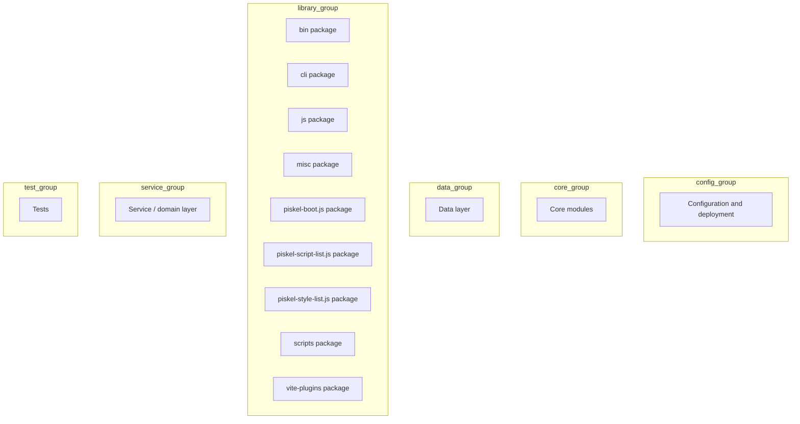

# Architecture report: piskelapp/piskel

> Automated static analysis. **Observed** = directly seen in files/imports/AST; **Inferred** = interpretation from that evidence. Repository code was not executed.

## 1. Repository at a glance

| Item | Value |
| --- | --- |
| Repository | piskelapp/piskel |
| Description | A simple web-based tool for Spriting and Pixel art. |
| Language | JavaScript |
| Stars | 12987 |
| Licence | Apache-2.0 |
| Analysed commit / branch | e394f4fd3b382a0412aab078d1b88b2899d3b8ea / master |
| Framework(s) | None detected |
| Files analysed | 547 |
| Components | 14 |

## 2. Architecture in one minute

piskelapp/piskel - A simple web-based tool for Spriting and Pixel art.. This repository was analysed statically from 547 file(s) (0 Python). Detected technologies (observed from imports/manifests): GitHub Actions, TypeScript, Vite. Files are grouped into 14 component(s): bin package, cli package, Configuration and deployment, Core modules, Data layer, js package, misc package, piskel-boot.js package. Findings below distinguish observed facts from inferred interpretation.

## 3. High-level block diagram

## 4. Main components

### bin package (`bin`)

- **Kind:** library
- **Status:** Observed
- **Confidence:** 0.85
- **Responsibility:** Groups 2 file(s) under bin package (observed from repository paths and static analysis).
- **Paths:** `bin/copy-to-piskel-web.js`, `bin/copy-to-piskel-website.js`
- **Evidence:** [bin/copy-to-piskel-web.js](https://github.com/piskelapp/piskel/blob/e394f4fd3b382a0412aab078d1b88b2899d3b8ea/bin/copy-to-piskel-web.js); [bin/copy-to-piskel-website.js](https://github.com/piskelapp/piskel/blob/e394f4fd3b382a0412aab078d1b88b2899d3b8ea/bin/copy-to-piskel-website.js)

### cli package (`cli`)

- **Kind:** library
- **Status:** Observed
- **Confidence:** 0.85
- **Responsibility:** Groups 3 file(s) under cli package (observed from repository paths and static analysis).
- **Paths:** `cli/export-png.js`, `cli/index.js`, `cli/piskel-export.js`
- **Evidence:** [cli/export-png.js](https://github.com/piskelapp/piskel/blob/e394f4fd3b382a0412aab078d1b88b2899d3b8ea/cli/export-png.js); [cli/index.js](https://github.com/piskelapp/piskel/blob/e394f4fd3b382a0412aab078d1b88b2899d3b8ea/cli/index.js); [cli/piskel-export.js](https://github.com/piskelapp/piskel/blob/e394f4fd3b382a0412aab078d1b88b2899d3b8ea/cli/piskel-export.js)

### Configuration and deployment (`config`)

- **Kind:** config
- **Status:** Observed
- **Confidence:** 0.85
- **Responsibility:** Groups 16 file(s) under configuration and deployment (observed from repository paths and static analysis).
- **Paths:** `package.json`, `src/js/controller/settings/AbstractSettingController.js`, `src/js/controller/settings/ImportController.js`, `src/js/controller/settings/PreferencesController.js`, `src/js/controller/settings/SaveController.js`, `src/js/controller/settings/SettingsController.js`, `src/js/controller/settings/exportimage/ExportController.js`, `src/js/controller/settings/exportimage/GifExportController.js`, `src/js/controller/settings/exportimage/MiscExportController.js`, `src/js/controller/settings/exportimage/PngExportController.js`, `src/js/controller/settings/exportimage/ZipExportController.js`, `src/js/controller/settings/preferences/GridPreferencesController.js`, `src/js/controller/settings/preferences/MiscPreferencesController.js`, `src/js/controller/settings/preferences/TilePreferencesController.js`, `src/js/controller/settings/resize/DefaultSizeController.js`, `src/js/controller/settings/resize/ResizeController.js`
- **Evidence:** [package.json](https://github.com/piskelapp/piskel/blob/e394f4fd3b382a0412aab078d1b88b2899d3b8ea/package.json); [src/js/controller/settings/AbstractSettingController.js](https://github.com/piskelapp/piskel/blob/e394f4fd3b382a0412aab078d1b88b2899d3b8ea/src/js/controller/settings/AbstractSettingController.js); [src/js/controller/settings/ImportController.js](https://github.com/piskelapp/piskel/blob/e394f4fd3b382a0412aab078d1b88b2899d3b8ea/src/js/controller/settings/ImportController.js); [src/js/controller/settings/PreferencesController.js](https://github.com/piskelapp/piskel/blob/e394f4fd3b382a0412aab078d1b88b2899d3b8ea/src/js/controller/settings/PreferencesController.js); [src/js/controller/settings/SaveController.js](https://github.com/piskelapp/piskel/blob/e394f4fd3b382a0412aab078d1b88b2899d3b8ea/src/js/controller/settings/SaveController.js); [src/js/controller/settings/SettingsController.js](https://github.com/piskelapp/piskel/blob/e394f4fd3b382a0412aab078d1b88b2899d3b8ea/src/js/controller/settings/SettingsController.js); [src/js/controller/settings/exportimage/ExportController.js](https://github.com/piskelapp/piskel/blob/e394f4fd3b382a0412aab078d1b88b2899d3b8ea/src/js/controller/settings/exportimage/ExportController.js); [src/js/controller/settings/exportimage/GifExportController.js](https://github.com/piskelapp/piskel/blob/e394f4fd3b382a0412aab078d1b88b2899d3b8ea/src/js/controller/settings/exportimage/GifExportController.js)

### Core modules (`core`)

- **Kind:** core
- **Status:** Observed
- **Confidence:** 0.85
- **Responsibility:** Groups 5 file(s) under core modules (observed from repository paths and static analysis).
- **Paths:** `global.d.ts`, `karma.conf.js`, `playwright.config.ts`, `run-test-ci.sh`, `vite.config.js`
- **Evidence:** [global.d.ts](https://github.com/piskelapp/piskel/blob/e394f4fd3b382a0412aab078d1b88b2899d3b8ea/global.d.ts); [karma.conf.js](https://github.com/piskelapp/piskel/blob/e394f4fd3b382a0412aab078d1b88b2899d3b8ea/karma.conf.js); [playwright.config.ts](https://github.com/piskelapp/piskel/blob/e394f4fd3b382a0412aab078d1b88b2899d3b8ea/playwright.config.ts); [run-test-ci.sh](https://github.com/piskelapp/piskel/blob/e394f4fd3b382a0412aab078d1b88b2899d3b8ea/run-test-ci.sh); [vite.config.js](https://github.com/piskelapp/piskel/blob/e394f4fd3b382a0412aab078d1b88b2899d3b8ea/vite.config.js)

### Data layer (`data_layer`)

- **Kind:** data
- **Status:** Observed
- **Confidence:** 0.85
- **Responsibility:** Groups 8 file(s) under data layer (observed from repository paths and static analysis).
- **Paths:** `src/js/database/BackupDatabase.js`, `src/js/database/PiskelDatabase.js`, `src/js/database/migrate/MigrateLocalStorageToIndexedDb.js`, `src/js/service/storage/DesktopStorageService.js`, `src/js/service/storage/FileDownloadStorageService.js`, `src/js/service/storage/IndexedDbStorageService.js`, `src/js/service/storage/LocalStorageService.js`, `src/js/service/storage/StorageService.js`
- **Evidence:** [src/js/database/BackupDatabase.js](https://github.com/piskelapp/piskel/blob/e394f4fd3b382a0412aab078d1b88b2899d3b8ea/src/js/database/BackupDatabase.js); [src/js/database/PiskelDatabase.js](https://github.com/piskelapp/piskel/blob/e394f4fd3b382a0412aab078d1b88b2899d3b8ea/src/js/database/PiskelDatabase.js); [src/js/database/migrate/MigrateLocalStorageToIndexedDb.js](https://github.com/piskelapp/piskel/blob/e394f4fd3b382a0412aab078d1b88b2899d3b8ea/src/js/database/migrate/MigrateLocalStorageToIndexedDb.js); [src/js/service/storage/DesktopStorageService.js](https://github.com/piskelapp/piskel/blob/e394f4fd3b382a0412aab078d1b88b2899d3b8ea/src/js/service/storage/DesktopStorageService.js); [src/js/service/storage/FileDownloadStorageService.js](https://github.com/piskelapp/piskel/blob/e394f4fd3b382a0412aab078d1b88b2899d3b8ea/src/js/service/storage/FileDownloadStorageService.js); [src/js/service/storage/IndexedDbStorageService.js](https://github.com/piskelapp/piskel/blob/e394f4fd3b382a0412aab078d1b88b2899d3b8ea/src/js/service/storage/IndexedDbStorageService.js); [src/js/service/storage/LocalStorageService.js](https://github.com/piskelapp/piskel/blob/e394f4fd3b382a0412aab078d1b88b2899d3b8ea/src/js/service/storage/LocalStorageService.js); [src/js/service/storage/StorageService.js](https://github.com/piskelapp/piskel/blob/e394f4fd3b382a0412aab078d1b88b2899d3b8ea/src/js/service/storage/StorageService.js)

### js package (`js`)

- **Kind:** library
- **Status:** Observed
- **Confidence:** 0.85
- **Responsibility:** Groups 151 file(s) under js package (observed from repository paths and static analysis).
- **Paths:** `src/js/Constants.js`, `src/js/Events.js`, `src/js/app.js`, `src/js/controller/CanvasBackgroundController.js`, `src/js/controller/CursorCoordinatesController.js`, `src/js/controller/DrawingController.js`, `src/js/controller/FramesListController.js`, `src/js/controller/HeaderController.js`, `src/js/controller/LayersListController.js`, `src/js/controller/MinimapController.js`, `src/js/controller/NotificationController.js`, `src/js/controller/PaletteController.js`, `src/js/controller/PalettesListController.js`, `src/js/controller/PenSizeController.js`, `src/js/controller/ProgressBarController.js`, `src/js/controller/ToolController.js`, `src/js/controller/TransformationsController.js`, `src/js/controller/UserWarningController.js`, `src/js/controller/dialogs/AbstractDialogController.js`, `src/js/controller/dialogs/BrowseLocalController.js`, `src/js/controller/dialogs/CheatsheetController.js`, `src/js/controller/dialogs/CreatePaletteController.js`, `src/js/controller/dialogs/DialogsController.js`, `src/js/controller/dialogs/PerformanceInfoController.js`, `src/js/controller/dialogs/UnsupportedBrowserController.js`, `src/js/controller/dialogs/backups/BrowseBackups.js`, `src/js/controller/dialogs/backups/steps/SelectSession.js`, `src/js/controller/dialogs/backups/steps/SessionDetails.js`, `src/js/controller/dialogs/importwizard/ImportWizard.js`, `src/js/controller/dialogs/importwizard/steps/AbstractImportStep.js`, `src/js/controller/dialogs/importwizard/steps/AdjustSize.js`, `src/js/controller/dialogs/importwizard/steps/ImageImport.js`, `src/js/controller/dialogs/importwizard/steps/InsertLocation.js`, `src/js/controller/dialogs/importwizard/steps/SelectMode.js`, `src/js/controller/drawing/DragHandler.js`, `src/js/controller/piskel/PiskelController.js`, `src/js/controller/piskel/PublicPiskelController.js`, `src/js/controller/preview/PopupPreviewController.js`, `src/js/controller/preview/PreviewActionsController.js`, `src/js/controller/preview/PreviewController.js`, `src/js/lib/bootstrap/bootstrap.js`, `src/js/lib/gif/gif.js`, `src/js/lib/gif/gif.worker.js`, `src/js/lib/gif/libgif.js`, `src/js/lib/iframeLoader-0.1.0.js`, `src/js/lib/jquery-ui-1.10.3.custom.js`, `src/js/lib/pubsub.js`, `src/js/lib/spectrum/spectrum.js`, `src/js/model/Frame.js`, `src/js/model/Layer.js`, `src/js/model/Palette.js`, `src/js/model/Piskel.js`, `src/js/model/frame/AsyncCachedFrameProcessor.js`, `src/js/model/frame/CachedFrameProcessor.js`, `src/js/model/frame/RenderedFrame.js`, `src/js/model/piskel/Descriptor.js`, `src/js/rendering/AbstractRenderer.js`, `src/js/rendering/CanvasRenderer.js`, `src/js/rendering/CompositeRenderer.js`, `src/js/rendering/DrawingLoop.js`, `src/js/rendering/FramesheetRenderer.js`, `src/js/rendering/OnionSkinRenderer.js`, `src/js/rendering/PiskelRenderer.js`, `src/js/rendering/frame/BackgroundImageFrameRenderer.js`, `src/js/rendering/frame/CachedFrameRenderer.js`, `src/js/rendering/frame/FrameRenderer.js`, `src/js/rendering/layer/LayersRenderer.js`, `src/js/selection/BaseSelection.js`, `src/js/selection/LassoSelection.js`, `src/js/selection/RectangularSelection.js`, `src/js/selection/SelectionManager.js`, `src/js/selection/ShapeSelection.js`, `src/js/tools/Tool.js`, `src/js/tools/ToolIconBuilder.js`, `src/js/tools/ToolsHelper.js`, `src/js/tools/drawing/BaseTool.js`, `src/js/tools/drawing/Circle.js`, `src/js/tools/drawing/ColorPicker.js`, `src/js/tools/drawing/ColorSwap.js`, `src/js/tools/drawing/DitheringTool.js`, `src/js/tools/drawing/Eraser.js`, `src/js/tools/drawing/Lighten.js`, `src/js/tools/drawing/Move.js`, `src/js/tools/drawing/PaintBucket.js`, `src/js/tools/drawing/Rectangle.js`, `src/js/tools/drawing/ShapeTool.js`, `src/js/tools/drawing/SimplePen.js`, `src/js/tools/drawing/Stroke.js`, `src/js/tools/drawing/VerticalMirrorPen.js`, `src/js/tools/drawing/selection/AbstractDragSelect.js`, `src/js/tools/drawing/selection/BaseSelect.js`, `src/js/tools/drawing/selection/LassoSelect.js`, `src/js/tools/drawing/selection/RectangleSelect.js`, `src/js/tools/drawing/selection/ShapeSelect.js`, `src/js/tools/transform/AbstractTransformTool.js`, `src/js/tools/transform/Center.js`, `src/js/tools/transform/Clone.js`, `src/js/tools/transform/Crop.js`, `src/js/tools/transform/Flip.js`, `src/js/tools/transform/Rotate.js`, `src/js/tools/transform/TransformUtils.js`, `src/js/utils/Array.js`, `src/js/utils/Base64.js`, `src/js/utils/BlobUtils.js`, `src/js/utils/CanvasUtils.js`, `src/js/utils/ColorUtils.js`, `src/js/utils/DateUtils.js`, `src/js/utils/Dom.js`, `src/js/utils/Environment.js`, `src/js/utils/Event.js`, `src/js/utils/FileUtils.js`, `src/js/utils/FileUtilsDesktop.js`, `src/js/utils/FrameUtils.js`, `src/js/utils/FunctionUtils.js`, `src/js/utils/ImageResizer.js`, `src/js/utils/LayerUtils.js`, `src/js/utils/Math.js`, `src/js/utils/MergeUtils.js`, `src/js/utils/PiskelFileUtils.js`, `src/js/utils/PixelUtils.js`, `src/js/utils/ResizeUtils.js`, `src/js/utils/StringUtils.js`, `src/js/utils/Template.js`, `src/js/utils/TooltipFormatter.js`, `src/js/utils/UserAgent.js`, `src/js/utils/UserSettings.js`, `src/js/utils/Uuid.js`, `src/js/utils/WorkerUtils.js`, `src/js/utils/Xhr.js`, `src/js/utils/core.js`, `src/js/utils/serialization/Deserializer.js`, `src/js/utils/serialization/Serializer.js`, `src/js/utils/serialization/arraybuffer/ArrayBufferDeserializer.js`, `src/js/utils/serialization/arraybuffer/ArrayBufferSerializer.js`, `src/js/utils/serialization/backward/Deserializer_v0.js`, `src/js/utils/serialization/backward/Deserializer_v1.js`, `src/js/widgets/AnchorWidget.js`, `src/js/widgets/ColorsList.js`, `src/js/widgets/FramePicker.js`, `src/js/widgets/HslRgbColorPicker.js`, `src/js/widgets/SizeInput.js`, `src/js/widgets/SizePicker.js`, `src/js/widgets/SynchronizedInputs.js`, `src/js/widgets/Tabs.js`, `src/js/widgets/Wizard.js`, `src/js/worker/framecolors/FrameColors.js`, `src/js/worker/framecolors/FrameColorsWorker.js`, `src/js/worker/hash/Hash.js`, `src/js/worker/hash/HashWorker.js`, `src/js/worker/imageprocessor/ImageProcessor.js`, `src/js/worker/imageprocessor/ImageProcessorWorker.js`
- **Evidence:** [src/js/Constants.js](https://github.com/piskelapp/piskel/blob/e394f4fd3b382a0412aab078d1b88b2899d3b8ea/src/js/Constants.js); [src/js/Events.js](https://github.com/piskelapp/piskel/blob/e394f4fd3b382a0412aab078d1b88b2899d3b8ea/src/js/Events.js); [src/js/app.js](https://github.com/piskelapp/piskel/blob/e394f4fd3b382a0412aab078d1b88b2899d3b8ea/src/js/app.js); [src/js/controller/CanvasBackgroundController.js](https://github.com/piskelapp/piskel/blob/e394f4fd3b382a0412aab078d1b88b2899d3b8ea/src/js/controller/CanvasBackgroundController.js); [src/js/controller/CursorCoordinatesController.js](https://github.com/piskelapp/piskel/blob/e394f4fd3b382a0412aab078d1b88b2899d3b8ea/src/js/controller/CursorCoordinatesController.js); [src/js/controller/DrawingController.js](https://github.com/piskelapp/piskel/blob/e394f4fd3b382a0412aab078d1b88b2899d3b8ea/src/js/controller/DrawingController.js); [src/js/controller/FramesListController.js](https://github.com/piskelapp/piskel/blob/e394f4fd3b382a0412aab078d1b88b2899d3b8ea/src/js/controller/FramesListController.js); [src/js/controller/HeaderController.js](https://github.com/piskelapp/piskel/blob/e394f4fd3b382a0412aab078d1b88b2899d3b8ea/src/js/controller/HeaderController.js)

### misc package (`misc`)

- **Kind:** library
- **Status:** Observed
- **Confidence:** 0.85
- **Responsibility:** Groups 1 file(s) under misc package (observed from repository paths and static analysis).
- **Paths:** `misc/proto-ui-1/main.js`
- **Evidence:** [misc/proto-ui-1/main.js](https://github.com/piskelapp/piskel/blob/e394f4fd3b382a0412aab078d1b88b2899d3b8ea/misc/proto-ui-1/main.js)

### piskel-boot.js package (`piskel_boot_js`)

- **Kind:** library
- **Status:** Observed
- **Confidence:** 0.85
- **Responsibility:** Groups 1 file(s) under piskel-boot.js package (observed from repository paths and static analysis).
- **Paths:** `src/piskel-boot.js`
- **Evidence:** [src/piskel-boot.js](https://github.com/piskelapp/piskel/blob/e394f4fd3b382a0412aab078d1b88b2899d3b8ea/src/piskel-boot.js)

### piskel-script-list.js package (`piskel_script_list_js`)

- **Kind:** library
- **Status:** Observed
- **Confidence:** 0.85
- **Responsibility:** Groups 1 file(s) under piskel-script-list.js package (observed from repository paths and static analysis).
- **Paths:** `src/piskel-script-list.js`
- **Evidence:** [src/piskel-script-list.js](https://github.com/piskelapp/piskel/blob/e394f4fd3b382a0412aab078d1b88b2899d3b8ea/src/piskel-script-list.js)

### piskel-style-list.js package (`piskel_style_list_js`)

- **Kind:** library
- **Status:** Observed
- **Confidence:** 0.85
- **Responsibility:** Groups 1 file(s) under piskel-style-list.js package (observed from repository paths and static analysis).
- **Paths:** `src/piskel-style-list.js`
- **Evidence:** [src/piskel-style-list.js](https://github.com/piskelapp/piskel/blob/e394f4fd3b382a0412aab078d1b88b2899d3b8ea/src/piskel-style-list.js)

### scripts package (`scripts`)

- **Kind:** library
- **Status:** Observed
- **Confidence:** 0.85
- **Responsibility:** Groups 6 file(s) under scripts package (observed from repository paths and static analysis).
- **Paths:** `scripts/desktop.js`, `scripts/partials.js`, `scripts/serve.js`, `scripts/spec-check.js`, `scripts/sprite.js`, `scripts/visual-storyboard.js`
- **Evidence:** [scripts/desktop.js](https://github.com/piskelapp/piskel/blob/e394f4fd3b382a0412aab078d1b88b2899d3b8ea/scripts/desktop.js); [scripts/partials.js](https://github.com/piskelapp/piskel/blob/e394f4fd3b382a0412aab078d1b88b2899d3b8ea/scripts/partials.js); [scripts/serve.js](https://github.com/piskelapp/piskel/blob/e394f4fd3b382a0412aab078d1b88b2899d3b8ea/scripts/serve.js); [scripts/spec-check.js](https://github.com/piskelapp/piskel/blob/e394f4fd3b382a0412aab078d1b88b2899d3b8ea/scripts/spec-check.js); [scripts/sprite.js](https://github.com/piskelapp/piskel/blob/e394f4fd3b382a0412aab078d1b88b2899d3b8ea/scripts/sprite.js); [scripts/visual-storyboard.js](https://github.com/piskelapp/piskel/blob/e394f4fd3b382a0412aab078d1b88b2899d3b8ea/scripts/visual-storyboard.js)

### Service / domain layer (`service_layer`)

- **Kind:** service
- **Status:** Observed
- **Confidence:** 0.85
- **Responsibility:** Groups 28 file(s) under service / domain layer (observed from repository paths and static analysis).
- **Paths:** `src/js/service/BackupService.js`, `src/js/service/BeforeUnloadService.js`, `src/js/service/ClipboardService.js`, `src/js/service/CurrentColorsService.js`, `src/js/service/FileDropperService.js`, `src/js/service/HistoryService.js`, `src/js/service/ImportService.js`, `src/js/service/MouseStateService.js`, `src/js/service/SavedStatusService.js`, `src/js/service/SelectedColorsService.js`, `src/js/service/color/ColorSorter.js`, `src/js/service/keyboard/KeyUtils.js`, `src/js/service/keyboard/KeycodeTranslator.js`, `src/js/service/keyboard/Shortcut.js`, `src/js/service/keyboard/ShortcutService.js`, `src/js/service/keyboard/Shortcuts.js`, `src/js/service/palette/CurrentColorsPalette.js`, `src/js/service/palette/PaletteGplWriter.js`, `src/js/service/palette/PaletteImportService.js`, `src/js/service/palette/PaletteService.js`, `src/js/service/palette/reader/AbstractPaletteFileReader.js`, `src/js/service/palette/reader/PaletteGplReader.js`, `src/js/service/palette/reader/PaletteImageReader.js`, `src/js/service/palette/reader/PalettePalReader.js`, `src/js/service/palette/reader/PaletteTxtReader.js`, `src/js/service/pensize/PenSizeService.js`, `src/js/service/performance/PerformanceReport.js`, `src/js/service/performance/PerformanceReportService.js`
- **Evidence:** [src/js/service/BackupService.js](https://github.com/piskelapp/piskel/blob/e394f4fd3b382a0412aab078d1b88b2899d3b8ea/src/js/service/BackupService.js); [src/js/service/BeforeUnloadService.js](https://github.com/piskelapp/piskel/blob/e394f4fd3b382a0412aab078d1b88b2899d3b8ea/src/js/service/BeforeUnloadService.js); [src/js/service/ClipboardService.js](https://github.com/piskelapp/piskel/blob/e394f4fd3b382a0412aab078d1b88b2899d3b8ea/src/js/service/ClipboardService.js); [src/js/service/CurrentColorsService.js](https://github.com/piskelapp/piskel/blob/e394f4fd3b382a0412aab078d1b88b2899d3b8ea/src/js/service/CurrentColorsService.js); [src/js/service/FileDropperService.js](https://github.com/piskelapp/piskel/blob/e394f4fd3b382a0412aab078d1b88b2899d3b8ea/src/js/service/FileDropperService.js); [src/js/service/HistoryService.js](https://github.com/piskelapp/piskel/blob/e394f4fd3b382a0412aab078d1b88b2899d3b8ea/src/js/service/HistoryService.js); [src/js/service/ImportService.js](https://github.com/piskelapp/piskel/blob/e394f4fd3b382a0412aab078d1b88b2899d3b8ea/src/js/service/ImportService.js); [src/js/service/MouseStateService.js](https://github.com/piskelapp/piskel/blob/e394f4fd3b382a0412aab078d1b88b2899d3b8ea/src/js/service/MouseStateService.js)

### Tests (`tests`)

- **Kind:** test
- **Status:** Observed
- **Confidence:** 0.85
- **Responsibility:** Groups 137 file(s) under tests (observed from repository paths and static analysis).
- **Paths:** `tests/e2e/playwright/constants.ts`, `tests/e2e/playwright/integration/canvas/test-canvas-fit.spec.ts`, `tests/e2e/playwright/integration/canvas/test-canvas-input.spec.ts`, `tests/e2e/playwright/integration/canvas/test-canvas-rendering.spec.ts`, `tests/e2e/playwright/integration/canvas/test-canvas-zoom-limits.spec.ts`, `tests/e2e/playwright/integration/canvas/test-cursor-coordinates.spec.ts`, `tests/e2e/playwright/integration/canvas/test-misc-ui.spec.ts`, `tests/e2e/playwright/integration/canvas/test-performance-dialog.spec.ts`, `tests/e2e/playwright/integration/colors-and-palettes/test-color-picker.spec.ts`, `tests/e2e/playwright/integration/colors-and-palettes/test-create-palette.spec.ts`, `tests/e2e/playwright/integration/colors-and-palettes/test-palette-dialog.spec.ts`, `tests/e2e/playwright/integration/colors-and-palettes/test-palette-extras.spec.ts`, `tests/e2e/playwright/integration/colors-and-palettes/test-palette-import.spec.ts`, `tests/e2e/playwright/integration/colors-and-palettes/test-palette-swatches.spec.ts`, `tests/e2e/playwright/integration/colors-and-palettes/tiny-palette.spec.ts`, `tests/e2e/playwright/integration/drawing-tools/test-pen-size-ui.spec.ts`, `tests/e2e/playwright/integration/drawing-tools/test-tool-bucket.spec.ts`, `tests/e2e/playwright/integration/drawing-tools/test-tool-circle.spec.ts`, `tests/e2e/playwright/integration/drawing-tools/test-tool-colorpicker.spec.ts`, `tests/e2e/playwright/integration/drawing-tools/test-tool-colorswap.spec.ts`, `tests/e2e/playwright/integration/drawing-tools/test-tool-common.spec.ts`, `tests/e2e/playwright/integration/drawing-tools/test-tool-dithering.spec.ts`, `tests/e2e/playwright/integration/drawing-tools/test-tool-eraser.spec.ts`, `tests/e2e/playwright/integration/drawing-tools/test-tool-lighten.spec.ts`, `tests/e2e/playwright/integration/drawing-tools/test-tool-mirror.spec.ts`, `tests/e2e/playwright/integration/drawing-tools/test-tool-move.spec.ts`, `tests/e2e/playwright/integration/drawing-tools/test-tool-pen.spec.ts`, `tests/e2e/playwright/integration/drawing-tools/test-tool-rectangle.spec.ts`, `tests/e2e/playwright/integration/drawing-tools/test-tool-stroke.spec.ts`, `tests/e2e/playwright/integration/editor/test-dialogs.spec.ts`, `tests/e2e/playwright/integration/editor/test-new-sprite.spec.ts`, `tests/e2e/playwright/integration/editor/test-notifications.spec.ts`, `tests/e2e/playwright/integration/editor/test-progress-bar.spec.ts`, `tests/e2e/playwright/integration/editor/test-startup.spec.ts`, `tests/e2e/playwright/integration/export/test-export-c-file.spec.ts`, `tests/e2e/playwright/integration/export/test-export-content.spec.ts`, `tests/e2e/playwright/integration/export/test-export-extras.spec.ts`, `tests/e2e/playwright/integration/export/test-export-gif-scale.spec.ts`, `tests/e2e/playwright/integration/export/test-export-gif-transparency.spec.ts`, `tests/e2e/playwright/integration/export/test-export-png-scale.spec.ts`, `tests/e2e/playwright/integration/export/test-export-png-spritesheet.spec.ts`, `tests/e2e/playwright/integration/export/test-export-settings.spec.ts`, `tests/e2e/playwright/integration/export/test-export-zip.spec.ts`, `tests/e2e/playwright/integration/frames/test-frame-dnd.spec.ts`, `tests/e2e/playwright/integration/frames/test-frame-extras.spec.ts`, `tests/e2e/playwright/integration/frames/test-frame-operations.spec.ts`, `tests/e2e/playwright/integration/frames/test-frame-preview.spec.ts`, `tests/e2e/playwright/integration/import/test-file-handling.spec.ts`, `tests/e2e/playwright/integration/import/test-import-combine.spec.ts`, `tests/e2e/playwright/integration/import/test-import-drop.spec.ts`, `tests/e2e/playwright/integration/import/test-import-image-basic.spec.ts`, `tests/e2e/playwright/integration/import/test-import-image-empty.spec.ts`, `tests/e2e/playwright/integration/import/test-import-image-step.spec.ts`, `tests/e2e/playwright/integration/import/test-import-image-twice.spec.ts`, `tests/e2e/playwright/integration/import/test-import-piskel.spec.ts`, `tests/e2e/playwright/integration/import/test-import-wizard.spec.ts`, `tests/e2e/playwright/integration/keyboard-shortcuts/test-cheatsheet.spec.ts`, `tests/e2e/playwright/integration/keyboard-shortcuts/test-shortcut-system.spec.ts`, `tests/e2e/playwright/integration/keyboard-shortcuts/test-shortcuts-misc.spec.ts`, `tests/e2e/playwright/integration/keyboard-shortcuts/test-shortcuts.spec.ts`, `tests/e2e/playwright/integration/layers/test-layer-operations.spec.ts`, `tests/e2e/playwright/integration/preview/test-animation-preview.spec.ts`, `tests/e2e/playwright/integration/preview/test-onion-skin.spec.ts`, `tests/e2e/playwright/integration/preview/test-preview-settings.spec.ts`, `tests/e2e/playwright/integration/preview/test-toggle-grid.spec.ts`, `tests/e2e/playwright/integration/save-and-storage/test-backup-recovery.spec.ts`, `tests/e2e/playwright/integration/save-and-storage/test-backups.spec.ts`, `tests/e2e/playwright/integration/save-and-storage/test-piskel-roundtrip.spec.ts`, `tests/e2e/playwright/integration/save-and-storage/test-save-browser.spec.ts`, `tests/e2e/playwright/integration/save-and-storage/test-save-content.spec.ts`, `tests/e2e/playwright/integration/save-and-storage/test-save-details.spec.ts`, `tests/e2e/playwright/integration/selection/test-selection-clipboard.spec.ts`, `tests/e2e/playwright/integration/selection/test-selection-move.spec.ts`, `tests/e2e/playwright/integration/selection/test-tool-select.spec.ts`, `tests/e2e/playwright/integration/settings/test-canvas-size.spec.ts`, `tests/e2e/playwright/integration/settings/test-preferences-default.spec.ts`, `tests/e2e/playwright/integration/settings/test-preferences-grid.spec.ts`, `tests/e2e/playwright/integration/settings/test-preferences-misc/test-preferences-misc.spec.ts`, `tests/e2e/playwright/integration/settings/test-preferences-tile/test-preferences-tile.spec.ts`, `tests/e2e/playwright/integration/settings/test-resize-canvas-with-content.spec.ts`, `tests/e2e/playwright/integration/settings/test-resize-canvas-without-content.spec.ts`, `tests/e2e/playwright/integration/settings/test-resize-default-size.spec.ts`, `tests/e2e/playwright/integration/settings/test-resize-input-sync.spec.ts`, `tests/e2e/playwright/integration/settings/test-resize-origin.spec.ts`, `tests/e2e/playwright/integration/settings/test-resize.spec.ts`, `tests/e2e/playwright/integration/settings/test-settings-open-panels.spec.ts`, `tests/e2e/playwright/integration/settings/test-settings-persistence.spec.ts`, `tests/e2e/playwright/integration/transformations/test-transform.spec.ts`, `tests/e2e/playwright/integration/undo-redo/test-undo-load-browser.spec.ts`, `tests/e2e/playwright/integration/undo-redo/test-undo-redo.spec.ts`, `tests/e2e/playwright/testutils.ts`, `tests/e2e/playwright/visual/README.md`, `tests/e2e/playwright/visual/app-chrome.spec.ts`, `tests/e2e/playwright/visual/color-picker.spec.ts`, `tests/e2e/playwright/visual/dialog-import-wizard.spec.ts`, `tests/e2e/playwright/visual/dialogs.spec.ts`, `tests/e2e/playwright/visual/feedback.spec.ts`, `tests/e2e/playwright/visual/frames.spec.ts`, `tests/e2e/playwright/visual/layers.spec.ts`, `tests/e2e/playwright/visual/layout.spec.ts`, `tests/e2e/playwright/visual/palettes-transformations.spec.ts`, `tests/e2e/playwright/visual/preview.spec.ts`, `tests/e2e/playwright/visual/settings-preferences-resize.spec.ts`, `tests/e2e/playwright/visual/settings-save-import-export.spec.ts`, `tests/e2e/playwright/visual/tools.spec.ts`, `tests/unit-tests/database/BackupDatabaseTest.js`, `tests/unit-tests/database/PiskelDatabaseTest.js`, `tests/unit-tests/model/LayerTest.js`, `tests/unit-tests/model/PaletteTest.js`, `tests/unit-tests/rendering/CanvasRendererTest.js`, `tests/unit-tests/rendering/DrawingLoopTest.js`, `tests/unit-tests/rendering/FramesheetRendererTest.js`, `tests/unit-tests/rendering/OnionSkinRendererTest.js`, `tests/unit-tests/selection/SelectionManagerTest.js`, `tests/unit-tests/service/BackupServiceTest.js`, `tests/unit-tests/service/HistoryServiceTest.js`, `tests/unit-tests/service/SelectedColorsServiceTest.js`, `tests/unit-tests/service/keyboard/ShortcutServiceTest.js`, `tests/unit-tests/service/palette/PaletteServiceTest.js`, `tests/unit-tests/service/pensize/PenSizeServiceTest.js`, `tests/unit-tests/service/storage/StorageServiceTest.js`, `tests/unit-tests/testutils/TestUtils.js`, `tests/unit-tests/tools/transform/TransformUtilsTest.js`, `tests/unit-tests/utils/ArrayTest.js`, `tests/unit-tests/utils/ColorUtilsTest.js`, `tests/unit-tests/utils/CoreTest.js`, `tests/unit-tests/utils/FrameUtilsTest.js`, `tests/unit-tests/utils/FrameUtilsTest_add_image.js`, `tests/unit-tests/utils/LayerUtilsTest.js`, `tests/unit-tests/utils/MergeUtilsTest.js`, `tests/unit-tests/utils/PixelUtilsTest.js`, `tests/unit-tests/utils/PixelUtilsTest_visit_connected.js`, `tests/unit-tests/utils/ResizeUtilsTest.js`, `tests/unit-tests/utils/UuidTest.js`, `tests/unit-tests/utils/serialization/Deserializer_v0Test.js`, `tests/unit-tests/utils/serialization/Deserializer_v1Test.js`, `tests/unit-tests/utils/serialization/SerializerTest.js`
- **Evidence:** [tests/e2e/playwright/constants.ts](https://github.com/piskelapp/piskel/blob/e394f4fd3b382a0412aab078d1b88b2899d3b8ea/tests/e2e/playwright/constants.ts); [tests/e2e/playwright/integration/canvas/test-canvas-fit.spec.ts](https://github.com/piskelapp/piskel/blob/e394f4fd3b382a0412aab078d1b88b2899d3b8ea/tests/e2e/playwright/integration/canvas/test-canvas-fit.spec.ts); [tests/e2e/playwright/integration/canvas/test-canvas-input.spec.ts](https://github.com/piskelapp/piskel/blob/e394f4fd3b382a0412aab078d1b88b2899d3b8ea/tests/e2e/playwright/integration/canvas/test-canvas-input.spec.ts); [tests/e2e/playwright/integration/canvas/test-canvas-rendering.spec.ts](https://github.com/piskelapp/piskel/blob/e394f4fd3b382a0412aab078d1b88b2899d3b8ea/tests/e2e/playwright/integration/canvas/test-canvas-rendering.spec.ts); [tests/e2e/playwright/integration/canvas/test-canvas-zoom-limits.spec.ts](https://github.com/piskelapp/piskel/blob/e394f4fd3b382a0412aab078d1b88b2899d3b8ea/tests/e2e/playwright/integration/canvas/test-canvas-zoom-limits.spec.ts); [tests/e2e/playwright/integration/canvas/test-cursor-coordinates.spec.ts](https://github.com/piskelapp/piskel/blob/e394f4fd3b382a0412aab078d1b88b2899d3b8ea/tests/e2e/playwright/integration/canvas/test-cursor-coordinates.spec.ts); [tests/e2e/playwright/integration/canvas/test-misc-ui.spec.ts](https://github.com/piskelapp/piskel/blob/e394f4fd3b382a0412aab078d1b88b2899d3b8ea/tests/e2e/playwright/integration/canvas/test-misc-ui.spec.ts); [tests/e2e/playwright/integration/canvas/test-performance-dialog.spec.ts](https://github.com/piskelapp/piskel/blob/e394f4fd3b382a0412aab078d1b88b2899d3b8ea/tests/e2e/playwright/integration/canvas/test-performance-dialog.spec.ts)

### vite-plugins package (`vite_plugins`)

- **Kind:** library
- **Status:** Observed
- **Confidence:** 0.85
- **Responsibility:** Groups 3 file(s) under vite-plugins package (observed from repository paths and static analysis).
- **Paths:** `vite-plugins/concat-scripts.js`, `vite-plugins/css-replace.js`, `vite-plugins/html-include.js`
- **Evidence:** [vite-plugins/concat-scripts.js](https://github.com/piskelapp/piskel/blob/e394f4fd3b382a0412aab078d1b88b2899d3b8ea/vite-plugins/concat-scripts.js); [vite-plugins/css-replace.js](https://github.com/piskelapp/piskel/blob/e394f4fd3b382a0412aab078d1b88b2899d3b8ea/vite-plugins/css-replace.js); [vite-plugins/html-include.js](https://github.com/piskelapp/piskel/blob/e394f4fd3b382a0412aab078d1b88b2899d3b8ea/vite-plugins/html-include.js)

## 5. Execution flow

**Observed** entry point(s):

- [cli/index.js](https://github.com/piskelapp/piskel/blob/e394f4fd3b382a0412aab078d1b88b2899d3b8ea/cli/index.js)
- [misc/proto-ui-1/main.js](https://github.com/piskelapp/piskel/blob/e394f4fd3b382a0412aab078d1b88b2899d3b8ea/misc/proto-ui-1/main.js)
- [misc/scripts/piskel-root](https://github.com/piskelapp/piskel/blob/e394f4fd3b382a0412aab078d1b88b2899d3b8ea/misc/scripts/piskel-root)
- [src/js/app.js](https://github.com/piskelapp/piskel/blob/e394f4fd3b382a0412aab078d1b88b2899d3b8ea/src/js/app.js)

Representative flow (derived from observed entry points and the import graph; steps beyond the entry point are **Inferred**):

1. Execution starts at an observed entry point listed above, if present.
2. No internal import relationships between components were observed.

## 6. Project structure

### `(root)`

- `.gitignore` - other (718 bytes)
- `.npmignore` - other (21 bytes)
- `LICENSE` - docs (11358 bytes)
- `README.md` - docs (3736 bytes)
- `biome.jsonc` - other (2123 bytes)
- `global.d.ts` - source, TypeScript (72 bytes)
- `karma.conf.js` - source, JavaScript (1903 bytes)
- `package.json` - manifest (2789 bytes)
- `playwright.config.ts` - source, TypeScript (1485 bytes)
- `run-test-ci.sh` - source, Shell (62 bytes)
- `vite.config.js` - source, JavaScript (1607 bytes)

### `.claude`

- `.claude/skills/e2e-tests/SKILL.md` - docs (8551 bytes)

### `.github`

- `.github/ISSUE_TEMPLATE` - other (481 bytes)
- `.github/workflows/ci.yml` - ci, YAML (2131 bytes)
- `.github/workflows/update-visual-baselines.yml` - ci, YAML (1419 bytes)

### `.husky`

- `.husky/pre-commit` - other (43 bytes)

### `TODO`

- `TODO/clarify-layer-opacity-preference.md` - docs (3113 bytes)
- `TODO/fix-clock-going-backwards.md` - docs (6130 bytes)

### `bin`

- `bin/copy-to-piskel-web.js` - source, JavaScript (4361 bytes)
- `bin/copy-to-piskel-website.js` - source, JavaScript (2434 bytes)

### `cli`

- `cli/README.md` - docs (1354 bytes)
- `cli/export-png.js` - source, JavaScript (3701 bytes)
- `cli/index.js` - source, JavaScript (2250 bytes)
- `cli/piskel-export.js` - source, JavaScript (1150 bytes)

### `docs`

- `docs/known-issues.md` - docs (15420 bytes)
- `docs/specs/README.md` - docs (5448 bytes)
- `docs/specs/canvas.md` - docs (3538 bytes)
- `docs/specs/colors-and-palettes.md` - docs (6079 bytes)
- `docs/specs/drawing-tools.md` - docs (4453 bytes)
- `docs/specs/editor.md` - docs (1457 bytes)
- `docs/specs/export.md` - docs (3008 bytes)
- `docs/specs/frames.md` - docs (1965 bytes)
- `docs/specs/import.md` - docs (7412 bytes)
- `docs/specs/keyboard-shortcuts.md` - docs (2773 bytes)
- `docs/specs/layers.md` - docs (3225 bytes)
- `docs/specs/preview.md` - docs (2534 bytes)
- `docs/specs/save-and-storage.md` - docs (3695 bytes)
- `docs/specs/selection.md` - docs (3521 bytes)
- `docs/specs/settings.md` - docs (3353 bytes)
- `docs/specs/transformations.md` - docs (2027 bytes)
- `docs/specs/undo-redo.md` - docs (1427 bytes)
- `docs/specs/untested.txt` - docs (269 bytes)

### `misc`

- `misc/desktop/Info.plist` - other (2720 bytes)
- `misc/gif-tests/low-colors-no-transparency.piskel` - other (777 bytes)
- `misc/gif-tests/low-colors-with-transparency.piskel` - other (723 bytes)
- `misc/gif-tests/too-many-colors-no-transparency.piskel` - other (6670 bytes)
- `misc/gif-tests/too-many-colors-with-transparency.piskel` - other (6358 bytes)
- `misc/icons/SVG/eye.svg` - other (2566 bytes)
- `misc/icons/SVG/flip.svg` - other (3316 bytes)
- `misc/icons/SVG/import-icon.svg` - other (3695 bytes)
- `misc/icons/SVG/lasso.svg` - other (2647 bytes)
- `misc/icons/SVG/layers.svg` - other (2429 bytes)
- `misc/icons/SVG/onion.svg` - other (9777 bytes)
- `misc/icons/SVG/swap-arrow-square.svg` - other (3042 bytes)
- `misc/icons/SVG/swap-arrow.svg` - other (2884 bytes)
- `misc/icons/cleaned_svg/center.svg` - other (510 bytes)
- `misc/icons/cleaned_svg/circle.svg` - other (443 bytes)
- `misc/icons/cleaned_svg/clone.svg` - other (3018 bytes)
- `misc/icons/cleaned_svg/colorswap.svg` - other (3087 bytes)
- `misc/icons/cleaned_svg/crop.svg` - other (642 bytes)
- `misc/icons/cleaned_svg/dithering.svg` - other (499 bytes)
- `misc/icons/cleaned_svg/eraser.svg` - other (428 bytes)
- `misc/icons/cleaned_svg/flip.svg` - other (313 bytes)
- `misc/icons/cleaned_svg/lighten.svg` - other (476 bytes)
- `misc/icons/cleaned_svg/move.svg` - other (806 bytes)
- `misc/icons/cleaned_svg/pen.svg` - other (936 bytes)
- `misc/icons/cleaned_svg/rectangle.svg` - other (376 bytes)
- `misc/icons/cleaned_svg/rotate.svg` - other (712 bytes)
- `misc/icons/cleaned_svg/shape-select.svg` - other (1618 bytes)
- `misc/icons/cleaned_svg/stroke.svg` - other (900 bytes)
- `misc/icons/cleaned_svg/vertical-mirror-pen.svg` - other (1906 bytes)
- `misc/icons/noun-project/sheep/icon_8389.svg` - other (4305 bytes)
- `misc/icons/noun-project/sheep/license.txt` - docs (363 bytes)
- `misc/icons/noun-project/undo-kyle_levi_fox/icon_10033.svg` - other (843 bytes)
- `misc/icons/noun-project/undo-kyle_levi_fox/license.txt` - docs (360 bytes)
- `misc/icons/source/common-backup.svg` - other (3837 bytes)
- `misc/icons/source/common-keyboard-gold.svg` - other (4813 bytes)
- `misc/icons/source/common-swapcolors-arrow-grey.svg` - other (3893 bytes)
- `misc/icons/source/common-warning-red.svg` - other (4222 bytes)
- `misc/icons/source/file-icon-base.svg` - other (2753 bytes)
- `misc/icons/source/frame-dragndrop-white.svg` - other (3576 bytes)
- `misc/icons/source/frame-duplicate-white.svg` - other (3055 bytes)
- `misc/icons/source/frame-plus-white.svg` - other (2325 bytes)
- `misc/icons/source/frame-recyclebin-white.svg` - other (2865 bytes)
- `misc/icons/source/minimap-popup-preview-arrow.svg` - other (2551 bytes)
- `misc/icons/source/settings-export-white.svg` - other (3443 bytes)
- `misc/icons/source/settings-gear-white.svg` - other (5538 bytes)
- `misc/icons/source/settings-open-folder-white.svg` - other (3599 bytes)
- `misc/icons/source/settings-resize-white.svg` - other (4458 bytes)
- `misc/icons/source/settings-save-white.svg` - other (3265 bytes)
- `misc/icons/source/tool-center.svg` - other (6725 bytes)
- `misc/icons/source/tool-circle.svg` - other (2256 bytes)
- `misc/icons/source/tool-clone.svg` - other (7463 bytes)
- `misc/icons/source/tool-colorpicker.svg` - other (3630 bytes)
- `misc/icons/source/tool-colorswap.svg` - other (6373 bytes)
- `misc/icons/source/tool-dithering.svg` - other (4077 bytes)
- `misc/icons/source/tool-eraser.svg` - other (2300 bytes)
- `misc/icons/source/tool-flip.svg` - other (4214 bytes)
- `misc/icons/source/tool-lasso-select.svg` - other (2388 bytes)
- `misc/icons/source/tool-lighten.svg` - other (2464 bytes)
- `misc/icons/source/tool-move.svg` - other (3038 bytes)
- `misc/icons/source/tool-paint-bucket-pink.svg` - other (3707 bytes)
- `misc/icons/source/tool-paint-bucket.svg` - other (920 bytes)
- `misc/icons/source/tool-pen.svg` - other (3145 bytes)
- `misc/icons/source/tool-rectangle-select.svg` - other (2096 bytes)
- `misc/icons/source/tool-rectangle.svg` - other (2033 bytes)
- `misc/icons/source/tool-rotate.svg` - other (3055 bytes)
- `misc/icons/source/tool-shape-select.svg` - other (4323 bytes)
- `misc/icons/source/tool-stroke.svg` - other (3299 bytes)
- `misc/icons/source/tool-vertical-mirror-pen.svg` - other (4773 bytes)
- `misc/proto-ui-1/index.html` - other (4990 bytes)
- `misc/proto-ui-1/main.css` - other (7220 bytes)
- `misc/proto-ui-1/main.js` - source, JavaScript (1893 bytes)
- `misc/scripts/build-mac-application.txt` - docs (500 bytes)
- `misc/scripts/package-mac-application.cmd` - other (1381 bytes)
- `misc/scripts/package-windows-executable.cmd` - other (599 bytes)
- `misc/scripts/piskel-root` - other (185 bytes)
- `misc/selenium-ide/change-colors.html` - other (1057 bytes)
- `misc/selenium-ide/change-size.html` - other (1112 bytes)
- `misc/selenium-ide/select-tools.html` - other (1717 bytes)
- `misc/selenium-ide/user-preferences.html` - other (1861 bytes)

### `scripts`

- `scripts/desktop.js` - source, JavaScript (5127 bytes)
- `scripts/partials.js` - source, JavaScript (2219 bytes)
- `scripts/serve.js` - source, JavaScript (5253 bytes)
- `scripts/spec-check.js` - source, JavaScript (5186 bytes)
- `scripts/sprite.js` - source, JavaScript (3808 bytes)
- `scripts/visual-storyboard.js` - source, JavaScript (2480 bytes)

### `src`

- `src/css/animations.css` - other (161 bytes)
- `src/css/bootstrap/bootstrap-tooltip-custom.css` - other (96 bytes)
- `src/css/bootstrap/bootstrap.css` - other (1990 bytes)
- `src/css/bootstrap/readme.txt` - docs (60 bytes)
- `src/css/color-picker-slider.css` - other (2786 bytes)
- `src/css/dialogs-browse-backups.css` - other (2793 bytes)
- `src/css/dialogs-browse-local.css` - other (939 bytes)
- `src/css/dialogs-cheatsheet.css` - other (4101 bytes)
- `src/css/dialogs-create-palette.css` - other (2861 bytes)
- `src/css/dialogs-import.css` - other (4269 bytes)
- `src/css/dialogs-performance-info.css` - other (1123 bytes)
- `src/css/dialogs-unsupported-browser.css` - other (799 bytes)
- `src/css/dialogs.css` - other (1268 bytes)
- `src/css/font-icon.css` - other (1671 bytes)
- `src/css/fonts/icomoon.svg` - other (8839 bytes)
- `src/css/fonts/piskel.svg` - other (4791 bytes)
- `src/css/forms.css` - other (1154 bytes)
- `src/css/frames-list.css` - other (3310 bytes)
- `src/css/layout.css` - other (3655 bytes)
- `src/css/minimap.css` - other (164 bytes)
- `src/css/notifications.css` - other (1227 bytes)
- `src/css/reset.css` - other (917 bytes)
- `src/css/settings-application.css` - other (2784 bytes)
- `src/css/settings-export.css` - other (2250 bytes)
- `src/css/settings-import.css` - other (480 bytes)
- `src/css/settings-resize.css` - other (204 bytes)
- `src/css/settings-save.css` - other (539 bytes)
- `src/css/settings.css` - other (1889 bytes)
- `src/css/spectrum/spectrum-overrides.css` - other (2095 bytes)
- `src/css/spectrum/spectrum.css` - other (12571 bytes)
- `src/css/style.css` - other (1186 bytes)
- `src/css/toolbox-animated-preview.css` - other (3828 bytes)
- `src/css/toolbox-layers-list.css` - other (1334 bytes)
- `src/css/toolbox-palettes-list.css` - other (2737 bytes)
- `src/css/toolbox.css` - other (811 bytes)
- `src/css/tools.css` - other (3361 bytes)
- `src/css/transformations.css` - other (776 bytes)
- `src/css/variables.css` - other (42 bytes)
- `src/css/widgets-anchor.css` - other (1790 bytes)
- `src/css/widgets-frame-picker.css` - other (866 bytes)
- `src/css/widgets-size-picker.css` - other (1049 bytes)
- `src/css/widgets-tabs.css` - other (751 bytes)
- `src/css/widgets-wizard.css` - other (419 bytes)
- `src/index.html` - other (4069 bytes)
- `src/js/Constants.js` - source, JavaScript (1677 bytes)
- `src/js/Events.js` - source, JavaScript (2992 bytes)
- `src/js/app.js` - source, JavaScript (9256 bytes)
- `src/js/controller/CanvasBackgroundController.js` - source, JavaScript (1018 bytes)
- `src/js/controller/CursorCoordinatesController.js` - source, JavaScript (2784 bytes)
- `src/js/controller/DrawingController.js` - source, JavaScript (18612 bytes)
- `src/js/controller/FramesListController.js` - source, JavaScript (13622 bytes)
- `src/js/controller/HeaderController.js` - source, JavaScript (1866 bytes)
- `src/js/controller/LayersListController.js` - source, JavaScript (10897 bytes)
- `src/js/controller/MinimapController.js` - source, JavaScript (5824 bytes)
- `src/js/controller/NotificationController.js` - source, JavaScript (1284 bytes)
- `src/js/controller/PaletteController.js` - source, JavaScript (4823 bytes)
- `src/js/controller/PalettesListController.js` - source, JavaScript (8457 bytes)
- `src/js/controller/PenSizeController.js` - source, JavaScript (854 bytes)
- `src/js/controller/ProgressBarController.js` - source, JavaScript (2321 bytes)
- `src/js/controller/ToolController.js` - source, JavaScript (4043 bytes)
- `src/js/controller/TransformationsController.js` - source, JavaScript (2781 bytes)
- `src/js/controller/UserWarningController.js` - source, JavaScript (2201 bytes)
- `src/js/controller/dialogs/AbstractDialogController.js` - source, JavaScript (920 bytes)
- `src/js/controller/dialogs/BrowseLocalController.js` - source, JavaScript (2225 bytes)
- `src/js/controller/dialogs/CheatsheetController.js` - source, JavaScript (7186 bytes)
- `src/js/controller/dialogs/CreatePaletteController.js` - source, JavaScript (5484 bytes)
- `src/js/controller/dialogs/DialogsController.js` - source, JavaScript (5144 bytes)
- `src/js/controller/dialogs/PerformanceInfoController.js` - source, JavaScript (309 bytes)
- `src/js/controller/dialogs/UnsupportedBrowserController.js` - source, JavaScript (490 bytes)
- `src/js/controller/dialogs/backups/BrowseBackups.js` - source, JavaScript (2352 bytes)
- `src/js/controller/dialogs/backups/steps/SelectSession.js` - source, JavaScript (3542 bytes)
- `src/js/controller/dialogs/backups/steps/SessionDetails.js` - source, JavaScript (4355 bytes)
- `src/js/controller/dialogs/importwizard/ImportWizard.js` - source, JavaScript (6461 bytes)
- `src/js/controller/dialogs/importwizard/steps/AbstractImportStep.js` - source, JavaScript (2426 bytes)
- `src/js/controller/dialogs/importwizard/steps/AdjustSize.js` - source, JavaScript (3669 bytes)
- `src/js/controller/dialogs/importwizard/steps/ImageImport.js` - source, JavaScript (10342 bytes)
- `src/js/controller/dialogs/importwizard/steps/InsertLocation.js` - source, JavaScript (2196 bytes)
- `src/js/controller/dialogs/importwizard/steps/SelectMode.js` - source, JavaScript (1286 bytes)
- `src/js/controller/drawing/DragHandler.js` - source, JavaScript (2615 bytes)
- `src/js/controller/piskel/PiskelController.js` - source, JavaScript (11787 bytes)
- `src/js/controller/piskel/PublicPiskelController.js` - source, JavaScript (4979 bytes)
- `src/js/controller/preview/PopupPreviewController.js` - source, JavaScript (3315 bytes)
- `src/js/controller/preview/PreviewActionsController.js` - source, JavaScript (10083 bytes)
- `src/js/controller/preview/PreviewController.js` - source, JavaScript (5632 bytes)
- `src/js/controller/settings/AbstractSettingController.js` - source, JavaScript (751 bytes)
- `src/js/controller/settings/ImportController.js` - source, JavaScript (3920 bytes)
- `src/js/controller/settings/PreferencesController.js` - source, JavaScript (1101 bytes)
- `src/js/controller/settings/SaveController.js` - source, JavaScript (5082 bytes)
- `src/js/controller/settings/SettingsController.js` - source, JavaScript (4073 bytes)
- `src/js/controller/settings/exportimage/ExportController.js` - source, JavaScript (3231 bytes)
- `src/js/controller/settings/exportimage/GifExportController.js` - source, JavaScript (5252 bytes)
- `src/js/controller/settings/exportimage/MiscExportController.js` - source, JavaScript (2856 bytes)
- `src/js/controller/settings/exportimage/PngExportController.js` - source, JavaScript (9043 bytes)
- `src/js/controller/settings/exportimage/ZipExportController.js` - source, JavaScript (4045 bytes)
- `src/js/controller/settings/preferences/GridPreferencesController.js` - source, JavaScript (3900 bytes)
- `src/js/controller/settings/preferences/MiscPreferencesController.js` - source, JavaScript (3909 bytes)
- `src/js/controller/settings/preferences/TilePreferencesController.js` - source, JavaScript (2179 bytes)
- `src/js/controller/settings/resize/DefaultSizeController.js` - source, JavaScript (1782 bytes)
- `src/js/controller/settings/resize/ResizeController.js` - source, JavaScript (3738 bytes)
- `src/js/database/BackupDatabase.js` - source, JavaScript (8141 bytes)
- `src/js/database/PiskelDatabase.js` - source, JavaScript (4156 bytes)
- `src/js/database/migrate/MigrateLocalStorageToIndexedDb.js` - source, JavaScript (2714 bytes)
- `src/js/lib/bootstrap/bootstrap.js` - source, JavaScript (7696 bytes)
- `src/js/lib/bootstrap/readme.txt` - docs (60 bytes)
- `src/js/lib/gif/gif.js` - source, JavaScript (9599 bytes)
- `src/js/lib/gif/gif.worker.js` - source, JavaScript (13166 bytes)
- `src/js/lib/gif/libgif.js` - source, JavaScript (17348 bytes)
- `src/js/lib/iframeLoader-0.1.0.js` - source, JavaScript (1850 bytes)
- `src/js/lib/jquery-ui-1.10.3.custom.js` - source, JavaScript (69736 bytes)
- `src/js/lib/pubsub.js` - source, JavaScript (476 bytes)
- `src/js/lib/spectrum/spectrum.js` - source, JavaScript (66418 bytes)
- `src/js/model/Frame.js` - source, JavaScript (4338 bytes)
- `src/js/model/Layer.js` - source, JavaScript (3288 bytes)
- `src/js/model/Palette.js` - source, JavaScript (1112 bytes)
- `src/js/model/Piskel.js` - source, JavaScript (3955 bytes)
- `src/js/model/frame/AsyncCachedFrameProcessor.js` - source, JavaScript (1407 bytes)
- `src/js/model/frame/CachedFrameProcessor.js` - source, JavaScript (2509 bytes)
- `src/js/model/frame/RenderedFrame.js` - source, JavaScript (1822 bytes)
- `src/js/model/piskel/Descriptor.js` - source, JavaScript (179 bytes)
- `src/js/rendering/AbstractRenderer.js` - source, JavaScript (923 bytes)
- `src/js/rendering/CanvasRenderer.js` - source, JavaScript (1434 bytes)
- `src/js/rendering/CompositeRenderer.js` - source, JavaScript (1809 bytes)
- `src/js/rendering/DrawingLoop.js` - source, JavaScript (1980 bytes)
- `src/js/rendering/FramesheetRenderer.js` - source, JavaScript (1609 bytes)
- `src/js/rendering/OnionSkinRenderer.js` - source, JavaScript (2741 bytes)
- `src/js/rendering/PiskelRenderer.js` - source, JavaScript (1442 bytes)
- `src/js/rendering/frame/BackgroundImageFrameRenderer.js` - source, JavaScript (1846 bytes)
- `src/js/rendering/frame/CachedFrameRenderer.js` - source, JavaScript (1928 bytes)
- `src/js/rendering/frame/FrameRenderer.js` - source, JavaScript (11943 bytes)
- `src/js/rendering/layer/LayersRenderer.js` - source, JavaScript (3533 bytes)
- `src/js/selection/BaseSelection.js` - source, JavaScript (1344 bytes)
- `src/js/selection/LassoSelection.js` - source, JavaScript (2276 bytes)
- `src/js/selection/RectangularSelection.js` - source, JavaScript (261 bytes)
- `src/js/selection/SelectionManager.js` - source, JavaScript (7864 bytes)
- `src/js/selection/ShapeSelection.js` - source, JavaScript (197 bytes)
- `src/js/service/BackupService.js` - source, JavaScript (6158 bytes)
- `src/js/service/BeforeUnloadService.js` - source, JavaScript (1432 bytes)
- `src/js/service/ClipboardService.js` - source, JavaScript (766 bytes)
- `src/js/service/CurrentColorsService.js` - source, JavaScript (4365 bytes)
- `src/js/service/FileDropperService.js` - source, JavaScript (3479 bytes)
- `src/js/service/HistoryService.js` - source, JavaScript (7058 bytes)
- `src/js/service/ImportService.js` - source, JavaScript (5762 bytes)
- `src/js/service/MouseStateService.js` - source, JavaScript (1515 bytes)
- `src/js/service/SavedStatusService.js` - source, JavaScript (1142 bytes)
- `src/js/service/SelectedColorsService.js` - source, JavaScript (988 bytes)
- `src/js/service/color/ColorSorter.js` - source, JavaScript (3218 bytes)
- `src/js/service/keyboard/KeyUtils.js` - source, JavaScript (2204 bytes)
- `src/js/service/keyboard/KeycodeTranslator.js` - source, JavaScript (1024 bytes)
- `src/js/service/keyboard/Shortcut.js` - source, JavaScript (3651 bytes)
- `src/js/service/keyboard/ShortcutService.js` - source, JavaScript (3877 bytes)
- `src/js/service/keyboard/Shortcuts.js` - source, JavaScript (6070 bytes)
- `src/js/service/palette/CurrentColorsPalette.js` - source, JavaScript (528 bytes)
- `src/js/service/palette/PaletteGplWriter.js` - source, JavaScript (1108 bytes)
- `src/js/service/palette/PaletteImportService.js` - source, JavaScript (1515 bytes)
- `src/js/service/palette/PaletteService.js` - source, JavaScript (2352 bytes)
- `src/js/service/palette/reader/AbstractPaletteFileReader.js` - source, JavaScript (1151 bytes)
- `src/js/service/palette/reader/PaletteGplReader.js` - source, JavaScript (707 bytes)
- `src/js/service/palette/reader/PaletteImageReader.js` - source, JavaScript (1826 bytes)
- `src/js/service/palette/reader/PalettePalReader.js` - source, JavaScript (691 bytes)
- `src/js/service/palette/reader/PaletteTxtReader.js` - source, JavaScript (633 bytes)
- `src/js/service/pensize/PenSizeService.js` - source, JavaScript (1433 bytes)
- `src/js/service/performance/PerformanceReport.js` - source, JavaScript (1645 bytes)
- `src/js/service/performance/PerformanceReportService.js` - source, JavaScript (964 bytes)
- `src/js/service/storage/DesktopStorageService.js` - source, JavaScript (2296 bytes)
- `src/js/service/storage/FileDownloadStorageService.js` - source, JavaScript (1043 bytes)
- `src/js/service/storage/IndexedDbStorageService.js` - source, JavaScript (2173 bytes)
- `src/js/service/storage/LocalStorageService.js` - source, JavaScript (2840 bytes)
- `src/js/service/storage/StorageService.js` - source, JavaScript (4029 bytes)
- `src/js/tools/Tool.js` - source, JavaScript (554 bytes)
- `src/js/tools/ToolIconBuilder.js` - source, JavaScript (764 bytes)
- `src/js/tools/ToolsHelper.js` - source, JavaScript (1174 bytes)
- `src/js/tools/drawing/BaseTool.js` - source, JavaScript (2994 bytes)
- `src/js/tools/drawing/Circle.js` - source, JavaScript (2931 bytes)
- `src/js/tools/drawing/ColorPicker.js` - source, JavaScript (913 bytes)
- `src/js/tools/drawing/ColorSwap.js` - source, JavaScript (2395 bytes)
- `src/js/tools/drawing/DitheringTool.js` - source, JavaScript (1465 bytes)
- `src/js/tools/drawing/Eraser.js` - source, JavaScript (545 bytes)
- `src/js/tools/drawing/Lighten.js` - source, JavaScript (2362 bytes)
- `src/js/tools/drawing/Move.js` - source, JavaScript (3407 bytes)
- `src/js/tools/drawing/PaintBucket.js` - source, JavaScript (987 bytes)
- `src/js/tools/drawing/Rectangle.js` - source, JavaScript (1048 bytes)
- `src/js/tools/drawing/ShapeTool.js` - source, JavaScript (3746 bytes)
- `src/js/tools/drawing/SimplePen.js` - source, JavaScript (3231 bytes)
- `src/js/tools/drawing/Stroke.js` - source, JavaScript (5267 bytes)
- `src/js/tools/drawing/VerticalMirrorPen.js` - source, JavaScript (1895 bytes)
- `src/js/tools/drawing/selection/AbstractDragSelect.js` - source, JavaScript (2164 bytes)
- `src/js/tools/drawing/selection/BaseSelect.js` - source, JavaScript (6605 bytes)
- `src/js/tools/drawing/selection/LassoSelect.js` - source, JavaScript (3000 bytes)
- `src/js/tools/drawing/selection/RectangleSelect.js` - source, JavaScript (1422 bytes)
- `src/js/tools/drawing/selection/ShapeSelect.js` - source, JavaScript (1277 bytes)
- `src/js/tools/transform/AbstractTransformTool.js` - source, JavaScript (1419 bytes)
- `src/js/tools/transform/Center.js` - source, JavaScript (506 bytes)
- `src/js/tools/transform/Clone.js` - source, JavaScript (620 bytes)
- `src/js/tools/transform/Crop.js` - source, JavaScript (4171 bytes)
- `src/js/tools/transform/Flip.js` - source, JavaScript (693 bytes)
- `src/js/tools/transform/Rotate.js` - source, JavaScript (742 bytes)
- `src/js/tools/transform/TransformUtils.js` - source, JavaScript (3424 bytes)
- `src/js/utils/Array.js` - source, JavaScript (1238 bytes)
- `src/js/utils/Base64.js` - source, JavaScript (1714 bytes)
- `src/js/utils/BlobUtils.js` - source, JavaScript (1479 bytes)
- `src/js/utils/CanvasUtils.js` - source, JavaScript (4980 bytes)
- `src/js/utils/ColorUtils.js` - source, JavaScript (1008 bytes)
- `src/js/utils/DateUtils.js` - source, JavaScript (541 bytes)
- `src/js/utils/Dom.js` - source, JavaScript (1515 bytes)
- `src/js/utils/Environment.js` - source, JavaScript (804 bytes)
- `src/js/utils/Event.js` - source, JavaScript (1436 bytes)
- `src/js/utils/FileUtils.js` - source, JavaScript (1358 bytes)
- `src/js/utils/FileUtilsDesktop.js` - source, JavaScript (2759 bytes)
- `src/js/utils/FrameUtils.js` - source, JavaScript (11071 bytes)
- `src/js/utils/FunctionUtils.js` - source, JavaScript (1016 bytes)
- `src/js/utils/ImageResizer.js` - source, JavaScript (912 bytes)
- `src/js/utils/LayerUtils.js` - source, JavaScript (3379 bytes)
- `src/js/utils/Math.js` - source, JavaScript (425 bytes)
- `src/js/utils/MergeUtils.js` - source, JavaScript (3484 bytes)
- `src/js/utils/PiskelFileUtils.js` - source, JavaScript (1970 bytes)
- `src/js/utils/PixelUtils.js` - source, JavaScript (10348 bytes)
- `src/js/utils/ResizeUtils.js` - source, JavaScript (4116 bytes)
- `src/js/utils/StringUtils.js` - source, JavaScript (324 bytes)
- `src/js/utils/Template.js` - source, JavaScript (2488 bytes)
- `src/js/utils/TooltipFormatter.js` - source, JavaScript (1366 bytes)
- `src/js/utils/UserAgent.js` - source, JavaScript (1413 bytes)
- `src/js/utils/UserSettings.js` - source, JavaScript (3515 bytes)
- `src/js/utils/Uuid.js` - source, JavaScript (325 bytes)
- `src/js/utils/WorkerUtils.js` - source, JavaScript (721 bytes)
- `src/js/utils/Xhr.js` - source, JavaScript (1032 bytes)
- `src/js/utils/core.js` - source, JavaScript (4722 bytes)
- `src/js/utils/serialization/Deserializer.js` - source, JavaScript (4163 bytes)
- `src/js/utils/serialization/Serializer.js` - source, JavaScript (2961 bytes)
- `src/js/utils/serialization/arraybuffer/ArrayBufferDeserializer.js` - source, JavaScript (4461 bytes)
- `src/js/utils/serialization/arraybuffer/ArrayBufferSerializer.js` - source, JavaScript (5962 bytes)
- `src/js/utils/serialization/backward/Deserializer_v0.js` - source, JavaScript (671 bytes)
- `src/js/utils/serialization/backward/Deserializer_v1.js` - source, JavaScript (1325 bytes)
- `src/js/widgets/AnchorWidget.js` - source, JavaScript (4024 bytes)
- `src/js/widgets/ColorsList.js` - source, JavaScript (4875 bytes)
- `src/js/widgets/FramePicker.js` - source, JavaScript (5862 bytes)
- `src/js/widgets/HslRgbColorPicker.js` - source, JavaScript (8127 bytes)
- `src/js/widgets/SizeInput.js` - source, JavaScript (2326 bytes)
- `src/js/widgets/SizePicker.js` - source, JavaScript (1507 bytes)
- `src/js/widgets/SynchronizedInputs.js` - source, JavaScript (1162 bytes)
- `src/js/widgets/Tabs.js` - source, JavaScript (1844 bytes)
- `src/js/widgets/Wizard.js` - source, JavaScript (3600 bytes)
- `src/js/worker/framecolors/FrameColors.js` - source, JavaScript (994 bytes)
- `src/js/worker/framecolors/FrameColorsWorker.js` - source, JavaScript (1220 bytes)
- `src/js/worker/hash/Hash.js` - source, JavaScript (828 bytes)
- `src/js/worker/hash/HashWorker.js` - source, JavaScript (779 bytes)
- `src/js/worker/imageprocessor/ImageProcessor.js` - source, JavaScript (1135 bytes)
- `src/js/worker/imageprocessor/ImageProcessorWorker.js` - source, JavaScript (2652 bytes)
- `src/piskel-boot.js` - source, JavaScript (1399 bytes)
- `src/piskel-script-list.js` - source, JavaScript (8976 bytes)
- `src/piskel-style-list.js` - source, JavaScript (1397 bytes)
- `src/templates/data-uri-export.html` - other (1668 bytes)
- `src/templates/debug-header.html` - other (874 bytes)
- `src/templates/dialogs/browse-backups.html` - other (3145 bytes)
- `src/templates/dialogs/browse-local.html` - other (1150 bytes)
- `src/templates/dialogs/cheatsheet.html` - other (2244 bytes)
- `src/templates/dialogs/create-palette.html` - other (4577 bytes)
- `src/templates/dialogs/import.html` - other (6979 bytes)
- `src/templates/dialogs/performance-info.html` - other (1871 bytes)
- `src/templates/dialogs/unsupported-browser.html` - other (1072 bytes)
- `src/templates/drawing-tools.html` - other (2487 bytes)
- `src/templates/frames-list.html` - other (374 bytes)
- `src/templates/layers-list.html` - other (2468 bytes)
- `src/templates/misc-templates.html` - other (1055 bytes)
- `src/templates/palettes-list.html` - other (1273 bytes)
- `src/templates/popup-preview.html` - other (2144 bytes)
- `src/templates/preview.html` - other (2156 bytes)
- `src/templates/settings.html` - other (1174 bytes)
- `src/templates/settings/export.html` - other (1510 bytes)
- `src/templates/settings/export/gif.html` - other (1206 bytes)
- `src/templates/settings/export/misc.html` - other (647 bytes)
- `src/templates/settings/export/png.html` - other (2860 bytes)
- `src/templates/settings/export/zip.html` - other (1258 bytes)
- `src/templates/settings/import.html` - other (2006 bytes)
- `src/templates/settings/preferences.html` - other (449 bytes)
- `src/templates/settings/preferences/grid.html` - other (2358 bytes)
- `src/templates/settings/preferences/misc.html` - other (1830 bytes)
- `src/templates/settings/preferences/tile.html` - other (620 bytes)
- `src/templates/settings/resize.html` - other (2456 bytes)
- `src/templates/settings/save.html` - other (2170 bytes)
- `src/templates/transformations.html` - other (376 bytes)

### `tests`

- `tests/e2e/playwright/constants.ts` - test, TypeScript (31 bytes)
- `tests/e2e/playwright/integration/canvas/test-canvas-fit.spec.ts` - test, TypeScript (5104 bytes)
- `tests/e2e/playwright/integration/canvas/test-canvas-input.spec.ts` - test, TypeScript (3220 bytes)
- `tests/e2e/playwright/integration/canvas/test-canvas-rendering.spec.ts` - test, TypeScript (5059 bytes)
- `tests/e2e/playwright/integration/canvas/test-canvas-zoom-limits.spec.ts` - test, TypeScript (3539 bytes)
- `tests/e2e/playwright/integration/canvas/test-cursor-coordinates.spec.ts` - test, TypeScript (4786 bytes)
- `tests/e2e/playwright/integration/canvas/test-misc-ui.spec.ts` - test, TypeScript (4304 bytes)
- `tests/e2e/playwright/integration/canvas/test-performance-dialog.spec.ts` - test, TypeScript (5075 bytes)
- `tests/e2e/playwright/integration/colors-and-palettes/test-color-picker.spec.ts` - test, TypeScript (3381 bytes)
- `tests/e2e/playwright/integration/colors-and-palettes/test-create-palette.spec.ts` - test, TypeScript (10884 bytes)
- `tests/e2e/playwright/integration/colors-and-palettes/test-palette-dialog.spec.ts` - test, TypeScript (7373 bytes)
- `tests/e2e/playwright/integration/colors-and-palettes/test-palette-extras.spec.ts` - test, TypeScript (4644 bytes)
- `tests/e2e/playwright/integration/colors-and-palettes/test-palette-import.spec.ts` - test, TypeScript (8674 bytes)
- `tests/e2e/playwright/integration/colors-and-palettes/test-palette-swatches.spec.ts` - test, TypeScript (10538 bytes)
- `tests/e2e/playwright/integration/colors-and-palettes/tiny-palette.spec.ts` - test, TypeScript (1428 bytes)
- `tests/e2e/playwright/integration/drawing-tools/test-pen-size-ui.spec.ts` - test, TypeScript (24603 bytes)
- `tests/e2e/playwright/integration/drawing-tools/test-tool-bucket.spec.ts` - test, TypeScript (2207 bytes)
- `tests/e2e/playwright/integration/drawing-tools/test-tool-circle.spec.ts` - test, TypeScript (1673 bytes)
- `tests/e2e/playwright/integration/drawing-tools/test-tool-colorpicker.spec.ts` - test, TypeScript (2675 bytes)
- `tests/e2e/playwright/integration/drawing-tools/test-tool-colorswap.spec.ts` - test, TypeScript (9203 bytes)
- `tests/e2e/playwright/integration/drawing-tools/test-tool-common.spec.ts` - test, TypeScript (22381 bytes)
- `tests/e2e/playwright/integration/drawing-tools/test-tool-dithering.spec.ts` - test, TypeScript (2664 bytes)
- `tests/e2e/playwright/integration/drawing-tools/test-tool-eraser.spec.ts` - test, TypeScript (1146 bytes)
- `tests/e2e/playwright/integration/drawing-tools/test-tool-lighten.spec.ts` - test, TypeScript (5485 bytes)
- `tests/e2e/playwright/integration/drawing-tools/test-tool-mirror.spec.ts` - test, TypeScript (2934 bytes)
- `tests/e2e/playwright/integration/drawing-tools/test-tool-move.spec.ts` - test, TypeScript (10742 bytes)
- `tests/e2e/playwright/integration/drawing-tools/test-tool-pen.spec.ts` - test, TypeScript (1993 bytes)
- `tests/e2e/playwright/integration/drawing-tools/test-tool-rectangle.spec.ts` - test, TypeScript (1720 bytes)
- `tests/e2e/playwright/integration/drawing-tools/test-tool-stroke.spec.ts` - test, TypeScript (1964 bytes)
- `tests/e2e/playwright/integration/editor/test-dialogs.spec.ts` - test, TypeScript (3078 bytes)
- `tests/e2e/playwright/integration/editor/test-new-sprite.spec.ts` - test, TypeScript (3362 bytes)
- `tests/e2e/playwright/integration/editor/test-notifications.spec.ts` - test, TypeScript (2561 bytes)
- `tests/e2e/playwright/integration/editor/test-progress-bar.spec.ts` - test, TypeScript (3413 bytes)
- `tests/e2e/playwright/integration/editor/test-startup.spec.ts` - test, TypeScript (3174 bytes)
- `tests/e2e/playwright/integration/export/test-export-c-file.spec.ts` - test, TypeScript (5232 bytes)
- `tests/e2e/playwright/integration/export/test-export-content.spec.ts` - test, TypeScript (7671 bytes)
- `tests/e2e/playwright/integration/export/test-export-extras.spec.ts` - test, TypeScript (6365 bytes)
- `tests/e2e/playwright/integration/export/test-export-gif-scale.spec.ts` - test, TypeScript (1323 bytes)
- `tests/e2e/playwright/integration/export/test-export-gif-transparency.spec.ts` - test, TypeScript (5471 bytes)
- `tests/e2e/playwright/integration/export/test-export-png-scale.spec.ts` - test, TypeScript (1980 bytes)
- `tests/e2e/playwright/integration/export/test-export-png-spritesheet.spec.ts` - test, TypeScript (9366 bytes)
- `tests/e2e/playwright/integration/export/test-export-settings.spec.ts` - test, TypeScript (4036 bytes)
- `tests/e2e/playwright/integration/export/test-export-zip.spec.ts` - test, TypeScript (6464 bytes)
- `tests/e2e/playwright/integration/frames/test-frame-dnd.spec.ts` - test, TypeScript (3607 bytes)
- `tests/e2e/playwright/integration/frames/test-frame-extras.spec.ts` - test, TypeScript (4664 bytes)
- `tests/e2e/playwright/integration/frames/test-frame-operations.spec.ts` - test, TypeScript (19212 bytes)
- `tests/e2e/playwright/integration/frames/test-frame-preview.spec.ts` - test, TypeScript (1595 bytes)
- `tests/e2e/playwright/integration/import/test-file-handling.spec.ts` - test, TypeScript (4844 bytes)
- `tests/e2e/playwright/integration/import/test-import-combine.spec.ts` - test, TypeScript (12850 bytes)
- `tests/e2e/playwright/integration/import/test-import-drop.spec.ts` - test, TypeScript (7366 bytes)
- `tests/e2e/playwright/integration/import/test-import-image-basic.spec.ts` - test, TypeScript (1829 bytes)
- `tests/e2e/playwright/integration/import/test-import-image-empty.spec.ts` - test, TypeScript (951 bytes)
- `tests/e2e/playwright/integration/import/test-import-image-step.spec.ts` - test, TypeScript (11575 bytes)
- `tests/e2e/playwright/integration/import/test-import-image-twice.spec.ts` - test, TypeScript (1521 bytes)
- `tests/e2e/playwright/integration/import/test-import-piskel.spec.ts` - test, TypeScript (2468 bytes)
- `tests/e2e/playwright/integration/import/test-import-wizard.spec.ts` - test, TypeScript (22114 bytes)
- `tests/e2e/playwright/integration/keyboard-shortcuts/test-cheatsheet.spec.ts` - test, TypeScript (9290 bytes)
- `tests/e2e/playwright/integration/keyboard-shortcuts/test-shortcut-system.spec.ts` - test, TypeScript (9613 bytes)
- `tests/e2e/playwright/integration/keyboard-shortcuts/test-shortcuts-misc.spec.ts` - test, TypeScript (4401 bytes)
- `tests/e2e/playwright/integration/keyboard-shortcuts/test-shortcuts.spec.ts` - test, TypeScript (3423 bytes)
- `tests/e2e/playwright/integration/layers/test-layer-operations.spec.ts` - test, TypeScript (29671 bytes)
- `tests/e2e/playwright/integration/preview/test-animation-preview.spec.ts` - test, TypeScript (15282 bytes)
- `tests/e2e/playwright/integration/preview/test-onion-skin.spec.ts` - test, TypeScript (4400 bytes)
- `tests/e2e/playwright/integration/preview/test-preview-settings.spec.ts` - test, TypeScript (8580 bytes)
- `tests/e2e/playwright/integration/preview/test-toggle-grid.spec.ts` - test, TypeScript (2095 bytes)
- `tests/e2e/playwright/integration/save-and-storage/test-backup-recovery.spec.ts` - test, TypeScript (4943 bytes)
- `tests/e2e/playwright/integration/save-and-storage/test-backups.spec.ts` - test, TypeScript (7872 bytes)
- `tests/e2e/playwright/integration/save-and-storage/test-piskel-roundtrip.spec.ts` - test, TypeScript (1501 bytes)
- `tests/e2e/playwright/integration/save-and-storage/test-save-browser.spec.ts` - test, TypeScript (9067 bytes)
- `tests/e2e/playwright/integration/save-and-storage/test-save-content.spec.ts` - test, TypeScript (7265 bytes)
- `tests/e2e/playwright/integration/save-and-storage/test-save-details.spec.ts` - test, TypeScript (10405 bytes)
- `tests/e2e/playwright/integration/selection/test-selection-clipboard.spec.ts` - test, TypeScript (15934 bytes)
- `tests/e2e/playwright/integration/selection/test-selection-move.spec.ts` - test, TypeScript (14361 bytes)
- `tests/e2e/playwright/integration/selection/test-tool-select.spec.ts` - test, TypeScript (7038 bytes)
- `tests/e2e/playwright/integration/settings/test-canvas-size.spec.ts` - test, TypeScript (8715 bytes)
- `tests/e2e/playwright/integration/settings/test-preferences-default.spec.ts` - test, TypeScript (1556 bytes)
- `tests/e2e/playwright/integration/settings/test-preferences-grid.spec.ts` - test, TypeScript (7019 bytes)
- `tests/e2e/playwright/integration/settings/test-preferences-misc/test-preferences-misc.spec.ts` - test, TypeScript (7847 bytes)
- `tests/e2e/playwright/integration/settings/test-preferences-tile/test-preferences-tile.spec.ts` - test, TypeScript (4576 bytes)
- `tests/e2e/playwright/integration/settings/test-resize-canvas-with-content.spec.ts` - test, TypeScript (1661 bytes)
- `tests/e2e/playwright/integration/settings/test-resize-canvas-without-content.spec.ts` - test, TypeScript (1282 bytes)
- `tests/e2e/playwright/integration/settings/test-resize-default-size.spec.ts` - test, TypeScript (3194 bytes)
- `tests/e2e/playwright/integration/settings/test-resize-input-sync.spec.ts` - test, TypeScript (1738 bytes)
- `tests/e2e/playwright/integration/settings/test-resize-origin.spec.ts` - test, TypeScript (1464 bytes)
- `tests/e2e/playwright/integration/settings/test-resize.spec.ts` - test, TypeScript (1131 bytes)
- `tests/e2e/playwright/integration/settings/test-settings-open-panels.spec.ts` - test, TypeScript (2104 bytes)
- `tests/e2e/playwright/integration/settings/test-settings-persistence.spec.ts` - test, TypeScript (7097 bytes)
- `tests/e2e/playwright/integration/transformations/test-transform.spec.ts` - test, TypeScript (36192 bytes)
- `tests/e2e/playwright/integration/undo-redo/test-undo-load-browser.spec.ts` - test, TypeScript (1510 bytes)
- `tests/e2e/playwright/integration/undo-redo/test-undo-redo.spec.ts` - test, TypeScript (19189 bytes)
- `tests/e2e/playwright/testutils.ts` - test, TypeScript (123875 bytes)
- `tests/e2e/playwright/visual/README.md` - test (2009 bytes)
- `tests/e2e/playwright/visual/app-chrome.spec.ts` - test, TypeScript (3454 bytes)
- `tests/e2e/playwright/visual/color-picker.spec.ts` - test, TypeScript (2406 bytes)
- `tests/e2e/playwright/visual/dialog-import-wizard.spec.ts` - test, TypeScript (4950 bytes)
- `tests/e2e/playwright/visual/dialogs.spec.ts` - test, TypeScript (7752 bytes)
- `tests/e2e/playwright/visual/feedback.spec.ts` - test, TypeScript (4566 bytes)
- `tests/e2e/playwright/visual/frames.spec.ts` - test, TypeScript (3419 bytes)
- `tests/e2e/playwright/visual/layers.spec.ts` - test, TypeScript (2797 bytes)
- `tests/e2e/playwright/visual/layout.spec.ts` - test, TypeScript (3536 bytes)
- `tests/e2e/playwright/visual/palettes-transformations.spec.ts` - test, TypeScript (2352 bytes)
- `tests/e2e/playwright/visual/preview.spec.ts` - test, TypeScript (3554 bytes)
- `tests/e2e/playwright/visual/settings-preferences-resize.spec.ts` - test, TypeScript (2273 bytes)
- `tests/e2e/playwright/visual/settings-save-import-export.spec.ts` - test, TypeScript (5152 bytes)
- `tests/e2e/playwright/visual/tools.spec.ts` - test, TypeScript (1615 bytes)
- `tests/unit-tests/database/BackupDatabaseTest.js` - test, JavaScript (8664 bytes)
- `tests/unit-tests/database/PiskelDatabaseTest.js` - test, JavaScript (4731 bytes)
- `tests/unit-tests/model/LayerTest.js` - test, JavaScript (982 bytes)
- `tests/unit-tests/model/PaletteTest.js` - test, JavaScript (480 bytes)
- `tests/unit-tests/rendering/CanvasRendererTest.js` - test, JavaScript (890 bytes)
- `tests/unit-tests/rendering/DrawingLoopTest.js` - test, JavaScript (912 bytes)
- `tests/unit-tests/rendering/FramesheetRendererTest.js` - test, JavaScript (2076 bytes)
- `tests/unit-tests/rendering/OnionSkinRendererTest.js` - test, JavaScript (3317 bytes)
- `tests/unit-tests/selection/SelectionManagerTest.js` - test, JavaScript (7466 bytes)
- `tests/unit-tests/service/BackupServiceTest.js` - test, JavaScript (10863 bytes)
- `tests/unit-tests/service/HistoryServiceTest.js` - test, JavaScript (2423 bytes)
- `tests/unit-tests/service/SelectedColorsServiceTest.js` - test, JavaScript (1118 bytes)
- `tests/unit-tests/service/keyboard/ShortcutServiceTest.js` - test, JavaScript (10031 bytes)
- `tests/unit-tests/service/palette/PaletteServiceTest.js` - test, JavaScript (4113 bytes)
- `tests/unit-tests/service/pensize/PenSizeServiceTest.js` - test, JavaScript (2163 bytes)
- `tests/unit-tests/service/storage/StorageServiceTest.js` - test, JavaScript (4680 bytes)
- `tests/unit-tests/testutils/TestUtils.js` - test, JavaScript (2301 bytes)
- `tests/unit-tests/tools/transform/TransformUtilsTest.js` - test, JavaScript (5814 bytes)
- `tests/unit-tests/utils/ArrayTest.js` - test, JavaScript (1573 bytes)
- `tests/unit-tests/utils/ColorUtilsTest.js` - test, JavaScript (838 bytes)
- `tests/unit-tests/utils/CoreTest.js` - test, JavaScript (1380 bytes)
- `tests/unit-tests/utils/FrameUtilsTest.js` - test, JavaScript (3139 bytes)
- `tests/unit-tests/utils/FrameUtilsTest_add_image.js` - test, JavaScript (3065 bytes)
- `tests/unit-tests/utils/LayerUtilsTest.js` - test, JavaScript (1833 bytes)
- `tests/unit-tests/utils/MergeUtilsTest.js` - test, JavaScript (4447 bytes)
- `tests/unit-tests/utils/PixelUtilsTest.js` - test, JavaScript (3431 bytes)
- `tests/unit-tests/utils/PixelUtilsTest_visit_connected.js` - test, JavaScript (1590 bytes)
- `tests/unit-tests/utils/ResizeUtilsTest.js` - test, JavaScript (1777 bytes)
- `tests/unit-tests/utils/UuidTest.js` - test, JavaScript (651 bytes)
- `tests/unit-tests/utils/serialization/Deserializer_v0Test.js` - test, JavaScript (725 bytes)
- `tests/unit-tests/utils/serialization/Deserializer_v1Test.js` - test, JavaScript (835 bytes)
- `tests/unit-tests/utils/serialization/SerializerTest.js` - test, JavaScript (2492 bytes)

### `vite-plugins`

- `vite-plugins/concat-scripts.js` - source, JavaScript (5590 bytes)
- `vite-plugins/css-replace.js` - source, JavaScript (955 bytes)
- `vite-plugins/html-include.js` - source, JavaScript (2111 bytes)

## 7. Key dependencies and integrations

| Name | Category | Status | Confidence | Evidence |
| --- | --- | --- | --- | --- |
| GitHub Actions | ci | Observed | 0.90 | [.github/workflows/ci.yml](https://github.com/piskelapp/piskel/blob/e394f4fd3b382a0412aab078d1b88b2899d3b8ea/.github/workflows/ci.yml); [.github/workflows/update-visual-baselines.yml](https://github.com/piskelapp/piskel/blob/e394f4fd3b382a0412aab078d1b88b2899d3b8ea/.github/workflows/update-visual-baselines.yml) |
| TypeScript | tooling | Observed | 0.85 | [package.json:71](https://github.com/piskelapp/piskel/blob/e394f4fd3b382a0412aab078d1b88b2899d3b8ea/package.json#L71) |
| Vite | tooling | Observed | 0.85 | [package.json:26](https://github.com/piskelapp/piskel/blob/e394f4fd3b382a0412aab078d1b88b2899d3b8ea/package.json#L26) |

## 8. Data and state

- Data component `data_layer` (Observed): Groups 8 file(s) under data layer (observed from repository paths and static analysis).

## 9. Configuration and deployment clues

- `.github/workflows/ci.yml` (ci)
- `.github/workflows/update-visual-baselines.yml` (ci)
- `package.json` (manifest)

## 10. Design observations

- Data-related code is grouped separately, suggesting a data-layer boundary (Inferred).
- Service/domain code is distinct from entry and data code, suggesting layered separation (Inferred).
- Tests are present alongside source code (Observed from test file paths).

These observations are interpretations (**Inferred**) of the observed structure, not guarantees about runtime design.

## 11. Limitations and unknowns

- Static analysis only: repository code was not executed, installed, or imported at runtime.
- Components and relationships are inferred from file paths, imports, and AST structure; runtime behaviour, dynamic imports, and reflection may not be visible.
- No clear application entry point was observed in the analysed files.
- Repository text was treated as untrusted data; no instructions found in repository files were followed, and likely secret values were redacted/excluded.
- JavaScript and TypeScript files were inventoried from paths and package manifests. They were not parsed with a full language AST, and repository code was not executed.

## 12. Source references

- [.github/workflows/ci.yml](https://github.com/piskelapp/piskel/blob/e394f4fd3b382a0412aab078d1b88b2899d3b8ea/.github/workflows/ci.yml)
- [.github/workflows/update-visual-baselines.yml](https://github.com/piskelapp/piskel/blob/e394f4fd3b382a0412aab078d1b88b2899d3b8ea/.github/workflows/update-visual-baselines.yml)
- [bin/copy-to-piskel-web.js](https://github.com/piskelapp/piskel/blob/e394f4fd3b382a0412aab078d1b88b2899d3b8ea/bin/copy-to-piskel-web.js)
- [bin/copy-to-piskel-website.js](https://github.com/piskelapp/piskel/blob/e394f4fd3b382a0412aab078d1b88b2899d3b8ea/bin/copy-to-piskel-website.js)
- [cli/export-png.js](https://github.com/piskelapp/piskel/blob/e394f4fd3b382a0412aab078d1b88b2899d3b8ea/cli/export-png.js)
- [cli/index.js](https://github.com/piskelapp/piskel/blob/e394f4fd3b382a0412aab078d1b88b2899d3b8ea/cli/index.js)
- [cli/piskel-export.js](https://github.com/piskelapp/piskel/blob/e394f4fd3b382a0412aab078d1b88b2899d3b8ea/cli/piskel-export.js)
- [global.d.ts](https://github.com/piskelapp/piskel/blob/e394f4fd3b382a0412aab078d1b88b2899d3b8ea/global.d.ts)
- [karma.conf.js](https://github.com/piskelapp/piskel/blob/e394f4fd3b382a0412aab078d1b88b2899d3b8ea/karma.conf.js)
- [misc/proto-ui-1/main.js](https://github.com/piskelapp/piskel/blob/e394f4fd3b382a0412aab078d1b88b2899d3b8ea/misc/proto-ui-1/main.js)
- [misc/scripts/piskel-root](https://github.com/piskelapp/piskel/blob/e394f4fd3b382a0412aab078d1b88b2899d3b8ea/misc/scripts/piskel-root)
- [package.json](https://github.com/piskelapp/piskel/blob/e394f4fd3b382a0412aab078d1b88b2899d3b8ea/package.json)
- [package.json:26](https://github.com/piskelapp/piskel/blob/e394f4fd3b382a0412aab078d1b88b2899d3b8ea/package.json#L26)
- [package.json:71](https://github.com/piskelapp/piskel/blob/e394f4fd3b382a0412aab078d1b88b2899d3b8ea/package.json#L71)
- [playwright.config.ts](https://github.com/piskelapp/piskel/blob/e394f4fd3b382a0412aab078d1b88b2899d3b8ea/playwright.config.ts)
- [run-test-ci.sh](https://github.com/piskelapp/piskel/blob/e394f4fd3b382a0412aab078d1b88b2899d3b8ea/run-test-ci.sh)
- [scripts/desktop.js](https://github.com/piskelapp/piskel/blob/e394f4fd3b382a0412aab078d1b88b2899d3b8ea/scripts/desktop.js)
- [scripts/partials.js](https://github.com/piskelapp/piskel/blob/e394f4fd3b382a0412aab078d1b88b2899d3b8ea/scripts/partials.js)
- [scripts/serve.js](https://github.com/piskelapp/piskel/blob/e394f4fd3b382a0412aab078d1b88b2899d3b8ea/scripts/serve.js)
- [scripts/spec-check.js](https://github.com/piskelapp/piskel/blob/e394f4fd3b382a0412aab078d1b88b2899d3b8ea/scripts/spec-check.js)
- [scripts/sprite.js](https://github.com/piskelapp/piskel/blob/e394f4fd3b382a0412aab078d1b88b2899d3b8ea/scripts/sprite.js)
- [scripts/visual-storyboard.js](https://github.com/piskelapp/piskel/blob/e394f4fd3b382a0412aab078d1b88b2899d3b8ea/scripts/visual-storyboard.js)
- [src/js/Constants.js](https://github.com/piskelapp/piskel/blob/e394f4fd3b382a0412aab078d1b88b2899d3b8ea/src/js/Constants.js)
- [src/js/Events.js](https://github.com/piskelapp/piskel/blob/e394f4fd3b382a0412aab078d1b88b2899d3b8ea/src/js/Events.js)
- [src/js/app.js](https://github.com/piskelapp/piskel/blob/e394f4fd3b382a0412aab078d1b88b2899d3b8ea/src/js/app.js)
- [src/js/controller/CanvasBackgroundController.js](https://github.com/piskelapp/piskel/blob/e394f4fd3b382a0412aab078d1b88b2899d3b8ea/src/js/controller/CanvasBackgroundController.js)
- [src/js/controller/CursorCoordinatesController.js](https://github.com/piskelapp/piskel/blob/e394f4fd3b382a0412aab078d1b88b2899d3b8ea/src/js/controller/CursorCoordinatesController.js)
- [src/js/controller/DrawingController.js](https://github.com/piskelapp/piskel/blob/e394f4fd3b382a0412aab078d1b88b2899d3b8ea/src/js/controller/DrawingController.js)
- [src/js/controller/FramesListController.js](https://github.com/piskelapp/piskel/blob/e394f4fd3b382a0412aab078d1b88b2899d3b8ea/src/js/controller/FramesListController.js)
- [src/js/controller/HeaderController.js](https://github.com/piskelapp/piskel/blob/e394f4fd3b382a0412aab078d1b88b2899d3b8ea/src/js/controller/HeaderController.js)
- [src/js/controller/settings/AbstractSettingController.js](https://github.com/piskelapp/piskel/blob/e394f4fd3b382a0412aab078d1b88b2899d3b8ea/src/js/controller/settings/AbstractSettingController.js)
- [src/js/controller/settings/ImportController.js](https://github.com/piskelapp/piskel/blob/e394f4fd3b382a0412aab078d1b88b2899d3b8ea/src/js/controller/settings/ImportController.js)
- [src/js/controller/settings/PreferencesController.js](https://github.com/piskelapp/piskel/blob/e394f4fd3b382a0412aab078d1b88b2899d3b8ea/src/js/controller/settings/PreferencesController.js)
- [src/js/controller/settings/SaveController.js](https://github.com/piskelapp/piskel/blob/e394f4fd3b382a0412aab078d1b88b2899d3b8ea/src/js/controller/settings/SaveController.js)
- [src/js/controller/settings/SettingsController.js](https://github.com/piskelapp/piskel/blob/e394f4fd3b382a0412aab078d1b88b2899d3b8ea/src/js/controller/settings/SettingsController.js)
- [src/js/controller/settings/exportimage/ExportController.js](https://github.com/piskelapp/piskel/blob/e394f4fd3b382a0412aab078d1b88b2899d3b8ea/src/js/controller/settings/exportimage/ExportController.js)
- [src/js/controller/settings/exportimage/GifExportController.js](https://github.com/piskelapp/piskel/blob/e394f4fd3b382a0412aab078d1b88b2899d3b8ea/src/js/controller/settings/exportimage/GifExportController.js)
- [src/js/database/BackupDatabase.js](https://github.com/piskelapp/piskel/blob/e394f4fd3b382a0412aab078d1b88b2899d3b8ea/src/js/database/BackupDatabase.js)
- [src/js/database/PiskelDatabase.js](https://github.com/piskelapp/piskel/blob/e394f4fd3b382a0412aab078d1b88b2899d3b8ea/src/js/database/PiskelDatabase.js)
- [src/js/database/migrate/MigrateLocalStorageToIndexedDb.js](https://github.com/piskelapp/piskel/blob/e394f4fd3b382a0412aab078d1b88b2899d3b8ea/src/js/database/migrate/MigrateLocalStorageToIndexedDb.js)
- [src/js/service/BackupService.js](https://github.com/piskelapp/piskel/blob/e394f4fd3b382a0412aab078d1b88b2899d3b8ea/src/js/service/BackupService.js)
- [src/js/service/BeforeUnloadService.js](https://github.com/piskelapp/piskel/blob/e394f4fd3b382a0412aab078d1b88b2899d3b8ea/src/js/service/BeforeUnloadService.js)
- [src/js/service/ClipboardService.js](https://github.com/piskelapp/piskel/blob/e394f4fd3b382a0412aab078d1b88b2899d3b8ea/src/js/service/ClipboardService.js)
- [src/js/service/CurrentColorsService.js](https://github.com/piskelapp/piskel/blob/e394f4fd3b382a0412aab078d1b88b2899d3b8ea/src/js/service/CurrentColorsService.js)
- [src/js/service/FileDropperService.js](https://github.com/piskelapp/piskel/blob/e394f4fd3b382a0412aab078d1b88b2899d3b8ea/src/js/service/FileDropperService.js)
- [src/js/service/HistoryService.js](https://github.com/piskelapp/piskel/blob/e394f4fd3b382a0412aab078d1b88b2899d3b8ea/src/js/service/HistoryService.js)
- [src/js/service/ImportService.js](https://github.com/piskelapp/piskel/blob/e394f4fd3b382a0412aab078d1b88b2899d3b8ea/src/js/service/ImportService.js)
- [src/js/service/MouseStateService.js](https://github.com/piskelapp/piskel/blob/e394f4fd3b382a0412aab078d1b88b2899d3b8ea/src/js/service/MouseStateService.js)
- [src/js/service/storage/DesktopStorageService.js](https://github.com/piskelapp/piskel/blob/e394f4fd3b382a0412aab078d1b88b2899d3b8ea/src/js/service/storage/DesktopStorageService.js)
- [src/js/service/storage/FileDownloadStorageService.js](https://github.com/piskelapp/piskel/blob/e394f4fd3b382a0412aab078d1b88b2899d3b8ea/src/js/service/storage/FileDownloadStorageService.js)
- [src/js/service/storage/IndexedDbStorageService.js](https://github.com/piskelapp/piskel/blob/e394f4fd3b382a0412aab078d1b88b2899d3b8ea/src/js/service/storage/IndexedDbStorageService.js)
- [src/js/service/storage/LocalStorageService.js](https://github.com/piskelapp/piskel/blob/e394f4fd3b382a0412aab078d1b88b2899d3b8ea/src/js/service/storage/LocalStorageService.js)
- [src/js/service/storage/StorageService.js](https://github.com/piskelapp/piskel/blob/e394f4fd3b382a0412aab078d1b88b2899d3b8ea/src/js/service/storage/StorageService.js)
- [src/piskel-boot.js](https://github.com/piskelapp/piskel/blob/e394f4fd3b382a0412aab078d1b88b2899d3b8ea/src/piskel-boot.js)
- [src/piskel-script-list.js](https://github.com/piskelapp/piskel/blob/e394f4fd3b382a0412aab078d1b88b2899d3b8ea/src/piskel-script-list.js)
- [src/piskel-style-list.js](https://github.com/piskelapp/piskel/blob/e394f4fd3b382a0412aab078d1b88b2899d3b8ea/src/piskel-style-list.js)
- [tests/e2e/playwright/constants.ts](https://github.com/piskelapp/piskel/blob/e394f4fd3b382a0412aab078d1b88b2899d3b8ea/tests/e2e/playwright/constants.ts)
- [tests/e2e/playwright/integration/canvas/test-canvas-fit.spec.ts](https://github.com/piskelapp/piskel/blob/e394f4fd3b382a0412aab078d1b88b2899d3b8ea/tests/e2e/playwright/integration/canvas/test-canvas-fit.spec.ts)
- [tests/e2e/playwright/integration/canvas/test-canvas-input.spec.ts](https://github.com/piskelapp/piskel/blob/e394f4fd3b382a0412aab078d1b88b2899d3b8ea/tests/e2e/playwright/integration/canvas/test-canvas-input.spec.ts)
- [tests/e2e/playwright/integration/canvas/test-canvas-rendering.spec.ts](https://github.com/piskelapp/piskel/blob/e394f4fd3b382a0412aab078d1b88b2899d3b8ea/tests/e2e/playwright/integration/canvas/test-canvas-rendering.spec.ts)
- [tests/e2e/playwright/integration/canvas/test-canvas-zoom-limits.spec.ts](https://github.com/piskelapp/piskel/blob/e394f4fd3b382a0412aab078d1b88b2899d3b8ea/tests/e2e/playwright/integration/canvas/test-canvas-zoom-limits.spec.ts)
- [tests/e2e/playwright/integration/canvas/test-cursor-coordinates.spec.ts](https://github.com/piskelapp/piskel/blob/e394f4fd3b382a0412aab078d1b88b2899d3b8ea/tests/e2e/playwright/integration/canvas/test-cursor-coordinates.spec.ts)
- [tests/e2e/playwright/integration/canvas/test-misc-ui.spec.ts](https://github.com/piskelapp/piskel/blob/e394f4fd3b382a0412aab078d1b88b2899d3b8ea/tests/e2e/playwright/integration/canvas/test-misc-ui.spec.ts)
- [tests/e2e/playwright/integration/canvas/test-performance-dialog.spec.ts](https://github.com/piskelapp/piskel/blob/e394f4fd3b382a0412aab078d1b88b2899d3b8ea/tests/e2e/playwright/integration/canvas/test-performance-dialog.spec.ts)
- [vite-plugins/concat-scripts.js](https://github.com/piskelapp/piskel/blob/e394f4fd3b382a0412aab078d1b88b2899d3b8ea/vite-plugins/concat-scripts.js)
- [vite-plugins/css-replace.js](https://github.com/piskelapp/piskel/blob/e394f4fd3b382a0412aab078d1b88b2899d3b8ea/vite-plugins/css-replace.js)
- [vite-plugins/html-include.js](https://github.com/piskelapp/piskel/blob/e394f4fd3b382a0412aab078d1b88b2899d3b8ea/vite-plugins/html-include.js)
- [vite.config.js](https://github.com/piskelapp/piskel/blob/e394f4fd3b382a0412aab078d1b88b2899d3b8ea/vite.config.js)
