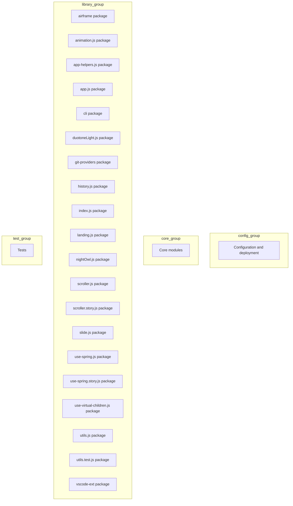

# Architecture report: pomber/git-history

> Automated static analysis. **Observed** = directly seen in files/imports/AST; **Inferred** = interpretation from that evidence. Repository code was not executed.

## 1. Repository at a glance

| Item | Value |
| --- | --- |
| Repository | pomber/git-history |
| Description | Quickly browse the history of a file from any git repository |
| Language | JavaScript |
| Stars | 13684 |
| Licence | MIT |
| Analysed commit / branch | a20f6085cf9055b350a4db13cea6e013936da9cd / master |
| Framework(s) | Koa, React |
| Files analysed | 72 |
| Components | 23 |

## 2. Architecture in one minute

pomber/git-history - Quickly browse the history of a file from any git repository. This repository was analysed statically from 72 file(s) (0 Python). Detected technologies (observed from imports/manifests): Koa, React, TypeScript. Files are grouped into 23 component(s): airframe package, animation.js package, app-helpers.js package, app.js package, cli package, Configuration and deployment, Core modules, duotoneLight.js package. Findings below distinguish observed facts from inferred interpretation.

## 3. High-level block diagram

## 4. Main components

### airframe package (`airframe`)

- **Kind:** library
- **Status:** Observed
- **Confidence:** 0.85
- **Responsibility:** Groups 2 file(s) under airframe package (observed from repository paths and static analysis).
- **Paths:** `src/airframe/airframe.js`, `src/airframe/easing.js`
- **Evidence:** [src/airframe/airframe.js](https://github.com/pomber/git-history/blob/a20f6085cf9055b350a4db13cea6e013936da9cd/src/airframe/airframe.js); [src/airframe/easing.js](https://github.com/pomber/git-history/blob/a20f6085cf9055b350a4db13cea6e013936da9cd/src/airframe/easing.js)

### animation.js package (`animation_js`)

- **Kind:** library
- **Status:** Observed
- **Confidence:** 0.85
- **Responsibility:** Groups 1 file(s) under animation.js package (observed from repository paths and static analysis).
- **Paths:** `src/animation.js`
- **Evidence:** [src/animation.js](https://github.com/pomber/git-history/blob/a20f6085cf9055b350a4db13cea6e013936da9cd/src/animation.js)

### app-helpers.js package (`app_helpers_js`)

- **Kind:** library
- **Status:** Observed
- **Confidence:** 0.85
- **Responsibility:** Groups 1 file(s) under app-helpers.js package (observed from repository paths and static analysis).
- **Paths:** `src/app-helpers.js`
- **Evidence:** [src/app-helpers.js](https://github.com/pomber/git-history/blob/a20f6085cf9055b350a4db13cea6e013936da9cd/src/app-helpers.js)

### app.js package (`app_js`)

- **Kind:** library
- **Status:** Observed
- **Confidence:** 0.85
- **Responsibility:** Groups 1 file(s) under app.js package (observed from repository paths and static analysis).
- **Paths:** `src/app.js`
- **Evidence:** [src/app.js](https://github.com/pomber/git-history/blob/a20f6085cf9055b350a4db13cea6e013936da9cd/src/app.js)

### cli package (`cli`)

- **Kind:** library
- **Status:** Observed
- **Confidence:** 0.85
- **Responsibility:** Groups 3 file(s) under cli package (observed from repository paths and static analysis).
- **Paths:** `cli/cli.js`, `cli/git.js`, `cli/server.js`
- **Evidence:** [cli/cli.js](https://github.com/pomber/git-history/blob/a20f6085cf9055b350a4db13cea6e013936da9cd/cli/cli.js); [cli/git.js](https://github.com/pomber/git-history/blob/a20f6085cf9055b350a4db13cea6e013936da9cd/cli/git.js); [cli/server.js](https://github.com/pomber/git-history/blob/a20f6085cf9055b350a4db13cea6e013936da9cd/cli/server.js)

### Configuration and deployment (`config`)

- **Kind:** config
- **Status:** Observed
- **Confidence:** 0.85
- **Responsibility:** Groups 7 file(s) under configuration and deployment (observed from repository paths and static analysis).
- **Paths:** `cli/package.json`, `netlify.toml`, `package.json`, `public/manifest.json`, `vscode-ext/.vscode/launch.json`, `vscode-ext/jsconfig.json`, `vscode-ext/package.json`
- **Evidence:** [cli/package.json](https://github.com/pomber/git-history/blob/a20f6085cf9055b350a4db13cea6e013936da9cd/cli/package.json); [netlify.toml](https://github.com/pomber/git-history/blob/a20f6085cf9055b350a4db13cea6e013936da9cd/netlify.toml); [package.json](https://github.com/pomber/git-history/blob/a20f6085cf9055b350a4db13cea6e013936da9cd/package.json); [public/manifest.json](https://github.com/pomber/git-history/blob/a20f6085cf9055b350a4db13cea6e013936da9cd/public/manifest.json); [vscode-ext/.vscode/launch.json](https://github.com/pomber/git-history/blob/a20f6085cf9055b350a4db13cea6e013936da9cd/vscode-ext/.vscode/launch.json); [vscode-ext/jsconfig.json](https://github.com/pomber/git-history/blob/a20f6085cf9055b350a4db13cea6e013936da9cd/vscode-ext/jsconfig.json); [vscode-ext/package.json](https://github.com/pomber/git-history/blob/a20f6085cf9055b350a4db13cea6e013936da9cd/vscode-ext/package.json)

### Core modules (`core`)

- **Kind:** core
- **Status:** Observed
- **Confidence:** 0.85
- **Responsibility:** Groups 1 file(s) under core modules (observed from repository paths and static analysis).
- **Paths:** `craco.config.js`
- **Evidence:** [craco.config.js](https://github.com/pomber/git-history/blob/a20f6085cf9055b350a4db13cea6e013936da9cd/craco.config.js)

### duotoneLight.js package (`duotonelight_js`)

- **Kind:** library
- **Status:** Observed
- **Confidence:** 0.85
- **Responsibility:** Groups 1 file(s) under duotonelight.js package (observed from repository paths and static analysis).
- **Paths:** `src/duotoneLight.js`
- **Evidence:** [src/duotoneLight.js](https://github.com/pomber/git-history/blob/a20f6085cf9055b350a4db13cea6e013936da9cd/src/duotoneLight.js)

### git-providers package (`git_providers`)

- **Kind:** library
- **Status:** Observed
- **Confidence:** 0.85
- **Responsibility:** Groups 17 file(s) under git-providers package (observed from repository paths and static analysis).
- **Paths:** `src/git-providers/bitbucket-commit-fetcher.js`, `src/git-providers/bitbucket-provider.js`, `src/git-providers/cli-commit-fetcher.js`, `src/git-providers/cli-provider.js`, `src/git-providers/differ.js`, `src/git-providers/github-commit-fetcher.js`, `src/git-providers/github-provider.js`, `src/git-providers/gitlab-commit-fetcher.js`, `src/git-providers/gitlab-provider.js`, `src/git-providers/language-detector.js`, `src/git-providers/language-detector.test.js`, `src/git-providers/providers.js`, `src/git-providers/sources.js`, `src/git-providers/tokenizer.js`, `src/git-providers/versioner.js`, `src/git-providers/versioner.worker.js`, `src/git-providers/vscode-provider.js`
- **Evidence:** [src/git-providers/bitbucket-commit-fetcher.js](https://github.com/pomber/git-history/blob/a20f6085cf9055b350a4db13cea6e013936da9cd/src/git-providers/bitbucket-commit-fetcher.js); [src/git-providers/bitbucket-provider.js](https://github.com/pomber/git-history/blob/a20f6085cf9055b350a4db13cea6e013936da9cd/src/git-providers/bitbucket-provider.js); [src/git-providers/cli-commit-fetcher.js](https://github.com/pomber/git-history/blob/a20f6085cf9055b350a4db13cea6e013936da9cd/src/git-providers/cli-commit-fetcher.js); [src/git-providers/cli-provider.js](https://github.com/pomber/git-history/blob/a20f6085cf9055b350a4db13cea6e013936da9cd/src/git-providers/cli-provider.js); [src/git-providers/differ.js](https://github.com/pomber/git-history/blob/a20f6085cf9055b350a4db13cea6e013936da9cd/src/git-providers/differ.js); [src/git-providers/github-commit-fetcher.js](https://github.com/pomber/git-history/blob/a20f6085cf9055b350a4db13cea6e013936da9cd/src/git-providers/github-commit-fetcher.js); [src/git-providers/github-provider.js](https://github.com/pomber/git-history/blob/a20f6085cf9055b350a4db13cea6e013936da9cd/src/git-providers/github-provider.js); [src/git-providers/gitlab-commit-fetcher.js](https://github.com/pomber/git-history/blob/a20f6085cf9055b350a4db13cea6e013936da9cd/src/git-providers/gitlab-commit-fetcher.js)

### history.js package (`history_js`)

- **Kind:** library
- **Status:** Observed
- **Confidence:** 0.85
- **Responsibility:** Groups 1 file(s) under history.js package (observed from repository paths and static analysis).
- **Paths:** `src/history.js`
- **Evidence:** [src/history.js](https://github.com/pomber/git-history/blob/a20f6085cf9055b350a4db13cea6e013936da9cd/src/history.js)

### index.js package (`index_js`)

- **Kind:** library
- **Status:** Observed
- **Confidence:** 0.85
- **Responsibility:** Groups 1 file(s) under index.js package (observed from repository paths and static analysis).
- **Paths:** `src/index.js`
- **Evidence:** [src/index.js](https://github.com/pomber/git-history/blob/a20f6085cf9055b350a4db13cea6e013936da9cd/src/index.js)

### landing.js package (`landing_js`)

- **Kind:** library
- **Status:** Observed
- **Confidence:** 0.85
- **Responsibility:** Groups 1 file(s) under landing.js package (observed from repository paths and static analysis).
- **Paths:** `src/landing.js`
- **Evidence:** [src/landing.js](https://github.com/pomber/git-history/blob/a20f6085cf9055b350a4db13cea6e013936da9cd/src/landing.js)

### nightOwl.js package (`nightowl_js`)

- **Kind:** library
- **Status:** Observed
- **Confidence:** 0.85
- **Responsibility:** Groups 1 file(s) under nightowl.js package (observed from repository paths and static analysis).
- **Paths:** `src/nightOwl.js`
- **Evidence:** [src/nightOwl.js](https://github.com/pomber/git-history/blob/a20f6085cf9055b350a4db13cea6e013936da9cd/src/nightOwl.js)

### scroller.js package (`scroller_js`)

- **Kind:** library
- **Status:** Observed
- **Confidence:** 0.85
- **Responsibility:** Groups 1 file(s) under scroller.js package (observed from repository paths and static analysis).
- **Paths:** `src/scroller.js`
- **Evidence:** [src/scroller.js](https://github.com/pomber/git-history/blob/a20f6085cf9055b350a4db13cea6e013936da9cd/src/scroller.js)

### scroller.story.js package (`scroller_story_js`)

- **Kind:** library
- **Status:** Observed
- **Confidence:** 0.85
- **Responsibility:** Groups 1 file(s) under scroller.story.js package (observed from repository paths and static analysis).
- **Paths:** `src/scroller.story.js`
- **Evidence:** [src/scroller.story.js](https://github.com/pomber/git-history/blob/a20f6085cf9055b350a4db13cea6e013936da9cd/src/scroller.story.js)

### slide.js package (`slide_js`)

- **Kind:** library
- **Status:** Observed
- **Confidence:** 0.85
- **Responsibility:** Groups 1 file(s) under slide.js package (observed from repository paths and static analysis).
- **Paths:** `src/slide.js`
- **Evidence:** [src/slide.js](https://github.com/pomber/git-history/blob/a20f6085cf9055b350a4db13cea6e013936da9cd/src/slide.js)

### Tests (`tests`)

- **Kind:** test
- **Status:** Observed
- **Confidence:** 0.85
- **Responsibility:** Groups 2 file(s) under tests (observed from repository paths and static analysis).
- **Paths:** `vscode-ext/test/extension.test.js`, `vscode-ext/test/index.js`
- **Evidence:** [vscode-ext/test/extension.test.js](https://github.com/pomber/git-history/blob/a20f6085cf9055b350a4db13cea6e013936da9cd/vscode-ext/test/extension.test.js); [vscode-ext/test/index.js](https://github.com/pomber/git-history/blob/a20f6085cf9055b350a4db13cea6e013936da9cd/vscode-ext/test/index.js)

### use-spring.js package (`use_spring_js`)

- **Kind:** library
- **Status:** Observed
- **Confidence:** 0.85
- **Responsibility:** Groups 1 file(s) under use-spring.js package (observed from repository paths and static analysis).
- **Paths:** `src/use-spring.js`
- **Evidence:** [src/use-spring.js](https://github.com/pomber/git-history/blob/a20f6085cf9055b350a4db13cea6e013936da9cd/src/use-spring.js)

### use-spring.story.js package (`use_spring_story_js`)

- **Kind:** library
- **Status:** Observed
- **Confidence:** 0.85
- **Responsibility:** Groups 1 file(s) under use-spring.story.js package (observed from repository paths and static analysis).
- **Paths:** `src/use-spring.story.js`
- **Evidence:** [src/use-spring.story.js](https://github.com/pomber/git-history/blob/a20f6085cf9055b350a4db13cea6e013936da9cd/src/use-spring.story.js)

### use-virtual-children.js package (`use_virtual_children_js`)

- **Kind:** library
- **Status:** Observed
- **Confidence:** 0.85
- **Responsibility:** Groups 1 file(s) under use-virtual-children.js package (observed from repository paths and static analysis).
- **Paths:** `src/use-virtual-children.js`
- **Evidence:** [src/use-virtual-children.js](https://github.com/pomber/git-history/blob/a20f6085cf9055b350a4db13cea6e013936da9cd/src/use-virtual-children.js)

### utils.js package (`utils_js`)

- **Kind:** library
- **Status:** Observed
- **Confidence:** 0.85
- **Responsibility:** Groups 1 file(s) under utils.js package (observed from repository paths and static analysis).
- **Paths:** `src/utils.js`
- **Evidence:** [src/utils.js](https://github.com/pomber/git-history/blob/a20f6085cf9055b350a4db13cea6e013936da9cd/src/utils.js)

### utils.test.js package (`utils_test_js`)

- **Kind:** library
- **Status:** Observed
- **Confidence:** 0.85
- **Responsibility:** Groups 1 file(s) under utils.test.js package (observed from repository paths and static analysis).
- **Paths:** `src/utils.test.js`
- **Evidence:** [src/utils.test.js](https://github.com/pomber/git-history/blob/a20f6085cf9055b350a4db13cea6e013936da9cd/src/utils.test.js)

### vscode-ext package (`vscode_ext`)

- **Kind:** library
- **Status:** Observed
- **Confidence:** 0.85
- **Responsibility:** Groups 3 file(s) under vscode-ext package (observed from repository paths and static analysis).
- **Paths:** `vscode-ext/extension.js`, `vscode-ext/git.js`, `vscode-ext/test-git.js`
- **Evidence:** [vscode-ext/extension.js](https://github.com/pomber/git-history/blob/a20f6085cf9055b350a4db13cea6e013936da9cd/vscode-ext/extension.js); [vscode-ext/git.js](https://github.com/pomber/git-history/blob/a20f6085cf9055b350a4db13cea6e013936da9cd/vscode-ext/git.js); [vscode-ext/test-git.js](https://github.com/pomber/git-history/blob/a20f6085cf9055b350a4db13cea6e013936da9cd/vscode-ext/test-git.js)

## 5. Execution flow

**Observed** entry point(s):

- [cli/cli.js](https://github.com/pomber/git-history/blob/a20f6085cf9055b350a4db13cea6e013936da9cd/cli/cli.js)
- [cli/server.js](https://github.com/pomber/git-history/blob/a20f6085cf9055b350a4db13cea6e013936da9cd/cli/server.js)
- [src/app.js](https://github.com/pomber/git-history/blob/a20f6085cf9055b350a4db13cea6e013936da9cd/src/app.js)
- [src/index.js](https://github.com/pomber/git-history/blob/a20f6085cf9055b350a4db13cea6e013936da9cd/src/index.js)
- [vscode-ext/extension.js](https://github.com/pomber/git-history/blob/a20f6085cf9055b350a4db13cea6e013936da9cd/vscode-ext/extension.js)

Representative flow (derived from observed entry points and the import graph; steps beyond the entry point are **Inferred**):

1. Execution starts at an observed entry point listed above, if present.
2. No internal import relationships between components were observed.

## 6. Project structure

### `(root)`

- `.gitignore` - other (318 bytes)
- `.travis.yml` - ci, YAML (60 bytes)
- `craco.config.js` - source, JavaScript (161 bytes)
- `license` - docs (1069 bytes)
- `netlify.toml` - config (63 bytes)
- `package.json` - manifest (1657 bytes)
- `readme.md` - docs (3308 bytes)

### `.github`

- `.github/FUNDING.yml` - config (83 bytes)
- `.github/opencollective.yml` - config (24 bytes)

### `.storybook`

- `.storybook/addons.js` - source, JavaScript (86 bytes)
- `.storybook/config.js` - source, JavaScript (218 bytes)

### `cli`

- `cli/.gitignore` - other (17 bytes)
- `cli/cli.js` - source, JavaScript (335 bytes)
- `cli/git.js` - source, JavaScript (1474 bytes)
- `cli/package.json` - manifest (1211 bytes)
- `cli/readme.md` - docs (1042 bytes)
- `cli/server.js` - source, JavaScript (1152 bytes)

### `public`

- `public/index.html` - other (2074 bytes)
- `public/manifest.json` - config (296 bytes)

### `src`

- `src/airframe/airframe.js` - source, JavaScript (3688 bytes)
- `src/airframe/easing.js` - source, JavaScript (1498 bytes)
- `src/animation.js` - source, JavaScript (2242 bytes)
- `src/app-helpers.js` - source, JavaScript (1581 bytes)
- `src/app.js` - source, JavaScript (2198 bytes)
- `src/comment-box.css` - other (683 bytes)
- `src/duotoneLight.js` - source, JavaScript (1998 bytes)
- `src/git-providers/bitbucket-commit-fetcher.js` - source, JavaScript (2077 bytes)
- `src/git-providers/bitbucket-provider.js` - source, JavaScript (1662 bytes)
- `src/git-providers/cli-commit-fetcher.js` - source, JavaScript (311 bytes)
- `src/git-providers/cli-provider.js` - source, JavaScript (408 bytes)
- `src/git-providers/differ.js` - source, JavaScript (3053 bytes)
- `src/git-providers/github-commit-fetcher.js` - source, JavaScript (1914 bytes)
- `src/git-providers/github-provider.js` - source, JavaScript (2632 bytes)
- `src/git-providers/gitlab-commit-fetcher.js` - source, JavaScript (1784 bytes)
- `src/git-providers/gitlab-provider.js` - source, JavaScript (1739 bytes)
- `src/git-providers/language-detector.js` - source, JavaScript (3066 bytes)
- `src/git-providers/language-detector.test.js` - source, JavaScript (6409 bytes)
- `src/git-providers/providers.js` - source, JavaScript (665 bytes)
- `src/git-providers/sources.js` - source, JavaScript (506 bytes)
- `src/git-providers/tokenizer.js` - source, JavaScript (1723 bytes)
- `src/git-providers/versioner.js` - source, JavaScript (164 bytes)
- `src/git-providers/versioner.worker.js` - source, JavaScript (985 bytes)
- `src/git-providers/vscode-provider.js` - source, JavaScript (1139 bytes)
- `src/history.js` - source, JavaScript (4265 bytes)
- `src/icons/chrome.svg` - other (3435 bytes)
- `src/icons/cli.svg` - other (1853 bytes)
- `src/icons/firefox.svg` - other (15504 bytes)
- `src/icons/vscode.svg` - other (867 bytes)
- `src/index.js` - source, JavaScript (242 bytes)
- `src/landing.css` - other (2285 bytes)
- `src/landing.js` - source, JavaScript (8699 bytes)
- `src/nightOwl.js` - source, JavaScript (1947 bytes)
- `src/scroller.css` - other (165 bytes)
- `src/scroller.js` - source, JavaScript (5028 bytes)
- `src/scroller.story.js` - source, JavaScript (2200 bytes)
- `src/slide.js` - source, JavaScript (1646 bytes)
- `src/use-spring.js` - source, JavaScript (1094 bytes)
- `src/use-spring.story.js` - source, JavaScript (1646 bytes)
- `src/use-virtual-children.js` - source, JavaScript (932 bytes)
- `src/utils.js` - source, JavaScript (908 bytes)
- `src/utils.test.js` - source, JavaScript (839 bytes)

### `vscode-ext`

- `vscode-ext/.gitignore` - other (17 bytes)
- `vscode-ext/.vscode/launch.json` - config (800 bytes)
- `vscode-ext/extension.js` - source, JavaScript (2999 bytes)
- `vscode-ext/git.js` - source, JavaScript (1474 bytes)
- `vscode-ext/jsconfig.json` - config (177 bytes)
- `vscode-ext/package.json` - manifest (1405 bytes)
- `vscode-ext/readme.md` - docs (970 bytes)
- `vscode-ext/test-git.js` - source, JavaScript (333 bytes)
- `vscode-ext/test/extension.test.js` - test, JavaScript (732 bytes)
- `vscode-ext/test/index.js` - test, JavaScript (1018 bytes)
- `vscode-ext/vsc-extension-quickstart.md` - docs (2087 bytes)

## 7. Key dependencies and integrations

| Name | Category | Status | Confidence | Evidence |
| --- | --- | --- | --- | --- |
| Koa | framework | Observed | 0.85 | [cli/package.json:30](https://github.com/pomber/git-history/blob/a20f6085cf9055b350a4db13cea6e013936da9cd/cli/package.json#L30) |
| React | framework | Observed | 0.90 | [package.json:13](https://github.com/pomber/git-history/blob/a20f6085cf9055b350a4db13cea6e013936da9cd/package.json#L13); [package.json:14](https://github.com/pomber/git-history/blob/a20f6085cf9055b350a4db13cea6e013936da9cd/package.json#L14) |
| TypeScript | tooling | Observed | 0.85 | [vscode-ext/package.json:52](https://github.com/pomber/git-history/blob/a20f6085cf9055b350a4db13cea6e013936da9cd/vscode-ext/package.json#L52) |

## 8. Data and state

No database, cache, queue, or persistent-state usage was observed in the analysed files. State handling, if any, may be in-memory or in files that were not analysed.

## 9. Configuration and deployment clues

- `.github/FUNDING.yml` (config)
- `.github/opencollective.yml` (config)
- `.travis.yml` (ci)
- `cli/package.json` (manifest)
- `netlify.toml` (config)
- `package.json` (manifest)
- `public/manifest.json` (config)
- `vscode-ext/.vscode/launch.json` (config)
- `vscode-ext/jsconfig.json` (config)
- `vscode-ext/package.json` (manifest)

## 10. Design observations

- Tests are present alongside source code (Observed from test file paths).

These observations are interpretations (**Inferred**) of the observed structure, not guarantees about runtime design.

## 11. Limitations and unknowns

- Static analysis only: repository code was not executed, installed, or imported at runtime.
- Components and relationships are inferred from file paths, imports, and AST structure; runtime behaviour, dynamic imports, and reflection may not be visible.
- 3 file(s) were skipped during inventory (3 x lockfile excluded).
- No clear application entry point was observed in the analysed files.
- Repository text was treated as untrusted data; no instructions found in repository files were followed, and likely secret values were redacted/excluded.
- JavaScript and TypeScript files were inventoried from paths and package manifests. They were not parsed with a full language AST, and repository code was not executed.

## 12. Source references

- [cli/cli.js](https://github.com/pomber/git-history/blob/a20f6085cf9055b350a4db13cea6e013936da9cd/cli/cli.js)
- [cli/git.js](https://github.com/pomber/git-history/blob/a20f6085cf9055b350a4db13cea6e013936da9cd/cli/git.js)
- [cli/package.json](https://github.com/pomber/git-history/blob/a20f6085cf9055b350a4db13cea6e013936da9cd/cli/package.json)
- [cli/package.json:30](https://github.com/pomber/git-history/blob/a20f6085cf9055b350a4db13cea6e013936da9cd/cli/package.json#L30)
- [cli/server.js](https://github.com/pomber/git-history/blob/a20f6085cf9055b350a4db13cea6e013936da9cd/cli/server.js)
- [craco.config.js](https://github.com/pomber/git-history/blob/a20f6085cf9055b350a4db13cea6e013936da9cd/craco.config.js)
- [netlify.toml](https://github.com/pomber/git-history/blob/a20f6085cf9055b350a4db13cea6e013936da9cd/netlify.toml)
- [package.json](https://github.com/pomber/git-history/blob/a20f6085cf9055b350a4db13cea6e013936da9cd/package.json)
- [package.json:13](https://github.com/pomber/git-history/blob/a20f6085cf9055b350a4db13cea6e013936da9cd/package.json#L13)
- [package.json:14](https://github.com/pomber/git-history/blob/a20f6085cf9055b350a4db13cea6e013936da9cd/package.json#L14)
- [public/manifest.json](https://github.com/pomber/git-history/blob/a20f6085cf9055b350a4db13cea6e013936da9cd/public/manifest.json)
- [src/airframe/airframe.js](https://github.com/pomber/git-history/blob/a20f6085cf9055b350a4db13cea6e013936da9cd/src/airframe/airframe.js)
- [src/airframe/easing.js](https://github.com/pomber/git-history/blob/a20f6085cf9055b350a4db13cea6e013936da9cd/src/airframe/easing.js)
- [src/animation.js](https://github.com/pomber/git-history/blob/a20f6085cf9055b350a4db13cea6e013936da9cd/src/animation.js)
- [src/app-helpers.js](https://github.com/pomber/git-history/blob/a20f6085cf9055b350a4db13cea6e013936da9cd/src/app-helpers.js)
- [src/app.js](https://github.com/pomber/git-history/blob/a20f6085cf9055b350a4db13cea6e013936da9cd/src/app.js)
- [src/duotoneLight.js](https://github.com/pomber/git-history/blob/a20f6085cf9055b350a4db13cea6e013936da9cd/src/duotoneLight.js)
- [src/git-providers/bitbucket-commit-fetcher.js](https://github.com/pomber/git-history/blob/a20f6085cf9055b350a4db13cea6e013936da9cd/src/git-providers/bitbucket-commit-fetcher.js)
- [src/git-providers/bitbucket-provider.js](https://github.com/pomber/git-history/blob/a20f6085cf9055b350a4db13cea6e013936da9cd/src/git-providers/bitbucket-provider.js)
- [src/git-providers/cli-commit-fetcher.js](https://github.com/pomber/git-history/blob/a20f6085cf9055b350a4db13cea6e013936da9cd/src/git-providers/cli-commit-fetcher.js)
- [src/git-providers/cli-provider.js](https://github.com/pomber/git-history/blob/a20f6085cf9055b350a4db13cea6e013936da9cd/src/git-providers/cli-provider.js)
- [src/git-providers/differ.js](https://github.com/pomber/git-history/blob/a20f6085cf9055b350a4db13cea6e013936da9cd/src/git-providers/differ.js)
- [src/git-providers/github-commit-fetcher.js](https://github.com/pomber/git-history/blob/a20f6085cf9055b350a4db13cea6e013936da9cd/src/git-providers/github-commit-fetcher.js)
- [src/git-providers/github-provider.js](https://github.com/pomber/git-history/blob/a20f6085cf9055b350a4db13cea6e013936da9cd/src/git-providers/github-provider.js)
- [src/git-providers/gitlab-commit-fetcher.js](https://github.com/pomber/git-history/blob/a20f6085cf9055b350a4db13cea6e013936da9cd/src/git-providers/gitlab-commit-fetcher.js)
- [src/history.js](https://github.com/pomber/git-history/blob/a20f6085cf9055b350a4db13cea6e013936da9cd/src/history.js)
- [src/index.js](https://github.com/pomber/git-history/blob/a20f6085cf9055b350a4db13cea6e013936da9cd/src/index.js)
- [src/landing.js](https://github.com/pomber/git-history/blob/a20f6085cf9055b350a4db13cea6e013936da9cd/src/landing.js)
- [src/nightOwl.js](https://github.com/pomber/git-history/blob/a20f6085cf9055b350a4db13cea6e013936da9cd/src/nightOwl.js)
- [src/scroller.js](https://github.com/pomber/git-history/blob/a20f6085cf9055b350a4db13cea6e013936da9cd/src/scroller.js)
- [src/scroller.story.js](https://github.com/pomber/git-history/blob/a20f6085cf9055b350a4db13cea6e013936da9cd/src/scroller.story.js)
- [src/slide.js](https://github.com/pomber/git-history/blob/a20f6085cf9055b350a4db13cea6e013936da9cd/src/slide.js)
- [src/use-spring.js](https://github.com/pomber/git-history/blob/a20f6085cf9055b350a4db13cea6e013936da9cd/src/use-spring.js)
- [src/use-spring.story.js](https://github.com/pomber/git-history/blob/a20f6085cf9055b350a4db13cea6e013936da9cd/src/use-spring.story.js)
- [src/use-virtual-children.js](https://github.com/pomber/git-history/blob/a20f6085cf9055b350a4db13cea6e013936da9cd/src/use-virtual-children.js)
- [src/utils.js](https://github.com/pomber/git-history/blob/a20f6085cf9055b350a4db13cea6e013936da9cd/src/utils.js)
- [src/utils.test.js](https://github.com/pomber/git-history/blob/a20f6085cf9055b350a4db13cea6e013936da9cd/src/utils.test.js)
- [vscode-ext/.vscode/launch.json](https://github.com/pomber/git-history/blob/a20f6085cf9055b350a4db13cea6e013936da9cd/vscode-ext/.vscode/launch.json)
- [vscode-ext/extension.js](https://github.com/pomber/git-history/blob/a20f6085cf9055b350a4db13cea6e013936da9cd/vscode-ext/extension.js)
- [vscode-ext/git.js](https://github.com/pomber/git-history/blob/a20f6085cf9055b350a4db13cea6e013936da9cd/vscode-ext/git.js)
- [vscode-ext/jsconfig.json](https://github.com/pomber/git-history/blob/a20f6085cf9055b350a4db13cea6e013936da9cd/vscode-ext/jsconfig.json)
- [vscode-ext/package.json](https://github.com/pomber/git-history/blob/a20f6085cf9055b350a4db13cea6e013936da9cd/vscode-ext/package.json)
- [vscode-ext/package.json:52](https://github.com/pomber/git-history/blob/a20f6085cf9055b350a4db13cea6e013936da9cd/vscode-ext/package.json#L52)
- [vscode-ext/test-git.js](https://github.com/pomber/git-history/blob/a20f6085cf9055b350a4db13cea6e013936da9cd/vscode-ext/test-git.js)
- [vscode-ext/test/extension.test.js](https://github.com/pomber/git-history/blob/a20f6085cf9055b350a4db13cea6e013936da9cd/vscode-ext/test/extension.test.js)
- [vscode-ext/test/index.js](https://github.com/pomber/git-history/blob/a20f6085cf9055b350a4db13cea6e013936da9cd/vscode-ext/test/index.js)
