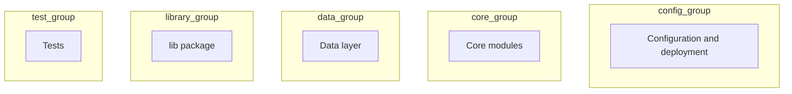

# Architecture report: postcss/autoprefixer

> Automated static analysis. **Observed** = directly seen in files/imports/AST; **Inferred** = interpretation from that evidence. Repository code was not executed.

## 1. Repository at a glance

| Item | Value |
| --- | --- |
| Repository | postcss/autoprefixer |
| Description |  Parse CSS and add vendor prefixes to rules by Can I Use |
| Language | JavaScript |
| Stars | 22197 |
| Licence | MIT |
| Analysed commit / branch | 58135fad52420576fce568223603ab1e382329ea / main |
| Framework(s) | None detected |
| Files analysed | 278 |
| Components | 5 |

## 2. Architecture in one minute

postcss/autoprefixer -  Parse CSS and add vendor prefixes to rules by Can I Use. This repository was analysed statically from 278 file(s) (0 Python). Detected technologies (observed from imports/manifests): GitHub Actions, TypeScript. Files are grouped into 5 component(s): Configuration and deployment, Core modules, Data layer, lib package, Tests. Findings below distinguish observed facts from inferred interpretation.

## 3. High-level block diagram

## 4. Main components

### Configuration and deployment (`config`)

- **Kind:** config
- **Status:** Observed
- **Confidence:** 0.85
- **Responsibility:** Groups 2 file(s) under configuration and deployment (observed from repository paths and static analysis).
- **Paths:** `package.json`, `pnpm-workspace.yaml`
- **Evidence:** [package.json](https://github.com/postcss/autoprefixer/blob/58135fad52420576fce568223603ab1e382329ea/package.json); [pnpm-workspace.yaml](https://github.com/postcss/autoprefixer/blob/58135fad52420576fce568223603ab1e382329ea/pnpm-workspace.yaml)

### Core modules (`core`)

- **Kind:** core
- **Status:** Observed
- **Confidence:** 0.85
- **Responsibility:** Groups 2 file(s) under core modules (observed from repository paths and static analysis).
- **Paths:** `oxfmt.config.ts`, `oxlint.config.ts`
- **Evidence:** [oxfmt.config.ts](https://github.com/postcss/autoprefixer/blob/58135fad52420576fce568223603ab1e382329ea/oxfmt.config.ts); [oxlint.config.ts](https://github.com/postcss/autoprefixer/blob/58135fad52420576fce568223603ab1e382329ea/oxlint.config.ts)

### Data layer (`data_layer`)

- **Kind:** data
- **Status:** Observed
- **Confidence:** 0.85
- **Responsibility:** Groups 1 file(s) under data layer (observed from repository paths and static analysis).
- **Paths:** `data/prefixes.js`
- **Evidence:** [data/prefixes.js](https://github.com/postcss/autoprefixer/blob/58135fad52420576fce568223603ab1e382329ea/data/prefixes.js)

### lib package (`lib`)

- **Kind:** library
- **Status:** Observed
- **Confidence:** 0.85
- **Responsibility:** Groups 78 file(s) under lib package (observed from repository paths and static analysis).
- **Paths:** `lib/at-rule.js`, `lib/autoprefixer.d.ts`, `lib/autoprefixer.js`, `lib/brackets.js`, `lib/browsers.js`, `lib/declaration.js`, `lib/hacks/align-content.js`, `lib/hacks/align-items.js`, `lib/hacks/align-self.js`, `lib/hacks/animation.js`, `lib/hacks/appearance.js`, `lib/hacks/autofill.js`, `lib/hacks/backdrop-filter.js`, `lib/hacks/background-clip.js`, `lib/hacks/background-size.js`, `lib/hacks/block-logical.js`, `lib/hacks/border-image.js`, `lib/hacks/border-radius.js`, `lib/hacks/break-props.js`, `lib/hacks/cross-fade.js`, `lib/hacks/display-flex.js`, `lib/hacks/display-grid.js`, `lib/hacks/file-selector-button.js`, `lib/hacks/filter-value.js`, `lib/hacks/filter.js`, `lib/hacks/flex-basis.js`, `lib/hacks/flex-direction.js`, `lib/hacks/flex-flow.js`, `lib/hacks/flex-grow.js`, `lib/hacks/flex-shrink.js`, `lib/hacks/flex-spec.js`, `lib/hacks/flex-wrap.js`, `lib/hacks/flex.js`, `lib/hacks/fullscreen.js`, `lib/hacks/gradient.js`, `lib/hacks/grid-area.js`, `lib/hacks/grid-column-align.js`, `lib/hacks/grid-end.js`, `lib/hacks/grid-row-align.js`, `lib/hacks/grid-row-column.js`, `lib/hacks/grid-rows-columns.js`, `lib/hacks/grid-start.js`, `lib/hacks/grid-template-areas.js`, `lib/hacks/grid-template.js`, `lib/hacks/grid-utils.js`, `lib/hacks/image-rendering.js`, `lib/hacks/image-set.js`, `lib/hacks/inline-logical.js`, `lib/hacks/intrinsic.js`, `lib/hacks/justify-content.js`, `lib/hacks/mask-border.js`, `lib/hacks/mask-composite.js`, `lib/hacks/order.js`, `lib/hacks/overscroll-behavior.js`, `lib/hacks/pixelated.js`, `lib/hacks/place-self.js`, `lib/hacks/placeholder-shown.js`, `lib/hacks/placeholder.js`, `lib/hacks/print-color-adjust.js`, `lib/hacks/text-decoration-skip-ink.js`, `lib/hacks/text-decoration.js`, `lib/hacks/text-emphasis-position.js`, `lib/hacks/transform-decl.js`, `lib/hacks/user-select.js`, `lib/hacks/writing-mode.js`, `lib/info.js`, `lib/old-selector.js`, `lib/old-value.js`, `lib/prefixer.js`, `lib/prefixes.js`, `lib/processor.js`, `lib/resolution.js`, `lib/selector.js`, `lib/supports.js`, `lib/transition.js`, `lib/utils.js`, `lib/value.js`, `lib/vendor.js`
- **Evidence:** [lib/at-rule.js](https://github.com/postcss/autoprefixer/blob/58135fad52420576fce568223603ab1e382329ea/lib/at-rule.js); [lib/autoprefixer.d.ts](https://github.com/postcss/autoprefixer/blob/58135fad52420576fce568223603ab1e382329ea/lib/autoprefixer.d.ts); [lib/autoprefixer.js](https://github.com/postcss/autoprefixer/blob/58135fad52420576fce568223603ab1e382329ea/lib/autoprefixer.js); [lib/brackets.js](https://github.com/postcss/autoprefixer/blob/58135fad52420576fce568223603ab1e382329ea/lib/brackets.js); [lib/browsers.js](https://github.com/postcss/autoprefixer/blob/58135fad52420576fce568223603ab1e382329ea/lib/browsers.js); [lib/declaration.js](https://github.com/postcss/autoprefixer/blob/58135fad52420576fce568223603ab1e382329ea/lib/declaration.js); [lib/hacks/align-content.js](https://github.com/postcss/autoprefixer/blob/58135fad52420576fce568223603ab1e382329ea/lib/hacks/align-content.js); [lib/hacks/align-items.js](https://github.com/postcss/autoprefixer/blob/58135fad52420576fce568223603ab1e382329ea/lib/hacks/align-items.js)

### Tests (`tests`)

- **Kind:** test
- **Status:** Observed
- **Confidence:** 0.85
- **Responsibility:** Groups 180 file(s) under tests (observed from repository paths and static analysis).
- **Paths:** `test/at-rule.test.js`, `test/autoprefixer.test.js`, `test/brackets.test.js`, `test/browsers.test.js`, `test/cases/3d-transform.css`, `test/cases/3d-transform.out.css`, `test/cases/advanced-filter.css`, `test/cases/advanced-filter.out.css`, `test/cases/animation.css`, `test/cases/animation.out.css`, `test/cases/appearance.css`, `test/cases/appearance.out.css`, `test/cases/at-rules.css`, `test/cases/at-rules.out.css`, `test/cases/autofill.css`, `test/cases/autofill.out.css`, `test/cases/backdrop-filter.css`, `test/cases/backdrop-filter.out.css`, `test/cases/backdrop.css`, `test/cases/backdrop.out.css`, `test/cases/background-clip.css`, `test/cases/background-clip.out.css`, `test/cases/background-size.css`, `test/cases/background-size.out.css`, `test/cases/border-image.css`, `test/cases/border-image.out.css`, `test/cases/border-radius.css`, `test/cases/border-radius.out.css`, `test/cases/cascade.css`, `test/cases/cascade.out.css`, `test/cases/check-down.css`, `test/cases/check-down.out.css`, `test/cases/comments.css`, `test/cases/comments.out.css`, `test/cases/config/browserslist`, `test/cases/config/test.css`, `test/cases/config/test.out.css`, `test/cases/config/test.production.css`, `test/cases/content.css`, `test/cases/cross-fade.css`, `test/cases/cross-fade.out.css`, `test/cases/custom-prefix.css`, `test/cases/custom-prefix.out.css`, `test/cases/disabled.css`, `test/cases/disabled.out.css`, `test/cases/double.css`, `test/cases/double.out.css`, `test/cases/element.css`, `test/cases/element.out.css`, `test/cases/example.css`, `test/cases/example.out.css`, `test/cases/file-selector-button.css`, `test/cases/file-selector-button.out.css`, `test/cases/filter.css`, `test/cases/filter.out.css`, `test/cases/flex-rewrite.css`, `test/cases/flex-rewrite.out.css`, `test/cases/flexbox.css`, `test/cases/flexbox.out.css`, `test/cases/fullscreen.css`, `test/cases/fullscreen.out.css`, `test/cases/gradient-fix.css`, `test/cases/gradient-fix.out.css`, `test/cases/gradient.css`, `test/cases/gradient.out.css`, `test/cases/grid-area-media-sequence.css`, `test/cases/grid-area-media-sequence.out.css`, `test/cases/grid-area.css`, `test/cases/grid-area.out.css`, `test/cases/grid-areas-duplicate-complex.css`, `test/cases/grid-areas-duplicate-complex.out.css`, `test/cases/grid-autoplacement.css`, `test/cases/grid-autoplacement.out.css`, `test/cases/grid-gap.css`, `test/cases/grid-gap.out.css`, `test/cases/grid-media-rules.css`, `test/cases/grid-media-rules.out.css`, `test/cases/grid-options.autoplace.out.css`, `test/cases/grid-options.css`, `test/cases/grid-options.disabled.out.css`, `test/cases/grid-options.no-autoplace.out.css`, `test/cases/grid-status.css`, `test/cases/grid-status.out.css`, `test/cases/grid-template-areas.css`, `test/cases/grid-template-areas.out.css`, `test/cases/grid-template.css`, `test/cases/grid-template.out.css`, `test/cases/grid.css`, `test/cases/grid.disabled.css`, `test/cases/grid.out.css`, `test/cases/grouping-rule.css`, `test/cases/grouping-rule.out.css`, `test/cases/ignore-next-warning.css`, `test/cases/ignore-next-warning.out.css`, `test/cases/ignore-next.css`, `test/cases/ignore-next.out.css`, `test/cases/image-rendering.css`, `test/cases/image-rendering.out.css`, `test/cases/image-set.css`, `test/cases/image-set.out.css`, `test/cases/initial-letter.css`, `test/cases/initial-letter.out.css`, `test/cases/intrinsic.css`, `test/cases/intrinsic.ff.css`, `test/cases/intrinsic.out.css`, `test/cases/keyframes.css`, `test/cases/keyframes.out.css`, `test/cases/logical.css`, `test/cases/logical.out.css`, `test/cases/mask-border.css`, `test/cases/mask-border.out.css`, `test/cases/mask-composite.css`, `test/cases/mask-composite.out.css`, `test/cases/mask-position.css`, `test/cases/mask-position.out.css`, `test/cases/mistakes.css`, `test/cases/mistakes.out.css`, `test/cases/multicolumn.css`, `test/cases/multicolumn.out.css`, `test/cases/notes.css`, `test/cases/notes.out.css`, `test/cases/overscroll-behavior.css`, `test/cases/overscroll-behavior.out.css`, `test/cases/pie.css`, `test/cases/placeholder-shown.css`, `test/cases/placeholder-shown.out.css`, `test/cases/placeholder.css`, `test/cases/placeholder.out.css`, `test/cases/print-color-adjust.css`, `test/cases/print-color-adjust.out.css`, `test/cases/resolution.css`, `test/cases/resolution.out.css`, `test/cases/scope.css`, `test/cases/scope.out.css`, `test/cases/selectors.css`, `test/cases/selectors.out.css`, `test/cases/style.css`, `test/cases/style.out.css`, `test/cases/supports.css`, `test/cases/supports.out.css`, `test/cases/syntax.css`, `test/cases/text-decoration.css`, `test/cases/text-decoration.out.css`, `test/cases/text-decoration.shorthand.out.css`, `test/cases/text-emphasis-position.css`, `test/cases/text-emphasis-position.out.css`, `test/cases/transition-no-warning.css`, `test/cases/transition-no-warning.out.css`, `test/cases/transition-spec.css`, `test/cases/transition-spec.out.css`, `test/cases/transition.css`, `test/cases/transition.out.css`, `test/cases/trim.css`, `test/cases/uncascade.css`, `test/cases/uncascade.out.css`, `test/cases/user-select.css`, `test/cases/user-select.out.css`, `test/cases/value-hack.css`, `test/cases/value-hack.out.css`, `test/cases/values.css`, `test/cases/values.out.css`, `test/cases/vendor-hack.css`, `test/cases/vendor-hack.out.css`, `test/cases/viewport.css`, `test/cases/viewport.out.css`, `test/cases/webkit-line-clamp.css`, `test/cases/webkit-line-clamp.out.css`, `test/cases/writing-mode.css`, `test/cases/writing-mode.out.css`, `test/declaration.test.js`, `test/info.test.js`, `test/old-selector.test.js`, `test/old-value.test.js`, `test/postcss.test.js`, `test/prefixer.test.js`, `test/prefixes.test.js`, `test/selector.test.js`, `test/supports.test.js`, `test/utils.test.js`, `test/value.test.js`
- **Evidence:** [test/at-rule.test.js](https://github.com/postcss/autoprefixer/blob/58135fad52420576fce568223603ab1e382329ea/test/at-rule.test.js); [test/autoprefixer.test.js](https://github.com/postcss/autoprefixer/blob/58135fad52420576fce568223603ab1e382329ea/test/autoprefixer.test.js); [test/brackets.test.js](https://github.com/postcss/autoprefixer/blob/58135fad52420576fce568223603ab1e382329ea/test/brackets.test.js); [test/browsers.test.js](https://github.com/postcss/autoprefixer/blob/58135fad52420576fce568223603ab1e382329ea/test/browsers.test.js); [test/cases/3d-transform.css](https://github.com/postcss/autoprefixer/blob/58135fad52420576fce568223603ab1e382329ea/test/cases/3d-transform.css); [test/cases/3d-transform.out.css](https://github.com/postcss/autoprefixer/blob/58135fad52420576fce568223603ab1e382329ea/test/cases/3d-transform.out.css); [test/cases/advanced-filter.css](https://github.com/postcss/autoprefixer/blob/58135fad52420576fce568223603ab1e382329ea/test/cases/advanced-filter.css); [test/cases/advanced-filter.out.css](https://github.com/postcss/autoprefixer/blob/58135fad52420576fce568223603ab1e382329ea/test/cases/advanced-filter.out.css)

## 5. Execution flow

**Observed** entry point(s):

- [bin/autoprefixer](https://github.com/postcss/autoprefixer/blob/58135fad52420576fce568223603ab1e382329ea/bin/autoprefixer)
- [lib/autoprefixer.js](https://github.com/postcss/autoprefixer/blob/58135fad52420576fce568223603ab1e382329ea/lib/autoprefixer.js)

Representative flow (derived from observed entry points and the import graph; steps beyond the entry point are **Inferred**):

1. Execution starts at an observed entry point listed above, if present.
2. No internal import relationships between components were observed.

## 6. Project structure

### `(root)`

- `.devcontainer.json` - config (48 bytes)
- `.editorconfig` - config (147 bytes)
- `.gitignore` - other (25 bytes)
- `.npmignore` - other (34 bytes)
- `.prettierrc.js` - source, JavaScript (87 bytes)
- `AUTHORS` - other (6769 bytes)
- `CHANGELOG.md` - docs (35580 bytes)
- `LICENSE` - docs (1095 bytes)
- `README.md` - docs (30817 bytes)
- `logo.svg` - other (403 bytes)
- `oxfmt.config.ts` - source, TypeScript (136 bytes)
- `oxlint.config.ts` - source, TypeScript (670 bytes)
- `package.json` - manifest (2032 bytes)
- `pnpm-workspace.yaml` - config (91 bytes)

### `.github`

- `.github/CONTRIBUTING.md` - docs (3394 bytes)
- `.github/FUNDING.yml` - config (63 bytes)
- `.github/workflows/release.yml` - ci, YAML (1253 bytes)
- `.github/workflows/test.yml` - ci, YAML (2266 bytes)

### `bin`

- `bin/autoprefixer` - other (554 bytes)

### `data`

- `data/prefixes.js` - source, JavaScript (24212 bytes)

### `lib`

- `lib/at-rule.js` - source, JavaScript (702 bytes)
- `lib/autoprefixer.d.ts` - source, TypeScript (2448 bytes)
- `lib/autoprefixer.js` - source, JavaScript (4182 bytes)
- `lib/brackets.js` - source, JavaScript (959 bytes)
- `lib/browsers.js` - source, JavaScript (1769 bytes)
- `lib/declaration.js` - source, JavaScript (4068 bytes)
- `lib/hacks/align-content.js` - source, JavaScript (1058 bytes)
- `lib/hacks/align-items.js` - source, JavaScript (968 bytes)
- `lib/hacks/align-self.js` - source, JavaScript (1131 bytes)
- `lib/hacks/animation.js` - source, JavaScript (401 bytes)
- `lib/hacks/appearance.js` - source, JavaScript (463 bytes)
- `lib/hacks/autofill.js` - source, JavaScript (531 bytes)
- `lib/hacks/backdrop-filter.js` - source, JavaScript (436 bytes)
- `lib/hacks/background-clip.js` - source, JavaScript (504 bytes)
- `lib/hacks/background-size.js` - source, JavaScript (516 bytes)
- `lib/hacks/block-logical.js` - source, JavaScript (857 bytes)
- `lib/hacks/border-image.js` - source, JavaScript (338 bytes)
- `lib/hacks/border-radius.js` - source, JavaScript (907 bytes)
- `lib/hacks/break-props.js` - source, JavaScript (1313 bytes)
- `lib/hacks/cross-fade.js` - source, JavaScript (921 bytes)
- `lib/hacks/display-flex.js` - source, JavaScript (1303 bytes)
- `lib/hacks/display-grid.js` - source, JavaScript (409 bytes)
- `lib/hacks/file-selector-button.js` - source, JavaScript (598 bytes)
- `lib/hacks/filter-value.js` - source, JavaScript (283 bytes)
- `lib/hacks/filter.js` - source, JavaScript (386 bytes)
- `lib/hacks/flex-basis.js` - source, JavaScript (808 bytes)
- `lib/hacks/flex-direction.js` - source, JavaScript (1791 bytes)
- `lib/hacks/flex-flow.js` - source, JavaScript (1455 bytes)
- `lib/hacks/flex-grow.js` - source, JavaScript (595 bytes)
- `lib/hacks/flex-shrink.js` - source, JavaScript (801 bytes)
- `lib/hacks/flex-spec.js` - source, JavaScript (375 bytes)
- `lib/hacks/flex-wrap.js` - source, JavaScript (379 bytes)
- `lib/hacks/flex.js` - source, JavaScript (1170 bytes)
- `lib/hacks/fullscreen.js` - source, JavaScript (406 bytes)
- `lib/hacks/gradient.js` - source, JavaScript (11553 bytes)
- `lib/hacks/grid-area.js` - source, JavaScript (891 bytes)
- `lib/hacks/grid-column-align.js` - source, JavaScript (513 bytes)
- `lib/hacks/grid-end.js` - source, JavaScript (1309 bytes)
- `lib/hacks/grid-row-align.js` - source, JavaScript (496 bytes)
- `lib/hacks/grid-row-column.js` - source, JavaScript (825 bytes)
- `lib/hacks/grid-rows-columns.js` - source, JavaScript (3145 bytes)
- `lib/hacks/grid-start.js` - source, JavaScript (670 bytes)
- `lib/hacks/grid-template-areas.js` - source, JavaScript (1900 bytes)
- `lib/hacks/grid-template.js` - source, JavaScript (1442 bytes)
- `lib/hacks/grid-utils.js` - source, JavaScript (31541 bytes)
- `lib/hacks/image-rendering.js` - source, JavaScript (913 bytes)
- `lib/hacks/image-set.js` - source, JavaScript (395 bytes)
- `lib/hacks/inline-logical.js` - source, JavaScript (681 bytes)
- `lib/hacks/intrinsic.js` - source, JavaScript (1749 bytes)
- `lib/hacks/justify-content.js` - source, JavaScript (1236 bytes)
- `lib/hacks/mask-border.js` - source, JavaScript (790 bytes)
- `lib/hacks/mask-composite.js` - source, JavaScript (2109 bytes)
- `lib/hacks/order.js` - source, JavaScript (907 bytes)
- `lib/hacks/overscroll-behavior.js` - source, JavaScript (677 bytes)
- `lib/hacks/pixelated.js` - source, JavaScript (819 bytes)
- `lib/hacks/place-self.js` - source, JavaScript (830 bytes)
- `lib/hacks/placeholder-shown.js` - source, JavaScript (437 bytes)
- `lib/hacks/placeholder.js` - source, JavaScript (711 bytes)
- `lib/hacks/print-color-adjust.js` - source, JavaScript (506 bytes)
- `lib/hacks/text-decoration-skip-ink.js` - source, JavaScript (524 bytes)
- `lib/hacks/text-decoration.js` - source, JavaScript (430 bytes)
- `lib/hacks/text-emphasis-position.js` - source, JavaScript (357 bytes)
- `lib/hacks/transform-decl.js` - source, JavaScript (1614 bytes)
- `lib/hacks/user-select.js` - source, JavaScript (711 bytes)
- `lib/hacks/writing-mode.js` - source, JavaScript (1002 bytes)
- `lib/info.js` - source, JavaScript (3165 bytes)
- `lib/old-selector.js` - source, JavaScript (1389 bytes)
- `lib/old-value.js` - source, JavaScript (463 bytes)
- `lib/prefixer.js` - source, JavaScript (3127 bytes)
- `lib/prefixes.js` - source, JavaScript (13098 bytes)
- `lib/processor.js` - source, JavaScript (21985 bytes)
- `lib/resolution.js` - source, JavaScript (2336 bytes)
- `lib/selector.js` - source, JavaScript (5350 bytes)
- `lib/supports.js` - source, JavaScript (6430 bytes)
- `lib/transition.js` - source, JavaScript (8221 bytes)
- `lib/utils.js` - source, JavaScript (2885 bytes)
- `lib/value.js` - source, JavaScript (2713 bytes)
- `lib/vendor.js` - source, JavaScript (206 bytes)

### `test`

- `test/at-rule.test.js` - test, JavaScript (510 bytes)
- `test/autoprefixer.test.js` - test, JavaScript (46862 bytes)
- `test/brackets.test.js` - test, JavaScript (1145 bytes)
- `test/browsers.test.js` - test, JavaScript (2008 bytes)
- `test/cases/3d-transform.css` - test (225 bytes)
- `test/cases/3d-transform.out.css` - test (649 bytes)
- `test/cases/advanced-filter.css` - test (174 bytes)
- `test/cases/advanced-filter.out.css` - test (354 bytes)
- `test/cases/animation.css` - test (216 bytes)
- `test/cases/animation.out.css` - test (394 bytes)
- `test/cases/appearance.css` - test (53 bytes)
- `test/cases/appearance.out.css` - test (181 bytes)
- `test/cases/at-rules.css` - test (336 bytes)
- `test/cases/at-rules.out.css` - test (576 bytes)
- `test/cases/autofill.css` - test (44 bytes)
- `test/cases/autofill.out.css` - test (97 bytes)
- `test/cases/backdrop-filter.css` - test (36 bytes)
- `test/cases/backdrop-filter.out.css` - test (82 bytes)
- `test/cases/backdrop.css` - test (31 bytes)
- `test/cases/backdrop.out.css` - test (66 bytes)
- `test/cases/background-clip.css` - test (70 bytes)
- `test/cases/background-clip.out.css` - test (111 bytes)
- `test/cases/background-size.css` - test (64 bytes)
- `test/cases/background-size.out.css` - test (223 bytes)
- `test/cases/border-image.css` - test (78 bytes)
- `test/cases/border-image.out.css` - test (237 bytes)
- `test/cases/border-radius.css` - test (94 bytes)
- `test/cases/border-radius.out.css` - test (340 bytes)
- `test/cases/cascade.css` - test (60 bytes)
- `test/cases/cascade.out.css` - test (314 bytes)
- `test/cases/check-down.css` - test (52 bytes)
- `test/cases/check-down.out.css` - test (82 bytes)
- `test/cases/comments.css` - test (173 bytes)
- `test/cases/comments.out.css` - test (357 bytes)
- `test/cases/config/browserslist` - test (31 bytes)
- `test/cases/config/test.css` - test (23 bytes)
- `test/cases/config/test.out.css` - test (47 bytes)
- `test/cases/config/test.production.css` - test (48 bytes)
- `test/cases/content.css` - test (90 bytes)
- `test/cases/cross-fade.css` - test (848 bytes)
- `test/cases/cross-fade.out.css` - test (1707 bytes)
- `test/cases/custom-prefix.css` - test (34 bytes)
- `test/cases/custom-prefix.out.css` - test (70 bytes)
- `test/cases/disabled.css` - test (692 bytes)
- `test/cases/disabled.out.css` - test (810 bytes)
- `test/cases/double.css` - test (64 bytes)
- `test/cases/double.out.css` - test (256 bytes)
- `test/cases/element.css` - test (89 bytes)
- `test/cases/element.out.css` - test (171 bytes)
- `test/cases/example.css` - test (63 bytes)
- `test/cases/example.out.css` - test (160 bytes)
- `test/cases/file-selector-button.css` - test (149 bytes)
- `test/cases/file-selector-button.out.css` - test (317 bytes)
- `test/cases/filter.css` - test (200 bytes)
- `test/cases/filter.out.css` - test (356 bytes)
- `test/cases/flex-rewrite.css` - test (23 bytes)
- `test/cases/flex-rewrite.out.css` - test (129 bytes)
- `test/cases/flexbox.css` - test (1396 bytes)
- `test/cases/flexbox.out.css` - test (7422 bytes)
- `test/cases/fullscreen.css` - test (36 bytes)
- `test/cases/fullscreen.out.css` - test (81 bytes)
- `test/cases/gradient-fix.css` - test (129 bytes)
- `test/cases/gradient-fix.out.css` - test (283 bytes)
- `test/cases/gradient.css` - test (3410 bytes)
- `test/cases/gradient.out.css` - test (11591 bytes)
- `test/cases/grid-area-media-sequence.css` - test (875 bytes)
- `test/cases/grid-area-media-sequence.out.css` - test (2114 bytes)
- `test/cases/grid-area.css` - test (499 bytes)
- `test/cases/grid-area.out.css` - test (1123 bytes)
- `test/cases/grid-areas-duplicate-complex.css` - test (3189 bytes)
- `test/cases/grid-areas-duplicate-complex.out.css` - test (8346 bytes)
- `test/cases/grid-autoplacement.css` - test (1371 bytes)
- `test/cases/grid-autoplacement.out.css` - test (4533 bytes)
- `test/cases/grid-gap.css` - test (6142 bytes)
- `test/cases/grid-gap.out.css` - test (10087 bytes)
- `test/cases/grid-media-rules.css` - test (294 bytes)
- `test/cases/grid-media-rules.out.css` - test (601 bytes)
- `test/cases/grid-options.autoplace.out.css` - test (3137 bytes)
- `test/cases/grid-options.css` - test (1297 bytes)
- `test/cases/grid-options.disabled.out.css` - test (1297 bytes)
- `test/cases/grid-options.no-autoplace.out.css` - test (2890 bytes)
- `test/cases/grid-status.css` - test (1101 bytes)
- `test/cases/grid-status.out.css` - test (1610 bytes)
- `test/cases/grid-template-areas.css` - test (3431 bytes)
- `test/cases/grid-template-areas.out.css` - test (6200 bytes)
- `test/cases/grid-template.css` - test (3769 bytes)
- `test/cases/grid-template.out.css` - test (9211 bytes)
- `test/cases/grid.css` - test (3439 bytes)
- `test/cases/grid.disabled.css` - test (3620 bytes)
- `test/cases/grid.out.css` - test (5575 bytes)
- `test/cases/grouping-rule.css` - test (219 bytes)
- `test/cases/grouping-rule.out.css` - test (746 bytes)
- `test/cases/ignore-next-warning.css` - test (634 bytes)
- `test/cases/ignore-next-warning.out.css` - test (1199 bytes)
- `test/cases/ignore-next.css` - test (465 bytes)
- `test/cases/ignore-next.out.css` - test (848 bytes)
- `test/cases/image-rendering.css` - test (226 bytes)
- `test/cases/image-rendering.out.css` - test (518 bytes)
- `test/cases/image-set.css` - test (150 bytes)
- `test/cases/image-set.out.css` - test (312 bytes)
- `test/cases/initial-letter.css` - test (48 bytes)
- `test/cases/initial-letter.out.css` - test (85 bytes)
- `test/cases/intrinsic.css` - test (680 bytes)
- `test/cases/intrinsic.ff.css` - test (742 bytes)
- `test/cases/intrinsic.out.css` - test (1510 bytes)
- `test/cases/keyframes.css` - test (292 bytes)
- `test/cases/keyframes.out.css` - test (1421 bytes)
- `test/cases/logical.css` - test (152 bytes)
- `test/cases/logical.out.css` - test (419 bytes)
- `test/cases/mask-border.css` - test (206 bytes)
- `test/cases/mask-border.out.css` - test (520 bytes)
- `test/cases/mask-composite.css` - test (296 bytes)
- `test/cases/mask-composite.out.css` - test (735 bytes)
- `test/cases/mask-position.css` - test (81 bytes)
- `test/cases/mask-position.out.css` - test (204 bytes)
- `test/cases/mistakes.css` - test (198 bytes)
- `test/cases/mistakes.out.css` - test (95 bytes)
- `test/cases/multicolumn.css` - test (247 bytes)
- `test/cases/multicolumn.out.css` - test (473 bytes)
- `test/cases/notes.css` - test (23 bytes)
- `test/cases/notes.out.css` - test (48 bytes)
- `test/cases/overscroll-behavior.css` - test (171 bytes)
- `test/cases/overscroll-behavior.out.css` - test (309 bytes)
- `test/cases/pie.css` - test (55 bytes)
- `test/cases/placeholder-shown.css` - test (42 bytes)
- `test/cases/placeholder-shown.out.css` - test (88 bytes)
- `test/cases/placeholder.css` - test (32 bytes)
- `test/cases/placeholder.out.css` - test (234 bytes)
- `test/cases/print-color-adjust.css` - test (69 bytes)
- `test/cases/print-color-adjust.out.css` - test (187 bytes)
- `test/cases/resolution.css` - test (382 bytes)
- `test/cases/resolution.out.css` - test (1420 bytes)
- `test/cases/scope.css` - test (131 bytes)
- `test/cases/scope.out.css` - test (131 bytes)
- `test/cases/selectors.css` - test (161 bytes)
- `test/cases/selectors.out.css` - test (419 bytes)
- `test/cases/style.css` - test (39 bytes)
- `test/cases/style.out.css` - test (64 bytes)
- `test/cases/supports.css` - test (487 bytes)
- `test/cases/supports.out.css` - test (817 bytes)
- `test/cases/syntax.css` - test (175 bytes)
- `test/cases/text-decoration.css` - test (437 bytes)
- `test/cases/text-decoration.out.css` - test (909 bytes)
- `test/cases/text-decoration.shorthand.out.css` - test (493 bytes)
- `test/cases/text-emphasis-position.css` - test (185 bytes)
- `test/cases/text-emphasis-position.out.css` - test (378 bytes)
- `test/cases/transition-no-warning.css` - test (83 bytes)
- `test/cases/transition-no-warning.out.css` - test (258 bytes)
- `test/cases/transition-spec.css` - test (1321 bytes)
- `test/cases/transition-spec.out.css` - test (3243 bytes)
- `test/cases/transition.css` - test (488 bytes)
- `test/cases/transition.out.css` - test (2132 bytes)
- `test/cases/trim.css` - test (146 bytes)
- `test/cases/uncascade.css` - test (243 bytes)
- `test/cases/uncascade.out.css` - test (126 bytes)
- `test/cases/user-select.css` - test (130 bytes)
- `test/cases/user-select.out.css` - test (352 bytes)
- `test/cases/value-hack.css` - test (302 bytes)
- `test/cases/value-hack.out.css` - test (192 bytes)
- `test/cases/values.css` - test (171 bytes)
- `test/cases/values.out.css` - test (404 bytes)
- `test/cases/vendor-hack.css` - test (165 bytes)
- `test/cases/vendor-hack.out.css` - test (133 bytes)
- `test/cases/viewport.css` - test (37 bytes)
- `test/cases/viewport.out.css` - test (78 bytes)
- `test/cases/webkit-line-clamp.css` - test (768 bytes)
- `test/cases/webkit-line-clamp.out.css` - test (734 bytes)
- `test/cases/writing-mode.css` - test (435 bytes)
- `test/cases/writing-mode.out.css` - test (973 bytes)
- `test/declaration.test.js` - test, JavaScript (2873 bytes)
- `test/info.test.js` - test, JavaScript (3020 bytes)
- `test/old-selector.test.js` - test, JavaScript (1080 bytes)
- `test/old-value.test.js` - test, JavaScript (430 bytes)
- `test/postcss.test.js` - test, JavaScript (770 bytes)
- `test/prefixer.test.js` - test, JavaScript (2298 bytes)
- `test/prefixes.test.js` - test, JavaScript (4710 bytes)
- `test/selector.test.js` - test, JavaScript (4192 bytes)
- `test/supports.test.js` - test, JavaScript (4062 bytes)
- `test/utils.test.js` - test, JavaScript (2870 bytes)
- `test/value.test.js` - test, JavaScript (3339 bytes)

## 7. Key dependencies and integrations

| Name | Category | Status | Confidence | Evidence |
| --- | --- | --- | --- | --- |
| GitHub Actions | ci | Observed | 0.90 | [.github/workflows/release.yml](https://github.com/postcss/autoprefixer/blob/58135fad52420576fce568223603ab1e382329ea/.github/workflows/release.yml); [.github/workflows/test.yml](https://github.com/postcss/autoprefixer/blob/58135fad52420576fce568223603ab1e382329ea/.github/workflows/test.yml) |
| TypeScript | tooling | Observed | 0.85 | [package.json:59](https://github.com/postcss/autoprefixer/blob/58135fad52420576fce568223603ab1e382329ea/package.json#L59) |

## 8. Data and state

- Data component `data_layer` (Observed): Groups 1 file(s) under data layer (observed from repository paths and static analysis).

## 9. Configuration and deployment clues

- `.devcontainer.json` (config)
- `.editorconfig` (config)
- `.github/FUNDING.yml` (config)
- `.github/workflows/release.yml` (ci)
- `.github/workflows/test.yml` (ci)
- `package.json` (manifest)
- `pnpm-workspace.yaml` (config)

## 10. Design observations

- Data-related code is grouped separately, suggesting a data-layer boundary (Inferred).
- Tests are present alongside source code (Observed from test file paths).

These observations are interpretations (**Inferred**) of the observed structure, not guarantees about runtime design.

## 11. Limitations and unknowns

- Static analysis only: repository code was not executed, installed, or imported at runtime.
- Components and relationships are inferred from file paths, imports, and AST structure; runtime behaviour, dynamic imports, and reflection may not be visible.
- 1 file(s) were skipped during inventory (1 x lockfile excluded).
- No clear application entry point was observed in the analysed files.
- Repository text was treated as untrusted data; no instructions found in repository files were followed, and likely secret values were redacted/excluded.
- JavaScript and TypeScript files were inventoried from paths and package manifests. They were not parsed with a full language AST, and repository code was not executed.

## 12. Source references

- [.github/workflows/release.yml](https://github.com/postcss/autoprefixer/blob/58135fad52420576fce568223603ab1e382329ea/.github/workflows/release.yml)
- [.github/workflows/test.yml](https://github.com/postcss/autoprefixer/blob/58135fad52420576fce568223603ab1e382329ea/.github/workflows/test.yml)
- [bin/autoprefixer](https://github.com/postcss/autoprefixer/blob/58135fad52420576fce568223603ab1e382329ea/bin/autoprefixer)
- [data/prefixes.js](https://github.com/postcss/autoprefixer/blob/58135fad52420576fce568223603ab1e382329ea/data/prefixes.js)
- [lib/at-rule.js](https://github.com/postcss/autoprefixer/blob/58135fad52420576fce568223603ab1e382329ea/lib/at-rule.js)
- [lib/autoprefixer.d.ts](https://github.com/postcss/autoprefixer/blob/58135fad52420576fce568223603ab1e382329ea/lib/autoprefixer.d.ts)
- [lib/autoprefixer.js](https://github.com/postcss/autoprefixer/blob/58135fad52420576fce568223603ab1e382329ea/lib/autoprefixer.js)
- [lib/brackets.js](https://github.com/postcss/autoprefixer/blob/58135fad52420576fce568223603ab1e382329ea/lib/brackets.js)
- [lib/browsers.js](https://github.com/postcss/autoprefixer/blob/58135fad52420576fce568223603ab1e382329ea/lib/browsers.js)
- [lib/declaration.js](https://github.com/postcss/autoprefixer/blob/58135fad52420576fce568223603ab1e382329ea/lib/declaration.js)
- [lib/hacks/align-content.js](https://github.com/postcss/autoprefixer/blob/58135fad52420576fce568223603ab1e382329ea/lib/hacks/align-content.js)
- [lib/hacks/align-items.js](https://github.com/postcss/autoprefixer/blob/58135fad52420576fce568223603ab1e382329ea/lib/hacks/align-items.js)
- [oxfmt.config.ts](https://github.com/postcss/autoprefixer/blob/58135fad52420576fce568223603ab1e382329ea/oxfmt.config.ts)
- [oxlint.config.ts](https://github.com/postcss/autoprefixer/blob/58135fad52420576fce568223603ab1e382329ea/oxlint.config.ts)
- [package.json](https://github.com/postcss/autoprefixer/blob/58135fad52420576fce568223603ab1e382329ea/package.json)
- [package.json:59](https://github.com/postcss/autoprefixer/blob/58135fad52420576fce568223603ab1e382329ea/package.json#L59)
- [pnpm-workspace.yaml](https://github.com/postcss/autoprefixer/blob/58135fad52420576fce568223603ab1e382329ea/pnpm-workspace.yaml)
- [test/at-rule.test.js](https://github.com/postcss/autoprefixer/blob/58135fad52420576fce568223603ab1e382329ea/test/at-rule.test.js)
- [test/autoprefixer.test.js](https://github.com/postcss/autoprefixer/blob/58135fad52420576fce568223603ab1e382329ea/test/autoprefixer.test.js)
- [test/brackets.test.js](https://github.com/postcss/autoprefixer/blob/58135fad52420576fce568223603ab1e382329ea/test/brackets.test.js)
- [test/browsers.test.js](https://github.com/postcss/autoprefixer/blob/58135fad52420576fce568223603ab1e382329ea/test/browsers.test.js)
- [test/cases/3d-transform.css](https://github.com/postcss/autoprefixer/blob/58135fad52420576fce568223603ab1e382329ea/test/cases/3d-transform.css)
- [test/cases/3d-transform.out.css](https://github.com/postcss/autoprefixer/blob/58135fad52420576fce568223603ab1e382329ea/test/cases/3d-transform.out.css)
- [test/cases/advanced-filter.css](https://github.com/postcss/autoprefixer/blob/58135fad52420576fce568223603ab1e382329ea/test/cases/advanced-filter.css)
- [test/cases/advanced-filter.out.css](https://github.com/postcss/autoprefixer/blob/58135fad52420576fce568223603ab1e382329ea/test/cases/advanced-filter.out.css)
