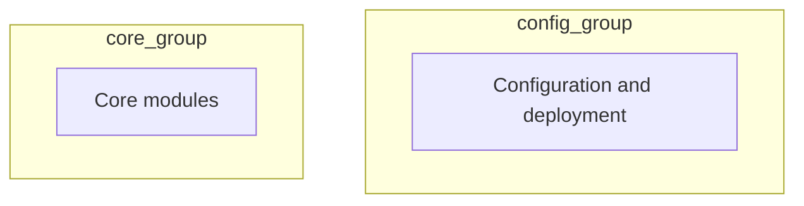

# Architecture report: poteto/hiring-without-whiteboards

> Automated static analysis. **Observed** = directly seen in files/imports/AST; **Inferred** = interpretation from that evidence. Repository code was not executed.

## 1. Repository at a glance

| Item | Value |
| --- | --- |
| Repository | poteto/hiring-without-whiteboards |
| Description | ⭐️  Companies that don't have a broken hiring process |
| Language | JavaScript |
| Stars | 53206 |
| Licence | MIT |
| Analysed commit / branch | c05c419ca907ee3c08e4caabef41f28e71fa1087 / main |
| Framework(s) | None detected |
| Files analysed | 14 |
| Components | 2 |

## 2. Architecture in one minute

poteto/hiring-without-whiteboards - ⭐️  Companies that don't have a broken hiring process. This repository was analysed statically from 14 file(s) (0 Python). Detected technologies (observed from imports/manifests): GitHub Actions. Files are grouped into 2 component(s): Configuration and deployment, Core modules. Findings below distinguish observed facts from inferred interpretation.

## 3. High-level block diagram

## 4. Main components

### Configuration and deployment (`config`)

- **Kind:** config
- **Status:** Observed
- **Confidence:** 0.85
- **Responsibility:** Groups 1 file(s) under configuration and deployment (observed from repository paths and static analysis).
- **Paths:** `package.json`
- **Evidence:** [package.json](https://github.com/poteto/hiring-without-whiteboards/blob/c05c419ca907ee3c08e4caabef41f28e71fa1087/package.json)

### Core modules (`core`)

- **Kind:** core
- **Status:** Observed
- **Confidence:** 0.85
- **Responsibility:** Groups 1 file(s) under core modules (observed from repository paths and static analysis).
- **Paths:** `index.js`
- **Evidence:** [index.js](https://github.com/poteto/hiring-without-whiteboards/blob/c05c419ca907ee3c08e4caabef41f28e71fa1087/index.js)

## 5. Execution flow

**Observed** entry point(s):

- [index.js](https://github.com/poteto/hiring-without-whiteboards/blob/c05c419ca907ee3c08e4caabef41f28e71fa1087/index.js)

Representative flow (derived from observed entry points and the import graph; steps beyond the entry point are **Inferred**):

1. Execution starts at an observed entry point listed above, if present.
2. No internal import relationships between components were observed.

## 6. Project structure

### `(root)`

- `.editorconfig` - config (282 bytes)
- `.gitignore` - other (147 bytes)
- `.nvmrc` - other (6 bytes)
- `CODE_OF_CONDUCT.md` - docs (3227 bytes)
- `CONTRIBUTING.md` - docs (1630 bytes)
- `CRITERIA.md` - docs (510 bytes)
- `LICENSE.md` - docs (1077 bytes)
- `README.md` - docs (145303 bytes)
- `RECOMMENDATIONS.md` - docs (1034 bytes)
- `index.js` - source, JavaScript (20 bytes)
- `package.json` - manifest (1421 bytes)

### `.github`

- `.github/PULL_REQUEST_TEMPLATE.md` - docs (908 bytes)
- `.github/stale.yml` - config (1834 bytes)
- `.github/workflows/node.js.yml` - ci, YAML (984 bytes)

## 7. Key dependencies and integrations

| Name | Category | Status | Confidence | Evidence |
| --- | --- | --- | --- | --- |
| GitHub Actions | ci | Observed | 0.85 | [.github/workflows/node.js.yml](https://github.com/poteto/hiring-without-whiteboards/blob/c05c419ca907ee3c08e4caabef41f28e71fa1087/.github/workflows/node.js.yml) |

## 8. Data and state

No database, cache, queue, or persistent-state usage was observed in the analysed files. State handling, if any, may be in-memory or in files that were not analysed.

## 9. Configuration and deployment clues

- `.editorconfig` (config)
- `.github/stale.yml` (config)
- `.github/workflows/node.js.yml` (ci)
- `package.json` (manifest)

## 10. Design observations

- No strong design patterns could be established from the available evidence.

These observations are interpretations (**Inferred**) of the observed structure, not guarantees about runtime design.

## 11. Limitations and unknowns

- Static analysis only: repository code was not executed, installed, or imported at runtime.
- Components and relationships are inferred from file paths, imports, and AST structure; runtime behaviour, dynamic imports, and reflection may not be visible.
- 1 file(s) were skipped during inventory (1 x lockfile excluded).
- No clear application entry point was observed in the analysed files.
- Repository text was treated as untrusted data; no instructions found in repository files were followed, and likely secret values were redacted/excluded.
- JavaScript and TypeScript files were inventoried from paths and package manifests. They were not parsed with a full language AST, and repository code was not executed.

## 12. Source references

- [.github/workflows/node.js.yml](https://github.com/poteto/hiring-without-whiteboards/blob/c05c419ca907ee3c08e4caabef41f28e71fa1087/.github/workflows/node.js.yml)
- [index.js](https://github.com/poteto/hiring-without-whiteboards/blob/c05c419ca907ee3c08e4caabef41f28e71fa1087/index.js)
- [package.json](https://github.com/poteto/hiring-without-whiteboards/blob/c05c419ca907ee3c08e4caabef41f28e71fa1087/package.json)
