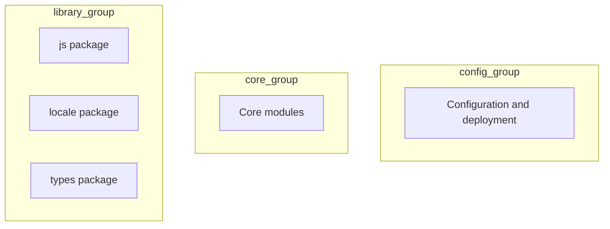

# Architecture report: pqina/filepond

> Automated static analysis. **Observed** = directly seen in files/imports/AST; **Inferred** = interpretation from that evidence. Repository code was not executed.

## 1. Repository at a glance

| Item | Value |
| --- | --- |
| Repository | pqina/filepond |
| Description | 🌊 A flexible and fun JavaScript file upload library |
| Language | JavaScript |
| Stars | 16396 |
| Licence | MIT |
| Analysed commit / branch | 2a2e2871f2fe1428bec102857d3fb5d8b2877aff / master |
| Framework(s) | None detected |
| Files analysed | 298 |
| Components | 5 |

## 2. Architecture in one minute

pqina/filepond - 🌊 A flexible and fun JavaScript file upload library. This repository was analysed statically from 298 file(s) (0 Python). Detected technologies (observed from imports/manifests): Jest, TypeScript. Files are grouped into 5 component(s): Configuration and deployment, Core modules, js package, locale package, types package. Findings below distinguish observed facts from inferred interpretation.

## 3. High-level block diagram

## 4. Main components

### Configuration and deployment (`config`)

- **Kind:** config
- **Status:** Observed
- **Confidence:** 0.85
- **Responsibility:** Groups 2 file(s) under configuration and deployment (observed from repository paths and static analysis).
- **Paths:** `package.json`, `types/tsconfig.json`
- **Evidence:** [package.json](https://github.com/pqina/filepond/blob/2a2e2871f2fe1428bec102857d3fb5d8b2877aff/package.json); [types/tsconfig.json](https://github.com/pqina/filepond/blob/2a2e2871f2fe1428bec102857d3fb5d8b2877aff/types/tsconfig.json)

### Core modules (`core`)

- **Kind:** core
- **Status:** Observed
- **Confidence:** 0.85
- **Responsibility:** Groups 6 file(s) under core modules (observed from repository paths and static analysis).
- **Paths:** `banner-cli.js`, `banner.js`, `jest.config.js`, `jest.stubs.js`, `rollup.config.js`, `rollup.scripts.js`
- **Evidence:** [banner-cli.js](https://github.com/pqina/filepond/blob/2a2e2871f2fe1428bec102857d3fb5d8b2877aff/banner-cli.js); [banner.js](https://github.com/pqina/filepond/blob/2a2e2871f2fe1428bec102857d3fb5d8b2877aff/banner.js); [jest.config.js](https://github.com/pqina/filepond/blob/2a2e2871f2fe1428bec102857d3fb5d8b2877aff/jest.config.js); [jest.stubs.js](https://github.com/pqina/filepond/blob/2a2e2871f2fe1428bec102857d3fb5d8b2877aff/jest.stubs.js); [rollup.config.js](https://github.com/pqina/filepond/blob/2a2e2871f2fe1428bec102857d3fb5d8b2877aff/rollup.config.js); [rollup.scripts.js](https://github.com/pqina/filepond/blob/2a2e2871f2fe1428bec102857d3fb5d8b2877aff/rollup.scripts.js)

### js package (`js`)

- **Kind:** library
- **Status:** Observed
- **Confidence:** 0.85
- **Responsibility:** Groups 204 file(s) under js package (observed from repository paths and static analysis).
- **Paths:** `src/js/__tests__/addFile.test.js`, `src/js/__tests__/assistant.test.js`, `src/js/__tests__/callbacks.test.js`, `src/js/__tests__/contentDisposition.test.js`, `src/js/__tests__/createInstance.test.js`, `src/js/__tests__/removeFile.test.js`, `src/js/__tests__/revertUploadOnRemove.test.js`, `src/js/__tests__/server.test.js`, `src/js/__tests__/setFiles.test.js`, `src/js/app/actions.js`, `src/js/app/enum/ChunkStatus.js`, `src/js/app/enum/FileOrigin.js`, `src/js/app/enum/InteractionMethod.js`, `src/js/app/enum/ItemStatus.js`, `src/js/app/enum/Key.js`, `src/js/app/enum/Status.js`, `src/js/app/enum/Type.js`, `src/js/app/frame/createPainter.js`, `src/js/app/frame/createRoute.js`, `src/js/app/frame/createStore.js`, `src/js/app/frame/createView.js`, `src/js/app/frame/index.js`, `src/js/app/frame/mixins/animations.js`, `src/js/app/frame/mixins/apis.js`, `src/js/app/frame/mixins/index.js`, `src/js/app/frame/mixins/listeners.js`, `src/js/app/frame/mixins/styles.js`, `src/js/app/frame/mixins/utils/addGetSet.js`, `src/js/app/frame/utils/AxisEnum.js`, `src/js/app/frame/utils/addEvent.js`, `src/js/app/frame/utils/animators/easing.js`, `src/js/app/frame/utils/animators/spring.js`, `src/js/app/frame/utils/animators/tween.js`, `src/js/app/frame/utils/appendChild.js`, `src/js/app/frame/utils/appendChildView.js`, `src/js/app/frame/utils/createAnimator.js`, `src/js/app/frame/utils/createElement.js`, `src/js/app/frame/utils/getChildCount.js`, `src/js/app/frame/utils/getViewRect.js`, `src/js/app/frame/utils/removeChildView.js`, `src/js/app/frame/utils/removeEvent.js`, `src/js/app/frame/utils/updateRect.js`, `src/js/app/index.js`, `src/js/app/options.js`, `src/js/app/queries.js`, `src/js/app/utils/buildURL.js`, `src/js/app/utils/convertTo.js`, `src/js/app/utils/createDragHelper.js`, `src/js/app/utils/createFetchFunction.js`, `src/js/app/utils/createFileLoader.js`, `src/js/app/utils/createFileProcessor.js`, `src/js/app/utils/createFileProcessorFunction.js`, `src/js/app/utils/createFileStub.js`, `src/js/app/utils/createHopper.js`, `src/js/app/utils/createInitialState.js`, `src/js/app/utils/createItem.js`, `src/js/app/utils/createItemAPI.js`, `src/js/app/utils/createOption.js`, `src/js/app/utils/createOptionAPI.js`, `src/js/app/utils/createOptionActions.js`, `src/js/app/utils/createOptionQueries.js`, `src/js/app/utils/createOptions.js`, `src/js/app/utils/createPaster.js`, `src/js/app/utils/createPerceivedPerformanceUpdater.js`, `src/js/app/utils/createProcessorFunction.js`, `src/js/app/utils/createRevertFunction.js`, `src/js/app/utils/createServerAPI.js`, `src/js/app/utils/dnd.js`, `src/js/app/utils/dropAreaDimensions.js`, `src/js/app/utils/dynamicLabel.js`, `src/js/app/utils/fetchBlob.js`, `src/js/app/utils/getActiveItems.js`, `src/js/app/utils/getItemById.js`, `src/js/app/utils/getItemByQuery.js`, `src/js/app/utils/getItemIndexByPosition.js`, `src/js/app/utils/getItemIndexByQuery.js`, `src/js/app/utils/getItemsPerRow.js`, `src/js/app/utils/getType.js`, `src/js/app/utils/getValueByType.js`, `src/js/app/utils/hasRoomForItem.js`, `src/js/app/utils/insertItem.js`, `src/js/app/utils/isAPI.js`, `src/js/app/utils/mergeOptionObject.js`, `src/js/app/utils/on.js`, `src/js/app/utils/processFileChunked.js`, `src/js/app/utils/removeReleasedItems.js`, `src/js/app/utils/requestDataTransferItems.js`, `src/js/app/utils/toServerAPI.js`, `src/js/app/view/assistant.js`, `src/js/app/view/blob.js`, `src/js/app/view/browser.js`, `src/js/app/view/data.js`, `src/js/app/view/drip.js`, `src/js/app/view/dropLabel.js`, `src/js/app/view/file.js`, `src/js/app/view/fileActionButton.js`, `src/js/app/view/fileInfo.js`, `src/js/app/view/fileStatus.js`, `src/js/app/view/fileWrapper.js`, `src/js/app/view/item.js`, `src/js/app/view/list.js`, `src/js/app/view/listScroller.js`, `src/js/app/view/panel.js`, `src/js/app/view/progressIndicator.js`, `src/js/app/view/root.js`, `src/js/createApp.js`, `src/js/createAppAPI.js`, `src/js/createAppAtElement.js`, `src/js/createAppObject.js`, `src/js/createAppPlugin.js`, `src/js/filter.js`, `src/js/index.js`, `src/js/utils/arrayInsert.js`, `src/js/utils/arrayRemove.js`, `src/js/utils/arrayReverse.js`, `src/js/utils/attr.js`, `src/js/utils/attrToggle.js`, `src/js/utils/canUpdateFileInput.js`, `src/js/utils/capitalizeFirstLetter.js`, `src/js/utils/composeObject.js`, `src/js/utils/copyFile.js`, `src/js/utils/copyObjectPropertiesToObject.js`, `src/js/utils/createBlob.js`, `src/js/utils/createDefaultResponse.js`, `src/js/utils/createElement.js`, `src/js/utils/createObject.js`, `src/js/utils/createResponse.js`, `src/js/utils/createWorker.js`, `src/js/utils/debounce.js`, `src/js/utils/deepCloneObject.js`, `src/js/utils/defineProperty.js`, `src/js/utils/describeArc.js`, `src/js/utils/forEachDelayed.js`, `src/js/utils/forin.js`, `src/js/utils/formatFilename.js`, `src/js/utils/fromCamels.js`, `src/js/utils/getAttributesAsObject.js`, `src/js/utils/getBase64DataFromBase64DataURI.js`, `src/js/utils/getBlobBuilder.js`, `src/js/utils/getBlobFromBase64DataURI.js`, `src/js/utils/getBlobFromByteStringWithMimeType.js`, `src/js/utils/getByteStringFromBase64DataURI.js`, `src/js/utils/getDateString.js`, `src/js/utils/getDecimalSeparator.js`, `src/js/utils/getDomainFromURL.js`, `src/js/utils/getExtensionFromFilename.js`, `src/js/utils/getFileFromBase64DataURI.js`, `src/js/utils/getFileFromBlob.js`, `src/js/utils/getFileInfoFromHeaders.js`, `src/js/utils/getFilenameFromURL.js`, `src/js/utils/getFilenameWithoutExtension.js`, `src/js/utils/getMimeTypeFromBase64DataURI.js`, `src/js/utils/getNonNumeric.js`, `src/js/utils/getNumericAspectRatioFromString.js`, `src/js/utils/getParameters.js`, `src/js/utils/getRandomNumber.js`, `src/js/utils/getRootNode.js`, `src/js/utils/getThousandsSeparator.js`, `src/js/utils/getUniqueId.js`, `src/js/utils/guesstimateExtension.js`, `src/js/utils/guesstimateMimeType.js`, `src/js/utils/hasQueryString.js`, `src/js/utils/insertAfter.js`, `src/js/utils/insertBefore.js`, `src/js/utils/isArray.js`, `src/js/utils/isBase64DataURI.js`, `src/js/utils/isBoolean.js`, `src/js/utils/isBrowser.js`, `src/js/utils/isDefined.js`, `src/js/utils/isEmpty.js`, `src/js/utils/isExternalURL.js`, `src/js/utils/isFile.js`, `src/js/utils/isFunction.js`, `src/js/utils/isIOS.js`, `src/js/utils/isInt.js`, `src/js/utils/isNode.js`, `src/js/utils/isNull.js`, `src/js/utils/isNumber.js`, `src/js/utils/isObject.js`, `src/js/utils/isString.js`, `src/js/utils/leftPad.js`, `src/js/utils/limit.js`, `src/js/utils/loadImage.js`, `src/js/utils/lowerCaseFirstLetter.js`, `src/js/utils/percentageArc.js`, `src/js/utils/polarToCartesian.js`, `src/js/utils/renameFile.js`, `src/js/utils/replaceInString.js`, `src/js/utils/resetFileInput.js`, `src/js/utils/sendRequest.js`, `src/js/utils/setInputFiles.js`, `src/js/utils/text.js`, `src/js/utils/toArray.js`, `src/js/utils/toBoolean.js`, `src/js/utils/toBytes.js`, `src/js/utils/toCamels.js`, `src/js/utils/toFloat.js`, `src/js/utils/toFunctionReference.js`, `src/js/utils/toInt.js`, `src/js/utils/toNaturalFileSize.js`, `src/js/utils/toNumber.js`, `src/js/utils/toPercentage.js`, `src/js/utils/toString.js`, `src/js/utils/trim.js`
- **Evidence:** [src/js/__tests__/addFile.test.js](https://github.com/pqina/filepond/blob/2a2e2871f2fe1428bec102857d3fb5d8b2877aff/src/js/__tests__/addFile.test.js); [src/js/__tests__/assistant.test.js](https://github.com/pqina/filepond/blob/2a2e2871f2fe1428bec102857d3fb5d8b2877aff/src/js/__tests__/assistant.test.js); [src/js/__tests__/callbacks.test.js](https://github.com/pqina/filepond/blob/2a2e2871f2fe1428bec102857d3fb5d8b2877aff/src/js/__tests__/callbacks.test.js); [src/js/__tests__/contentDisposition.test.js](https://github.com/pqina/filepond/blob/2a2e2871f2fe1428bec102857d3fb5d8b2877aff/src/js/__tests__/contentDisposition.test.js); [src/js/__tests__/createInstance.test.js](https://github.com/pqina/filepond/blob/2a2e2871f2fe1428bec102857d3fb5d8b2877aff/src/js/__tests__/createInstance.test.js); [src/js/__tests__/removeFile.test.js](https://github.com/pqina/filepond/blob/2a2e2871f2fe1428bec102857d3fb5d8b2877aff/src/js/__tests__/removeFile.test.js); [src/js/__tests__/revertUploadOnRemove.test.js](https://github.com/pqina/filepond/blob/2a2e2871f2fe1428bec102857d3fb5d8b2877aff/src/js/__tests__/revertUploadOnRemove.test.js); [src/js/__tests__/server.test.js](https://github.com/pqina/filepond/blob/2a2e2871f2fe1428bec102857d3fb5d8b2877aff/src/js/__tests__/server.test.js)

### locale package (`locale`)

- **Kind:** library
- **Status:** Observed
- **Confidence:** 0.85
- **Responsibility:** Groups 48 file(s) under locale package (observed from repository paths and static analysis).
- **Paths:** `locale/am-et.js`, `locale/ar-ar.js`, `locale/az-az.js`, `locale/ca-ca.js`, `locale/cs-cz.js`, `locale/cy-cy.js`, `locale/da-dk.js`, `locale/de-de.js`, `locale/el-el.js`, `locale/en-en.js`, `locale/es-es.js`, `locale/et-ee.js`, `locale/fa_ir.js`, `locale/fi-fi.js`, `locale/fr-fr.js`, `locale/he-he.js`, `locale/hr-hr.js`, `locale/hu-hu.js`, `locale/id-id.js`, `locale/it-it.js`, `locale/ja-ja.js`, `locale/km-km.js`, `locale/ko-kr.js`, `locale/ku-ckb.js`, `locale/kur-ckb.js`, `locale/lt-lt.js`, `locale/lus-lus.js`, `locale/lv-lv.js`, `locale/ms-ms.js`, `locale/nl-nl.js`, `locale/no_nb.js`, `locale/no_nn.js`, `locale/pl-pl.js`, `locale/pt-br.js`, `locale/pt-pt.js`, `locale/ro-ro.js`, `locale/ru-ru.js`, `locale/sk-sk.js`, `locale/sl-si.js`, `locale/sr-rs.js`, `locale/sv_se.js`, `locale/tr-tr.js`, `locale/uk-ua.js`, `locale/ur-ur.js`, `locale/vi-vi.js`, `locale/zh-cn.js`, `locale/zh-hk.js`, `locale/zh-tw.js`
- **Evidence:** [locale/am-et.js](https://github.com/pqina/filepond/blob/2a2e2871f2fe1428bec102857d3fb5d8b2877aff/locale/am-et.js); [locale/ar-ar.js](https://github.com/pqina/filepond/blob/2a2e2871f2fe1428bec102857d3fb5d8b2877aff/locale/ar-ar.js); [locale/az-az.js](https://github.com/pqina/filepond/blob/2a2e2871f2fe1428bec102857d3fb5d8b2877aff/locale/az-az.js); [locale/ca-ca.js](https://github.com/pqina/filepond/blob/2a2e2871f2fe1428bec102857d3fb5d8b2877aff/locale/ca-ca.js); [locale/cs-cz.js](https://github.com/pqina/filepond/blob/2a2e2871f2fe1428bec102857d3fb5d8b2877aff/locale/cs-cz.js); [locale/cy-cy.js](https://github.com/pqina/filepond/blob/2a2e2871f2fe1428bec102857d3fb5d8b2877aff/locale/cy-cy.js); [locale/da-dk.js](https://github.com/pqina/filepond/blob/2a2e2871f2fe1428bec102857d3fb5d8b2877aff/locale/da-dk.js); [locale/de-de.js](https://github.com/pqina/filepond/blob/2a2e2871f2fe1428bec102857d3fb5d8b2877aff/locale/de-de.js)

### types package (`types`)

- **Kind:** library
- **Status:** Observed
- **Confidence:** 0.85
- **Responsibility:** Groups 1 file(s) under types package (observed from repository paths and static analysis).
- **Paths:** `types/index.d.ts`
- **Evidence:** [types/index.d.ts](https://github.com/pqina/filepond/blob/2a2e2871f2fe1428bec102857d3fb5d8b2877aff/types/index.d.ts)

## 5. Execution flow

**Observed** entry point(s):

- [src/js/app/index.js](https://github.com/pqina/filepond/blob/2a2e2871f2fe1428bec102857d3fb5d8b2877aff/src/js/app/index.js)
- [src/js/index.js](https://github.com/pqina/filepond/blob/2a2e2871f2fe1428bec102857d3fb5d8b2877aff/src/js/index.js)

Representative flow (derived from observed entry points and the import graph; steps beyond the entry point are **Inferred**):

1. Execution starts at an observed entry point listed above, if present.
2. No internal import relationships between components were observed.

## 6. Project structure

### `(root)`

- `.babelrc` - other (663 bytes)
- `.gitattributes` - other (31 bytes)
- `.gitignore` - other (92 bytes)
- `.nvmrc` - other (8 bytes)
- `.prettierignore` - other (6 bytes)
- `.prettierrc` - other (164 bytes)
- `CHANGELOG.md` - docs (29132 bytes)
- `LICENSE` - docs (1062 bytes)
- `README.md` - docs (11995 bytes)
- `banner-cli.js` - source, JavaScript (281 bytes)
- `banner.js` - source, JavaScript (235 bytes)
- `index.html` - other (1769 bytes)
- `jest.config.js` - source, JavaScript (133 bytes)
- `jest.stubs.js` - source, JavaScript (298 bytes)
- `package.json` - manifest (2360 bytes)
- `rollup.config.js` - source, JavaScript (317 bytes)
- `rollup.scripts.js` - source, JavaScript (1086 bytes)

### `.github`

- `.github/FUNDING.yml` - config (54 bytes)
- `.github/ISSUE_TEMPLATE/bug_report.yml` - config (1733 bytes)
- `.github/ISSUE_TEMPLATE/config.yml` - config (196 bytes)
- `.github/ISSUE_TEMPLATE/feature_request.yml` - config (1246 bytes)

### `locale`

- `locale/am-et.js` - source, JavaScript (3143 bytes)
- `locale/ar-ar.js` - source, JavaScript (2556 bytes)
- `locale/az-az.js` - source, JavaScript (2407 bytes)
- `locale/ca-ca.js` - source, JavaScript (2294 bytes)
- `locale/cs-cz.js` - source, JavaScript (2375 bytes)
- `locale/cy-cy.js` - source, JavaScript (2328 bytes)
- `locale/da-dk.js` - source, JavaScript (2214 bytes)
- `locale/de-de.js` - source, JavaScript (2243 bytes)
- `locale/el-el.js` - source, JavaScript (3252 bytes)
- `locale/en-en.js` - source, JavaScript (2132 bytes)
- `locale/es-es.js` - source, JavaScript (2337 bytes)
- `locale/et-ee.js` - source, JavaScript (2289 bytes)
- `locale/fa_ir.js` - source, JavaScript (2708 bytes)
- `locale/fi-fi.js` - source, JavaScript (2271 bytes)
- `locale/fr-fr.js` - source, JavaScript (2398 bytes)
- `locale/he-he.js` - source, JavaScript (2835 bytes)
- `locale/hr-hr.js` - source, JavaScript (2319 bytes)
- `locale/hu-hu.js` - source, JavaScript (2440 bytes)
- `locale/id-id.js` - source, JavaScript (2318 bytes)
- `locale/it-it.js` - source, JavaScript (2390 bytes)
- `locale/ja-ja.js` - source, JavaScript (5147 bytes)
- `locale/km-km.js` - source, JavaScript (3448 bytes)
- `locale/ko-kr.js` - source, JavaScript (2431 bytes)
- `locale/ku-ckb.js` - source, JavaScript (2817 bytes)
- `locale/kur-ckb.js` - source, JavaScript (3119 bytes)
- `locale/lt-lt.js` - source, JavaScript (2296 bytes)
- `locale/lus-lus.js` - source, JavaScript (2314 bytes)
- `locale/lv-lv.js` - source, JavaScript (2473 bytes)
- `locale/ms-ms.js` - source, JavaScript (2270 bytes)
- `locale/nl-nl.js` - source, JavaScript (2278 bytes)
- `locale/no_nb.js` - source, JavaScript (2268 bytes)
- `locale/no_nn.js` - source, JavaScript (2248 bytes)
- `locale/pl-pl.js` - source, JavaScript (2255 bytes)
- `locale/pt-br.js` - source, JavaScript (2323 bytes)
- `locale/pt-pt.js` - source, JavaScript (2364 bytes)
- `locale/ro-ro.js` - source, JavaScript (2415 bytes)
- `locale/ru-ru.js` - source, JavaScript (3016 bytes)
- `locale/sk-sk.js` - source, JavaScript (2360 bytes)
- `locale/sl-si.js` - source, JavaScript (2293 bytes)
- `locale/sr-rs.js` - source, JavaScript (2954 bytes)
- `locale/sv_se.js` - source, JavaScript (2324 bytes)
- `locale/tr-tr.js` - source, JavaScript (2321 bytes)
- `locale/uk-ua.js` - source, JavaScript (3097 bytes)
- `locale/ur-ur.js` - source, JavaScript (2843 bytes)
- `locale/vi-vi.js` - source, JavaScript (2464 bytes)
- `locale/zh-cn.js` - source, JavaScript (2029 bytes)
- `locale/zh-hk.js` - source, JavaScript (2062 bytes)
- `locale/zh-tw.js` - source, JavaScript (2062 bytes)

### `src`

- `src/css/assistant.css` - other (223 bytes)
- `src/css/browser.css` - other (419 bytes)
- `src/css/data.css` - other (193 bytes)
- `src/css/drip.css` - other (727 bytes)
- `src/css/drop-label.css` - other (1056 bytes)
- `src/css/file-action-button.css` - other (2364 bytes)
- `src/css/file-info.css` - other (993 bytes)
- `src/css/file-status.css` - other (735 bytes)
- `src/css/file-wrapper.css` - other (463 bytes)
- `src/css/file.css` - other (3887 bytes)
- `src/css/hopper.css` - other (403 bytes)
- `src/css/item-order.css` - other (195 bytes)
- `src/css/item.css` - other (1480 bytes)
- `src/css/list-scroller.css` - other (908 bytes)
- `src/css/list.css` - other (371 bytes)
- `src/css/modifiers.css` - other (2220 bytes)
- `src/css/panel-root.css` - other (83 bytes)
- `src/css/panel.css` - other (2561 bytes)
- `src/css/progress-indicator.css` - other (577 bytes)
- `src/css/root-order.css` - other (221 bytes)
- `src/css/root.css` - other (1869 bytes)
- `src/css/styles.css` - other (517 bytes)
- `src/js/__tests__/addFile.test.js` - source, JavaScript (1062 bytes)
- `src/js/__tests__/assistant.test.js` - source, JavaScript (3119 bytes)
- `src/js/__tests__/callbacks.test.js` - source, JavaScript (3760 bytes)
- `src/js/__tests__/contentDisposition.test.js` - source, JavaScript (1847 bytes)
- `src/js/__tests__/createInstance.test.js` - source, JavaScript (1056 bytes)
- `src/js/__tests__/removeFile.test.js` - source, JavaScript (3081 bytes)
- `src/js/__tests__/revertUploadOnRemove.test.js` - source, JavaScript (5069 bytes)
- `src/js/__tests__/server.test.js` - source, JavaScript (2352 bytes)
- `src/js/__tests__/setFiles.test.js` - source, JavaScript (2499 bytes)
- `src/js/__tests__/windowMatchMedia.mock` - other (639 bytes)
- `src/js/app/actions.js` - source, JavaScript (37512 bytes)
- `src/js/app/enum/ChunkStatus.js` - source, JavaScript (96 bytes)
- `src/js/app/enum/FileOrigin.js` - source, JavaScript (68 bytes)
- `src/js/app/enum/InteractionMethod.js` - source, JavaScript (104 bytes)
- `src/js/app/enum/ItemStatus.js` - source, JavaScript (222 bytes)
- `src/js/app/enum/Key.js` - source, JavaScript (53 bytes)
- `src/js/app/enum/Status.js` - source, JavaScript (184 bytes)
- `src/js/app/enum/Type.js` - source, JavaScript (247 bytes)
- `src/js/app/frame/createPainter.js` - source, JavaScript (1663 bytes)
- `src/js/app/frame/createRoute.js` - source, JavaScript (381 bytes)
- `src/js/app/frame/createStore.js` - source, JavaScript (2284 bytes)
- `src/js/app/frame/createView.js` - source, JavaScript (10894 bytes)
- `src/js/app/frame/index.js` - source, JavaScript (246 bytes)
- `src/js/app/frame/mixins/animations.js` - source, JavaScript (1961 bytes)
- `src/js/app/frame/mixins/apis.js` - source, JavaScript (220 bytes)
- `src/js/app/frame/mixins/index.js` - source, JavaScript (230 bytes)
- `src/js/app/frame/mixins/listeners.js` - source, JavaScript (936 bytes)
- `src/js/app/frame/mixins/styles.js` - source, JavaScript (4998 bytes)
- `src/js/app/frame/mixins/utils/addGetSet.js` - source, JavaScript (676 bytes)
- `src/js/app/frame/utils/AxisEnum.js` - source, JavaScript (58 bytes)
- `src/js/app/frame/utils/addEvent.js` - source, JavaScript (94 bytes)
- `src/js/app/frame/utils/animators/easing.js` - source, JavaScript (114 bytes)
- `src/js/app/frame/utils/animators/spring.js` - source, JavaScript (3686 bytes)
- `src/js/app/frame/utils/animators/tween.js` - source, JavaScript (2549 bytes)
- `src/js/app/frame/utils/appendChild.js` - source, JavaScript (240 bytes)
- `src/js/app/frame/utils/appendChildView.js` - source, JavaScript (237 bytes)
- `src/js/app/frame/utils/createAnimator.js` - source, JavaScript (857 bytes)
- `src/js/app/frame/utils/createElement.js` - source, JavaScript (831 bytes)
- `src/js/app/frame/utils/getChildCount.js` - source, JavaScript (275 bytes)
- `src/js/app/frame/utils/getViewRect.js` - source, JavaScript (2165 bytes)
- `src/js/app/frame/utils/removeChildView.js` - source, JavaScript (279 bytes)
- `src/js/app/frame/utils/removeEvent.js` - source, JavaScript (100 bytes)
- `src/js/app/frame/utils/updateRect.js` - source, JavaScript (838 bytes)
- `src/js/app/index.js` - source, JavaScript (19945 bytes)
- `src/js/app/options.js` - source, JavaScript (10711 bytes)
- `src/js/app/queries.js` - source, JavaScript (3339 bytes)
- `src/js/app/utils/buildURL.js` - source, JavaScript (223 bytes)
- `src/js/app/utils/convertTo.js` - source, JavaScript (1296 bytes)
- `src/js/app/utils/createDragHelper.js` - source, JavaScript (309 bytes)
- `src/js/app/utils/createFetchFunction.js` - source, JavaScript (2598 bytes)
- `src/js/app/utils/createFileLoader.js` - source, JavaScript (4533 bytes)
- `src/js/app/utils/createFileProcessor.js` - source, JavaScript (6509 bytes)
- `src/js/app/utils/createFileProcessorFunction.js` - source, JavaScript (2929 bytes)
- `src/js/app/utils/createFileStub.js` - source, JavaScript (1067 bytes)
- `src/js/app/utils/createHopper.js` - source, JavaScript (1844 bytes)
- `src/js/app/utils/createInitialState.js` - source, JavaScript (414 bytes)
- `src/js/app/utils/createItem.js` - source, JavaScript (13634 bytes)
- `src/js/app/utils/createItemAPI.js` - source, JavaScript (462 bytes)
- `src/js/app/utils/createOption.js` - source, JavaScript (345 bytes)
- `src/js/app/utils/createOptionAPI.js` - source, JavaScript (477 bytes)
- `src/js/app/utils/createOptionActions.js` - source, JavaScript (640 bytes)
- `src/js/app/utils/createOptionQueries.js` - source, JavaScript (330 bytes)
- `src/js/app/utils/createOptions.js` - source, JavaScript (438 bytes)
- `src/js/app/utils/createPaster.js` - source, JavaScript (2082 bytes)
- `src/js/app/utils/createPerceivedPerformanceUpdater.js` - source, JavaScript (820 bytes)
- `src/js/app/utils/createProcessorFunction.js` - source, JavaScript (568 bytes)
- `src/js/app/utils/createRevertFunction.js` - source, JavaScript (1738 bytes)
- `src/js/app/utils/createServerAPI.js` - source, JavaScript (2084 bytes)
- `src/js/app/utils/dnd.js` - source, JavaScript (6859 bytes)
- `src/js/app/utils/dropAreaDimensions.js` - source, JavaScript (552 bytes)
- `src/js/app/utils/dynamicLabel.js` - source, JavaScript (153 bytes)
- `src/js/app/utils/fetchBlob.js` - source, JavaScript (1684 bytes)
- `src/js/app/utils/getActiveItems.js` - source, JavaScript (78 bytes)
- `src/js/app/utils/getItemById.js` - source, JavaScript (243 bytes)
- `src/js/app/utils/getItemByQuery.js` - source, JavaScript (549 bytes)
- `src/js/app/utils/getItemIndexByPosition.js` - source, JavaScript (2059 bytes)
- `src/js/app/utils/getItemIndexByQuery.js` - source, JavaScript (415 bytes)
- `src/js/app/utils/getItemsPerRow.js` - source, JavaScript (223 bytes)
- `src/js/app/utils/getType.js` - source, JavaScript (535 bytes)
- `src/js/app/utils/getValueByType.js` - source, JavaScript (902 bytes)
- `src/js/app/utils/hasRoomForItem.js` - source, JavaScript (750 bytes)
- `src/js/app/utils/insertItem.js` - source, JavaScript (577 bytes)
- `src/js/app/utils/isAPI.js` - source, JavaScript (346 bytes)
- `src/js/app/utils/mergeOptionObject.js` - source, JavaScript (249 bytes)
- `src/js/app/utils/on.js` - source, JavaScript (1269 bytes)
- `src/js/app/utils/processFileChunked.js` - source, JavaScript (9671 bytes)
- `src/js/app/utils/removeReleasedItems.js` - source, JavaScript (229 bytes)
- `src/js/app/utils/requestDataTransferItems.js` - source, JavaScript (6424 bytes)
- `src/js/app/utils/toServerAPI.js` - source, JavaScript (113 bytes)
- `src/js/app/view/assistant.js` - source, JavaScript (3588 bytes)
- `src/js/app/view/blob.js` - source, JavaScript (439 bytes)
- `src/js/app/view/browser.js` - source, JavaScript (5755 bytes)
- `src/js/app/view/data.js` - source, JavaScript (3252 bytes)
- `src/js/app/view/drip.js` - source, JavaScript (1572 bytes)
- `src/js/app/view/dropLabel.js` - source, JavaScript (2361 bytes)
- `src/js/app/view/file.js` - source, JavaScript (15713 bytes)
- `src/js/app/view/fileActionButton.js` - source, JavaScript (1243 bytes)
- `src/js/app/view/fileInfo.js` - source, JavaScript (2489 bytes)
- `src/js/app/view/fileStatus.js` - source, JavaScript (3348 bytes)
- `src/js/app/view/fileWrapper.js` - source, JavaScript (1214 bytes)
- `src/js/app/view/item.js` - source, JavaScript (7197 bytes)
- `src/js/app/view/list.js` - source, JavaScript (12407 bytes)
- `src/js/app/view/listScroller.js` - source, JavaScript (1888 bytes)
- `src/js/app/view/panel.js` - source, JavaScript (2750 bytes)
- `src/js/app/view/progressIndicator.js` - source, JavaScript (1999 bytes)
- `src/js/app/view/root.js` - source, JavaScript (22761 bytes)
- `src/js/createApp.js` - source, JavaScript (372 bytes)
- `src/js/createAppAPI.js` - source, JavaScript (272 bytes)
- `src/js/createAppAtElement.js` - source, JavaScript (2916 bytes)
- `src/js/createAppObject.js` - source, JavaScript (546 bytes)
- `src/js/createAppPlugin.js` - source, JavaScript (2547 bytes)
- `src/js/filter.js` - source, JavaScript (1301 bytes)
- `src/js/index.js` - source, JavaScript (6201 bytes)
- `src/js/utils/arrayInsert.js` - source, JavaScript (77 bytes)
- `src/js/utils/arrayRemove.js` - source, JavaScript (65 bytes)
- `src/js/utils/arrayReverse.js` - source, JavaScript (50 bytes)
- `src/js/utils/attr.js` - source, JavaScript (190 bytes)
- `src/js/utils/attrToggle.js` - source, JavaScript (225 bytes)
- `src/js/utils/canUpdateFileInput.js` - source, JavaScript (499 bytes)
- `src/js/utils/capitalizeFirstLetter.js` - source, JavaScript (101 bytes)
- `src/js/utils/composeObject.js` - source, JavaScript (92 bytes)
- `src/js/utils/copyFile.js` - source, JavaScript (104 bytes)
- `src/js/utils/copyObjectPropertiesToObject.js` - source, JavaScript (357 bytes)
- `src/js/utils/createBlob.js` - source, JavaScript (331 bytes)
- `src/js/utils/createDefaultResponse.js` - source, JavaScript (256 bytes)
- `src/js/utils/createElement.js` - source, JavaScript (89 bytes)
- `src/js/utils/createObject.js` - source, JavaScript (273 bytes)
- `src/js/utils/createResponse.js` - source, JavaScript (109 bytes)
- `src/js/utils/createWorker.js` - source, JavaScript (879 bytes)
- `src/js/utils/debounce.js` - source, JavaScript (759 bytes)
- `src/js/utils/deepCloneObject.js` - source, JavaScript (394 bytes)
- `src/js/utils/defineProperty.js` - source, JavaScript (229 bytes)
- `src/js/utils/describeArc.js` - source, JavaScript (449 bytes)
- `src/js/utils/forEachDelayed.js` - source, JavaScript (297 bytes)
- `src/js/utils/forin.js` - source, JavaScript (174 bytes)
- `src/js/utils/formatFilename.js` - source, JavaScript (44 bytes)
- `src/js/utils/fromCamels.js` - source, JavaScript (161 bytes)
- `src/js/utils/getAttributesAsObject.js` - source, JavaScript (2324 bytes)
- `src/js/utils/getBase64DataFromBase64DataURI.js` - source, JavaScript (271 bytes)
- `src/js/utils/getBlobBuilder.js` - source, JavaScript (204 bytes)
- `src/js/utils/getBlobFromBase64DataURI.js` - source, JavaScript (501 bytes)
- `src/js/utils/getBlobFromByteStringWithMimeType.js` - source, JavaScript (347 bytes)
- `src/js/utils/getByteStringFromBase64DataURI.js` - source, JavaScript (204 bytes)
- `src/js/utils/getDateString.js` - source, JavaScript (339 bytes)
- `src/js/utils/getDecimalSeparator.js` - source, JavaScript (137 bytes)
- `src/js/utils/getDomainFromURL.js` - source, JavaScript (256 bytes)
- `src/js/utils/getExtensionFromFilename.js` - source, JavaScript (71 bytes)
- `src/js/utils/getFileFromBase64DataURI.js` - source, JavaScript (332 bytes)
- `src/js/utils/getFileFromBlob.js` - source, JavaScript (1119 bytes)
- `src/js/utils/getFileInfoFromHeaders.js` - source, JavaScript (1532 bytes)
- `src/js/utils/getFilenameFromURL.js` - source, JavaScript (127 bytes)
- `src/js/utils/getFilenameWithoutExtension.js` - source, JavaScript (105 bytes)
- `src/js/utils/getMimeTypeFromBase64DataURI.js` - source, JavaScript (119 bytes)
- `src/js/utils/getNonNumeric.js` - source, JavaScript (57 bytes)
- `src/js/utils/getNumericAspectRatioFromString.js` - source, JavaScript (326 bytes)
- `src/js/utils/getParameters.js` - source, JavaScript (209 bytes)
- `src/js/utils/getRandomNumber.js` - source, JavaScript (92 bytes)
- `src/js/utils/getRootNode.js` - source, JavaScript (103 bytes)
- `src/js/utils/getThousandsSeparator.js` - source, JavaScript (771 bytes)
- `src/js/utils/getUniqueId.js` - source, JavaScript (100 bytes)
- `src/js/utils/guesstimateExtension.js` - source, JavaScript (735 bytes)
- `src/js/utils/guesstimateMimeType.js` - source, JavaScript (627 bytes)
- `src/js/utils/hasQueryString.js` - source, JavaScript (55 bytes)
- `src/js/utils/insertAfter.js` - source, JavaScript (168 bytes)
- `src/js/utils/insertBefore.js` - source, JavaScript (119 bytes)
- `src/js/utils/isArray.js` - source, JavaScript (54 bytes)
- `src/js/utils/isBase64DataURI.js` - source, JavaScript (175 bytes)
- `src/js/utils/isBoolean.js` - source, JavaScript (62 bytes)
- `src/js/utils/isBrowser.js` - source, JavaScript (144 bytes)
- `src/js/utils/isDefined.js` - source, JavaScript (49 bytes)
- `src/js/utils/isEmpty.js` - source, JavaScript (47 bytes)
- `src/js/utils/isExternalURL.js` - source, JavaScript (211 bytes)
- `src/js/utils/isFile.js` - source, JavaScript (99 bytes)
- `src/js/utils/isFunction.js` - source, JavaScript (64 bytes)
- `src/js/utils/isIOS.js` - source, JavaScript (200 bytes)
- `src/js/utils/isInt.js` - source, JavaScript (140 bytes)
- `src/js/utils/isNode.js` - source, JavaScript (61 bytes)
- `src/js/utils/isNull.js` - source, JavaScript (47 bytes)
- `src/js/utils/isNumber.js` - source, JavaScript (60 bytes)
- `src/js/utils/isObject.js` - source, JavaScript (77 bytes)
- `src/js/utils/isString.js` - source, JavaScript (60 bytes)
- `src/js/utils/leftPad.js` - source, JavaScript (94 bytes)
- `src/js/utils/limit.js` - source, JavaScript (79 bytes)
- `src/js/utils/loadImage.js` - source, JavaScript (266 bytes)
- `src/js/utils/lowerCaseFirstLetter.js` - source, JavaScript (100 bytes)
- `src/js/utils/percentageArc.js` - source, JavaScript (428 bytes)
- `src/js/utils/polarToCartesian.js` - source, JavaScript (288 bytes)
- `src/js/utils/renameFile.js` - source, JavaScript (219 bytes)
- `src/js/utils/replaceInString.js` - source, JavaScript (276 bytes)
- `src/js/utils/resetFileInput.js` - source, JavaScript (758 bytes)
- `src/js/utils/sendRequest.js` - source, JavaScript (3133 bytes)
- `src/js/utils/setInputFiles.js` - source, JavaScript (696 bytes)
- `src/js/utils/text.js` - source, JavaScript (278 bytes)
- `src/js/utils/toArray.js` - source, JavaScript (412 bytes)
- `src/js/utils/toBoolean.js` - source, JavaScript (122 bytes)
- `src/js/utils/toBytes.js` - source, JavaScript (740 bytes)
- `src/js/utils/toCamels.js` - source, JavaScript (156 bytes)
- `src/js/utils/toFloat.js` - source, JavaScript (100 bytes)
- `src/js/utils/toFunctionReference.js` - source, JavaScript (270 bytes)
- `src/js/utils/toInt.js` - source, JavaScript (100 bytes)
- `src/js/utils/toNaturalFileSize.js` - source, JavaScript (1060 bytes)
- `src/js/utils/toNumber.js` - source, JavaScript (259 bytes)
- `src/js/utils/toPercentage.js` - source, JavaScript (62 bytes)
- `src/js/utils/toString.js` - source, JavaScript (45 bytes)
- `src/js/utils/trim.js` - source, JavaScript (39 bytes)

### `types`

- `types/index.d.ts` - source, TypeScript (33959 bytes)
- `types/tsconfig.json` - config (552 bytes)

## 7. Key dependencies and integrations

| Name | Category | Status | Confidence | Evidence |
| --- | --- | --- | --- | --- |
| Jest | tooling | Observed | 0.85 | [package.json:39](https://github.com/pqina/filepond/blob/2a2e2871f2fe1428bec102857d3fb5d8b2877aff/package.json#L39) |
| TypeScript | tooling | Observed | 0.85 | [package.json:70](https://github.com/pqina/filepond/blob/2a2e2871f2fe1428bec102857d3fb5d8b2877aff/package.json#L70) |

## 8. Data and state

No database, cache, queue, or persistent-state usage was observed in the analysed files. State handling, if any, may be in-memory or in files that were not analysed.

## 9. Configuration and deployment clues

- `.github/FUNDING.yml` (config)
- `.github/ISSUE_TEMPLATE/bug_report.yml` (config)
- `.github/ISSUE_TEMPLATE/config.yml` (config)
- `.github/ISSUE_TEMPLATE/feature_request.yml` (config)
- `package.json` (manifest)
- `types/tsconfig.json` (config)

## 10. Design observations

- No strong design patterns could be established from the available evidence.

These observations are interpretations (**Inferred**) of the observed structure, not guarantees about runtime design.

## 11. Limitations and unknowns

- Static analysis only: repository code was not executed, installed, or imported at runtime.
- Components and relationships are inferred from file paths, imports, and AST structure; runtime behaviour, dynamic imports, and reflection may not be visible.
- 2 file(s) were skipped during inventory (2 x vendored/generated directory excluded).
- No clear application entry point was observed in the analysed files.
- Repository text was treated as untrusted data; no instructions found in repository files were followed, and likely secret values were redacted/excluded.
- JavaScript and TypeScript files were inventoried from paths and package manifests. They were not parsed with a full language AST, and repository code was not executed.

## 12. Source references

- [banner-cli.js](https://github.com/pqina/filepond/blob/2a2e2871f2fe1428bec102857d3fb5d8b2877aff/banner-cli.js)
- [banner.js](https://github.com/pqina/filepond/blob/2a2e2871f2fe1428bec102857d3fb5d8b2877aff/banner.js)
- [jest.config.js](https://github.com/pqina/filepond/blob/2a2e2871f2fe1428bec102857d3fb5d8b2877aff/jest.config.js)
- [jest.stubs.js](https://github.com/pqina/filepond/blob/2a2e2871f2fe1428bec102857d3fb5d8b2877aff/jest.stubs.js)
- [locale/am-et.js](https://github.com/pqina/filepond/blob/2a2e2871f2fe1428bec102857d3fb5d8b2877aff/locale/am-et.js)
- [locale/ar-ar.js](https://github.com/pqina/filepond/blob/2a2e2871f2fe1428bec102857d3fb5d8b2877aff/locale/ar-ar.js)
- [locale/az-az.js](https://github.com/pqina/filepond/blob/2a2e2871f2fe1428bec102857d3fb5d8b2877aff/locale/az-az.js)
- [locale/ca-ca.js](https://github.com/pqina/filepond/blob/2a2e2871f2fe1428bec102857d3fb5d8b2877aff/locale/ca-ca.js)
- [locale/cs-cz.js](https://github.com/pqina/filepond/blob/2a2e2871f2fe1428bec102857d3fb5d8b2877aff/locale/cs-cz.js)
- [locale/cy-cy.js](https://github.com/pqina/filepond/blob/2a2e2871f2fe1428bec102857d3fb5d8b2877aff/locale/cy-cy.js)
- [locale/da-dk.js](https://github.com/pqina/filepond/blob/2a2e2871f2fe1428bec102857d3fb5d8b2877aff/locale/da-dk.js)
- [locale/de-de.js](https://github.com/pqina/filepond/blob/2a2e2871f2fe1428bec102857d3fb5d8b2877aff/locale/de-de.js)
- [package.json](https://github.com/pqina/filepond/blob/2a2e2871f2fe1428bec102857d3fb5d8b2877aff/package.json)
- [package.json:39](https://github.com/pqina/filepond/blob/2a2e2871f2fe1428bec102857d3fb5d8b2877aff/package.json#L39)
- [package.json:70](https://github.com/pqina/filepond/blob/2a2e2871f2fe1428bec102857d3fb5d8b2877aff/package.json#L70)
- [rollup.config.js](https://github.com/pqina/filepond/blob/2a2e2871f2fe1428bec102857d3fb5d8b2877aff/rollup.config.js)
- [rollup.scripts.js](https://github.com/pqina/filepond/blob/2a2e2871f2fe1428bec102857d3fb5d8b2877aff/rollup.scripts.js)
- [src/js/__tests__/addFile.test.js](https://github.com/pqina/filepond/blob/2a2e2871f2fe1428bec102857d3fb5d8b2877aff/src/js/__tests__/addFile.test.js)
- [src/js/__tests__/assistant.test.js](https://github.com/pqina/filepond/blob/2a2e2871f2fe1428bec102857d3fb5d8b2877aff/src/js/__tests__/assistant.test.js)
- [src/js/__tests__/callbacks.test.js](https://github.com/pqina/filepond/blob/2a2e2871f2fe1428bec102857d3fb5d8b2877aff/src/js/__tests__/callbacks.test.js)
- [src/js/__tests__/contentDisposition.test.js](https://github.com/pqina/filepond/blob/2a2e2871f2fe1428bec102857d3fb5d8b2877aff/src/js/__tests__/contentDisposition.test.js)
- [src/js/__tests__/createInstance.test.js](https://github.com/pqina/filepond/blob/2a2e2871f2fe1428bec102857d3fb5d8b2877aff/src/js/__tests__/createInstance.test.js)
- [src/js/__tests__/removeFile.test.js](https://github.com/pqina/filepond/blob/2a2e2871f2fe1428bec102857d3fb5d8b2877aff/src/js/__tests__/removeFile.test.js)
- [src/js/__tests__/revertUploadOnRemove.test.js](https://github.com/pqina/filepond/blob/2a2e2871f2fe1428bec102857d3fb5d8b2877aff/src/js/__tests__/revertUploadOnRemove.test.js)
- [src/js/__tests__/server.test.js](https://github.com/pqina/filepond/blob/2a2e2871f2fe1428bec102857d3fb5d8b2877aff/src/js/__tests__/server.test.js)
- [src/js/app/index.js](https://github.com/pqina/filepond/blob/2a2e2871f2fe1428bec102857d3fb5d8b2877aff/src/js/app/index.js)
- [src/js/index.js](https://github.com/pqina/filepond/blob/2a2e2871f2fe1428bec102857d3fb5d8b2877aff/src/js/index.js)
- [types/index.d.ts](https://github.com/pqina/filepond/blob/2a2e2871f2fe1428bec102857d3fb5d8b2877aff/types/index.d.ts)
- [types/tsconfig.json](https://github.com/pqina/filepond/blob/2a2e2871f2fe1428bec102857d3fb5d8b2877aff/types/tsconfig.json)
