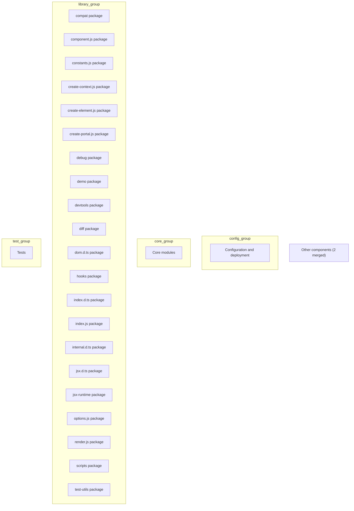

# Architecture report: preactjs/preact

> Automated static analysis. **Observed** = directly seen in files/imports/AST; **Inferred** = interpretation from that evidence. Repository code was not executed.

## 1. Repository at a glance

| Item | Value |
| --- | --- |
| Repository | preactjs/preact |
| Description | ⚛️ Fast 3kB React alternative with the same modern API. Components & Virtual DOM. |
| Language | JavaScript |
| Stars | 39005 |
| Licence | MIT |
| Analysed commit / branch | a2e03dbc6a4a239552d43edb6580ecf86886cc39 / main |
| Framework(s) | None detected |
| Files analysed | 308 |
| Components | 26 |

## 2. Architecture in one minute

preactjs/preact - ⚛️ Fast 3kB React alternative with the same modern API. Components & Virtual DOM.. This repository was analysed statically from 308 file(s) (0 Python). Detected technologies (observed from imports/manifests): GitHub Actions, React Router, Redux, Redux Toolkit, TypeScript, Vite. Files are grouped into 26 component(s): compat package, component.js package, Configuration and deployment, constants.js package, Core modules, create-context.js package, create-element.js package, create-portal.js package. Findings below distinguish observed facts from inferred interpretation.

## 3. High-level block diagram

## 4. Main components

### compat package (`compat`)

- **Kind:** library
- **Status:** Observed
- **Confidence:** 0.85
- **Responsibility:** Groups 32 file(s) under compat package (observed from repository paths and static analysis).
- **Paths:** `compat/client.d.ts`, `compat/client.js`, `compat/client.mjs`, `compat/compiler-runtime.d.ts`, `compat/compiler-runtime.js`, `compat/compiler-runtime.mjs`, `compat/jsx-dev-runtime.js`, `compat/jsx-dev-runtime.mjs`, `compat/jsx-runtime.js`, `compat/jsx-runtime.mjs`, `compat/scheduler.d.ts`, `compat/scheduler.js`, `compat/scheduler.mjs`, `compat/server.browser.mjs`, `compat/server.d.ts`, `compat/server.js`, `compat/server.mjs`, `compat/src/Children.js`, `compat/src/PureComponent.js`, `compat/src/forwardRef.js`, `compat/src/hooks.js`, `compat/src/index.d.ts`, `compat/src/index.js`, `compat/src/internal.d.ts`, `compat/src/memo.js`, `compat/src/portals.js`, `compat/src/render.js`, `compat/src/suspense.d.ts`, `compat/src/suspense.js`, `compat/src/util.js`, `compat/test-utils.js`, `compat/test-utils.mjs`
- **Evidence:** [compat/client.d.ts](https://github.com/preactjs/preact/blob/a2e03dbc6a4a239552d43edb6580ecf86886cc39/compat/client.d.ts); [compat/client.js](https://github.com/preactjs/preact/blob/a2e03dbc6a4a239552d43edb6580ecf86886cc39/compat/client.js); [compat/client.mjs](https://github.com/preactjs/preact/blob/a2e03dbc6a4a239552d43edb6580ecf86886cc39/compat/client.mjs); [compat/compiler-runtime.d.ts](https://github.com/preactjs/preact/blob/a2e03dbc6a4a239552d43edb6580ecf86886cc39/compat/compiler-runtime.d.ts); [compat/compiler-runtime.js](https://github.com/preactjs/preact/blob/a2e03dbc6a4a239552d43edb6580ecf86886cc39/compat/compiler-runtime.js); [compat/compiler-runtime.mjs](https://github.com/preactjs/preact/blob/a2e03dbc6a4a239552d43edb6580ecf86886cc39/compat/compiler-runtime.mjs); [compat/jsx-dev-runtime.js](https://github.com/preactjs/preact/blob/a2e03dbc6a4a239552d43edb6580ecf86886cc39/compat/jsx-dev-runtime.js); [compat/jsx-dev-runtime.mjs](https://github.com/preactjs/preact/blob/a2e03dbc6a4a239552d43edb6580ecf86886cc39/compat/jsx-dev-runtime.mjs)

### component.js package (`component_js`)

- **Kind:** library
- **Status:** Observed
- **Confidence:** 0.85
- **Responsibility:** Groups 1 file(s) under component.js package (observed from repository paths and static analysis).
- **Paths:** `src/component.js`
- **Evidence:** [src/component.js](https://github.com/preactjs/preact/blob/a2e03dbc6a4a239552d43edb6580ecf86886cc39/src/component.js)

### Configuration and deployment (`config`)

- **Kind:** config
- **Status:** Observed
- **Confidence:** 0.85
- **Responsibility:** Groups 19 file(s) under configuration and deployment (observed from repository paths and static analysis).
- **Paths:** `compat/mangle.json`, `compat/package.json`, `config/compat-entries.js`, `debug/mangle.json`, `debug/package.json`, `demo/package.json`, `demo/tsconfig.json`, `devtools/mangle.json`, `devtools/package.json`, `hooks/mangle.json`, `hooks/package.json`, `jsconfig-lint.json`, `jsconfig.json`, `jsx-runtime/mangle.json`, `jsx-runtime/package.json`, `mangle.json`, `package.json`, `pnpm-workspace.yaml`, `test-utils/package.json`
- **Evidence:** [compat/mangle.json](https://github.com/preactjs/preact/blob/a2e03dbc6a4a239552d43edb6580ecf86886cc39/compat/mangle.json); [compat/package.json](https://github.com/preactjs/preact/blob/a2e03dbc6a4a239552d43edb6580ecf86886cc39/compat/package.json); [config/compat-entries.js](https://github.com/preactjs/preact/blob/a2e03dbc6a4a239552d43edb6580ecf86886cc39/config/compat-entries.js); [debug/mangle.json](https://github.com/preactjs/preact/blob/a2e03dbc6a4a239552d43edb6580ecf86886cc39/debug/mangle.json); [debug/package.json](https://github.com/preactjs/preact/blob/a2e03dbc6a4a239552d43edb6580ecf86886cc39/debug/package.json); [demo/package.json](https://github.com/preactjs/preact/blob/a2e03dbc6a4a239552d43edb6580ecf86886cc39/demo/package.json); [demo/tsconfig.json](https://github.com/preactjs/preact/blob/a2e03dbc6a4a239552d43edb6580ecf86886cc39/demo/tsconfig.json); [devtools/mangle.json](https://github.com/preactjs/preact/blob/a2e03dbc6a4a239552d43edb6580ecf86886cc39/devtools/mangle.json)

### constants.js package (`constants_js`)

- **Kind:** library
- **Status:** Observed
- **Confidence:** 0.85
- **Responsibility:** Groups 1 file(s) under constants.js package (observed from repository paths and static analysis).
- **Paths:** `src/constants.js`
- **Evidence:** [src/constants.js](https://github.com/preactjs/preact/blob/a2e03dbc6a4a239552d43edb6580ecf86886cc39/src/constants.js)

### Core modules (`core`)

- **Kind:** core
- **Status:** Observed
- **Confidence:** 0.85
- **Responsibility:** Groups 2 file(s) under core modules (observed from repository paths and static analysis).
- **Paths:** `vitest.config.mjs`, `vitest.setup.js`
- **Evidence:** [vitest.config.mjs](https://github.com/preactjs/preact/blob/a2e03dbc6a4a239552d43edb6580ecf86886cc39/vitest.config.mjs); [vitest.setup.js](https://github.com/preactjs/preact/blob/a2e03dbc6a4a239552d43edb6580ecf86886cc39/vitest.setup.js)

### create-context.js package (`create_context_js`)

- **Kind:** library
- **Status:** Observed
- **Confidence:** 0.85
- **Responsibility:** Groups 1 file(s) under create-context.js package (observed from repository paths and static analysis).
- **Paths:** `src/create-context.js`
- **Evidence:** [src/create-context.js](https://github.com/preactjs/preact/blob/a2e03dbc6a4a239552d43edb6580ecf86886cc39/src/create-context.js)

### create-element.js package (`create_element_js`)

- **Kind:** library
- **Status:** Observed
- **Confidence:** 0.85
- **Responsibility:** Groups 1 file(s) under create-element.js package (observed from repository paths and static analysis).
- **Paths:** `src/create-element.js`
- **Evidence:** [src/create-element.js](https://github.com/preactjs/preact/blob/a2e03dbc6a4a239552d43edb6580ecf86886cc39/src/create-element.js)

### create-portal.js package (`create_portal_js`)

- **Kind:** library
- **Status:** Observed
- **Confidence:** 0.85
- **Responsibility:** Groups 1 file(s) under create-portal.js package (observed from repository paths and static analysis).
- **Paths:** `src/create-portal.js`
- **Evidence:** [src/create-portal.js](https://github.com/preactjs/preact/blob/a2e03dbc6a4a239552d43edb6580ecf86886cc39/src/create-portal.js)

### debug package (`debug`)

- **Kind:** library
- **Status:** Observed
- **Confidence:** 0.85
- **Responsibility:** Groups 8 file(s) under debug package (observed from repository paths and static analysis).
- **Paths:** `debug/src/check-props.js`, `debug/src/component-stack.js`, `debug/src/constants.js`, `debug/src/debug.js`, `debug/src/index.d.ts`, `debug/src/index.js`, `debug/src/internal.d.ts`, `debug/src/util.js`
- **Evidence:** [debug/src/check-props.js](https://github.com/preactjs/preact/blob/a2e03dbc6a4a239552d43edb6580ecf86886cc39/debug/src/check-props.js); [debug/src/component-stack.js](https://github.com/preactjs/preact/blob/a2e03dbc6a4a239552d43edb6580ecf86886cc39/debug/src/component-stack.js); [debug/src/constants.js](https://github.com/preactjs/preact/blob/a2e03dbc6a4a239552d43edb6580ecf86886cc39/debug/src/constants.js); [debug/src/debug.js](https://github.com/preactjs/preact/blob/a2e03dbc6a4a239552d43edb6580ecf86886cc39/debug/src/debug.js); [debug/src/index.d.ts](https://github.com/preactjs/preact/blob/a2e03dbc6a4a239552d43edb6580ecf86886cc39/debug/src/index.d.ts); [debug/src/index.js](https://github.com/preactjs/preact/blob/a2e03dbc6a4a239552d43edb6580ecf86886cc39/debug/src/index.js); [debug/src/internal.d.ts](https://github.com/preactjs/preact/blob/a2e03dbc6a4a239552d43edb6580ecf86886cc39/debug/src/internal.d.ts); [debug/src/util.js](https://github.com/preactjs/preact/blob/a2e03dbc6a4a239552d43edb6580ecf86886cc39/debug/src/util.js)

### demo package (`demo`)

- **Kind:** library
- **Status:** Observed
- **Confidence:** 0.85
- **Responsibility:** Groups 39 file(s) under demo package (observed from repository paths and static analysis).
- **Paths:** `demo/contenteditable.jsx`, `demo/context.jsx`, `demo/devtools.jsx`, `demo/fragments.jsx`, `demo/index.jsx`, `demo/key_bug.jsx`, `demo/list.jsx`, `demo/logger.jsx`, `demo/mobx.jsx`, `demo/nested-suspense/addnewcomponent.jsx`, `demo/nested-suspense/component-container.jsx`, `demo/nested-suspense/dropzone.jsx`, `demo/nested-suspense/editor.jsx`, `demo/nested-suspense/index.jsx`, `demo/nested-suspense/subcomponent.jsx`, `demo/people/index.tsx`, `demo/people/profile.tsx`, `demo/people/router.tsx`, `demo/people/store.ts`, `demo/preact.jsx`, `demo/profiler.jsx`, `demo/pythagoras/index.jsx`, `demo/pythagoras/pythagoras.jsx`, `demo/redux-toolkit.jsx`, `demo/redux.jsx`, `demo/reduxUpdate.jsx`, `demo/reorder.jsx`, `demo/spiral.jsx`, `demo/stateOrderBug.jsx`, `demo/styled-components.jsx`, `demo/suspense-router/bye.jsx`, `demo/suspense-router/hello.jsx`, `demo/suspense-router/index.jsx`, `demo/suspense-router/simple-router.jsx`, `demo/suspense.jsx`, `demo/textFields.jsx`, `demo/todo.jsx`, `demo/vite.config.js`, `demo/zustand.jsx`
- **Evidence:** [demo/contenteditable.jsx](https://github.com/preactjs/preact/blob/a2e03dbc6a4a239552d43edb6580ecf86886cc39/demo/contenteditable.jsx); [demo/context.jsx](https://github.com/preactjs/preact/blob/a2e03dbc6a4a239552d43edb6580ecf86886cc39/demo/context.jsx); [demo/devtools.jsx](https://github.com/preactjs/preact/blob/a2e03dbc6a4a239552d43edb6580ecf86886cc39/demo/devtools.jsx); [demo/fragments.jsx](https://github.com/preactjs/preact/blob/a2e03dbc6a4a239552d43edb6580ecf86886cc39/demo/fragments.jsx); [demo/index.jsx](https://github.com/preactjs/preact/blob/a2e03dbc6a4a239552d43edb6580ecf86886cc39/demo/index.jsx); [demo/key_bug.jsx](https://github.com/preactjs/preact/blob/a2e03dbc6a4a239552d43edb6580ecf86886cc39/demo/key_bug.jsx); [demo/list.jsx](https://github.com/preactjs/preact/blob/a2e03dbc6a4a239552d43edb6580ecf86886cc39/demo/list.jsx); [demo/logger.jsx](https://github.com/preactjs/preact/blob/a2e03dbc6a4a239552d43edb6580ecf86886cc39/demo/logger.jsx)

### devtools package (`devtools`)

- **Kind:** library
- **Status:** Observed
- **Confidence:** 0.85
- **Responsibility:** Groups 3 file(s) under devtools package (observed from repository paths and static analysis).
- **Paths:** `devtools/src/devtools.js`, `devtools/src/index.d.ts`, `devtools/src/index.js`
- **Evidence:** [devtools/src/devtools.js](https://github.com/preactjs/preact/blob/a2e03dbc6a4a239552d43edb6580ecf86886cc39/devtools/src/devtools.js); [devtools/src/index.d.ts](https://github.com/preactjs/preact/blob/a2e03dbc6a4a239552d43edb6580ecf86886cc39/devtools/src/index.d.ts); [devtools/src/index.js](https://github.com/preactjs/preact/blob/a2e03dbc6a4a239552d43edb6580ecf86886cc39/devtools/src/index.js)

### diff package (`diff`)

- **Kind:** library
- **Status:** Observed
- **Confidence:** 0.85
- **Responsibility:** Groups 4 file(s) under diff package (observed from repository paths and static analysis).
- **Paths:** `src/diff/catch-error.js`, `src/diff/children.js`, `src/diff/index.js`, `src/diff/props.js`
- **Evidence:** [src/diff/catch-error.js](https://github.com/preactjs/preact/blob/a2e03dbc6a4a239552d43edb6580ecf86886cc39/src/diff/catch-error.js); [src/diff/children.js](https://github.com/preactjs/preact/blob/a2e03dbc6a4a239552d43edb6580ecf86886cc39/src/diff/children.js); [src/diff/index.js](https://github.com/preactjs/preact/blob/a2e03dbc6a4a239552d43edb6580ecf86886cc39/src/diff/index.js); [src/diff/props.js](https://github.com/preactjs/preact/blob/a2e03dbc6a4a239552d43edb6580ecf86886cc39/src/diff/props.js)

### dom.d.ts package (`dom_d_ts`)

- **Kind:** library
- **Status:** Observed
- **Confidence:** 0.85
- **Responsibility:** Groups 1 file(s) under dom.d.ts package (observed from repository paths and static analysis).
- **Paths:** `src/dom.d.ts`
- **Evidence:** [src/dom.d.ts](https://github.com/preactjs/preact/blob/a2e03dbc6a4a239552d43edb6580ecf86886cc39/src/dom.d.ts)

### hooks package (`hooks`)

- **Kind:** library
- **Status:** Observed
- **Confidence:** 0.85
- **Responsibility:** Groups 3 file(s) under hooks package (observed from repository paths and static analysis).
- **Paths:** `hooks/src/index.d.ts`, `hooks/src/index.js`, `hooks/src/internal.d.ts`
- **Evidence:** [hooks/src/index.d.ts](https://github.com/preactjs/preact/blob/a2e03dbc6a4a239552d43edb6580ecf86886cc39/hooks/src/index.d.ts); [hooks/src/index.js](https://github.com/preactjs/preact/blob/a2e03dbc6a4a239552d43edb6580ecf86886cc39/hooks/src/index.js); [hooks/src/internal.d.ts](https://github.com/preactjs/preact/blob/a2e03dbc6a4a239552d43edb6580ecf86886cc39/hooks/src/internal.d.ts)

### index.d.ts package (`index_d_ts`)

- **Kind:** library
- **Status:** Observed
- **Confidence:** 0.85
- **Responsibility:** Groups 1 file(s) under index.d.ts package (observed from repository paths and static analysis).
- **Paths:** `src/index.d.ts`
- **Evidence:** [src/index.d.ts](https://github.com/preactjs/preact/blob/a2e03dbc6a4a239552d43edb6580ecf86886cc39/src/index.d.ts)

### index.js package (`index_js`)

- **Kind:** library
- **Status:** Observed
- **Confidence:** 0.85
- **Responsibility:** Groups 1 file(s) under index.js package (observed from repository paths and static analysis).
- **Paths:** `src/index.js`
- **Evidence:** [src/index.js](https://github.com/preactjs/preact/blob/a2e03dbc6a4a239552d43edb6580ecf86886cc39/src/index.js)

### internal.d.ts package (`internal_d_ts`)

- **Kind:** library
- **Status:** Observed
- **Confidence:** 0.85
- **Responsibility:** Groups 1 file(s) under internal.d.ts package (observed from repository paths and static analysis).
- **Paths:** `src/internal.d.ts`
- **Evidence:** [src/internal.d.ts](https://github.com/preactjs/preact/blob/a2e03dbc6a4a239552d43edb6580ecf86886cc39/src/internal.d.ts)

### jsx.d.ts package (`jsx_d_ts`)

- **Kind:** library
- **Status:** Observed
- **Confidence:** 0.85
- **Responsibility:** Groups 1 file(s) under jsx.d.ts package (observed from repository paths and static analysis).
- **Paths:** `src/jsx.d.ts`
- **Evidence:** [src/jsx.d.ts](https://github.com/preactjs/preact/blob/a2e03dbc6a4a239552d43edb6580ecf86886cc39/src/jsx.d.ts)

### jsx-runtime package (`jsx_runtime`)

- **Kind:** library
- **Status:** Observed
- **Confidence:** 0.85
- **Responsibility:** Groups 3 file(s) under jsx-runtime package (observed from repository paths and static analysis).
- **Paths:** `jsx-runtime/src/index.d.ts`, `jsx-runtime/src/index.js`, `jsx-runtime/src/utils.js`
- **Evidence:** [jsx-runtime/src/index.d.ts](https://github.com/preactjs/preact/blob/a2e03dbc6a4a239552d43edb6580ecf86886cc39/jsx-runtime/src/index.d.ts); [jsx-runtime/src/index.js](https://github.com/preactjs/preact/blob/a2e03dbc6a4a239552d43edb6580ecf86886cc39/jsx-runtime/src/index.js); [jsx-runtime/src/utils.js](https://github.com/preactjs/preact/blob/a2e03dbc6a4a239552d43edb6580ecf86886cc39/jsx-runtime/src/utils.js)

### options.js package (`options_js`)

- **Kind:** library
- **Status:** Observed
- **Confidence:** 0.85
- **Responsibility:** Groups 1 file(s) under options.js package (observed from repository paths and static analysis).
- **Paths:** `src/options.js`
- **Evidence:** [src/options.js](https://github.com/preactjs/preact/blob/a2e03dbc6a4a239552d43edb6580ecf86886cc39/src/options.js)

### render.js package (`render_js`)

- **Kind:** library
- **Status:** Observed
- **Confidence:** 0.85
- **Responsibility:** Groups 1 file(s) under render.js package (observed from repository paths and static analysis).
- **Paths:** `src/render.js`
- **Evidence:** [src/render.js](https://github.com/preactjs/preact/blob/a2e03dbc6a4a239552d43edb6580ecf86886cc39/src/render.js)

### scripts package (`scripts`)

- **Kind:** library
- **Status:** Observed
- **Confidence:** 0.85
- **Responsibility:** Groups 2 file(s) under scripts package (observed from repository paths and static analysis).
- **Paths:** `scripts/babel-plugin-fast-rest.mjs`, `scripts/build.mjs`
- **Evidence:** [scripts/babel-plugin-fast-rest.mjs](https://github.com/preactjs/preact/blob/a2e03dbc6a4a239552d43edb6580ecf86886cc39/scripts/babel-plugin-fast-rest.mjs); [scripts/build.mjs](https://github.com/preactjs/preact/blob/a2e03dbc6a4a239552d43edb6580ecf86886cc39/scripts/build.mjs)

### test-utils package (`test_utils`)

- **Kind:** library
- **Status:** Observed
- **Confidence:** 0.85
- **Responsibility:** Groups 2 file(s) under test-utils package (observed from repository paths and static analysis).
- **Paths:** `test-utils/src/index.d.ts`, `test-utils/src/index.js`
- **Evidence:** [test-utils/src/index.d.ts](https://github.com/preactjs/preact/blob/a2e03dbc6a4a239552d43edb6580ecf86886cc39/test-utils/src/index.d.ts); [test-utils/src/index.js](https://github.com/preactjs/preact/blob/a2e03dbc6a4a239552d43edb6580ecf86886cc39/test-utils/src/index.js)

### Tests (`tests`)

- **Kind:** test
- **Status:** Observed
- **Confidence:** 0.85
- **Responsibility:** Groups 139 file(s) under tests (observed from repository paths and static analysis).
- **Paths:** `compat/test/browser/Children.test.jsx`, `compat/test/browser/PureComponent.test.jsx`, `compat/test/browser/cloneElement.test.jsx`, `compat/test/browser/compat.options.test.jsx`, `compat/test/browser/compiler-runtime.test.jsx`, `compat/test/browser/component.test.jsx`, `compat/test/browser/componentDidCatch.test.jsx`, `compat/test/browser/context.test.jsx`, `compat/test/browser/createElement.test.jsx`, `compat/test/browser/createFactory.test.jsx`, `compat/test/browser/elementPropsRef.test.jsx`, `compat/test/browser/events.test.jsx`, `compat/test/browser/exports.test.js`, `compat/test/browser/findDOMNode.test.jsx`, `compat/test/browser/forwardRef.test.jsx`, `compat/test/browser/hardened-js.test.jsx`, `compat/test/browser/hooks.test.jsx`, `compat/test/browser/hydrate.test.jsx`, `compat/test/browser/isFragment.test.js`, `compat/test/browser/isMemo.test.jsx`, `compat/test/browser/isValidElement.test.js`, `compat/test/browser/memo.test.jsx`, `compat/test/browser/portals.test.jsx`, `compat/test/browser/render.test.jsx`, `compat/test/browser/scheduler.test.js`, `compat/test/browser/select.test.jsx`, `compat/test/browser/suspense-hydration.test.jsx`, `compat/test/browser/suspense-utils.js`, `compat/test/browser/suspense.test.jsx`, `compat/test/browser/svg.test.jsx`, `compat/test/browser/testUtils.js`, `compat/test/browser/textarea.test.jsx`, `compat/test/browser/unmountComponentAtNode.test.jsx`, `compat/test/browser/unstable_batchedUpdates.test.js`, `compat/test/browser/unstable_batchedUpdates.test.jsx`, `compat/test/browser/use.test.jsx`, `compat/test/browser/useSyncExternalStore.test.jsx`, `compat/test/ts/forward-ref.tsx`, `compat/test/ts/index.tsx`, `compat/test/ts/lazy.tsx`, `compat/test/ts/memo.tsx`, `compat/test/ts/react-default.tsx`, `compat/test/ts/react-star.tsx`, `compat/test/ts/scheduler.ts`, `compat/test/ts/server.tsx`, `compat/test/ts/suspense.tsx`, `compat/test/ts/tsconfig.json`, `compat/test/ts/utils.ts`, `debug/test/browser/component-stack-2.test.jsx`, `debug/test/browser/component-stack.test.jsx`, `debug/test/browser/debug-compat.test.jsx`, `debug/test/browser/debug-hooks.test.jsx`, `debug/test/browser/debug-suspense.test.jsx`, `debug/test/browser/debug.options.test.jsx`, `debug/test/browser/debug.test.jsx`, `debug/test/browser/fakeDevTools.js`, `debug/test/browser/prop-types.test.js`, `debug/test/browser/serializeVNode.test.jsx`, `debug/test/browser/validateHookArgs.test.jsx`, `devtools/test/browser/addHookName.test.jsx`, `hooks/test/_util/useEffectUtil.js`, `hooks/test/browser/combinations.test.jsx`, `hooks/test/browser/componentDidCatch.test.jsx`, `hooks/test/browser/errorBoundary.test.jsx`, `hooks/test/browser/hooks.options.test.jsx`, `hooks/test/browser/useCallback.test.jsx`, `hooks/test/browser/useContext.test.jsx`, `hooks/test/browser/useDebugValue.test.jsx`, `hooks/test/browser/useEffect.test.jsx`, `hooks/test/browser/useEffectAssertions.jsx`, `hooks/test/browser/useId.test.jsx`, `hooks/test/browser/useImperativeHandle.test.jsx`, `hooks/test/browser/useLayoutEffect.test.jsx`, `hooks/test/browser/useMemo.test.jsx`, `hooks/test/browser/useReducer.test.jsx`, `hooks/test/browser/useRef.test.jsx`, `hooks/test/browser/useState.test.jsx`, `jsx-runtime/test/browser/jsx-runtime.test.js`, `test-utils/test/shared/act.test.jsx`, `test-utils/test/shared/rerender.test.jsx`, `test/_util/dom.js`, `test/_util/helpers.jsx`, `test/_util/logCall.js`, `test/_util/optionSpies.js`, `test/browser/cloneElement.test.jsx`, `test/browser/components.test.jsx`, `test/browser/context.test.jsx`, `test/browser/createContext.test.jsx`, `test/browser/customBuiltInElements.test.jsx`, `test/browser/events.test.jsx`, `test/browser/focus.test.jsx`, `test/browser/fragments.test.jsx`, `test/browser/getDomSibling.test.jsx`, `test/browser/hardened-js.test.jsx`, `test/browser/hydrate.test.jsx`, `test/browser/isValidElement.test.js`, `test/browser/keys.test.jsx`, `test/browser/lifecycles/componentDidCatch.test.jsx`, `test/browser/lifecycles/componentDidMount.test.jsx`, `test/browser/lifecycles/componentDidUpdate.test.jsx`, `test/browser/lifecycles/componentWillMount.test.jsx`, `test/browser/lifecycles/componentWillReceiveProps.test.jsx`, `test/browser/lifecycles/componentWillUnmount.test.jsx`, `test/browser/lifecycles/componentWillUpdate.test.jsx`, `test/browser/lifecycles/getDerivedStateFromError.test.jsx`, `test/browser/lifecycles/getDerivedStateFromProps.test.jsx`, `test/browser/lifecycles/getSnapshotBeforeUpdate.test.jsx`, `test/browser/lifecycles/lifecycle.test.jsx`, `test/browser/lifecycles/shouldComponentUpdate.test.jsx`, `test/browser/mathml.test.jsx`, `test/browser/placeholders.test.jsx`, `test/browser/portals.test.jsx`, `test/browser/refs.test.jsx`, `test/browser/render.test.jsx`, `test/browser/select.test.jsx`, `test/browser/signals.test.jsx`, `test/browser/spec.test.jsx`, `test/browser/style.test.jsx`, `test/browser/svg.test.jsx`, `test/browser/toChildArray.test.jsx`, `test/browser/vnode-recognition.test.jsx`, `test/fixtures/preact.js`, `test/node/index.test.js`, `test/shared/createContext.test.jsx`, `test/shared/createElement.test.jsx`, `test/shared/exports.test.js`, `test/shared/isValidElement.test.js`, `test/shared/isValidElementTests.jsx`, `test/ts/Component.test.tsx`, `test/ts/VNode.test.tsx`, `test/ts/custom-elements.tsx`, `test/ts/dom-attributes.test-d.tsx`, `test/ts/hoc.test.tsx`, `test/ts/jsx-namespace.test-d.tsx`, `test/ts/package.json`, `test/ts/preact-global.test-d.tsx`, `test/ts/preact.tsx`, `test/ts/refs.tsx`, `test/ts/tsconfig.json`
- **Evidence:** [compat/test/browser/Children.test.jsx](https://github.com/preactjs/preact/blob/a2e03dbc6a4a239552d43edb6580ecf86886cc39/compat/test/browser/Children.test.jsx); [compat/test/browser/PureComponent.test.jsx](https://github.com/preactjs/preact/blob/a2e03dbc6a4a239552d43edb6580ecf86886cc39/compat/test/browser/PureComponent.test.jsx); [compat/test/browser/cloneElement.test.jsx](https://github.com/preactjs/preact/blob/a2e03dbc6a4a239552d43edb6580ecf86886cc39/compat/test/browser/cloneElement.test.jsx); [compat/test/browser/compat.options.test.jsx](https://github.com/preactjs/preact/blob/a2e03dbc6a4a239552d43edb6580ecf86886cc39/compat/test/browser/compat.options.test.jsx); [compat/test/browser/compiler-runtime.test.jsx](https://github.com/preactjs/preact/blob/a2e03dbc6a4a239552d43edb6580ecf86886cc39/compat/test/browser/compiler-runtime.test.jsx); [compat/test/browser/component.test.jsx](https://github.com/preactjs/preact/blob/a2e03dbc6a4a239552d43edb6580ecf86886cc39/compat/test/browser/component.test.jsx); [compat/test/browser/componentDidCatch.test.jsx](https://github.com/preactjs/preact/blob/a2e03dbc6a4a239552d43edb6580ecf86886cc39/compat/test/browser/componentDidCatch.test.jsx); [compat/test/browser/context.test.jsx](https://github.com/preactjs/preact/blob/a2e03dbc6a4a239552d43edb6580ecf86886cc39/compat/test/browser/context.test.jsx)

### types package (`types`)

- **Kind:** library
- **Status:** Observed
- **Confidence:** 0.85
- **Responsibility:** Groups 1 file(s) under types package (observed from repository paths and static analysis).
- **Paths:** `types/weak-key.d.ts`
- **Evidence:** [types/weak-key.d.ts](https://github.com/preactjs/preact/blob/a2e03dbc6a4a239552d43edb6580ecf86886cc39/types/weak-key.d.ts)

### util.js package (`util_js`)

- **Kind:** library
- **Status:** Observed
- **Confidence:** 0.85
- **Responsibility:** Groups 1 file(s) under util.js package (observed from repository paths and static analysis).
- **Paths:** `src/util.js`
- **Evidence:** [src/util.js](https://github.com/preactjs/preact/blob/a2e03dbc6a4a239552d43edb6580ecf86886cc39/src/util.js)

## 5. Execution flow

**Observed** entry point(s):

- [compat/server.js](https://github.com/preactjs/preact/blob/a2e03dbc6a4a239552d43edb6580ecf86886cc39/compat/server.js)
- [compat/src/index.js](https://github.com/preactjs/preact/blob/a2e03dbc6a4a239552d43edb6580ecf86886cc39/compat/src/index.js)
- [debug/src/index.js](https://github.com/preactjs/preact/blob/a2e03dbc6a4a239552d43edb6580ecf86886cc39/debug/src/index.js)
- [demo/index.jsx](https://github.com/preactjs/preact/blob/a2e03dbc6a4a239552d43edb6580ecf86886cc39/demo/index.jsx)
- [demo/nested-suspense/index.jsx](https://github.com/preactjs/preact/blob/a2e03dbc6a4a239552d43edb6580ecf86886cc39/demo/nested-suspense/index.jsx)
- [demo/people/index.tsx](https://github.com/preactjs/preact/blob/a2e03dbc6a4a239552d43edb6580ecf86886cc39/demo/people/index.tsx)
- [demo/pythagoras/index.jsx](https://github.com/preactjs/preact/blob/a2e03dbc6a4a239552d43edb6580ecf86886cc39/demo/pythagoras/index.jsx)
- [demo/suspense-router/index.jsx](https://github.com/preactjs/preact/blob/a2e03dbc6a4a239552d43edb6580ecf86886cc39/demo/suspense-router/index.jsx)
- [devtools/src/index.js](https://github.com/preactjs/preact/blob/a2e03dbc6a4a239552d43edb6580ecf86886cc39/devtools/src/index.js)
- [hooks/src/index.js](https://github.com/preactjs/preact/blob/a2e03dbc6a4a239552d43edb6580ecf86886cc39/hooks/src/index.js)
- [jsx-runtime/src/index.js](https://github.com/preactjs/preact/blob/a2e03dbc6a4a239552d43edb6580ecf86886cc39/jsx-runtime/src/index.js)
- [src/diff/index.js](https://github.com/preactjs/preact/blob/a2e03dbc6a4a239552d43edb6580ecf86886cc39/src/diff/index.js)

Representative flow (derived from observed entry points and the import graph; steps beyond the entry point are **Inferred**):

1. Execution starts at an observed entry point listed above, if present.
2. No internal import relationships between components were observed.

## 6. Project structure

### `(root)`

- `.editorconfig` - config (230 bytes)
- `.gitignore` - other (187 bytes)
- `.gitmodules` - other (90 bytes)
- `.oxfmtrc.json` - config (981 bytes)
- `.oxlintrc.json` - config (1252 bytes)
- `.prettierignore` - other (178 bytes)
- `CONTRIBUTING.md` - docs (16039 bytes)
- `LICENSE` - docs (1087 bytes)
- `README.md` - docs (14884 bytes)
- `jsconfig-lint.json` - config (553 bytes)
- `jsconfig.json` - config (497 bytes)
- `mangle.json` - config (2159 bytes)
- `package.json` - manifest (6739 bytes)
- `pnpm-workspace.yaml` - config (1138 bytes)
- `vitest.config.mjs` - source, JavaScript (5186 bytes)
- `vitest.setup.js` - source, JavaScript (1219 bytes)

### `.github`

- `.github/CODEOWNERS` - other (74 bytes)
- `.github/CODE_OF_CONDUCT.md` - docs (3215 bytes)
- `.github/ISSUE_TEMPLATE/bug_report.md` - docs (677 bytes)
- `.github/ISSUE_TEMPLATE/feature_request.md` - docs (341 bytes)
- `.github/workflows/benchmarks.yml` - ci, YAML (2411 bytes)
- `.github/workflows/build-test.yml` - ci, YAML (2388 bytes)
- `.github/workflows/ci.yml` - ci, YAML (1463 bytes)
- `.github/workflows/pr-reporter.yml` - ci, YAML (4685 bytes)
- `.github/workflows/release.yml` - ci, YAML (4135 bytes)
- `.github/workflows/run-bench.yml` - ci, YAML (4511 bytes)
- `.github/workflows/single-bench.yml` - ci, YAML (2706 bytes)
- `.github/workflows/size.yml` - ci, YAML (826 bytes)

### `.husky`

- `.husky/pre-commit` - other (22 bytes)

### `compat`

- `compat/LICENSE` - docs (1087 bytes)
- `compat/client.d.ts` - source, TypeScript (304 bytes)
- `compat/client.js` - source, JavaScript (479 bytes)
- `compat/client.mjs` - source, JavaScript (489 bytes)
- `compat/compiler-runtime.d.ts` - source, TypeScript (40 bytes)
- `compat/compiler-runtime.js` - source, JavaScript (190 bytes)
- `compat/compiler-runtime.mjs` - source, JavaScript (179 bytes)
- `compat/jsx-dev-runtime.js` - source, JavaScript (75 bytes)
- `compat/jsx-dev-runtime.mjs` - source, JavaScript (61 bytes)
- `compat/jsx-runtime.js` - source, JavaScript (75 bytes)
- `compat/jsx-runtime.mjs` - source, JavaScript (61 bytes)
- `compat/mangle.json` - config (684 bytes)
- `compat/package.json` - manifest (335 bytes)
- `compat/scheduler.d.ts` - source, TypeScript (371 bytes)
- `compat/scheduler.js` - source, JavaScript (348 bytes)
- `compat/scheduler.mjs` - source, JavaScript (767 bytes)
- `compat/server.browser.mjs` - source, JavaScript (235 bytes)
- `compat/server.d.ts` - source, TypeScript (968 bytes)
- `compat/server.js` - source, JavaScript (1060 bytes)
- `compat/server.mjs` - source, JavaScript (587 bytes)
- `compat/src/Children.js` - source, JavaScript (576 bytes)
- `compat/src/PureComponent.js` - source, JavaScript (755 bytes)
- `compat/src/forwardRef.js` - source, JavaScript (1046 bytes)
- `compat/src/hooks.js` - source, JavaScript (678 bytes)
- `compat/src/index.d.ts` - source, TypeScript (16556 bytes)
- `compat/src/index.js` - source, JavaScript (5485 bytes)
- `compat/src/internal.d.ts` - source, TypeScript (1278 bytes)
- `compat/src/memo.js` - source, JavaScript (1025 bytes)
- `compat/src/portals.js` - source, JavaScript (444 bytes)
- `compat/src/render.js` - source, JavaScript (12095 bytes)
- `compat/src/suspense.d.ts` - source, TypeScript (435 bytes)
- `compat/src/suspense.js` - source, JavaScript (7959 bytes)
- `compat/src/util.js` - source, JavaScript (512 bytes)
- `compat/test-utils.js` - source, JavaScript (47 bytes)
- `compat/test-utils.mjs` - source, JavaScript (35 bytes)
- `compat/test/browser/Children.test.jsx` - test, JavaScript (4234 bytes)
- `compat/test/browser/PureComponent.test.jsx` - test, JavaScript (3866 bytes)
- `compat/test/browser/cloneElement.test.jsx` - test, JavaScript (2805 bytes)
- `compat/test/browser/compat.options.test.jsx` - test, JavaScript (1721 bytes)
- `compat/test/browser/compiler-runtime.test.jsx` - test, JavaScript (2272 bytes)
- `compat/test/browser/component.test.jsx` - test, JavaScript (9127 bytes)
- `compat/test/browser/componentDidCatch.test.jsx` - test, JavaScript (1018 bytes)
- `compat/test/browser/context.test.jsx` - test, JavaScript (3394 bytes)
- `compat/test/browser/createElement.test.jsx` - test, JavaScript (1322 bytes)
- `compat/test/browser/createFactory.test.jsx` - test, JavaScript (758 bytes)
- `compat/test/browser/elementPropsRef.test.jsx` - test, JavaScript (3623 bytes)
- `compat/test/browser/events.test.jsx` - test, JavaScript (9340 bytes)
- `compat/test/browser/exports.test.js` - test, JavaScript (4531 bytes)
- `compat/test/browser/findDOMNode.test.jsx` - test, JavaScript (1628 bytes)
- `compat/test/browser/forwardRef.test.jsx` - test, JavaScript (12241 bytes)
- `compat/test/browser/hardened-js.test.jsx` - test, JavaScript (1544 bytes)
- `compat/test/browser/hooks.test.jsx` - test, JavaScript (3835 bytes)
- `compat/test/browser/hydrate.test.jsx` - test, JavaScript (842 bytes)
- `compat/test/browser/isFragment.test.js` - test, JavaScript (777 bytes)
- `compat/test/browser/isMemo.test.jsx` - test, JavaScript (1089 bytes)
- `compat/test/browser/isValidElement.test.js` - test, JavaScript (969 bytes)
- `compat/test/browser/memo.test.jsx` - test, JavaScript (5741 bytes)
- `compat/test/browser/portals.test.jsx` - test, JavaScript (4529 bytes)
- `compat/test/browser/render.test.jsx` - test, JavaScript (25802 bytes)
- `compat/test/browser/scheduler.test.js` - test, JavaScript (1080 bytes)
- `compat/test/browser/select.test.jsx` - test, JavaScript (841 bytes)
- `compat/test/browser/suspense-hydration.test.jsx` - test, JavaScript (59935 bytes)
- `compat/test/browser/suspense-utils.js` - test, JavaScript (4300 bytes)
- `compat/test/browser/suspense.test.jsx` - test, JavaScript (81954 bytes)
- `compat/test/browser/svg.test.jsx` - test, JavaScript (2932 bytes)
- `compat/test/browser/testUtils.js` - test, JavaScript (652 bytes)
- `compat/test/browser/textarea.test.jsx` - test, JavaScript (2056 bytes)
- `compat/test/browser/unmountComponentAtNode.test.jsx` - test, JavaScript (723 bytes)
- `compat/test/browser/unstable_batchedUpdates.test.js` - test, JavaScript (285 bytes)
- `compat/test/browser/unstable_batchedUpdates.test.jsx` - test, JavaScript (1363 bytes)
- `compat/test/browser/use.test.jsx` - test, JavaScript (6292 bytes)
- `compat/test/browser/useSyncExternalStore.test.jsx` - test, JavaScript (23096 bytes)
- `compat/test/ts/forward-ref.tsx` - test, TypeScript (660 bytes)
- `compat/test/ts/index.tsx` - test, TypeScript (2376 bytes)
- `compat/test/ts/lazy.tsx` - test, TypeScript (328 bytes)
- `compat/test/ts/memo.tsx` - test, TypeScript (1804 bytes)
- `compat/test/ts/react-default.tsx` - test, TypeScript (115 bytes)
- `compat/test/ts/react-star.tsx` - test, TypeScript (154 bytes)
- `compat/test/ts/scheduler.ts` - test, TypeScript (752 bytes)
- `compat/test/ts/server.tsx` - test, TypeScript (646 bytes)
- `compat/test/ts/suspense.tsx` - test, TypeScript (1153 bytes)
- `compat/test/ts/tsconfig.json` - test (387 bytes)
- `compat/test/ts/utils.ts` - test, TypeScript (111 bytes)

### `config`

- `config/compat-entries.js` - source, JavaScript (637 bytes)

### `debug`

- `debug/LICENSE` - docs (1087 bytes)
- `debug/mangle.json` - config (727 bytes)
- `debug/package.json` - manifest (341 bytes)
- `debug/src/check-props.js` - source, JavaScript (1325 bytes)
- `debug/src/component-stack.js` - source, JavaScript (5470 bytes)
- `debug/src/constants.js` - source, JavaScript (105 bytes)
- `debug/src/debug.js` - source, JavaScript (19626 bytes)
- `debug/src/index.d.ts` - source, TypeScript (919 bytes)
- `debug/src/index.js` - source, JavaScript (259 bytes)
- `debug/src/internal.d.ts` - source, TypeScript (2302 bytes)
- `debug/src/util.js` - source, JavaScript (96 bytes)
- `debug/test/browser/component-stack-2.test.jsx` - test, JavaScript (1236 bytes)
- `debug/test/browser/component-stack.test.jsx` - test, JavaScript (8913 bytes)
- `debug/test/browser/debug-compat.test.jsx` - test, JavaScript (2718 bytes)
- `debug/test/browser/debug-hooks.test.jsx` - test, JavaScript (2510 bytes)
- `debug/test/browser/debug-suspense.test.jsx` - test, JavaScript (5006 bytes)
- `debug/test/browser/debug.options.test.jsx` - test, JavaScript (3088 bytes)
- `debug/test/browser/debug.test.jsx` - test, JavaScript (25252 bytes)
- `debug/test/browser/fakeDevTools.js` - test, JavaScript (97 bytes)
- `debug/test/browser/prop-types.test.js` - test, JavaScript (3344 bytes)
- `debug/test/browser/serializeVNode.test.jsx` - test, JavaScript (1693 bytes)
- `debug/test/browser/validateHookArgs.test.jsx` - test, JavaScript (2178 bytes)

### `demo`

- `demo/contenteditable.jsx` - source, JavaScript (521 bytes)
- `demo/context.jsx` - source, JavaScript (1272 bytes)
- `demo/devtools.jsx` - source, JavaScript (640 bytes)
- `demo/fragments.jsx` - source, JavaScript (456 bytes)
- `demo/index.html` - other (340 bytes)
- `demo/index.jsx` - source, JavaScript (5603 bytes)
- `demo/key_bug.jsx` - source, JavaScript (571 bytes)
- `demo/list.jsx` - source, JavaScript (1436 bytes)
- `demo/logger.jsx` - source, JavaScript (4126 bytes)
- `demo/mobx.jsx` - source, JavaScript (1373 bytes)
- `demo/nested-suspense/addnewcomponent.jsx` - source, JavaScript (162 bytes)
- `demo/nested-suspense/component-container.jsx` - source, JavaScript (390 bytes)
- `demo/nested-suspense/dropzone.jsx` - source, JavaScript (148 bytes)
- `demo/nested-suspense/editor.jsx` - source, JavaScript (139 bytes)
- `demo/nested-suspense/index.jsx` - source, JavaScript (1702 bytes)
- `demo/nested-suspense/subcomponent.jsx` - source, JavaScript (140 bytes)
- `demo/old.js.bak` - other (2215 bytes)
- `demo/package.json` - manifest (900 bytes)
- `demo/people/Readme.md` - docs (270 bytes)
- `demo/people/index.tsx` - source, TypeScript (1422 bytes)
- `demo/people/profile.tsx` - source, TypeScript (1295 bytes)
- `demo/people/router.tsx` - source, TypeScript (3905 bytes)
- `demo/people/store.ts` - source, TypeScript (2236 bytes)
- `demo/people/styles/animations.scss` - other (431 bytes)
- `demo/people/styles/app.scss` - other (1842 bytes)
- `demo/people/styles/avatar.scss` - other (416 bytes)
- `demo/people/styles/button.scss` - other (2242 bytes)
- `demo/people/styles/index.scss` - other (3959 bytes)
- `demo/people/styles/profile.scss` - other (403 bytes)
- `demo/preact.jsx` - source, JavaScript (945 bytes)
- `demo/profiler.jsx` - source, JavaScript (1612 bytes)
- `demo/pythagoras/index.jsx` - source, JavaScript (1660 bytes)
- `demo/pythagoras/pythagoras.jsx` - source, JavaScript (1638 bytes)
- `demo/redux-toolkit.jsx` - source, JavaScript (1259 bytes)
- `demo/redux.jsx` - source, JavaScript (1115 bytes)
- `demo/reduxUpdate.jsx` - source, JavaScript (1364 bytes)
- `demo/reorder.jsx` - source, JavaScript (2314 bytes)
- `demo/spiral.jsx` - source, JavaScript (3260 bytes)
- `demo/stateOrderBug.jsx` - source, JavaScript (1551 bytes)
- `demo/style.css` - other (356 bytes)
- `demo/style.scss` - other (2362 bytes)
- `demo/styled-components.jsx` - source, JavaScript (577 bytes)
- `demo/suspense-router/bye.jsx` - source, JavaScript (147 bytes)
- `demo/suspense-router/hello.jsx` - source, JavaScript (152 bytes)
- `demo/suspense-router/index.jsx` - source, JavaScript (598 bytes)
- `demo/suspense-router/simple-router.jsx` - source, JavaScript (1748 bytes)
- `demo/suspense.jsx` - source, JavaScript (1765 bytes)
- `demo/textFields.jsx` - source, JavaScript (679 bytes)
- `demo/todo.jsx` - source, JavaScript (1052 bytes)
- `demo/tsconfig.json` - config (316 bytes)
- `demo/vite.config.js` - source, JavaScript (1127 bytes)
- `demo/zustand.jsx` - source, JavaScript (1236 bytes)

### `devtools`

- `devtools/LICENSE` - docs (1087 bytes)
- `devtools/mangle.json` - config (684 bytes)
- `devtools/package.json` - manifest (299 bytes)
- `devtools/src/devtools.js` - source, JavaScript (425 bytes)
- `devtools/src/index.d.ts` - source, TypeScript (233 bytes)
- `devtools/src/index.js` - source, JavaScript (336 bytes)
- `devtools/test/browser/addHookName.test.jsx` - test, JavaScript (1085 bytes)

### `hooks`

- `hooks/LICENSE` - docs (1087 bytes)
- `hooks/mangle.json` - config (684 bytes)
- `hooks/package.json` - manifest (315 bytes)
- `hooks/src/index.d.ts` - source, TypeScript (5524 bytes)
- `hooks/src/index.js` - source, JavaScript (16226 bytes)
- `hooks/src/internal.d.ts` - source, TypeScript (2995 bytes)
- `hooks/test/_util/useEffectUtil.js` - test, JavaScript (186 bytes)
- `hooks/test/browser/combinations.test.jsx` - test, JavaScript (12450 bytes)
- `hooks/test/browser/componentDidCatch.test.jsx` - test, JavaScript (1143 bytes)
- `hooks/test/browser/errorBoundary.test.jsx` - test, JavaScript (11908 bytes)
- `hooks/test/browser/hooks.options.test.jsx` - test, JavaScript (3176 bytes)
- `hooks/test/browser/useCallback.test.jsx` - test, JavaScript (946 bytes)
- `hooks/test/browser/useContext.test.jsx` - test, JavaScript (8333 bytes)
- `hooks/test/browser/useDebugValue.test.jsx` - test, JavaScript (1445 bytes)
- `hooks/test/browser/useEffect.test.jsx` - test, JavaScript (19914 bytes)
- `hooks/test/browser/useEffectAssertions.jsx` - test, JavaScript (4206 bytes)
- `hooks/test/browser/useId.test.jsx` - test, JavaScript (9834 bytes)
- `hooks/test/browser/useImperativeHandle.test.jsx` - test, JavaScript (5818 bytes)
- `hooks/test/browser/useLayoutEffect.test.jsx` - test, JavaScript (12030 bytes)
- `hooks/test/browser/useMemo.test.jsx` - test, JavaScript (4945 bytes)
- `hooks/test/browser/useReducer.test.jsx` - test, JavaScript (4795 bytes)
- `hooks/test/browser/useRef.test.jsx` - test, JavaScript (907 bytes)
- `hooks/test/browser/useState.test.jsx` - test, JavaScript (12728 bytes)

### `jsx-runtime`

- `jsx-runtime/LICENSE` - docs (1087 bytes)
- `jsx-runtime/mangle.json` - config (684 bytes)
- `jsx-runtime/package.json` - manifest (321 bytes)
- `jsx-runtime/src/index.d.ts` - source, TypeScript (1501 bytes)
- `jsx-runtime/src/index.js` - source, JavaScript (4633 bytes)
- `jsx-runtime/src/utils.js` - source, JavaScript (799 bytes)
- `jsx-runtime/test/browser/jsx-runtime.test.js` - test, JavaScript (5856 bytes)

### `scripts`

- `scripts/babel-plugin-fast-rest.mjs` - source, JavaScript (2666 bytes)
- `scripts/build.mjs` - source, JavaScript (6720 bytes)

### `src`

- `src/component.js` - source, JavaScript (7763 bytes)
- `src/constants.js` - source, JavaScript (1584 bytes)
- `src/create-context.js` - source, JavaScript (1119 bytes)
- `src/create-element.js` - source, JavaScript (3563 bytes)
- `src/create-portal.js` - source, JavaScript (736 bytes)
- `src/diff/catch-error.js` - source, JavaScript (1830 bytes)
- `src/diff/children.js` - source, JavaScript (16361 bytes)
- `src/diff/index.js` - source, JavaScript (24615 bytes)
- `src/diff/props.js` - source, JavaScript (6007 bytes)
- `src/dom.d.ts` - source, TypeScript (113415 bytes)
- `src/index.d.ts` - source, TypeScript (10743 bytes)
- `src/index.js` - source, JavaScript (423 bytes)
- `src/internal.d.ts` - source, TypeScript (5843 bytes)
- `src/jsx.d.ts` - source, TypeScript (12904 bytes)
- `src/options.js` - source, JavaScript (587 bytes)
- `src/render.js` - source, JavaScript (2651 bytes)
- `src/util.js` - source, JavaScript (376 bytes)

### `test`

- `test/_util/dom.js` - test, JavaScript (2230 bytes)
- `test/_util/helpers.jsx` - test, JavaScript (7416 bytes)
- `test/_util/logCall.js` - test, JavaScript (1851 bytes)
- `test/_util/optionSpies.js` - test, JavaScript (1282 bytes)
- `test/browser/cloneElement.test.jsx` - test, JavaScript (3217 bytes)
- `test/browser/components.test.jsx` - test, JavaScript (57472 bytes)
- `test/browser/context.test.jsx` - test, JavaScript (5709 bytes)
- `test/browser/createContext.test.jsx` - test, JavaScript (23506 bytes)
- `test/browser/customBuiltInElements.test.jsx` - test, JavaScript (794 bytes)
- `test/browser/events.test.jsx` - test, JavaScript (23209 bytes)
- `test/browser/focus.test.jsx` - test, JavaScript (13433 bytes)
- `test/browser/fragments.test.jsx` - test, JavaScript (73363 bytes)
- `test/browser/getDomSibling.test.jsx` - test, JavaScript (8637 bytes)
- `test/browser/hardened-js.test.jsx` - test, JavaScript (2213 bytes)
- `test/browser/hydrate.test.jsx` - test, JavaScript (17753 bytes)
- `test/browser/isValidElement.test.js` - test, JavaScript (208 bytes)
- `test/browser/keys.test.jsx` - test, JavaScript (38530 bytes)
- `test/browser/lifecycles/componentDidCatch.test.jsx` - test, JavaScript (22997 bytes)
- `test/browser/lifecycles/componentDidMount.test.jsx` - test, JavaScript (1418 bytes)
- `test/browser/lifecycles/componentDidUpdate.test.jsx` - test, JavaScript (10091 bytes)
- `test/browser/lifecycles/componentWillMount.test.jsx` - test, JavaScript (1749 bytes)
- `test/browser/lifecycles/componentWillReceiveProps.test.jsx` - test, JavaScript (7527 bytes)
- `test/browser/lifecycles/componentWillUnmount.test.jsx` - test, JavaScript (1720 bytes)
- `test/browser/lifecycles/componentWillUpdate.test.jsx` - test, JavaScript (2511 bytes)
- `test/browser/lifecycles/getDerivedStateFromError.test.jsx` - test, JavaScript (14134 bytes)
- `test/browser/lifecycles/getDerivedStateFromProps.test.jsx` - test, JavaScript (10942 bytes)
- `test/browser/lifecycles/getSnapshotBeforeUpdate.test.jsx` - test, JavaScript (5450 bytes)
- `test/browser/lifecycles/lifecycle.test.jsx` - test, JavaScript (15076 bytes)
- `test/browser/lifecycles/shouldComponentUpdate.test.jsx` - test, JavaScript (23838 bytes)
- `test/browser/mathml.test.jsx` - test, JavaScript (3018 bytes)
- `test/browser/placeholders.test.jsx` - test, JavaScript (11698 bytes)
- `test/browser/portals.test.jsx` - test, JavaScript (18876 bytes)
- `test/browser/refs.test.jsx` - test, JavaScript (14940 bytes)
- `test/browser/render.test.jsx` - test, JavaScript (63243 bytes)
- `test/browser/select.test.jsx` - test, JavaScript (2768 bytes)
- `test/browser/signals.test.jsx` - test, JavaScript (1280 bytes)
- `test/browser/spec.test.jsx` - test, JavaScript (1868 bytes)
- `test/browser/style.test.jsx` - test, JavaScript (8587 bytes)
- `test/browser/svg.test.jsx` - test, JavaScript (7305 bytes)
- `test/browser/toChildArray.test.jsx` - test, JavaScript (5982 bytes)
- `test/browser/vnode-recognition.test.jsx` - test, JavaScript (2166 bytes)
- `test/fixtures/preact.js` - test, JavaScript (18974 bytes)
- `test/node/index.test.js` - test, JavaScript (545 bytes)
- `test/shared/createContext.test.jsx` - test, JavaScript (842 bytes)
- `test/shared/createElement.test.jsx` - test, JavaScript (7208 bytes)
- `test/shared/exports.test.js` - test, JavaScript (794 bytes)
- `test/shared/isValidElement.test.js` - test, JavaScript (240 bytes)
- `test/shared/isValidElementTests.jsx` - test, JavaScript (1093 bytes)
- `test/ts/Component.test.tsx` - test, TypeScript (3620 bytes)
- `test/ts/VNode.test.tsx` - test, TypeScript (5184 bytes)
- `test/ts/custom-elements.tsx` - test, TypeScript (2675 bytes)
- `test/ts/dom-attributes.test-d.tsx` - test, TypeScript (15502 bytes)
- `test/ts/hoc.test.tsx` - test, TypeScript (1096 bytes)
- `test/ts/jsx-namespace.test-d.tsx` - test, TypeScript (317 bytes)
- `test/ts/package.json` - test (25 bytes)
- `test/ts/preact-global.test-d.tsx` - test, TypeScript (194 bytes)
- `test/ts/preact.tsx` - test, TypeScript (10879 bytes)
- `test/ts/refs.tsx` - test, TypeScript (1363 bytes)
- `test/ts/tsconfig.json` - test (522 bytes)

### `test-utils`

- `test-utils/package.json` - manifest (321 bytes)
- `test-utils/src/index.d.ts` - source, TypeScript (153 bytes)
- `test-utils/src/index.js` - source, JavaScript (3239 bytes)
- `test-utils/test/shared/act.test.jsx` - test, JavaScript (14940 bytes)
- `test-utils/test/shared/rerender.test.jsx` - test, JavaScript (1456 bytes)

### `types`

- `types/weak-key.d.ts` - source, TypeScript (143 bytes)

## 7. Key dependencies and integrations

| Name | Category | Status | Confidence | Evidence |
| --- | --- | --- | --- | --- |
| GitHub Actions | ci | Observed | 0.90 | [.github/workflows/benchmarks.yml](https://github.com/preactjs/preact/blob/a2e03dbc6a4a239552d43edb6580ecf86886cc39/.github/workflows/benchmarks.yml); [.github/workflows/build-test.yml](https://github.com/preactjs/preact/blob/a2e03dbc6a4a239552d43edb6580ecf86886cc39/.github/workflows/build-test.yml); [.github/workflows/ci.yml](https://github.com/preactjs/preact/blob/a2e03dbc6a4a239552d43edb6580ecf86886cc39/.github/workflows/ci.yml); [.github/workflows/pr-reporter.yml](https://github.com/preactjs/preact/blob/a2e03dbc6a4a239552d43edb6580ecf86886cc39/.github/workflows/pr-reporter.yml) |
| React Router | library | Observed | 0.90 | [demo/package.json:26](https://github.com/preactjs/preact/blob/a2e03dbc6a4a239552d43edb6580ecf86886cc39/demo/package.json#L26); [demo/package.json:29](https://github.com/preactjs/preact/blob/a2e03dbc6a4a239552d43edb6580ecf86886cc39/demo/package.json#L29) |
| Redux | library | Observed | 0.85 | [demo/package.json:18](https://github.com/preactjs/preact/blob/a2e03dbc6a4a239552d43edb6580ecf86886cc39/demo/package.json#L18) |
| Redux Toolkit | library | Observed | 0.85 | [demo/package.json:18](https://github.com/preactjs/preact/blob/a2e03dbc6a4a239552d43edb6580ecf86886cc39/demo/package.json#L18) |
| TypeScript | tooling | Observed | 0.85 | [package.json:213](https://github.com/preactjs/preact/blob/a2e03dbc6a4a239552d43edb6580ecf86886cc39/package.json#L213) |
| Vite | tooling | Observed | 0.85 | [demo/package.json:5](https://github.com/preactjs/preact/blob/a2e03dbc6a4a239552d43edb6580ecf86886cc39/demo/package.json#L5) |
| Vitest | tooling | Observed | 0.85 | [package.json:109](https://github.com/preactjs/preact/blob/a2e03dbc6a4a239552d43edb6580ecf86886cc39/package.json#L109) |

## 8. Data and state

No database, cache, queue, or persistent-state usage was observed in the analysed files. State handling, if any, may be in-memory or in files that were not analysed.

## 9. Configuration and deployment clues

- `.editorconfig` (config)
- `.github/workflows/benchmarks.yml` (ci)
- `.github/workflows/build-test.yml` (ci)
- `.github/workflows/ci.yml` (ci)
- `.github/workflows/pr-reporter.yml` (ci)
- `.github/workflows/release.yml` (ci)
- `.github/workflows/run-bench.yml` (ci)
- `.github/workflows/single-bench.yml` (ci)
- `.github/workflows/size.yml` (ci)
- `.oxfmtrc.json` (config)
- `.oxlintrc.json` (config)
- `compat/mangle.json` (config)
- `compat/package.json` (manifest)
- `debug/mangle.json` (config)
- `debug/package.json` (manifest)
- `demo/package.json` (manifest)
- `demo/tsconfig.json` (config)
- `devtools/mangle.json` (config)
- `devtools/package.json` (manifest)
- `hooks/mangle.json` (config)
- `hooks/package.json` (manifest)
- `jsconfig-lint.json` (config)
- `jsconfig.json` (config)
- `jsx-runtime/mangle.json` (config)
- `jsx-runtime/package.json` (manifest)
- `mangle.json` (config)
- `package.json` (manifest)
- `pnpm-workspace.yaml` (config)
- `test-utils/package.json` (manifest)

## 10. Design observations

- Tests are present alongside source code (Observed from test file paths).

These observations are interpretations (**Inferred**) of the observed structure, not guarantees about runtime design.

## 11. Limitations and unknowns

- Static analysis only: repository code was not executed, installed, or imported at runtime.
- Components and relationships are inferred from file paths, imports, and AST structure; runtime behaviour, dynamic imports, and reflection may not be visible.
- 1 file(s) were skipped during inventory (1 x lockfile excluded).
- No clear application entry point was observed in the analysed files.
- Repository text was treated as untrusted data; no instructions found in repository files were followed, and likely secret values were redacted/excluded.
- JavaScript and TypeScript files were inventoried from paths and package manifests. They were not parsed with a full language AST, and repository code was not executed.

## 12. Source references

- [.github/workflows/benchmarks.yml](https://github.com/preactjs/preact/blob/a2e03dbc6a4a239552d43edb6580ecf86886cc39/.github/workflows/benchmarks.yml)
- [.github/workflows/build-test.yml](https://github.com/preactjs/preact/blob/a2e03dbc6a4a239552d43edb6580ecf86886cc39/.github/workflows/build-test.yml)
- [.github/workflows/ci.yml](https://github.com/preactjs/preact/blob/a2e03dbc6a4a239552d43edb6580ecf86886cc39/.github/workflows/ci.yml)
- [.github/workflows/pr-reporter.yml](https://github.com/preactjs/preact/blob/a2e03dbc6a4a239552d43edb6580ecf86886cc39/.github/workflows/pr-reporter.yml)
- [.github/workflows/release.yml](https://github.com/preactjs/preact/blob/a2e03dbc6a4a239552d43edb6580ecf86886cc39/.github/workflows/release.yml)
- [.github/workflows/run-bench.yml](https://github.com/preactjs/preact/blob/a2e03dbc6a4a239552d43edb6580ecf86886cc39/.github/workflows/run-bench.yml)
- [.github/workflows/single-bench.yml](https://github.com/preactjs/preact/blob/a2e03dbc6a4a239552d43edb6580ecf86886cc39/.github/workflows/single-bench.yml)
- [.github/workflows/size.yml](https://github.com/preactjs/preact/blob/a2e03dbc6a4a239552d43edb6580ecf86886cc39/.github/workflows/size.yml)
- [compat/client.d.ts](https://github.com/preactjs/preact/blob/a2e03dbc6a4a239552d43edb6580ecf86886cc39/compat/client.d.ts)
- [compat/client.js](https://github.com/preactjs/preact/blob/a2e03dbc6a4a239552d43edb6580ecf86886cc39/compat/client.js)
- [compat/client.mjs](https://github.com/preactjs/preact/blob/a2e03dbc6a4a239552d43edb6580ecf86886cc39/compat/client.mjs)
- [compat/compiler-runtime.d.ts](https://github.com/preactjs/preact/blob/a2e03dbc6a4a239552d43edb6580ecf86886cc39/compat/compiler-runtime.d.ts)
- [compat/compiler-runtime.js](https://github.com/preactjs/preact/blob/a2e03dbc6a4a239552d43edb6580ecf86886cc39/compat/compiler-runtime.js)
- [compat/compiler-runtime.mjs](https://github.com/preactjs/preact/blob/a2e03dbc6a4a239552d43edb6580ecf86886cc39/compat/compiler-runtime.mjs)
- [compat/jsx-dev-runtime.js](https://github.com/preactjs/preact/blob/a2e03dbc6a4a239552d43edb6580ecf86886cc39/compat/jsx-dev-runtime.js)
- [compat/jsx-dev-runtime.mjs](https://github.com/preactjs/preact/blob/a2e03dbc6a4a239552d43edb6580ecf86886cc39/compat/jsx-dev-runtime.mjs)
- [compat/mangle.json](https://github.com/preactjs/preact/blob/a2e03dbc6a4a239552d43edb6580ecf86886cc39/compat/mangle.json)
- [compat/package.json](https://github.com/preactjs/preact/blob/a2e03dbc6a4a239552d43edb6580ecf86886cc39/compat/package.json)
- [compat/server.js](https://github.com/preactjs/preact/blob/a2e03dbc6a4a239552d43edb6580ecf86886cc39/compat/server.js)
- [compat/src/index.js](https://github.com/preactjs/preact/blob/a2e03dbc6a4a239552d43edb6580ecf86886cc39/compat/src/index.js)
- [compat/test/browser/Children.test.jsx](https://github.com/preactjs/preact/blob/a2e03dbc6a4a239552d43edb6580ecf86886cc39/compat/test/browser/Children.test.jsx)
- [compat/test/browser/PureComponent.test.jsx](https://github.com/preactjs/preact/blob/a2e03dbc6a4a239552d43edb6580ecf86886cc39/compat/test/browser/PureComponent.test.jsx)
- [compat/test/browser/cloneElement.test.jsx](https://github.com/preactjs/preact/blob/a2e03dbc6a4a239552d43edb6580ecf86886cc39/compat/test/browser/cloneElement.test.jsx)
- [compat/test/browser/compat.options.test.jsx](https://github.com/preactjs/preact/blob/a2e03dbc6a4a239552d43edb6580ecf86886cc39/compat/test/browser/compat.options.test.jsx)
- [compat/test/browser/compiler-runtime.test.jsx](https://github.com/preactjs/preact/blob/a2e03dbc6a4a239552d43edb6580ecf86886cc39/compat/test/browser/compiler-runtime.test.jsx)
- [compat/test/browser/component.test.jsx](https://github.com/preactjs/preact/blob/a2e03dbc6a4a239552d43edb6580ecf86886cc39/compat/test/browser/component.test.jsx)
- [compat/test/browser/componentDidCatch.test.jsx](https://github.com/preactjs/preact/blob/a2e03dbc6a4a239552d43edb6580ecf86886cc39/compat/test/browser/componentDidCatch.test.jsx)
- [compat/test/browser/context.test.jsx](https://github.com/preactjs/preact/blob/a2e03dbc6a4a239552d43edb6580ecf86886cc39/compat/test/browser/context.test.jsx)
- [config/compat-entries.js](https://github.com/preactjs/preact/blob/a2e03dbc6a4a239552d43edb6580ecf86886cc39/config/compat-entries.js)
- [debug/mangle.json](https://github.com/preactjs/preact/blob/a2e03dbc6a4a239552d43edb6580ecf86886cc39/debug/mangle.json)
- [debug/package.json](https://github.com/preactjs/preact/blob/a2e03dbc6a4a239552d43edb6580ecf86886cc39/debug/package.json)
- [debug/src/check-props.js](https://github.com/preactjs/preact/blob/a2e03dbc6a4a239552d43edb6580ecf86886cc39/debug/src/check-props.js)
- [debug/src/component-stack.js](https://github.com/preactjs/preact/blob/a2e03dbc6a4a239552d43edb6580ecf86886cc39/debug/src/component-stack.js)
- [debug/src/constants.js](https://github.com/preactjs/preact/blob/a2e03dbc6a4a239552d43edb6580ecf86886cc39/debug/src/constants.js)
- [debug/src/debug.js](https://github.com/preactjs/preact/blob/a2e03dbc6a4a239552d43edb6580ecf86886cc39/debug/src/debug.js)
- [debug/src/index.d.ts](https://github.com/preactjs/preact/blob/a2e03dbc6a4a239552d43edb6580ecf86886cc39/debug/src/index.d.ts)
- [debug/src/index.js](https://github.com/preactjs/preact/blob/a2e03dbc6a4a239552d43edb6580ecf86886cc39/debug/src/index.js)
- [debug/src/internal.d.ts](https://github.com/preactjs/preact/blob/a2e03dbc6a4a239552d43edb6580ecf86886cc39/debug/src/internal.d.ts)
- [debug/src/util.js](https://github.com/preactjs/preact/blob/a2e03dbc6a4a239552d43edb6580ecf86886cc39/debug/src/util.js)
- [demo/contenteditable.jsx](https://github.com/preactjs/preact/blob/a2e03dbc6a4a239552d43edb6580ecf86886cc39/demo/contenteditable.jsx)
- [demo/context.jsx](https://github.com/preactjs/preact/blob/a2e03dbc6a4a239552d43edb6580ecf86886cc39/demo/context.jsx)
- [demo/devtools.jsx](https://github.com/preactjs/preact/blob/a2e03dbc6a4a239552d43edb6580ecf86886cc39/demo/devtools.jsx)
- [demo/fragments.jsx](https://github.com/preactjs/preact/blob/a2e03dbc6a4a239552d43edb6580ecf86886cc39/demo/fragments.jsx)
- [demo/index.jsx](https://github.com/preactjs/preact/blob/a2e03dbc6a4a239552d43edb6580ecf86886cc39/demo/index.jsx)
- [demo/key_bug.jsx](https://github.com/preactjs/preact/blob/a2e03dbc6a4a239552d43edb6580ecf86886cc39/demo/key_bug.jsx)
- [demo/list.jsx](https://github.com/preactjs/preact/blob/a2e03dbc6a4a239552d43edb6580ecf86886cc39/demo/list.jsx)
- [demo/logger.jsx](https://github.com/preactjs/preact/blob/a2e03dbc6a4a239552d43edb6580ecf86886cc39/demo/logger.jsx)
- [demo/nested-suspense/index.jsx](https://github.com/preactjs/preact/blob/a2e03dbc6a4a239552d43edb6580ecf86886cc39/demo/nested-suspense/index.jsx)
- [demo/package.json](https://github.com/preactjs/preact/blob/a2e03dbc6a4a239552d43edb6580ecf86886cc39/demo/package.json)
- [demo/package.json:5](https://github.com/preactjs/preact/blob/a2e03dbc6a4a239552d43edb6580ecf86886cc39/demo/package.json#L5)
- [demo/package.json:18](https://github.com/preactjs/preact/blob/a2e03dbc6a4a239552d43edb6580ecf86886cc39/demo/package.json#L18)
- [demo/package.json:26](https://github.com/preactjs/preact/blob/a2e03dbc6a4a239552d43edb6580ecf86886cc39/demo/package.json#L26)
- [demo/package.json:29](https://github.com/preactjs/preact/blob/a2e03dbc6a4a239552d43edb6580ecf86886cc39/demo/package.json#L29)
- [demo/people/index.tsx](https://github.com/preactjs/preact/blob/a2e03dbc6a4a239552d43edb6580ecf86886cc39/demo/people/index.tsx)
- [demo/pythagoras/index.jsx](https://github.com/preactjs/preact/blob/a2e03dbc6a4a239552d43edb6580ecf86886cc39/demo/pythagoras/index.jsx)
- [demo/suspense-router/index.jsx](https://github.com/preactjs/preact/blob/a2e03dbc6a4a239552d43edb6580ecf86886cc39/demo/suspense-router/index.jsx)
- [demo/tsconfig.json](https://github.com/preactjs/preact/blob/a2e03dbc6a4a239552d43edb6580ecf86886cc39/demo/tsconfig.json)
- [devtools/mangle.json](https://github.com/preactjs/preact/blob/a2e03dbc6a4a239552d43edb6580ecf86886cc39/devtools/mangle.json)
- [devtools/src/devtools.js](https://github.com/preactjs/preact/blob/a2e03dbc6a4a239552d43edb6580ecf86886cc39/devtools/src/devtools.js)
- [devtools/src/index.d.ts](https://github.com/preactjs/preact/blob/a2e03dbc6a4a239552d43edb6580ecf86886cc39/devtools/src/index.d.ts)
- [devtools/src/index.js](https://github.com/preactjs/preact/blob/a2e03dbc6a4a239552d43edb6580ecf86886cc39/devtools/src/index.js)
- [hooks/src/index.d.ts](https://github.com/preactjs/preact/blob/a2e03dbc6a4a239552d43edb6580ecf86886cc39/hooks/src/index.d.ts)
- [hooks/src/index.js](https://github.com/preactjs/preact/blob/a2e03dbc6a4a239552d43edb6580ecf86886cc39/hooks/src/index.js)
- [hooks/src/internal.d.ts](https://github.com/preactjs/preact/blob/a2e03dbc6a4a239552d43edb6580ecf86886cc39/hooks/src/internal.d.ts)
- [jsx-runtime/src/index.d.ts](https://github.com/preactjs/preact/blob/a2e03dbc6a4a239552d43edb6580ecf86886cc39/jsx-runtime/src/index.d.ts)
- [jsx-runtime/src/index.js](https://github.com/preactjs/preact/blob/a2e03dbc6a4a239552d43edb6580ecf86886cc39/jsx-runtime/src/index.js)
- [jsx-runtime/src/utils.js](https://github.com/preactjs/preact/blob/a2e03dbc6a4a239552d43edb6580ecf86886cc39/jsx-runtime/src/utils.js)
- [package.json:109](https://github.com/preactjs/preact/blob/a2e03dbc6a4a239552d43edb6580ecf86886cc39/package.json#L109)
- [package.json:213](https://github.com/preactjs/preact/blob/a2e03dbc6a4a239552d43edb6580ecf86886cc39/package.json#L213)
- [scripts/babel-plugin-fast-rest.mjs](https://github.com/preactjs/preact/blob/a2e03dbc6a4a239552d43edb6580ecf86886cc39/scripts/babel-plugin-fast-rest.mjs)
- [scripts/build.mjs](https://github.com/preactjs/preact/blob/a2e03dbc6a4a239552d43edb6580ecf86886cc39/scripts/build.mjs)
- [src/component.js](https://github.com/preactjs/preact/blob/a2e03dbc6a4a239552d43edb6580ecf86886cc39/src/component.js)
- [src/constants.js](https://github.com/preactjs/preact/blob/a2e03dbc6a4a239552d43edb6580ecf86886cc39/src/constants.js)
- [src/create-context.js](https://github.com/preactjs/preact/blob/a2e03dbc6a4a239552d43edb6580ecf86886cc39/src/create-context.js)
- [src/create-element.js](https://github.com/preactjs/preact/blob/a2e03dbc6a4a239552d43edb6580ecf86886cc39/src/create-element.js)
- [src/create-portal.js](https://github.com/preactjs/preact/blob/a2e03dbc6a4a239552d43edb6580ecf86886cc39/src/create-portal.js)
- [src/diff/catch-error.js](https://github.com/preactjs/preact/blob/a2e03dbc6a4a239552d43edb6580ecf86886cc39/src/diff/catch-error.js)
- [src/diff/children.js](https://github.com/preactjs/preact/blob/a2e03dbc6a4a239552d43edb6580ecf86886cc39/src/diff/children.js)
- [src/diff/index.js](https://github.com/preactjs/preact/blob/a2e03dbc6a4a239552d43edb6580ecf86886cc39/src/diff/index.js)
- [src/diff/props.js](https://github.com/preactjs/preact/blob/a2e03dbc6a4a239552d43edb6580ecf86886cc39/src/diff/props.js)
- [src/dom.d.ts](https://github.com/preactjs/preact/blob/a2e03dbc6a4a239552d43edb6580ecf86886cc39/src/dom.d.ts)
- [src/index.d.ts](https://github.com/preactjs/preact/blob/a2e03dbc6a4a239552d43edb6580ecf86886cc39/src/index.d.ts)
- [src/index.js](https://github.com/preactjs/preact/blob/a2e03dbc6a4a239552d43edb6580ecf86886cc39/src/index.js)
- [src/internal.d.ts](https://github.com/preactjs/preact/blob/a2e03dbc6a4a239552d43edb6580ecf86886cc39/src/internal.d.ts)
- [src/jsx.d.ts](https://github.com/preactjs/preact/blob/a2e03dbc6a4a239552d43edb6580ecf86886cc39/src/jsx.d.ts)
- [src/options.js](https://github.com/preactjs/preact/blob/a2e03dbc6a4a239552d43edb6580ecf86886cc39/src/options.js)
- [src/render.js](https://github.com/preactjs/preact/blob/a2e03dbc6a4a239552d43edb6580ecf86886cc39/src/render.js)
- [src/util.js](https://github.com/preactjs/preact/blob/a2e03dbc6a4a239552d43edb6580ecf86886cc39/src/util.js)
- [test-utils/src/index.d.ts](https://github.com/preactjs/preact/blob/a2e03dbc6a4a239552d43edb6580ecf86886cc39/test-utils/src/index.d.ts)
- [test-utils/src/index.js](https://github.com/preactjs/preact/blob/a2e03dbc6a4a239552d43edb6580ecf86886cc39/test-utils/src/index.js)
- [types/weak-key.d.ts](https://github.com/preactjs/preact/blob/a2e03dbc6a4a239552d43edb6580ecf86886cc39/types/weak-key.d.ts)
- [vitest.config.mjs](https://github.com/preactjs/preact/blob/a2e03dbc6a4a239552d43edb6580ecf86886cc39/vitest.config.mjs)
- [vitest.setup.js](https://github.com/preactjs/preact/blob/a2e03dbc6a4a239552d43edb6580ecf86886cc39/vitest.setup.js)
