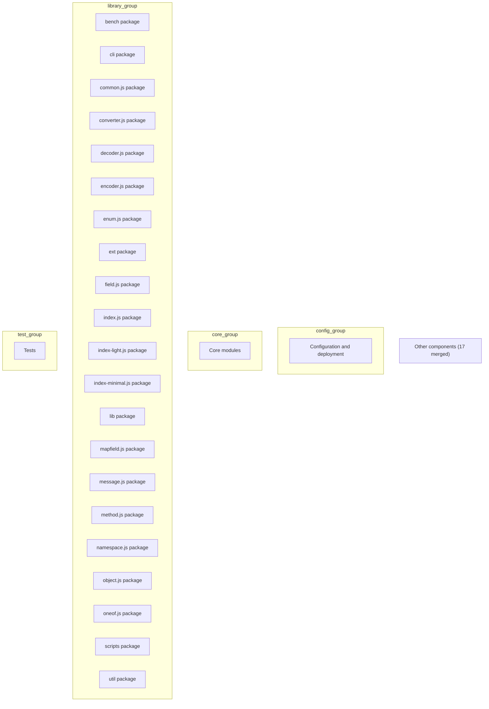

# Architecture report: protobufjs/protobuf.js

> Automated static analysis. **Observed** = directly seen in files/imports/AST; **Inferred** = interpretation from that evidence. Repository code was not executed.

## 1. Repository at a glance

| Item | Value |
| --- | --- |
| Repository | protobufjs/protobuf.js |
| Description | High-performance Protocol Buffers for JavaScript and TypeScript. Conformant through Edition 2026, and unusually versatile. No protoc required. |
| Language | JavaScript |
| Stars | 10608 |
| Licence | Other |
| Analysed commit / branch | 798b4c942cca81a7ae0a2694f28ecd2985d386c9 / master |
| Framework(s) | None detected |
| Files analysed | 361 |
| Components | 41 |

## 2. Architecture in one minute

protobufjs/protobuf.js - High-performance Protocol Buffers for JavaScript and TypeScript. Conformant through Edition 2026, and unusually versatile. No protoc required.. This repository was analysed statically from 361 file(s) (0 Python). Detected technologies (observed from imports/manifests): GitHub Actions, TypeScript. Files are grouped into 41 component(s): bench package, cli package, common.js package, Configuration and deployment, converter.js package, Core modules, decoder.js package, encoder.js package. Findings below distinguish observed facts from inferred interpretation.

## 3. High-level block diagram

## 4. Main components

### bench package (`bench`)

- **Kind:** library
- **Status:** Observed
- **Confidence:** 0.85
- **Responsibility:** Groups 9 file(s) under bench package (observed from repository paths and static analysis).
- **Paths:** `bench/cases/buf-perf/index.js`, `bench/cases/common/index.js`, `bench/cases/support.js`, `bench/cases/vector-tile/index.js`, `bench/generate.js`, `bench/index.js`, `bench/prof.js`, `bench/report.js`, `bench/suite.js`
- **Evidence:** [bench/cases/buf-perf/index.js](https://github.com/protobufjs/protobuf.js/blob/798b4c942cca81a7ae0a2694f28ecd2985d386c9/bench/cases/buf-perf/index.js); [bench/cases/common/index.js](https://github.com/protobufjs/protobuf.js/blob/798b4c942cca81a7ae0a2694f28ecd2985d386c9/bench/cases/common/index.js); [bench/cases/support.js](https://github.com/protobufjs/protobuf.js/blob/798b4c942cca81a7ae0a2694f28ecd2985d386c9/bench/cases/support.js); [bench/cases/vector-tile/index.js](https://github.com/protobufjs/protobuf.js/blob/798b4c942cca81a7ae0a2694f28ecd2985d386c9/bench/cases/vector-tile/index.js); [bench/generate.js](https://github.com/protobufjs/protobuf.js/blob/798b4c942cca81a7ae0a2694f28ecd2985d386c9/bench/generate.js); [bench/index.js](https://github.com/protobufjs/protobuf.js/blob/798b4c942cca81a7ae0a2694f28ecd2985d386c9/bench/index.js); [bench/prof.js](https://github.com/protobufjs/protobuf.js/blob/798b4c942cca81a7ae0a2694f28ecd2985d386c9/bench/prof.js); [bench/report.js](https://github.com/protobufjs/protobuf.js/blob/798b4c942cca81a7ae0a2694f28ecd2985d386c9/bench/report.js)

### cli package (`cli`)

- **Kind:** library
- **Status:** Observed
- **Confidence:** 0.85
- **Responsibility:** Groups 28 file(s) under cli package (observed from repository paths and static analysis).
- **Paths:** `cli/index.d.ts`, `cli/index.js`, `cli/lib/catharsis/catharsis.js`, `cli/lib/catharsis/lib/stringify.js`, `cli/lib/catharsis/lib/types.js`, `cli/lib/tsd-jsdoc/patch.js`, `cli/lib/tsd-jsdoc/plugin.js`, `cli/lib/tsd-jsdoc/publish.js`, `cli/pbjs.d.ts`, `cli/pbjs.js`, `cli/pbts.d.ts`, `cli/pbts.js`, `cli/protoc-gen-pbjs.d.ts`, `cli/protoc-gen-pbjs.js`, `cli/targets/json-module.js`, `cli/targets/json.js`, `cli/targets/proto.js`, `cli/targets/proto2.js`, `cli/targets/proto3.js`, `cli/targets/static-module.js`, `cli/targets/static.js`, `cli/util.js`, `cli/wrappers/amd.js`, `cli/wrappers/closure.js`, `cli/wrappers/commonjs.js`, `cli/wrappers/default.js`, `cli/wrappers/es6.js`, `cli/wrappers/esm.js`
- **Evidence:** [cli/index.d.ts](https://github.com/protobufjs/protobuf.js/blob/798b4c942cca81a7ae0a2694f28ecd2985d386c9/cli/index.d.ts); [cli/index.js](https://github.com/protobufjs/protobuf.js/blob/798b4c942cca81a7ae0a2694f28ecd2985d386c9/cli/index.js); [cli/lib/catharsis/catharsis.js](https://github.com/protobufjs/protobuf.js/blob/798b4c942cca81a7ae0a2694f28ecd2985d386c9/cli/lib/catharsis/catharsis.js); [cli/lib/catharsis/lib/stringify.js](https://github.com/protobufjs/protobuf.js/blob/798b4c942cca81a7ae0a2694f28ecd2985d386c9/cli/lib/catharsis/lib/stringify.js); [cli/lib/catharsis/lib/types.js](https://github.com/protobufjs/protobuf.js/blob/798b4c942cca81a7ae0a2694f28ecd2985d386c9/cli/lib/catharsis/lib/types.js); [cli/lib/tsd-jsdoc/patch.js](https://github.com/protobufjs/protobuf.js/blob/798b4c942cca81a7ae0a2694f28ecd2985d386c9/cli/lib/tsd-jsdoc/patch.js); [cli/lib/tsd-jsdoc/plugin.js](https://github.com/protobufjs/protobuf.js/blob/798b4c942cca81a7ae0a2694f28ecd2985d386c9/cli/lib/tsd-jsdoc/plugin.js); [cli/lib/tsd-jsdoc/publish.js](https://github.com/protobufjs/protobuf.js/blob/798b4c942cca81a7ae0a2694f28ecd2985d386c9/cli/lib/tsd-jsdoc/publish.js)

### common.js package (`common_js`)

- **Kind:** library
- **Status:** Observed
- **Confidence:** 0.85
- **Responsibility:** Groups 1 file(s) under common.js package (observed from repository paths and static analysis).
- **Paths:** `src/common.js`
- **Evidence:** [src/common.js](https://github.com/protobufjs/protobuf.js/blob/798b4c942cca81a7ae0a2694f28ecd2985d386c9/src/common.js)

### Configuration and deployment (`config`)

- **Kind:** config
- **Status:** Observed
- **Confidence:** 0.85
- **Responsibility:** Groups 20 file(s) under configuration and deployment (observed from repository paths and static analysis).
- **Paths:** `bench/cases/common/bench.json`, `bench/package.json`, `bench/results/latest.json`, `cli/lib/tsd-jsdoc.json`, `cli/package.json`, `config/jsdoc.json`, `config/tslint.json`, `google/api/annotations.json`, `google/api/http.json`, `google/protobuf/api.json`, `google/protobuf/compiler/plugin.json`, `google/protobuf/descriptor.json`, `google/protobuf/json_enumvalue_options.json`, `google/protobuf/source_context.json`, `google/protobuf/type.json`, `package.json`, `release-please-config.json`, `renovate.json`, `tsconfig.json`, `tsconfig.test-types.json`
- **Evidence:** [bench/cases/common/bench.json](https://github.com/protobufjs/protobuf.js/blob/798b4c942cca81a7ae0a2694f28ecd2985d386c9/bench/cases/common/bench.json); [bench/package.json](https://github.com/protobufjs/protobuf.js/blob/798b4c942cca81a7ae0a2694f28ecd2985d386c9/bench/package.json); [bench/results/latest.json](https://github.com/protobufjs/protobuf.js/blob/798b4c942cca81a7ae0a2694f28ecd2985d386c9/bench/results/latest.json); [cli/lib/tsd-jsdoc.json](https://github.com/protobufjs/protobuf.js/blob/798b4c942cca81a7ae0a2694f28ecd2985d386c9/cli/lib/tsd-jsdoc.json); [cli/package.json](https://github.com/protobufjs/protobuf.js/blob/798b4c942cca81a7ae0a2694f28ecd2985d386c9/cli/package.json); [config/jsdoc.json](https://github.com/protobufjs/protobuf.js/blob/798b4c942cca81a7ae0a2694f28ecd2985d386c9/config/jsdoc.json); [config/tslint.json](https://github.com/protobufjs/protobuf.js/blob/798b4c942cca81a7ae0a2694f28ecd2985d386c9/config/tslint.json); [google/api/annotations.json](https://github.com/protobufjs/protobuf.js/blob/798b4c942cca81a7ae0a2694f28ecd2985d386c9/google/api/annotations.json)

### converter.js package (`converter_js`)

- **Kind:** library
- **Status:** Observed
- **Confidence:** 0.85
- **Responsibility:** Groups 1 file(s) under converter.js package (observed from repository paths and static analysis).
- **Paths:** `src/converter.js`
- **Evidence:** [src/converter.js](https://github.com/protobufjs/protobuf.js/blob/798b4c942cca81a7ae0a2694f28ecd2985d386c9/src/converter.js)

### Core modules (`core`)

- **Kind:** core
- **Status:** Observed
- **Confidence:** 0.85
- **Responsibility:** Groups 7 file(s) under core modules (observed from repository paths and static analysis).
- **Paths:** `eslint.config.cjs`, `index.d.ts`, `index.js`, `light.d.ts`, `light.js`, `minimal.d.ts`, `minimal.js`
- **Evidence:** [eslint.config.cjs](https://github.com/protobufjs/protobuf.js/blob/798b4c942cca81a7ae0a2694f28ecd2985d386c9/eslint.config.cjs); [index.d.ts](https://github.com/protobufjs/protobuf.js/blob/798b4c942cca81a7ae0a2694f28ecd2985d386c9/index.d.ts); [index.js](https://github.com/protobufjs/protobuf.js/blob/798b4c942cca81a7ae0a2694f28ecd2985d386c9/index.js); [light.d.ts](https://github.com/protobufjs/protobuf.js/blob/798b4c942cca81a7ae0a2694f28ecd2985d386c9/light.d.ts); [light.js](https://github.com/protobufjs/protobuf.js/blob/798b4c942cca81a7ae0a2694f28ecd2985d386c9/light.js); [minimal.d.ts](https://github.com/protobufjs/protobuf.js/blob/798b4c942cca81a7ae0a2694f28ecd2985d386c9/minimal.d.ts); [minimal.js](https://github.com/protobufjs/protobuf.js/blob/798b4c942cca81a7ae0a2694f28ecd2985d386c9/minimal.js)

### decoder.js package (`decoder_js`)

- **Kind:** library
- **Status:** Observed
- **Confidence:** 0.85
- **Responsibility:** Groups 1 file(s) under decoder.js package (observed from repository paths and static analysis).
- **Paths:** `src/decoder.js`
- **Evidence:** [src/decoder.js](https://github.com/protobufjs/protobuf.js/blob/798b4c942cca81a7ae0a2694f28ecd2985d386c9/src/decoder.js)

### encoder.js package (`encoder_js`)

- **Kind:** library
- **Status:** Observed
- **Confidence:** 0.85
- **Responsibility:** Groups 1 file(s) under encoder.js package (observed from repository paths and static analysis).
- **Paths:** `src/encoder.js`
- **Evidence:** [src/encoder.js](https://github.com/protobufjs/protobuf.js/blob/798b4c942cca81a7ae0a2694f28ecd2985d386c9/src/encoder.js)

### enum.js package (`enum_js`)

- **Kind:** library
- **Status:** Observed
- **Confidence:** 0.85
- **Responsibility:** Groups 1 file(s) under enum.js package (observed from repository paths and static analysis).
- **Paths:** `src/enum.js`
- **Evidence:** [src/enum.js](https://github.com/protobufjs/protobuf.js/blob/798b4c942cca81a7ae0a2694f28ecd2985d386c9/src/enum.js)

### ext package (`ext`)

- **Kind:** library
- **Status:** Observed
- **Confidence:** 0.85
- **Responsibility:** Groups 12 file(s) under ext package (observed from repository paths and static analysis).
- **Paths:** `ext/debug/index.js`, `ext/descriptor.d.ts`, `ext/descriptor.generated.d.ts`, `ext/descriptor.js`, `ext/descriptor/index.d.ts`, `ext/descriptor/index.js`, `ext/protojson.d.ts`, `ext/protojson.generated.d.ts`, `ext/protojson.js`, `ext/textformat.d.ts`, `ext/textformat.generated.d.ts`, `ext/textformat.js`
- **Evidence:** [ext/debug/index.js](https://github.com/protobufjs/protobuf.js/blob/798b4c942cca81a7ae0a2694f28ecd2985d386c9/ext/debug/index.js); [ext/descriptor.d.ts](https://github.com/protobufjs/protobuf.js/blob/798b4c942cca81a7ae0a2694f28ecd2985d386c9/ext/descriptor.d.ts); [ext/descriptor.generated.d.ts](https://github.com/protobufjs/protobuf.js/blob/798b4c942cca81a7ae0a2694f28ecd2985d386c9/ext/descriptor.generated.d.ts); [ext/descriptor.js](https://github.com/protobufjs/protobuf.js/blob/798b4c942cca81a7ae0a2694f28ecd2985d386c9/ext/descriptor.js); [ext/descriptor/index.d.ts](https://github.com/protobufjs/protobuf.js/blob/798b4c942cca81a7ae0a2694f28ecd2985d386c9/ext/descriptor/index.d.ts); [ext/descriptor/index.js](https://github.com/protobufjs/protobuf.js/blob/798b4c942cca81a7ae0a2694f28ecd2985d386c9/ext/descriptor/index.js); [ext/protojson.d.ts](https://github.com/protobufjs/protobuf.js/blob/798b4c942cca81a7ae0a2694f28ecd2985d386c9/ext/protojson.d.ts); [ext/protojson.generated.d.ts](https://github.com/protobufjs/protobuf.js/blob/798b4c942cca81a7ae0a2694f28ecd2985d386c9/ext/protojson.generated.d.ts)

### field.js package (`field_js`)

- **Kind:** library
- **Status:** Observed
- **Confidence:** 0.85
- **Responsibility:** Groups 1 file(s) under field.js package (observed from repository paths and static analysis).
- **Paths:** `src/field.js`
- **Evidence:** [src/field.js](https://github.com/protobufjs/protobuf.js/blob/798b4c942cca81a7ae0a2694f28ecd2985d386c9/src/field.js)

### index.js package (`index_js`)

- **Kind:** library
- **Status:** Observed
- **Confidence:** 0.85
- **Responsibility:** Groups 1 file(s) under index.js package (observed from repository paths and static analysis).
- **Paths:** `src/index.js`
- **Evidence:** [src/index.js](https://github.com/protobufjs/protobuf.js/blob/798b4c942cca81a7ae0a2694f28ecd2985d386c9/src/index.js)

### index-light.js package (`index_light_js`)

- **Kind:** library
- **Status:** Observed
- **Confidence:** 0.85
- **Responsibility:** Groups 1 file(s) under index-light.js package (observed from repository paths and static analysis).
- **Paths:** `src/index-light.js`
- **Evidence:** [src/index-light.js](https://github.com/protobufjs/protobuf.js/blob/798b4c942cca81a7ae0a2694f28ecd2985d386c9/src/index-light.js)

### index-minimal.js package (`index_minimal_js`)

- **Kind:** library
- **Status:** Observed
- **Confidence:** 0.85
- **Responsibility:** Groups 1 file(s) under index-minimal.js package (observed from repository paths and static analysis).
- **Paths:** `src/index-minimal.js`
- **Evidence:** [src/index-minimal.js](https://github.com/protobufjs/protobuf.js/blob/798b4c942cca81a7ae0a2694f28ecd2985d386c9/src/index-minimal.js)

### lib package (`lib`)

- **Kind:** library
- **Status:** Observed
- **Confidence:** 0.85
- **Responsibility:** Groups 5 file(s) under lib package (observed from repository paths and static analysis).
- **Paths:** `lib/deep-equal/index.js`, `lib/deep-equal/lib/is_arguments.js`, `lib/deep-equal/lib/keys.js`, `lib/prelude.js`, `lib/tape-adapter.js`
- **Evidence:** [lib/deep-equal/index.js](https://github.com/protobufjs/protobuf.js/blob/798b4c942cca81a7ae0a2694f28ecd2985d386c9/lib/deep-equal/index.js); [lib/deep-equal/lib/is_arguments.js](https://github.com/protobufjs/protobuf.js/blob/798b4c942cca81a7ae0a2694f28ecd2985d386c9/lib/deep-equal/lib/is_arguments.js); [lib/deep-equal/lib/keys.js](https://github.com/protobufjs/protobuf.js/blob/798b4c942cca81a7ae0a2694f28ecd2985d386c9/lib/deep-equal/lib/keys.js); [lib/prelude.js](https://github.com/protobufjs/protobuf.js/blob/798b4c942cca81a7ae0a2694f28ecd2985d386c9/lib/prelude.js); [lib/tape-adapter.js](https://github.com/protobufjs/protobuf.js/blob/798b4c942cca81a7ae0a2694f28ecd2985d386c9/lib/tape-adapter.js)

### mapfield.js package (`mapfield_js`)

- **Kind:** library
- **Status:** Observed
- **Confidence:** 0.85
- **Responsibility:** Groups 1 file(s) under mapfield.js package (observed from repository paths and static analysis).
- **Paths:** `src/mapfield.js`
- **Evidence:** [src/mapfield.js](https://github.com/protobufjs/protobuf.js/blob/798b4c942cca81a7ae0a2694f28ecd2985d386c9/src/mapfield.js)

### message.js package (`message_js`)

- **Kind:** library
- **Status:** Observed
- **Confidence:** 0.85
- **Responsibility:** Groups 1 file(s) under message.js package (observed from repository paths and static analysis).
- **Paths:** `src/message.js`
- **Evidence:** [src/message.js](https://github.com/protobufjs/protobuf.js/blob/798b4c942cca81a7ae0a2694f28ecd2985d386c9/src/message.js)

### method.js package (`method_js`)

- **Kind:** library
- **Status:** Observed
- **Confidence:** 0.85
- **Responsibility:** Groups 1 file(s) under method.js package (observed from repository paths and static analysis).
- **Paths:** `src/method.js`
- **Evidence:** [src/method.js](https://github.com/protobufjs/protobuf.js/blob/798b4c942cca81a7ae0a2694f28ecd2985d386c9/src/method.js)

### namespace.js package (`namespace_js`)

- **Kind:** library
- **Status:** Observed
- **Confidence:** 0.85
- **Responsibility:** Groups 1 file(s) under namespace.js package (observed from repository paths and static analysis).
- **Paths:** `src/namespace.js`
- **Evidence:** [src/namespace.js](https://github.com/protobufjs/protobuf.js/blob/798b4c942cca81a7ae0a2694f28ecd2985d386c9/src/namespace.js)

### object.js package (`object_js`)

- **Kind:** library
- **Status:** Observed
- **Confidence:** 0.85
- **Responsibility:** Groups 1 file(s) under object.js package (observed from repository paths and static analysis).
- **Paths:** `src/object.js`
- **Evidence:** [src/object.js](https://github.com/protobufjs/protobuf.js/blob/798b4c942cca81a7ae0a2694f28ecd2985d386c9/src/object.js)

### oneof.js package (`oneof_js`)

- **Kind:** library
- **Status:** Observed
- **Confidence:** 0.85
- **Responsibility:** Groups 1 file(s) under oneof.js package (observed from repository paths and static analysis).
- **Paths:** `src/oneof.js`
- **Evidence:** [src/oneof.js](https://github.com/protobufjs/protobuf.js/blob/798b4c942cca81a7ae0a2694f28ecd2985d386c9/src/oneof.js)

### parse.js package (`parse_js`)

- **Kind:** library
- **Status:** Observed
- **Confidence:** 0.85
- **Responsibility:** Groups 1 file(s) under parse.js package (observed from repository paths and static analysis).
- **Paths:** `src/parse.js`
- **Evidence:** [src/parse.js](https://github.com/protobufjs/protobuf.js/blob/798b4c942cca81a7ae0a2694f28ecd2985d386c9/src/parse.js)

### reader_buffer.js package (`reader_buffer_js`)

- **Kind:** library
- **Status:** Observed
- **Confidence:** 0.85
- **Responsibility:** Groups 1 file(s) under reader_buffer.js package (observed from repository paths and static analysis).
- **Paths:** `src/reader_buffer.js`
- **Evidence:** [src/reader_buffer.js](https://github.com/protobufjs/protobuf.js/blob/798b4c942cca81a7ae0a2694f28ecd2985d386c9/src/reader_buffer.js)

### reader.js package (`reader_js`)

- **Kind:** library
- **Status:** Observed
- **Confidence:** 0.85
- **Responsibility:** Groups 1 file(s) under reader.js package (observed from repository paths and static analysis).
- **Paths:** `src/reader.js`
- **Evidence:** [src/reader.js](https://github.com/protobufjs/protobuf.js/blob/798b4c942cca81a7ae0a2694f28ecd2985d386c9/src/reader.js)

### root.js package (`root_js`)

- **Kind:** library
- **Status:** Observed
- **Confidence:** 0.85
- **Responsibility:** Groups 1 file(s) under root.js package (observed from repository paths and static analysis).
- **Paths:** `src/root.js`
- **Evidence:** [src/root.js](https://github.com/protobufjs/protobuf.js/blob/798b4c942cca81a7ae0a2694f28ecd2985d386c9/src/root.js)

### roots.js package (`roots_js`)

- **Kind:** library
- **Status:** Observed
- **Confidence:** 0.85
- **Responsibility:** Groups 1 file(s) under roots.js package (observed from repository paths and static analysis).
- **Paths:** `src/roots.js`
- **Evidence:** [src/roots.js](https://github.com/protobufjs/protobuf.js/blob/798b4c942cca81a7ae0a2694f28ecd2985d386c9/src/roots.js)

### rpc package (`rpc`)

- **Kind:** library
- **Status:** Observed
- **Confidence:** 0.85
- **Responsibility:** Groups 1 file(s) under rpc package (observed from repository paths and static analysis).
- **Paths:** `src/rpc/service.js`
- **Evidence:** [src/rpc/service.js](https://github.com/protobufjs/protobuf.js/blob/798b4c942cca81a7ae0a2694f28ecd2985d386c9/src/rpc/service.js)

### rpc.js package (`rpc_js`)

- **Kind:** library
- **Status:** Observed
- **Confidence:** 0.85
- **Responsibility:** Groups 1 file(s) under rpc.js package (observed from repository paths and static analysis).
- **Paths:** `src/rpc.js`
- **Evidence:** [src/rpc.js](https://github.com/protobufjs/protobuf.js/blob/798b4c942cca81a7ae0a2694f28ecd2985d386c9/src/rpc.js)

### scripts package (`scripts`)

- **Kind:** library
- **Status:** Observed
- **Confidence:** 0.85
- **Responsibility:** Groups 5 file(s) under scripts package (observed from repository paths and static analysis).
- **Paths:** `scripts/bundle.js`, `scripts/gencommons.js`, `scripts/gentests.js`, `scripts/gulpfile.js`, `scripts/pages.js`
- **Evidence:** [scripts/bundle.js](https://github.com/protobufjs/protobuf.js/blob/798b4c942cca81a7ae0a2694f28ecd2985d386c9/scripts/bundle.js); [scripts/gencommons.js](https://github.com/protobufjs/protobuf.js/blob/798b4c942cca81a7ae0a2694f28ecd2985d386c9/scripts/gencommons.js); [scripts/gentests.js](https://github.com/protobufjs/protobuf.js/blob/798b4c942cca81a7ae0a2694f28ecd2985d386c9/scripts/gentests.js); [scripts/gulpfile.js](https://github.com/protobufjs/protobuf.js/blob/798b4c942cca81a7ae0a2694f28ecd2985d386c9/scripts/gulpfile.js); [scripts/pages.js](https://github.com/protobufjs/protobuf.js/blob/798b4c942cca81a7ae0a2694f28ecd2985d386c9/scripts/pages.js)

### service.js package (`service_js`)

- **Kind:** library
- **Status:** Observed
- **Confidence:** 0.85
- **Responsibility:** Groups 1 file(s) under service.js package (observed from repository paths and static analysis).
- **Paths:** `src/service.js`
- **Evidence:** [src/service.js](https://github.com/protobufjs/protobuf.js/blob/798b4c942cca81a7ae0a2694f28ecd2985d386c9/src/service.js)

### Tests (`tests`)

- **Kind:** test
- **Status:** Observed
- **Confidence:** 0.85
- **Responsibility:** Groups 161 file(s) under tests (observed from repository paths and static analysis).
- **Paths:** `tests/README.md`, `tests/api_Class.js`, `tests/api_common.js`, `tests/api_converters.js`, `tests/api_decoder_bounds.js`, `tests/api_descriptor.js`, `tests/api_enum.js`, `tests/api_field.js`, `tests/api_inheritance.js`, `tests/api_longbits.js`, `tests/api_mapfield.js`, `tests/api_namespace.js`, `tests/api_object.js`, `tests/api_oneof.js`, `tests/api_protojson.js`, `tests/api_reader-writer-reuse.js`, `tests/api_reader_packed.js`, `tests/api_root-deferred.js`, `tests/api_root-expose.js`, `tests/api_root.js`, `tests/api_service-rpc-streaming.js`, `tests/api_service-rpc.js`, `tests/api_service.js`, `tests/api_textformat.js`, `tests/api_tokenize.js`, `tests/api_type.js`, `tests/api_util.js`, `tests/api_writer-reader.js`, `tests/api_writer_packed.js`, `tests/api_writer_resize.js`, `tests/cli-null-semantics.js`, `tests/cli-pbjs.js`, `tests/cli-pbts.js`, `tests/cli-plugin.js`, `tests/cli-proto.js`, `tests/comment_serialization.js`, `tests/comp_ambiguous-names.js`, `tests/comp_bytes.js`, `tests/comp_descriptor.ts`, `tests/comp_empty-encode.js`, `tests/comp_empty-inner-fields.js`, `tests/comp_empty-statements.js`, `tests/comp_enum-semantics.js`, `tests/comp_extend.js`, `tests/comp_fixed64-grpc.js`, `tests/comp_google_protobuf_any.js`, `tests/comp_groups.js`, `tests/comp_import-after-decl.js`, `tests/comp_jspb-test.js`, `tests/comp_long-tags.js`, `tests/comp_maps.js`, `tests/comp_negative-int32.js`, `tests/comp_oneof.js`, `tests/comp_optional.js`, `tests/comp_options-parse.js`, `tests/comp_options-textformat.js`, `tests/comp_options.js`, `tests/comp_packed-repeated.js`, `tests/comp_parse-uncommon.js`, `tests/comp_protojson.ts`, `tests/comp_repeated-message.js`, `tests/comp_sfixed64-grpc.js`, `tests/comp_static_maps.js`, `tests/comp_textformat.ts`, `tests/comp_typescript.js`, `tests/comp_typescript.ts`, `tests/comp_unknown-fields.js`, `tests/comp_whitespace-in-type.js`, `tests/conformance/.gitignore`, `tests/conformance/check.js`, `tests/conformance/generate.js`, `tests/conformance/report.js`, `tests/conformance/summary.js`, `tests/conformance/testee.js`, `tests/data/badimport.proto`, `tests/data/cli/default-path/proto/a.proto`, `tests/data/cli/default-path/proto/b.proto`, `tests/data/cli/filter.json`, `tests/data/cli/null-defaults-edition2023.proto`, `tests/data/cli/null-defaults-proto3.proto`, `tests/data/cli/null-defaults.proto`, `tests/data/cli/test-filter-import.proto`, `tests/data/cli/test-filter.proto`, `tests/data/cli/test.proto`, `tests/data/comment_serialization.proto`, `tests/data/comments-alternate-parse.proto`, `tests/data/comments.d.ts`, `tests/data/comments.js`, `tests/data/comments.proto`, `tests/data/common-custom.proto`, `tests/data/common.json`, `tests/data/common.proto`, `tests/data/convert.d.ts`, `tests/data/convert.js`, `tests/data/convert.proto`, `tests/data/enum-semantics.d.ts`, `tests/data/enum-semantics.js`, `tests/data/enum-semantics.proto`, `tests/data/feature-resolution.proto`, `tests/data/google/protobuf/LICENSE`, `tests/data/google/protobuf/descriptor.proto`, `tests/data/import-option-bad.proto`, `tests/data/invalid-lookup.proto`, `tests/data/invalid.json`, `tests/data/invalid.proto`, `tests/data/issue936.proto`, `tests/data/mapbox/LICENSE`, `tests/data/mapbox/vector_tile.d.ts`, `tests/data/mapbox/vector_tile.js`, `tests/data/mapbox/vector_tile.proto`, `tests/data/options_test.proto`, `tests/data/package.d.ts`, `tests/data/package.js`, `tests/data/package.proto`, `tests/data/rpc-es6.d.ts`, `tests/data/rpc-es6.js`, `tests/data/rpc-reserved.d.ts`, `tests/data/rpc-reserved.js`, `tests/data/rpc-reserved.proto`, `tests/data/rpc.d.ts`, `tests/data/rpc.js`, `tests/data/rpc.proto`, `tests/data/rpc.ts`, `tests/data/test.d.ts`, `tests/data/test.js.ts`, `tests/data/test.json`, `tests/data/test.proto`, `tests/data/type_url.js`, `tests/data/type_url.proto`, `tests/data/uncommon.proto`, `tests/data/util_fetch/file.txt`, `tests/data/util_utf8/surrogate_pair_bug.txt`, `tests/data/util_utf8/utf8.txt`, `tests/data/weak-other.proto`, `tests/data/weak.proto`, `tests/data/whitespace-in-type.proto`, `tests/docs_comments.js`, `tests/docs_comments_alternate_parse.js`, `tests/feature_grammar.js`, `tests/feature_resolution_editions.js`, `tests/gen_type_url.js`, `tests/helpers/cli.js`, `tests/node/api_load-sync.js`, `tests/node/comp_loaders.js`, `tests/node/override-mistake.js`, `tests/other_bench.js`, `tests/other_classes.js`, `tests/other_node-or-browser.js`, `tests/other_protocolerror.js`, `tests/parse_editions.js`, `tests/split/root.js`, `tests/split/test.proto`, `tests/util_aspromise.js`, `tests/util_base64.js`, `tests/util_codegen.js`, `tests/util_eventemitter.js`, `tests/util_fetch.js`, `tests/util_float.js`, `tests/util_path.js`, `tests/util_pool.js`, `tests/util_utf8.js`
- **Evidence:** [tests/README.md](https://github.com/protobufjs/protobuf.js/blob/798b4c942cca81a7ae0a2694f28ecd2985d386c9/tests/README.md); [tests/api_Class.js](https://github.com/protobufjs/protobuf.js/blob/798b4c942cca81a7ae0a2694f28ecd2985d386c9/tests/api_Class.js); [tests/api_common.js](https://github.com/protobufjs/protobuf.js/blob/798b4c942cca81a7ae0a2694f28ecd2985d386c9/tests/api_common.js); [tests/api_converters.js](https://github.com/protobufjs/protobuf.js/blob/798b4c942cca81a7ae0a2694f28ecd2985d386c9/tests/api_converters.js); [tests/api_decoder_bounds.js](https://github.com/protobufjs/protobuf.js/blob/798b4c942cca81a7ae0a2694f28ecd2985d386c9/tests/api_decoder_bounds.js); [tests/api_descriptor.js](https://github.com/protobufjs/protobuf.js/blob/798b4c942cca81a7ae0a2694f28ecd2985d386c9/tests/api_descriptor.js); [tests/api_enum.js](https://github.com/protobufjs/protobuf.js/blob/798b4c942cca81a7ae0a2694f28ecd2985d386c9/tests/api_enum.js); [tests/api_field.js](https://github.com/protobufjs/protobuf.js/blob/798b4c942cca81a7ae0a2694f28ecd2985d386c9/tests/api_field.js)

### tokenize.js package (`tokenize_js`)

- **Kind:** library
- **Status:** Observed
- **Confidence:** 0.85
- **Responsibility:** Groups 1 file(s) under tokenize.js package (observed from repository paths and static analysis).
- **Paths:** `src/tokenize.js`
- **Evidence:** [src/tokenize.js](https://github.com/protobufjs/protobuf.js/blob/798b4c942cca81a7ae0a2694f28ecd2985d386c9/src/tokenize.js)

### type.js package (`type_js`)

- **Kind:** library
- **Status:** Observed
- **Confidence:** 0.85
- **Responsibility:** Groups 1 file(s) under type.js package (observed from repository paths and static analysis).
- **Paths:** `src/type.js`
- **Evidence:** [src/type.js](https://github.com/protobufjs/protobuf.js/blob/798b4c942cca81a7ae0a2694f28ecd2985d386c9/src/type.js)

### types.js package (`types_js`)

- **Kind:** library
- **Status:** Observed
- **Confidence:** 0.85
- **Responsibility:** Groups 1 file(s) under types.js package (observed from repository paths and static analysis).
- **Paths:** `src/types.js`
- **Evidence:** [src/types.js](https://github.com/protobufjs/protobuf.js/blob/798b4c942cca81a7ae0a2694f28ecd2985d386c9/src/types.js)

### typescript.js package (`typescript_js`)

- **Kind:** library
- **Status:** Observed
- **Confidence:** 0.85
- **Responsibility:** Groups 1 file(s) under typescript.js package (observed from repository paths and static analysis).
- **Paths:** `src/typescript.js`
- **Evidence:** [src/typescript.js](https://github.com/protobufjs/protobuf.js/blob/798b4c942cca81a7ae0a2694f28ecd2985d386c9/src/typescript.js)

### util package (`util`)

- **Kind:** library
- **Status:** Observed
- **Confidence:** 0.85
- **Responsibility:** Groups 22 file(s) under util package (observed from repository paths and static analysis).
- **Paths:** `src/util/aspromise.d.ts`, `src/util/aspromise.js`, `src/util/base64.d.ts`, `src/util/base64.js`, `src/util/codegen.d.ts`, `src/util/codegen.js`, `src/util/eventemitter.d.ts`, `src/util/eventemitter.js`, `src/util/fetch.d.ts`, `src/util/fetch.js`, `src/util/float.d.ts`, `src/util/float.js`, `src/util/fs.js`, `src/util/longbits.js`, `src/util/minimal.js`, `src/util/path.d.ts`, `src/util/path.js`, `src/util/patterns.js`, `src/util/pool.d.ts`, `src/util/pool.js`, `src/util/utf8.d.ts`, `src/util/utf8.js`
- **Evidence:** [src/util/aspromise.d.ts](https://github.com/protobufjs/protobuf.js/blob/798b4c942cca81a7ae0a2694f28ecd2985d386c9/src/util/aspromise.d.ts); [src/util/aspromise.js](https://github.com/protobufjs/protobuf.js/blob/798b4c942cca81a7ae0a2694f28ecd2985d386c9/src/util/aspromise.js); [src/util/base64.d.ts](https://github.com/protobufjs/protobuf.js/blob/798b4c942cca81a7ae0a2694f28ecd2985d386c9/src/util/base64.d.ts); [src/util/base64.js](https://github.com/protobufjs/protobuf.js/blob/798b4c942cca81a7ae0a2694f28ecd2985d386c9/src/util/base64.js); [src/util/codegen.d.ts](https://github.com/protobufjs/protobuf.js/blob/798b4c942cca81a7ae0a2694f28ecd2985d386c9/src/util/codegen.d.ts); [src/util/codegen.js](https://github.com/protobufjs/protobuf.js/blob/798b4c942cca81a7ae0a2694f28ecd2985d386c9/src/util/codegen.js); [src/util/eventemitter.d.ts](https://github.com/protobufjs/protobuf.js/blob/798b4c942cca81a7ae0a2694f28ecd2985d386c9/src/util/eventemitter.d.ts); [src/util/eventemitter.js](https://github.com/protobufjs/protobuf.js/blob/798b4c942cca81a7ae0a2694f28ecd2985d386c9/src/util/eventemitter.js)

### util.js package (`util_js`)

- **Kind:** library
- **Status:** Observed
- **Confidence:** 0.85
- **Responsibility:** Groups 1 file(s) under util.js package (observed from repository paths and static analysis).
- **Paths:** `src/util.js`
- **Evidence:** [src/util.js](https://github.com/protobufjs/protobuf.js/blob/798b4c942cca81a7ae0a2694f28ecd2985d386c9/src/util.js)

### verifier.js package (`verifier_js`)

- **Kind:** library
- **Status:** Observed
- **Confidence:** 0.85
- **Responsibility:** Groups 1 file(s) under verifier.js package (observed from repository paths and static analysis).
- **Paths:** `src/verifier.js`
- **Evidence:** [src/verifier.js](https://github.com/protobufjs/protobuf.js/blob/798b4c942cca81a7ae0a2694f28ecd2985d386c9/src/verifier.js)

### wrappers.js package (`wrappers_js`)

- **Kind:** library
- **Status:** Observed
- **Confidence:** 0.85
- **Responsibility:** Groups 1 file(s) under wrappers.js package (observed from repository paths and static analysis).
- **Paths:** `src/wrappers.js`
- **Evidence:** [src/wrappers.js](https://github.com/protobufjs/protobuf.js/blob/798b4c942cca81a7ae0a2694f28ecd2985d386c9/src/wrappers.js)

### writer_buffer.js package (`writer_buffer_js`)

- **Kind:** library
- **Status:** Observed
- **Confidence:** 0.85
- **Responsibility:** Groups 1 file(s) under writer_buffer.js package (observed from repository paths and static analysis).
- **Paths:** `src/writer_buffer.js`
- **Evidence:** [src/writer_buffer.js](https://github.com/protobufjs/protobuf.js/blob/798b4c942cca81a7ae0a2694f28ecd2985d386c9/src/writer_buffer.js)

### writer.js package (`writer_js`)

- **Kind:** library
- **Status:** Observed
- **Confidence:** 0.85
- **Responsibility:** Groups 1 file(s) under writer.js package (observed from repository paths and static analysis).
- **Paths:** `src/writer.js`
- **Evidence:** [src/writer.js](https://github.com/protobufjs/protobuf.js/blob/798b4c942cca81a7ae0a2694f28ecd2985d386c9/src/writer.js)

## 5. Execution flow

**Observed** entry point(s):

- [bench/cases/buf-perf/index.js](https://github.com/protobufjs/protobuf.js/blob/798b4c942cca81a7ae0a2694f28ecd2985d386c9/bench/cases/buf-perf/index.js)
- [bench/cases/common/index.js](https://github.com/protobufjs/protobuf.js/blob/798b4c942cca81a7ae0a2694f28ecd2985d386c9/bench/cases/common/index.js)
- [bench/cases/vector-tile/index.js](https://github.com/protobufjs/protobuf.js/blob/798b4c942cca81a7ae0a2694f28ecd2985d386c9/bench/cases/vector-tile/index.js)
- [bench/index.js](https://github.com/protobufjs/protobuf.js/blob/798b4c942cca81a7ae0a2694f28ecd2985d386c9/bench/index.js)
- [cli/bin/pbjs](https://github.com/protobufjs/protobuf.js/blob/798b4c942cca81a7ae0a2694f28ecd2985d386c9/cli/bin/pbjs)
- [cli/bin/pbts](https://github.com/protobufjs/protobuf.js/blob/798b4c942cca81a7ae0a2694f28ecd2985d386c9/cli/bin/pbts)
- [cli/bin/protoc-gen-pbjs](https://github.com/protobufjs/protobuf.js/blob/798b4c942cca81a7ae0a2694f28ecd2985d386c9/cli/bin/protoc-gen-pbjs)
- [cli/index.js](https://github.com/protobufjs/protobuf.js/blob/798b4c942cca81a7ae0a2694f28ecd2985d386c9/cli/index.js)
- [ext/debug/index.js](https://github.com/protobufjs/protobuf.js/blob/798b4c942cca81a7ae0a2694f28ecd2985d386c9/ext/debug/index.js)
- [ext/descriptor/index.js](https://github.com/protobufjs/protobuf.js/blob/798b4c942cca81a7ae0a2694f28ecd2985d386c9/ext/descriptor/index.js)
- [index.js](https://github.com/protobufjs/protobuf.js/blob/798b4c942cca81a7ae0a2694f28ecd2985d386c9/index.js)
- [lib/deep-equal/index.js](https://github.com/protobufjs/protobuf.js/blob/798b4c942cca81a7ae0a2694f28ecd2985d386c9/lib/deep-equal/index.js)

Representative flow (derived from observed entry points and the import graph; steps beyond the entry point are **Inferred**):

1. Execution starts at an observed entry point listed above, if present.
2. No internal import relationships between components were observed.

## 6. Project structure

### `(root)`

- `.gitattributes` - other (36 bytes)
- `.gitignore` - other (131 bytes)
- `.gitmodules` - other (116 bytes)
- `.release-please-manifest.json` - config (28 bytes)
- `CHANGELOG.md` - docs (176476 bytes)
- `CONTRIBUTING.md` - docs (970 bytes)
- `LICENSE` - docs (1937 bytes)
- `README.md` - docs (19644 bytes)
- `SECURITY.md` - docs (1891 bytes)
- `eslint.config.cjs` - source, JavaScript (7192 bytes)
- `index.d.ts` - source, TypeScript (101471 bytes)
- `index.js` - source, JavaScript (85 bytes)
- `light.d.ts` - source, TypeScript (55 bytes)
- `light.js` - source, JavaScript (91 bytes)
- `minimal.d.ts` - source, TypeScript (55 bytes)
- `minimal.js` - source, JavaScript (96 bytes)
- `package.json` - manifest (3520 bytes)
- `pbjs.svg` - other (1338 bytes)
- `release-please-config.json` - config (522 bytes)
- `renovate.json` - config (1731 bytes)
- `tsconfig.json` - config (92 bytes)
- `tsconfig.test-types.json` - config (381 bytes)

### `.github`

- `.github/FUNDING.yml` - config (16 bytes)
- `.github/ISSUE_TEMPLATE/config.yml` - config (27 bytes)
- `.github/ISSUE_TEMPLATE/issue.yml` - config (1105 bytes)
- `.github/actions/conformance/action.yml` - config (8046 bytes)
- `.github/workflows/release.yaml` - ci, YAML (2002 bytes)
- `.github/workflows/test.yml` - ci, YAML (3157 bytes)

### `bench`

- `bench/README.md` - docs (372 bytes)
- `bench/cases/buf-perf/LICENSE` - docs (11357 bytes)
- `bench/cases/buf-perf/index.js` - source, JavaScript (1582 bytes)
- `bench/cases/buf-perf/perf.proto` - other (2314 bytes)
- `bench/cases/common/bench.json` - config (488 bytes)
- `bench/cases/common/bench.proto` - other (691 bytes)
- `bench/cases/common/index.js` - source, JavaScript (1995 bytes)
- `bench/cases/support.js` - source, JavaScript (1494 bytes)
- `bench/cases/vector-tile/LICENSE` - docs (1467 bytes)
- `bench/cases/vector-tile/index.js` - source, JavaScript (1624 bytes)
- `bench/cases/vector-tile/vector_tile.proto` - other (1122 bytes)
- `bench/generate.js` - source, JavaScript (3638 bytes)
- `bench/generated/.gitignore` - other (14 bytes)
- `bench/index.js` - source, JavaScript (4268 bytes)
- `bench/package.json` - manifest (532 bytes)
- `bench/prof.js` - source, JavaScript (3567 bytes)
- `bench/report.js` - source, JavaScript (11105 bytes)
- `bench/results/decode-dark.svg` - other (4390 bytes)
- `bench/results/decode-light.svg` - other (4390 bytes)
- `bench/results/decode.svg` - other (4440 bytes)
- `bench/results/encode-dark.svg` - other (4393 bytes)
- `bench/results/encode-light.svg` - other (4393 bytes)
- `bench/results/encode.svg` - other (4443 bytes)
- `bench/results/latest.json` - config (5277 bytes)
- `bench/suite.js` - source, JavaScript (2097 bytes)

### `cli`

- `cli/CHANGELOG.md` - docs (24955 bytes)
- `cli/LICENSE` - docs (1737 bytes)
- `cli/README.md` - docs (6540 bytes)
- `cli/bin/pbjs` - other (203 bytes)
- `cli/bin/pbts` - other (203 bytes)
- `cli/bin/protoc-gen-pbjs` - other (72 bytes)
- `cli/index.d.ts` - source, TypeScript (93 bytes)
- `cli/index.js` - source, JavaScript (82 bytes)
- `cli/lib/catharsis/LICENSE` - docs (1062 bytes)
- `cli/lib/catharsis/README.md` - docs (440 bytes)
- `cli/lib/catharsis/catharsis.js` - source, JavaScript (1655 bytes)
- `cli/lib/catharsis/lib/stringify.js` - source, JavaScript (6717 bytes)
- `cli/lib/catharsis/lib/types.js` - source, JavaScript (1716 bytes)
- `cli/lib/tsd-jsdoc.json` - config (447 bytes)
- `cli/lib/tsd-jsdoc/LICENSE` - docs (1071 bytes)
- `cli/lib/tsd-jsdoc/README.md` - docs (923 bytes)
- `cli/lib/tsd-jsdoc/patch.js` - source, JavaScript (3535 bytes)
- `cli/lib/tsd-jsdoc/plugin.js` - source, JavaScript (630 bytes)
- `cli/lib/tsd-jsdoc/publish.js` - source, JavaScript (26918 bytes)
- `cli/package.json` - manifest (880 bytes)
- `cli/pbjs.d.ts` - source, TypeScript (363 bytes)
- `cli/pbjs.js` - source, JavaScript (17186 bytes)
- `cli/pbts.d.ts` - source, TypeScript (778 bytes)
- `cli/pbts.js` - source, JavaScript (9366 bytes)
- `cli/protoc-gen-pbjs.d.ts` - source, TypeScript (1576 bytes)
- `cli/protoc-gen-pbjs.js` - source, JavaScript (7176 bytes)
- `cli/targets/json-module.js` - source, JavaScript (2986 bytes)
- `cli/targets/json.js` - source, JavaScript (188 bytes)
- `cli/targets/proto.js` - source, JavaScript (9848 bytes)
- `cli/targets/proto2.js` - source, JavaScript (290 bytes)
- `cli/targets/proto3.js` - source, JavaScript (290 bytes)
- `cli/targets/static-module.js` - source, JavaScript (1237 bytes)
- `cli/targets/static.js` - source, JavaScript (43888 bytes)
- `cli/util.js` - source, JavaScript (8633 bytes)
- `cli/wrappers/amd.js` - source, JavaScript (99 bytes)
- `cli/wrappers/closure.js` - source, JavaScript (88 bytes)
- `cli/wrappers/commonjs.js` - source, JavaScript (103 bytes)
- `cli/wrappers/default.js` - source, JavaScript (430 bytes)
- `cli/wrappers/es6.js` - source, JavaScript (92 bytes)
- `cli/wrappers/esm.js` - source, JavaScript (92 bytes)

### `config`

- `config/jsdoc.json` - config (1285 bytes)
- `config/tslint.json` - config (1225 bytes)

### `examples`

- `examples/custom-get-set.js` - source, JavaScript (1712 bytes)
- `examples/grpc-service.js` - source, JavaScript (2963 bytes)
- `examples/reader-writer.js` - source, JavaScript (706 bytes)
- `examples/streaming-rpc.js` - source, JavaScript (3441 bytes)
- `examples/traverse-types.js` - source, JavaScript (1210 bytes)

### `ext`

- `ext/README.md` - docs (3665 bytes)
- `ext/debug/README.md` - docs (82 bytes)
- `ext/debug/index.js` - source, JavaScript (2091 bytes)
- `ext/descriptor.d.ts` - source, TypeScript (3233 bytes)
- `ext/descriptor.generated.d.ts` - source, TypeScript (9918 bytes)
- `ext/descriptor.js` - source, JavaScript (49339 bytes)
- `ext/descriptor/README.md` - docs (255 bytes)
- `ext/descriptor/index.d.ts` - source, TypeScript (67 bytes)
- `ext/descriptor/index.js` - source, JavaScript (57 bytes)
- `ext/protojson.LICENSE` - other (11357 bytes)
- `ext/protojson.d.ts` - source, TypeScript (915 bytes)
- `ext/protojson.generated.d.ts` - source, TypeScript (1923 bytes)
- `ext/protojson.js` - source, JavaScript (35750 bytes)
- `ext/textformat.d.ts` - source, TypeScript (720 bytes)
- `ext/textformat.generated.d.ts` - source, TypeScript (1149 bytes)
- `ext/textformat.js` - source, JavaScript (42414 bytes)

### `google`

- `google/LICENSE` - docs (1476 bytes)
- `google/README.md` - docs (190 bytes)
- `google/api/annotations.json` - config (2076 bytes)
- `google/api/annotations.proto` - other (188 bytes)
- `google/api/http.json` - config (2141 bytes)
- `google/api/http.proto` - other (474 bytes)
- `google/protobuf/api.json` - config (3252 bytes)
- `google/protobuf/api.proto` - other (642 bytes)
- `google/protobuf/compiler/plugin.json` - config (3975 bytes)
- `google/protobuf/compiler/plugin.proto` - other (1216 bytes)
- `google/protobuf/descriptor.json` - config (46661 bytes)
- `google/protobuf/descriptor.proto` - other (14500 bytes)
- `google/protobuf/json_enumvalue_options.json` - config (1250 bytes)
- `google/protobuf/json_enumvalue_options.proto` - other (841 bytes)
- `google/protobuf/source_context.json` - config (376 bytes)
- `google/protobuf/source_context.proto` - other (98 bytes)
- `google/protobuf/type.json` - config (5793 bytes)
- `google/protobuf/type.proto` - other (1675 bytes)

### `lib`

- `lib/deep-equal/LICENSE` - docs (1072 bytes)
- `lib/deep-equal/README.md` - docs (171 bytes)
- `lib/deep-equal/index.js` - source, JavaScript (3118 bytes)
- `lib/deep-equal/lib/is_arguments.js` - source, JavaScript (640 bytes)
- `lib/deep-equal/lib/keys.js` - source, JavaScript (201 bytes)
- `lib/prelude.js` - source, JavaScript (1187 bytes)
- `lib/tape-adapter.js` - source, JavaScript (638 bytes)

### `scripts`

- `scripts/bundle.js` - source, JavaScript (2995 bytes)
- `scripts/gencommons.js` - source, JavaScript (663 bytes)
- `scripts/gentests.js` - source, JavaScript (2602 bytes)
- `scripts/gulpfile.js` - source, JavaScript (1207 bytes)
- `scripts/pages.js` - source, JavaScript (882 bytes)

### `src`

- `src/common.js` - source, JavaScript (9559 bytes)
- `src/converter.js` - source, JavaScript (14771 bytes)
- `src/decoder.js` - source, JavaScript (11680 bytes)
- `src/encoder.js` - source, JavaScript (5403 bytes)
- `src/enum.js` - source, JavaScript (8016 bytes)
- `src/field.js` - source, JavaScript (16192 bytes)
- `src/index-light.js` - source, JavaScript (3635 bytes)
- `src/index-minimal.js` - source, JavaScript (913 bytes)
- `src/index.js` - source, JavaScript (339 bytes)
- `src/mapfield.js` - source, JavaScript (4902 bytes)
- `src/message.js` - source, JavaScript (3904 bytes)
- `src/method.js` - source, JavaScript (5575 bytes)
- `src/namespace.js` - source, JavaScript (19666 bytes)
- `src/object.js` - source, JavaScript (12866 bytes)
- `src/oneof.js` - source, JavaScript (6705 bytes)
- `src/parse.js` - source, JavaScript (35559 bytes)
- `src/reader.js` - source, JavaScript (26588 bytes)
- `src/reader_buffer.js` - source, JavaScript (1839 bytes)
- `src/root.js` - source, JavaScript (14457 bytes)
- `src/roots.js` - source, JavaScript (471 bytes)
- `src/rpc.js` - source, JavaScript (1204 bytes)
- `src/rpc/service.js` - source, JavaScript (4925 bytes)
- `src/service.js` - source, JavaScript (6394 bytes)
- `src/tokenize.js` - source, JavaScript (13647 bytes)
- `src/type.js` - source, JavaScript (24334 bytes)
- `src/types.js` - source, JavaScript (5535 bytes)
- `src/typescript.js` - source, JavaScript (596 bytes)
- `src/util.js` - source, JavaScript (7646 bytes)
- `src/util/aspromise.d.ts` - source, TypeScript (445 bytes)
- `src/util/aspromise.js` - source, JavaScript (1540 bytes)
- `src/util/base64.d.ts` - source, TypeScript (1094 bytes)
- `src/util/base64.js` - source, JavaScript (4047 bytes)
- `src/util/codegen.d.ts` - source, TypeScript (1131 bytes)
- `src/util/codegen.js` - source, JavaScript (4341 bytes)
- `src/util/eventemitter.d.ts` - source, TypeScript (1333 bytes)
- `src/util/eventemitter.js` - source, JavaScript (2262 bytes)
- `src/util/fetch.d.ts` - source, TypeScript (1598 bytes)
- `src/util/fetch.js` - source, JavaScript (3833 bytes)
- `src/util/float.d.ts` - source, TypeScript (2543 bytes)
- `src/util/float.js` - source, JavaScript (11113 bytes)
- `src/util/fs.js` - source, JavaScript (256 bytes)
- `src/util/longbits.js` - source, JavaScript (5438 bytes)
- `src/util/minimal.js` - source, JavaScript (15104 bytes)
- `src/util/path.d.ts` - source, TypeScript (816 bytes)
- `src/util/path.js` - source, JavaScript (2946 bytes)
- `src/util/patterns.js` - source, JavaScript (538 bytes)
- `src/util/pool.d.ts` - source, TypeScript (873 bytes)
- `src/util/pool.js` - source, JavaScript (1190 bytes)
- `src/util/utf8.d.ts` - source, TypeScript (734 bytes)
- `src/util/utf8.js` - source, JavaScript (4816 bytes)
- `src/verifier.js` - source, JavaScript (6425 bytes)
- `src/wrappers.js` - source, JavaScript (3823 bytes)
- `src/writer.js` - source, JavaScript (20037 bytes)
- `src/writer_buffer.js` - source, JavaScript (2328 bytes)

### `tests`

- `tests/README.md` - test (634 bytes)
- `tests/api_Class.js` - test, JavaScript (535 bytes)
- `tests/api_common.js` - test, JavaScript (1563 bytes)
- `tests/api_converters.js` - test, JavaScript (20626 bytes)
- `tests/api_decoder_bounds.js` - test, JavaScript (5975 bytes)
- `tests/api_descriptor.js` - test, JavaScript (29521 bytes)
- `tests/api_enum.js` - test, JavaScript (9605 bytes)
- `tests/api_field.js` - test, JavaScript (6999 bytes)
- `tests/api_inheritance.js` - test, JavaScript (905 bytes)
- `tests/api_longbits.js` - test, JavaScript (5223 bytes)
- `tests/api_mapfield.js` - test, JavaScript (449 bytes)
- `tests/api_namespace.js` - test, JavaScript (9818 bytes)
- `tests/api_object.js` - test, JavaScript (3829 bytes)
- `tests/api_oneof.js` - test, JavaScript (1724 bytes)
- `tests/api_protojson.js` - test, JavaScript (30718 bytes)
- `tests/api_reader-writer-reuse.js` - test, JavaScript (2547 bytes)
- `tests/api_reader_packed.js` - test, JavaScript (4049 bytes)
- `tests/api_root-deferred.js` - test, JavaScript (1588 bytes)
- `tests/api_root-expose.js` - test, JavaScript (1231 bytes)
- `tests/api_root.js` - test, JavaScript (7621 bytes)
- `tests/api_service-rpc-streaming.js` - test, JavaScript (6999 bytes)
- `tests/api_service-rpc.js` - test, JavaScript (4189 bytes)
- `tests/api_service.js` - test, JavaScript (5971 bytes)
- `tests/api_textformat.js` - test, JavaScript (14277 bytes)
- `tests/api_tokenize.js` - test, JavaScript (4671 bytes)
- `tests/api_type.js` - test, JavaScript (33214 bytes)
- `tests/api_util.js` - test, JavaScript (9618 bytes)
- `tests/api_writer-reader.js` - test, JavaScript (15347 bytes)
- `tests/api_writer_packed.js` - test, JavaScript (4686 bytes)
- `tests/api_writer_resize.js` - test, JavaScript (7180 bytes)
- `tests/cli-null-semantics.js` - test, JavaScript (11576 bytes)
- `tests/cli-pbjs.js` - test, JavaScript (56061 bytes)
- `tests/cli-pbts.js` - test, JavaScript (12989 bytes)
- `tests/cli-plugin.js` - test, JavaScript (15835 bytes)
- `tests/cli-proto.js` - test, JavaScript (5909 bytes)
- `tests/comment_serialization.js` - test, JavaScript (2831 bytes)
- `tests/comp_ambiguous-names.js` - test, JavaScript (304 bytes)
- `tests/comp_bytes.js` - test, JavaScript (2336 bytes)
- `tests/comp_descriptor.ts` - test, TypeScript (1201 bytes)
- `tests/comp_empty-encode.js` - test, JavaScript (470 bytes)
- `tests/comp_empty-inner-fields.js` - test, JavaScript (956 bytes)
- `tests/comp_empty-statements.js` - test, JavaScript (1065 bytes)
- `tests/comp_enum-semantics.js` - test, JavaScript (9766 bytes)
- `tests/comp_extend.js` - test, JavaScript (581 bytes)
- `tests/comp_fixed64-grpc.js` - test, JavaScript (1016 bytes)
- `tests/comp_google_protobuf_any.js` - test, JavaScript (4548 bytes)
- `tests/comp_groups.js` - test, JavaScript (8199 bytes)
- `tests/comp_import-after-decl.js` - test, JavaScript (543 bytes)
- `tests/comp_jspb-test.js` - test, JavaScript (859 bytes)
- `tests/comp_long-tags.js` - test, JavaScript (916 bytes)
- `tests/comp_maps.js` - test, JavaScript (12746 bytes)
- `tests/comp_negative-int32.js` - test, JavaScript (499 bytes)
- `tests/comp_oneof.js` - test, JavaScript (2039 bytes)
- `tests/comp_optional.js` - test, JavaScript (5446 bytes)
- `tests/comp_options-parse.js` - test, JavaScript (15933 bytes)
- `tests/comp_options-textformat.js` - test, JavaScript (1629 bytes)
- `tests/comp_options.js` - test, JavaScript (1122 bytes)
- `tests/comp_packed-repeated.js` - test, JavaScript (3441 bytes)
- `tests/comp_parse-uncommon.js` - test, JavaScript (11252 bytes)
- `tests/comp_protojson.ts` - test, TypeScript (1007 bytes)
- `tests/comp_repeated-message.js` - test, JavaScript (1371 bytes)
- `tests/comp_sfixed64-grpc.js` - test, JavaScript (950 bytes)
- `tests/comp_static_maps.js` - test, JavaScript (1243 bytes)
- `tests/comp_textformat.ts` - test, TypeScript (603 bytes)
- `tests/comp_typescript.js` - test, JavaScript (6926 bytes)
- `tests/comp_typescript.ts` - test, TypeScript (6128 bytes)
- `tests/comp_unknown-fields.js` - test, JavaScript (9222 bytes)
- `tests/comp_whitespace-in-type.js` - test, JavaScript (637 bytes)
- `tests/conformance/.gitignore` - test (26 bytes)
- `tests/conformance/check.js` - test, JavaScript (2494 bytes)
- `tests/conformance/generate.js` - test, JavaScript (5678 bytes)
- `tests/conformance/report.js` - test, JavaScript (5575 bytes)
- `tests/conformance/summary.js` - test, JavaScript (6660 bytes)
- `tests/conformance/testee.js` - test, JavaScript (8192 bytes)
- `tests/data/badimport.proto` - test (94 bytes)
- `tests/data/cli/default-path/proto/a.proto` - test (49 bytes)
- `tests/data/cli/default-path/proto/b.proto` - test (86 bytes)
- `tests/data/cli/filter.json` - test (76 bytes)
- `tests/data/cli/null-defaults-edition2023.proto` - test (279 bytes)
- `tests/data/cli/null-defaults-proto3.proto` - test (188 bytes)
- `tests/data/cli/null-defaults.proto` - test (206 bytes)
- `tests/data/cli/test-filter-import.proto` - test (135 bytes)
- `tests/data/cli/test-filter.proto` - test (448 bytes)
- `tests/data/cli/test.proto` - test (373 bytes)
- `tests/data/comment_serialization.proto` - test (564 bytes)
- `tests/data/comments-alternate-parse.proto` - test (2729 bytes)
- `tests/data/comments.d.ts` - test, TypeScript (2522 bytes)
- `tests/data/comments.js` - test, JavaScript (21444 bytes)
- `tests/data/comments.proto` - test (904 bytes)
- `tests/data/common-custom.proto` - test (114 bytes)
- `tests/data/common.json` - test (2808 bytes)
- `tests/data/common.proto` - test (239 bytes)
- `tests/data/convert.d.ts` - test, TypeScript (2076 bytes)
- `tests/data/convert.js` - test, JavaScript (37598 bytes)
- `tests/data/convert.proto` - test (466 bytes)
- `tests/data/enum-semantics.d.ts` - test, TypeScript (5013 bytes)
- `tests/data/enum-semantics.js` - test, JavaScript (57820 bytes)
- `tests/data/enum-semantics.proto` - test (911 bytes)
- `tests/data/feature-resolution.proto` - test (1321 bytes)
- `tests/data/google/protobuf/LICENSE` - test (1476 bytes)
- `tests/data/google/protobuf/descriptor.proto` - test (57658 bytes)
- `tests/data/import-option-bad.proto` - test (136 bytes)
- `tests/data/invalid-lookup.proto` - test (178 bytes)
- `tests/data/invalid.json` - test (60 bytes)
- `tests/data/invalid.proto` - test (14 bytes)
- `tests/data/issue936.proto` - test (125 bytes)
- `tests/data/mapbox/LICENSE` - test (1467 bytes)
- `tests/data/mapbox/vector_tile.d.ts` - test, TypeScript (7758 bytes)
- `tests/data/mapbox/vector_tile.js` - test, JavaScript (82307 bytes)
- `tests/data/mapbox/vector_tile.proto` - test (1122 bytes)
- `tests/data/options_test.proto` - test (3800 bytes)
- `tests/data/package.d.ts` - test, TypeScript (3873 bytes)
- `tests/data/package.js` - test, JavaScript (54337 bytes)
- `tests/data/package.proto` - test (727 bytes)
- `tests/data/rpc-es6.d.ts` - test, TypeScript (3363 bytes)
- `tests/data/rpc-es6.js` - test, JavaScript (23393 bytes)
- `tests/data/rpc-reserved.d.ts` - test, TypeScript (3349 bytes)
- `tests/data/rpc-reserved.js` - test, JavaScript (23320 bytes)
- `tests/data/rpc-reserved.proto` - test (175 bytes)
- `tests/data/rpc.d.ts` - test, TypeScript (3363 bytes)
- `tests/data/rpc.js` - test, JavaScript (23323 bytes)
- `tests/data/rpc.proto` - test (183 bytes)
- `tests/data/rpc.ts` - test, TypeScript (34 bytes)
- `tests/data/test.d.ts` - test, TypeScript (157770 bytes)
- `tests/data/test.js.ts` - test, TypeScript (838 bytes)
- `tests/data/test.json` - test (44333 bytes)
- `tests/data/test.proto` - test (7352 bytes)
- `tests/data/type_url.js` - test, JavaScript (22000 bytes)
- `tests/data/type_url.proto` - test (116 bytes)
- `tests/data/uncommon.proto` - test (2171 bytes)
- `tests/data/util_fetch/file.txt` - test (8 bytes)
- `tests/data/util_utf8/surrogate_pair_bug.txt` - test (16388 bytes)
- `tests/data/util_utf8/utf8.txt` - test (14381 bytes)
- `tests/data/weak-other.proto` - test (26 bytes)
- `tests/data/weak.proto` - test (88 bytes)
- `tests/data/whitespace-in-type.proto` - test (373 bytes)
- `tests/docs_comments.js` - test, JavaScript (3614 bytes)
- `tests/docs_comments_alternate_parse.js` - test, JavaScript (9190 bytes)
- `tests/feature_grammar.js` - test, JavaScript (2371 bytes)
- `tests/feature_resolution_editions.js` - test, JavaScript (26987 bytes)
- `tests/gen_type_url.js` - test, JavaScript (680 bytes)
- `tests/helpers/cli.js` - test, JavaScript (810 bytes)
- `tests/node/api_load-sync.js` - test, JavaScript (3537 bytes)
- `tests/node/comp_loaders.js` - test, JavaScript (2770 bytes)
- `tests/node/override-mistake.js` - test, JavaScript (1922 bytes)
- `tests/other_bench.js` - test, JavaScript (926 bytes)
- `tests/other_classes.js` - test, JavaScript (2939 bytes)
- `tests/other_node-or-browser.js` - test, JavaScript (609 bytes)
- `tests/other_protocolerror.js` - test, JavaScript (1537 bytes)
- `tests/parse_editions.js` - test, JavaScript (6162 bytes)
- `tests/split/root.js` - test, JavaScript (785 bytes)
- `tests/split/test.proto` - test (189 bytes)
- `tests/util_aspromise.js` - test, JavaScript (4344 bytes)
- `tests/util_base64.js` - test, JavaScript (2265 bytes)
- `tests/util_codegen.js` - test, JavaScript (1006 bytes)
- `tests/util_eventemitter.js` - test, JavaScript (3285 bytes)
- `tests/util_fetch.js` - test, JavaScript (5809 bytes)
- `tests/util_float.js` - test, JavaScript (3018 bytes)
- `tests/util_path.js` - test, JavaScript (3148 bytes)
- `tests/util_pool.js` - test, JavaScript (1460 bytes)
- `tests/util_utf8.js` - test, JavaScript (3602 bytes)

## 7. Key dependencies and integrations

| Name | Category | Status | Confidence | Evidence |
| --- | --- | --- | --- | --- |
| GitHub Actions | ci | Observed | 0.90 | [.github/workflows/release.yaml](https://github.com/protobufjs/protobuf.js/blob/798b4c942cca81a7ae0a2694f28ecd2985d386c9/.github/workflows/release.yaml); [.github/workflows/test.yml](https://github.com/protobufjs/protobuf.js/blob/798b4c942cca81a7ae0a2694f28ecd2985d386c9/.github/workflows/test.yml) |
| TypeScript | tooling | Observed | 0.85 | [package.json:4](https://github.com/protobufjs/protobuf.js/blob/798b4c942cca81a7ae0a2694f28ecd2985d386c9/package.json#L4) |

## 8. Data and state

No database, cache, queue, or persistent-state usage was observed in the analysed files. State handling, if any, may be in-memory or in files that were not analysed.

## 9. Configuration and deployment clues

- `.github/FUNDING.yml` (config)
- `.github/ISSUE_TEMPLATE/config.yml` (config)
- `.github/ISSUE_TEMPLATE/issue.yml` (config)
- `.github/actions/conformance/action.yml` (config)
- `.github/workflows/release.yaml` (ci)
- `.github/workflows/test.yml` (ci)
- `.release-please-manifest.json` (config)
- `bench/cases/common/bench.json` (config)
- `bench/package.json` (manifest)
- `bench/results/latest.json` (config)
- `cli/lib/tsd-jsdoc.json` (config)
- `cli/package.json` (manifest)
- `config/jsdoc.json` (config)
- `config/tslint.json` (config)
- `google/api/annotations.json` (config)
- `google/api/http.json` (config)
- `google/protobuf/api.json` (config)
- `google/protobuf/compiler/plugin.json` (config)
- `google/protobuf/descriptor.json` (config)
- `google/protobuf/json_enumvalue_options.json` (config)
- `google/protobuf/source_context.json` (config)
- `google/protobuf/type.json` (config)
- `package.json` (manifest)
- `release-please-config.json` (config)
- `renovate.json` (config)
- `tsconfig.json` (config)
- `tsconfig.test-types.json` (config)

## 10. Design observations

- Tests are present alongside source code (Observed from test file paths).

These observations are interpretations (**Inferred**) of the observed structure, not guarantees about runtime design.

## 11. Limitations and unknowns

- Static analysis only: repository code was not executed, installed, or imported at runtime.
- Components and relationships are inferred from file paths, imports, and AST structure; runtime behaviour, dynamic imports, and reflection may not be visible.
- 2 file(s) were skipped during inventory (2 x lockfile excluded).
- No clear application entry point was observed in the analysed files.
- Repository text was treated as untrusted data; no instructions found in repository files were followed, and likely secret values were redacted/excluded.
- JavaScript and TypeScript files were inventoried from paths and package manifests. They were not parsed with a full language AST, and repository code was not executed.

## 12. Source references

- [.github/workflows/release.yaml](https://github.com/protobufjs/protobuf.js/blob/798b4c942cca81a7ae0a2694f28ecd2985d386c9/.github/workflows/release.yaml)
- [.github/workflows/test.yml](https://github.com/protobufjs/protobuf.js/blob/798b4c942cca81a7ae0a2694f28ecd2985d386c9/.github/workflows/test.yml)
- [bench/cases/buf-perf/index.js](https://github.com/protobufjs/protobuf.js/blob/798b4c942cca81a7ae0a2694f28ecd2985d386c9/bench/cases/buf-perf/index.js)
- [bench/cases/common/bench.json](https://github.com/protobufjs/protobuf.js/blob/798b4c942cca81a7ae0a2694f28ecd2985d386c9/bench/cases/common/bench.json)
- [bench/cases/common/index.js](https://github.com/protobufjs/protobuf.js/blob/798b4c942cca81a7ae0a2694f28ecd2985d386c9/bench/cases/common/index.js)
- [bench/cases/support.js](https://github.com/protobufjs/protobuf.js/blob/798b4c942cca81a7ae0a2694f28ecd2985d386c9/bench/cases/support.js)
- [bench/cases/vector-tile/index.js](https://github.com/protobufjs/protobuf.js/blob/798b4c942cca81a7ae0a2694f28ecd2985d386c9/bench/cases/vector-tile/index.js)
- [bench/generate.js](https://github.com/protobufjs/protobuf.js/blob/798b4c942cca81a7ae0a2694f28ecd2985d386c9/bench/generate.js)
- [bench/index.js](https://github.com/protobufjs/protobuf.js/blob/798b4c942cca81a7ae0a2694f28ecd2985d386c9/bench/index.js)
- [bench/package.json](https://github.com/protobufjs/protobuf.js/blob/798b4c942cca81a7ae0a2694f28ecd2985d386c9/bench/package.json)
- [bench/prof.js](https://github.com/protobufjs/protobuf.js/blob/798b4c942cca81a7ae0a2694f28ecd2985d386c9/bench/prof.js)
- [bench/report.js](https://github.com/protobufjs/protobuf.js/blob/798b4c942cca81a7ae0a2694f28ecd2985d386c9/bench/report.js)
- [bench/results/latest.json](https://github.com/protobufjs/protobuf.js/blob/798b4c942cca81a7ae0a2694f28ecd2985d386c9/bench/results/latest.json)
- [cli/bin/pbjs](https://github.com/protobufjs/protobuf.js/blob/798b4c942cca81a7ae0a2694f28ecd2985d386c9/cli/bin/pbjs)
- [cli/bin/pbts](https://github.com/protobufjs/protobuf.js/blob/798b4c942cca81a7ae0a2694f28ecd2985d386c9/cli/bin/pbts)
- [cli/bin/protoc-gen-pbjs](https://github.com/protobufjs/protobuf.js/blob/798b4c942cca81a7ae0a2694f28ecd2985d386c9/cli/bin/protoc-gen-pbjs)
- [cli/index.d.ts](https://github.com/protobufjs/protobuf.js/blob/798b4c942cca81a7ae0a2694f28ecd2985d386c9/cli/index.d.ts)
- [cli/index.js](https://github.com/protobufjs/protobuf.js/blob/798b4c942cca81a7ae0a2694f28ecd2985d386c9/cli/index.js)
- [cli/lib/catharsis/catharsis.js](https://github.com/protobufjs/protobuf.js/blob/798b4c942cca81a7ae0a2694f28ecd2985d386c9/cli/lib/catharsis/catharsis.js)
- [cli/lib/catharsis/lib/stringify.js](https://github.com/protobufjs/protobuf.js/blob/798b4c942cca81a7ae0a2694f28ecd2985d386c9/cli/lib/catharsis/lib/stringify.js)
- [cli/lib/catharsis/lib/types.js](https://github.com/protobufjs/protobuf.js/blob/798b4c942cca81a7ae0a2694f28ecd2985d386c9/cli/lib/catharsis/lib/types.js)
- [cli/lib/tsd-jsdoc.json](https://github.com/protobufjs/protobuf.js/blob/798b4c942cca81a7ae0a2694f28ecd2985d386c9/cli/lib/tsd-jsdoc.json)
- [cli/lib/tsd-jsdoc/patch.js](https://github.com/protobufjs/protobuf.js/blob/798b4c942cca81a7ae0a2694f28ecd2985d386c9/cli/lib/tsd-jsdoc/patch.js)
- [cli/lib/tsd-jsdoc/plugin.js](https://github.com/protobufjs/protobuf.js/blob/798b4c942cca81a7ae0a2694f28ecd2985d386c9/cli/lib/tsd-jsdoc/plugin.js)
- [cli/lib/tsd-jsdoc/publish.js](https://github.com/protobufjs/protobuf.js/blob/798b4c942cca81a7ae0a2694f28ecd2985d386c9/cli/lib/tsd-jsdoc/publish.js)
- [cli/package.json](https://github.com/protobufjs/protobuf.js/blob/798b4c942cca81a7ae0a2694f28ecd2985d386c9/cli/package.json)
- [config/jsdoc.json](https://github.com/protobufjs/protobuf.js/blob/798b4c942cca81a7ae0a2694f28ecd2985d386c9/config/jsdoc.json)
- [config/tslint.json](https://github.com/protobufjs/protobuf.js/blob/798b4c942cca81a7ae0a2694f28ecd2985d386c9/config/tslint.json)
- [eslint.config.cjs](https://github.com/protobufjs/protobuf.js/blob/798b4c942cca81a7ae0a2694f28ecd2985d386c9/eslint.config.cjs)
- [ext/debug/index.js](https://github.com/protobufjs/protobuf.js/blob/798b4c942cca81a7ae0a2694f28ecd2985d386c9/ext/debug/index.js)
- [ext/descriptor.d.ts](https://github.com/protobufjs/protobuf.js/blob/798b4c942cca81a7ae0a2694f28ecd2985d386c9/ext/descriptor.d.ts)
- [ext/descriptor.generated.d.ts](https://github.com/protobufjs/protobuf.js/blob/798b4c942cca81a7ae0a2694f28ecd2985d386c9/ext/descriptor.generated.d.ts)
- [ext/descriptor.js](https://github.com/protobufjs/protobuf.js/blob/798b4c942cca81a7ae0a2694f28ecd2985d386c9/ext/descriptor.js)
- [ext/descriptor/index.d.ts](https://github.com/protobufjs/protobuf.js/blob/798b4c942cca81a7ae0a2694f28ecd2985d386c9/ext/descriptor/index.d.ts)
- [ext/descriptor/index.js](https://github.com/protobufjs/protobuf.js/blob/798b4c942cca81a7ae0a2694f28ecd2985d386c9/ext/descriptor/index.js)
- [ext/protojson.d.ts](https://github.com/protobufjs/protobuf.js/blob/798b4c942cca81a7ae0a2694f28ecd2985d386c9/ext/protojson.d.ts)
- [ext/protojson.generated.d.ts](https://github.com/protobufjs/protobuf.js/blob/798b4c942cca81a7ae0a2694f28ecd2985d386c9/ext/protojson.generated.d.ts)
- [google/api/annotations.json](https://github.com/protobufjs/protobuf.js/blob/798b4c942cca81a7ae0a2694f28ecd2985d386c9/google/api/annotations.json)
- [index.d.ts](https://github.com/protobufjs/protobuf.js/blob/798b4c942cca81a7ae0a2694f28ecd2985d386c9/index.d.ts)
- [index.js](https://github.com/protobufjs/protobuf.js/blob/798b4c942cca81a7ae0a2694f28ecd2985d386c9/index.js)
- [lib/deep-equal/index.js](https://github.com/protobufjs/protobuf.js/blob/798b4c942cca81a7ae0a2694f28ecd2985d386c9/lib/deep-equal/index.js)
- [lib/deep-equal/lib/is_arguments.js](https://github.com/protobufjs/protobuf.js/blob/798b4c942cca81a7ae0a2694f28ecd2985d386c9/lib/deep-equal/lib/is_arguments.js)
- [lib/deep-equal/lib/keys.js](https://github.com/protobufjs/protobuf.js/blob/798b4c942cca81a7ae0a2694f28ecd2985d386c9/lib/deep-equal/lib/keys.js)
- [lib/prelude.js](https://github.com/protobufjs/protobuf.js/blob/798b4c942cca81a7ae0a2694f28ecd2985d386c9/lib/prelude.js)
- [lib/tape-adapter.js](https://github.com/protobufjs/protobuf.js/blob/798b4c942cca81a7ae0a2694f28ecd2985d386c9/lib/tape-adapter.js)
- [light.d.ts](https://github.com/protobufjs/protobuf.js/blob/798b4c942cca81a7ae0a2694f28ecd2985d386c9/light.d.ts)
- [light.js](https://github.com/protobufjs/protobuf.js/blob/798b4c942cca81a7ae0a2694f28ecd2985d386c9/light.js)
- [minimal.d.ts](https://github.com/protobufjs/protobuf.js/blob/798b4c942cca81a7ae0a2694f28ecd2985d386c9/minimal.d.ts)
- [minimal.js](https://github.com/protobufjs/protobuf.js/blob/798b4c942cca81a7ae0a2694f28ecd2985d386c9/minimal.js)
- [package.json:4](https://github.com/protobufjs/protobuf.js/blob/798b4c942cca81a7ae0a2694f28ecd2985d386c9/package.json#L4)
- [scripts/bundle.js](https://github.com/protobufjs/protobuf.js/blob/798b4c942cca81a7ae0a2694f28ecd2985d386c9/scripts/bundle.js)
- [scripts/gencommons.js](https://github.com/protobufjs/protobuf.js/blob/798b4c942cca81a7ae0a2694f28ecd2985d386c9/scripts/gencommons.js)
- [scripts/gentests.js](https://github.com/protobufjs/protobuf.js/blob/798b4c942cca81a7ae0a2694f28ecd2985d386c9/scripts/gentests.js)
- [scripts/gulpfile.js](https://github.com/protobufjs/protobuf.js/blob/798b4c942cca81a7ae0a2694f28ecd2985d386c9/scripts/gulpfile.js)
- [scripts/pages.js](https://github.com/protobufjs/protobuf.js/blob/798b4c942cca81a7ae0a2694f28ecd2985d386c9/scripts/pages.js)
- [src/common.js](https://github.com/protobufjs/protobuf.js/blob/798b4c942cca81a7ae0a2694f28ecd2985d386c9/src/common.js)
- [src/converter.js](https://github.com/protobufjs/protobuf.js/blob/798b4c942cca81a7ae0a2694f28ecd2985d386c9/src/converter.js)
- [src/decoder.js](https://github.com/protobufjs/protobuf.js/blob/798b4c942cca81a7ae0a2694f28ecd2985d386c9/src/decoder.js)
- [src/encoder.js](https://github.com/protobufjs/protobuf.js/blob/798b4c942cca81a7ae0a2694f28ecd2985d386c9/src/encoder.js)
- [src/enum.js](https://github.com/protobufjs/protobuf.js/blob/798b4c942cca81a7ae0a2694f28ecd2985d386c9/src/enum.js)
- [src/field.js](https://github.com/protobufjs/protobuf.js/blob/798b4c942cca81a7ae0a2694f28ecd2985d386c9/src/field.js)
- [src/index-light.js](https://github.com/protobufjs/protobuf.js/blob/798b4c942cca81a7ae0a2694f28ecd2985d386c9/src/index-light.js)
- [src/index-minimal.js](https://github.com/protobufjs/protobuf.js/blob/798b4c942cca81a7ae0a2694f28ecd2985d386c9/src/index-minimal.js)
- [src/index.js](https://github.com/protobufjs/protobuf.js/blob/798b4c942cca81a7ae0a2694f28ecd2985d386c9/src/index.js)
- [src/mapfield.js](https://github.com/protobufjs/protobuf.js/blob/798b4c942cca81a7ae0a2694f28ecd2985d386c9/src/mapfield.js)
- [src/message.js](https://github.com/protobufjs/protobuf.js/blob/798b4c942cca81a7ae0a2694f28ecd2985d386c9/src/message.js)
- [src/method.js](https://github.com/protobufjs/protobuf.js/blob/798b4c942cca81a7ae0a2694f28ecd2985d386c9/src/method.js)
- [src/namespace.js](https://github.com/protobufjs/protobuf.js/blob/798b4c942cca81a7ae0a2694f28ecd2985d386c9/src/namespace.js)
- [src/object.js](https://github.com/protobufjs/protobuf.js/blob/798b4c942cca81a7ae0a2694f28ecd2985d386c9/src/object.js)
- [src/oneof.js](https://github.com/protobufjs/protobuf.js/blob/798b4c942cca81a7ae0a2694f28ecd2985d386c9/src/oneof.js)
- [src/parse.js](https://github.com/protobufjs/protobuf.js/blob/798b4c942cca81a7ae0a2694f28ecd2985d386c9/src/parse.js)
- [src/reader.js](https://github.com/protobufjs/protobuf.js/blob/798b4c942cca81a7ae0a2694f28ecd2985d386c9/src/reader.js)
- [src/reader_buffer.js](https://github.com/protobufjs/protobuf.js/blob/798b4c942cca81a7ae0a2694f28ecd2985d386c9/src/reader_buffer.js)
- [src/root.js](https://github.com/protobufjs/protobuf.js/blob/798b4c942cca81a7ae0a2694f28ecd2985d386c9/src/root.js)
- [src/roots.js](https://github.com/protobufjs/protobuf.js/blob/798b4c942cca81a7ae0a2694f28ecd2985d386c9/src/roots.js)
- [src/rpc.js](https://github.com/protobufjs/protobuf.js/blob/798b4c942cca81a7ae0a2694f28ecd2985d386c9/src/rpc.js)
- [src/rpc/service.js](https://github.com/protobufjs/protobuf.js/blob/798b4c942cca81a7ae0a2694f28ecd2985d386c9/src/rpc/service.js)
- [src/service.js](https://github.com/protobufjs/protobuf.js/blob/798b4c942cca81a7ae0a2694f28ecd2985d386c9/src/service.js)
- [src/tokenize.js](https://github.com/protobufjs/protobuf.js/blob/798b4c942cca81a7ae0a2694f28ecd2985d386c9/src/tokenize.js)
- [src/type.js](https://github.com/protobufjs/protobuf.js/blob/798b4c942cca81a7ae0a2694f28ecd2985d386c9/src/type.js)
- [src/types.js](https://github.com/protobufjs/protobuf.js/blob/798b4c942cca81a7ae0a2694f28ecd2985d386c9/src/types.js)
- [src/typescript.js](https://github.com/protobufjs/protobuf.js/blob/798b4c942cca81a7ae0a2694f28ecd2985d386c9/src/typescript.js)
- [src/util.js](https://github.com/protobufjs/protobuf.js/blob/798b4c942cca81a7ae0a2694f28ecd2985d386c9/src/util.js)
- [src/util/aspromise.d.ts](https://github.com/protobufjs/protobuf.js/blob/798b4c942cca81a7ae0a2694f28ecd2985d386c9/src/util/aspromise.d.ts)
- [src/util/aspromise.js](https://github.com/protobufjs/protobuf.js/blob/798b4c942cca81a7ae0a2694f28ecd2985d386c9/src/util/aspromise.js)
- [src/util/base64.d.ts](https://github.com/protobufjs/protobuf.js/blob/798b4c942cca81a7ae0a2694f28ecd2985d386c9/src/util/base64.d.ts)
- [src/util/base64.js](https://github.com/protobufjs/protobuf.js/blob/798b4c942cca81a7ae0a2694f28ecd2985d386c9/src/util/base64.js)
- [src/util/codegen.d.ts](https://github.com/protobufjs/protobuf.js/blob/798b4c942cca81a7ae0a2694f28ecd2985d386c9/src/util/codegen.d.ts)
- [src/util/codegen.js](https://github.com/protobufjs/protobuf.js/blob/798b4c942cca81a7ae0a2694f28ecd2985d386c9/src/util/codegen.js)
- [src/util/eventemitter.d.ts](https://github.com/protobufjs/protobuf.js/blob/798b4c942cca81a7ae0a2694f28ecd2985d386c9/src/util/eventemitter.d.ts)
- [src/util/eventemitter.js](https://github.com/protobufjs/protobuf.js/blob/798b4c942cca81a7ae0a2694f28ecd2985d386c9/src/util/eventemitter.js)
- [src/verifier.js](https://github.com/protobufjs/protobuf.js/blob/798b4c942cca81a7ae0a2694f28ecd2985d386c9/src/verifier.js)
- [src/wrappers.js](https://github.com/protobufjs/protobuf.js/blob/798b4c942cca81a7ae0a2694f28ecd2985d386c9/src/wrappers.js)
- [src/writer.js](https://github.com/protobufjs/protobuf.js/blob/798b4c942cca81a7ae0a2694f28ecd2985d386c9/src/writer.js)
- [src/writer_buffer.js](https://github.com/protobufjs/protobuf.js/blob/798b4c942cca81a7ae0a2694f28ecd2985d386c9/src/writer_buffer.js)
- [tests/README.md](https://github.com/protobufjs/protobuf.js/blob/798b4c942cca81a7ae0a2694f28ecd2985d386c9/tests/README.md)
- [tests/api_Class.js](https://github.com/protobufjs/protobuf.js/blob/798b4c942cca81a7ae0a2694f28ecd2985d386c9/tests/api_Class.js)
- [tests/api_common.js](https://github.com/protobufjs/protobuf.js/blob/798b4c942cca81a7ae0a2694f28ecd2985d386c9/tests/api_common.js)
- [tests/api_converters.js](https://github.com/protobufjs/protobuf.js/blob/798b4c942cca81a7ae0a2694f28ecd2985d386c9/tests/api_converters.js)
- [tests/api_decoder_bounds.js](https://github.com/protobufjs/protobuf.js/blob/798b4c942cca81a7ae0a2694f28ecd2985d386c9/tests/api_decoder_bounds.js)
- [tests/api_descriptor.js](https://github.com/protobufjs/protobuf.js/blob/798b4c942cca81a7ae0a2694f28ecd2985d386c9/tests/api_descriptor.js)
- [tests/api_enum.js](https://github.com/protobufjs/protobuf.js/blob/798b4c942cca81a7ae0a2694f28ecd2985d386c9/tests/api_enum.js)
- [tests/api_field.js](https://github.com/protobufjs/protobuf.js/blob/798b4c942cca81a7ae0a2694f28ecd2985d386c9/tests/api_field.js)
