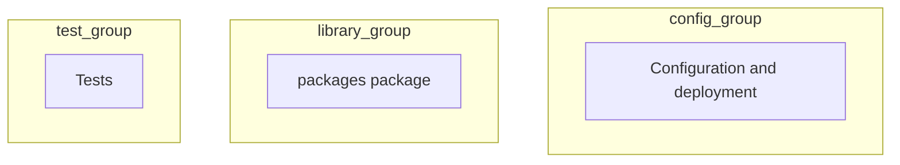

# Architecture report: pugjs/pug

> Automated static analysis. **Observed** = directly seen in files/imports/AST; **Inferred** = interpretation from that evidence. Repository code was not executed.

## 1. Repository at a glance

| Item | Value |
| --- | --- |
| Repository | pugjs/pug |
| Description | Pug – robust, elegant, feature rich template engine for Node.js |
| Language | JavaScript |
| Stars | 21818 |
| Licence | Not detected |
| Analysed commit / branch | c323ed3e630b931bc04790efb509d34ac5927040 / master |
| Framework(s) | None detected |
| Files analysed | 800 |
| Components | 3 |

## 2. Architecture in one minute

pugjs/pug - Pug – robust, elegant, feature rich template engine for Node.js. This repository was analysed statically from 800 file(s) (0 Python). Detected technologies (observed from imports/manifests): GitHub Actions, Jest, TypeScript. Files are grouped into 3 component(s): Configuration and deployment, packages package, Tests. Findings below distinguish observed facts from inferred interpretation.

## 3. High-level block diagram

## 4. Main components

### Configuration and deployment (`config`)

- **Kind:** config
- **Status:** Observed
- **Confidence:** 0.85
- **Responsibility:** Groups 15 file(s) under configuration and deployment (observed from repository paths and static analysis).
- **Paths:** `package.json`, `packages/pug-attrs/package.json`, `packages/pug-code-gen/package.json`, `packages/pug-error/package.json`, `packages/pug-error/tsconfig.json`, `packages/pug-filters/package.json`, `packages/pug-lexer/package.json`, `packages/pug-linker/package.json`, `packages/pug-load/package.json`, `packages/pug-parser/package.json`, `packages/pug-runtime/package.json`, `packages/pug-strip-comments/package.json`, `packages/pug-walk/.travis.yml`, `packages/pug-walk/package.json`, `packages/pug/package.json`
- **Evidence:** [package.json](https://github.com/pugjs/pug/blob/c323ed3e630b931bc04790efb509d34ac5927040/package.json); [packages/pug-attrs/package.json](https://github.com/pugjs/pug/blob/c323ed3e630b931bc04790efb509d34ac5927040/packages/pug-attrs/package.json); [packages/pug-code-gen/package.json](https://github.com/pugjs/pug/blob/c323ed3e630b931bc04790efb509d34ac5927040/packages/pug-code-gen/package.json); [packages/pug-error/package.json](https://github.com/pugjs/pug/blob/c323ed3e630b931bc04790efb509d34ac5927040/packages/pug-error/package.json); [packages/pug-error/tsconfig.json](https://github.com/pugjs/pug/blob/c323ed3e630b931bc04790efb509d34ac5927040/packages/pug-error/tsconfig.json); [packages/pug-filters/package.json](https://github.com/pugjs/pug/blob/c323ed3e630b931bc04790efb509d34ac5927040/packages/pug-filters/package.json); [packages/pug-lexer/package.json](https://github.com/pugjs/pug/blob/c323ed3e630b931bc04790efb509d34ac5927040/packages/pug-lexer/package.json); [packages/pug-linker/package.json](https://github.com/pugjs/pug/blob/c323ed3e630b931bc04790efb509d34ac5927040/packages/pug-linker/package.json)

### packages package (`packages`)

- **Kind:** library
- **Status:** Observed
- **Confidence:** 0.85
- **Responsibility:** Groups 34 file(s) under packages package (observed from repository paths and static analysis).
- **Paths:** `packages/pug-attrs/index.js`, `packages/pug-code-gen/index.js`, `packages/pug-error/src/index.ts`, `packages/pug-filters/index.js`, `packages/pug-filters/lib/handle-filters.js`, `packages/pug-filters/lib/run-filter.js`, `packages/pug-lexer/index.d.ts`, `packages/pug-lexer/index.js`, `packages/pug-linker/index.js`, `packages/pug-load/index.js`, `packages/pug-parser/index.js`, `packages/pug-parser/lib/inline-tags.js`, `packages/pug-runtime/build.js`, `packages/pug-runtime/index.js`, `packages/pug-runtime/prepublish.js`, `packages/pug-runtime/wrap.js`, `packages/pug-strip-comments/index.js`, `packages/pug-walk/index.js`, `packages/pug/examples/attributes.js`, `packages/pug/examples/code.js`, `packages/pug/examples/dynamicscript.js`, `packages/pug/examples/each.js`, `packages/pug/examples/extend.js`, `packages/pug/examples/form.js`, `packages/pug/examples/includes.js`, `packages/pug/examples/layout-debug.js`, `packages/pug/examples/layout.js`, `packages/pug/examples/mixins.js`, `packages/pug/examples/rss.js`, `packages/pug/examples/text.js`, `packages/pug/examples/whitespace.js`, `packages/pug/lib/index.js`, `packages/pug/register.js`, `packages/pug/support/benchmark.js`
- **Evidence:** [packages/pug-attrs/index.js](https://github.com/pugjs/pug/blob/c323ed3e630b931bc04790efb509d34ac5927040/packages/pug-attrs/index.js); [packages/pug-code-gen/index.js](https://github.com/pugjs/pug/blob/c323ed3e630b931bc04790efb509d34ac5927040/packages/pug-code-gen/index.js); [packages/pug-error/src/index.ts](https://github.com/pugjs/pug/blob/c323ed3e630b931bc04790efb509d34ac5927040/packages/pug-error/src/index.ts); [packages/pug-filters/index.js](https://github.com/pugjs/pug/blob/c323ed3e630b931bc04790efb509d34ac5927040/packages/pug-filters/index.js); [packages/pug-filters/lib/handle-filters.js](https://github.com/pugjs/pug/blob/c323ed3e630b931bc04790efb509d34ac5927040/packages/pug-filters/lib/handle-filters.js); [packages/pug-filters/lib/run-filter.js](https://github.com/pugjs/pug/blob/c323ed3e630b931bc04790efb509d34ac5927040/packages/pug-filters/lib/run-filter.js); [packages/pug-lexer/index.d.ts](https://github.com/pugjs/pug/blob/c323ed3e630b931bc04790efb509d34ac5927040/packages/pug-lexer/index.d.ts); [packages/pug-lexer/index.js](https://github.com/pugjs/pug/blob/c323ed3e630b931bc04790efb509d34ac5927040/packages/pug-lexer/index.js)

### Tests (`tests`)

- **Kind:** test
- **Status:** Observed
- **Confidence:** 0.85
- **Responsibility:** Groups 683 file(s) under tests (observed from repository paths and static analysis).
- **Paths:** `packages/pug-attrs/test/index.test.js`, `packages/pug-error/test/index.test.js`, `packages/pug-filters/test/__snapshots__/filter-aliases.test.js.snap`, `packages/pug-filters/test/__snapshots__/index.test.js.snap`, `packages/pug-filters/test/__snapshots__/per-filter-options-applied-to-nested-filters.test.js.snap`, `packages/pug-filters/test/cases/filters-empty.input.json`, `packages/pug-filters/test/cases/filters.cdata.input.json`, `packages/pug-filters/test/cases/filters.coffeescript.input.json`, `packages/pug-filters/test/cases/filters.custom.input.json`, `packages/pug-filters/test/cases/filters.include.custom.input.json`, `packages/pug-filters/test/cases/filters.include.custom.pug`, `packages/pug-filters/test/cases/filters.include.input.json`, `packages/pug-filters/test/cases/filters.inline.input.json`, `packages/pug-filters/test/cases/filters.less.input.json`, `packages/pug-filters/test/cases/filters.markdown.input.json`, `packages/pug-filters/test/cases/filters.nested.input.json`, `packages/pug-filters/test/cases/filters.stylus.input.json`, `packages/pug-filters/test/cases/include-filter-coffee.coffee`, `packages/pug-filters/test/cases/some.md`, `packages/pug-filters/test/custom-filters.js`, `packages/pug-filters/test/errors-src/dynamic-option.jade`, `packages/pug-filters/test/errors/dynamic-option.input.json`, `packages/pug-filters/test/filter-aliases.test.js`, `packages/pug-filters/test/index.test.js`, `packages/pug-filters/test/per-filter-options-applied-to-nested-filters.test.js`, `packages/pug-lexer/test/cases/attr-es2015.pug`, `packages/pug-lexer/test/cases/attrs-data.pug`, `packages/pug-lexer/test/cases/attrs.js.pug`, `packages/pug-lexer/test/cases/attrs.pug`, `packages/pug-lexer/test/cases/attrs.unescaped.pug`, `packages/pug-lexer/test/cases/basic.pug`, `packages/pug-lexer/test/cases/blanks.pug`, `packages/pug-lexer/test/cases/block-code.pug`, `packages/pug-lexer/test/cases/block-expansion.pug`, `packages/pug-lexer/test/cases/block-expansion.shorthands.pug`, `packages/pug-lexer/test/cases/blockquote.pug`, `packages/pug-lexer/test/cases/blocks-in-blocks.pug`, `packages/pug-lexer/test/cases/blocks-in-if.pug`, `packages/pug-lexer/test/cases/case-blocks.pug`, `packages/pug-lexer/test/cases/case.pug`, `packages/pug-lexer/test/cases/classes-empty.pug`, `packages/pug-lexer/test/cases/classes.pug`, `packages/pug-lexer/test/cases/code.conditionals.pug`, `packages/pug-lexer/test/cases/code.escape.pug`, `packages/pug-lexer/test/cases/code.iteration.pug`, `packages/pug-lexer/test/cases/code.pug`, `packages/pug-lexer/test/cases/comments-in-case.pug`, `packages/pug-lexer/test/cases/comments.pug`, `packages/pug-lexer/test/cases/comments.source.pug`, `packages/pug-lexer/test/cases/doctype.custom.pug`, `packages/pug-lexer/test/cases/doctype.default.pug`, `packages/pug-lexer/test/cases/doctype.keyword.pug`, `packages/pug-lexer/test/cases/each.else.pug`, `packages/pug-lexer/test/cases/escape-chars.pug`, `packages/pug-lexer/test/cases/escape-test.pug`, `packages/pug-lexer/test/cases/escaping-class-attribute.pug`, `packages/pug-lexer/test/cases/filter-in-include.pug`, `packages/pug-lexer/test/cases/filters-empty.pug`, `packages/pug-lexer/test/cases/filters.coffeescript.pug`, `packages/pug-lexer/test/cases/filters.custom.pug`, `packages/pug-lexer/test/cases/filters.include.custom.pug`, `packages/pug-lexer/test/cases/filters.include.pug`, `packages/pug-lexer/test/cases/filters.inline.pug`, `packages/pug-lexer/test/cases/filters.less.pug`, `packages/pug-lexer/test/cases/filters.markdown.pug`, `packages/pug-lexer/test/cases/filters.nested.pug`, `packages/pug-lexer/test/cases/filters.stylus.pug`, `packages/pug-lexer/test/cases/filters.verbatim.pug`, `packages/pug-lexer/test/cases/html.pug`, `packages/pug-lexer/test/cases/html5.pug`, `packages/pug-lexer/test/cases/include-extends-from-root.pug`, `packages/pug-lexer/test/cases/include-extends-of-common-template.pug`, `packages/pug-lexer/test/cases/include-extends-relative.pug`, `packages/pug-lexer/test/cases/include-only-text-body.pug`, `packages/pug-lexer/test/cases/include-only-text.pug`, `packages/pug-lexer/test/cases/include-with-text-head.pug`, `packages/pug-lexer/test/cases/include-with-text.pug`, `packages/pug-lexer/test/cases/include.script.pug`, `packages/pug-lexer/test/cases/include.yield.nested.pug`, `packages/pug-lexer/test/cases/includes-with-ext-js.pug`, `packages/pug-lexer/test/cases/includes.pug`, `packages/pug-lexer/test/cases/inheritance.alert-dialog.pug`, `packages/pug-lexer/test/cases/inheritance.defaults.pug`, `packages/pug-lexer/test/cases/inheritance.extend.include.pug`, `packages/pug-lexer/test/cases/inheritance.extend.mixins.block.pug`, `packages/pug-lexer/test/cases/inheritance.extend.mixins.pug`, `packages/pug-lexer/test/cases/inheritance.extend.pug`, `packages/pug-lexer/test/cases/inheritance.extend.recursive.pug`, `packages/pug-lexer/test/cases/inheritance.extend.whitespace.pug`, `packages/pug-lexer/test/cases/inheritance.pug`, `packages/pug-lexer/test/cases/inline-block-comment.pug`, `packages/pug-lexer/test/cases/inline-tag.pug`, `packages/pug-lexer/test/cases/intepolated-elements.pug`, `packages/pug-lexer/test/cases/interpolated-mixin.pug`, `packages/pug-lexer/test/cases/interpolation.escape.pug`, `packages/pug-lexer/test/cases/javascript-new-lines.js`, `packages/pug-lexer/test/cases/layout.append.pug`, `packages/pug-lexer/test/cases/layout.append.without-block.pug`, `packages/pug-lexer/test/cases/layout.multi.append.prepend.block.pug`, `packages/pug-lexer/test/cases/layout.prepend.pug`, `packages/pug-lexer/test/cases/layout.prepend.without-block.pug`, `packages/pug-lexer/test/cases/mixin-at-end-of-file.pug`, `packages/pug-lexer/test/cases/mixin-block-with-space.pug`, `packages/pug-lexer/test/cases/mixin-hoist.pug`, `packages/pug-lexer/test/cases/mixin-via-include.pug`, `packages/pug-lexer/test/cases/mixin.attrs.pug`, `packages/pug-lexer/test/cases/mixin.block-tag-behaviour.pug`, `packages/pug-lexer/test/cases/mixin.blocks.pug`, `packages/pug-lexer/test/cases/mixin.merge.pug`, `packages/pug-lexer/test/cases/mixins-unused.pug`, `packages/pug-lexer/test/cases/mixins.pug`, `packages/pug-lexer/test/cases/mixins.rest-args.pug`, `packages/pug-lexer/test/cases/namespaces.pug`, `packages/pug-lexer/test/cases/nesting.pug`, `packages/pug-lexer/test/cases/pipeless-comments.pug`, `packages/pug-lexer/test/cases/pipeless-filters.pug`, `packages/pug-lexer/test/cases/pipeless-tag.pug`, `packages/pug-lexer/test/cases/pre.pug`, `packages/pug-lexer/test/cases/quotes.pug`, `packages/pug-lexer/test/cases/regression.1794.pug`, `packages/pug-lexer/test/cases/regression.784.pug`, `packages/pug-lexer/test/cases/script.whitespace.pug`, `packages/pug-lexer/test/cases/scripts.non-js.pug`, `packages/pug-lexer/test/cases/scripts.pug`, `packages/pug-lexer/test/cases/self-closing-html.pug`, `packages/pug-lexer/test/cases/single-period.pug`, `packages/pug-lexer/test/cases/source.pug`, `packages/pug-lexer/test/cases/styles.pug`, `packages/pug-lexer/test/cases/tag-blocks.pug`, `packages/pug-lexer/test/cases/tag.interpolation.pug`, `packages/pug-lexer/test/cases/tags.self-closing.pug`, `packages/pug-lexer/test/cases/template.pug`, `packages/pug-lexer/test/cases/text-block.pug`, `packages/pug-lexer/test/cases/text.pug`, `packages/pug-lexer/test/cases/utf8bom.pug`, `packages/pug-lexer/test/cases/vars.pug`, `packages/pug-lexer/test/cases/while.pug`, `packages/pug-lexer/test/cases/xml.pug`, `packages/pug-lexer/test/cases/yield-before-conditional-head.pug`, `packages/pug-lexer/test/cases/yield-before-conditional.pug`, `packages/pug-lexer/test/cases/yield-head.pug`, `packages/pug-lexer/test/cases/yield-title-head.pug`, `packages/pug-lexer/test/cases/yield-title.pug`, `packages/pug-lexer/test/cases/yield.pug`, `packages/pug-lexer/test/check-lexer-functions.test.js`, `packages/pug-lexer/test/errors/attribute-invalid-expression.pug`, `packages/pug-lexer/test/errors/case-with-invalid-expression.pug`, `packages/pug-lexer/test/errors/case-with-no-expression.pug`, `packages/pug-lexer/test/errors/default-with-expression.pug`, `packages/pug-lexer/test/errors/else-with-condition.pug`, `packages/pug-lexer/test/errors/extends-no-path.pug`, `packages/pug-lexer/test/errors/include-filter-no-path-2.pug`, `packages/pug-lexer/test/errors/include-filter-no-path.pug`, `packages/pug-lexer/test/errors/include-filter-no-space.pug`, `packages/pug-lexer/test/errors/include-no-path.pug`, `packages/pug-lexer/test/errors/inconsistent-indentation.pug`, `packages/pug-lexer/test/errors/interpolated-call.pug`, `packages/pug-lexer/test/errors/invalid-class-name-1.pug`, `packages/pug-lexer/test/errors/invalid-class-name-2.pug`, `packages/pug-lexer/test/errors/invalid-class-name-3.pug`, `packages/pug-lexer/test/errors/invalid-id.pug`, `packages/pug-lexer/test/errors/malformed-each.pug`, `packages/pug-lexer/test/errors/malformed-extend.pug`, `packages/pug-lexer/test/errors/malformed-include.pug`, `packages/pug-lexer/test/errors/mismatched-inline-tag.pug`, `packages/pug-lexer/test/errors/mismatched-tag-interpolation.pug`, `packages/pug-lexer/test/errors/multi-line-interpolation.pug`, `packages/pug-lexer/test/errors/old-prefixed-each.pug`, `packages/pug-lexer/test/errors/open-interpolation.pug`, `packages/pug-lexer/test/errors/when-with-no-expression.pug`, `packages/pug-lexer/test/errors/while-with-no-expression.pug`, `packages/pug-lexer/test/index.test.js`, `packages/pug-linker/test/__snapshots__/index.test.js.snap`, `packages/pug-linker/test/cases-src/auxiliary/1794-extends.pug`, `packages/pug-linker/test/cases-src/auxiliary/1794-include.pug`, `packages/pug-linker/test/cases-src/auxiliary/blocks-in-blocks-layout.pug`, `packages/pug-linker/test/cases-src/auxiliary/dialog.pug`, `packages/pug-linker/test/cases-src/auxiliary/empty-block.pug`, `packages/pug-linker/test/cases-src/auxiliary/escapes.html`, `packages/pug-linker/test/cases-src/auxiliary/extends-empty-block-1.pug`, `packages/pug-linker/test/cases-src/auxiliary/extends-empty-block-2.pug`, `packages/pug-linker/test/cases-src/auxiliary/extends-from-root.pug`, `packages/pug-linker/test/cases-src/auxiliary/extends-relative.pug`, `packages/pug-linker/test/cases-src/auxiliary/filter-in-include.pug`, `packages/pug-linker/test/cases-src/auxiliary/includable.js`, `packages/pug-linker/test/cases-src/auxiliary/include-from-root.pug`, `packages/pug-linker/test/cases-src/auxiliary/inheritance.extend.mixin.block.pug`, `packages/pug-linker/test/cases-src/auxiliary/inheritance.extend.recursive-grand-grandparent.pug`, `packages/pug-linker/test/cases-src/auxiliary/inheritance.extend.recursive-grandparent.pug`, `packages/pug-linker/test/cases-src/auxiliary/inheritance.extend.recursive-parent.pug`, `packages/pug-linker/test/cases-src/auxiliary/layout.include.pug`, `packages/pug-linker/test/cases-src/auxiliary/layout.pug`, `packages/pug-linker/test/cases-src/auxiliary/mixin-at-end-of-file.pug`, `packages/pug-linker/test/cases-src/auxiliary/mixins.pug`, `packages/pug-linker/test/cases-src/auxiliary/pet.pug`, `packages/pug-linker/test/cases-src/auxiliary/smile.html`, `packages/pug-linker/test/cases-src/auxiliary/window.pug`, `packages/pug-linker/test/cases-src/auxiliary/yield-nested.pug`, `packages/pug-linker/test/cases-src/include-extends-from-root.pug`, `packages/pug-linker/test/cases-src/include-extends-of-common-template.pug`, `packages/pug-linker/test/cases-src/include-extends-relative.pug`, `packages/pug-linker/test/cases-src/include-filter-coffee.coffee`, `packages/pug-linker/test/cases-src/include-filter-stylus.pug`, `packages/pug-linker/test/cases-src/include-filter.pug`, `packages/pug-linker/test/cases-src/include-only-text-body.pug`, `packages/pug-linker/test/cases-src/include-only-text.pug`, `packages/pug-linker/test/cases-src/include-with-text-head.pug`, `packages/pug-linker/test/cases-src/include-with-text.pug`, `packages/pug-linker/test/cases-src/include.script.pug`, `packages/pug-linker/test/cases-src/include.yield.nested.pug`, `packages/pug-linker/test/cases-src/includes-with-ext-js.pug`, `packages/pug-linker/test/cases-src/includes.pug`, `packages/pug-linker/test/cases-src/javascript-new-lines.js`, `packages/pug-linker/test/cases-src/layout.append.pug`, `packages/pug-linker/test/cases-src/layout.append.without-block.pug`, `packages/pug-linker/test/cases-src/layout.multi.append.prepend.block.pug`, `packages/pug-linker/test/cases-src/layout.prepend.pug`, `packages/pug-linker/test/cases-src/layout.prepend.without-block.pug`, `packages/pug-linker/test/cases-src/some-included.styl`, `packages/pug-linker/test/cases-src/some.md`, `packages/pug-linker/test/cases-src/some.styl`, `packages/pug-linker/test/cases/include-extends-from-root.input.json`, `packages/pug-linker/test/cases/include-extends-of-common-template.input.json`, `packages/pug-linker/test/cases/include-extends-relative.input.json`, `packages/pug-linker/test/cases/include-filter-stylus.input.json`, `packages/pug-linker/test/cases/include-filter.input.json`, `packages/pug-linker/test/cases/include-only-text-body.input.json`, `packages/pug-linker/test/cases/include-only-text.input.json`, `packages/pug-linker/test/cases/include-with-text-head.input.json`, `packages/pug-linker/test/cases/include-with-text.input.json`, `packages/pug-linker/test/cases/include.script.input.json`, `packages/pug-linker/test/cases/include.yield.nested.input.json`, `packages/pug-linker/test/cases/includes-with-ext-js.input.json`, `packages/pug-linker/test/cases/includes.input.json`, `packages/pug-linker/test/cases/layout.append.input.json`, `packages/pug-linker/test/cases/layout.append.without-block.input.json`, `packages/pug-linker/test/cases/layout.multi.append.prepend.block.input.json`, `packages/pug-linker/test/cases/layout.prepend.input.json`, `packages/pug-linker/test/cases/layout.prepend.without-block.input.json`, `packages/pug-linker/test/errors-src/child-with-tags.pug`, `packages/pug-linker/test/errors-src/extends-not-first.pug`, `packages/pug-linker/test/errors-src/unexpected-block.pug`, `packages/pug-linker/test/errors/child-with-tags.input.json`, `packages/pug-linker/test/errors/extends-not-first.input.json`, `packages/pug-linker/test/errors/unexpected-block.input.json`, `packages/pug-linker/test/fixtures/append-without-block/app-layout.pug`, `packages/pug-linker/test/fixtures/append-without-block/layout.pug`, `packages/pug-linker/test/fixtures/append-without-block/page.pug`, `packages/pug-linker/test/fixtures/append/app-layout.pug`, `packages/pug-linker/test/fixtures/append/layout.pug`, `packages/pug-linker/test/fixtures/append/page.html`, `packages/pug-linker/test/fixtures/append/page.pug`, `packages/pug-linker/test/fixtures/empty.pug`, `packages/pug-linker/test/fixtures/layout.pug`, `packages/pug-linker/test/fixtures/mixins.pug`, `packages/pug-linker/test/fixtures/multi-append-prepend-block/redefine.pug`, `packages/pug-linker/test/fixtures/multi-append-prepend-block/root.pug`, `packages/pug-linker/test/fixtures/prepend-without-block/app-layout.pug`, `packages/pug-linker/test/fixtures/prepend-without-block/layout.pug`, `packages/pug-linker/test/fixtures/prepend-without-block/page.html`, `packages/pug-linker/test/fixtures/prepend-without-block/page.pug`, `packages/pug-linker/test/fixtures/prepend/app-layout.pug`, `packages/pug-linker/test/fixtures/prepend/layout.pug`, `packages/pug-linker/test/fixtures/prepend/page.html`, `packages/pug-linker/test/fixtures/prepend/page.pug`, `packages/pug-linker/test/index.test.js`, `packages/pug-linker/test/special-cases-src/extending-empty.pug`, `packages/pug-linker/test/special-cases-src/extending-include.pug`, `packages/pug-linker/test/special-cases-src/root-mixin.pug`, `packages/pug-linker/test/special-cases/extending-empty.input.json`, `packages/pug-linker/test/special-cases/extending-include.input.json`, `packages/pug-linker/test/special-cases/root-mixin.input.json`, `packages/pug-load/test/__snapshots__/index.test.js.snap`, `packages/pug-load/test/bar.pug`, `packages/pug-load/test/bing.pug`, `packages/pug-load/test/foo.pug`, `packages/pug-load/test/index.test.js`, `packages/pug-load/test/script.js`, `packages/pug-parser/test/__snapshots__/no-unnecessary-blocks.test.js.snap`, `packages/pug-parser/test/cases/attr-es2015.tokens.json`, `packages/pug-parser/test/cases/attrs-data.tokens.json`, `packages/pug-parser/test/cases/attrs.js.tokens.json`, `packages/pug-parser/test/cases/attrs.tokens.json`, `packages/pug-parser/test/cases/attrs.unescaped.tokens.json`, `packages/pug-parser/test/cases/basic.tokens.json`, `packages/pug-parser/test/cases/blanks.tokens.json`, `packages/pug-parser/test/cases/block-code.tokens.json`, `packages/pug-parser/test/cases/block-expansion.shorthands.tokens.json`, `packages/pug-parser/test/cases/block-expansion.tokens.json`, `packages/pug-parser/test/cases/blockquote.tokens.json`, `packages/pug-parser/test/cases/blocks-in-blocks.tokens.json`, `packages/pug-parser/test/cases/blocks-in-if.tokens.json`, `packages/pug-parser/test/cases/case-blocks.tokens.json`, `packages/pug-parser/test/cases/case.tokens.json`, `packages/pug-parser/test/cases/classes-empty.tokens.json`, `packages/pug-parser/test/cases/classes.tokens.json`, `packages/pug-parser/test/cases/code.conditionals.tokens.json`, `packages/pug-parser/test/cases/code.escape.tokens.json`, `packages/pug-parser/test/cases/code.iteration.tokens.json`, `packages/pug-parser/test/cases/code.tokens.json`, `packages/pug-parser/test/cases/comments-in-case.tokens.json`, `packages/pug-parser/test/cases/comments.source.tokens.json`, `packages/pug-parser/test/cases/comments.tokens.json`, `packages/pug-parser/test/cases/doctype.custom.tokens.json`, `packages/pug-parser/test/cases/doctype.default.tokens.json`, `packages/pug-parser/test/cases/doctype.keyword.tokens.json`, `packages/pug-parser/test/cases/each.else.tokens.json`, `packages/pug-parser/test/cases/escape-chars.tokens.json`, `packages/pug-parser/test/cases/escape-test.tokens.json`, `packages/pug-parser/test/cases/escaping-class-attribute.tokens.json`, `packages/pug-parser/test/cases/filter-in-include.tokens.json`, `packages/pug-parser/test/cases/filters-empty.tokens.json`, `packages/pug-parser/test/cases/filters.coffeescript.tokens.json`, `packages/pug-parser/test/cases/filters.custom.tokens.json`, `packages/pug-parser/test/cases/filters.include.custom.tokens.json`, `packages/pug-parser/test/cases/filters.include.tokens.json`, `packages/pug-parser/test/cases/filters.inline.tokens.json`, `packages/pug-parser/test/cases/filters.less.tokens.json`, `packages/pug-parser/test/cases/filters.markdown.tokens.json`, `packages/pug-parser/test/cases/filters.nested.tokens.json`, `packages/pug-parser/test/cases/filters.stylus.tokens.json`, `packages/pug-parser/test/cases/filters.verbatim.tokens.json`, `packages/pug-parser/test/cases/html.tokens.json`, `packages/pug-parser/test/cases/html5.tokens.json`, `packages/pug-parser/test/cases/include-extends-from-root.tokens.json`, `packages/pug-parser/test/cases/include-extends-of-common-template.tokens.json`, `packages/pug-parser/test/cases/include-extends-relative.tokens.json`, `packages/pug-parser/test/cases/include-only-text-body.tokens.json`, `packages/pug-parser/test/cases/include-only-text.tokens.json`, `packages/pug-parser/test/cases/include-with-text-head.tokens.json`, `packages/pug-parser/test/cases/include-with-text.tokens.json`, `packages/pug-parser/test/cases/include.script.tokens.json`, `packages/pug-parser/test/cases/include.yield.nested.tokens.json`, `packages/pug-parser/test/cases/includes-with-ext-js.tokens.json`, `packages/pug-parser/test/cases/includes.tokens.json`, `packages/pug-parser/test/cases/inheritance.alert-dialog.tokens.json`, `packages/pug-parser/test/cases/inheritance.defaults.tokens.json`, `packages/pug-parser/test/cases/inheritance.extend.include.tokens.json`, `packages/pug-parser/test/cases/inheritance.extend.mixins.block.tokens.json`, `packages/pug-parser/test/cases/inheritance.extend.mixins.tokens.json`, `packages/pug-parser/test/cases/inheritance.extend.recursive.tokens.json`, `packages/pug-parser/test/cases/inheritance.extend.tokens.json`, `packages/pug-parser/test/cases/inheritance.extend.whitespace.tokens.json`, `packages/pug-parser/test/cases/inheritance.tokens.json`, `packages/pug-parser/test/cases/inline-block-comment.tokens.json`, `packages/pug-parser/test/cases/inline-tag.tokens.json`, `packages/pug-parser/test/cases/intepolated-elements.tokens.json`, `packages/pug-parser/test/cases/interpolated-mixin.tokens.json`, `packages/pug-parser/test/cases/interpolation.escape.tokens.json`, `packages/pug-parser/test/cases/layout.append.tokens.json`, `packages/pug-parser/test/cases/layout.append.without-block.tokens.json`, `packages/pug-parser/test/cases/layout.multi.append.prepend.block.tokens.json`, `packages/pug-parser/test/cases/layout.prepend.tokens.json`, `packages/pug-parser/test/cases/layout.prepend.without-block.tokens.json`, `packages/pug-parser/test/cases/mixin-at-end-of-file.tokens.json`, `packages/pug-parser/test/cases/mixin-block-with-space.tokens.json`, `packages/pug-parser/test/cases/mixin-hoist.tokens.json`, `packages/pug-parser/test/cases/mixin-via-include.tokens.json`, `packages/pug-parser/test/cases/mixin.attrs.tokens.json`, `packages/pug-parser/test/cases/mixin.block-tag-behaviour.tokens.json`, `packages/pug-parser/test/cases/mixin.blocks.tokens.json`, `packages/pug-parser/test/cases/mixin.merge.tokens.json`, `packages/pug-parser/test/cases/mixins-unused.tokens.json`, `packages/pug-parser/test/cases/mixins.rest-args.tokens.json`, `packages/pug-parser/test/cases/mixins.tokens.json`, `packages/pug-parser/test/cases/namespaces.tokens.json`, `packages/pug-parser/test/cases/nesting.tokens.json`, `packages/pug-parser/test/cases/pipeless-comments.tokens.json`, `packages/pug-parser/test/cases/pipeless-filters.tokens.json`, `packages/pug-parser/test/cases/pipeless-tag.tokens.json`, `packages/pug-parser/test/cases/pre.tokens.json`, `packages/pug-parser/test/cases/quotes.tokens.json`, `packages/pug-parser/test/cases/regression.1794.tokens.json`, `packages/pug-parser/test/cases/regression.784.tokens.json`, `packages/pug-parser/test/cases/script.whitespace.tokens.json`, `packages/pug-parser/test/cases/scripts.non-js.tokens.json`, `packages/pug-parser/test/cases/scripts.tokens.json`, `packages/pug-parser/test/cases/self-closing-html.tokens.json`, `packages/pug-parser/test/cases/single-period.tokens.json`, `packages/pug-parser/test/cases/source.tokens.json`, `packages/pug-parser/test/cases/styles.tokens.json`, `packages/pug-parser/test/cases/tag-blocks.tokens.json`, `packages/pug-parser/test/cases/tag.interpolation.tokens.json`, `packages/pug-parser/test/cases/tags.self-closing.tokens.json`, `packages/pug-parser/test/cases/template.tokens.json`, `packages/pug-parser/test/cases/text-block.tokens.json`, `packages/pug-parser/test/cases/text.tokens.json`, `packages/pug-parser/test/cases/utf8bom.tokens.json`, `packages/pug-parser/test/cases/vars.tokens.json`, `packages/pug-parser/test/cases/while.tokens.json`, `packages/pug-parser/test/cases/xml.tokens.json`, `packages/pug-parser/test/cases/yield-before-conditional-head.tokens.json`, `packages/pug-parser/test/cases/yield-before-conditional.tokens.json`, `packages/pug-parser/test/cases/yield-head.tokens.json`, `packages/pug-parser/test/cases/yield-title-head.tokens.json`, `packages/pug-parser/test/cases/yield-title.tokens.json`, `packages/pug-parser/test/cases/yield.tokens.json`, `packages/pug-parser/test/index.test.js`, `packages/pug-parser/test/no-unnecessary-blocks.test.js`, `packages/pug-runtime/test/index.test.js`, `packages/pug-strip-comments/test/__snapshots__/index.test.js.snap`, `packages/pug-strip-comments/test/cases/comments-in-case.input.json`, `packages/pug-strip-comments/test/cases/comments.input.json`, `packages/pug-strip-comments/test/cases/comments.source.input.json`, `packages/pug-strip-comments/test/errors/comment-in-comment.input.json`, `packages/pug-strip-comments/test/errors/end.input.json`, `packages/pug-strip-comments/test/errors/startstart.input.json`, `packages/pug-strip-comments/test/index.test.js`, `packages/pug-walk/test/index.test.js`, `packages/pug/test/README.md`, `packages/pug/test/__snapshots__/pug.test.js.snap`, `packages/pug/test/anti-cases/attrs.unescaped.pug`, `packages/pug/test/anti-cases/case-when.pug`, `packages/pug/test/anti-cases/case-without-with.pug`, `packages/pug/test/anti-cases/else-condition.pug`, `packages/pug/test/anti-cases/else-without-if.pug`, `packages/pug/test/anti-cases/inlining-a-mixin-after-a-tag.pug`, `packages/pug/test/anti-cases/key-char-ending-badly.pug`, `packages/pug/test/anti-cases/key-ending-badly.pug`, `packages/pug/test/anti-cases/mismatched-inline-tag.pug`, `packages/pug/test/anti-cases/mixin-args-syntax-error.pug`, `packages/pug/test/anti-cases/mixins-blocks-with-bodies.pug`, `packages/pug/test/anti-cases/multiple-non-nested-tags-on-a-line.pug`, `packages/pug/test/anti-cases/non-existant-filter.pug`, `packages/pug/test/anti-cases/non-mixin-block.pug`, `packages/pug/test/anti-cases/open-brace-in-attributes.pug`, `packages/pug/test/anti-cases/readme.md`, `packages/pug/test/anti-cases/self-closing-tag-with-block.pug`, `packages/pug/test/anti-cases/self-closing-tag-with-body.pug`, `packages/pug/test/anti-cases/self-closing-tag-with-code.pug`, `packages/pug/test/anti-cases/tabs-and-spaces.pug`, `packages/pug/test/anti-cases/unclosed-interpolated-call.pug`, `packages/pug/test/anti-cases/unclosed-interpolated-tag.pug`, `packages/pug/test/anti-cases/unclosed-interpolation.pug`, `packages/pug/test/browser/index.html`, `packages/pug/test/browser/index.pug`, `packages/pug/test/cases-es2015/attr.html`, `packages/pug/test/cases-es2015/attr.pug`, `packages/pug/test/cases/attrs-data.html`, `packages/pug/test/cases/attrs-data.pug`, `packages/pug/test/cases/attrs.colon.html`, `packages/pug/test/cases/attrs.colon.pug`, `packages/pug/test/cases/attrs.html`, `packages/pug/test/cases/attrs.js.html`, `packages/pug/test/cases/attrs.js.pug`, `packages/pug/test/cases/attrs.pug`, `packages/pug/test/cases/attrs.unescaped.html`, `packages/pug/test/cases/attrs.unescaped.pug`, `packages/pug/test/cases/auxiliary/1794-extends.pug`, `packages/pug/test/cases/auxiliary/1794-include.pug`, `packages/pug/test/cases/auxiliary/blocks-in-blocks-layout.pug`, `packages/pug/test/cases/auxiliary/dialog.pug`, `packages/pug/test/cases/auxiliary/empty-block.pug`, `packages/pug/test/cases/auxiliary/escapes.html`, `packages/pug/test/cases/auxiliary/extends-empty-block-1.pug`, `packages/pug/test/cases/auxiliary/extends-empty-block-2.pug`, `packages/pug/test/cases/auxiliary/extends-from-root.pug`, `packages/pug/test/cases/auxiliary/extends-relative.pug`, `packages/pug/test/cases/auxiliary/filter-in-include.pug`, `packages/pug/test/cases/auxiliary/includable.js`, `packages/pug/test/cases/auxiliary/include-from-root.pug`, `packages/pug/test/cases/auxiliary/inheritance.extend.mixin.block.pug`, `packages/pug/test/cases/auxiliary/inheritance.extend.recursive-grand-grandparent.pug`, `packages/pug/test/cases/auxiliary/inheritance.extend.recursive-grandparent.pug`, `packages/pug/test/cases/auxiliary/inheritance.extend.recursive-parent.pug`, `packages/pug/test/cases/auxiliary/layout.include.pug`, `packages/pug/test/cases/auxiliary/layout.pug`, `packages/pug/test/cases/auxiliary/mixin-at-end-of-file.pug`, `packages/pug/test/cases/auxiliary/mixins.pug`, `packages/pug/test/cases/auxiliary/pet.pug`, `packages/pug/test/cases/auxiliary/smile.html`, `packages/pug/test/cases/auxiliary/window.pug`, `packages/pug/test/cases/auxiliary/yield-nested.pug`, `packages/pug/test/cases/basic.html`, `packages/pug/test/cases/basic.pug`, `packages/pug/test/cases/blanks.html`, `packages/pug/test/cases/blanks.pug`, `packages/pug/test/cases/block-code.html`, `packages/pug/test/cases/block-code.pug`, `packages/pug/test/cases/block-expansion.html`, `packages/pug/test/cases/block-expansion.pug`, `packages/pug/test/cases/block-expansion.shorthands.html`, `packages/pug/test/cases/block-expansion.shorthands.pug`, `packages/pug/test/cases/blockquote.html`, `packages/pug/test/cases/blockquote.pug`, `packages/pug/test/cases/blocks-in-blocks.html`, `packages/pug/test/cases/blocks-in-blocks.pug`, `packages/pug/test/cases/blocks-in-if.html`, `packages/pug/test/cases/blocks-in-if.pug`, `packages/pug/test/cases/case-blocks.html`, `packages/pug/test/cases/case-blocks.pug`, `packages/pug/test/cases/case.html`, `packages/pug/test/cases/case.pug`, `packages/pug/test/cases/classes-empty.html`, `packages/pug/test/cases/classes-empty.pug`, `packages/pug/test/cases/classes.html`, `packages/pug/test/cases/classes.pug`, `packages/pug/test/cases/code.conditionals.html`, `packages/pug/test/cases/code.conditionals.pug`, `packages/pug/test/cases/code.escape.html`, `packages/pug/test/cases/code.escape.pug`, `packages/pug/test/cases/code.html`, `packages/pug/test/cases/code.iteration.html`, `packages/pug/test/cases/code.iteration.pug`, `packages/pug/test/cases/code.pug`, `packages/pug/test/cases/comments-in-case.html`, `packages/pug/test/cases/comments-in-case.pug`, `packages/pug/test/cases/comments.html`, `packages/pug/test/cases/comments.pug`, `packages/pug/test/cases/comments.source.html`, `packages/pug/test/cases/comments.source.pug`, `packages/pug/test/cases/doctype.custom.html`, `packages/pug/test/cases/doctype.custom.pug`, `packages/pug/test/cases/doctype.default.html`, `packages/pug/test/cases/doctype.default.pug`, `packages/pug/test/cases/doctype.keyword.html`, `packages/pug/test/cases/doctype.keyword.pug`, `packages/pug/test/cases/each.else.html`, `packages/pug/test/cases/each.else.pug`, `packages/pug/test/cases/escape-chars.html`, `packages/pug/test/cases/escape-chars.pug`, `packages/pug/test/cases/escape-test.html`, `packages/pug/test/cases/escape-test.pug`, `packages/pug/test/cases/escaping-class-attribute.html`, `packages/pug/test/cases/escaping-class-attribute.pug`, `packages/pug/test/cases/filter-in-include.html`, `packages/pug/test/cases/filter-in-include.pug`, `packages/pug/test/cases/filters-empty.html`, `packages/pug/test/cases/filters-empty.pug`, `packages/pug/test/cases/filters.coffeescript.html`, `packages/pug/test/cases/filters.coffeescript.pug`, `packages/pug/test/cases/filters.custom.html`, `packages/pug/test/cases/filters.custom.pug`, `packages/pug/test/cases/filters.include.custom.html`, `packages/pug/test/cases/filters.include.custom.pug`, `packages/pug/test/cases/filters.include.html`, `packages/pug/test/cases/filters.include.pug`, `packages/pug/test/cases/filters.inline.html`, `packages/pug/test/cases/filters.inline.pug`, `packages/pug/test/cases/filters.less.html`, `packages/pug/test/cases/filters.less.pug`, `packages/pug/test/cases/filters.markdown.html`, `packages/pug/test/cases/filters.markdown.pug`, `packages/pug/test/cases/filters.nested.html`, `packages/pug/test/cases/filters.nested.pug`, `packages/pug/test/cases/filters.stylus.html`, `packages/pug/test/cases/filters.stylus.pug`, `packages/pug/test/cases/html.html`, `packages/pug/test/cases/html.pug`, `packages/pug/test/cases/html5.html`, `packages/pug/test/cases/html5.pug`, `packages/pug/test/cases/include-extends-from-root.html`, `packages/pug/test/cases/include-extends-from-root.pug`, `packages/pug/test/cases/include-extends-of-common-template.html`, `packages/pug/test/cases/include-extends-of-common-template.pug`, `packages/pug/test/cases/include-extends-relative.html`, `packages/pug/test/cases/include-extends-relative.pug`, `packages/pug/test/cases/include-filter-coffee.coffee`, `packages/pug/test/cases/include-only-text-body.html`, `packages/pug/test/cases/include-only-text-body.pug`, `packages/pug/test/cases/include-only-text.html`, `packages/pug/test/cases/include-only-text.pug`, `packages/pug/test/cases/include-with-text-head.html`, `packages/pug/test/cases/include-with-text-head.pug`, `packages/pug/test/cases/include-with-text.html`, `packages/pug/test/cases/include-with-text.pug`, `packages/pug/test/cases/include.script.html`, `packages/pug/test/cases/include.script.pug`, `packages/pug/test/cases/include.yield.nested.html`, `packages/pug/test/cases/include.yield.nested.pug`, `packages/pug/test/cases/includes-with-ext-js.html`, `packages/pug/test/cases/includes-with-ext-js.pug`, `packages/pug/test/cases/includes.html`, `packages/pug/test/cases/includes.pug`, `packages/pug/test/cases/inheritance.alert-dialog.html`, `packages/pug/test/cases/inheritance.alert-dialog.pug`, `packages/pug/test/cases/inheritance.defaults.html`, `packages/pug/test/cases/inheritance.defaults.pug`, `packages/pug/test/cases/inheritance.extend.html`, `packages/pug/test/cases/inheritance.extend.include.html`, `packages/pug/test/cases/inheritance.extend.include.pug`, `packages/pug/test/cases/inheritance.extend.mixins.block.html`, `packages/pug/test/cases/inheritance.extend.mixins.block.pug`, `packages/pug/test/cases/inheritance.extend.mixins.html`, `packages/pug/test/cases/inheritance.extend.mixins.pug`, `packages/pug/test/cases/inheritance.extend.pug`, `packages/pug/test/cases/inheritance.extend.recursive.html`, `packages/pug/test/cases/inheritance.extend.recursive.pug`, `packages/pug/test/cases/inheritance.extend.whitespace.html`, `packages/pug/test/cases/inheritance.extend.whitespace.pug`, `packages/pug/test/cases/inheritance.html`, `packages/pug/test/cases/inheritance.pug`, `packages/pug/test/cases/inline-tag.html`, `packages/pug/test/cases/inline-tag.pug`, `packages/pug/test/cases/intepolated-elements.html`, `packages/pug/test/cases/intepolated-elements.pug`, `packages/pug/test/cases/interpolated-mixin.html`, `packages/pug/test/cases/interpolated-mixin.pug`, `packages/pug/test/cases/interpolation.escape.html`, `packages/pug/test/cases/interpolation.escape.pug`, `packages/pug/test/cases/javascript-new-lines.js`, `packages/pug/test/cases/layout.append.html`, `packages/pug/test/cases/layout.append.pug`, `packages/pug/test/cases/layout.append.without-block.html`, `packages/pug/test/cases/layout.append.without-block.pug`, `packages/pug/test/cases/layout.multi.append.prepend.block.html`, `packages/pug/test/cases/layout.multi.append.prepend.block.pug`, `packages/pug/test/cases/layout.prepend.html`, `packages/pug/test/cases/layout.prepend.pug`, `packages/pug/test/cases/layout.prepend.without-block.html`, `packages/pug/test/cases/layout.prepend.without-block.pug`, `packages/pug/test/cases/mixin-at-end-of-file.html`, `packages/pug/test/cases/mixin-at-end-of-file.pug`, `packages/pug/test/cases/mixin-block-with-space.html`, `packages/pug/test/cases/mixin-block-with-space.pug`, `packages/pug/test/cases/mixin-hoist.html`, `packages/pug/test/cases/mixin-hoist.pug`, `packages/pug/test/cases/mixin-via-include.html`, `packages/pug/test/cases/mixin-via-include.pug`, `packages/pug/test/cases/mixin.attrs.html`, `packages/pug/test/cases/mixin.attrs.pug`, `packages/pug/test/cases/mixin.block-tag-behaviour.html`, `packages/pug/test/cases/mixin.block-tag-behaviour.pug`, `packages/pug/test/cases/mixin.blocks.html`, `packages/pug/test/cases/mixin.blocks.pug`, `packages/pug/test/cases/mixin.merge.html`, `packages/pug/test/cases/mixin.merge.pug`, `packages/pug/test/cases/mixins-unused.html`, `packages/pug/test/cases/mixins-unused.pug`, `packages/pug/test/cases/mixins.html`, `packages/pug/test/cases/mixins.pug`, `packages/pug/test/cases/mixins.rest-args.html`, `packages/pug/test/cases/mixins.rest-args.pug`, `packages/pug/test/cases/namespaces.html`, `packages/pug/test/cases/namespaces.pug`, `packages/pug/test/cases/nesting.html`, `packages/pug/test/cases/nesting.pug`, `packages/pug/test/cases/pipeless-comments.html`, `packages/pug/test/cases/pipeless-comments.pug`, `packages/pug/test/cases/pipeless-filters.html`, `packages/pug/test/cases/pipeless-filters.pug`, `packages/pug/test/cases/pipeless-tag.html`, `packages/pug/test/cases/pipeless-tag.pug`, `packages/pug/test/cases/pre.html`, `packages/pug/test/cases/pre.pug`, `packages/pug/test/cases/quotes.html`, `packages/pug/test/cases/quotes.pug`, `packages/pug/test/cases/regression.1794.html`, `packages/pug/test/cases/regression.1794.pug`, `packages/pug/test/cases/regression.784.html`, `packages/pug/test/cases/regression.784.pug`, `packages/pug/test/cases/script.whitespace.html`, `packages/pug/test/cases/script.whitespace.pug`, `packages/pug/test/cases/scripts.html`, `packages/pug/test/cases/scripts.non-js.html`, `packages/pug/test/cases/scripts.non-js.pug`, `packages/pug/test/cases/scripts.pug`, `packages/pug/test/cases/self-closing-html.html`, `packages/pug/test/cases/self-closing-html.pug`, `packages/pug/test/cases/single-period.html`, `packages/pug/test/cases/single-period.pug`, `packages/pug/test/cases/some-included.styl`, `packages/pug/test/cases/some.md`, `packages/pug/test/cases/some.styl`, `packages/pug/test/cases/source.html`, `packages/pug/test/cases/source.pug`, `packages/pug/test/cases/styles.html`, `packages/pug/test/cases/styles.pug`, `packages/pug/test/cases/tag.interpolation.html`, `packages/pug/test/cases/tag.interpolation.pug`, `packages/pug/test/cases/tags.self-closing.html`, `packages/pug/test/cases/tags.self-closing.pug`, `packages/pug/test/cases/template.html`, `packages/pug/test/cases/template.pug`, `packages/pug/test/cases/text-block.html`, `packages/pug/test/cases/text-block.pug`, `packages/pug/test/cases/text.html`, `packages/pug/test/cases/text.pug`, `packages/pug/test/cases/utf8bom.html`, `packages/pug/test/cases/utf8bom.pug`, `packages/pug/test/cases/vars.html`, `packages/pug/test/cases/vars.pug`, `packages/pug/test/cases/while.html`
- **Evidence:** [packages/pug-attrs/test/index.test.js](https://github.com/pugjs/pug/blob/c323ed3e630b931bc04790efb509d34ac5927040/packages/pug-attrs/test/index.test.js); [packages/pug-error/test/index.test.js](https://github.com/pugjs/pug/blob/c323ed3e630b931bc04790efb509d34ac5927040/packages/pug-error/test/index.test.js); [packages/pug-filters/test/__snapshots__/filter-aliases.test.js.snap](https://github.com/pugjs/pug/blob/c323ed3e630b931bc04790efb509d34ac5927040/packages/pug-filters/test/__snapshots__/filter-aliases.test.js.snap); [packages/pug-filters/test/__snapshots__/index.test.js.snap](https://github.com/pugjs/pug/blob/c323ed3e630b931bc04790efb509d34ac5927040/packages/pug-filters/test/__snapshots__/index.test.js.snap); [packages/pug-filters/test/__snapshots__/per-filter-options-applied-to-nested-filters.test.js.snap](https://github.com/pugjs/pug/blob/c323ed3e630b931bc04790efb509d34ac5927040/packages/pug-filters/test/__snapshots__/per-filter-options-applied-to-nested-filters.test.js.snap); [packages/pug-filters/test/cases/filters-empty.input.json](https://github.com/pugjs/pug/blob/c323ed3e630b931bc04790efb509d34ac5927040/packages/pug-filters/test/cases/filters-empty.input.json); [packages/pug-filters/test/cases/filters.cdata.input.json](https://github.com/pugjs/pug/blob/c323ed3e630b931bc04790efb509d34ac5927040/packages/pug-filters/test/cases/filters.cdata.input.json); [packages/pug-filters/test/cases/filters.coffeescript.input.json](https://github.com/pugjs/pug/blob/c323ed3e630b931bc04790efb509d34ac5927040/packages/pug-filters/test/cases/filters.coffeescript.input.json)

## 5. Execution flow

**Observed** entry point(s):

- [packages/pug-attrs/index.js](https://github.com/pugjs/pug/blob/c323ed3e630b931bc04790efb509d34ac5927040/packages/pug-attrs/index.js)
- [packages/pug-code-gen/index.js](https://github.com/pugjs/pug/blob/c323ed3e630b931bc04790efb509d34ac5927040/packages/pug-code-gen/index.js)
- [packages/pug-error/src/index.ts](https://github.com/pugjs/pug/blob/c323ed3e630b931bc04790efb509d34ac5927040/packages/pug-error/src/index.ts)
- [packages/pug-filters/index.js](https://github.com/pugjs/pug/blob/c323ed3e630b931bc04790efb509d34ac5927040/packages/pug-filters/index.js)
- [packages/pug-lexer/index.js](https://github.com/pugjs/pug/blob/c323ed3e630b931bc04790efb509d34ac5927040/packages/pug-lexer/index.js)
- [packages/pug-linker/index.js](https://github.com/pugjs/pug/blob/c323ed3e630b931bc04790efb509d34ac5927040/packages/pug-linker/index.js)
- [packages/pug-load/index.js](https://github.com/pugjs/pug/blob/c323ed3e630b931bc04790efb509d34ac5927040/packages/pug-load/index.js)
- [packages/pug-parser/index.js](https://github.com/pugjs/pug/blob/c323ed3e630b931bc04790efb509d34ac5927040/packages/pug-parser/index.js)
- [packages/pug-runtime/index.js](https://github.com/pugjs/pug/blob/c323ed3e630b931bc04790efb509d34ac5927040/packages/pug-runtime/index.js)
- [packages/pug-strip-comments/index.js](https://github.com/pugjs/pug/blob/c323ed3e630b931bc04790efb509d34ac5927040/packages/pug-strip-comments/index.js)
- [packages/pug-walk/index.js](https://github.com/pugjs/pug/blob/c323ed3e630b931bc04790efb509d34ac5927040/packages/pug-walk/index.js)
- [packages/pug/lib/index.js](https://github.com/pugjs/pug/blob/c323ed3e630b931bc04790efb509d34ac5927040/packages/pug/lib/index.js)

Representative flow (derived from observed entry points and the import graph; steps beyond the entry point are **Inferred**):

1. Execution starts at an observed entry point listed above, if present.
2. No internal import relationships between components were observed.

## 6. Project structure

### `(root)`

- `.editorconfig` - config (161 bytes)
- `.gitattributes` - other (21 bytes)
- `.gitignore` - other (227 bytes)
- `.prettierrc.js` - source, JavaScript (227 bytes)
- `README.md` - docs (18170 bytes)
- `SECURITY.md` - docs (369 bytes)
- `package.json` - manifest (1100 bytes)

### `.github`

- `.github/FUNDING.yml` - config (573 bytes)
- `.github/ISSUE_TEMPLATE.md` - docs (727 bytes)
- `.github/workflows/rollingversions.yml` - ci, YAML (1534 bytes)
- `.github/workflows/test.yml` - ci, YAML (473 bytes)

### `packages`

- `packages/pug-attrs/LICENSE` - docs (1058 bytes)
- `packages/pug-attrs/README.md` - docs (2295 bytes)
- `packages/pug-attrs/index.js` - source, JavaScript (4117 bytes)
- `packages/pug-attrs/package.json` - manifest (446 bytes)
- `packages/pug-attrs/test/index.test.js` - test, JavaScript (8201 bytes)
- `packages/pug-code-gen/HISTORY.md` - docs (200 bytes)
- `packages/pug-code-gen/LICENSE` - docs (1058 bytes)
- `packages/pug-code-gen/README.md` - docs (2092 bytes)
- `packages/pug-code-gen/index.js` - source, JavaScript (25236 bytes)
- `packages/pug-code-gen/package.json` - manifest (639 bytes)
- `packages/pug-error/LICENSE` - docs (1058 bytes)
- `packages/pug-error/README.md` - docs (1756 bytes)
- `packages/pug-error/package.json` - manifest (384 bytes)
- `packages/pug-error/src/index.ts` - source, TypeScript (1640 bytes)
- `packages/pug-error/test/index.test.js` - test, JavaScript (3903 bytes)
- `packages/pug-error/tsconfig.json` - config (205 bytes)
- `packages/pug-filters/CHANGELOG.md` - docs (498 bytes)
- `packages/pug-filters/LICENSE` - docs (1058 bytes)
- `packages/pug-filters/README.md` - docs (1496 bytes)
- `packages/pug-filters/index.js` - source, JavaScript (121 bytes)
- `packages/pug-filters/lib/handle-filters.js` - source, JavaScript (4233 bytes)
- `packages/pug-filters/lib/run-filter.js` - source, JavaScript (1260 bytes)
- `packages/pug-filters/package.json` - manifest (915 bytes)
- `packages/pug-filters/test/__snapshots__/filter-aliases.test.js.snap` - test (9977 bytes)
- `packages/pug-filters/test/__snapshots__/index.test.js.snap` - test (35965 bytes)
- `packages/pug-filters/test/__snapshots__/per-filter-options-applied-to-nested-filters.test.js.snap` - test (3865 bytes)
- `packages/pug-filters/test/cases/filters-empty.input.json` - test (2361 bytes)
- `packages/pug-filters/test/cases/filters.cdata.input.json` - test (2294 bytes)
- `packages/pug-filters/test/cases/filters.coffeescript.input.json` - test (2107 bytes)
- `packages/pug-filters/test/cases/filters.custom.input.json` - test (2861 bytes)
- `packages/pug-filters/test/cases/filters.include.custom.input.json` - test (3081 bytes)
- `packages/pug-filters/test/cases/filters.include.custom.pug` - test (85 bytes)
- `packages/pug-filters/test/cases/filters.include.input.json` - test (5765 bytes)
- `packages/pug-filters/test/cases/filters.inline.input.json` - test (1347 bytes)
- `packages/pug-filters/test/cases/filters.less.input.json` - test (3576 bytes)
- `packages/pug-filters/test/cases/filters.markdown.input.json` - test (1931 bytes)
- `packages/pug-filters/test/cases/filters.nested.input.json` - test (4868 bytes)
- `packages/pug-filters/test/cases/filters.stylus.input.json` - test (3282 bytes)
- `packages/pug-filters/test/cases/include-filter-coffee.coffee` - test (42 bytes)
- `packages/pug-filters/test/cases/some.md` - test (48 bytes)
- `packages/pug-filters/test/custom-filters.js` - test, JavaScript (199 bytes)
- `packages/pug-filters/test/errors-src/dynamic-option.jade` - test (41 bytes)
- `packages/pug-filters/test/errors/dynamic-option.input.json` - test (602 bytes)
- `packages/pug-filters/test/filter-aliases.test.js` - test, JavaScript (1748 bytes)
- `packages/pug-filters/test/index.test.js` - test, JavaScript (1396 bytes)
- `packages/pug-filters/test/per-filter-options-applied-to-nested-filters.test.js` - test, JavaScript (665 bytes)
- `packages/pug-lexer/History.md` - docs (1540 bytes)
- `packages/pug-lexer/LICENSE` - docs (1058 bytes)
- `packages/pug-lexer/README.md` - docs (2229 bytes)
- `packages/pug-lexer/index.d.ts` - source, TypeScript (9351 bytes)
- `packages/pug-lexer/index.js` - source, JavaScript (44597 bytes)
- `packages/pug-lexer/package.json` - manifest (578 bytes)
- `packages/pug-lexer/test/cases/attr-es2015.pug` - test (140 bytes)
- `packages/pug-lexer/test/cases/attrs-data.pug` - test (231 bytes)
- `packages/pug-lexer/test/cases/attrs.js.pug` - test (654 bytes)
- `packages/pug-lexer/test/cases/attrs.pug` - test (761 bytes)
- `packages/pug-lexer/test/cases/attrs.unescaped.pug` - test (88 bytes)
- `packages/pug-lexer/test/cases/basic.pug` - test (24 bytes)
- `packages/pug-lexer/test/cases/blanks.pug` - test (40 bytes)
- `packages/pug-lexer/test/cases/block-code.pug` - test (254 bytes)
- `packages/pug-lexer/test/cases/block-expansion.pug` - test (53 bytes)
- `packages/pug-lexer/test/cases/block-expansion.shorthands.pug` - test (33 bytes)
- `packages/pug-lexer/test/cases/blockquote.pug` - test (189 bytes)
- `packages/pug-lexer/test/cases/blocks-in-blocks.pug` - test (72 bytes)
- `packages/pug-lexer/test/cases/blocks-in-if.pug` - test (382 bytes)
- `packages/pug-lexer/test/cases/case-blocks.pug` - test (186 bytes)
- `packages/pug-lexer/test/cases/case.pug` - test (452 bytes)
- `packages/pug-lexer/test/cases/classes-empty.pug` - test (44 bytes)
- `packages/pug-lexer/test/cases/classes.pug` - test (134 bytes)
- `packages/pug-lexer/test/cases/code.conditionals.pug` - test (319 bytes)
- `packages/pug-lexer/test/cases/code.escape.pug` - test (28 bytes)
- `packages/pug-lexer/test/cases/code.iteration.pug` - test (480 bytes)
- `packages/pug-lexer/test/cases/code.pug` - test (101 bytes)
- `packages/pug-lexer/test/cases/comments-in-case.pug` - test (145 bytes)
- `packages/pug-lexer/test/cases/comments.pug` - test (260 bytes)
- `packages/pug-lexer/test/cases/comments.source.pug` - test (97 bytes)
- `packages/pug-lexer/test/cases/doctype.custom.pug` - test (20 bytes)
- `packages/pug-lexer/test/cases/doctype.default.pug` - test (32 bytes)
- `packages/pug-lexer/test/cases/doctype.keyword.pug` - test (12 bytes)
- `packages/pug-lexer/test/cases/each.else.pug` - test (787 bytes)
- `packages/pug-lexer/test/cases/escape-chars.pug` - test (25 bytes)
- `packages/pug-lexer/test/cases/escape-test.pug` - test (208 bytes)
- `packages/pug-lexer/test/cases/escaping-class-attribute.pug` - test (176 bytes)
- `packages/pug-lexer/test/cases/filter-in-include.pug` - test (42 bytes)
- `packages/pug-lexer/test/cases/filters-empty.pug` - test (110 bytes)
- `packages/pug-lexer/test/cases/filters.coffeescript.pug` - test (146 bytes)
- `packages/pug-lexer/test/cases/filters.custom.pug` - test (81 bytes)
- `packages/pug-lexer/test/cases/filters.include.custom.pug` - test (85 bytes)
- `packages/pug-lexer/test/cases/filters.include.pug` - test (213 bytes)
- `packages/pug-lexer/test/cases/filters.inline.pug` - test (31 bytes)
- `packages/pug-lexer/test/cases/filters.less.pug` - test (121 bytes)
- `packages/pug-lexer/test/cases/filters.markdown.pug` - test (84 bytes)
- `packages/pug-lexer/test/cases/filters.nested.pug` - test (160 bytes)
- `packages/pug-lexer/test/cases/filters.stylus.pug` - test (97 bytes)
- `packages/pug-lexer/test/cases/filters.verbatim.pug` - test (104 bytes)
- `packages/pug-lexer/test/cases/html.pug` - test (247 bytes)
- `packages/pug-lexer/test/cases/html5.pug` - test (119 bytes)
- `packages/pug-lexer/test/cases/include-extends-from-root.pug` - test (41 bytes)
- `packages/pug-lexer/test/cases/include-extends-of-common-template.pug` - test (88 bytes)
- `packages/pug-lexer/test/cases/include-extends-relative.pug` - test (48 bytes)
- `packages/pug-lexer/test/cases/include-only-text-body.pug` - test (29 bytes)
- `packages/pug-lexer/test/cases/include-only-text.pug` - test (82 bytes)
- `packages/pug-lexer/test/cases/include-with-text-head.pug` - test (65 bytes)
- `packages/pug-lexer/test/cases/include-with-text.pug` - test (98 bytes)
- `packages/pug-lexer/test/cases/include.script.pug` - test (72 bytes)
- `packages/pug-lexer/test/cases/include.yield.nested.pug` - test (71 bytes)
- `packages/pug-lexer/test/cases/includes-with-ext-js.pug` - test (47 bytes)
- `packages/pug-lexer/test/cases/includes.pug` - test (184 bytes)
- `packages/pug-lexer/test/cases/inheritance.alert-dialog.pug` - test (75 bytes)
- `packages/pug-lexer/test/cases/inheritance.defaults.pug` - test (120 bytes)
- `packages/pug-lexer/test/cases/inheritance.extend.include.pug` - test (191 bytes)
- `packages/pug-lexer/test/cases/inheritance.extend.mixins.block.pug` - test (84 bytes)
- `packages/pug-lexer/test/cases/inheritance.extend.mixins.pug` - test (152 bytes)
- `packages/pug-lexer/test/cases/inheritance.extend.pug` - test (109 bytes)
- `packages/pug-lexer/test/cases/inheritance.extend.recursive.pug` - test (85 bytes)
- `packages/pug-lexer/test/cases/inheritance.extend.whitespace.pug` - test (121 bytes)
- `packages/pug-lexer/test/cases/inheritance.pug` - test (110 bytes)
- `packages/pug-lexer/test/cases/inline-block-comment.pug` - test (146 bytes)
- `packages/pug-lexer/test/cases/inline-tag.pug` - test (241 bytes)
- `packages/pug-lexer/test/cases/intepolated-elements.pug` - test (185 bytes)
- `packages/pug-lexer/test/cases/interpolated-mixin.pug` - test (107 bytes)
- `packages/pug-lexer/test/cases/interpolation.escape.pug` - test (85 bytes)
- `packages/pug-lexer/test/cases/javascript-new-lines.js` - test, JavaScript (45 bytes)
- `packages/pug-lexer/test/cases/layout.append.pug` - test (108 bytes)
- `packages/pug-lexer/test/cases/layout.append.without-block.pug` - test (116 bytes)
- `packages/pug-lexer/test/cases/layout.multi.append.prepend.block.pug` - test (387 bytes)
- `packages/pug-lexer/test/cases/layout.prepend.pug` - test (110 bytes)
- `packages/pug-lexer/test/cases/layout.prepend.without-block.pug` - test (118 bytes)
- `packages/pug-lexer/test/cases/mixin-at-end-of-file.pug` - test (80 bytes)
- `packages/pug-lexer/test/cases/mixin-block-with-space.pug` - test (65 bytes)
- `packages/pug-lexer/test/cases/mixin-hoist.pug` - test (47 bytes)
- `packages/pug-lexer/test/cases/mixin-via-include.pug` - test (110 bytes)
- `packages/pug-lexer/test/cases/mixin.attrs.pug` - test (1272 bytes)
- `packages/pug-lexer/test/cases/mixin.block-tag-behaviour.pug` - test (344 bytes)
- `packages/pug-lexer/test/cases/mixin.blocks.pug` - test (677 bytes)
- `packages/pug-lexer/test/cases/mixin.merge.pug` - test (329 bytes)
- `packages/pug-lexer/test/cases/mixins-unused.pug` - test (74 bytes)
- `packages/pug-lexer/test/cases/mixins.pug` - test (420 bytes)
- `packages/pug-lexer/test/cases/mixins.rest-args.pug` - test (98 bytes)
- `packages/pug-lexer/test/cases/namespaces.pug` - test (40 bytes)
- `packages/pug-lexer/test/cases/nesting.pug` - test (61 bytes)
- `packages/pug-lexer/test/cases/pipeless-comments.pug` - test (30 bytes)
- `packages/pug-lexer/test/cases/pipeless-filters.pug` - test (44 bytes)
- `packages/pug-lexer/test/cases/pipeless-tag.pug` - test (43 bytes)
- `packages/pug-lexer/test/cases/pre.pug` - test (59 bytes)
- `packages/pug-lexer/test/cases/quotes.pug` - test (15 bytes)
- `packages/pug-lexer/test/cases/regression.1794.pug` - test (91 bytes)
- `packages/pug-lexer/test/cases/regression.784.pug` - test (92 bytes)
- `packages/pug-lexer/test/cases/script.whitespace.pug` - test (43 bytes)
- `packages/pug-lexer/test/cases/scripts.non-js.pug` - test (177 bytes)
- `packages/pug-lexer/test/cases/scripts.pug` - test (76 bytes)
- `packages/pug-lexer/test/cases/self-closing-html.pug` - test (33 bytes)
- `packages/pug-lexer/test/cases/single-period.pug` - test (6 bytes)
- `packages/pug-lexer/test/cases/source.pug` - test (94 bytes)
- `packages/pug-lexer/test/cases/styles.pug` - test (615 bytes)
- `packages/pug-lexer/test/cases/tag-blocks.pug` - test (187 bytes)
- `packages/pug-lexer/test/cases/tag.interpolation.pug` - test (375 bytes)
- `packages/pug-lexer/test/cases/tags.self-closing.pug` - test (277 bytes)
- `packages/pug-lexer/test/cases/template.pug` - test (162 bytes)
- `packages/pug-lexer/test/cases/text-block.pug` - test (113 bytes)
- `packages/pug-lexer/test/cases/text.pug` - test (233 bytes)
- `packages/pug-lexer/test/cases/utf8bom.pug` - test (11 bytes)
- `packages/pug-lexer/test/cases/vars.pug` - test (60 bytes)
- `packages/pug-lexer/test/cases/while.pug` - test (52 bytes)
- `packages/pug-lexer/test/cases/xml.pug` - test (62 bytes)
- `packages/pug-lexer/test/cases/yield-before-conditional-head.pug` - test (83 bytes)
- `packages/pug-lexer/test/cases/yield-before-conditional.pug` - test (118 bytes)
- `packages/pug-lexer/test/cases/yield-head.pug` - test (70 bytes)
- `packages/pug-lexer/test/cases/yield-title-head.pug` - test (80 bytes)
- `packages/pug-lexer/test/cases/yield-title.pug` - test (62 bytes)
- `packages/pug-lexer/test/cases/yield.pug` - test (99 bytes)
- `packages/pug-lexer/test/check-lexer-functions.test.js` - test, JavaScript (2538 bytes)
- `packages/pug-lexer/test/errors/attribute-invalid-expression.pug` - test (28 bytes)
- `packages/pug-lexer/test/errors/case-with-invalid-expression.pug` - test (22 bytes)
- `packages/pug-lexer/test/errors/case-with-no-expression.pug` - test (4 bytes)
- `packages/pug-lexer/test/errors/default-with-expression.pug` - test (11 bytes)
- `packages/pug-lexer/test/errors/else-with-condition.pug` - test (32 bytes)
- `packages/pug-lexer/test/errors/extends-no-path.pug` - test (8 bytes)
- `packages/pug-lexer/test/errors/include-filter-no-path-2.pug` - test (11 bytes)
- `packages/pug-lexer/test/errors/include-filter-no-path.pug` - test (12 bytes)
- `packages/pug-lexer/test/errors/include-filter-no-space.pug` - test (19 bytes)
- `packages/pug-lexer/test/errors/include-no-path.pug` - test (7 bytes)
- `packages/pug-lexer/test/errors/inconsistent-indentation.pug` - test (59 bytes)
- `packages/pug-lexer/test/errors/interpolated-call.pug` - test (50 bytes)
- `packages/pug-lexer/test/errors/invalid-class-name-1.pug` - test (3 bytes)
- `packages/pug-lexer/test/errors/invalid-class-name-2.pug` - test (2 bytes)
- `packages/pug-lexer/test/errors/invalid-class-name-3.pug` - test (3 bytes)
- `packages/pug-lexer/test/errors/invalid-id.pug` - test (3 bytes)
- `packages/pug-lexer/test/errors/malformed-each.pug` - test (12 bytes)
- `packages/pug-lexer/test/errors/malformed-extend.pug` - test (49 bytes)
- `packages/pug-lexer/test/errors/malformed-include.pug` - test (50 bytes)
- `packages/pug-lexer/test/errors/mismatched-inline-tag.pug` - test (24 bytes)
- `packages/pug-lexer/test/errors/mismatched-tag-interpolation.pug` - test (11 bytes)
- `packages/pug-lexer/test/errors/multi-line-interpolation.pug` - test (144 bytes)
- `packages/pug-lexer/test/errors/old-prefixed-each.pug` - test (35 bytes)
- `packages/pug-lexer/test/errors/open-interpolation.pug` - test (53 bytes)
- `packages/pug-lexer/test/errors/when-with-no-expression.pug` - test (4 bytes)
- `packages/pug-lexer/test/errors/while-with-no-expression.pug` - test (5 bytes)
- `packages/pug-lexer/test/index.test.js` - test, JavaScript (1053 bytes)
- `packages/pug-linker/HISTORY.md` - docs (164 bytes)
- `packages/pug-linker/LICENSE` - docs (1058 bytes)
- `packages/pug-linker/README.md` - docs (1076 bytes)
- `packages/pug-linker/index.js` - source, JavaScript (5733 bytes)
- `packages/pug-linker/package.json` - manifest (540 bytes)
- `packages/pug-linker/test/__snapshots__/index.test.js.snap` - test (130131 bytes)
- `packages/pug-linker/test/cases-src/auxiliary/1794-extends.pug` - test (13 bytes)
- `packages/pug-linker/test/cases-src/auxiliary/1794-include.pug` - test (53 bytes)
- `packages/pug-linker/test/cases-src/auxiliary/blocks-in-blocks-layout.pug` - test (110 bytes)
- `packages/pug-linker/test/cases-src/auxiliary/dialog.pug` - test (70 bytes)
- `packages/pug-linker/test/cases-src/auxiliary/empty-block.pug` - test (12 bytes)
- `packages/pug-linker/test/cases-src/auxiliary/escapes.html` - test (45 bytes)
- `packages/pug-linker/test/cases-src/auxiliary/extends-empty-block-1.pug` - test (51 bytes)
- `packages/pug-linker/test/cases-src/auxiliary/extends-empty-block-2.pug` - test (51 bytes)
- `packages/pug-linker/test/cases-src/auxiliary/extends-from-root.pug` - test (90 bytes)
- `packages/pug-linker/test/cases-src/auxiliary/extends-relative.pug` - test (112 bytes)
- `packages/pug-linker/test/cases-src/auxiliary/filter-in-include.pug` - test (121 bytes)
- `packages/pug-linker/test/cases-src/auxiliary/includable.js` - test, JavaScript (145 bytes)
- `packages/pug-linker/test/cases-src/auxiliary/include-from-root.pug` - test (8 bytes)
- `packages/pug-linker/test/cases-src/auxiliary/inheritance.extend.mixin.block.pug` - test (129 bytes)
- `packages/pug-linker/test/cases-src/auxiliary/inheritance.extend.recursive-grand-grandparent.pug` - test (44 bytes)
- `packages/pug-linker/test/cases-src/auxiliary/inheritance.extend.recursive-grandparent.pug` - test (126 bytes)
- `packages/pug-linker/test/cases-src/auxiliary/inheritance.extend.recursive-parent.pug` - test (102 bytes)
- `packages/pug-linker/test/cases-src/auxiliary/layout.include.pug` - test (100 bytes)
- `packages/pug-linker/test/cases-src/auxiliary/layout.pug` - test (76 bytes)
- `packages/pug-linker/test/cases-src/auxiliary/mixin-at-end-of-file.pug` - test (37 bytes)
- `packages/pug-linker/test/cases-src/auxiliary/mixins.pug` - test (20 bytes)
- `packages/pug-linker/test/cases-src/auxiliary/pet.pug` - test (68 bytes)
- `packages/pug-linker/test/cases-src/auxiliary/smile.html` - test (10 bytes)
- `packages/pug-linker/test/cases-src/auxiliary/window.pug` - test (57 bytes)
- `packages/pug-linker/test/cases-src/auxiliary/yield-nested.pug` - test (114 bytes)
- `packages/pug-linker/test/cases-src/include-extends-from-root.pug` - test (41 bytes)
- `packages/pug-linker/test/cases-src/include-extends-of-common-template.pug` - test (88 bytes)
- `packages/pug-linker/test/cases-src/include-extends-relative.pug` - test (52 bytes)
- `packages/pug-linker/test/cases-src/include-filter-coffee.coffee` - test (42 bytes)
- `packages/pug-linker/test/cases-src/include-filter-stylus.pug` - test (50 bytes)
- `packages/pug-linker/test/cases-src/include-filter.pug` - test (207 bytes)
- `packages/pug-linker/test/cases-src/include-only-text-body.pug` - test (29 bytes)
- `packages/pug-linker/test/cases-src/include-only-text.pug` - test (82 bytes)
- `packages/pug-linker/test/cases-src/include-with-text-head.pug` - test (65 bytes)
- `packages/pug-linker/test/cases-src/include-with-text.pug` - test (98 bytes)
- `packages/pug-linker/test/cases-src/include.script.pug` - test (72 bytes)
- `packages/pug-linker/test/cases-src/include.yield.nested.pug` - test (71 bytes)
- `packages/pug-linker/test/cases-src/includes-with-ext-js.pug` - test (47 bytes)
- `packages/pug-linker/test/cases-src/includes.pug` - test (184 bytes)
- `packages/pug-linker/test/cases-src/javascript-new-lines.js` - test, JavaScript (45 bytes)
- `packages/pug-linker/test/cases-src/layout.append.pug` - test (108 bytes)
- `packages/pug-linker/test/cases-src/layout.append.without-block.pug` - test (116 bytes)
- `packages/pug-linker/test/cases-src/layout.multi.append.prepend.block.pug` - test (387 bytes)
- `packages/pug-linker/test/cases-src/layout.prepend.pug` - test (110 bytes)
- `packages/pug-linker/test/cases-src/layout.prepend.without-block.pug` - test (118 bytes)
- `packages/pug-linker/test/cases-src/some-included.styl` - test (20 bytes)
- `packages/pug-linker/test/cases-src/some.md` - test (48 bytes)
- `packages/pug-linker/test/cases-src/some.styl` - test (24 bytes)
- `packages/pug-linker/test/cases/include-extends-from-root.input.json` - test (7881 bytes)
- `packages/pug-linker/test/cases/include-extends-of-common-template.input.json` - test (5763 bytes)
- `packages/pug-linker/test/cases/include-extends-relative.input.json` - test (6769 bytes)
- `packages/pug-linker/test/cases/include-filter-stylus.input.json` - test (1251 bytes)
- `packages/pug-linker/test/cases/include-filter.input.json` - test (5264 bytes)
- `packages/pug-linker/test/cases/include-only-text-body.input.json` - test (451 bytes)
- `packages/pug-linker/test/cases/include-only-text.input.json` - test (4490 bytes)
- `packages/pug-linker/test/cases/include-with-text-head.input.json` - test (1272 bytes)
- `packages/pug-linker/test/cases/include-with-text.input.json` - test (4596 bytes)
- `packages/pug-linker/test/cases/include.script.input.json` - test (4228 bytes)
- `packages/pug-linker/test/cases/include.yield.nested.input.json` - test (9577 bytes)
- `packages/pug-linker/test/cases/includes-with-ext-js.input.json` - test (1498 bytes)
- `packages/pug-linker/test/cases/includes.input.json` - test (4920 bytes)
- `packages/pug-linker/test/cases/layout.append.input.json` - test (7987 bytes)
- `packages/pug-linker/test/cases/layout.append.without-block.input.json` - test (8383 bytes)
- `packages/pug-linker/test/cases/layout.multi.append.prepend.block.input.json` - test (10912 bytes)
- `packages/pug-linker/test/cases/layout.prepend.input.json` - test (8028 bytes)
- `packages/pug-linker/test/cases/layout.prepend.without-block.input.json` - test (8414 bytes)
- `packages/pug-linker/test/errors-src/child-with-tags.pug` - test (65 bytes)
- `packages/pug-linker/test/errors-src/extends-not-first.pug` - test (47 bytes)
- `packages/pug-linker/test/errors-src/unexpected-block.pug` - test (59 bytes)
- `packages/pug-linker/test/errors/child-with-tags.input.json` - test (4802 bytes)
- `packages/pug-linker/test/errors/extends-not-first.input.json` - test (4304 bytes)
- `packages/pug-linker/test/errors/unexpected-block.input.json` - test (1330 bytes)
- `packages/pug-linker/test/fixtures/append-without-block/app-layout.pug` - test (56 bytes)
- `packages/pug-linker/test/fixtures/append-without-block/layout.pug` - test (111 bytes)
- `packages/pug-linker/test/fixtures/append-without-block/page.pug` - test (83 bytes)
- `packages/pug-linker/test/fixtures/append/app-layout.pug` - test (57 bytes)
- `packages/pug-linker/test/fixtures/append/layout.pug` - test (111 bytes)
- `packages/pug-linker/test/fixtures/append/page.html` - test (220 bytes)
- `packages/pug-linker/test/fixtures/append/page.pug` - test (85 bytes)
- `packages/pug-linker/test/fixtures/empty.pug` - test (0 bytes)
- `packages/pug-linker/test/fixtures/layout.pug` - test (92 bytes)
- `packages/pug-linker/test/fixtures/mixins.pug` - test (58 bytes)
- `packages/pug-linker/test/fixtures/multi-append-prepend-block/redefine.pug` - test (62 bytes)
- `packages/pug-linker/test/fixtures/multi-append-prepend-block/root.pug` - test (67 bytes)
- `packages/pug-linker/test/fixtures/prepend-without-block/app-layout.pug` - test (57 bytes)
- `packages/pug-linker/test/fixtures/prepend-without-block/layout.pug` - test (111 bytes)
- `packages/pug-linker/test/fixtures/prepend-without-block/page.html` - test (220 bytes)
- `packages/pug-linker/test/fixtures/prepend-without-block/page.pug` - test (84 bytes)
- `packages/pug-linker/test/fixtures/prepend/app-layout.pug` - test (63 bytes)
- `packages/pug-linker/test/fixtures/prepend/layout.pug` - test (111 bytes)
- `packages/pug-linker/test/fixtures/prepend/page.html` - test (220 bytes)
- `packages/pug-linker/test/fixtures/prepend/page.pug` - test (90 bytes)
- `packages/pug-linker/test/index.test.js` - test, JavaScript (1117 bytes)
- `packages/pug-linker/test/special-cases-src/extending-empty.pug` - test (29 bytes)
- `packages/pug-linker/test/special-cases-src/extending-include.pug` - test (123 bytes)
- `packages/pug-linker/test/special-cases-src/root-mixin.pug` - test (105 bytes)
- `packages/pug-linker/test/special-cases/extending-empty.input.json` - test (552 bytes)
- `packages/pug-linker/test/special-cases/extending-include.input.json` - test (6184 bytes)
- `packages/pug-linker/test/special-cases/root-mixin.input.json` - test (6028 bytes)
- `packages/pug-load/HISTORY.md` - docs (358 bytes)
- `packages/pug-load/LICENSE` - docs (1058 bytes)
- `packages/pug-load/README.md` - docs (4076 bytes)
- `packages/pug-load/index.js` - source, JavaScript (3301 bytes)
- `packages/pug-load/package.json` - manifest (541 bytes)
- `packages/pug-load/test/__snapshots__/index.test.js.snap` - test (4737 bytes)
- `packages/pug-load/test/bar.pug` - test (11 bytes)
- `packages/pug-load/test/bing.pug` - test (11 bytes)
- `packages/pug-load/test/foo.pug` - test (78 bytes)
- `packages/pug-load/test/index.test.js` - test, JavaScript (679 bytes)
- `packages/pug-load/test/script.js` - test, JavaScript (32 bytes)
- `packages/pug-parser/HISTORY.md` - docs (360 bytes)
- `packages/pug-parser/LICENSE` - docs (1058 bytes)
- `packages/pug-parser/README.md` - docs (2538 bytes)
- `packages/pug-parser/index.js` - source, JavaScript (31128 bytes)
- `packages/pug-parser/lib/inline-tags.js` - source, JavaScript (214 bytes)
- `packages/pug-parser/package.json` - manifest (515 bytes)
- `packages/pug-parser/test/__snapshots__/no-unnecessary-blocks.test.js.snap` - test (898 bytes)
- `packages/pug-parser/test/cases/attr-es2015.tokens.json` - test (1330 bytes)
- `packages/pug-parser/test/cases/attrs-data.tokens.json` - test (4582 bytes)
- `packages/pug-parser/test/cases/attrs.js.tokens.json` - test (10902 bytes)
- `packages/pug-parser/test/cases/attrs.tokens.json` - test (24285 bytes)
- `packages/pug-parser/test/cases/attrs.unescaped.tokens.json` - test (2101 bytes)
- `packages/pug-parser/test/cases/basic.tokens.json` - test (1087 bytes)
- `packages/pug-parser/test/cases/blanks.tokens.json` - test (1565 bytes)
- `packages/pug-parser/test/cases/block-code.tokens.json` - test (3787 bytes)
- `packages/pug-parser/test/cases/block-expansion.shorthands.tokens.json` - test (1557 bytes)
- `packages/pug-parser/test/cases/block-expansion.tokens.json` - test (2815 bytes)
- `packages/pug-parser/test/cases/blockquote.tokens.json` - test (1421 bytes)
- `packages/pug-parser/test/cases/blocks-in-blocks.tokens.json` - test (1231 bytes)
- `packages/pug-parser/test/cases/blocks-in-if.tokens.json` - test (6087 bytes)
- `packages/pug-parser/test/cases/case-blocks.tokens.json` - test (3847 bytes)
- `packages/pug-parser/test/cases/case.tokens.json` - test (7719 bytes)
- `packages/pug-parser/test/cases/classes-empty.tokens.json` - test (2064 bytes)
- `packages/pug-parser/test/cases/classes.tokens.json` - test (3528 bytes)
- `packages/pug-parser/test/cases/code.conditionals.tokens.json` - test (11784 bytes)
- `packages/pug-parser/test/cases/code.escape.tokens.json` - test (834 bytes)
- `packages/pug-parser/test/cases/code.iteration.tokens.json` - test (10247 bytes)
- `packages/pug-parser/test/cases/code.tokens.json` - test (5162 bytes)
- `packages/pug-parser/test/cases/comments-in-case.tokens.json` - test (3534 bytes)
- `packages/pug-parser/test/cases/comments.source.tokens.json` - test (2464 bytes)
- `packages/pug-parser/test/cases/comments.tokens.json` - test (7871 bytes)
- `packages/pug-parser/test/cases/doctype.custom.tokens.json` - test (267 bytes)
- `packages/pug-parser/test/cases/doctype.default.tokens.json` - test (1436 bytes)
- `packages/pug-parser/test/cases/doctype.keyword.tokens.json` - test (261 bytes)
- `packages/pug-parser/test/cases/each.else.tokens.json` - test (12051 bytes)
- `packages/pug-parser/test/cases/escape-chars.tokens.json` - test (783 bytes)
- `packages/pug-parser/test/cases/escape-test.tokens.json` - test (2727 bytes)
- `packages/pug-parser/test/cases/escaping-class-attribute.tokens.json` - test (4691 bytes)
- `packages/pug-parser/test/cases/filter-in-include.tokens.json` - test (543 bytes)
- `packages/pug-parser/test/cases/filters-empty.tokens.json` - test (2212 bytes)
- `packages/pug-parser/test/cases/filters.coffeescript.tokens.json` - test (3068 bytes)
- `packages/pug-parser/test/cases/filters.custom.tokens.json` - test (2837 bytes)
- `packages/pug-parser/test/cases/filters.include.custom.tokens.json` - test (2451 bytes)
- `packages/pug-parser/test/cases/filters.include.tokens.json` - test (4130 bytes)
- `packages/pug-parser/test/cases/filters.inline.tokens.json` - test (1086 bytes)
- `packages/pug-parser/test/cases/filters.less.tokens.json` - test (3037 bytes)
- `packages/pug-parser/test/cases/filters.markdown.tokens.json` - test (1772 bytes)
- `packages/pug-parser/test/cases/filters.nested.tokens.json` - test (3501 bytes)
- `packages/pug-parser/test/cases/filters.stylus.tokens.json` - test (2685 bytes)
- `packages/pug-parser/test/cases/filters.verbatim.tokens.json` - test (1798 bytes)
- `packages/pug-parser/test/cases/html.tokens.json` - test (3420 bytes)
- `packages/pug-parser/test/cases/html5.tokens.json` - test (2712 bytes)
- `packages/pug-parser/test/cases/include-extends-from-root.tokens.json` - test (574 bytes)
- `packages/pug-parser/test/cases/include-extends-of-common-template.tokens.json` - test (1087 bytes)
- `packages/pug-parser/test/cases/include-extends-relative.tokens.json` - test (577 bytes)
- `packages/pug-parser/test/cases/include-only-text-body.tokens.json` - test (949 bytes)
- `packages/pug-parser/test/cases/include-only-text.tokens.json` - test (2141 bytes)
- `packages/pug-parser/test/cases/include-with-text-head.tokens.json` - test (1743 bytes)
- `packages/pug-parser/test/cases/include-with-text.tokens.json` - test (2386 bytes)
- `packages/pug-parser/test/cases/include.script.tokens.json` - test (1378 bytes)
- `packages/pug-parser/test/cases/include.yield.nested.tokens.json` - test (1516 bytes)
- `packages/pug-parser/test/cases/includes-with-ext-js.tokens.json` - test (1228 bytes)
- `packages/pug-parser/test/cases/includes.tokens.json` - test (3234 bytes)
- `packages/pug-parser/test/cases/inheritance.alert-dialog.tokens.json` - test (1849 bytes)
- `packages/pug-parser/test/cases/inheritance.defaults.tokens.json` - test (3456 bytes)
- `packages/pug-parser/test/cases/inheritance.extend.include.tokens.json` - test (4175 bytes)
- `packages/pug-parser/test/cases/inheritance.extend.mixins.block.tokens.json` - test (1379 bytes)
- `packages/pug-parser/test/cases/inheritance.extend.mixins.tokens.json` - test (3235 bytes)
- `packages/pug-parser/test/cases/inheritance.extend.recursive.tokens.json` - test (1355 bytes)
- `packages/pug-parser/test/cases/inheritance.extend.tokens.json` - test (2789 bytes)
- `packages/pug-parser/test/cases/inheritance.extend.whitespace.tokens.json` - test (3021 bytes)
- `packages/pug-parser/test/cases/inheritance.tokens.json` - test (2649 bytes)
- `packages/pug-parser/test/cases/inline-block-comment.tokens.json` - test (1557 bytes)
- `packages/pug-parser/test/cases/inline-tag.tokens.json` - test (10166 bytes)
- `packages/pug-parser/test/cases/intepolated-elements.tokens.json` - test (5611 bytes)
- `packages/pug-parser/test/cases/interpolated-mixin.tokens.json` - test (2199 bytes)
- `packages/pug-parser/test/cases/interpolation.escape.tokens.json` - test (2138 bytes)
- `packages/pug-parser/test/cases/layout.append.tokens.json` - test (2325 bytes)
- `packages/pug-parser/test/cases/layout.append.without-block.tokens.json` - test (2577 bytes)
- `packages/pug-parser/test/cases/layout.multi.append.prepend.block.tokens.json` - test (7354 bytes)
- `packages/pug-parser/test/cases/layout.prepend.tokens.json` - test (2344 bytes)
- `packages/pug-parser/test/cases/layout.prepend.without-block.tokens.json` - test (2596 bytes)
- `packages/pug-parser/test/cases/mixin-at-end-of-file.tokens.json` - test (1269 bytes)
- `packages/pug-parser/test/cases/mixin-block-with-space.tokens.json` - test (1685 bytes)
- `packages/pug-parser/test/cases/mixin-hoist.tokens.json` - test (1823 bytes)
- `packages/pug-parser/test/cases/mixin-via-include.tokens.json` - test (1028 bytes)
- `packages/pug-parser/test/cases/mixin.attrs.tokens.json` - test (22859 bytes)
- `packages/pug-parser/test/cases/mixin.block-tag-behaviour.tokens.json` - test (8200 bytes)
- `packages/pug-parser/test/cases/mixin.blocks.tokens.json` - test (15018 bytes)
- `packages/pug-parser/test/cases/mixin.merge.tokens.json` - test (7832 bytes)
- `packages/pug-parser/test/cases/mixins-unused.tokens.json` - test (964 bytes)
- `packages/pug-parser/test/cases/mixins.rest-args.tokens.json` - test (1957 bytes)
- `packages/pug-parser/test/cases/mixins.tokens.json` - test (8489 bytes)
- `packages/pug-parser/test/cases/namespaces.tokens.json` - test (1069 bytes)
- `packages/pug-parser/test/cases/nesting.tokens.json` - test (2804 bytes)
- `packages/pug-parser/test/cases/pipeless-comments.tokens.json` - test (1221 bytes)
- `packages/pug-parser/test/cases/pipeless-filters.tokens.json` - test (1221 bytes)
- `packages/pug-parser/test/cases/pipeless-tag.tokens.json` - test (1921 bytes)
- `packages/pug-parser/test/cases/pre.tokens.json` - test (2958 bytes)
- `packages/pug-parser/test/cases/quotes.tokens.json` - test (727 bytes)
- `packages/pug-parser/test/cases/regression.1794.tokens.json` - test (1235 bytes)
- `packages/pug-parser/test/cases/regression.784.tokens.json` - test (802 bytes)
- `packages/pug-parser/test/cases/script.whitespace.tokens.json` - test (1855 bytes)
- `packages/pug-parser/test/cases/scripts.non-js.tokens.json` - test (3958 bytes)
- `packages/pug-parser/test/cases/scripts.tokens.json` - test (2503 bytes)
- `packages/pug-parser/test/cases/self-closing-html.tokens.json` - test (1443 bytes)
- `packages/pug-parser/test/cases/single-period.tokens.json` - test (380 bytes)
- `packages/pug-parser/test/cases/source.tokens.json` - test (2807 bytes)
- `packages/pug-parser/test/cases/styles.tokens.json` - test (8586 bytes)
- `packages/pug-parser/test/cases/tag-blocks.tokens.json` - test (2255 bytes)
- `packages/pug-parser/test/cases/tag.interpolation.tokens.json` - test (9344 bytes)
- `packages/pug-parser/test/cases/tags.self-closing.tokens.json` - test (8377 bytes)
- `packages/pug-parser/test/cases/template.tokens.json` - test (3526 bytes)
- `packages/pug-parser/test/cases/text-block.tokens.json` - test (2735 bytes)
- `packages/pug-parser/test/cases/text.tokens.json` - test (10997 bytes)
- `packages/pug-parser/test/cases/utf8bom.tokens.json` - test (482 bytes)
- `packages/pug-parser/test/cases/vars.tokens.json` - test (1371 bytes)
- `packages/pug-parser/test/cases/while.tokens.json` - test (1668 bytes)
- `packages/pug-parser/test/cases/xml.tokens.json` - test (1374 bytes)
- `packages/pug-parser/test/cases/yield-before-conditional-head.tokens.json` - test (2705 bytes)
- `packages/pug-parser/test/cases/yield-before-conditional.tokens.json` - test (2930 bytes)
- `packages/pug-parser/test/cases/yield-head.tokens.json` - test (1984 bytes)
- `packages/pug-parser/test/cases/yield-title-head.tokens.json` - test (2344 bytes)
- `packages/pug-parser/test/cases/yield-title.tokens.json` - test (1530 bytes)
- `packages/pug-parser/test/cases/yield.tokens.json` - test (2531 bytes)
- `packages/pug-parser/test/index.test.js` - test, JavaScript (598 bytes)
- `packages/pug-parser/test/no-unnecessary-blocks.test.js` - test, JavaScript (226 bytes)
- `packages/pug-runtime/.gitignore` - other (5 bytes)
- `packages/pug-runtime/CHANGELOG.md` - docs (1630 bytes)
- `packages/pug-runtime/LICENSE` - docs (1058 bytes)
- `packages/pug-runtime/README.md` - docs (2260 bytes)
- `packages/pug-runtime/build.js` - source, JavaScript (634 bytes)
- `packages/pug-runtime/index.js` - source, JavaScript (6988 bytes)
- `packages/pug-runtime/package.json` - manifest (675 bytes)
- `packages/pug-runtime/prepublish.js` - source, JavaScript (1728 bytes)
- `packages/pug-runtime/test/index.test.js` - test, JavaScript (9007 bytes)
- `packages/pug-runtime/wrap.js` - source, JavaScript (237 bytes)
- `packages/pug-strip-comments/CHANGELOG.md` - docs (384 bytes)
- `packages/pug-strip-comments/LICENSE` - docs (1058 bytes)
- `packages/pug-strip-comments/LICENSE.md` - docs (1070 bytes)
- `packages/pug-strip-comments/README.md` - docs (1797 bytes)
- `packages/pug-strip-comments/index.js` - source, JavaScript (2199 bytes)
- `packages/pug-strip-comments/package.json` - manifest (496 bytes)
- `packages/pug-strip-comments/test/__snapshots__/index.test.js.snap` - test (17037 bytes)
- `packages/pug-strip-comments/test/cases/comments-in-case.input.json` - test (1034 bytes)
- `packages/pug-strip-comments/test/cases/comments.input.json` - test (2947 bytes)
- `packages/pug-strip-comments/test/cases/comments.source.input.json` - test (750 bytes)
- `packages/pug-strip-comments/test/errors/comment-in-comment.input.json` - test (127 bytes)
- `packages/pug-strip-comments/test/errors/end.input.json` - test (141 bytes)
- `packages/pug-strip-comments/test/errors/startstart.input.json` - test (221 bytes)
- `packages/pug-strip-comments/test/index.test.js` - test, JavaScript (1404 bytes)
- `packages/pug-walk/.gitignore` - other (104 bytes)
- `packages/pug-walk/.travis.yml` - ci, YAML (216 bytes)
- `packages/pug-walk/HISTORY.md` - docs (66 bytes)
- `packages/pug-walk/LICENSE` - docs (1058 bytes)
- `packages/pug-walk/README.md` - docs (4918 bytes)
- `packages/pug-walk/index.js` - source, JavaScript (3165 bytes)
- `packages/pug-walk/package.json` - manifest (406 bytes)
- `packages/pug-walk/test/index.test.js` - test, JavaScript (4203 bytes)
- `packages/pug/History.md` - docs (37213 bytes)
- `packages/pug/LICENSE` - docs (1103 bytes)
- `packages/pug/README.md` - docs (6478 bytes)
- `packages/pug/examples/README.md` - docs (141 bytes)
- `packages/pug/examples/attributes.js` - source, JavaScript (238 bytes)
- `packages/pug/examples/attributes.pug` - other (286 bytes)
- `packages/pug/examples/code.js` - source, JavaScript (375 bytes)
- `packages/pug/examples/code.pug` - other (382 bytes)
- `packages/pug/examples/dynamicscript.js` - source, JavaScript (307 bytes)
- `packages/pug/examples/dynamicscript.pug` - other (127 bytes)
- `packages/pug/examples/each.js` - source, JavaScript (375 bytes)
- `packages/pug/examples/each.pug` - other (86 bytes)
- `packages/pug/examples/extend-layout.pug` - other (170 bytes)
- `packages/pug/examples/extend.js` - source, JavaScript (386 bytes)
- `packages/pug/examples/extend.pug` - other (160 bytes)
- `packages/pug/examples/form.js` - source, JavaScript (332 bytes)
- `packages/pug/examples/form.pug` - other (878 bytes)
- `packages/pug/examples/includes.js` - source, JavaScript (224 bytes)
- `packages/pug/examples/includes.pug` - other (123 bytes)
- `packages/pug/examples/includes/foot.pug` - other (32 bytes)
- `packages/pug/examples/includes/head.pug` - other (132 bytes)
- `packages/pug/examples/includes/scripts.pug` - other (71 bytes)
- `packages/pug/examples/includes/style.css` - other (48 bytes)
- `packages/pug/examples/layout-debug.js` - source, JavaScript (186 bytes)
- `packages/pug/examples/layout.js` - source, JavaScript (222 bytes)
- `packages/pug/examples/layout.pug` - other (379 bytes)
- `packages/pug/examples/mixins.js` - source, JavaScript (308 bytes)
- `packages/pug/examples/mixins.pug` - other (181 bytes)
- `packages/pug/examples/mixins/dialog.pug` - other (186 bytes)
- `packages/pug/examples/mixins/profile.pug` - other (131 bytes)
- `packages/pug/examples/pet.pug` - other (71 bytes)
- `packages/pug/examples/rss.js` - source, JavaScript (533 bytes)
- `packages/pug/examples/rss.pug` - other (321 bytes)
- `packages/pug/examples/text.js` - source, JavaScript (261 bytes)
- `packages/pug/examples/text.pug` - other (764 bytes)
- `packages/pug/examples/whitespace.js` - source, JavaScript (226 bytes)
- `packages/pug/examples/whitespace.pug` - other (126 bytes)
- `packages/pug/lib/index.js` - source, JavaScript (12912 bytes)
- `packages/pug/package.json` - manifest (1577 bytes)
- `packages/pug/register.js` - source, JavaScript (465 bytes)
- `packages/pug/support/benchmark.js` - source, JavaScript (2201 bytes)
- `packages/pug/test/README.md` - test (164 bytes)
- `packages/pug/test/__snapshots__/pug.test.js.snap` - test (3015 bytes)
- `packages/pug/test/anti-cases/attrs.unescaped.pug` - test (90 bytes)
- `packages/pug/test/anti-cases/case-when.pug` - test (27 bytes)
- `packages/pug/test/anti-cases/case-without-with.pug` - test (15 bytes)
- `packages/pug/test/anti-cases/else-condition.pug` - test (31 bytes)
- `packages/pug/test/anti-cases/else-without-if.pug` - test (11 bytes)
- `packages/pug/test/anti-cases/inlining-a-mixin-after-a-tag.pug` - test (11 bytes)
- `packages/pug/test/anti-cases/key-char-ending-badly.pug` - test (14 bytes)
- `packages/pug/test/anti-cases/key-ending-badly.pug` - test (14 bytes)
- `packages/pug/test/anti-cases/mismatched-inline-tag.pug` - test (24 bytes)
- `packages/pug/test/anti-cases/mixin-args-syntax-error.pug` - test (30 bytes)
- `packages/pug/test/anti-cases/mixins-blocks-with-bodies.pug` - test (25 bytes)
- `packages/pug/test/anti-cases/multiple-non-nested-tags-on-a-line.pug` - test (8 bytes)
- `packages/pug/test/anti-cases/non-existant-filter.pug` - test (29 bytes)
- `packages/pug/test/anti-cases/non-mixin-block.pug` - test (11 bytes)
- `packages/pug/test/anti-cases/open-brace-in-attributes.pug` - test (12 bytes)
- `packages/pug/test/anti-cases/readme.md` - test (240 bytes)
- `packages/pug/test/anti-cases/self-closing-tag-with-block.pug` - test (37 bytes)
- `packages/pug/test/anti-cases/self-closing-tag-with-body.pug` - test (32 bytes)
- `packages/pug/test/anti-cases/self-closing-tag-with-code.pug` - test (33 bytes)
- `packages/pug/test/anti-cases/tabs-and-spaces.pug` - test (18 bytes)
- `packages/pug/test/anti-cases/unclosed-interpolated-call.pug` - test (10 bytes)
- `packages/pug/test/anti-cases/unclosed-interpolated-tag.pug` - test (34 bytes)
- `packages/pug/test/anti-cases/unclosed-interpolation.pug` - test (9 bytes)
- `packages/pug/test/browser/index.html` - test (605 bytes)
- `packages/pug/test/browser/index.pug` - test (614 bytes)
- `packages/pug/test/cases-es2015/attr.html` - test (127 bytes)
- `packages/pug/test/cases-es2015/attr.pug` - test (140 bytes)
- `packages/pug/test/cases/attrs-data.html` - test (347 bytes)
- `packages/pug/test/cases/attrs-data.pug` - test (231 bytes)
- `packages/pug/test/cases/attrs.colon.html` - test (267 bytes)
- `packages/pug/test/cases/attrs.colon.pug` - test (349 bytes)
- `packages/pug/test/cases/attrs.html` - test (1034 bytes)
- `packages/pug/test/cases/attrs.js.html` - test (399 bytes)
- `packages/pug/test/cases/attrs.js.pug` - test (533 bytes)
- `packages/pug/test/cases/attrs.pug` - test (761 bytes)
- `packages/pug/test/cases/attrs.unescaped.html` - test (114 bytes)
- `packages/pug/test/cases/attrs.unescaped.pug` - test (88 bytes)
- `packages/pug/test/cases/auxiliary/1794-extends.pug` - test (13 bytes)
- `packages/pug/test/cases/auxiliary/1794-include.pug` - test (53 bytes)
- `packages/pug/test/cases/auxiliary/blocks-in-blocks-layout.pug` - test (110 bytes)
- `packages/pug/test/cases/auxiliary/dialog.pug` - test (70 bytes)
- `packages/pug/test/cases/auxiliary/empty-block.pug` - test (12 bytes)
- `packages/pug/test/cases/auxiliary/escapes.html` - test (44 bytes)
- `packages/pug/test/cases/auxiliary/extends-empty-block-1.pug` - test (51 bytes)
- `packages/pug/test/cases/auxiliary/extends-empty-block-2.pug` - test (51 bytes)
- `packages/pug/test/cases/auxiliary/extends-from-root.pug` - test (90 bytes)
- `packages/pug/test/cases/auxiliary/extends-relative.pug` - test (104 bytes)
- `packages/pug/test/cases/auxiliary/filter-in-include.pug` - test (121 bytes)
- `packages/pug/test/cases/auxiliary/includable.js` - test, JavaScript (145 bytes)
- `packages/pug/test/cases/auxiliary/include-from-root.pug` - test (8 bytes)
- `packages/pug/test/cases/auxiliary/inheritance.extend.mixin.block.pug` - test (129 bytes)
- `packages/pug/test/cases/auxiliary/inheritance.extend.recursive-grand-grandparent.pug` - test (44 bytes)
- `packages/pug/test/cases/auxiliary/inheritance.extend.recursive-grandparent.pug` - test (126 bytes)
- `packages/pug/test/cases/auxiliary/inheritance.extend.recursive-parent.pug` - test (102 bytes)
- `packages/pug/test/cases/auxiliary/layout.include.pug` - test (100 bytes)
- `packages/pug/test/cases/auxiliary/layout.pug` - test (76 bytes)
- `packages/pug/test/cases/auxiliary/mixin-at-end-of-file.pug` - test (37 bytes)
- `packages/pug/test/cases/auxiliary/mixins.pug` - test (20 bytes)
- `packages/pug/test/cases/auxiliary/pet.pug` - test (68 bytes)
- `packages/pug/test/cases/auxiliary/smile.html` - test (9 bytes)
- `packages/pug/test/cases/auxiliary/window.pug` - test (57 bytes)
- `packages/pug/test/cases/auxiliary/yield-nested.pug` - test (114 bytes)
- `packages/pug/test/cases/basic.html` - test (52 bytes)
- `packages/pug/test/cases/basic.pug` - test (24 bytes)
- `packages/pug/test/cases/blanks.html` - test (55 bytes)
- `packages/pug/test/cases/blanks.pug` - test (40 bytes)
- `packages/pug/test/cases/block-code.html` - test (86 bytes)
- `packages/pug/test/cases/block-code.pug` - test (254 bytes)
- `packages/pug/test/cases/block-expansion.html` - test (83 bytes)
- `packages/pug/test/cases/block-expansion.pug` - test (53 bytes)
- `packages/pug/test/cases/block-expansion.shorthands.html` - test (106 bytes)
- `packages/pug/test/cases/block-expansion.shorthands.pug` - test (33 bytes)
- `packages/pug/test/cases/blockquote.html` - test (223 bytes)
- `packages/pug/test/cases/blockquote.pug` - test (189 bytes)
- `packages/pug/test/cases/blocks-in-blocks.html` - test (122 bytes)
- `packages/pug/test/cases/blocks-in-blocks.pug` - test (72 bytes)
- `packages/pug/test/cases/blocks-in-if.html` - test (21 bytes)
- `packages/pug/test/cases/blocks-in-if.pug` - test (382 bytes)
- `packages/pug/test/cases/case-blocks.html` - test (62 bytes)
- `packages/pug/test/cases/case-blocks.pug` - test (186 bytes)
- `packages/pug/test/cases/case.html` - test (130 bytes)
- `packages/pug/test/cases/case.pug` - test (452 bytes)
- `packages/pug/test/cases/classes-empty.html` - test (21 bytes)
- `packages/pug/test/cases/classes-empty.pug` - test (44 bytes)
- `packages/pug/test/cases/classes.html` - test (105 bytes)
- `packages/pug/test/cases/classes.pug` - test (119 bytes)
- `packages/pug/test/cases/code.conditionals.html` - test (174 bytes)
- `packages/pug/test/cases/code.conditionals.pug` - test (319 bytes)
- `packages/pug/test/cases/code.escape.html` - test (37 bytes)
- `packages/pug/test/cases/code.escape.pug` - test (28 bytes)
- `packages/pug/test/cases/code.html` - test (100 bytes)
- `packages/pug/test/cases/code.iteration.html` - test (449 bytes)
- `packages/pug/test/cases/code.iteration.pug` - test (480 bytes)
- `packages/pug/test/cases/code.pug` - test (101 bytes)
- `packages/pug/test/cases/comments-in-case.html` - test (71 bytes)
- `packages/pug/test/cases/comments-in-case.pug` - test (145 bytes)
- `packages/pug/test/cases/comments.html` - test (320 bytes)
- `packages/pug/test/cases/comments.pug` - test (260 bytes)
- `packages/pug/test/cases/comments.source.html` - test (0 bytes)
- `packages/pug/test/cases/comments.source.pug` - test (97 bytes)
- `packages/pug/test/cases/doctype.custom.html` - test (23 bytes)
- `packages/pug/test/cases/doctype.custom.pug` - test (20 bytes)
- `packages/pug/test/cases/doctype.default.html` - test (68 bytes)
- `packages/pug/test/cases/doctype.default.pug` - test (32 bytes)
- `packages/pug/test/cases/doctype.keyword.html` - test (15 bytes)
- `packages/pug/test/cases/doctype.keyword.pug` - test (12 bytes)
- `packages/pug/test/cases/each.else.html` - test (203 bytes)
- `packages/pug/test/cases/each.else.pug` - test (609 bytes)
- `packages/pug/test/cases/escape-chars.html` - test (32 bytes)
- `packages/pug/test/cases/escape-chars.pug` - test (25 bytes)
- `packages/pug/test/cases/escape-test.html` - test (257 bytes)
- `packages/pug/test/cases/escape-test.pug` - test (208 bytes)
- `packages/pug/test/cases/escaping-class-attribute.html` - test (225 bytes)
- `packages/pug/test/cases/escaping-class-attribute.pug` - test (176 bytes)
- `packages/pug/test/cases/filter-in-include.html` - test (91 bytes)
- `packages/pug/test/cases/filter-in-include.pug` - test (42 bytes)
- `packages/pug/test/cases/filters-empty.html` - test (68 bytes)
- `packages/pug/test/cases/filters-empty.pug` - test (110 bytes)
- `packages/pug/test/cases/filters.coffeescript.html` - test (135 bytes)
- `packages/pug/test/cases/filters.coffeescript.pug` - test (146 bytes)
- `packages/pug/test/cases/filters.custom.html` - test (63 bytes)
- `packages/pug/test/cases/filters.custom.pug` - test (81 bytes)
- `packages/pug/test/cases/filters.include.custom.html` - test (144 bytes)
- `packages/pug/test/cases/filters.include.custom.pug` - test (85 bytes)
- `packages/pug/test/cases/filters.include.html` - test (313 bytes)
- `packages/pug/test/cases/filters.include.pug` - test (207 bytes)
- `packages/pug/test/cases/filters.inline.html` - test (42 bytes)
- `packages/pug/test/cases/filters.inline.pug` - test (31 bytes)
- `packages/pug/test/cases/filters.less.html` - test (90 bytes)
- `packages/pug/test/cases/filters.less.pug` - test (121 bytes)
- `packages/pug/test/cases/filters.markdown.html` - test (102 bytes)
- `packages/pug/test/cases/filters.markdown.pug` - test (81 bytes)
- `packages/pug/test/cases/filters.nested.html` - test (155 bytes)
- `packages/pug/test/cases/filters.nested.pug` - test (160 bytes)
- `packages/pug/test/cases/filters.stylus.html` - test (106 bytes)
- `packages/pug/test/cases/filters.stylus.pug` - test (97 bytes)
- `packages/pug/test/cases/html.html` - test (219 bytes)
- `packages/pug/test/cases/html.pug` - test (247 bytes)
- `packages/pug/test/cases/html5.html` - test (103 bytes)
- `packages/pug/test/cases/html5.pug` - test (119 bytes)
- `packages/pug/test/cases/include-extends-from-root.html` - test (105 bytes)
- `packages/pug/test/cases/include-extends-from-root.pug` - test (41 bytes)
- `packages/pug/test/cases/include-extends-of-common-template.html` - test (34 bytes)
- `packages/pug/test/cases/include-extends-of-common-template.pug` - test (88 bytes)
- `packages/pug/test/cases/include-extends-relative.html` - test (105 bytes)
- `packages/pug/test/cases/include-extends-relative.pug` - test (48 bytes)
- `packages/pug/test/cases/include-filter-coffee.coffee` - test (42 bytes)
- `packages/pug/test/cases/include-only-text-body.html` - test (17 bytes)
- `packages/pug/test/cases/include-only-text-body.pug` - test (29 bytes)
- `packages/pug/test/cases/include-only-text.html` - test (82 bytes)
- `packages/pug/test/cases/include-only-text.pug` - test (82 bytes)
- `packages/pug/test/cases/include-with-text-head.html` - test (78 bytes)
- `packages/pug/test/cases/include-with-text-head.pug` - test (65 bytes)
- `packages/pug/test/cases/include-with-text.html` - test (175 bytes)
- `packages/pug/test/cases/include-with-text.pug` - test (98 bytes)
- `packages/pug/test/cases/include.script.html` - test (167 bytes)
- `packages/pug/test/cases/include.script.pug` - test (72 bytes)
- `packages/pug/test/cases/include.yield.nested.html` - test (282 bytes)
- `packages/pug/test/cases/include.yield.nested.pug` - test (71 bytes)
- `packages/pug/test/cases/includes-with-ext-js.html` - test (70 bytes)
- `packages/pug/test/cases/includes-with-ext-js.pug` - test (47 bytes)
- `packages/pug/test/cases/includes.html` - test (274 bytes)
- `packages/pug/test/cases/includes.pug` - test (184 bytes)
- `packages/pug/test/cases/inheritance.alert-dialog.html` - test (140 bytes)
- `packages/pug/test/cases/inheritance.alert-dialog.pug` - test (75 bytes)
- `packages/pug/test/cases/inheritance.defaults.html` - test (151 bytes)
- `packages/pug/test/cases/inheritance.defaults.pug` - test (120 bytes)
- `packages/pug/test/cases/inheritance.extend.html` - test (166 bytes)
- `packages/pug/test/cases/inheritance.extend.include.html` - test (309 bytes)
- `packages/pug/test/cases/inheritance.extend.include.pug` - test (191 bytes)
- `packages/pug/test/cases/inheritance.extend.mixins.block.html` - test (142 bytes)
- `packages/pug/test/cases/inheritance.extend.mixins.block.pug` - test (84 bytes)
- `packages/pug/test/cases/inheritance.extend.mixins.html` - test (143 bytes)
- `packages/pug/test/cases/inheritance.extend.mixins.pug` - test (152 bytes)
- `packages/pug/test/cases/inheritance.extend.pug` - test (109 bytes)
- `packages/pug/test/cases/inheritance.extend.recursive.html` - test (78 bytes)
- `packages/pug/test/cases/inheritance.extend.recursive.pug` - test (85 bytes)
- `packages/pug/test/cases/inheritance.extend.whitespace.html` - test (166 bytes)
- `packages/pug/test/cases/inheritance.extend.whitespace.pug` - test (121 bytes)
- `packages/pug/test/cases/inheritance.html` - test (166 bytes)
- `packages/pug/test/cases/inheritance.pug` - test (110 bytes)
- `packages/pug/test/cases/inline-tag.html` - test (247 bytes)
- `packages/pug/test/cases/inline-tag.pug` - test (241 bytes)
- `packages/pug/test/cases/intepolated-elements.html` - test (202 bytes)
- `packages/pug/test/cases/intepolated-elements.pug` - test (185 bytes)
- `packages/pug/test/cases/interpolated-mixin.html` - test (96 bytes)
- `packages/pug/test/cases/interpolated-mixin.pug` - test (107 bytes)
- `packages/pug/test/cases/interpolation.escape.html` - test (52 bytes)
- `packages/pug/test/cases/interpolation.escape.pug` - test (81 bytes)
- `packages/pug/test/cases/javascript-new-lines.js` - test, JavaScript (45 bytes)
- `packages/pug/test/cases/layout.append.html` - test (220 bytes)
- `packages/pug/test/cases/layout.append.pug` - test (108 bytes)
- `packages/pug/test/cases/layout.append.without-block.html` - test (220 bytes)
- `packages/pug/test/cases/layout.append.without-block.pug` - test (116 bytes)
- `packages/pug/test/cases/layout.multi.append.prepend.block.html` - test (374 bytes)
- `packages/pug/test/cases/layout.multi.append.prepend.block.pug` - test (387 bytes)
- `packages/pug/test/cases/layout.prepend.html` - test (220 bytes)
- `packages/pug/test/cases/layout.prepend.pug` - test (110 bytes)
- `packages/pug/test/cases/layout.prepend.without-block.html` - test (220 bytes)
- `packages/pug/test/cases/layout.prepend.without-block.pug` - test (118 bytes)
- `packages/pug/test/cases/mixin-at-end-of-file.html` - test (65 bytes)
- `packages/pug/test/cases/mixin-at-end-of-file.pug` - test (80 bytes)
- `packages/pug/test/cases/mixin-block-with-space.html` - test (36 bytes)
- `packages/pug/test/cases/mixin-block-with-space.pug` - test (65 bytes)
- `packages/pug/test/cases/mixin-hoist.html` - test (50 bytes)
- `packages/pug/test/cases/mixin-hoist.pug` - test (47 bytes)
- `packages/pug/test/cases/mixin-via-include.html` - test (10 bytes)
- `packages/pug/test/cases/mixin-via-include.pug` - test (110 bytes)
- `packages/pug/test/cases/mixin.attrs.html` - test (985 bytes)
- `packages/pug/test/cases/mixin.attrs.pug` - test (1272 bytes)
- `packages/pug/test/cases/mixin.block-tag-behaviour.html` - test (382 bytes)
- `packages/pug/test/cases/mixin.block-tag-behaviour.pug` - test (344 bytes)
- `packages/pug/test/cases/mixin.blocks.html` - test (754 bytes)
- `packages/pug/test/cases/mixin.blocks.pug` - test (677 bytes)
- `packages/pug/test/cases/mixin.merge.html` - test (1143 bytes)
- `packages/pug/test/cases/mixin.merge.pug` - test (329 bytes)
- `packages/pug/test/cases/mixins-unused.html` - test (13 bytes)
- `packages/pug/test/cases/mixins-unused.pug` - test (74 bytes)
- `packages/pug/test/cases/mixins.html` - test (377 bytes)
- `packages/pug/test/cases/mixins.pug` - test (420 bytes)
- `packages/pug/test/cases/mixins.rest-args.html` - test (63 bytes)
- `packages/pug/test/cases/mixins.rest-args.pug` - test (98 bytes)
- `packages/pug/test/cases/namespaces.html` - test (63 bytes)
- `packages/pug/test/cases/namespaces.pug` - test (40 bytes)
- `packages/pug/test/cases/nesting.html` - test (117 bytes)
- `packages/pug/test/cases/nesting.pug` - test (61 bytes)
- `packages/pug/test/cases/pipeless-comments.html` - test (30 bytes)
- `packages/pug/test/cases/pipeless-comments.pug` - test (30 bytes)
- `packages/pug/test/cases/pipeless-filters.html` - test (53 bytes)
- `packages/pug/test/cases/pipeless-filters.pug` - test (44 bytes)
- `packages/pug/test/cases/pipeless-tag.html` - test (30 bytes)
- `packages/pug/test/cases/pipeless-tag.pug` - test (43 bytes)
- `packages/pug/test/cases/pre.html` - test (59 bytes)
- `packages/pug/test/cases/pre.pug` - test (59 bytes)
- `packages/pug/test/cases/quotes.html` - test (25 bytes)
- `packages/pug/test/cases/quotes.pug` - test (15 bytes)
- `packages/pug/test/cases/regression.1794.html` - test (24 bytes)
- `packages/pug/test/cases/regression.1794.pug` - test (91 bytes)
- `packages/pug/test/cases/regression.784.html` - test (33 bytes)
- `packages/pug/test/cases/regression.784.pug` - test (92 bytes)
- `packages/pug/test/cases/script.whitespace.html` - test (54 bytes)
- `packages/pug/test/cases/script.whitespace.pug` - test (43 bytes)
- `packages/pug/test/cases/scripts.html` - test (122 bytes)
- `packages/pug/test/cases/scripts.non-js.html` - test (237 bytes)
- `packages/pug/test/cases/scripts.non-js.pug` - test (177 bytes)
- `packages/pug/test/cases/scripts.pug` - test (76 bytes)
- `packages/pug/test/cases/self-closing-html.html` - test (52 bytes)
- `packages/pug/test/cases/self-closing-html.pug` - test (33 bytes)
- `packages/pug/test/cases/single-period.html` - test (14 bytes)
- `packages/pug/test/cases/single-period.pug` - test (6 bytes)
- `packages/pug/test/cases/some-included.styl` - test (20 bytes)
- `packages/pug/test/cases/some.md` - test (48 bytes)
- `packages/pug/test/cases/some.styl` - test (24 bytes)
- `packages/pug/test/cases/source.html` - test (142 bytes)
- `packages/pug/test/cases/source.pug` - test (94 bytes)
- `packages/pug/test/cases/styles.html` - test (599 bytes)
- `packages/pug/test/cases/styles.pug` - test (615 bytes)
- `packages/pug/test/cases/tag.interpolation.html` - test (213 bytes)
- `packages/pug/test/cases/tag.interpolation.pug` - test (375 bytes)
- `packages/pug/test/cases/tags.self-closing.html` - test (210 bytes)
- `packages/pug/test/cases/tags.self-closing.pug` - test (277 bytes)
- `packages/pug/test/cases/template.html` - test (207 bytes)
- `packages/pug/test/cases/template.pug` - test (162 bytes)
- `packages/pug/test/cases/text-block.html` - test (133 bytes)
- `packages/pug/test/cases/text-block.pug` - test (113 bytes)
- `packages/pug/test/cases/text.html` - test (225 bytes)
- `packages/pug/test/cases/text.pug` - test (232 bytes)
- `packages/pug/test/cases/utf8bom.html` - test (13 bytes)
- `packages/pug/test/cases/utf8bom.pug` - test (11 bytes)
- `packages/pug/test/cases/vars.html` - test (30 bytes)
- `packages/pug/test/cases/vars.pug` - test (60 bytes)
- `packages/pug/test/cases/while.html` - test (129 bytes)

## 7. Key dependencies and integrations

| Name | Category | Status | Confidence | Evidence |
| --- | --- | --- | --- | --- |
| GitHub Actions | ci | Observed | 0.90 | [.github/workflows/rollingversions.yml](https://github.com/pugjs/pug/blob/c323ed3e630b931bc04790efb509d34ac5927040/.github/workflows/rollingversions.yml); [.github/workflows/test.yml](https://github.com/pugjs/pug/blob/c323ed3e630b931bc04790efb509d34ac5927040/.github/workflows/test.yml) |
| Jest | tooling | Observed | 0.85 | [package.json:10](https://github.com/pugjs/pug/blob/c323ed3e630b931bc04790efb509d34ac5927040/package.json#L10) |
| TypeScript | tooling | Observed | 0.85 | [package.json:12](https://github.com/pugjs/pug/blob/c323ed3e630b931bc04790efb509d34ac5927040/package.json#L12) |

## 8. Data and state

No database, cache, queue, or persistent-state usage was observed in the analysed files. State handling, if any, may be in-memory or in files that were not analysed.

## 9. Configuration and deployment clues

- `.editorconfig` (config)
- `.github/FUNDING.yml` (config)
- `.github/workflows/rollingversions.yml` (ci)
- `.github/workflows/test.yml` (ci)
- `package.json` (manifest)
- `packages/pug-attrs/package.json` (manifest)
- `packages/pug-code-gen/package.json` (manifest)
- `packages/pug-error/package.json` (manifest)
- `packages/pug-error/tsconfig.json` (config)
- `packages/pug-filters/package.json` (manifest)
- `packages/pug-lexer/package.json` (manifest)
- `packages/pug-linker/package.json` (manifest)
- `packages/pug-load/package.json` (manifest)
- `packages/pug-parser/package.json` (manifest)
- `packages/pug-runtime/package.json` (manifest)
- `packages/pug-strip-comments/package.json` (manifest)
- `packages/pug-walk/.travis.yml` (ci)
- `packages/pug-walk/package.json` (manifest)
- `packages/pug/package.json` (manifest)

## 10. Design observations

- Tests are present alongside source code (Observed from test file paths).

These observations are interpretations (**Inferred**) of the observed structure, not guarantees about runtime design.

## 11. Limitations and unknowns

- Static analysis only: repository code was not executed, installed, or imported at runtime.
- Components and relationships are inferred from file paths, imports, and AST structure; runtime behaviour, dynamic imports, and reflection may not be visible.
- No clear application entry point was observed in the analysed files.
- Repository text was treated as untrusted data; no instructions found in repository files were followed, and likely secret values were redacted/excluded.
- JavaScript and TypeScript files were inventoried from paths and package manifests. They were not parsed with a full language AST, and repository code was not executed.

## 12. Source references

- [.github/workflows/rollingversions.yml](https://github.com/pugjs/pug/blob/c323ed3e630b931bc04790efb509d34ac5927040/.github/workflows/rollingversions.yml)
- [.github/workflows/test.yml](https://github.com/pugjs/pug/blob/c323ed3e630b931bc04790efb509d34ac5927040/.github/workflows/test.yml)
- [package.json](https://github.com/pugjs/pug/blob/c323ed3e630b931bc04790efb509d34ac5927040/package.json)
- [package.json:10](https://github.com/pugjs/pug/blob/c323ed3e630b931bc04790efb509d34ac5927040/package.json#L10)
- [package.json:12](https://github.com/pugjs/pug/blob/c323ed3e630b931bc04790efb509d34ac5927040/package.json#L12)
- [packages/pug-attrs/index.js](https://github.com/pugjs/pug/blob/c323ed3e630b931bc04790efb509d34ac5927040/packages/pug-attrs/index.js)
- [packages/pug-attrs/package.json](https://github.com/pugjs/pug/blob/c323ed3e630b931bc04790efb509d34ac5927040/packages/pug-attrs/package.json)
- [packages/pug-attrs/test/index.test.js](https://github.com/pugjs/pug/blob/c323ed3e630b931bc04790efb509d34ac5927040/packages/pug-attrs/test/index.test.js)
- [packages/pug-code-gen/index.js](https://github.com/pugjs/pug/blob/c323ed3e630b931bc04790efb509d34ac5927040/packages/pug-code-gen/index.js)
- [packages/pug-code-gen/package.json](https://github.com/pugjs/pug/blob/c323ed3e630b931bc04790efb509d34ac5927040/packages/pug-code-gen/package.json)
- [packages/pug-error/package.json](https://github.com/pugjs/pug/blob/c323ed3e630b931bc04790efb509d34ac5927040/packages/pug-error/package.json)
- [packages/pug-error/src/index.ts](https://github.com/pugjs/pug/blob/c323ed3e630b931bc04790efb509d34ac5927040/packages/pug-error/src/index.ts)
- [packages/pug-error/test/index.test.js](https://github.com/pugjs/pug/blob/c323ed3e630b931bc04790efb509d34ac5927040/packages/pug-error/test/index.test.js)
- [packages/pug-error/tsconfig.json](https://github.com/pugjs/pug/blob/c323ed3e630b931bc04790efb509d34ac5927040/packages/pug-error/tsconfig.json)
- [packages/pug-filters/index.js](https://github.com/pugjs/pug/blob/c323ed3e630b931bc04790efb509d34ac5927040/packages/pug-filters/index.js)
- [packages/pug-filters/lib/handle-filters.js](https://github.com/pugjs/pug/blob/c323ed3e630b931bc04790efb509d34ac5927040/packages/pug-filters/lib/handle-filters.js)
- [packages/pug-filters/lib/run-filter.js](https://github.com/pugjs/pug/blob/c323ed3e630b931bc04790efb509d34ac5927040/packages/pug-filters/lib/run-filter.js)
- [packages/pug-filters/package.json](https://github.com/pugjs/pug/blob/c323ed3e630b931bc04790efb509d34ac5927040/packages/pug-filters/package.json)
- [packages/pug-filters/test/__snapshots__/filter-aliases.test.js.snap](https://github.com/pugjs/pug/blob/c323ed3e630b931bc04790efb509d34ac5927040/packages/pug-filters/test/__snapshots__/filter-aliases.test.js.snap)
- [packages/pug-filters/test/__snapshots__/index.test.js.snap](https://github.com/pugjs/pug/blob/c323ed3e630b931bc04790efb509d34ac5927040/packages/pug-filters/test/__snapshots__/index.test.js.snap)
- [packages/pug-filters/test/__snapshots__/per-filter-options-applied-to-nested-filters.test.js.snap](https://github.com/pugjs/pug/blob/c323ed3e630b931bc04790efb509d34ac5927040/packages/pug-filters/test/__snapshots__/per-filter-options-applied-to-nested-filters.test.js.snap)
- [packages/pug-filters/test/cases/filters-empty.input.json](https://github.com/pugjs/pug/blob/c323ed3e630b931bc04790efb509d34ac5927040/packages/pug-filters/test/cases/filters-empty.input.json)
- [packages/pug-filters/test/cases/filters.cdata.input.json](https://github.com/pugjs/pug/blob/c323ed3e630b931bc04790efb509d34ac5927040/packages/pug-filters/test/cases/filters.cdata.input.json)
- [packages/pug-filters/test/cases/filters.coffeescript.input.json](https://github.com/pugjs/pug/blob/c323ed3e630b931bc04790efb509d34ac5927040/packages/pug-filters/test/cases/filters.coffeescript.input.json)
- [packages/pug-lexer/index.d.ts](https://github.com/pugjs/pug/blob/c323ed3e630b931bc04790efb509d34ac5927040/packages/pug-lexer/index.d.ts)
- [packages/pug-lexer/index.js](https://github.com/pugjs/pug/blob/c323ed3e630b931bc04790efb509d34ac5927040/packages/pug-lexer/index.js)
- [packages/pug-lexer/package.json](https://github.com/pugjs/pug/blob/c323ed3e630b931bc04790efb509d34ac5927040/packages/pug-lexer/package.json)
- [packages/pug-linker/index.js](https://github.com/pugjs/pug/blob/c323ed3e630b931bc04790efb509d34ac5927040/packages/pug-linker/index.js)
- [packages/pug-linker/package.json](https://github.com/pugjs/pug/blob/c323ed3e630b931bc04790efb509d34ac5927040/packages/pug-linker/package.json)
- [packages/pug-load/index.js](https://github.com/pugjs/pug/blob/c323ed3e630b931bc04790efb509d34ac5927040/packages/pug-load/index.js)
- [packages/pug-parser/index.js](https://github.com/pugjs/pug/blob/c323ed3e630b931bc04790efb509d34ac5927040/packages/pug-parser/index.js)
- [packages/pug-runtime/index.js](https://github.com/pugjs/pug/blob/c323ed3e630b931bc04790efb509d34ac5927040/packages/pug-runtime/index.js)
- [packages/pug-strip-comments/index.js](https://github.com/pugjs/pug/blob/c323ed3e630b931bc04790efb509d34ac5927040/packages/pug-strip-comments/index.js)
- [packages/pug-walk/index.js](https://github.com/pugjs/pug/blob/c323ed3e630b931bc04790efb509d34ac5927040/packages/pug-walk/index.js)
- [packages/pug/lib/index.js](https://github.com/pugjs/pug/blob/c323ed3e630b931bc04790efb509d34ac5927040/packages/pug/lib/index.js)
