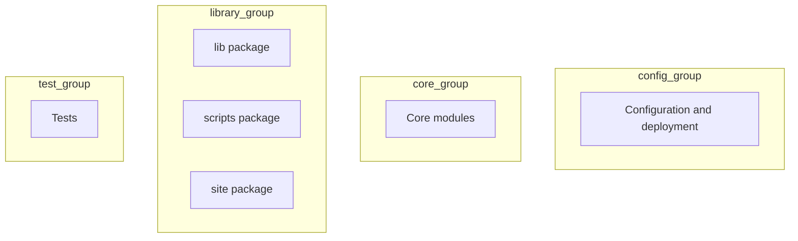

# Architecture report: pure-css/pure

> Automated static analysis. **Observed** = directly seen in files/imports/AST; **Inferred** = interpretation from that evidence. Repository code was not executed.

## 1. Repository at a glance

| Item | Value |
| --- | --- |
| Repository | pure-css/pure |
| Description | A set of small, responsive CSS modules that you can use in every web project. |
| Language | JavaScript |
| Stars | 23716 |
| Licence | Other |
| Analysed commit / branch | 4e079fc499869dd8cb333c52a0bbfe5360514739 / main |
| Framework(s) | React |
| Files analysed | 113 |
| Components | 6 |

## 2. Architecture in one minute

pure-css/pure - A set of small, responsive CSS modules that you can use in every web project.. This repository was analysed statically from 113 file(s) (0 Python). Detected technologies (observed from imports/manifests): GitHub Actions, React, webpack. Files are grouped into 6 component(s): Configuration and deployment, Core modules, lib package, scripts package, site package, Tests. Findings below distinguish observed facts from inferred interpretation.

## 3. High-level block diagram

## 4. Main components

### Configuration and deployment (`config`)

- **Kind:** config
- **Status:** Observed
- **Confidence:** 0.85
- **Responsibility:** Groups 3 file(s) under configuration and deployment (observed from repository paths and static analysis).
- **Paths:** `composer.json`, `package.json`, `site/package.json`
- **Evidence:** [composer.json](https://github.com/pure-css/pure/blob/4e079fc499869dd8cb333c52a0bbfe5360514739/composer.json); [package.json](https://github.com/pure-css/pure/blob/4e079fc499869dd8cb333c52a0bbfe5360514739/package.json); [site/package.json](https://github.com/pure-css/pure/blob/4e079fc499869dd8cb333c52a0bbfe5360514739/site/package.json)

### Core modules (`core`)

- **Kind:** core
- **Status:** Observed
- **Confidence:** 0.85
- **Responsibility:** Groups 2 file(s) under core modules (observed from repository paths and static analysis).
- **Paths:** `eslint.config.mjs`, `index.js`
- **Evidence:** [eslint.config.mjs](https://github.com/pure-css/pure/blob/4e079fc499869dd8cb333c52a0bbfe5360514739/eslint.config.mjs); [index.js](https://github.com/pure-css/pure/blob/4e079fc499869dd8cb333c52a0bbfe5360514739/index.js)

### lib package (`lib`)

- **Kind:** library
- **Status:** Observed
- **Confidence:** 0.85
- **Responsibility:** Groups 1 file(s) under lib package (observed from repository paths and static analysis).
- **Paths:** `lib/grids.js`
- **Evidence:** [lib/grids.js](https://github.com/pure-css/pure/blob/4e079fc499869dd8cb333c52a0bbfe5360514739/lib/grids.js)

### scripts package (`scripts`)

- **Kind:** library
- **Status:** Observed
- **Confidence:** 0.85
- **Responsibility:** Groups 6 file(s) under scripts package (observed from repository paths and static analysis).
- **Paths:** `scripts/build.mjs`, `scripts/lint-css.mjs`, `scripts/prefix-selectors.mjs`, `scripts/release.mjs`, `scripts/util.mjs`, `scripts/watch.mjs`
- **Evidence:** [scripts/build.mjs](https://github.com/pure-css/pure/blob/4e079fc499869dd8cb333c52a0bbfe5360514739/scripts/build.mjs); [scripts/lint-css.mjs](https://github.com/pure-css/pure/blob/4e079fc499869dd8cb333c52a0bbfe5360514739/scripts/lint-css.mjs); [scripts/prefix-selectors.mjs](https://github.com/pure-css/pure/blob/4e079fc499869dd8cb333c52a0bbfe5360514739/scripts/prefix-selectors.mjs); [scripts/release.mjs](https://github.com/pure-css/pure/blob/4e079fc499869dd8cb333c52a0bbfe5360514739/scripts/release.mjs); [scripts/util.mjs](https://github.com/pure-css/pure/blob/4e079fc499869dd8cb333c52a0bbfe5360514739/scripts/util.mjs); [scripts/watch.mjs](https://github.com/pure-css/pure/blob/4e079fc499869dd8cb333c52a0bbfe5360514739/scripts/watch.mjs)

### site package (`site`)

- **Kind:** library
- **Status:** Observed
- **Confidence:** 0.85
- **Responsibility:** Groups 28 file(s) under site package (observed from repository paths and static analysis).
- **Paths:** `site/components/CodeBlock.js`, `site/components/Example.js`, `site/components/Footer.js`, `site/components/Header.js`, `site/components/Menu.js`, `site/components/SectionHeader.js`, `site/docusaurus.config.js`, `site/lib/pure.js`, `site/lib/utils.js`, `site/playwright.config.mjs`, `site/src/index.js`, `site/src/pages/base/index.js`, `site/src/pages/buttons/index.js`, `site/src/pages/customize/index.js`, `site/src/pages/extend/index.js`, `site/src/pages/forms/index.js`, `site/src/pages/grids/index.js`, `site/src/pages/index.js`, `site/src/pages/layouts/index.js`, `site/src/pages/menus/index.js`, `site/src/pages/start/index.js`, `site/src/pages/tables/index.js`, `site/src/pages/tools/index.js`, `site/src/theme/Layout.js`, `site/static/js/grids.js`, `site/static/js/menus.js`, `site/static/js/track-downloads.js`, `site/static/js/ui.js`
- **Evidence:** [site/components/CodeBlock.js](https://github.com/pure-css/pure/blob/4e079fc499869dd8cb333c52a0bbfe5360514739/site/components/CodeBlock.js); [site/components/Example.js](https://github.com/pure-css/pure/blob/4e079fc499869dd8cb333c52a0bbfe5360514739/site/components/Example.js); [site/components/Footer.js](https://github.com/pure-css/pure/blob/4e079fc499869dd8cb333c52a0bbfe5360514739/site/components/Footer.js); [site/components/Header.js](https://github.com/pure-css/pure/blob/4e079fc499869dd8cb333c52a0bbfe5360514739/site/components/Header.js); [site/components/Menu.js](https://github.com/pure-css/pure/blob/4e079fc499869dd8cb333c52a0bbfe5360514739/site/components/Menu.js); [site/components/SectionHeader.js](https://github.com/pure-css/pure/blob/4e079fc499869dd8cb333c52a0bbfe5360514739/site/components/SectionHeader.js); [site/docusaurus.config.js](https://github.com/pure-css/pure/blob/4e079fc499869dd8cb333c52a0bbfe5360514739/site/docusaurus.config.js); [site/lib/pure.js](https://github.com/pure-css/pure/blob/4e079fc499869dd8cb333c52a0bbfe5360514739/site/lib/pure.js)

### Tests (`tests`)

- **Kind:** test
- **Status:** Observed
- **Confidence:** 0.85
- **Responsibility:** Groups 18 file(s) under tests (observed from repository paths and static analysis).
- **Paths:** `site/tests/render.spec.mjs`, `src/buttons/tests/manual/button.html`, `src/forms/tests/manual/forms.html`, `src/grids/tests/manual/responsive.html`, `src/menus/tests/manual/menus.html`, `src/tables/tests/manual/tables.html`, `test/fixtures/base-context.css`, `test/fixtures/base-input.css`, `test/fixtures/cases.json`, `test/fixtures/grids-12-custom-prefix-media.css`, `test/fixtures/grids-12-decimals-2.css`, `test/fixtures/grids-12-default-indent.css`, `test/fixtures/grids-12-old-ie.css`, `test/fixtures/grids-12-unreduced.css`, `test/fixtures/grids-responsive.css`, `test/fixtures/grids-units.css`, `test/grids.mjs`, `test/index.mjs`
- **Evidence:** [site/tests/render.spec.mjs](https://github.com/pure-css/pure/blob/4e079fc499869dd8cb333c52a0bbfe5360514739/site/tests/render.spec.mjs); [src/buttons/tests/manual/button.html](https://github.com/pure-css/pure/blob/4e079fc499869dd8cb333c52a0bbfe5360514739/src/buttons/tests/manual/button.html); [src/forms/tests/manual/forms.html](https://github.com/pure-css/pure/blob/4e079fc499869dd8cb333c52a0bbfe5360514739/src/forms/tests/manual/forms.html); [src/grids/tests/manual/responsive.html](https://github.com/pure-css/pure/blob/4e079fc499869dd8cb333c52a0bbfe5360514739/src/grids/tests/manual/responsive.html); [src/menus/tests/manual/menus.html](https://github.com/pure-css/pure/blob/4e079fc499869dd8cb333c52a0bbfe5360514739/src/menus/tests/manual/menus.html); [src/tables/tests/manual/tables.html](https://github.com/pure-css/pure/blob/4e079fc499869dd8cb333c52a0bbfe5360514739/src/tables/tests/manual/tables.html); [test/fixtures/base-context.css](https://github.com/pure-css/pure/blob/4e079fc499869dd8cb333c52a0bbfe5360514739/test/fixtures/base-context.css); [test/fixtures/base-input.css](https://github.com/pure-css/pure/blob/4e079fc499869dd8cb333c52a0bbfe5360514739/test/fixtures/base-input.css)

## 5. Execution flow

**Observed** entry point(s):

- [index.js](https://github.com/pure-css/pure/blob/4e079fc499869dd8cb333c52a0bbfe5360514739/index.js)
- [site/src/index.js](https://github.com/pure-css/pure/blob/4e079fc499869dd8cb333c52a0bbfe5360514739/site/src/index.js)
- [site/src/pages/index.js](https://github.com/pure-css/pure/blob/4e079fc499869dd8cb333c52a0bbfe5360514739/site/src/pages/index.js)

Representative flow (derived from observed entry points and the import graph; steps beyond the entry point are **Inferred**):

1. Execution starts at an observed entry point listed above, if present.
2. No internal import relationships between components were observed.

## 6. Project structure

### `(root)`

- `.csslintrc` - other (283 bytes)
- `.gitignore` - other (80 bytes)
- `.nvmrc` - other (3 bytes)
- `CODE_OF_CONDUCT.md` - docs (5202 bytes)
- `CONTRIBUTING.md` - docs (4434 bytes)
- `CREDITS.md` - docs (1119 bytes)
- `HISTORY.md` - docs (19895 bytes)
- `LICENSE` - docs (1548 bytes)
- `README.md` - docs (3733 bytes)
- `RELEASE.md` - docs (4192 bytes)
- `composer.json` - config (744 bytes)
- `eslint.config.mjs` - source, JavaScript (1181 bytes)
- `index.js` - source, JavaScript (569 bytes)
- `package.json` - manifest (1908 bytes)

### `.github`

- `.github/ISSUE_TEMPLATE/bug_report.md` - docs (864 bytes)
- `.github/ISSUE_TEMPLATE/feature_request.md` - docs (595 bytes)
- `.github/PULL_REQUEST_TEMPLATE.md` - docs (524 bytes)
- `.github/dependabot.yml` - config (455 bytes)
- `.github/stale.yml` - config (2115 bytes)
- `.github/workflows/dependabot-automerge.yml` - ci, YAML (2249 bytes)
- `.github/workflows/deploy.yml` - ci, YAML (2366 bytes)
- `.github/workflows/publish.yml` - ci, YAML (5100 bytes)
- `.github/workflows/test.yml` - ci, YAML (1877 bytes)

### `lib`

- `lib/grids.js` - source, JavaScript (9654 bytes)

### `scripts`

- `scripts/build.mjs` - source, JavaScript (5604 bytes)
- `scripts/lint-css.mjs` - source, JavaScript (2201 bytes)
- `scripts/prefix-selectors.mjs` - source, JavaScript (2901 bytes)
- `scripts/release.mjs` - source, JavaScript (1307 bytes)
- `scripts/util.mjs` - source, JavaScript (1181 bytes)
- `scripts/watch.mjs` - source, JavaScript (269 bytes)

### `site`

- `site/.gitignore` - other (355 bytes)
- `site/README.md` - docs (1200 bytes)
- `site/components/CodeBlock.js` - source, JavaScript (662 bytes)
- `site/components/Example.js` - source, JavaScript (657 bytes)
- `site/components/Footer.js` - source, JavaScript (1241 bytes)
- `site/components/Header.js` - source, JavaScript (201 bytes)
- `site/components/Menu.js` - source, JavaScript (2987 bytes)
- `site/components/SectionHeader.js` - source, JavaScript (525 bytes)
- `site/docusaurus.config.js` - source, JavaScript (1207 bytes)
- `site/lib/pure.js` - source, JavaScript (1637 bytes)
- `site/lib/utils.js` - source, JavaScript (677 bytes)
- `site/package.json` - manifest (1250 bytes)
- `site/playwright.config.mjs` - source, JavaScript (779 bytes)
- `site/src/index.js` - source, JavaScript (268 bytes)
- `site/src/pages/base/index.js` - source, JavaScript (4085 bytes)
- `site/src/pages/buttons/index.js` - source, JavaScript (8411 bytes)
- `site/src/pages/customize/index.js` - source, JavaScript (8142 bytes)
- `site/src/pages/extend/index.js` - source, JavaScript (9654 bytes)
- `site/src/pages/forms/index.js` - source, JavaScript (16475 bytes)
- `site/src/pages/grids/index.js` - source, JavaScript (42941 bytes)
- `site/src/pages/grids/styles.css` - other (879 bytes)
- `site/src/pages/index.js` - source, JavaScript (8261 bytes)
- `site/src/pages/layouts/README.md` - docs (376 bytes)
- `site/src/pages/layouts/index.js` - source, JavaScript (4669 bytes)
- `site/src/pages/layouts/styles.css` - other (1081 bytes)
- `site/src/pages/menus/index.js` - source, JavaScript (15735 bytes)
- `site/src/pages/start/index.js` - source, JavaScript (9619 bytes)
- `site/src/pages/start/styles.css` - other (3232 bytes)
- `site/src/pages/styles.css` - other (4382 bytes)
- `site/src/pages/tables/index.js` - source, JavaScript (8551 bytes)
- `site/src/pages/tools/index.js` - source, JavaScript (6190 bytes)
- `site/src/theme/Layout.js` - source, JavaScript (3420 bytes)
- `site/static/.nojekyll` - other (0 bytes)
- `site/static/css/main.css` - other (12554 bytes)
- `site/static/js/grids.js` - source, JavaScript (497 bytes)
- `site/static/js/menus.js` - source, JavaScript (6337 bytes)
- `site/static/js/track-downloads.js` - source, JavaScript (924 bytes)
- `site/static/js/ui.js` - source, JavaScript (1639 bytes)
- `site/static/layouts/blog/index.html` - other (6232 bytes)
- `site/static/layouts/blog/styles.css` - other (2727 bytes)
- `site/static/layouts/email/index.html` - other (8663 bytes)
- `site/static/layouts/email/styles.css` - other (5529 bytes)
- `site/static/layouts/gallery/index.html` - other (8811 bytes)
- `site/static/layouts/gallery/styles.css` - other (2253 bytes)
- `site/static/layouts/marketing/index.html` - other (5869 bytes)
- `site/static/layouts/marketing/styles.css` - other (5297 bytes)
- `site/static/layouts/pricing/index.html` - other (6019 bytes)
- `site/static/layouts/pricing/styles.css` - other (4074 bytes)
- `site/static/layouts/side-menu/index.html` - other (4019 bytes)
- `site/static/layouts/side-menu/styles.css` - other (5019 bytes)
- `site/static/layouts/tucked-menu-vertical/index.html` - other (10913 bytes)
- `site/static/layouts/tucked-menu/index.html` - other (13444 bytes)
- `site/tests/render.spec.mjs` - test, JavaScript (5662 bytes)

### `src`

- `src/base/css/base.css` - other (941 bytes)
- `src/buttons/css/buttons-core.css` - other (823 bytes)
- `src/buttons/css/buttons.css` - other (1496 bytes)
- `src/buttons/tests/manual/button.html` - test (7350 bytes)
- `src/forms/css/forms-r.css` - other (1815 bytes)
- `src/forms/css/forms.css` - other (8976 bytes)
- `src/forms/tests/manual/forms.html` - test (13493 bytes)
- `src/grids/README.md` - docs (516 bytes)
- `src/grids/css/grids-core.css` - other (291 bytes)
- `src/grids/tests/manual/responsive.html` - test (13258 bytes)
- `src/menus/css/menus-core.css` - other (500 bytes)
- `src/menus/css/menus-dropdown.css` - other (797 bytes)
- `src/menus/css/menus-horizontal.css` - other (415 bytes)
- `src/menus/css/menus-scrollable.css` - other (463 bytes)
- `src/menus/css/menus-skin.css` - other (1048 bytes)
- `src/menus/tests/manual/menus.html` - test (16067 bytes)
- `src/tables/css/tables.css` - other (1439 bytes)
- `src/tables/tests/manual/tables.html` - test (11460 bytes)

### `test`

- `test/fixtures/base-context.css` - test (7345 bytes)
- `test/fixtures/base-input.css` - test (6772 bytes)
- `test/fixtures/cases.json` - test (1476 bytes)
- `test/fixtures/grids-12-custom-prefix-media.css` - test (1964 bytes)
- `test/fixtures/grids-12-decimals-2.css` - test (936 bytes)
- `test/fixtures/grids-12-default-indent.css` - test (952 bytes)
- `test/fixtures/grids-12-old-ie.css` - test (1171 bytes)
- `test/fixtures/grids-12-unreduced.css` - test (722 bytes)
- `test/fixtures/grids-responsive.css` - test (21420 bytes)
- `test/fixtures/grids-units.css` - test (2073 bytes)
- `test/grids.mjs` - test, JavaScript (1365 bytes)
- `test/index.mjs` - test, JavaScript (349 bytes)

## 7. Key dependencies and integrations

| Name | Category | Status | Confidence | Evidence |
| --- | --- | --- | --- | --- |
| GitHub Actions | ci | Observed | 0.90 | [.github/workflows/dependabot-automerge.yml](https://github.com/pure-css/pure/blob/4e079fc499869dd8cb333c52a0bbfe5360514739/.github/workflows/dependabot-automerge.yml); [.github/workflows/deploy.yml](https://github.com/pure-css/pure/blob/4e079fc499869dd8cb333c52a0bbfe5360514739/.github/workflows/deploy.yml); [.github/workflows/publish.yml](https://github.com/pure-css/pure/blob/4e079fc499869dd8cb333c52a0bbfe5360514739/.github/workflows/publish.yml); [.github/workflows/test.yml](https://github.com/pure-css/pure/blob/4e079fc499869dd8cb333c52a0bbfe5360514739/.github/workflows/test.yml) |
| React | framework | Observed | 0.90 | [site/package.json:25](https://github.com/pure-css/pure/blob/4e079fc499869dd8cb333c52a0bbfe5360514739/site/package.json#L25); [site/package.json:26](https://github.com/pure-css/pure/blob/4e079fc499869dd8cb333c52a0bbfe5360514739/site/package.json#L26) |
| webpack | tooling | Observed | 0.85 | [site/package.json:28](https://github.com/pure-css/pure/blob/4e079fc499869dd8cb333c52a0bbfe5360514739/site/package.json#L28) |

## 8. Data and state

No database, cache, queue, or persistent-state usage was observed in the analysed files. State handling, if any, may be in-memory or in files that were not analysed.

## 9. Configuration and deployment clues

- `.github/dependabot.yml` (config)
- `.github/stale.yml` (config)
- `.github/workflows/dependabot-automerge.yml` (ci)
- `.github/workflows/deploy.yml` (ci)
- `.github/workflows/publish.yml` (ci)
- `.github/workflows/test.yml` (ci)
- `composer.json` (config)
- `package.json` (manifest)
- `site/package.json` (manifest)

## 10. Design observations

- Tests are present alongside source code (Observed from test file paths).

These observations are interpretations (**Inferred**) of the observed structure, not guarantees about runtime design.

## 11. Limitations and unknowns

- Static analysis only: repository code was not executed, installed, or imported at runtime.
- Components and relationships are inferred from file paths, imports, and AST structure; runtime behaviour, dynamic imports, and reflection may not be visible.
- 1 file(s) were skipped during inventory (1 x likely secret file excluded).
- No clear application entry point was observed in the analysed files.
- Repository text was treated as untrusted data; no instructions found in repository files were followed, and likely secret values were redacted/excluded.
- JavaScript and TypeScript files were inventoried from paths and package manifests. They were not parsed with a full language AST, and repository code was not executed.

## 12. Source references

- [.github/workflows/dependabot-automerge.yml](https://github.com/pure-css/pure/blob/4e079fc499869dd8cb333c52a0bbfe5360514739/.github/workflows/dependabot-automerge.yml)
- [.github/workflows/deploy.yml](https://github.com/pure-css/pure/blob/4e079fc499869dd8cb333c52a0bbfe5360514739/.github/workflows/deploy.yml)
- [.github/workflows/publish.yml](https://github.com/pure-css/pure/blob/4e079fc499869dd8cb333c52a0bbfe5360514739/.github/workflows/publish.yml)
- [.github/workflows/test.yml](https://github.com/pure-css/pure/blob/4e079fc499869dd8cb333c52a0bbfe5360514739/.github/workflows/test.yml)
- [composer.json](https://github.com/pure-css/pure/blob/4e079fc499869dd8cb333c52a0bbfe5360514739/composer.json)
- [eslint.config.mjs](https://github.com/pure-css/pure/blob/4e079fc499869dd8cb333c52a0bbfe5360514739/eslint.config.mjs)
- [index.js](https://github.com/pure-css/pure/blob/4e079fc499869dd8cb333c52a0bbfe5360514739/index.js)
- [lib/grids.js](https://github.com/pure-css/pure/blob/4e079fc499869dd8cb333c52a0bbfe5360514739/lib/grids.js)
- [package.json](https://github.com/pure-css/pure/blob/4e079fc499869dd8cb333c52a0bbfe5360514739/package.json)
- [scripts/build.mjs](https://github.com/pure-css/pure/blob/4e079fc499869dd8cb333c52a0bbfe5360514739/scripts/build.mjs)
- [scripts/lint-css.mjs](https://github.com/pure-css/pure/blob/4e079fc499869dd8cb333c52a0bbfe5360514739/scripts/lint-css.mjs)
- [scripts/prefix-selectors.mjs](https://github.com/pure-css/pure/blob/4e079fc499869dd8cb333c52a0bbfe5360514739/scripts/prefix-selectors.mjs)
- [scripts/release.mjs](https://github.com/pure-css/pure/blob/4e079fc499869dd8cb333c52a0bbfe5360514739/scripts/release.mjs)
- [scripts/util.mjs](https://github.com/pure-css/pure/blob/4e079fc499869dd8cb333c52a0bbfe5360514739/scripts/util.mjs)
- [scripts/watch.mjs](https://github.com/pure-css/pure/blob/4e079fc499869dd8cb333c52a0bbfe5360514739/scripts/watch.mjs)
- [site/components/CodeBlock.js](https://github.com/pure-css/pure/blob/4e079fc499869dd8cb333c52a0bbfe5360514739/site/components/CodeBlock.js)
- [site/components/Example.js](https://github.com/pure-css/pure/blob/4e079fc499869dd8cb333c52a0bbfe5360514739/site/components/Example.js)
- [site/components/Footer.js](https://github.com/pure-css/pure/blob/4e079fc499869dd8cb333c52a0bbfe5360514739/site/components/Footer.js)
- [site/components/Header.js](https://github.com/pure-css/pure/blob/4e079fc499869dd8cb333c52a0bbfe5360514739/site/components/Header.js)
- [site/components/Menu.js](https://github.com/pure-css/pure/blob/4e079fc499869dd8cb333c52a0bbfe5360514739/site/components/Menu.js)
- [site/components/SectionHeader.js](https://github.com/pure-css/pure/blob/4e079fc499869dd8cb333c52a0bbfe5360514739/site/components/SectionHeader.js)
- [site/docusaurus.config.js](https://github.com/pure-css/pure/blob/4e079fc499869dd8cb333c52a0bbfe5360514739/site/docusaurus.config.js)
- [site/lib/pure.js](https://github.com/pure-css/pure/blob/4e079fc499869dd8cb333c52a0bbfe5360514739/site/lib/pure.js)
- [site/package.json](https://github.com/pure-css/pure/blob/4e079fc499869dd8cb333c52a0bbfe5360514739/site/package.json)
- [site/package.json:25](https://github.com/pure-css/pure/blob/4e079fc499869dd8cb333c52a0bbfe5360514739/site/package.json#L25)
- [site/package.json:26](https://github.com/pure-css/pure/blob/4e079fc499869dd8cb333c52a0bbfe5360514739/site/package.json#L26)
- [site/package.json:28](https://github.com/pure-css/pure/blob/4e079fc499869dd8cb333c52a0bbfe5360514739/site/package.json#L28)
- [site/src/index.js](https://github.com/pure-css/pure/blob/4e079fc499869dd8cb333c52a0bbfe5360514739/site/src/index.js)
- [site/src/pages/index.js](https://github.com/pure-css/pure/blob/4e079fc499869dd8cb333c52a0bbfe5360514739/site/src/pages/index.js)
- [site/tests/render.spec.mjs](https://github.com/pure-css/pure/blob/4e079fc499869dd8cb333c52a0bbfe5360514739/site/tests/render.spec.mjs)
- [src/buttons/tests/manual/button.html](https://github.com/pure-css/pure/blob/4e079fc499869dd8cb333c52a0bbfe5360514739/src/buttons/tests/manual/button.html)
- [src/forms/tests/manual/forms.html](https://github.com/pure-css/pure/blob/4e079fc499869dd8cb333c52a0bbfe5360514739/src/forms/tests/manual/forms.html)
- [src/grids/tests/manual/responsive.html](https://github.com/pure-css/pure/blob/4e079fc499869dd8cb333c52a0bbfe5360514739/src/grids/tests/manual/responsive.html)
- [src/menus/tests/manual/menus.html](https://github.com/pure-css/pure/blob/4e079fc499869dd8cb333c52a0bbfe5360514739/src/menus/tests/manual/menus.html)
- [src/tables/tests/manual/tables.html](https://github.com/pure-css/pure/blob/4e079fc499869dd8cb333c52a0bbfe5360514739/src/tables/tests/manual/tables.html)
- [test/fixtures/base-context.css](https://github.com/pure-css/pure/blob/4e079fc499869dd8cb333c52a0bbfe5360514739/test/fixtures/base-context.css)
- [test/fixtures/base-input.css](https://github.com/pure-css/pure/blob/4e079fc499869dd8cb333c52a0bbfe5360514739/test/fixtures/base-input.css)
