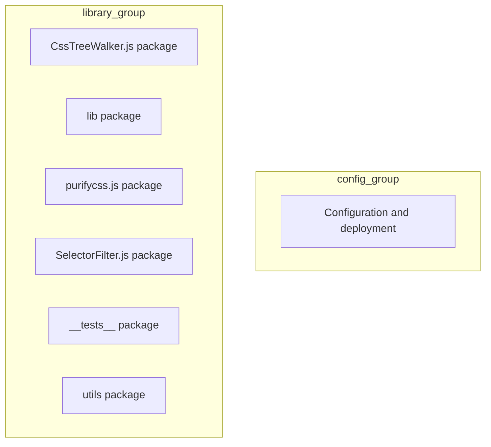

# Architecture report: purifycss/purifycss

> Automated static analysis. **Observed** = directly seen in files/imports/AST; **Inferred** = interpretation from that evidence. Repository code was not executed.

## 1. Repository at a glance

| Item | Value |
| --- | --- |
| Repository | purifycss/purifycss |
| Description | Remove unused CSS. Also works with single-page apps. |
| Language | JavaScript |
| Stars | 9832 |
| Licence | MIT |
| Analysed commit / branch | be52c1c6b1b6e287b6989428c57f05a79aa135dc / master |
| Framework(s) | None detected |
| Files analysed | 43 |
| Components | 7 |

## 2. Architecture in one minute

purifycss/purifycss - Remove unused CSS. Also works with single-page apps.. This repository was analysed statically from 43 file(s) (0 Python). Detected technologies (observed from imports/manifests): Jest. Files are grouped into 7 component(s): Configuration and deployment, CssTreeWalker.js package, lib package, purifycss.js package, SelectorFilter.js package, __tests__ package, utils package. Findings below distinguish observed facts from inferred interpretation.

## 3. High-level block diagram

## 4. Main components

### Configuration and deployment (`config`)

- **Kind:** config
- **Status:** Observed
- **Confidence:** 0.85
- **Responsibility:** Groups 2 file(s) under configuration and deployment (observed from repository paths and static analysis).
- **Paths:** `config/rollup.config.js`, `package.json`
- **Evidence:** [config/rollup.config.js](https://github.com/purifycss/purifycss/blob/be52c1c6b1b6e287b6989428c57f05a79aa135dc/config/rollup.config.js); [package.json](https://github.com/purifycss/purifycss/blob/be52c1c6b1b6e287b6989428c57f05a79aa135dc/package.json)

### CssTreeWalker.js package (`csstreewalker_js`)

- **Kind:** library
- **Status:** Observed
- **Confidence:** 0.85
- **Responsibility:** Groups 1 file(s) under csstreewalker.js package (observed from repository paths and static analysis).
- **Paths:** `src/CssTreeWalker.js`
- **Evidence:** [src/CssTreeWalker.js](https://github.com/purifycss/purifycss/blob/be52c1c6b1b6e287b6989428c57f05a79aa135dc/src/CssTreeWalker.js)

### lib package (`lib`)

- **Kind:** library
- **Status:** Observed
- **Confidence:** 0.85
- **Responsibility:** Groups 2 file(s) under lib package (observed from repository paths and static analysis).
- **Paths:** `lib/purifycss.es.js`, `lib/purifycss.js`
- **Evidence:** [lib/purifycss.es.js](https://github.com/purifycss/purifycss/blob/be52c1c6b1b6e287b6989428c57f05a79aa135dc/lib/purifycss.es.js); [lib/purifycss.js](https://github.com/purifycss/purifycss/blob/be52c1c6b1b6e287b6989428c57f05a79aa135dc/lib/purifycss.js)

### purifycss.js package (`purifycss_js`)

- **Kind:** library
- **Status:** Observed
- **Confidence:** 0.85
- **Responsibility:** Groups 1 file(s) under purifycss.js package (observed from repository paths and static analysis).
- **Paths:** `src/purifycss.js`
- **Evidence:** [src/purifycss.js](https://github.com/purifycss/purifycss/blob/be52c1c6b1b6e287b6989428c57f05a79aa135dc/src/purifycss.js)

### SelectorFilter.js package (`selectorfilter_js`)

- **Kind:** library
- **Status:** Observed
- **Confidence:** 0.85
- **Responsibility:** Groups 1 file(s) under selectorfilter.js package (observed from repository paths and static analysis).
- **Paths:** `src/SelectorFilter.js`
- **Evidence:** [src/SelectorFilter.js](https://github.com/purifycss/purifycss/blob/be52c1c6b1b6e287b6989428c57f05a79aa135dc/src/SelectorFilter.js)

### __tests__ package (`tests`)

- **Kind:** library
- **Status:** Observed
- **Confidence:** 0.85
- **Responsibility:** Groups 8 file(s) under __tests__ package (observed from repository paths and static analysis).
- **Paths:** `__tests__/index.js`, `__tests__/test_examples/camel_case/camel_case.js`, `__tests__/test_examples/combined/combined.js`, `__tests__/test_examples/multiple_files/multiple_files.js`, `__tests__/test_examples/pseudo_class/pseudo_class.js`, `__tests__/test_examples/remove_unused/remove_unused.js`, `__tests__/test_examples/simple/simple.js`, `__tests__/test_examples/special_characters/special_characters.js`
- **Evidence:** [__tests__/index.js](https://github.com/purifycss/purifycss/blob/be52c1c6b1b6e287b6989428c57f05a79aa135dc/__tests__/index.js); [__tests__/test_examples/camel_case/camel_case.js](https://github.com/purifycss/purifycss/blob/be52c1c6b1b6e287b6989428c57f05a79aa135dc/__tests__/test_examples/camel_case/camel_case.js); [__tests__/test_examples/combined/combined.js](https://github.com/purifycss/purifycss/blob/be52c1c6b1b6e287b6989428c57f05a79aa135dc/__tests__/test_examples/combined/combined.js); [__tests__/test_examples/multiple_files/multiple_files.js](https://github.com/purifycss/purifycss/blob/be52c1c6b1b6e287b6989428c57f05a79aa135dc/__tests__/test_examples/multiple_files/multiple_files.js); [__tests__/test_examples/pseudo_class/pseudo_class.js](https://github.com/purifycss/purifycss/blob/be52c1c6b1b6e287b6989428c57f05a79aa135dc/__tests__/test_examples/pseudo_class/pseudo_class.js); [__tests__/test_examples/remove_unused/remove_unused.js](https://github.com/purifycss/purifycss/blob/be52c1c6b1b6e287b6989428c57f05a79aa135dc/__tests__/test_examples/remove_unused/remove_unused.js); [__tests__/test_examples/simple/simple.js](https://github.com/purifycss/purifycss/blob/be52c1c6b1b6e287b6989428c57f05a79aa135dc/__tests__/test_examples/simple/simple.js); [__tests__/test_examples/special_characters/special_characters.js](https://github.com/purifycss/purifycss/blob/be52c1c6b1b6e287b6989428c57f05a79aa135dc/__tests__/test_examples/special_characters/special_characters.js)

### utils package (`utils`)

- **Kind:** library
- **Status:** Observed
- **Confidence:** 0.85
- **Responsibility:** Groups 3 file(s) under utils package (observed from repository paths and static analysis).
- **Paths:** `src/utils/ExtractWordsUtil.js`, `src/utils/FileUtil.js`, `src/utils/PrintUtil.js`
- **Evidence:** [src/utils/ExtractWordsUtil.js](https://github.com/purifycss/purifycss/blob/be52c1c6b1b6e287b6989428c57f05a79aa135dc/src/utils/ExtractWordsUtil.js); [src/utils/FileUtil.js](https://github.com/purifycss/purifycss/blob/be52c1c6b1b6e287b6989428c57f05a79aa135dc/src/utils/FileUtil.js); [src/utils/PrintUtil.js](https://github.com/purifycss/purifycss/blob/be52c1c6b1b6e287b6989428c57f05a79aa135dc/src/utils/PrintUtil.js)

## 5. Execution flow

**Observed** entry point(s):

- [bin/purifycss](https://github.com/purifycss/purifycss/blob/be52c1c6b1b6e287b6989428c57f05a79aa135dc/bin/purifycss)
- [lib/purifycss.js](https://github.com/purifycss/purifycss/blob/be52c1c6b1b6e287b6989428c57f05a79aa135dc/lib/purifycss.js)

Representative flow (derived from observed entry points and the import graph; steps beyond the entry point are **Inferred**):

1. Execution starts at an observed entry point listed above, if present.
2. No internal import relationships between components were observed.

## 6. Project structure

### `(root)`

- `.eslintrc` - other (9608 bytes)
- `.gitignore` - other (48 bytes)
- `.travis.yml` - ci, YAML (65 bytes)
- `LICENSE` - docs (1096 bytes)
- `README.md` - docs (7248 bytes)
- `package.json` - manifest (1317 bytes)
- `purified.css` - other (294 bytes)

### `__tests__`

- `__tests__/index.js` - source, JavaScript (7292 bytes)
- `__tests__/test_examples/attribute_selector/attribute_selector.css` - other (146 bytes)
- `__tests__/test_examples/attribute_selector/attribute_selector.html` - other (54 bytes)
- `__tests__/test_examples/bootstrap/modified-bootstrap.css` - other (144363 bytes)
- `__tests__/test_examples/camel_case/camel_case.css` - other (60 bytes)
- `__tests__/test_examples/camel_case/camel_case.js` - source, JavaScript (23 bytes)
- `__tests__/test_examples/combined/combined.css` - other (71 bytes)
- `__tests__/test_examples/combined/combined.js` - source, JavaScript (71 bytes)
- `__tests__/test_examples/delimited/delimited.css` - other (44 bytes)
- `__tests__/test_examples/delimited/delimited.html` - other (28 bytes)
- `__tests__/test_examples/media_queries/media_queries.css` - other (413 bytes)
- `__tests__/test_examples/media_queries/media_queries.html` - other (71 bytes)
- `__tests__/test_examples/multiple_files/multiple_files.css` - other (33 bytes)
- `__tests__/test_examples/multiple_files/multiple_files.html` - other (33 bytes)
- `__tests__/test_examples/multiple_files/multiple_files.js` - source, JavaScript (14 bytes)
- `__tests__/test_examples/multiple_files/multiple_files2.css` - other (69 bytes)
- `__tests__/test_examples/pseudo_class/pseudo_class.css` - other (63 bytes)
- `__tests__/test_examples/pseudo_class/pseudo_class.js` - source, JavaScript (6 bytes)
- `__tests__/test_examples/remove_unused/remove_unused.css` - other (111 bytes)
- `__tests__/test_examples/remove_unused/remove_unused.js` - source, JavaScript (14 bytes)
- `__tests__/test_examples/simple/simple.css` - other (105 bytes)
- `__tests__/test_examples/simple/simple.js` - source, JavaScript (48 bytes)
- `__tests__/test_examples/special_characters/special_characters.css` - other (67 bytes)
- `__tests__/test_examples/special_characters/special_characters.js` - source, JavaScript (30 bytes)
- `__tests__/test_examples/wildcard/wildcard.css` - other (212 bytes)
- `__tests__/test_examples/wildcard/wildcard.html` - other (87 bytes)

### `bin`

- `bin/purifycss` - other (1487 bytes)

### `config`

- `config/rollup.config.js` - source, JavaScript (837 bytes)

### `lib`

- `lib/purifycss.es.js` - source, JavaScript (30632 bytes)
- `lib/purifycss.js` - source, JavaScript (30825 bytes)

### `src`

- `src/CssTreeWalker.js` - source, JavaScript (1663 bytes)
- `src/SelectorFilter.js` - source, JavaScript (2188 bytes)
- `src/purifycss.js` - source, JavaScript (2029 bytes)
- `src/utils/ExtractWordsUtil.js` - source, JavaScript (1324 bytes)
- `src/utils/FileUtil.js` - source, JavaScript (1952 bytes)
- `src/utils/PrintUtil.js` - source, JavaScript (816 bytes)

## 7. Key dependencies and integrations

| Name | Category | Status | Confidence | Evidence |
| --- | --- | --- | --- | --- |
| Jest | tooling | Observed | 0.85 | [package.json:18](https://github.com/purifycss/purifycss/blob/be52c1c6b1b6e287b6989428c57f05a79aa135dc/package.json#L18) |

## 8. Data and state

No database, cache, queue, or persistent-state usage was observed in the analysed files. State handling, if any, may be in-memory or in files that were not analysed.

## 9. Configuration and deployment clues

- `.travis.yml` (ci)
- `package.json` (manifest)

## 10. Design observations

- No strong design patterns could be established from the available evidence.

These observations are interpretations (**Inferred**) of the observed structure, not guarantees about runtime design.

## 11. Limitations and unknowns

- Static analysis only: repository code was not executed, installed, or imported at runtime.
- Components and relationships are inferred from file paths, imports, and AST structure; runtime behaviour, dynamic imports, and reflection may not be visible.
- 1 file(s) were skipped during inventory (1 x lockfile excluded).
- No clear application entry point was observed in the analysed files.
- Repository text was treated as untrusted data; no instructions found in repository files were followed, and likely secret values were redacted/excluded.
- JavaScript and TypeScript files were inventoried from paths and package manifests. They were not parsed with a full language AST, and repository code was not executed.

## 12. Source references

- [__tests__/index.js](https://github.com/purifycss/purifycss/blob/be52c1c6b1b6e287b6989428c57f05a79aa135dc/__tests__/index.js)
- [__tests__/test_examples/camel_case/camel_case.js](https://github.com/purifycss/purifycss/blob/be52c1c6b1b6e287b6989428c57f05a79aa135dc/__tests__/test_examples/camel_case/camel_case.js)
- [__tests__/test_examples/combined/combined.js](https://github.com/purifycss/purifycss/blob/be52c1c6b1b6e287b6989428c57f05a79aa135dc/__tests__/test_examples/combined/combined.js)
- [__tests__/test_examples/multiple_files/multiple_files.js](https://github.com/purifycss/purifycss/blob/be52c1c6b1b6e287b6989428c57f05a79aa135dc/__tests__/test_examples/multiple_files/multiple_files.js)
- [__tests__/test_examples/pseudo_class/pseudo_class.js](https://github.com/purifycss/purifycss/blob/be52c1c6b1b6e287b6989428c57f05a79aa135dc/__tests__/test_examples/pseudo_class/pseudo_class.js)
- [__tests__/test_examples/remove_unused/remove_unused.js](https://github.com/purifycss/purifycss/blob/be52c1c6b1b6e287b6989428c57f05a79aa135dc/__tests__/test_examples/remove_unused/remove_unused.js)
- [__tests__/test_examples/simple/simple.js](https://github.com/purifycss/purifycss/blob/be52c1c6b1b6e287b6989428c57f05a79aa135dc/__tests__/test_examples/simple/simple.js)
- [__tests__/test_examples/special_characters/special_characters.js](https://github.com/purifycss/purifycss/blob/be52c1c6b1b6e287b6989428c57f05a79aa135dc/__tests__/test_examples/special_characters/special_characters.js)
- [bin/purifycss](https://github.com/purifycss/purifycss/blob/be52c1c6b1b6e287b6989428c57f05a79aa135dc/bin/purifycss)
- [config/rollup.config.js](https://github.com/purifycss/purifycss/blob/be52c1c6b1b6e287b6989428c57f05a79aa135dc/config/rollup.config.js)
- [lib/purifycss.es.js](https://github.com/purifycss/purifycss/blob/be52c1c6b1b6e287b6989428c57f05a79aa135dc/lib/purifycss.es.js)
- [lib/purifycss.js](https://github.com/purifycss/purifycss/blob/be52c1c6b1b6e287b6989428c57f05a79aa135dc/lib/purifycss.js)
- [package.json](https://github.com/purifycss/purifycss/blob/be52c1c6b1b6e287b6989428c57f05a79aa135dc/package.json)
- [package.json:18](https://github.com/purifycss/purifycss/blob/be52c1c6b1b6e287b6989428c57f05a79aa135dc/package.json#L18)
- [src/CssTreeWalker.js](https://github.com/purifycss/purifycss/blob/be52c1c6b1b6e287b6989428c57f05a79aa135dc/src/CssTreeWalker.js)
- [src/SelectorFilter.js](https://github.com/purifycss/purifycss/blob/be52c1c6b1b6e287b6989428c57f05a79aa135dc/src/SelectorFilter.js)
- [src/purifycss.js](https://github.com/purifycss/purifycss/blob/be52c1c6b1b6e287b6989428c57f05a79aa135dc/src/purifycss.js)
- [src/utils/ExtractWordsUtil.js](https://github.com/purifycss/purifycss/blob/be52c1c6b1b6e287b6989428c57f05a79aa135dc/src/utils/ExtractWordsUtil.js)
- [src/utils/FileUtil.js](https://github.com/purifycss/purifycss/blob/be52c1c6b1b6e287b6989428c57f05a79aa135dc/src/utils/FileUtil.js)
- [src/utils/PrintUtil.js](https://github.com/purifycss/purifycss/blob/be52c1c6b1b6e287b6989428c57f05a79aa135dc/src/utils/PrintUtil.js)
