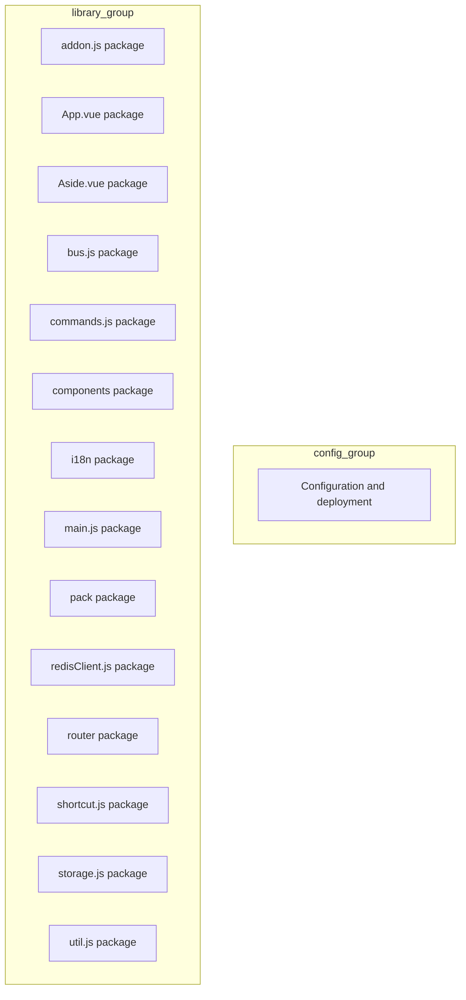

# Architecture report: qishibo/AnotherRedisDesktopManager

> Automated static analysis. **Observed** = directly seen in files/imports/AST; **Inferred** = interpretation from that evidence. Repository code was not executed.

## 1. Repository at a glance

| Item | Value |
| --- | --- |
| Repository | qishibo/AnotherRedisDesktopManager |
| Description | 🚀🚀🚀A faster, better and more stable Redis desktop manager [GUI client], compatible with Linux, Windows, Mac. |
| Language | JavaScript |
| Stars | 34860 |
| Licence | MIT |
| Analysed commit / branch | c149855106628babcdfb7675a8e7ba9434d2492a / master |
| Framework(s) | Electron, Vue |
| Files analysed | 117 |
| Components | 15 |

## 2. Architecture in one minute

qishibo/AnotherRedisDesktopManager - 🚀🚀🚀A faster, better and more stable Redis desktop manager [GUI client], compatible with Linux, Windows, Mac.. This repository was analysed statically from 117 file(s) (0 Python). Detected technologies (observed from imports/manifests): GitHub Actions, Electron, Vue, webpack. Files are grouped into 15 component(s): addon.js package, App.vue package, Aside.vue package, bus.js package, commands.js package, components package, Configuration and deployment, i18n package. Findings below distinguish observed facts from inferred interpretation.

## 3. High-level block diagram

## 4. Main components

### addon.js package (`addon_js`)

- **Kind:** library
- **Status:** Observed
- **Confidence:** 0.85
- **Responsibility:** Groups 1 file(s) under addon.js package (observed from repository paths and static analysis).
- **Paths:** `src/addon.js`
- **Evidence:** [src/addon.js](https://github.com/qishibo/AnotherRedisDesktopManager/blob/c149855106628babcdfb7675a8e7ba9434d2492a/src/addon.js)

### App.vue package (`app_vue`)

- **Kind:** library
- **Status:** Observed
- **Confidence:** 0.85
- **Responsibility:** Groups 1 file(s) under app.vue package (observed from repository paths and static analysis).
- **Paths:** `src/App.vue`
- **Evidence:** [src/App.vue](https://github.com/qishibo/AnotherRedisDesktopManager/blob/c149855106628babcdfb7675a8e7ba9434d2492a/src/App.vue)

### Aside.vue package (`aside_vue`)

- **Kind:** library
- **Status:** Observed
- **Confidence:** 0.85
- **Responsibility:** Groups 1 file(s) under aside.vue package (observed from repository paths and static analysis).
- **Paths:** `src/Aside.vue`
- **Evidence:** [src/Aside.vue](https://github.com/qishibo/AnotherRedisDesktopManager/blob/c149855106628babcdfb7675a8e7ba9434d2492a/src/Aside.vue)

### bus.js package (`bus_js`)

- **Kind:** library
- **Status:** Observed
- **Confidence:** 0.85
- **Responsibility:** Groups 1 file(s) under bus.js package (observed from repository paths and static analysis).
- **Paths:** `src/bus.js`
- **Evidence:** [src/bus.js](https://github.com/qishibo/AnotherRedisDesktopManager/blob/c149855106628babcdfb7675a8e7ba9434d2492a/src/bus.js)

### commands.js package (`commands_js`)

- **Kind:** library
- **Status:** Observed
- **Confidence:** 0.85
- **Responsibility:** Groups 1 file(s) under commands.js package (observed from repository paths and static analysis).
- **Paths:** `src/commands.js`
- **Evidence:** [src/commands.js](https://github.com/qishibo/AnotherRedisDesktopManager/blob/c149855106628babcdfb7675a8e7ba9434d2492a/src/commands.js)

### components package (`components`)

- **Kind:** library
- **Status:** Observed
- **Confidence:** 0.85
- **Responsibility:** Groups 56 file(s) under components package (observed from repository paths and static analysis).
- **Paths:** `src/components/CliContent.vue`, `src/components/CliTab.vue`, `src/components/CommandLog.vue`, `src/components/ConnectionMenu.vue`, `src/components/ConnectionWrapper.vue`, `src/components/Connections.vue`, `src/components/CustomFormatter.vue`, `src/components/DeleteBatch.vue`, `src/components/FileInput.vue`, `src/components/FormatViewer.vue`, `src/components/HotKeys.vue`, `src/components/InputBinary.vue`, `src/components/InputPassword.vue`, `src/components/JsonEditor.vue`, `src/components/KeyDetail.vue`, `src/components/KeyHeader.vue`, `src/components/KeyList.vue`, `src/components/KeyListNormal.vue`, `src/components/KeyListVirtualTree.vue`, `src/components/LanguageSelector.vue`, `src/components/MemoryAnalysis.vue`, `src/components/NewConnectionDialog.vue`, `src/components/OperateItem.vue`, `src/components/PaginationTable.vue`, `src/components/RightClickMenu.vue`, `src/components/ScrollToTop.vue`, `src/components/Setting.vue`, `src/components/SlowLog.vue`, `src/components/Status.vue`, `src/components/Tabs.vue`, `src/components/UpdateCheck.vue`, `src/components/contents/KeyContentArray.vue`, `src/components/contents/KeyContentHash.vue`, `src/components/contents/KeyContentList.vue`, `src/components/contents/KeyContentReJson.vue`, `src/components/contents/KeyContentSet.vue`, `src/components/contents/KeyContentStream.vue`, `src/components/contents/KeyContentString.vue`, `src/components/contents/KeyContentTimeSeries.vue`, `src/components/contents/KeyContentVector.vue`, `src/components/contents/KeyContentZset.vue`, `src/components/viewers/ViewerBinary.vue`, `src/components/viewers/ViewerBrotli.vue`, `src/components/viewers/ViewerCustom.vue`, `src/components/viewers/ViewerDeflate.vue`, `src/components/viewers/ViewerDeflateRaw.vue`, `src/components/viewers/ViewerGzip.vue`, `src/components/viewers/ViewerHex.vue`, `src/components/viewers/ViewerJavaSerialize.vue`, `src/components/viewers/ViewerJson.vue`, `src/components/viewers/ViewerMsgpack.vue`, `src/components/viewers/ViewerOverSize.vue`, `src/components/viewers/ViewerPHPSerialize.vue`, `src/components/viewers/ViewerPickle.vue`, `src/components/viewers/ViewerProtobuf.vue`, `src/components/viewers/ViewerText.vue`
- **Evidence:** [src/components/CliContent.vue](https://github.com/qishibo/AnotherRedisDesktopManager/blob/c149855106628babcdfb7675a8e7ba9434d2492a/src/components/CliContent.vue); [src/components/CliTab.vue](https://github.com/qishibo/AnotherRedisDesktopManager/blob/c149855106628babcdfb7675a8e7ba9434d2492a/src/components/CliTab.vue); [src/components/CommandLog.vue](https://github.com/qishibo/AnotherRedisDesktopManager/blob/c149855106628babcdfb7675a8e7ba9434d2492a/src/components/CommandLog.vue); [src/components/ConnectionMenu.vue](https://github.com/qishibo/AnotherRedisDesktopManager/blob/c149855106628babcdfb7675a8e7ba9434d2492a/src/components/ConnectionMenu.vue); [src/components/ConnectionWrapper.vue](https://github.com/qishibo/AnotherRedisDesktopManager/blob/c149855106628babcdfb7675a8e7ba9434d2492a/src/components/ConnectionWrapper.vue); [src/components/Connections.vue](https://github.com/qishibo/AnotherRedisDesktopManager/blob/c149855106628babcdfb7675a8e7ba9434d2492a/src/components/Connections.vue); [src/components/CustomFormatter.vue](https://github.com/qishibo/AnotherRedisDesktopManager/blob/c149855106628babcdfb7675a8e7ba9434d2492a/src/components/CustomFormatter.vue); [src/components/DeleteBatch.vue](https://github.com/qishibo/AnotherRedisDesktopManager/blob/c149855106628babcdfb7675a8e7ba9434d2492a/src/components/DeleteBatch.vue)

### Configuration and deployment (`config`)

- **Kind:** config
- **Status:** Observed
- **Confidence:** 0.85
- **Responsibility:** Groups 6 file(s) under configuration and deployment (observed from repository paths and static analysis).
- **Paths:** `babel.config.json`, `config/dev.env.js`, `config/index.js`, `config/prod.env.js`, `pack/electron/package.json`, `package.json`
- **Evidence:** [babel.config.json](https://github.com/qishibo/AnotherRedisDesktopManager/blob/c149855106628babcdfb7675a8e7ba9434d2492a/babel.config.json); [config/dev.env.js](https://github.com/qishibo/AnotherRedisDesktopManager/blob/c149855106628babcdfb7675a8e7ba9434d2492a/config/dev.env.js); [config/index.js](https://github.com/qishibo/AnotherRedisDesktopManager/blob/c149855106628babcdfb7675a8e7ba9434d2492a/config/index.js); [config/prod.env.js](https://github.com/qishibo/AnotherRedisDesktopManager/blob/c149855106628babcdfb7675a8e7ba9434d2492a/config/prod.env.js); [pack/electron/package.json](https://github.com/qishibo/AnotherRedisDesktopManager/blob/c149855106628babcdfb7675a8e7ba9434d2492a/pack/electron/package.json); [package.json](https://github.com/qishibo/AnotherRedisDesktopManager/blob/c149855106628babcdfb7675a8e7ba9434d2492a/package.json)

### i18n package (`i18n`)

- **Kind:** library
- **Status:** Observed
- **Confidence:** 0.85
- **Responsibility:** Groups 14 file(s) under i18n package (observed from repository paths and static analysis).
- **Paths:** `src/i18n/i18n.js`, `src/i18n/langs/cn.js`, `src/i18n/langs/de.js`, `src/i18n/langs/en.js`, `src/i18n/langs/es.js`, `src/i18n/langs/fr.js`, `src/i18n/langs/it.js`, `src/i18n/langs/ko.js`, `src/i18n/langs/pt.js`, `src/i18n/langs/ru.js`, `src/i18n/langs/tr.js`, `src/i18n/langs/tw.js`, `src/i18n/langs/ua.js`, `src/i18n/langs/vi.js`
- **Evidence:** [src/i18n/i18n.js](https://github.com/qishibo/AnotherRedisDesktopManager/blob/c149855106628babcdfb7675a8e7ba9434d2492a/src/i18n/i18n.js); [src/i18n/langs/cn.js](https://github.com/qishibo/AnotherRedisDesktopManager/blob/c149855106628babcdfb7675a8e7ba9434d2492a/src/i18n/langs/cn.js); [src/i18n/langs/de.js](https://github.com/qishibo/AnotherRedisDesktopManager/blob/c149855106628babcdfb7675a8e7ba9434d2492a/src/i18n/langs/de.js); [src/i18n/langs/en.js](https://github.com/qishibo/AnotherRedisDesktopManager/blob/c149855106628babcdfb7675a8e7ba9434d2492a/src/i18n/langs/en.js); [src/i18n/langs/es.js](https://github.com/qishibo/AnotherRedisDesktopManager/blob/c149855106628babcdfb7675a8e7ba9434d2492a/src/i18n/langs/es.js); [src/i18n/langs/fr.js](https://github.com/qishibo/AnotherRedisDesktopManager/blob/c149855106628babcdfb7675a8e7ba9434d2492a/src/i18n/langs/fr.js); [src/i18n/langs/it.js](https://github.com/qishibo/AnotherRedisDesktopManager/blob/c149855106628babcdfb7675a8e7ba9434d2492a/src/i18n/langs/it.js); [src/i18n/langs/ko.js](https://github.com/qishibo/AnotherRedisDesktopManager/blob/c149855106628babcdfb7675a8e7ba9434d2492a/src/i18n/langs/ko.js)

### main.js package (`main_js`)

- **Kind:** library
- **Status:** Observed
- **Confidence:** 0.85
- **Responsibility:** Groups 1 file(s) under main.js package (observed from repository paths and static analysis).
- **Paths:** `src/main.js`
- **Evidence:** [src/main.js](https://github.com/qishibo/AnotherRedisDesktopManager/blob/c149855106628babcdfb7675a8e7ba9434d2492a/src/main.js)

### pack package (`pack`)

- **Kind:** library
- **Status:** Observed
- **Confidence:** 0.85
- **Responsibility:** Groups 5 file(s) under pack package (observed from repository paths and static analysis).
- **Paths:** `pack/electron/electron-main.js`, `pack/electron/font-manager.js`, `pack/electron/update.js`, `pack/electron/win-state.js`, `pack/scripts/notarize.js`
- **Evidence:** [pack/electron/electron-main.js](https://github.com/qishibo/AnotherRedisDesktopManager/blob/c149855106628babcdfb7675a8e7ba9434d2492a/pack/electron/electron-main.js); [pack/electron/font-manager.js](https://github.com/qishibo/AnotherRedisDesktopManager/blob/c149855106628babcdfb7675a8e7ba9434d2492a/pack/electron/font-manager.js); [pack/electron/update.js](https://github.com/qishibo/AnotherRedisDesktopManager/blob/c149855106628babcdfb7675a8e7ba9434d2492a/pack/electron/update.js); [pack/electron/win-state.js](https://github.com/qishibo/AnotherRedisDesktopManager/blob/c149855106628babcdfb7675a8e7ba9434d2492a/pack/electron/win-state.js); [pack/scripts/notarize.js](https://github.com/qishibo/AnotherRedisDesktopManager/blob/c149855106628babcdfb7675a8e7ba9434d2492a/pack/scripts/notarize.js)

### redisClient.js package (`redisclient_js`)

- **Kind:** library
- **Status:** Observed
- **Confidence:** 0.85
- **Responsibility:** Groups 1 file(s) under redisclient.js package (observed from repository paths and static analysis).
- **Paths:** `src/redisClient.js`
- **Evidence:** [src/redisClient.js](https://github.com/qishibo/AnotherRedisDesktopManager/blob/c149855106628babcdfb7675a8e7ba9434d2492a/src/redisClient.js)

### router package (`router`)

- **Kind:** library
- **Status:** Observed
- **Confidence:** 0.85
- **Responsibility:** Groups 1 file(s) under router package (observed from repository paths and static analysis).
- **Paths:** `src/router/index.js`
- **Evidence:** [src/router/index.js](https://github.com/qishibo/AnotherRedisDesktopManager/blob/c149855106628babcdfb7675a8e7ba9434d2492a/src/router/index.js)

### shortcut.js package (`shortcut_js`)

- **Kind:** library
- **Status:** Observed
- **Confidence:** 0.85
- **Responsibility:** Groups 1 file(s) under shortcut.js package (observed from repository paths and static analysis).
- **Paths:** `src/shortcut.js`
- **Evidence:** [src/shortcut.js](https://github.com/qishibo/AnotherRedisDesktopManager/blob/c149855106628babcdfb7675a8e7ba9434d2492a/src/shortcut.js)

### storage.js package (`storage_js`)

- **Kind:** library
- **Status:** Observed
- **Confidence:** 0.85
- **Responsibility:** Groups 1 file(s) under storage.js package (observed from repository paths and static analysis).
- **Paths:** `src/storage.js`
- **Evidence:** [src/storage.js](https://github.com/qishibo/AnotherRedisDesktopManager/blob/c149855106628babcdfb7675a8e7ba9434d2492a/src/storage.js)

### util.js package (`util_js`)

- **Kind:** library
- **Status:** Observed
- **Confidence:** 0.85
- **Responsibility:** Groups 1 file(s) under util.js package (observed from repository paths and static analysis).
- **Paths:** `src/util.js`
- **Evidence:** [src/util.js](https://github.com/qishibo/AnotherRedisDesktopManager/blob/c149855106628babcdfb7675a8e7ba9434d2492a/src/util.js)

## 5. Execution flow

**Observed** entry point(s):

- [config/index.js](https://github.com/qishibo/AnotherRedisDesktopManager/blob/c149855106628babcdfb7675a8e7ba9434d2492a/config/index.js)
- [pack/electron/electron-main.js](https://github.com/qishibo/AnotherRedisDesktopManager/blob/c149855106628babcdfb7675a8e7ba9434d2492a/pack/electron/electron-main.js)
- [src/main.js](https://github.com/qishibo/AnotherRedisDesktopManager/blob/c149855106628babcdfb7675a8e7ba9434d2492a/src/main.js)
- [src/router/index.js](https://github.com/qishibo/AnotherRedisDesktopManager/blob/c149855106628babcdfb7675a8e7ba9434d2492a/src/router/index.js)

Representative flow (derived from observed entry points and the import graph; steps beyond the entry point are **Inferred**):

1. Execution starts at an observed entry point listed above, if present.
2. No internal import relationships between components were observed.

## 6. Project structure

### `(root)`

- `.editorconfig` - config (220 bytes)
- `.eslintrc.json` - config (358 bytes)
- `.gitattributes` - other (35 bytes)
- `.gitignore` - other (160 bytes)
- `.jshintrc` - other (59 bytes)
- `.postcssrc.js` - source, JavaScript (173 bytes)
- `LICENSE` - docs (1067 bytes)
- `PRIVACY.md` - docs (1673 bytes)
- `README.md` - docs (15700 bytes)
- `README.zh-CN.md` - docs (15193 bytes)
- `SECURITY.md` - docs (743 bytes)
- `babel.config.json` - config (250 bytes)
- `element-variables.scss` - other (35660 bytes)
- `index.html` - other (2012 bytes)
- `package.json` - manifest (4509 bytes)

### `.github`

- `.github/FUNDING.yml` - config (599 bytes)
- `.github/ISSUE_TEMPLATE.md` - docs (154 bytes)
- `.github/workflows/build_appx.yaml` - ci, YAML (1744 bytes)
- `.github/workflows/build_linux.yml` - ci, YAML (488 bytes)
- `.github/workflows/build_mac.yml` - ci, YAML (1018 bytes)
- `.github/workflows/build_snap.yml` - ci, YAML (904 bytes)
- `.github/workflows/build_windows.yml` - ci, YAML (489 bytes)
- `.github/workflows/codeql-analysis.yml.bak` - ci, YAML (2342 bytes)
- `.github/workflows/gen_sponsors.yaml` - ci, YAML (1117 bytes)
- `.github/workflows/publish_winget.yml` - ci, YAML (337 bytes)

### `config`

- `config/dev.env.js` - source, JavaScript (156 bytes)
- `config/index.js` - source, JavaScript (2051 bytes)
- `config/prod.env.js` - source, JavaScript (61 bytes)

### `pack`

- `pack/electron/electron-main.js` - source, JavaScript (6670 bytes)
- `pack/electron/font-manager.js` - source, JavaScript (518 bytes)
- `pack/electron/package.json` - manifest (1873 bytes)
- `pack/electron/update.js` - source, JavaScript (1320 bytes)
- `pack/electron/win-state.js` - source, JavaScript (2927 bytes)
- `pack/scripts/notarize.js` - source, JavaScript (534 bytes)

### `src`

- `src/App.vue` - source, Vue (5399 bytes)
- `src/Aside.vue` - source, Vue (3253 bytes)
- `src/addon.js` - source, JavaScript (3200 bytes)
- `src/bus.js` - source, JavaScript (287 bytes)
- `src/commands.js` - source, JavaScript (11850 bytes)
- `src/components/CliContent.vue` - source, Vue (4555 bytes)
- `src/components/CliTab.vue` - source, Vue (12980 bytes)
- `src/components/CommandLog.vue` - source, Vue (3872 bytes)
- `src/components/ConnectionMenu.vue` - source, Vue (14073 bytes)
- `src/components/ConnectionWrapper.vue` - source, Vue (6927 bytes)
- `src/components/Connections.vue` - source, Vue (14076 bytes)
- `src/components/CustomFormatter.vue` - source, Vue (5766 bytes)
- `src/components/DeleteBatch.vue` - source, Vue (6962 bytes)
- `src/components/FileInput.vue` - source, Vue (1205 bytes)
- `src/components/FormatViewer.vue` - source, Vue (8490 bytes)
- `src/components/HotKeys.vue` - source, Vue (1910 bytes)
- `src/components/InputBinary.vue` - source, Vue (1121 bytes)
- `src/components/InputPassword.vue` - source, Vue (1387 bytes)
- `src/components/JsonEditor.vue` - source, Vue (6825 bytes)
- `src/components/KeyDetail.vue` - source, Vue (4541 bytes)
- `src/components/KeyHeader.vue` - source, Vue (8921 bytes)
- `src/components/KeyList.vue` - source, Vue (9646 bytes)
- `src/components/KeyListNormal.vue` - source, Vue (2451 bytes)
- `src/components/KeyListVirtualTree.vue` - source, Vue (17610 bytes)
- `src/components/LanguageSelector.vue` - source, Vue (1269 bytes)
- `src/components/MemoryAnalysis.vue` - source, Vue (9051 bytes)
- `src/components/NewConnectionDialog.vue` - source, Vue (16880 bytes)
- `src/components/OperateItem.vue` - source, Vue (14558 bytes)
- `src/components/PaginationTable.vue` - source, Vue (1313 bytes)
- `src/components/RightClickMenu.vue` - source, Vue (2286 bytes)
- `src/components/ScrollToTop.vue` - source, Vue (2713 bytes)
- `src/components/Setting.vue` - source, Vue (11371 bytes)
- `src/components/SlowLog.vue` - source, Vue (6206 bytes)
- `src/components/Status.vue` - source, Vue (12019 bytes)
- `src/components/Tabs.vue` - source, Vue (13198 bytes)
- `src/components/UpdateCheck.vue` - source, Vue (4062 bytes)
- `src/components/contents/KeyContentArray.vue` - source, Vue (10561 bytes)
- `src/components/contents/KeyContentHash.vue` - source, Vue (10988 bytes)
- `src/components/contents/KeyContentList.vue` - source, Vue (9257 bytes)
- `src/components/contents/KeyContentReJson.vue` - source, Vue (2613 bytes)
- `src/components/contents/KeyContentSet.vue` - source, Vue (8729 bytes)
- `src/components/contents/KeyContentStream.vue` - source, Vue (13999 bytes)
- `src/components/contents/KeyContentString.vue` - source, Vue (2580 bytes)
- `src/components/contents/KeyContentTimeSeries.vue` - source, Vue (12601 bytes)
- `src/components/contents/KeyContentVector.vue` - source, Vue (17950 bytes)
- `src/components/contents/KeyContentZset.vue` - source, Vue (10425 bytes)
- `src/components/viewers/ViewerBinary.vue` - source, Vue (656 bytes)
- `src/components/viewers/ViewerBrotli.vue` - source, Vue (972 bytes)
- `src/components/viewers/ViewerCustom.vue` - source, Vue (4834 bytes)
- `src/components/viewers/ViewerDeflate.vue` - source, Vue (967 bytes)
- `src/components/viewers/ViewerDeflateRaw.vue` - source, Vue (976 bytes)
- `src/components/viewers/ViewerGzip.vue` - source, Vue (958 bytes)
- `src/components/viewers/ViewerHex.vue` - source, Vue (645 bytes)
- `src/components/viewers/ViewerJavaSerialize.vue` - source, Vue (975 bytes)
- `src/components/viewers/ViewerJson.vue` - source, Vue (1203 bytes)
- `src/components/viewers/ViewerMsgpack.vue` - source, Vue (1323 bytes)
- `src/components/viewers/ViewerOverSize.vue` - source, Vue (1067 bytes)
- `src/components/viewers/ViewerPHPSerialize.vue` - source, Vue (1288 bytes)
- `src/components/viewers/ViewerPickle.vue` - source, Vue (677 bytes)
- `src/components/viewers/ViewerProtobuf.vue` - source, Vue (7832 bytes)
- `src/components/viewers/ViewerText.vue` - source, Vue (1355 bytes)
- `src/i18n/i18n.js` - source, JavaScript (1935 bytes)
- `src/i18n/langs/cn.js` - source, JavaScript (9038 bytes)
- `src/i18n/langs/de.js` - source, JavaScript (10949 bytes)
- `src/i18n/langs/en.js` - source, JavaScript (9454 bytes)
- `src/i18n/langs/es.js` - source, JavaScript (10480 bytes)
- `src/i18n/langs/fr.js` - source, JavaScript (11041 bytes)
- `src/i18n/langs/it.js` - source, JavaScript (10856 bytes)
- `src/i18n/langs/ko.js` - source, JavaScript (10819 bytes)
- `src/i18n/langs/pt.js` - source, JavaScript (10592 bytes)
- `src/i18n/langs/ru.js` - source, JavaScript (15688 bytes)
- `src/i18n/langs/tr.js` - source, JavaScript (10601 bytes)
- `src/i18n/langs/tw.js` - source, JavaScript (9137 bytes)
- `src/i18n/langs/ua.js` - source, JavaScript (15099 bytes)
- `src/i18n/langs/vi.js` - source, JavaScript (11448 bytes)
- `src/main.js` - source, JavaScript (979 bytes)
- `src/redisClient.js` - source, JavaScript (11541 bytes)
- `src/router/index.js` - source, JavaScript (235 bytes)
- `src/shortcut.js` - source, JavaScript (683 bytes)
- `src/storage.js` - source, JavaScript (9662 bytes)
- `src/util.js` - source, JavaScript (9938 bytes)

### `static`

- `static/.gitkeep` - other (0 bytes)
- `static/theme/light/index.css` - other (198511 bytes)

## 7. Key dependencies and integrations

| Name | Category | Status | Confidence | Evidence |
| --- | --- | --- | --- | --- |
| GitHub Actions | ci | Observed | 0.90 | [.github/workflows/build_appx.yaml](https://github.com/qishibo/AnotherRedisDesktopManager/blob/c149855106628babcdfb7675a8e7ba9434d2492a/.github/workflows/build_appx.yaml); [.github/workflows/build_linux.yml](https://github.com/qishibo/AnotherRedisDesktopManager/blob/c149855106628babcdfb7675a8e7ba9434d2492a/.github/workflows/build_linux.yml); [.github/workflows/build_mac.yml](https://github.com/qishibo/AnotherRedisDesktopManager/blob/c149855106628babcdfb7675a8e7ba9434d2492a/.github/workflows/build_mac.yml); [.github/workflows/build_snap.yml](https://github.com/qishibo/AnotherRedisDesktopManager/blob/c149855106628babcdfb7675a8e7ba9434d2492a/.github/workflows/build_snap.yml) |
| Electron | framework | Observed | 0.85 | [package.json:11](https://github.com/qishibo/AnotherRedisDesktopManager/blob/c149855106628babcdfb7675a8e7ba9434d2492a/package.json#L11) |
| Vue | framework | Observed | 0.85 | [package.json:12](https://github.com/qishibo/AnotherRedisDesktopManager/blob/c149855106628babcdfb7675a8e7ba9434d2492a/package.json#L12) |
| webpack | tooling | Observed | 0.85 | [package.json:8](https://github.com/qishibo/AnotherRedisDesktopManager/blob/c149855106628babcdfb7675a8e7ba9434d2492a/package.json#L8) |

## 8. Data and state

No database, cache, queue, or persistent-state usage was observed in the analysed files. State handling, if any, may be in-memory or in files that were not analysed.

## 9. Configuration and deployment clues

- `.editorconfig` (config)
- `.eslintrc.json` (config)
- `.github/FUNDING.yml` (config)
- `.github/workflows/build_appx.yaml` (ci)
- `.github/workflows/build_linux.yml` (ci)
- `.github/workflows/build_mac.yml` (ci)
- `.github/workflows/build_snap.yml` (ci)
- `.github/workflows/build_windows.yml` (ci)
- `.github/workflows/codeql-analysis.yml.bak` (ci)
- `.github/workflows/gen_sponsors.yaml` (ci)
- `.github/workflows/publish_winget.yml` (ci)
- `babel.config.json` (config)
- `pack/electron/package.json` (manifest)
- `package.json` (manifest)

## 10. Design observations

- No strong design patterns could be established from the available evidence.

These observations are interpretations (**Inferred**) of the observed structure, not guarantees about runtime design.

## 11. Limitations and unknowns

- Static analysis only: repository code was not executed, installed, or imported at runtime.
- Components and relationships are inferred from file paths, imports, and AST structure; runtime behaviour, dynamic imports, and reflection may not be visible.
- 7 file(s) were skipped during inventory (7 x vendored/generated directory excluded).
- No clear application entry point was observed in the analysed files.
- Repository text was treated as untrusted data; no instructions found in repository files were followed, and likely secret values were redacted/excluded.
- JavaScript and TypeScript files were inventoried from paths and package manifests. They were not parsed with a full language AST, and repository code was not executed.

## 12. Source references

- [.github/workflows/build_appx.yaml](https://github.com/qishibo/AnotherRedisDesktopManager/blob/c149855106628babcdfb7675a8e7ba9434d2492a/.github/workflows/build_appx.yaml)
- [.github/workflows/build_linux.yml](https://github.com/qishibo/AnotherRedisDesktopManager/blob/c149855106628babcdfb7675a8e7ba9434d2492a/.github/workflows/build_linux.yml)
- [.github/workflows/build_mac.yml](https://github.com/qishibo/AnotherRedisDesktopManager/blob/c149855106628babcdfb7675a8e7ba9434d2492a/.github/workflows/build_mac.yml)
- [.github/workflows/build_snap.yml](https://github.com/qishibo/AnotherRedisDesktopManager/blob/c149855106628babcdfb7675a8e7ba9434d2492a/.github/workflows/build_snap.yml)
- [.github/workflows/build_windows.yml](https://github.com/qishibo/AnotherRedisDesktopManager/blob/c149855106628babcdfb7675a8e7ba9434d2492a/.github/workflows/build_windows.yml)
- [.github/workflows/codeql-analysis.yml.bak](https://github.com/qishibo/AnotherRedisDesktopManager/blob/c149855106628babcdfb7675a8e7ba9434d2492a/.github/workflows/codeql-analysis.yml.bak)
- [.github/workflows/gen_sponsors.yaml](https://github.com/qishibo/AnotherRedisDesktopManager/blob/c149855106628babcdfb7675a8e7ba9434d2492a/.github/workflows/gen_sponsors.yaml)
- [.github/workflows/publish_winget.yml](https://github.com/qishibo/AnotherRedisDesktopManager/blob/c149855106628babcdfb7675a8e7ba9434d2492a/.github/workflows/publish_winget.yml)
- [babel.config.json](https://github.com/qishibo/AnotherRedisDesktopManager/blob/c149855106628babcdfb7675a8e7ba9434d2492a/babel.config.json)
- [config/dev.env.js](https://github.com/qishibo/AnotherRedisDesktopManager/blob/c149855106628babcdfb7675a8e7ba9434d2492a/config/dev.env.js)
- [config/index.js](https://github.com/qishibo/AnotherRedisDesktopManager/blob/c149855106628babcdfb7675a8e7ba9434d2492a/config/index.js)
- [config/prod.env.js](https://github.com/qishibo/AnotherRedisDesktopManager/blob/c149855106628babcdfb7675a8e7ba9434d2492a/config/prod.env.js)
- [pack/electron/electron-main.js](https://github.com/qishibo/AnotherRedisDesktopManager/blob/c149855106628babcdfb7675a8e7ba9434d2492a/pack/electron/electron-main.js)
- [pack/electron/font-manager.js](https://github.com/qishibo/AnotherRedisDesktopManager/blob/c149855106628babcdfb7675a8e7ba9434d2492a/pack/electron/font-manager.js)
- [pack/electron/package.json](https://github.com/qishibo/AnotherRedisDesktopManager/blob/c149855106628babcdfb7675a8e7ba9434d2492a/pack/electron/package.json)
- [pack/electron/update.js](https://github.com/qishibo/AnotherRedisDesktopManager/blob/c149855106628babcdfb7675a8e7ba9434d2492a/pack/electron/update.js)
- [pack/electron/win-state.js](https://github.com/qishibo/AnotherRedisDesktopManager/blob/c149855106628babcdfb7675a8e7ba9434d2492a/pack/electron/win-state.js)
- [pack/scripts/notarize.js](https://github.com/qishibo/AnotherRedisDesktopManager/blob/c149855106628babcdfb7675a8e7ba9434d2492a/pack/scripts/notarize.js)
- [package.json](https://github.com/qishibo/AnotherRedisDesktopManager/blob/c149855106628babcdfb7675a8e7ba9434d2492a/package.json)
- [package.json:8](https://github.com/qishibo/AnotherRedisDesktopManager/blob/c149855106628babcdfb7675a8e7ba9434d2492a/package.json#L8)
- [package.json:11](https://github.com/qishibo/AnotherRedisDesktopManager/blob/c149855106628babcdfb7675a8e7ba9434d2492a/package.json#L11)
- [package.json:12](https://github.com/qishibo/AnotherRedisDesktopManager/blob/c149855106628babcdfb7675a8e7ba9434d2492a/package.json#L12)
- [src/App.vue](https://github.com/qishibo/AnotherRedisDesktopManager/blob/c149855106628babcdfb7675a8e7ba9434d2492a/src/App.vue)
- [src/Aside.vue](https://github.com/qishibo/AnotherRedisDesktopManager/blob/c149855106628babcdfb7675a8e7ba9434d2492a/src/Aside.vue)
- [src/addon.js](https://github.com/qishibo/AnotherRedisDesktopManager/blob/c149855106628babcdfb7675a8e7ba9434d2492a/src/addon.js)
- [src/bus.js](https://github.com/qishibo/AnotherRedisDesktopManager/blob/c149855106628babcdfb7675a8e7ba9434d2492a/src/bus.js)
- [src/commands.js](https://github.com/qishibo/AnotherRedisDesktopManager/blob/c149855106628babcdfb7675a8e7ba9434d2492a/src/commands.js)
- [src/components/CliContent.vue](https://github.com/qishibo/AnotherRedisDesktopManager/blob/c149855106628babcdfb7675a8e7ba9434d2492a/src/components/CliContent.vue)
- [src/components/CliTab.vue](https://github.com/qishibo/AnotherRedisDesktopManager/blob/c149855106628babcdfb7675a8e7ba9434d2492a/src/components/CliTab.vue)
- [src/components/CommandLog.vue](https://github.com/qishibo/AnotherRedisDesktopManager/blob/c149855106628babcdfb7675a8e7ba9434d2492a/src/components/CommandLog.vue)
- [src/components/ConnectionMenu.vue](https://github.com/qishibo/AnotherRedisDesktopManager/blob/c149855106628babcdfb7675a8e7ba9434d2492a/src/components/ConnectionMenu.vue)
- [src/components/ConnectionWrapper.vue](https://github.com/qishibo/AnotherRedisDesktopManager/blob/c149855106628babcdfb7675a8e7ba9434d2492a/src/components/ConnectionWrapper.vue)
- [src/components/Connections.vue](https://github.com/qishibo/AnotherRedisDesktopManager/blob/c149855106628babcdfb7675a8e7ba9434d2492a/src/components/Connections.vue)
- [src/components/CustomFormatter.vue](https://github.com/qishibo/AnotherRedisDesktopManager/blob/c149855106628babcdfb7675a8e7ba9434d2492a/src/components/CustomFormatter.vue)
- [src/components/DeleteBatch.vue](https://github.com/qishibo/AnotherRedisDesktopManager/blob/c149855106628babcdfb7675a8e7ba9434d2492a/src/components/DeleteBatch.vue)
- [src/i18n/i18n.js](https://github.com/qishibo/AnotherRedisDesktopManager/blob/c149855106628babcdfb7675a8e7ba9434d2492a/src/i18n/i18n.js)
- [src/i18n/langs/cn.js](https://github.com/qishibo/AnotherRedisDesktopManager/blob/c149855106628babcdfb7675a8e7ba9434d2492a/src/i18n/langs/cn.js)
- [src/i18n/langs/de.js](https://github.com/qishibo/AnotherRedisDesktopManager/blob/c149855106628babcdfb7675a8e7ba9434d2492a/src/i18n/langs/de.js)
- [src/i18n/langs/en.js](https://github.com/qishibo/AnotherRedisDesktopManager/blob/c149855106628babcdfb7675a8e7ba9434d2492a/src/i18n/langs/en.js)
- [src/i18n/langs/es.js](https://github.com/qishibo/AnotherRedisDesktopManager/blob/c149855106628babcdfb7675a8e7ba9434d2492a/src/i18n/langs/es.js)
- [src/i18n/langs/fr.js](https://github.com/qishibo/AnotherRedisDesktopManager/blob/c149855106628babcdfb7675a8e7ba9434d2492a/src/i18n/langs/fr.js)
- [src/i18n/langs/it.js](https://github.com/qishibo/AnotherRedisDesktopManager/blob/c149855106628babcdfb7675a8e7ba9434d2492a/src/i18n/langs/it.js)
- [src/i18n/langs/ko.js](https://github.com/qishibo/AnotherRedisDesktopManager/blob/c149855106628babcdfb7675a8e7ba9434d2492a/src/i18n/langs/ko.js)
- [src/main.js](https://github.com/qishibo/AnotherRedisDesktopManager/blob/c149855106628babcdfb7675a8e7ba9434d2492a/src/main.js)
- [src/redisClient.js](https://github.com/qishibo/AnotherRedisDesktopManager/blob/c149855106628babcdfb7675a8e7ba9434d2492a/src/redisClient.js)
- [src/router/index.js](https://github.com/qishibo/AnotherRedisDesktopManager/blob/c149855106628babcdfb7675a8e7ba9434d2492a/src/router/index.js)
- [src/shortcut.js](https://github.com/qishibo/AnotherRedisDesktopManager/blob/c149855106628babcdfb7675a8e7ba9434d2492a/src/shortcut.js)
- [src/storage.js](https://github.com/qishibo/AnotherRedisDesktopManager/blob/c149855106628babcdfb7675a8e7ba9434d2492a/src/storage.js)
- [src/util.js](https://github.com/qishibo/AnotherRedisDesktopManager/blob/c149855106628babcdfb7675a8e7ba9434d2492a/src/util.js)
