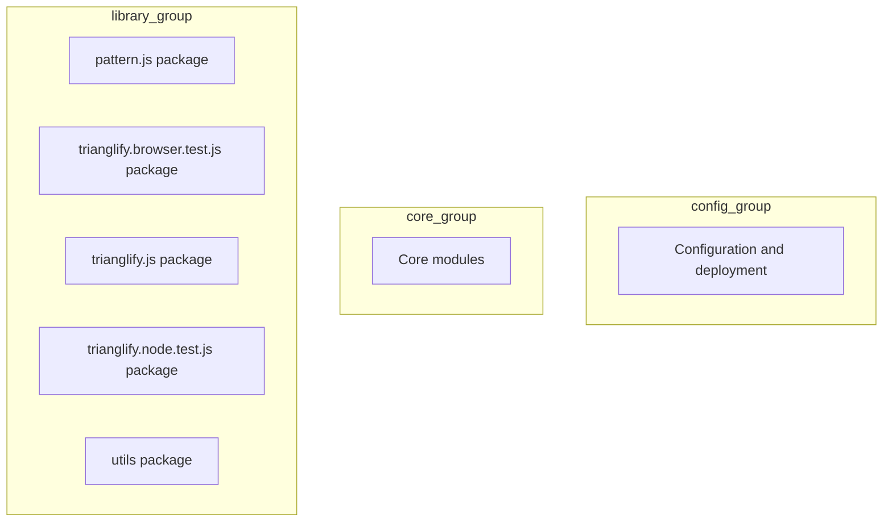

# Architecture report: qrohlf/trianglify

> Automated static analysis. **Observed** = directly seen in files/imports/AST; **Inferred** = interpretation from that evidence. Repository code was not executed.

## 1. Repository at a glance

| Item | Value |
| --- | --- |
| Repository | qrohlf/trianglify |
| Description | Algorithmically generated triangle art |
| Language | JavaScript |
| Stars | 10089 |
| Licence | GPL-3.0 |
| Analysed commit / branch | b959ccd656ca7294ebe363ee0c1dfbe72929a16e / master |
| Framework(s) | None detected |
| Files analysed | 30 |
| Components | 7 |

## 2. Architecture in one minute

qrohlf/trianglify - Algorithmically generated triangle art. This repository was analysed statically from 30 file(s) (0 Python). Detected technologies (observed from imports/manifests): GitHub Actions, Jest. Files are grouped into 7 component(s): Configuration and deployment, Core modules, pattern.js package, trianglify.browser.test.js package, trianglify.js package, trianglify.node.test.js package, utils package. Findings below distinguish observed facts from inferred interpretation.

## 3. High-level block diagram

## 4. Main components

### Configuration and deployment (`config`)

- **Kind:** config
- **Status:** Observed
- **Confidence:** 0.85
- **Responsibility:** Groups 1 file(s) under configuration and deployment (observed from repository paths and static analysis).
- **Paths:** `package.json`
- **Evidence:** [package.json](https://github.com/qrohlf/trianglify/blob/b959ccd656ca7294ebe363ee0c1dfbe72929a16e/package.json)

### Core modules (`core`)

- **Kind:** core
- **Status:** Observed
- **Confidence:** 0.85
- **Responsibility:** Groups 1 file(s) under core modules (observed from repository paths and static analysis).
- **Paths:** `rollup.config.js`
- **Evidence:** [rollup.config.js](https://github.com/qrohlf/trianglify/blob/b959ccd656ca7294ebe363ee0c1dfbe72929a16e/rollup.config.js)

### pattern.js package (`pattern_js`)

- **Kind:** library
- **Status:** Observed
- **Confidence:** 0.85
- **Responsibility:** Groups 1 file(s) under pattern.js package (observed from repository paths and static analysis).
- **Paths:** `src/pattern.js`
- **Evidence:** [src/pattern.js](https://github.com/qrohlf/trianglify/blob/b959ccd656ca7294ebe363ee0c1dfbe72929a16e/src/pattern.js)

### trianglify.browser.test.js package (`trianglify_browser_test_js`)

- **Kind:** library
- **Status:** Observed
- **Confidence:** 0.85
- **Responsibility:** Groups 1 file(s) under trianglify.browser.test.js package (observed from repository paths and static analysis).
- **Paths:** `src/trianglify.browser.test.js`
- **Evidence:** [src/trianglify.browser.test.js](https://github.com/qrohlf/trianglify/blob/b959ccd656ca7294ebe363ee0c1dfbe72929a16e/src/trianglify.browser.test.js)

### trianglify.js package (`trianglify_js`)

- **Kind:** library
- **Status:** Observed
- **Confidence:** 0.85
- **Responsibility:** Groups 1 file(s) under trianglify.js package (observed from repository paths and static analysis).
- **Paths:** `src/trianglify.js`
- **Evidence:** [src/trianglify.js](https://github.com/qrohlf/trianglify/blob/b959ccd656ca7294ebe363ee0c1dfbe72929a16e/src/trianglify.js)

### trianglify.node.test.js package (`trianglify_node_test_js`)

- **Kind:** library
- **Status:** Observed
- **Confidence:** 0.85
- **Responsibility:** Groups 1 file(s) under trianglify.node.test.js package (observed from repository paths and static analysis).
- **Paths:** `src/trianglify.node.test.js`
- **Evidence:** [src/trianglify.node.test.js](https://github.com/qrohlf/trianglify/blob/b959ccd656ca7294ebe363ee0c1dfbe72929a16e/src/trianglify.node.test.js)

### utils package (`utils`)

- **Kind:** library
- **Status:** Observed
- **Confidence:** 0.85
- **Responsibility:** Groups 6 file(s) under utils package (observed from repository paths and static analysis).
- **Paths:** `src/utils/colorFunctions.js`, `src/utils/colorbrewer.js`, `src/utils/debugRender.js`, `src/utils/geom.js`, `src/utils/getScalingRatio.js`, `src/utils/mulberry32.js`
- **Evidence:** [src/utils/colorFunctions.js](https://github.com/qrohlf/trianglify/blob/b959ccd656ca7294ebe363ee0c1dfbe72929a16e/src/utils/colorFunctions.js); [src/utils/colorbrewer.js](https://github.com/qrohlf/trianglify/blob/b959ccd656ca7294ebe363ee0c1dfbe72929a16e/src/utils/colorbrewer.js); [src/utils/debugRender.js](https://github.com/qrohlf/trianglify/blob/b959ccd656ca7294ebe363ee0c1dfbe72929a16e/src/utils/debugRender.js); [src/utils/geom.js](https://github.com/qrohlf/trianglify/blob/b959ccd656ca7294ebe363ee0c1dfbe72929a16e/src/utils/geom.js); [src/utils/getScalingRatio.js](https://github.com/qrohlf/trianglify/blob/b959ccd656ca7294ebe363ee0c1dfbe72929a16e/src/utils/getScalingRatio.js); [src/utils/mulberry32.js](https://github.com/qrohlf/trianglify/blob/b959ccd656ca7294ebe363ee0c1dfbe72929a16e/src/utils/mulberry32.js)

## 5. Execution flow

No entry point was observed; the startup flow below is therefore limited.

Representative flow (derived from observed entry points and the import graph; steps beyond the entry point are **Inferred**):

1. Execution starts at an observed entry point listed above, if present.
2. No internal import relationships between components were observed.

## 6. Project structure

### `(root)`

- `.babelrc` - other (107 bytes)
- `.browserslistrc` - other (58 bytes)
- `.gitignore` - other (18 bytes)
- `.nvmrc` - other (4 bytes)
- `CONTRIBUTING.md` - docs (1008 bytes)
- `LICENSE` - docs (32472 bytes)
- `Readme.md` - docs (10611 bytes)
- `changelog.txt` - docs (700 bytes)
- `package.json` - manifest (1699 bytes)
- `rollup.config.js` - source, JavaScript (1242 bytes)

### `.github`

- `.github/workflows/build.yml` - ci, YAML (539 bytes)

### `examples`

- `examples/basic-web-example.html` - other (1437 bytes)
- `examples/color-function-example.html` - other (3966 bytes)
- `examples/custom-points-example.html` - other (1292 bytes)
- `examples/destsvg-example.html` - other (1139 bytes)
- `examples/save-as-png.js` - source, JavaScript (607 bytes)
- `examples/save-as-svg.js` - source, JavaScript (420 bytes)
- `examples/transparency-example.html` - other (2889 bytes)

### `src`

- `src/__snapshots__/trianglify.browser.test.js.snap` - other (69343 bytes)
- `src/__snapshots__/trianglify.node.test.js.snap` - other (21417 bytes)
- `src/pattern.js` - source, JavaScript (5471 bytes)
- `src/trianglify.browser.test.js` - source, JavaScript (6355 bytes)
- `src/trianglify.js` - source, JavaScript (5860 bytes)
- `src/trianglify.node.test.js` - source, JavaScript (1369 bytes)
- `src/utils/colorFunctions.js` - source, JavaScript (1689 bytes)
- `src/utils/colorbrewer.js` - source, JavaScript (3253 bytes)
- `src/utils/debugRender.js` - source, JavaScript (964 bytes)
- `src/utils/geom.js` - source, JavaScript (506 bytes)
- `src/utils/getScalingRatio.js` - source, JavaScript (495 bytes)
- `src/utils/mulberry32.js` - source, JavaScript (921 bytes)

## 7. Key dependencies and integrations

| Name | Category | Status | Confidence | Evidence |
| --- | --- | --- | --- | --- |
| GitHub Actions | ci | Observed | 0.85 | [.github/workflows/build.yml](https://github.com/qrohlf/trianglify/blob/b959ccd656ca7294ebe363ee0c1dfbe72929a16e/.github/workflows/build.yml) |
| Jest | tooling | Observed | 0.85 | [package.json:8](https://github.com/qrohlf/trianglify/blob/b959ccd656ca7294ebe363ee0c1dfbe72929a16e/package.json#L8) |

## 8. Data and state

No database, cache, queue, or persistent-state usage was observed in the analysed files. State handling, if any, may be in-memory or in files that were not analysed.

## 9. Configuration and deployment clues

- `.github/workflows/build.yml` (ci)
- `package.json` (manifest)

## 10. Design observations

- No strong design patterns could be established from the available evidence.

These observations are interpretations (**Inferred**) of the observed structure, not guarantees about runtime design.

## 11. Limitations and unknowns

- Static analysis only: repository code was not executed, installed, or imported at runtime.
- Components and relationships are inferred from file paths, imports, and AST structure; runtime behaviour, dynamic imports, and reflection may not be visible.
- No clear application entry point was observed in the analysed files.
- Repository text was treated as untrusted data; no instructions found in repository files were followed, and likely secret values were redacted/excluded.
- JavaScript and TypeScript files were inventoried from paths and package manifests. They were not parsed with a full language AST, and repository code was not executed.

## 12. Source references

- [.github/workflows/build.yml](https://github.com/qrohlf/trianglify/blob/b959ccd656ca7294ebe363ee0c1dfbe72929a16e/.github/workflows/build.yml)
- [package.json](https://github.com/qrohlf/trianglify/blob/b959ccd656ca7294ebe363ee0c1dfbe72929a16e/package.json)
- [package.json:8](https://github.com/qrohlf/trianglify/blob/b959ccd656ca7294ebe363ee0c1dfbe72929a16e/package.json#L8)
- [rollup.config.js](https://github.com/qrohlf/trianglify/blob/b959ccd656ca7294ebe363ee0c1dfbe72929a16e/rollup.config.js)
- [src/pattern.js](https://github.com/qrohlf/trianglify/blob/b959ccd656ca7294ebe363ee0c1dfbe72929a16e/src/pattern.js)
- [src/trianglify.browser.test.js](https://github.com/qrohlf/trianglify/blob/b959ccd656ca7294ebe363ee0c1dfbe72929a16e/src/trianglify.browser.test.js)
- [src/trianglify.js](https://github.com/qrohlf/trianglify/blob/b959ccd656ca7294ebe363ee0c1dfbe72929a16e/src/trianglify.js)
- [src/trianglify.node.test.js](https://github.com/qrohlf/trianglify/blob/b959ccd656ca7294ebe363ee0c1dfbe72929a16e/src/trianglify.node.test.js)
- [src/utils/colorFunctions.js](https://github.com/qrohlf/trianglify/blob/b959ccd656ca7294ebe363ee0c1dfbe72929a16e/src/utils/colorFunctions.js)
- [src/utils/colorbrewer.js](https://github.com/qrohlf/trianglify/blob/b959ccd656ca7294ebe363ee0c1dfbe72929a16e/src/utils/colorbrewer.js)
- [src/utils/debugRender.js](https://github.com/qrohlf/trianglify/blob/b959ccd656ca7294ebe363ee0c1dfbe72929a16e/src/utils/debugRender.js)
- [src/utils/geom.js](https://github.com/qrohlf/trianglify/blob/b959ccd656ca7294ebe363ee0c1dfbe72929a16e/src/utils/geom.js)
- [src/utils/getScalingRatio.js](https://github.com/qrohlf/trianglify/blob/b959ccd656ca7294ebe363ee0c1dfbe72929a16e/src/utils/getScalingRatio.js)
- [src/utils/mulberry32.js](https://github.com/qrohlf/trianglify/blob/b959ccd656ca7294ebe363ee0c1dfbe72929a16e/src/utils/mulberry32.js)
