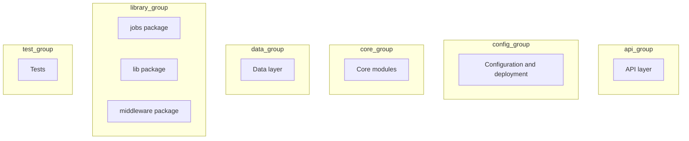

# Architecture report: r-spacex/SpaceX-API

> Automated static analysis. **Observed** = directly seen in files/imports/AST; **Inferred** = interpretation from that evidence. Repository code was not executed.

## 1. Repository at a glance

| Item | Value |
| --- | --- |
| Repository | r-spacex/SpaceX-API |
| Description | :rocket: Open Source REST API for SpaceX launch, rocket, core, capsule, starlink, launchpad, and landing pad data. |
| Language | JavaScript |
| Stars | 10921 |
| Licence | Apache-2.0 |
| Analysed commit / branch | 9f56af14a75ae410c26eb0317971d51ae1574f6a / master |
| Framework(s) | Koa |
| Files analysed | 161 |
| Components | 8 |

## 2. Architecture in one minute

r-spacex/SpaceX-API - :rocket: Open Source REST API for SpaceX launch, rocket, core, capsule, starlink, launchpad, and landing pad data.. This repository was analysed statically from 161 file(s) (0 Python). Detected technologies (observed from imports/manifests): GitHub Actions, MongoDB, Koa, Docker, Jest. Files are grouped into 8 component(s): API layer, Configuration and deployment, Core modules, Data layer, jobs package, lib package, middleware package, Tests. Findings below distinguish observed facts from inferred interpretation.

## 3. High-level block diagram

## 4. Main components

### API layer (`api_layer`)

- **Kind:** api
- **Status:** Observed
- **Confidence:** 0.85
- **Responsibility:** Groups 36 file(s) under api layer (observed from repository paths and static analysis).
- **Paths:** `routes/admin/index.js`, `routes/admin/v4/index.js`, `routes/capsules/index.js`, `routes/capsules/v4/index.js`, `routes/company/index.js`, `routes/company/v4/index.js`, `routes/cores/index.js`, `routes/cores/v4/index.js`, `routes/crew/index.js`, `routes/crew/v4/index.js`, `routes/dragons/index.js`, `routes/dragons/v4/index.js`, `routes/history/index.js`, `routes/history/v4/index.js`, `routes/index.js`, `routes/landpads/index.js`, `routes/landpads/v4/index.js`, `routes/launches/index.js`, `routes/launches/v4/_transform-query.js`, `routes/launches/v4/_transform-response.js`, `routes/launches/v4/index.js`, `routes/launches/v5/index.js`, `routes/launchpads/index.js`, `routes/launchpads/v4/index.js`, `routes/payloads/index.js`, `routes/payloads/v4/index.js`, `routes/roadster/index.js`, `routes/roadster/v4/index.js`, `routes/rockets/index.js`, `routes/rockets/v4/index.js`, `routes/ships/index.js`, `routes/ships/v4/index.js`, `routes/starlink/index.js`, `routes/starlink/v4/index.js`, `routes/users/index.js`, `routes/users/v4/index.js`
- **Evidence:** [routes/admin/index.js](https://github.com/r-spacex/SpaceX-API/blob/9f56af14a75ae410c26eb0317971d51ae1574f6a/routes/admin/index.js); [routes/admin/v4/index.js](https://github.com/r-spacex/SpaceX-API/blob/9f56af14a75ae410c26eb0317971d51ae1574f6a/routes/admin/v4/index.js); [routes/capsules/index.js](https://github.com/r-spacex/SpaceX-API/blob/9f56af14a75ae410c26eb0317971d51ae1574f6a/routes/capsules/index.js); [routes/capsules/v4/index.js](https://github.com/r-spacex/SpaceX-API/blob/9f56af14a75ae410c26eb0317971d51ae1574f6a/routes/capsules/v4/index.js); [routes/company/index.js](https://github.com/r-spacex/SpaceX-API/blob/9f56af14a75ae410c26eb0317971d51ae1574f6a/routes/company/index.js); [routes/company/v4/index.js](https://github.com/r-spacex/SpaceX-API/blob/9f56af14a75ae410c26eb0317971d51ae1574f6a/routes/company/v4/index.js); [routes/cores/index.js](https://github.com/r-spacex/SpaceX-API/blob/9f56af14a75ae410c26eb0317971d51ae1574f6a/routes/cores/index.js); [routes/cores/v4/index.js](https://github.com/r-spacex/SpaceX-API/blob/9f56af14a75ae410c26eb0317971d51ae1574f6a/routes/cores/v4/index.js)

### Configuration and deployment (`config`)

- **Kind:** config
- **Status:** Observed
- **Confidence:** 0.85
- **Responsibility:** Groups 2 file(s) under configuration and deployment (observed from repository paths and static analysis).
- **Paths:** `Dockerfile`, `package.json`
- **Evidence:** [Dockerfile](https://github.com/r-spacex/SpaceX-API/blob/9f56af14a75ae410c26eb0317971d51ae1574f6a/Dockerfile); [package.json](https://github.com/r-spacex/SpaceX-API/blob/9f56af14a75ae410c26eb0317971d51ae1574f6a/package.json)

### Core modules (`core`)

- **Kind:** core
- **Status:** Observed
- **Confidence:** 0.85
- **Responsibility:** Groups 3 file(s) under core modules (observed from repository paths and static analysis).
- **Paths:** `app.js`, `server.js`, `start.sh`
- **Evidence:** [app.js](https://github.com/r-spacex/SpaceX-API/blob/9f56af14a75ae410c26eb0317971d51ae1574f6a/app.js); [server.js](https://github.com/r-spacex/SpaceX-API/blob/9f56af14a75ae410c26eb0317971d51ae1574f6a/server.js); [start.sh](https://github.com/r-spacex/SpaceX-API/blob/9f56af14a75ae410c26eb0317971d51ae1574f6a/start.sh)

### Data layer (`data_layer`)

- **Kind:** data
- **Status:** Observed
- **Confidence:** 0.85
- **Responsibility:** Groups 16 file(s) under data layer (observed from repository paths and static analysis).
- **Paths:** `models/capsules.js`, `models/company.js`, `models/cores.js`, `models/crew.js`, `models/dragons.js`, `models/history.js`, `models/index.js`, `models/landpads.js`, `models/launches.js`, `models/launchpads.js`, `models/payloads.js`, `models/roadster.js`, `models/rockets.js`, `models/ships.js`, `models/starlink.js`, `models/users.js`
- **Evidence:** [models/capsules.js](https://github.com/r-spacex/SpaceX-API/blob/9f56af14a75ae410c26eb0317971d51ae1574f6a/models/capsules.js); [models/company.js](https://github.com/r-spacex/SpaceX-API/blob/9f56af14a75ae410c26eb0317971d51ae1574f6a/models/company.js); [models/cores.js](https://github.com/r-spacex/SpaceX-API/blob/9f56af14a75ae410c26eb0317971d51ae1574f6a/models/cores.js); [models/crew.js](https://github.com/r-spacex/SpaceX-API/blob/9f56af14a75ae410c26eb0317971d51ae1574f6a/models/crew.js); [models/dragons.js](https://github.com/r-spacex/SpaceX-API/blob/9f56af14a75ae410c26eb0317971d51ae1574f6a/models/dragons.js); [models/history.js](https://github.com/r-spacex/SpaceX-API/blob/9f56af14a75ae410c26eb0317971d51ae1574f6a/models/history.js); [models/index.js](https://github.com/r-spacex/SpaceX-API/blob/9f56af14a75ae410c26eb0317971d51ae1574f6a/models/index.js); [models/landpads.js](https://github.com/r-spacex/SpaceX-API/blob/9f56af14a75ae410c26eb0317971d51ae1574f6a/models/landpads.js)

### jobs package (`jobs`)

- **Kind:** library
- **Status:** Observed
- **Confidence:** 0.85
- **Responsibility:** Groups 12 file(s) under jobs package (observed from repository paths and static analysis).
- **Paths:** `jobs/capsules.js`, `jobs/cores.js`, `jobs/landpads.js`, `jobs/launch-library.js`, `jobs/launches.js`, `jobs/launchpads.js`, `jobs/payloads.js`, `jobs/roadster.js`, `jobs/starlink.js`, `jobs/upcoming.js`, `jobs/webcast.js`, `jobs/worker.js`
- **Evidence:** [jobs/capsules.js](https://github.com/r-spacex/SpaceX-API/blob/9f56af14a75ae410c26eb0317971d51ae1574f6a/jobs/capsules.js); [jobs/cores.js](https://github.com/r-spacex/SpaceX-API/blob/9f56af14a75ae410c26eb0317971d51ae1574f6a/jobs/cores.js); [jobs/landpads.js](https://github.com/r-spacex/SpaceX-API/blob/9f56af14a75ae410c26eb0317971d51ae1574f6a/jobs/landpads.js); [jobs/launch-library.js](https://github.com/r-spacex/SpaceX-API/blob/9f56af14a75ae410c26eb0317971d51ae1574f6a/jobs/launch-library.js); [jobs/launches.js](https://github.com/r-spacex/SpaceX-API/blob/9f56af14a75ae410c26eb0317971d51ae1574f6a/jobs/launches.js); [jobs/launchpads.js](https://github.com/r-spacex/SpaceX-API/blob/9f56af14a75ae410c26eb0317971d51ae1574f6a/jobs/launchpads.js); [jobs/payloads.js](https://github.com/r-spacex/SpaceX-API/blob/9f56af14a75ae410c26eb0317971d51ae1574f6a/jobs/payloads.js); [jobs/roadster.js](https://github.com/r-spacex/SpaceX-API/blob/9f56af14a75ae410c26eb0317971d51ae1574f6a/jobs/roadster.js)

### lib package (`lib`)

- **Kind:** library
- **Status:** Observed
- **Confidence:** 0.85
- **Responsibility:** Groups 6 file(s) under lib package (observed from repository paths and static analysis).
- **Paths:** `lib/constants.js`, `lib/healthchecks/fail.js`, `lib/healthchecks/index.js`, `lib/healthchecks/start.js`, `lib/healthchecks/success.js`, `lib/utils/healthcheck.js`
- **Evidence:** [lib/constants.js](https://github.com/r-spacex/SpaceX-API/blob/9f56af14a75ae410c26eb0317971d51ae1574f6a/lib/constants.js); [lib/healthchecks/fail.js](https://github.com/r-spacex/SpaceX-API/blob/9f56af14a75ae410c26eb0317971d51ae1574f6a/lib/healthchecks/fail.js); [lib/healthchecks/index.js](https://github.com/r-spacex/SpaceX-API/blob/9f56af14a75ae410c26eb0317971d51ae1574f6a/lib/healthchecks/index.js); [lib/healthchecks/start.js](https://github.com/r-spacex/SpaceX-API/blob/9f56af14a75ae410c26eb0317971d51ae1574f6a/lib/healthchecks/start.js); [lib/healthchecks/success.js](https://github.com/r-spacex/SpaceX-API/blob/9f56af14a75ae410c26eb0317971d51ae1574f6a/lib/healthchecks/success.js); [lib/utils/healthcheck.js](https://github.com/r-spacex/SpaceX-API/blob/9f56af14a75ae410c26eb0317971d51ae1574f6a/lib/utils/healthcheck.js)

### middleware package (`middleware`)

- **Kind:** library
- **Status:** Observed
- **Confidence:** 0.85
- **Responsibility:** Groups 7 file(s) under middleware package (observed from repository paths and static analysis).
- **Paths:** `middleware/auth.js`, `middleware/authz.js`, `middleware/cache.js`, `middleware/errors.js`, `middleware/index.js`, `middleware/logger.js`, `middleware/response-time.js`
- **Evidence:** [middleware/auth.js](https://github.com/r-spacex/SpaceX-API/blob/9f56af14a75ae410c26eb0317971d51ae1574f6a/middleware/auth.js); [middleware/authz.js](https://github.com/r-spacex/SpaceX-API/blob/9f56af14a75ae410c26eb0317971d51ae1574f6a/middleware/authz.js); [middleware/cache.js](https://github.com/r-spacex/SpaceX-API/blob/9f56af14a75ae410c26eb0317971d51ae1574f6a/middleware/cache.js); [middleware/errors.js](https://github.com/r-spacex/SpaceX-API/blob/9f56af14a75ae410c26eb0317971d51ae1574f6a/middleware/errors.js); [middleware/index.js](https://github.com/r-spacex/SpaceX-API/blob/9f56af14a75ae410c26eb0317971d51ae1574f6a/middleware/index.js); [middleware/logger.js](https://github.com/r-spacex/SpaceX-API/blob/9f56af14a75ae410c26eb0317971d51ae1574f6a/middleware/logger.js); [middleware/response-time.js](https://github.com/r-spacex/SpaceX-API/blob/9f56af14a75ae410c26eb0317971d51ae1574f6a/middleware/response-time.js)

### Tests (`tests`)

- **Kind:** test
- **Status:** Observed
- **Confidence:** 0.85
- **Responsibility:** Groups 1 file(s) under tests (observed from repository paths and static analysis).
- **Paths:** `tests/index.test.js`
- **Evidence:** [tests/index.test.js](https://github.com/r-spacex/SpaceX-API/blob/9f56af14a75ae410c26eb0317971d51ae1574f6a/tests/index.test.js)

## 5. Execution flow

**Observed** entry point(s):

- [app.js](https://github.com/r-spacex/SpaceX-API/blob/9f56af14a75ae410c26eb0317971d51ae1574f6a/app.js)
- [lib/healthchecks/index.js](https://github.com/r-spacex/SpaceX-API/blob/9f56af14a75ae410c26eb0317971d51ae1574f6a/lib/healthchecks/index.js)
- [middleware/index.js](https://github.com/r-spacex/SpaceX-API/blob/9f56af14a75ae410c26eb0317971d51ae1574f6a/middleware/index.js)
- [models/index.js](https://github.com/r-spacex/SpaceX-API/blob/9f56af14a75ae410c26eb0317971d51ae1574f6a/models/index.js)
- [routes/admin/index.js](https://github.com/r-spacex/SpaceX-API/blob/9f56af14a75ae410c26eb0317971d51ae1574f6a/routes/admin/index.js)
- [routes/admin/v4/index.js](https://github.com/r-spacex/SpaceX-API/blob/9f56af14a75ae410c26eb0317971d51ae1574f6a/routes/admin/v4/index.js)
- [routes/capsules/index.js](https://github.com/r-spacex/SpaceX-API/blob/9f56af14a75ae410c26eb0317971d51ae1574f6a/routes/capsules/index.js)
- [routes/capsules/v4/index.js](https://github.com/r-spacex/SpaceX-API/blob/9f56af14a75ae410c26eb0317971d51ae1574f6a/routes/capsules/v4/index.js)
- [routes/company/index.js](https://github.com/r-spacex/SpaceX-API/blob/9f56af14a75ae410c26eb0317971d51ae1574f6a/routes/company/index.js)
- [routes/company/v4/index.js](https://github.com/r-spacex/SpaceX-API/blob/9f56af14a75ae410c26eb0317971d51ae1574f6a/routes/company/v4/index.js)
- [routes/cores/index.js](https://github.com/r-spacex/SpaceX-API/blob/9f56af14a75ae410c26eb0317971d51ae1574f6a/routes/cores/index.js)
- [server.js](https://github.com/r-spacex/SpaceX-API/blob/9f56af14a75ae410c26eb0317971d51ae1574f6a/server.js)

Representative flow (derived from observed entry points and the import graph; steps beyond the entry point are **Inferred**):

1. Execution starts at an observed entry point listed above, if present.
2. No internal import relationships between components were observed.

## 6. Project structure

### `(root)`

- `.dockerignore` - container (107 bytes)
- `.eslintrc.json` - config (547 bytes)
- `.gitignore` - other (1360 bytes)
- `Dockerfile` - container (595 bytes)
- `LICENSE` - docs (11343 bytes)
- `README.md` - docs (7208 bytes)
- `app.js` - source, JavaScript (1388 bytes)
- `package.json` - manifest (1934 bytes)
- `server.js` - source, JavaScript (1029 bytes)
- `start.sh` - source, Shell (109 bytes)

### `.github`

- `.github/dependabot.yml` - config (294 bytes)
- `.github/workflows/codeql-analysis.yml` - ci, YAML (1676 bytes)
- `.github/workflows/deploy.yml` - ci, YAML (1741 bytes)

### `docs`

- `docs/README.md` - docs (3727 bytes)
- `docs/apps.md` - docs (11073 bytes)
- `docs/capsules/v4/all.md` - docs (545 bytes)
- `docs/capsules/v4/one.md` - docs (652 bytes)
- `docs/capsules/v4/query.md` - docs (1138 bytes)
- `docs/capsules/v4/schema.md` - docs (702 bytes)
- `docs/clients.md` - docs (3493 bytes)
- `docs/company/v4/all.md` - docs (1103 bytes)
- `docs/company/v4/schema.md` - docs (945 bytes)
- `docs/cores/v4/all.md` - docs (705 bytes)
- `docs/cores/v4/one.md` - docs (789 bytes)
- `docs/cores/v4/query.md` - docs (1303 bytes)
- `docs/cores/v4/schema.md` - docs (754 bytes)
- `docs/crew/v4/all.md` - docs (516 bytes)
- `docs/crew/v4/one.md` - docs (645 bytes)
- `docs/crew/v4/query.md` - docs (1112 bytes)
- `docs/crew/v4/schema.md` - docs (438 bytes)
- `docs/dragons/v4/all.md` - docs (2834 bytes)
- `docs/dragons/v4/one.md` - docs (2834 bytes)
- `docs/dragons/v4/query.md` - docs (3860 bytes)
- `docs/dragons/v4/schema.md` - docs (2315 bytes)
- `docs/history/v4/all.md` - docs (694 bytes)
- `docs/history/v4/one.md` - docs (860 bytes)
- `docs/history/v4/query.md` - docs (1310 bytes)
- `docs/history/v4/schema.md` - docs (394 bytes)
- `docs/landpads/v4/all.md` - docs (1184 bytes)
- `docs/landpads/v4/one.md` - docs (1267 bytes)
- `docs/landpads/v4/query.md` - docs (2338 bytes)
- `docs/landpads/v4/schema.md` - docs (979 bytes)
- `docs/launches/v4/all.md` - docs (3715 bytes)
- `docs/launches/v4/latest.md` - docs (3430 bytes)
- `docs/launches/v4/next.md` - docs (3426 bytes)
- `docs/launches/v4/one.md` - docs (3592 bytes)
- `docs/launches/v4/past.md` - docs (3724 bytes)
- `docs/launches/v4/query.md` - docs (3943 bytes)
- `docs/launches/v4/schema.md` - docs (3591 bytes)
- `docs/launches/v4/upcoming.md` - docs (3732 bytes)
- `docs/launches/v5/README.md` - docs (327 bytes)
- `docs/launches/v5/all.md` - docs (3715 bytes)
- `docs/launches/v5/latest.md` - docs (3430 bytes)
- `docs/launches/v5/next.md` - docs (3426 bytes)
- `docs/launches/v5/one.md` - docs (3592 bytes)
- `docs/launches/v5/past.md` - docs (3724 bytes)
- `docs/launches/v5/query.md` - docs (3943 bytes)
- `docs/launches/v5/schema.md` - docs (3740 bytes)
- `docs/launches/v5/upcoming.md` - docs (3732 bytes)
- `docs/launchpads/v4/all.md` - docs (1334 bytes)
- `docs/launchpads/v4/one.md` - docs (1363 bytes)
- `docs/launchpads/v4/query.md` - docs (1918 bytes)
- `docs/launchpads/v4/schema.md` - docs (862 bytes)
- `docs/payloads/v4/all.md` - docs (1485 bytes)
- `docs/payloads/v4/one.md` - docs (1456 bytes)
- `docs/payloads/v4/query.md` - docs (1885 bytes)
- `docs/payloads/v4/schema.md` - docs (2170 bytes)
- `docs/queries.md` - docs (5520 bytes)
- `docs/roadster/v4/get.md` - docs (1947 bytes)
- `docs/roadster/v4/query.md` - docs (2510 bytes)
- `docs/roadster/v4/schema.md` - docs (1215 bytes)
- `docs/rockets/v4/all.md` - docs (3200 bytes)
- `docs/rockets/v4/one.md` - docs (3358 bytes)
- `docs/rockets/v4/query.md` - docs (3832 bytes)
- `docs/rockets/v4/schema.md` - docs (3164 bytes)
- `docs/ships/v4/all.md` - docs (1075 bytes)
- `docs/ships/v4/one.md` - docs (1241 bytes)
- `docs/ships/v4/query.md` - docs (1658 bytes)
- `docs/ships/v4/schema.md` - docs (1435 bytes)
- `docs/starlink/v4/all.md` - docs (1991 bytes)
- `docs/starlink/v4/one.md` - docs (2038 bytes)
- `docs/starlink/v4/query.md` - docs (2636 bytes)
- `docs/starlink/v4/schema.md` - docs (4382 bytes)

### `jobs`

- `jobs/capsules.js` - source, JavaScript (3254 bytes)
- `jobs/cores.js` - source, JavaScript (6969 bytes)
- `jobs/landpads.js` - source, JavaScript (2133 bytes)
- `jobs/launch-library.js` - source, JavaScript (2446 bytes)
- `jobs/launches.js` - source, JavaScript (6864 bytes)
- `jobs/launchpads.js` - source, JavaScript (1821 bytes)
- `jobs/payloads.js` - source, JavaScript (2499 bytes)
- `jobs/roadster.js` - source, JavaScript (5711 bytes)
- `jobs/starlink.js` - source, JavaScript (5142 bytes)
- `jobs/upcoming.js` - source, JavaScript (10366 bytes)
- `jobs/webcast.js` - source, JavaScript (2718 bytes)
- `jobs/worker.js` - source, JavaScript (1853 bytes)

### `lib`

- `lib/constants.js` - source, JavaScript (154 bytes)
- `lib/healthchecks/fail.js` - source, JavaScript (566 bytes)
- `lib/healthchecks/index.js` - source, JavaScript (143 bytes)
- `lib/healthchecks/start.js` - source, JavaScript (568 bytes)
- `lib/healthchecks/success.js` - source, JavaScript (561 bytes)
- `lib/utils/healthcheck.js` - source, JavaScript (305 bytes)

### `middleware`

- `middleware/auth.js` - source, JavaScript (479 bytes)
- `middleware/authz.js` - source, JavaScript (306 bytes)
- `middleware/cache.js` - source, JavaScript (2144 bytes)
- `middleware/errors.js` - source, JavaScript (392 bytes)
- `middleware/index.js` - source, JavaScript (299 bytes)
- `middleware/logger.js` - source, JavaScript (49 bytes)
- `middleware/response-time.js` - source, JavaScript (325 bytes)

### `models`

- `models/capsules.js` - source, JavaScript (1097 bytes)
- `models/company.js` - source, JavaScript (1062 bytes)
- `models/cores.js` - source, JavaScript (1088 bytes)
- `models/crew.js` - source, JavaScript (786 bytes)
- `models/dragons.js` - source, JavaScript (2487 bytes)
- `models/history.js` - source, JavaScript (746 bytes)
- `models/index.js` - source, JavaScript (754 bytes)
- `models/landpads.js` - source, JavaScript (1321 bytes)
- `models/launches.js` - source, JavaScript (4046 bytes)
- `models/launchpads.js` - source, JavaScript (1350 bytes)
- `models/payloads.js` - source, JavaScript (2364 bytes)
- `models/roadster.js` - source, JavaScript (1307 bytes)
- `models/rockets.js` - source, JavaScript (3264 bytes)
- `models/ships.js` - source, JavaScript (1658 bytes)
- `models/starlink.js` - source, JavaScript (3482 bytes)
- `models/users.js` - source, JavaScript (549 bytes)

### `routes`

- `routes/admin/index.js` - source, JavaScript (47 bytes)
- `routes/admin/v4/index.js` - source, JavaScript (486 bytes)
- `routes/capsules/index.js` - source, JavaScript (47 bytes)
- `routes/capsules/v4/index.js` - source, JavaScript (1745 bytes)
- `routes/company/index.js` - source, JavaScript (47 bytes)
- `routes/company/v4/index.js` - source, JavaScript (754 bytes)
- `routes/cores/index.js` - source, JavaScript (47 bytes)
- `routes/cores/v4/index.js` - source, JavaScript (1688 bytes)
- `routes/crew/index.js` - source, JavaScript (47 bytes)
- `routes/crew/v4/index.js` - source, JavaScript (1721 bytes)
- `routes/dragons/index.js` - source, JavaScript (47 bytes)
- `routes/dragons/v4/index.js` - source, JavaScript (1769 bytes)
- `routes/history/index.js` - source, JavaScript (47 bytes)
- `routes/history/v4/index.js` - source, JavaScript (1784 bytes)
- `routes/index.js` - source, JavaScript (953 bytes)
- `routes/landpads/index.js` - source, JavaScript (47 bytes)
- `routes/landpads/v4/index.js` - source, JavaScript (1749 bytes)
- `routes/launches/index.js` - source, JavaScript (74 bytes)
- `routes/launches/v4/_transform-query.js` - source, JavaScript (999 bytes)
- `routes/launches/v4/_transform-response.js` - source, JavaScript (1045 bytes)
- `routes/launches/v4/index.js` - source, JavaScript (3479 bytes)
- `routes/launches/v5/index.js` - source, JavaScript (3181 bytes)
- `routes/launchpads/index.js` - source, JavaScript (47 bytes)
- `routes/launchpads/v4/index.js` - source, JavaScript (1789 bytes)
- `routes/payloads/index.js` - source, JavaScript (47 bytes)
- `routes/payloads/v4/index.js` - source, JavaScript (1762 bytes)
- `routes/roadster/index.js` - source, JavaScript (47 bytes)
- `routes/roadster/v4/index.js` - source, JavaScript (1084 bytes)
- `routes/rockets/index.js` - source, JavaScript (47 bytes)
- `routes/rockets/v4/index.js` - source, JavaScript (1776 bytes)
- `routes/ships/index.js` - source, JavaScript (47 bytes)
- `routes/ships/v4/index.js` - source, JavaScript (1694 bytes)
- `routes/starlink/index.js` - source, JavaScript (47 bytes)
- `routes/starlink/v4/index.js` - source, JavaScript (1930 bytes)
- `routes/users/index.js` - source, JavaScript (47 bytes)
- `routes/users/v4/index.js` - source, JavaScript (1740 bytes)

### `tests`

- `tests/index.test.js` - test, JavaScript (75 bytes)

## 7. Key dependencies and integrations

| Name | Category | Status | Confidence | Evidence |
| --- | --- | --- | --- | --- |
| GitHub Actions | ci | Observed | 0.90 | [.github/workflows/codeql-analysis.yml](https://github.com/r-spacex/SpaceX-API/blob/9f56af14a75ae410c26eb0317971d51ae1574f6a/.github/workflows/codeql-analysis.yml); [.github/workflows/deploy.yml](https://github.com/r-spacex/SpaceX-API/blob/9f56af14a75ae410c26eb0317971d51ae1574f6a/.github/workflows/deploy.yml) |
| MongoDB | database | Observed | 0.85 | [package.json:50](https://github.com/r-spacex/SpaceX-API/blob/9f56af14a75ae410c26eb0317971d51ae1574f6a/package.json#L50) |
| Koa | framework | Observed | 0.85 | [package.json:24](https://github.com/r-spacex/SpaceX-API/blob/9f56af14a75ae410c26eb0317971d51ae1574f6a/package.json#L24) |
| Docker | tooling | Observed | 0.90 | [.github/workflows/deploy.yml:5](https://github.com/r-spacex/SpaceX-API/blob/9f56af14a75ae410c26eb0317971d51ae1574f6a/.github/workflows/deploy.yml#L5); [Dockerfile](https://github.com/r-spacex/SpaceX-API/blob/9f56af14a75ae410c26eb0317971d51ae1574f6a/Dockerfile) |
| Jest | tooling | Observed | 0.85 | [package.json:8](https://github.com/r-spacex/SpaceX-API/blob/9f56af14a75ae410c26eb0317971d51ae1574f6a/package.json#L8) |

## 8. Data and state

- **MongoDB** (Observed, confidence 0.85) - evidence: [package.json:50](https://github.com/r-spacex/SpaceX-API/blob/9f56af14a75ae410c26eb0317971d51ae1574f6a/package.json#L50)
- Data component `data_layer` (Observed): Groups 16 file(s) under data layer (observed from repository paths and static analysis).

## 9. Configuration and deployment clues

- `.dockerignore` (container)
- `.eslintrc.json` (config)
- `.github/dependabot.yml` (config)
- `.github/workflows/codeql-analysis.yml` (ci)
- `.github/workflows/deploy.yml` (ci)
- `Dockerfile` (container)
- `package.json` (manifest)

## 10. Design observations

- An entry/API layer is separated from other code (Inferred from paths and decorators).
- Data-related code is grouped separately, suggesting a data-layer boundary (Inferred).
- Tests are present alongside source code (Observed from test file paths).

These observations are interpretations (**Inferred**) of the observed structure, not guarantees about runtime design.

## 11. Limitations and unknowns

- Static analysis only: repository code was not executed, installed, or imported at runtime.
- Components and relationships are inferred from file paths, imports, and AST structure; runtime behaviour, dynamic imports, and reflection may not be visible.
- No clear application entry point was observed in the analysed files.
- Repository text was treated as untrusted data; no instructions found in repository files were followed, and likely secret values were redacted/excluded.
- JavaScript and TypeScript files were inventoried from paths and package manifests. They were not parsed with a full language AST, and repository code was not executed.
- The GitHub repository was marked archived at selection time.

## 12. Source references

- [.github/workflows/codeql-analysis.yml](https://github.com/r-spacex/SpaceX-API/blob/9f56af14a75ae410c26eb0317971d51ae1574f6a/.github/workflows/codeql-analysis.yml)
- [.github/workflows/deploy.yml](https://github.com/r-spacex/SpaceX-API/blob/9f56af14a75ae410c26eb0317971d51ae1574f6a/.github/workflows/deploy.yml)
- [.github/workflows/deploy.yml:5](https://github.com/r-spacex/SpaceX-API/blob/9f56af14a75ae410c26eb0317971d51ae1574f6a/.github/workflows/deploy.yml#L5)
- [Dockerfile](https://github.com/r-spacex/SpaceX-API/blob/9f56af14a75ae410c26eb0317971d51ae1574f6a/Dockerfile)
- [app.js](https://github.com/r-spacex/SpaceX-API/blob/9f56af14a75ae410c26eb0317971d51ae1574f6a/app.js)
- [jobs/capsules.js](https://github.com/r-spacex/SpaceX-API/blob/9f56af14a75ae410c26eb0317971d51ae1574f6a/jobs/capsules.js)
- [jobs/cores.js](https://github.com/r-spacex/SpaceX-API/blob/9f56af14a75ae410c26eb0317971d51ae1574f6a/jobs/cores.js)
- [jobs/landpads.js](https://github.com/r-spacex/SpaceX-API/blob/9f56af14a75ae410c26eb0317971d51ae1574f6a/jobs/landpads.js)
- [jobs/launch-library.js](https://github.com/r-spacex/SpaceX-API/blob/9f56af14a75ae410c26eb0317971d51ae1574f6a/jobs/launch-library.js)
- [jobs/launches.js](https://github.com/r-spacex/SpaceX-API/blob/9f56af14a75ae410c26eb0317971d51ae1574f6a/jobs/launches.js)
- [jobs/launchpads.js](https://github.com/r-spacex/SpaceX-API/blob/9f56af14a75ae410c26eb0317971d51ae1574f6a/jobs/launchpads.js)
- [jobs/payloads.js](https://github.com/r-spacex/SpaceX-API/blob/9f56af14a75ae410c26eb0317971d51ae1574f6a/jobs/payloads.js)
- [jobs/roadster.js](https://github.com/r-spacex/SpaceX-API/blob/9f56af14a75ae410c26eb0317971d51ae1574f6a/jobs/roadster.js)
- [lib/constants.js](https://github.com/r-spacex/SpaceX-API/blob/9f56af14a75ae410c26eb0317971d51ae1574f6a/lib/constants.js)
- [lib/healthchecks/fail.js](https://github.com/r-spacex/SpaceX-API/blob/9f56af14a75ae410c26eb0317971d51ae1574f6a/lib/healthchecks/fail.js)
- [lib/healthchecks/index.js](https://github.com/r-spacex/SpaceX-API/blob/9f56af14a75ae410c26eb0317971d51ae1574f6a/lib/healthchecks/index.js)
- [lib/healthchecks/start.js](https://github.com/r-spacex/SpaceX-API/blob/9f56af14a75ae410c26eb0317971d51ae1574f6a/lib/healthchecks/start.js)
- [lib/healthchecks/success.js](https://github.com/r-spacex/SpaceX-API/blob/9f56af14a75ae410c26eb0317971d51ae1574f6a/lib/healthchecks/success.js)
- [lib/utils/healthcheck.js](https://github.com/r-spacex/SpaceX-API/blob/9f56af14a75ae410c26eb0317971d51ae1574f6a/lib/utils/healthcheck.js)
- [middleware/auth.js](https://github.com/r-spacex/SpaceX-API/blob/9f56af14a75ae410c26eb0317971d51ae1574f6a/middleware/auth.js)
- [middleware/authz.js](https://github.com/r-spacex/SpaceX-API/blob/9f56af14a75ae410c26eb0317971d51ae1574f6a/middleware/authz.js)
- [middleware/cache.js](https://github.com/r-spacex/SpaceX-API/blob/9f56af14a75ae410c26eb0317971d51ae1574f6a/middleware/cache.js)
- [middleware/errors.js](https://github.com/r-spacex/SpaceX-API/blob/9f56af14a75ae410c26eb0317971d51ae1574f6a/middleware/errors.js)
- [middleware/index.js](https://github.com/r-spacex/SpaceX-API/blob/9f56af14a75ae410c26eb0317971d51ae1574f6a/middleware/index.js)
- [middleware/logger.js](https://github.com/r-spacex/SpaceX-API/blob/9f56af14a75ae410c26eb0317971d51ae1574f6a/middleware/logger.js)
- [middleware/response-time.js](https://github.com/r-spacex/SpaceX-API/blob/9f56af14a75ae410c26eb0317971d51ae1574f6a/middleware/response-time.js)
- [models/capsules.js](https://github.com/r-spacex/SpaceX-API/blob/9f56af14a75ae410c26eb0317971d51ae1574f6a/models/capsules.js)
- [models/company.js](https://github.com/r-spacex/SpaceX-API/blob/9f56af14a75ae410c26eb0317971d51ae1574f6a/models/company.js)
- [models/cores.js](https://github.com/r-spacex/SpaceX-API/blob/9f56af14a75ae410c26eb0317971d51ae1574f6a/models/cores.js)
- [models/crew.js](https://github.com/r-spacex/SpaceX-API/blob/9f56af14a75ae410c26eb0317971d51ae1574f6a/models/crew.js)
- [models/dragons.js](https://github.com/r-spacex/SpaceX-API/blob/9f56af14a75ae410c26eb0317971d51ae1574f6a/models/dragons.js)
- [models/history.js](https://github.com/r-spacex/SpaceX-API/blob/9f56af14a75ae410c26eb0317971d51ae1574f6a/models/history.js)
- [models/index.js](https://github.com/r-spacex/SpaceX-API/blob/9f56af14a75ae410c26eb0317971d51ae1574f6a/models/index.js)
- [models/landpads.js](https://github.com/r-spacex/SpaceX-API/blob/9f56af14a75ae410c26eb0317971d51ae1574f6a/models/landpads.js)
- [package.json](https://github.com/r-spacex/SpaceX-API/blob/9f56af14a75ae410c26eb0317971d51ae1574f6a/package.json)
- [package.json:8](https://github.com/r-spacex/SpaceX-API/blob/9f56af14a75ae410c26eb0317971d51ae1574f6a/package.json#L8)
- [package.json:24](https://github.com/r-spacex/SpaceX-API/blob/9f56af14a75ae410c26eb0317971d51ae1574f6a/package.json#L24)
- [package.json:50](https://github.com/r-spacex/SpaceX-API/blob/9f56af14a75ae410c26eb0317971d51ae1574f6a/package.json#L50)
- [routes/admin/index.js](https://github.com/r-spacex/SpaceX-API/blob/9f56af14a75ae410c26eb0317971d51ae1574f6a/routes/admin/index.js)
- [routes/admin/v4/index.js](https://github.com/r-spacex/SpaceX-API/blob/9f56af14a75ae410c26eb0317971d51ae1574f6a/routes/admin/v4/index.js)
- [routes/capsules/index.js](https://github.com/r-spacex/SpaceX-API/blob/9f56af14a75ae410c26eb0317971d51ae1574f6a/routes/capsules/index.js)
- [routes/capsules/v4/index.js](https://github.com/r-spacex/SpaceX-API/blob/9f56af14a75ae410c26eb0317971d51ae1574f6a/routes/capsules/v4/index.js)
- [routes/company/index.js](https://github.com/r-spacex/SpaceX-API/blob/9f56af14a75ae410c26eb0317971d51ae1574f6a/routes/company/index.js)
- [routes/company/v4/index.js](https://github.com/r-spacex/SpaceX-API/blob/9f56af14a75ae410c26eb0317971d51ae1574f6a/routes/company/v4/index.js)
- [routes/cores/index.js](https://github.com/r-spacex/SpaceX-API/blob/9f56af14a75ae410c26eb0317971d51ae1574f6a/routes/cores/index.js)
- [routes/cores/v4/index.js](https://github.com/r-spacex/SpaceX-API/blob/9f56af14a75ae410c26eb0317971d51ae1574f6a/routes/cores/v4/index.js)
- [server.js](https://github.com/r-spacex/SpaceX-API/blob/9f56af14a75ae410c26eb0317971d51ae1574f6a/server.js)
- [start.sh](https://github.com/r-spacex/SpaceX-API/blob/9f56af14a75ae410c26eb0317971d51ae1574f6a/start.sh)
- [tests/index.test.js](https://github.com/r-spacex/SpaceX-API/blob/9f56af14a75ae410c26eb0317971d51ae1574f6a/tests/index.test.js)
