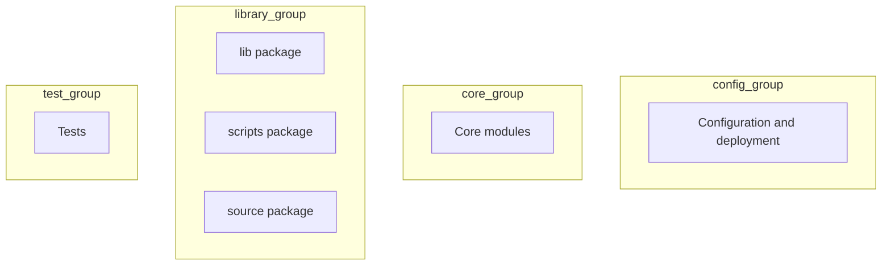

# Architecture report: ramda/ramda

> Automated static analysis. **Observed** = directly seen in files/imports/AST; **Inferred** = interpretation from that evidence. Repository code was not executed.

## 1. Repository at a glance

| Item | Value |
| --- | --- |
| Repository | ramda/ramda |
| Description | :ram: Practical functional Javascript |
| Language | JavaScript |
| Stars | 24051 |
| Licence | MIT |
| Analysed commit / branch | f4b2e35ff433e18c751326b82acc3c6ab3585e18 / master |
| Framework(s) | None detected |
| Files analysed | 713 |
| Components | 6 |

## 2. Architecture in one minute

ramda/ramda - :ram: Practical functional Javascript. This repository was analysed statically from 713 file(s) (0 Python). Detected technologies (observed from imports/manifests): GitHub Actions. Files are grouped into 6 component(s): Configuration and deployment, Core modules, lib package, scripts package, source package, Tests. Findings below distinguish observed facts from inferred interpretation.

## 3. High-level block diagram

## 4. Main components

### Configuration and deployment (`config`)

- **Kind:** config
- **Status:** Observed
- **Confidence:** 0.85
- **Responsibility:** Groups 4 file(s) under configuration and deployment (observed from repository paths and static analysis).
- **Paths:** `bower.json`, `egg.json`, `package.json`, `testem.json`
- **Evidence:** [bower.json](https://github.com/ramda/ramda/blob/f4b2e35ff433e18c751326b82acc3c6ab3585e18/bower.json); [egg.json](https://github.com/ramda/ramda/blob/f4b2e35ff433e18c751326b82acc3c6ab3585e18/egg.json); [package.json](https://github.com/ramda/ramda/blob/f4b2e35ff433e18c751326b82acc3c6ab3585e18/package.json); [testem.json](https://github.com/ramda/ramda/blob/f4b2e35ff433e18c751326b82acc3c6ab3585e18/testem.json)

### Core modules (`core`)

- **Kind:** core
- **Status:** Observed
- **Confidence:** 0.85
- **Responsibility:** Groups 2 file(s) under core modules (observed from repository paths and static analysis).
- **Paths:** `mod.ts`, `rollup.config.js`
- **Evidence:** [mod.ts](https://github.com/ramda/ramda/blob/f4b2e35ff433e18c751326b82acc3c6ab3585e18/mod.ts); [rollup.config.js](https://github.com/ramda/ramda/blob/f4b2e35ff433e18c751326b82acc3c6ab3585e18/rollup.config.js)

### lib package (`lib`)

- **Kind:** library
- **Status:** Observed
- **Confidence:** 0.85
- **Responsibility:** Groups 27 file(s) under lib package (observed from repository paths and static analysis).
- **Paths:** `lib/bench/concat.bench.js`, `lib/bench/curry.bench.js`, `lib/bench/each.bench.js`, `lib/bench/either.bench.js`, `lib/bench/filter-where.bench.js`, `lib/bench/filter.bench.js`, `lib/bench/find-where.bench.js`, `lib/bench/find.bench.js`, `lib/bench/findIndex-where.bench.js`, `lib/bench/findIndex.bench.js`, `lib/bench/includes.bench.js`, `lib/bench/indexof.bench.js`, `lib/bench/map.bench.js`, `lib/bench/maxWith.bench.js`, `lib/bench/propEq.bench.js`, `lib/bench/reduce.bench.js`, `lib/bench/uniq.bench.js`, `lib/sauce/android.js`, `lib/sauce/apple.js`, `lib/sauce/browsers.js`, `lib/sauce/conf.js`, `lib/sauce/ie8-shim.js`, `lib/sauce/ios.js`, `lib/sauce/linux.js`, `lib/sauce/mocharun.js`, `lib/sauce/server.js`, `lib/sauce/windows.js`
- **Evidence:** [lib/bench/concat.bench.js](https://github.com/ramda/ramda/blob/f4b2e35ff433e18c751326b82acc3c6ab3585e18/lib/bench/concat.bench.js); [lib/bench/curry.bench.js](https://github.com/ramda/ramda/blob/f4b2e35ff433e18c751326b82acc3c6ab3585e18/lib/bench/curry.bench.js); [lib/bench/each.bench.js](https://github.com/ramda/ramda/blob/f4b2e35ff433e18c751326b82acc3c6ab3585e18/lib/bench/each.bench.js); [lib/bench/either.bench.js](https://github.com/ramda/ramda/blob/f4b2e35ff433e18c751326b82acc3c6ab3585e18/lib/bench/either.bench.js); [lib/bench/filter-where.bench.js](https://github.com/ramda/ramda/blob/f4b2e35ff433e18c751326b82acc3c6ab3585e18/lib/bench/filter-where.bench.js); [lib/bench/filter.bench.js](https://github.com/ramda/ramda/blob/f4b2e35ff433e18c751326b82acc3c6ab3585e18/lib/bench/filter.bench.js); [lib/bench/find-where.bench.js](https://github.com/ramda/ramda/blob/f4b2e35ff433e18c751326b82acc3c6ab3585e18/lib/bench/find-where.bench.js); [lib/bench/find.bench.js](https://github.com/ramda/ramda/blob/f4b2e35ff433e18c751326b82acc3c6ab3585e18/lib/bench/find.bench.js)

### scripts package (`scripts`)

- **Kind:** library
- **Status:** Observed
- **Confidence:** 0.85
- **Responsibility:** Groups 6 file(s) under scripts package (observed from repository paths and static analysis).
- **Paths:** `scripts/addModulePackageScope.js`, `scripts/beforePublish.js`, `scripts/bookmarklet.tmpl.js`, `scripts/partialBuild.js`, `scripts/transpile/esm-to-cjs.js`, `scripts/transpile/wrap-constructor-pattern.js`
- **Evidence:** [scripts/addModulePackageScope.js](https://github.com/ramda/ramda/blob/f4b2e35ff433e18c751326b82acc3c6ab3585e18/scripts/addModulePackageScope.js); [scripts/beforePublish.js](https://github.com/ramda/ramda/blob/f4b2e35ff433e18c751326b82acc3c6ab3585e18/scripts/beforePublish.js); [scripts/bookmarklet.tmpl.js](https://github.com/ramda/ramda/blob/f4b2e35ff433e18c751326b82acc3c6ab3585e18/scripts/bookmarklet.tmpl.js); [scripts/partialBuild.js](https://github.com/ramda/ramda/blob/f4b2e35ff433e18c751326b82acc3c6ab3585e18/scripts/partialBuild.js); [scripts/transpile/esm-to-cjs.js](https://github.com/ramda/ramda/blob/f4b2e35ff433e18c751326b82acc3c6ab3585e18/scripts/transpile/esm-to-cjs.js); [scripts/transpile/wrap-constructor-pattern.js](https://github.com/ramda/ramda/blob/f4b2e35ff433e18c751326b82acc3c6ab3585e18/scripts/transpile/wrap-constructor-pattern.js)

### source package (`source`)

- **Kind:** library
- **Status:** Observed
- **Confidence:** 0.85
- **Responsibility:** Groups 370 file(s) under source package (observed from repository paths and static analysis).
- **Paths:** `source/F.js`, `source/T.js`, `source/__.js`, `source/add.js`, `source/addIndex.js`, `source/addIndexRight.js`, `source/adjust.js`, `source/all.js`, `source/allPass.js`, `source/always.js`, `source/and.js`, `source/andThen.js`, `source/any.js`, `source/anyPass.js`, `source/ap.js`, `source/aperture.js`, `source/append.js`, `source/apply.js`, `source/applySpec.js`, `source/applyTo.js`, `source/ascend.js`, `source/ascendNatural.js`, `source/assoc.js`, `source/assocPath.js`, `source/binary.js`, `source/bind.js`, `source/both.js`, `source/call.js`, `source/chain.js`, `source/clamp.js`, `source/clone.js`, `source/collectBy.js`, `source/comparator.js`, `source/complement.js`, `source/compose.js`, `source/composeWith.js`, `source/concat.js`, `source/cond.js`, `source/construct.js`, `source/constructN.js`, `source/converge.js`, `source/count.js`, `source/countBy.js`, `source/curry.js`, `source/curryN.js`, `source/dec.js`, `source/defaultTo.js`, `source/descend.js`, `source/descendNatural.js`, `source/difference.js`, `source/differenceWith.js`, `source/dissoc.js`, `source/dissocPath.js`, `source/divide.js`, `source/drop.js`, `source/dropLast.js`, `source/dropLastWhile.js`, `source/dropRepeats.js`, `source/dropRepeatsBy.js`, `source/dropRepeatsWith.js`, `source/dropWhile.js`, `source/either.js`, `source/empty.js`, `source/endsWith.js`, `source/eqBy.js`, `source/eqProps.js`, `source/equals.js`, `source/evolve.js`, `source/filter.js`, `source/find.js`, `source/findIndex.js`, `source/findLast.js`, `source/findLastIndex.js`, `source/flatten.js`, `source/flip.js`, `source/flow.js`, `source/forEach.js`, `source/forEachObjIndexed.js`, `source/fromPairs.js`, `source/groupBy.js`, `source/groupWith.js`, `source/gt.js`, `source/gte.js`, `source/has.js`, `source/hasIn.js`, `source/hasPath.js`, `source/head.js`, `source/identical.js`, `source/identity.js`, `source/ifElse.js`, `source/inc.js`, `source/includes.js`, `source/index.js`, `source/indexBy.js`, `source/indexOf.js`, `source/init.js`, `source/innerJoin.js`, `source/insert.js`, `source/insertAll.js`, `source/internal/_Set.js`, `source/internal/_aperture.js`, `source/internal/_arity.js`, `source/internal/_arrayFromIterator.js`, `source/internal/_arrayReduce.js`, `source/internal/_assertPromise.js`, `source/internal/_assoc.js`, `source/internal/_chain.js`, `source/internal/_checkForMethod.js`, `source/internal/_clone.js`, `source/internal/_cloneRegExp.js`, `source/internal/_complement.js`, `source/internal/_concat.js`, `source/internal/_createPartialApplicator.js`, `source/internal/_createReduce.js`, `source/internal/_curry1.js`, `source/internal/_curry2.js`, `source/internal/_curry3.js`, `source/internal/_curryN.js`, `source/internal/_dispatchable.js`, `source/internal/_dissoc.js`, `source/internal/_dropLast.js`, `source/internal/_dropLastWhile.js`, `source/internal/_equals.js`, `source/internal/_filter.js`, `source/internal/_filterMap.js`, `source/internal/_flatCat.js`, `source/internal/_forceReduced.js`, `source/internal/_fromPairs.js`, `source/internal/_functionName.js`, `source/internal/_functionsWith.js`, `source/internal/_has.js`, `source/internal/_identity.js`, `source/internal/_includes.js`, `source/internal/_includesWith.js`, `source/internal/_indexOf.js`, `source/internal/_isArguments.js`, `source/internal/_isArray.js`, `source/internal/_isArrayLike.js`, `source/internal/_isFunction.js`, `source/internal/_isInteger.js`, `source/internal/_isMap.js`, `source/internal/_isNumber.js`, `source/internal/_isObject.js`, `source/internal/_isPlaceholder.js`, `source/internal/_isRegExp.js`, `source/internal/_isString.js`, `source/internal/_isTransformer.js`, `source/internal/_isTypedArray.js`, `source/internal/_makeFlat.js`, `source/internal/_map.js`, `source/internal/_mapKeys.js`, `source/internal/_modify.js`, `source/internal/_nth.js`, `source/internal/_objectAssign.js`, `source/internal/_objectIs.js`, `source/internal/_path.js`, `source/internal/_pipe.js`, `source/internal/_pipeP.js`, `source/internal/_promap.js`, `source/internal/_prop.js`, `source/internal/_quote.js`, `source/internal/_rebuild.js`, `source/internal/_reduce.js`, `source/internal/_reduced.js`, `source/internal/_stepCat.js`, `source/internal/_toISOString.js`, `source/internal/_toPairs.js`, `source/internal/_toString.js`, `source/internal/_unreduced.js`, `source/internal/_xArrayReduce.js`, `source/internal/_xReduce.js`, `source/internal/_xall.js`, `source/internal/_xany.js`, `source/internal/_xaperture.js`, `source/internal/_xchain.js`, `source/internal/_xdrop.js`, `source/internal/_xdropLast.js`, `source/internal/_xdropLastWhile.js`, `source/internal/_xdropRepeatsWith.js`, `source/internal/_xdropWhile.js`, `source/internal/_xfBase.js`, `source/internal/_xfilter.js`, `source/internal/_xfind.js`, `source/internal/_xfindIndex.js`, `source/internal/_xfindLast.js`, `source/internal/_xfindLastIndex.js`, `source/internal/_xmap.js`, `source/internal/_xpromap.js`, `source/internal/_xreduceBy.js`, `source/internal/_xscan.js`, `source/internal/_xtake.js`, `source/internal/_xtakeWhile.js`, `source/internal/_xtap.js`, `source/internal/_xuniqBy.js`, `source/internal/_xuniqWith.js`, `source/internal/_xwrap.js`, `source/intersection.js`, `source/intersperse.js`, `source/into.js`, `source/invert.js`, `source/invertObj.js`, `source/invoker.js`, `source/is.js`, `source/isEmpty.js`, `source/isNil.js`, `source/isNotEmpty.js`, `source/isNotNil.js`, `source/join.js`, `source/juxt.js`, `source/keys.js`, `source/keysIn.js`, `source/last.js`, `source/lastIndexOf.js`, `source/length.js`, `source/lens.js`, `source/lensIndex.js`, `source/lensPath.js`, `source/lensProp.js`, `source/lift.js`, `source/liftN.js`, `source/lt.js`, `source/lte.js`, `source/map.js`, `source/mapAccum.js`, `source/mapAccumRight.js`, `source/mapKeys.js`, `source/mapObjIndexed.js`, `source/match.js`, `source/mathMod.js`, `source/max.js`, `source/maxBy.js`, `source/mean.js`, `source/median.js`, `source/memoizeWith.js`, `source/mergeAll.js`, `source/mergeDeepLeft.js`, `source/mergeDeepRight.js`, `source/mergeDeepWith.js`, `source/mergeDeepWithKey.js`, `source/mergeLeft.js`, `source/mergeRight.js`, `source/mergeWith.js`, `source/mergeWithKey.js`, `source/min.js`, `source/minBy.js`, `source/modify.js`, `source/modifyPath.js`, `source/modulo.js`, `source/move.js`, `source/multiply.js`, `source/nAry.js`, `source/negate.js`, `source/none.js`, `source/not.js`, `source/nth.js`, `source/nthArg.js`, `source/o.js`, `source/objOf.js`, `source/of.js`, `source/omit.js`, `source/on.js`, `source/once.js`, `source/or.js`, `source/otherwise.js`, `source/over.js`, `source/pair.js`, `source/partial.js`, `source/partialObject.js`, `source/partialRight.js`, `source/partition.js`, `source/path.js`, `source/pathEq.js`, `source/pathOr.js`, `source/pathSatisfies.js`, `source/paths.js`, `source/pick.js`, `source/pickAll.js`, `source/pickBy.js`, `source/pipe.js`, `source/pipeWith.js`, `source/pluck.js`, `source/prepend.js`, `source/product.js`, `source/project.js`, `source/promap.js`, `source/prop.js`, `source/propEq.js`, `source/propIs.js`, `source/propOr.js`, `source/propSatisfies.js`, `source/props.js`, `source/range.js`, `source/rebuild.js`, `source/reduce.js`, `source/reduceBy.js`, `source/reduceRight.js`, `source/reduceWhile.js`, `source/reduced.js`, `source/reject.js`, `source/remove.js`, `source/renameKeys.js`, `source/repeat.js`, `source/replace.js`, `source/reverse.js`, `source/scan.js`, `source/sequence.js`, `source/set.js`, `source/slice.js`, `source/sort.js`, `source/sortBy.js`, `source/sortWith.js`, `source/split.js`, `source/splitAt.js`, `source/splitEvery.js`, `source/splitWhen.js`, `source/splitWhenever.js`, `source/startsWith.js`, `source/subtract.js`, `source/sum.js`, `source/swap.js`, `source/symmetricDifference.js`, `source/symmetricDifferenceWith.js`, `source/tail.js`, `source/take.js`, `source/takeLast.js`, `source/takeLastWhile.js`, `source/takeWhile.js`, `source/tap.js`, `source/test.js`, `source/thunkify.js`, `source/times.js`, `source/toLower.js`, `source/toPairs.js`, `source/toPairsIn.js`, `source/toString.js`, `source/toUpper.js`, `source/transduce.js`, `source/transpose.js`, `source/traverse.js`, `source/trim.js`, `source/tryCatch.js`, `source/type.js`, `source/unapply.js`, `source/unary.js`, `source/uncurryN.js`, `source/unfold.js`, `source/union.js`, `source/unionWith.js`, `source/uniq.js`, `source/uniqBy.js`, `source/uniqWith.js`, `source/unless.js`, `source/unnest.js`, `source/until.js`, `source/unwind.js`, `source/update.js`, `source/useWith.js`, `source/values.js`, `source/valuesIn.js`, `source/view.js`, `source/when.js`, `source/where.js`, `source/whereAny.js`, `source/whereEq.js`, `source/without.js`, `source/xor.js`, `source/xprod.js`, `source/zip.js`, `source/zipObj.js`, `source/zipWith.js`
- **Evidence:** [source/F.js](https://github.com/ramda/ramda/blob/f4b2e35ff433e18c751326b82acc3c6ab3585e18/source/F.js); [source/T.js](https://github.com/ramda/ramda/blob/f4b2e35ff433e18c751326b82acc3c6ab3585e18/source/T.js); [source/__.js](https://github.com/ramda/ramda/blob/f4b2e35ff433e18c751326b82acc3c6ab3585e18/source/__.js); [source/add.js](https://github.com/ramda/ramda/blob/f4b2e35ff433e18c751326b82acc3c6ab3585e18/source/add.js); [source/addIndex.js](https://github.com/ramda/ramda/blob/f4b2e35ff433e18c751326b82acc3c6ab3585e18/source/addIndex.js); [source/addIndexRight.js](https://github.com/ramda/ramda/blob/f4b2e35ff433e18c751326b82acc3c6ab3585e18/source/addIndexRight.js); [source/adjust.js](https://github.com/ramda/ramda/blob/f4b2e35ff433e18c751326b82acc3c6ab3585e18/source/adjust.js); [source/all.js](https://github.com/ramda/ramda/blob/f4b2e35ff433e18c751326b82acc3c6ab3585e18/source/all.js)

### Tests (`tests`)

- **Kind:** test
- **Status:** Observed
- **Confidence:** 0.85
- **Responsibility:** Groups 281 file(s) under tests (observed from repository paths and static analysis).
- **Paths:** `test/F.js`, `test/T.js`, `test/add.js`, `test/addIndex.js`, `test/addIndexRight.js`, `test/adjust.js`, `test/all.js`, `test/allPass.js`, `test/always.js`, `test/and.js`, `test/andThen.js`, `test/any.js`, `test/anyPass.js`, `test/ap.js`, `test/aperture.js`, `test/append.js`, `test/apply.js`, `test/applySpec.js`, `test/applyTo.js`, `test/ascend.js`, `test/ascendNatural.js`, `test/assoc.js`, `test/assocPath.js`, `test/binary.js`, `test/bind.js`, `test/bookmarklet.js`, `test/both.js`, `test/call.js`, `test/chain.js`, `test/clamp.js`, `test/clone.js`, `test/collectBy.js`, `test/comparator.js`, `test/complement.js`, `test/compose.js`, `test/composeWith.js`, `test/concat.js`, `test/cond.js`, `test/construct.js`, `test/constructN.js`, `test/converge.js`, `test/count.js`, `test/countBy.js`, `test/curry.js`, `test/curryN.js`, `test/dec.js`, `test/defaultTo.js`, `test/descend.js`, `test/descendNatural.js`, `test/difference.js`, `test/differenceWith.js`, `test/dissoc.js`, `test/dissocPath.js`, `test/divide.js`, `test/drop.js`, `test/dropLast.js`, `test/dropLastWhile.js`, `test/dropRepeats.js`, `test/dropRepeatsBy.js`, `test/dropRepeatsWith.js`, `test/dropWhile.js`, `test/either.js`, `test/empty.js`, `test/endsWith.js`, `test/eqBy.js`, `test/eqProps.js`, `test/equals.js`, `test/evolve.js`, `test/filter.js`, `test/find.js`, `test/findIndex.js`, `test/findLast.js`, `test/findLastIndex.js`, `test/flatten.js`, `test/flip.js`, `test/flow.js`, `test/forEach.js`, `test/forEachObjIndexed.js`, `test/fromPairs.js`, `test/groupBy.js`, `test/groupWith.js`, `test/gt.js`, `test/gte.js`, `test/has.js`, `test/hasIn.js`, `test/hasPath.js`, `test/head.js`, `test/helpers/listXf.js`, `test/helpers/test.examplesRunner.js`, `test/identical.js`, `test/identity.js`, `test/ifElse.js`, `test/inc.js`, `test/includes.js`, `test/index.js`, `test/indexBy.js`, `test/indexOf.js`, `test/init.js`, `test/innerJoin.js`, `test/insert.js`, `test/insertAll.js`, `test/internal/_curry2.js`, `test/internal/_curry3.js`, `test/internal/_isArrayLike.js`, `test/intersection.js`, `test/intersperse.js`, `test/into.js`, `test/invariants.js`, `test/invert.js`, `test/invertObj.js`, `test/invoker.js`, `test/is.js`, `test/isEmpty.js`, `test/isNil.js`, `test/isNotEmpty.js`, `test/isNotNil.js`, `test/join.js`, `test/juxt.js`, `test/keys.js`, `test/keysIn.js`, `test/last.js`, `test/lastIndexOf.js`, `test/length.js`, `test/lensIndex.js`, `test/lensPath.js`, `test/lensProp.js`, `test/lenses.js`, `test/lift.js`, `test/liftN.js`, `test/lt.js`, `test/lte.js`, `test/map.js`, `test/mapAccum.js`, `test/mapAccumRight.js`, `test/mapKeys.js`, `test/mapObjIndexed.js`, `test/match.js`, `test/mathMod.js`, `test/max.js`, `test/maxBy.js`, `test/mean.js`, `test/median.js`, `test/memoizeWith.js`, `test/mergeAll.js`, `test/mergeDeepLeft.js`, `test/mergeDeepRight.js`, `test/mergeDeepWith.js`, `test/mergeDeepWithKey.js`, `test/mergeLeft.js`, `test/mergeRight.js`, `test/mergeWith.js`, `test/mergeWithKey.js`, `test/min.js`, `test/minBy.js`, `test/modify.js`, `test/modifyPath.js`, `test/modulo.js`, `test/move.js`, `test/multiply.js`, `test/nAry.js`, `test/negate.js`, `test/none.js`, `test/not.js`, `test/nth.js`, `test/nthArg.js`, `test/o.js`, `test/objOf.js`, `test/of.js`, `test/omit.js`, `test/on.js`, `test/once.js`, `test/or.js`, `test/otherwise.js`, `test/pair.js`, `test/partial.js`, `test/partialObject.js`, `test/partialRight.js`, `test/partition.js`, `test/path.js`, `test/pathEq.js`, `test/pathOr.js`, `test/pathSatisfies.js`, `test/paths.js`, `test/pick.js`, `test/pickAll.js`, `test/pickBy.js`, `test/pipe.js`, `test/pipeWith.js`, `test/pluck.js`, `test/prepend.js`, `test/product.js`, `test/project.js`, `test/promap.js`, `test/prop.js`, `test/propEq.js`, `test/propIs.js`, `test/propOr.js`, `test/propSatisfies.js`, `test/props.js`, `test/range.js`, `test/rebuild.js`, `test/reduce.js`, `test/reduceBy.js`, `test/reduceRight.js`, `test/reduceWhile.js`, `test/reduced.js`, `test/reject.js`, `test/remove.js`, `test/renameKeys.js`, `test/repeat.js`, `test/replace.js`, `test/reverse.js`, `test/scan.js`, `test/sequence.js`, `test/shared/Id.js`, `test/shared/Maybe.js`, `test/shared/Pair.js`, `test/shared/eq.js`, `test/slice.js`, `test/sort.js`, `test/sortBy.js`, `test/sortWith.js`, `test/split.js`, `test/splitAt.js`, `test/splitEvery.js`, `test/splitWhen.js`, `test/splitWhenever.js`, `test/startsWith.js`, `test/subtract.js`, `test/sum.js`, `test/swap.js`, `test/symmetricDifference.js`, `test/symmetricDifferenceWith.js`, `test/tail.js`, `test/take.js`, `test/takeLast.js`, `test/takeLastWhile.js`, `test/takeWhile.js`, `test/tap.js`, `test/test.js`, `test/thunkify.js`, `test/times.js`, `test/toLower.js`, `test/toPairs.js`, `test/toPairsIn.js`, `test/toString.js`, `test/toUpper.js`, `test/transduce.js`, `test/transducerResult.js`, `test/transpose.js`, `test/traverse.js`, `test/trim.js`, `test/tryCatch.js`, `test/type.js`, `test/unapply.js`, `test/unary.js`, `test/uncurryN.js`, `test/unfold.js`, `test/union.js`, `test/unionWith.js`, `test/uniq.js`, `test/uniqBy.js`, `test/uniqWith.js`, `test/unless.js`, `test/unnest.js`, `test/until.js`, `test/unwind.js`, `test/update.js`, `test/useWith.js`, `test/values.js`, `test/valuesIn.js`, `test/when.js`, `test/where.js`, `test/whereAny.js`, `test/whereEq.js`, `test/without.js`, `test/xor.js`, `test/xprod.js`, `test/zip.js`, `test/zipObj.js`, `test/zipWith.js`
- **Evidence:** [test/F.js](https://github.com/ramda/ramda/blob/f4b2e35ff433e18c751326b82acc3c6ab3585e18/test/F.js); [test/T.js](https://github.com/ramda/ramda/blob/f4b2e35ff433e18c751326b82acc3c6ab3585e18/test/T.js); [test/add.js](https://github.com/ramda/ramda/blob/f4b2e35ff433e18c751326b82acc3c6ab3585e18/test/add.js); [test/addIndex.js](https://github.com/ramda/ramda/blob/f4b2e35ff433e18c751326b82acc3c6ab3585e18/test/addIndex.js); [test/addIndexRight.js](https://github.com/ramda/ramda/blob/f4b2e35ff433e18c751326b82acc3c6ab3585e18/test/addIndexRight.js); [test/adjust.js](https://github.com/ramda/ramda/blob/f4b2e35ff433e18c751326b82acc3c6ab3585e18/test/adjust.js); [test/all.js](https://github.com/ramda/ramda/blob/f4b2e35ff433e18c751326b82acc3c6ab3585e18/test/all.js); [test/allPass.js](https://github.com/ramda/ramda/blob/f4b2e35ff433e18c751326b82acc3c6ab3585e18/test/allPass.js)

## 5. Execution flow

**Observed** entry point(s):

- [lib/sauce/server.js](https://github.com/ramda/ramda/blob/f4b2e35ff433e18c751326b82acc3c6ab3585e18/lib/sauce/server.js)
- [source/index.js](https://github.com/ramda/ramda/blob/f4b2e35ff433e18c751326b82acc3c6ab3585e18/source/index.js)

Representative flow (derived from observed entry points and the import graph; steps beyond the entry point are **Inferred**):

1. Execution starts at an observed entry point listed above, if present.
2. No internal import relationships between components were observed.

## 6. Project structure

### `(root)`

- `.babelrc` - other (393 bytes)
- `.codeclimate.yml` - config (331 bytes)
- `.editorconfig` - config (346 bytes)
- `.eslintignore` - other (112 bytes)
- `.eslintrc` - other (2386 bytes)
- `.gitattributes` - other (17 bytes)
- `.gitignore` - other (187 bytes)
- `BOOKMARKLET.md` - docs (293 bytes)
- `CHANGELOG.md` - docs (117 bytes)
- `CONTRIBUTING.md` - docs (1157 bytes)
- `LICENSE.txt` - docs (1103 bytes)
- `Makefile` - other (455 bytes)
- `README.md` - docs (9951 bytes)
- `SECURITY.md` - docs (300 bytes)
- `bower.json` - config (596 bytes)
- `egg.json` - config (378 bytes)
- `mod.ts` - source, TypeScript (35 bytes)
- `package.json` - manifest (3765 bytes)
- `repl` - other (224 bytes)
- `rollup.config.js` - source, JavaScript (1052 bytes)
- `testem.json` - config (308 bytes)

### `.github`

- `.github/FUNDING.yml` - config (23 bytes)
- `.github/workflows/build.yml` - ci, YAML (482 bytes)
- `.github/workflows/coverage.yml` - ci, YAML (2034 bytes)

### `lib`

- `lib/bench/concat.bench.js` - source, JavaScript (464 bytes)
- `lib/bench/curry.bench.js` - source, JavaScript (379 bytes)
- `lib/bench/each.bench.js` - source, JavaScript (543 bytes)
- `lib/bench/either.bench.js` - source, JavaScript (642 bytes)
- `lib/bench/filter-where.bench.js` - source, JavaScript (1009 bytes)
- `lib/bench/filter.bench.js` - source, JavaScript (542 bytes)
- `lib/bench/find-where.bench.js` - source, JavaScript (989 bytes)
- `lib/bench/find.bench.js` - source, JavaScript (512 bytes)
- `lib/bench/findIndex-where.bench.js` - source, JavaScript (1060 bytes)
- `lib/bench/findIndex.bench.js` - source, JavaScript (577 bytes)
- `lib/bench/includes.bench.js` - source, JavaScript (523 bytes)
- `lib/bench/indexof.bench.js` - source, JavaScript (476 bytes)
- `lib/bench/map.bench.js` - source, JavaScript (463 bytes)
- `lib/bench/maxWith.bench.js` - source, JavaScript (496 bytes)
- `lib/bench/propEq.bench.js` - source, JavaScript (234 bytes)
- `lib/bench/reduce.bench.js` - source, JavaScript (536 bytes)
- `lib/bench/uniq.bench.js` - source, JavaScript (1286 bytes)
- `lib/sauce/android.js` - source, JavaScript (741 bytes)
- `lib/sauce/apple.js` - source, JavaScript (342 bytes)
- `lib/sauce/browsers.js` - source, JavaScript (241 bytes)
- `lib/sauce/conf.js` - source, JavaScript (293 bytes)
- `lib/sauce/ie8-shim.js` - source, JavaScript (1175 bytes)
- `lib/sauce/ios.js` - source, JavaScript (257 bytes)
- `lib/sauce/linux.js` - source, JavaScript (176 bytes)
- `lib/sauce/mocharun.js` - source, JavaScript (1068 bytes)
- `lib/sauce/server.js` - source, JavaScript (122 bytes)
- `lib/sauce/windows.js` - source, JavaScript (640 bytes)

### `scripts`

- `scripts/BOOKMARKLET.tmpl.md` - docs (310 bytes)
- `scripts/addModulePackageScope.js` - source, JavaScript (286 bytes)
- `scripts/beforePublish.js` - source, JavaScript (1029 bytes)
- `scripts/benchRunner` - other (1043 bytes)
- `scripts/bookmarklet` - other (1101 bytes)
- `scripts/bookmarklet.tmpl.js` - source, JavaScript (1082 bytes)
- `scripts/doc-blob` - other (305 bytes)
- `scripts/partialBuild.js` - source, JavaScript (900 bytes)
- `scripts/prepublish` - other (898 bytes)
- `scripts/transpile/esm-to-cjs.js` - source, JavaScript (4021 bytes)
- `scripts/transpile/wrap-constructor-pattern.js` - source, JavaScript (2127 bytes)

### `source`

- `source/F.js` - source, JavaScript (320 bytes)
- `source/T.js` - source, JavaScript (317 bytes)
- `source/__.js` - source, JavaScript (739 bytes)
- `source/add.js` - source, JavaScript (433 bytes)
- `source/addIndex.js` - source, JavaScript (1676 bytes)
- `source/addIndexRight.js` - source, JavaScript (1535 bytes)
- `source/adjust.js` - source, JavaScript (1653 bytes)
- `source/all.js` - source, JavaScript (1119 bytes)
- `source/allPass.js` - source, JavaScript (1364 bytes)
- `source/always.js` - source, JavaScript (691 bytes)
- `source/and.js` - source, JavaScript (613 bytes)
- `source/andThen.js` - source, JavaScript (1601 bytes)
- `source/any.js` - source, JavaScript (1164 bytes)
- `source/anyPass.js` - source, JavaScript (1405 bytes)
- `source/ap.js` - source, JavaScript (1454 bytes)
- `source/aperture.js` - source, JavaScript (1031 bytes)
- `source/append.js` - source, JavaScript (864 bytes)
- `source/apply.js` - source, JavaScript (813 bytes)
- `source/applySpec.js` - source, JavaScript (2020 bytes)
- `source/applyTo.js` - source, JavaScript (579 bytes)
- `source/ascend.js` - source, JavaScript (1133 bytes)
- `source/ascendNatural.js` - source, JavaScript (1401 bytes)
- `source/assoc.js` - source, JavaScript (1038 bytes)
- `source/assocPath.js` - source, JavaScript (1731 bytes)
- `source/binary.js` - source, JavaScript (1097 bytes)
- `source/bind.js` - source, JavaScript (1064 bytes)
- `source/both.js` - source, JavaScript (1497 bytes)
- `source/call.js` - source, JavaScript (1222 bytes)
- `source/chain.js` - source, JavaScript (1052 bytes)
- `source/clamp.js` - source, JavaScript (947 bytes)
- `source/clone.js` - source, JavaScript (1269 bytes)
- `source/collectBy.js` - source, JavaScript (1545 bytes)
- `source/comparator.js` - source, JavaScript (1096 bytes)
- `source/complement.js` - source, JavaScript (741 bytes)
- `source/compose.js` - source, JavaScript (1156 bytes)
- `source/composeWith.js` - source, JavaScript (1267 bytes)
- `source/concat.js` - source, JavaScript (1850 bytes)
- `source/cond.js` - source, JavaScript (1836 bytes)
- `source/construct.js` - source, JavaScript (1296 bytes)
- `source/constructN.js` - source, JavaScript (2237 bytes)
- `source/converge.js` - source, JavaScript (1700 bytes)
- `source/count.js` - source, JavaScript (778 bytes)
- `source/countBy.js` - source, JavaScript (1091 bytes)
- `source/curry.js` - source, JavaScript (1824 bytes)
- `source/curryN.js` - source, JavaScript (1644 bytes)
- `source/dec.js` - source, JavaScript (295 bytes)
- `source/defaultTo.js` - source, JavaScript (952 bytes)
- `source/descend.js` - source, JavaScript (1135 bytes)
- `source/descendNatural.js` - source, JavaScript (1408 bytes)
- `source/difference.js` - source, JavaScript (1260 bytes)
- `source/differenceWith.js` - source, JavaScript (1467 bytes)
- `source/dissoc.js` - source, JavaScript (671 bytes)
- `source/dissocPath.js` - source, JavaScript (1938 bytes)
- `source/divide.js` - source, JavaScript (623 bytes)
- `source/drop.js` - source, JavaScript (1103 bytes)
- `source/dropLast.js` - source, JavaScript (1147 bytes)
- `source/dropLastWhile.js` - source, JavaScript (1386 bytes)
- `source/dropRepeats.js` - source, JavaScript (906 bytes)
- `source/dropRepeatsBy.js` - source, JavaScript (1148 bytes)
- `source/dropRepeatsWith.js` - source, JavaScript (1370 bytes)
- `source/dropWhile.js` - source, JavaScript (1430 bytes)
- `source/either.js` - source, JavaScript (1477 bytes)
- `source/empty.js` - source, JavaScript (2358 bytes)
- `source/endsWith.js` - source, JavaScript (833 bytes)
- `source/eqBy.js` - source, JavaScript (569 bytes)
- `source/eqProps.js` - source, JavaScript (797 bytes)
- `source/equals.js` - source, JavaScript (781 bytes)
- `source/evolve.js` - source, JavaScript (1742 bytes)
- `source/filter.js` - source, JavaScript (1779 bytes)
- `source/find.js` - source, JavaScript (1152 bytes)
- `source/findIndex.js` - source, JavaScript (1116 bytes)
- `source/findLast.js` - source, JavaScript (1093 bytes)
- `source/findLastIndex.js` - source, JavaScript (1142 bytes)
- `source/flatten.js` - source, JavaScript (617 bytes)
- `source/flip.js` - source, JavaScript (953 bytes)
- `source/flow.js` - source, JavaScript (1581 bytes)
- `source/forEach.js` - source, JavaScript (1515 bytes)
- `source/forEachObjIndexed.js` - source, JavaScript (1120 bytes)
- `source/fromPairs.js` - source, JavaScript (693 bytes)
- `source/groupBy.js` - source, JavaScript (1744 bytes)
- `source/groupWith.js` - source, JavaScript (1592 bytes)
- `source/gt.js` - source, JavaScript (562 bytes)
- `source/gte.js` - source, JavaScript (593 bytes)
- `source/has.js` - source, JavaScript (902 bytes)
- `source/hasIn.js` - source, JavaScript (947 bytes)
- `source/hasPath.js` - source, JavaScript (1152 bytes)
- `source/head.js` - source, JavaScript (730 bytes)
- `source/identical.js` - source, JavaScript (1566 bytes)
- `source/identity.js` - source, JavaScript (580 bytes)
- `source/ifElse.js` - source, JavaScript (1505 bytes)
- `source/inc.js` - source, JavaScript (294 bytes)
- `source/includes.js` - source, JavaScript (886 bytes)
- `source/index.js` - source, JavaScript (13789 bytes)
- `source/indexBy.js` - source, JavaScript (1023 bytes)
- `source/indexOf.js` - source, JavaScript (908 bytes)
- `source/init.js` - source, JavaScript (622 bytes)
- `source/innerJoin.js` - source, JavaScript (1557 bytes)
- `source/insert.js` - source, JavaScript (930 bytes)
- `source/insertAll.js` - source, JavaScript (1008 bytes)
- `source/internal/_Set.js` - source, JavaScript (4536 bytes)
- `source/internal/_aperture.js` - source, JavaScript (265 bytes)
- `source/internal/_arity.js` - source, JavaScript (1168 bytes)
- `source/internal/_arrayFromIterator.js` - source, JavaScript (167 bytes)
- `source/internal/_arrayReduce.js` - source, JavaScript (204 bytes)
- `source/internal/_assertPromise.js` - source, JavaScript (276 bytes)
- `source/internal/_assoc.js` - source, JavaScript (923 bytes)
- `source/internal/_chain.js` - source, JavaScript (394 bytes)
- `source/internal/_checkForMethod.js` - source, JavaScript (823 bytes)
- `source/internal/_clone.js` - source, JavaScript (4309 bytes)
- `source/internal/_cloneRegExp.js` - source, JavaScript (675 bytes)
- `source/internal/_complement.js` - source, JavaScript (108 bytes)
- `source/internal/_concat.js` - source, JavaScript (695 bytes)
- `source/internal/_createPartialApplicator.js` - source, JavaScript (308 bytes)
- `source/internal/_createReduce.js` - source, JavaScript (889 bytes)
- `source/internal/_curry1.js` - source, JavaScript (438 bytes)
- `source/internal/_curry2.js` - source, JavaScript (826 bytes)
- `source/internal/_curry3.js` - source, JavaScript (1754 bytes)
- `source/internal/_curryN.js` - source, JavaScript (1262 bytes)
- `source/internal/_dispatchable.js` - source, JavaScript (1570 bytes)
- `source/internal/_dissoc.js` - source, JavaScript (698 bytes)
- `source/internal/_dropLast.js` - source, JavaScript (130 bytes)
- `source/internal/_dropLastWhile.js` - source, JavaScript (201 bytes)
- `source/internal/_equals.js` - source, JavaScript (4569 bytes)
- `source/internal/_filter.js` - source, JavaScript (235 bytes)
- `source/internal/_filterMap.js` - source, JavaScript (309 bytes)
- `source/internal/_flatCat.js` - source, JavaScript (1111 bytes)
- `source/internal/_forceReduced.js` - source, JavaScript (123 bytes)
- `source/internal/_fromPairs.js` - source, JavaScript (189 bytes)
- `source/internal/_functionName.js` - source, JavaScript (208 bytes)
- `source/internal/_functionsWith.js` - source, JavaScript (398 bytes)
- `source/internal/_has.js` - source, JavaScript (102 bytes)
- `source/internal/_identity.js` - source, JavaScript (51 bytes)
- `source/internal/_includes.js` - source, JavaScript (123 bytes)
- `source/internal/_includesWith.js` - source, JavaScript (209 bytes)
- `source/internal/_indexOf.js` - source, JavaScript (1421 bytes)
- `source/internal/_isArguments.js` - source, JavaScript (349 bytes)
- `source/internal/_isArray.js` - source, JavaScript (475 bytes)
- `source/internal/_isArrayLike.js` - source, JavaScript (1086 bytes)
- `source/internal/_isFunction.js` - source, JavaScript (267 bytes)
- `source/internal/_isInteger.js` - source, JavaScript (217 bytes)
- `source/internal/_isMap.js` - source, JavaScript (101 bytes)
- `source/internal/_isNumber.js` - source, JavaScript (107 bytes)
- `source/internal/_isObject.js` - source, JavaScript (107 bytes)
- `source/internal/_isPlaceholder.js` - source, JavaScript (151 bytes)
- `source/internal/_isRegExp.js` - source, JavaScript (107 bytes)
- `source/internal/_isString.js` - source, JavaScript (107 bytes)
- `source/internal/_isTransformer.js` - source, JavaScript (120 bytes)
- `source/internal/_isTypedArray.js` - source, JavaScript (943 bytes)
- `source/internal/_makeFlat.js` - source, JavaScript (739 bytes)
- `source/internal/_map.js` - source, JavaScript (209 bytes)
- `source/internal/_mapKeys.js` - source, JavaScript (172 bytes)
- `source/internal/_modify.js` - source, JavaScript (925 bytes)
- `source/internal/_nth.js` - source, JavaScript (123 bytes)
- `source/internal/_objectAssign.js` - source, JavaScript (695 bytes)
- `source/internal/_objectIs.js` - source, JavaScript (410 bytes)
- `source/internal/_path.js` - source, JavaScript (369 bytes)
- `source/internal/_pipe.js` - source, JavaScript (118 bytes)
- `source/internal/_pipeP.js` - source, JavaScript (179 bytes)
- `source/internal/_promap.js` - source, JavaScript (114 bytes)
- `source/internal/_prop.js` - source, JavaScript (208 bytes)
- `source/internal/_quote.js` - source, JavaScript (381 bytes)
- `source/internal/_rebuild.js` - source, JavaScript (289 bytes)
- `source/internal/_reduce.js` - source, JavaScript (471 bytes)
- `source/internal/_reduced.js` - source, JavaScript (165 bytes)
- `source/internal/_stepCat.js` - source, JavaScript (1126 bytes)
- `source/internal/_toISOString.js` - source, JavaScript (689 bytes)
- `source/internal/_toPairs.js` - source, JavaScript (218 bytes)
- `source/internal/_toString.js` - source, JavaScript (2081 bytes)
- `source/internal/_unreduced.js` - source, JavaScript (113 bytes)
- `source/internal/_xArrayReduce.js` - source, JavaScript (333 bytes)
- `source/internal/_xReduce.js` - source, JavaScript (701 bytes)
- `source/internal/_xall.js` - source, JavaScript (737 bytes)
- `source/internal/_xany.js` - source, JavaScript (737 bytes)
- `source/internal/_xaperture.js` - source, JavaScript (1000 bytes)
- `source/internal/_xchain.js` - source, JavaScript (169 bytes)
- `source/internal/_xdrop.js` - source, JavaScript (477 bytes)
- `source/internal/_xdropLast.js` - source, JavaScript (857 bytes)
- `source/internal/_xdropLastWhile.js` - source, JavaScript (1080 bytes)
- `source/internal/_xdropRepeatsWith.js` - source, JavaScript (772 bytes)
- `source/internal/_xdropWhile.js` - source, JavaScript (538 bytes)
- `source/internal/_xfBase.js` - source, JavaScript (173 bytes)
- `source/internal/_xfilter.js` - source, JavaScript (454 bytes)
- `source/internal/_xfind.js` - source, JavaScript (751 bytes)
- `source/internal/_xfindIndex.js` - source, JavaScript (814 bytes)
- `source/internal/_xfindLast.js` - source, JavaScript (623 bytes)
- `source/internal/_xfindLastIndex.js` - source, JavaScript (717 bytes)
- `source/internal/_xmap.js` - source, JavaScript (439 bytes)
- `source/internal/_xpromap.js` - source, JavaScript (513 bytes)
- `source/internal/_xreduceBy.js` - source, JavaScript (1146 bytes)
- `source/internal/_xscan.js` - source, JavaScript (703 bytes)
- `source/internal/_xtake.js` - source, JavaScript (574 bytes)
- `source/internal/_xtakeWhile.js` - source, JavaScript (520 bytes)
- `source/internal/_xtap.js` - source, JavaScript (428 bytes)
- `source/internal/_xuniqBy.js` - source, JavaScript (523 bytes)
- `source/internal/_xuniqWith.js` - source, JavaScript (640 bytes)
- `source/internal/_xwrap.js` - source, JavaScript (365 bytes)
- `source/intersection.js` - source, JavaScript (877 bytes)
- `source/intersperse.js` - source, JavaScript (1052 bytes)
- `source/into.js` - source, JavaScript (2009 bytes)
- `source/invert.js` - source, JavaScript (1089 bytes)
- `source/invertObj.js` - source, JavaScript (1115 bytes)
- `source/invoker.js` - source, JavaScript (2384 bytes)
- `source/is.js` - source, JavaScript (1005 bytes)
- `source/isEmpty.js` - source, JavaScript (941 bytes)
- `source/isNil.js` - source, JavaScript (541 bytes)
- `source/isNotEmpty.js` - source, JavaScript (817 bytes)
- `source/isNotNil.js` - source, JavaScript (612 bytes)
- `source/join.js` - source, JavaScript (705 bytes)
- `source/juxt.js` - source, JavaScript (793 bytes)
- `source/keys.js` - source, JavaScript (2024 bytes)
- `source/keysIn.js` - source, JavaScript (854 bytes)
- `source/last.js` - source, JavaScript (666 bytes)
- `source/lastIndexOf.js` - source, JavaScript (1075 bytes)
- `source/length.js` - source, JavaScript (574 bytes)
- `source/lens.js` - source, JavaScript (1136 bytes)
- `source/lensIndex.js` - source, JavaScript (1187 bytes)
- `source/lensPath.js` - source, JavaScript (1039 bytes)
- `source/lensProp.js` - source, JavaScript (779 bytes)
- `source/lift.js` - source, JavaScript (966 bytes)
- `source/liftN.js` - source, JavaScript (1052 bytes)
- `source/lt.js` - source, JavaScript (559 bytes)
- `source/lte.js` - source, JavaScript (590 bytes)
- `source/map.js` - source, JavaScript (2059 bytes)
- `source/mapAccum.js` - source, JavaScript (1510 bytes)
- `source/mapAccumRight.js` - source, JavaScript (1632 bytes)
- `source/mapKeys.js` - source, JavaScript (637 bytes)
- `source/mapObjIndexed.js` - source, JavaScript (953 bytes)
- `source/match.js` - source, JavaScript (959 bytes)
- `source/mathMod.js` - source, JavaScript (1290 bytes)
- `source/max.js` - source, JavaScript (983 bytes)
- `source/maxBy.js` - source, JavaScript (807 bytes)
- `source/mean.js` - source, JavaScript (461 bytes)
- `source/median.js` - source, JavaScript (743 bytes)
- `source/memoizeWith.js` - source, JavaScript (2080 bytes)
- `source/mergeAll.js` - source, JavaScript (839 bytes)
- `source/mergeDeepLeft.js` - source, JavaScript (1067 bytes)
- `source/mergeDeepRight.js` - source, JavaScript (1072 bytes)
- `source/mergeDeepWith.js` - source, JavaScript (1249 bytes)
- `source/mergeDeepWithKey.js` - source, JavaScript (1562 bytes)
- `source/mergeLeft.js` - source, JavaScript (939 bytes)
- `source/mergeRight.js` - source, JavaScript (942 bytes)
- `source/mergeWith.js` - source, JavaScript (1001 bytes)
- `source/mergeWithKey.js` - source, JavaScript (1446 bytes)
- `source/min.js` - source, JavaScript (984 bytes)
- `source/minBy.js` - source, JavaScript (826 bytes)
- `source/modify.js` - source, JavaScript (1156 bytes)
- `source/modifyPath.js` - source, JavaScript (1885 bytes)
- `source/modulo.js` - source, JavaScript (824 bytes)
- `source/move.js` - source, JavaScript (1225 bytes)
- `source/multiply.js` - source, JavaScript (635 bytes)
- `source/nAry.js` - source, JavaScript (2257 bytes)
- `source/negate.js` - source, JavaScript (334 bytes)
- `source/none.js` - source, JavaScript (1004 bytes)
- `source/not.js` - source, JavaScript (599 bytes)
- `source/nth.js` - source, JavaScript (824 bytes)
- `source/nthArg.js` - source, JavaScript (703 bytes)
- `source/o.js` - source, JavaScript (1143 bytes)
- `source/objOf.js` - source, JavaScript (670 bytes)
- `source/of.js` - source, JavaScript (1101 bytes)
- `source/omit.js` - source, JavaScript (884 bytes)
- `source/on.js` - source, JavaScript (894 bytes)
- `source/once.js` - source, JavaScript (1265 bytes)
- `source/or.js` - source, JavaScript (607 bytes)
- `source/otherwise.js` - source, JavaScript (1273 bytes)
- `source/over.js` - source, JavaScript (1231 bytes)
- `source/pair.js` - source, JavaScript (440 bytes)
- `source/partial.js` - source, JavaScript (1186 bytes)
- `source/partialObject.js` - source, JavaScript (1417 bytes)
- `source/partialRight.js` - source, JavaScript (1069 bytes)
- `source/partition.js` - source, JavaScript (1219 bytes)
- `source/path.js` - source, JavaScript (1089 bytes)
- `source/pathEq.js` - source, JavaScript (1221 bytes)
- `source/pathOr.js` - source, JavaScript (889 bytes)
- `source/pathSatisfies.js` - source, JavaScript (791 bytes)
- `source/paths.js` - source, JavaScript (1136 bytes)
- `source/pick.js` - source, JavaScript (919 bytes)
- `source/pickAll.js` - source, JavaScript (929 bytes)
- `source/pickBy.js` - source, JavaScript (936 bytes)
- `source/pipe.js` - source, JavaScript (1066 bytes)
- `source/pipeWith.js` - source, JavaScript (1580 bytes)
- `source/pluck.js` - source, JavaScript (1214 bytes)
- `source/prepend.js` - source, JavaScript (675 bytes)
- `source/product.js` - source, JavaScript (467 bytes)
- `source/project.js` - source, JavaScript (942 bytes)
- `source/promap.js` - source, JavaScript (1519 bytes)
- `source/prop.js` - source, JavaScript (781 bytes)
- `source/propEq.js` - source, JavaScript (1375 bytes)
- `source/propIs.js` - source, JavaScript (736 bytes)
- `source/propOr.js` - source, JavaScript (1074 bytes)
- `source/propSatisfies.js` - source, JavaScript (715 bytes)
- `source/props.js` - source, JavaScript (913 bytes)
- `source/range.js` - source, JavaScript (994 bytes)
- `source/rebuild.js` - source, JavaScript (923 bytes)
- `source/reduce.js` - source, JavaScript (2492 bytes)
- `source/reduceBy.js` - source, JavaScript (2629 bytes)
- `source/reduceRight.js` - source, JavaScript (2468 bytes)
- `source/reduceWhile.js` - source, JavaScript (1607 bytes)
- `source/reduced.js` - source, JavaScript (978 bytes)
- `source/reject.js` - source, JavaScript (904 bytes)
- `source/remove.js` - source, JavaScript (945 bytes)
- `source/renameKeys.js` - source, JavaScript (1072 bytes)
- `source/repeat.js` - source, JavaScript (887 bytes)
- `source/replace.js` - source, JavaScript (1076 bytes)
- `source/reverse.js` - source, JavaScript (892 bytes)
- `source/scan.js` - source, JavaScript (1257 bytes)
- `source/sequence.js` - source, JavaScript (1965 bytes)
- `source/set.js` - source, JavaScript (814 bytes)
- `source/slice.js` - source, JavaScript (1164 bytes)
- `source/sort.js` - source, JavaScript (973 bytes)
- `source/sortBy.js` - source, JavaScript (1206 bytes)
- `source/sortWith.js` - source, JavaScript (1190 bytes)
- `source/split.js` - source, JavaScript (705 bytes)
- `source/splitAt.js` - source, JavaScript (823 bytes)
- `source/splitEvery.js` - source, JavaScript (819 bytes)
- `source/splitWhen.js` - source, JavaScript (1054 bytes)
- `source/splitWhenever.js` - source, JavaScript (883 bytes)
- `source/startsWith.js` - source, JavaScript (835 bytes)
- `source/subtract.js` - source, JavaScript (712 bytes)
- `source/sum.js` - source, JavaScript (428 bytes)
- `source/swap.js` - source, JavaScript (2552 bytes)
- `source/symmetricDifference.js` - source, JavaScript (897 bytes)
- `source/symmetricDifferenceWith.js` - source, JavaScript (1249 bytes)
- `source/tail.js` - source, JavaScript (879 bytes)
- `source/take.js` - source, JavaScript (1594 bytes)
- `source/takeLast.js` - source, JavaScript (964 bytes)
- `source/takeLastWhile.js` - source, JavaScript (1135 bytes)
- `source/takeWhile.js` - source, JavaScript (1438 bytes)
- `source/tap.js` - source, JavaScript (808 bytes)
- `source/test.js` - source, JavaScript (825 bytes)
- `source/thunkify.js` - source, JavaScript (933 bytes)
- `source/times.js` - source, JavaScript (1148 bytes)
- `source/toLower.js` - source, JavaScript (411 bytes)
- `source/toPairs.js` - source, JavaScript (736 bytes)
- `source/toPairsIn.js` - source, JavaScript (909 bytes)
- `source/toString.js` - source, JavaScript (1425 bytes)
- `source/toUpper.js` - source, JavaScript (411 bytes)
- `source/transduce.js` - source, JavaScript (2617 bytes)
- `source/transpose.js` - source, JavaScript (1291 bytes)
- `source/traverse.js` - source, JavaScript (2086 bytes)
- `source/trim.js` - source, JavaScript (1040 bytes)
- `source/tryCatch.js` - source, JavaScript (1593 bytes)
- `source/type.js` - source, JavaScript (1155 bytes)
- `source/unapply.js` - source, JavaScript (875 bytes)
- `source/unary.js` - source, JavaScript (1053 bytes)
- `source/uncurryN.js` - source, JavaScript (1308 bytes)
- `source/unfold.js` - source, JavaScript (1307 bytes)
- `source/union.js` - source, JavaScript (664 bytes)
- `source/unionWith.js` - source, JavaScript (1174 bytes)
- `source/uniq.js` - source, JavaScript (588 bytes)
- `source/uniqBy.js` - source, JavaScript (1299 bytes)
- `source/uniqWith.js` - source, JavaScript (1432 bytes)
- `source/unless.js` - source, JavaScript (1139 bytes)
- `source/unnest.js` - source, JavaScript (584 bytes)
- `source/until.js` - source, JavaScript (840 bytes)
- `source/unwind.js` - source, JavaScript (1461 bytes)
- `source/update.js` - source, JavaScript (1297 bytes)
- `source/useWith.js` - source, JavaScript (1787 bytes)
- `source/values.js` - source, JavaScript (824 bytes)
- `source/valuesIn.js` - source, JavaScript (857 bytes)
- `source/view.js` - source, JavaScript (1051 bytes)
- `source/when.js` - source, JavaScript (1322 bytes)
- `source/where.js` - source, JavaScript (1531 bytes)
- `source/whereAny.js` - source, JavaScript (1507 bytes)
- `source/whereEq.js` - source, JavaScript (1147 bytes)
- `source/without.js` - source, JavaScript (933 bytes)
- `source/xor.js` - source, JavaScript (696 bytes)
- `source/xprod.js` - source, JavaScript (985 bytes)
- `source/zip.js` - source, JavaScript (1002 bytes)
- `source/zipObj.js` - source, JavaScript (939 bytes)
- `source/zipWith.js` - source, JavaScript (1172 bytes)

### `test`

- `test/F.js` - test, JavaScript (229 bytes)
- `test/T.js` - test, JavaScript (225 bytes)
- `test/add.js` - test, JavaScript (1041 bytes)
- `test/addIndex.js` - test, JavaScript (2729 bytes)
- `test/addIndexRight.js` - test, JavaScript (2904 bytes)
- `test/adjust.js` - test, JavaScript (972 bytes)
- `test/all.js` - test, JavaScript (1911 bytes)
- `test/allPass.js` - test, JavaScript (930 bytes)
- `test/always.js` - test, JavaScript (977 bytes)
- `test/and.js` - test, JavaScript (308 bytes)
- `test/andThen.js` - test, JavaScript (1237 bytes)
- `test/any.js` - test, JavaScript (2194 bytes)
- `test/anyPass.js` - test, JavaScript (959 bytes)
- `test/ap.js` - test, JavaScript (908 bytes)
- `test/aperture.js` - test, JavaScript (910 bytes)
- `test/append.js` - test, JavaScript (377 bytes)
- `test/apply.js` - test, JavaScript (447 bytes)
- `test/applySpec.js` - test, JavaScript (1516 bytes)
- `test/applyTo.js` - test, JavaScript (296 bytes)
- `test/ascend.js` - test, JavaScript (283 bytes)
- `test/ascendNatural.js` - test, JavaScript (811 bytes)
- `test/assoc.js` - test, JavaScript (2597 bytes)
- `test/assocPath.js` - test, JavaScript (2334 bytes)
- `test/binary.js` - test, JavaScript (482 bytes)
- `test/bind.js` - test, JavaScript (1964 bytes)
- `test/bookmarklet.js` - test, JavaScript (3229 bytes)
- `test/both.js` - test, JavaScript (1343 bytes)
- `test/call.js` - test, JavaScript (711 bytes)
- `test/chain.js` - test, JavaScript (3713 bytes)
- `test/clamp.js` - test, JavaScript (734 bytes)
- `test/clone.js` - test, JavaScript (12265 bytes)
- `test/collectBy.js` - test, JavaScript (1607 bytes)
- `test/comparator.js` - test, JavaScript (359 bytes)
- `test/complement.js` - test, JavaScript (795 bytes)
- `test/compose.js` - test, JavaScript (1993 bytes)
- `test/composeWith.js` - test, JavaScript (1398 bytes)
- `test/concat.js` - test, JavaScript (1083 bytes)
- `test/cond.js` - test, JavaScript (1496 bytes)
- `test/construct.js` - test, JavaScript (1880 bytes)
- `test/constructN.js` - test, JavaScript (1489 bytes)
- `test/converge.js` - test, JavaScript (1522 bytes)
- `test/count.js` - test, JavaScript (511 bytes)
- `test/countBy.js` - test, JavaScript (2324 bytes)
- `test/curry.js` - test, JavaScript (5268 bytes)
- `test/curryN.js` - test, JavaScript (2921 bytes)
- `test/dec.js` - test, JavaScript (330 bytes)
- `test/defaultTo.js` - test, JavaScript (839 bytes)
- `test/descend.js` - test, JavaScript (285 bytes)
- `test/descendNatural.js` - test, JavaScript (816 bytes)
- `test/difference.js` - test, JavaScript (1327 bytes)
- `test/differenceWith.js` - test, JavaScript (960 bytes)
- `test/dissoc.js` - test, JavaScript (1988 bytes)
- `test/dissocPath.js` - test, JavaScript (2490 bytes)
- `test/divide.js` - test, JavaScript (189 bytes)
- `test/drop.js` - test, JavaScript (1009 bytes)
- `test/dropLast.js` - test, JavaScript (1227 bytes)
- `test/dropLastWhile.js` - test, JavaScript (2636 bytes)
- `test/dropRepeats.js` - test, JavaScript (894 bytes)
- `test/dropRepeatsBy.js` - test, JavaScript (977 bytes)
- `test/dropRepeatsWith.js` - test, JavaScript (1007 bytes)
- `test/dropWhile.js` - test, JavaScript (1143 bytes)
- `test/either.js` - test, JavaScript (1409 bytes)
- `test/empty.js` - test, JavaScript (2002 bytes)
- `test/endsWith.js` - test, JavaScript (1266 bytes)
- `test/eqBy.js` - test, JavaScript (693 bytes)
- `test/eqProps.js` - test, JavaScript (740 bytes)
- `test/equals.js` - test, JavaScript (13531 bytes)
- `test/evolve.js` - test, JavaScript (2233 bytes)
- `test/filter.js` - test, JavaScript (2152 bytes)
- `test/find.js` - test, JavaScript (1270 bytes)
- `test/findIndex.js` - test, JavaScript (1241 bytes)
- `test/findLast.js` - test, JavaScript (1411 bytes)
- `test/findLastIndex.js` - test, JavaScript (1472 bytes)
- `test/flatten.js` - test, JavaScript (1131 bytes)
- `test/flip.js` - test, JavaScript (1130 bytes)
- `test/flow.js` - test, JavaScript (581 bytes)
- `test/forEach.js` - test, JavaScript (1017 bytes)
- `test/forEachObjIndexed.js` - test, JavaScript (552 bytes)
- `test/fromPairs.js` - test, JavaScript (401 bytes)
- `test/groupBy.js` - test, JavaScript (2062 bytes)
- `test/groupWith.js` - test, JavaScript (1467 bytes)
- `test/gt.js` - test, JavaScript (340 bytes)
- `test/gte.js` - test, JavaScript (357 bytes)
- `test/has.js` - test, JavaScript (926 bytes)
- `test/hasIn.js` - test, JavaScript (874 bytes)
- `test/hasPath.js` - test, JavaScript (2434 bytes)
- `test/head.js` - test, JavaScript (641 bytes)
- `test/helpers/listXf.js` - test, JavaScript (192 bytes)
- `test/helpers/test.examplesRunner.js` - test, JavaScript (5874 bytes)
- `test/identical.js` - test, JavaScript (2595 bytes)
- `test/identity.js` - test, JavaScript (358 bytes)
- `test/ifElse.js` - test, JavaScript (2298 bytes)
- `test/inc.js` - test, JavaScript (328 bytes)
- `test/includes.js` - test, JavaScript (859 bytes)
- `test/index.js` - test, JavaScript (1671 bytes)
- `test/indexBy.js` - test, JavaScript (1170 bytes)
- `test/indexOf.js` - test, JavaScript (2560 bytes)
- `test/init.js` - test, JavaScript (798 bytes)
- `test/innerJoin.js` - test, JavaScript (663 bytes)
- `test/insert.js` - test, JavaScript (660 bytes)
- `test/insertAll.js` - test, JavaScript (538 bytes)
- `test/internal/_curry2.js` - test, JavaScript (537 bytes)
- `test/internal/_curry3.js` - test, JavaScript (985 bytes)
- `test/internal/_isArrayLike.js` - test, JavaScript (1416 bytes)
- `test/intersection.js` - test, JavaScript (1126 bytes)
- `test/intersperse.js` - test, JavaScript (504 bytes)
- `test/into.js` - test, JavaScript (1436 bytes)
- `test/invariants.js` - test, JavaScript (1431 bytes)
- `test/invert.js` - test, JavaScript (1628 bytes)
- `test/invertObj.js` - test, JavaScript (1209 bytes)
- `test/invoker.js` - test, JavaScript (1519 bytes)
- `test/is.js` - test, JavaScript (1904 bytes)
- `test/isEmpty.js` - test, JavaScript (1617 bytes)
- `test/isNil.js` - test, JavaScript (350 bytes)
- `test/isNotEmpty.js` - test, JavaScript (1408 bytes)
- `test/isNotNil.js` - test, JavaScript (407 bytes)
- `test/join.js` - test, JavaScript (292 bytes)
- `test/juxt.js` - test, JavaScript (1293 bytes)
- `test/keys.js` - test, JavaScript (1025 bytes)
- `test/keysIn.js` - test, JavaScript (821 bytes)
- `test/last.js` - test, JavaScript (640 bytes)
- `test/lastIndexOf.js` - test, JavaScript (2599 bytes)
- `test/length.js` - test, JavaScript (1325 bytes)
- `test/lensIndex.js` - test, JavaScript (1607 bytes)
- `test/lensPath.js` - test, JavaScript (2953 bytes)
- `test/lensProp.js` - test, JavaScript (1938 bytes)
- `test/lenses.js` - test, JavaScript (2087 bytes)
- `test/lift.js` - test, JavaScript (1338 bytes)
- `test/liftN.js` - test, JavaScript (1961 bytes)
- `test/lt.js` - test, JavaScript (337 bytes)
- `test/lte.js` - test, JavaScript (354 bytes)
- `test/map.js` - test, JavaScript (2051 bytes)
- `test/mapAccum.js` - test, JavaScript (733 bytes)
- `test/mapAccumRight.js` - test, JavaScript (699 bytes)
- `test/mapKeys.js` - test, JavaScript (471 bytes)
- `test/mapObjIndexed.js` - test, JavaScript (969 bytes)
- `test/match.js` - test, JavaScript (717 bytes)
- `test/mathMod.js` - test, JavaScript (911 bytes)
- `test/max.js` - test, JavaScript (1304 bytes)
- `test/maxBy.js` - test, JavaScript (329 bytes)
- `test/mean.js` - test, JavaScript (509 bytes)
- `test/median.js` - test, JavaScript (627 bytes)
- `test/memoizeWith.js` - test, JavaScript (1862 bytes)
- `test/mergeAll.js` - test, JavaScript (1110 bytes)
- `test/mergeDeepLeft.js` - test, JavaScript (1202 bytes)
- `test/mergeDeepRight.js` - test, JavaScript (1208 bytes)
- `test/mergeDeepWith.js` - test, JavaScript (1440 bytes)
- `test/mergeDeepWithKey.js` - test, JavaScript (1478 bytes)
- `test/mergeLeft.js` - test, JavaScript (1670 bytes)
- `test/mergeRight.js` - test, JavaScript (1671 bytes)
- `test/mergeWith.js` - test, JavaScript (2001 bytes)
- `test/mergeWithKey.js` - test, JavaScript (1836 bytes)
- `test/min.js` - test, JavaScript (1302 bytes)
- `test/minBy.js` - test, JavaScript (328 bytes)
- `test/modify.js` - test, JavaScript (1785 bytes)
- `test/modifyPath.js` - test, JavaScript (2198 bytes)
- `test/modulo.js` - test, JavaScript (417 bytes)
- `test/move.js` - test, JavaScript (766 bytes)
- `test/multiply.js` - test, JavaScript (205 bytes)
- `test/nAry.js` - test, JavaScript (1427 bytes)
- `test/negate.js` - test, JavaScript (341 bytes)
- `test/none.js` - test, JavaScript (1031 bytes)
- `test/not.js` - test, JavaScript (234 bytes)
- `test/nth.js` - test, JavaScript (1074 bytes)
- `test/nthArg.js` - test, JavaScript (1022 bytes)
- `test/o.js` - test, JavaScript (1263 bytes)
- `test/objOf.js` - test, JavaScript (272 bytes)
- `test/of.js` - test, JavaScript (499 bytes)
- `test/omit.js` - test, JavaScript (552 bytes)
- `test/on.js` - test, JavaScript (279 bytes)
- `test/once.js` - test, JavaScript (1730 bytes)
- `test/or.js` - test, JavaScript (301 bytes)
- `test/otherwise.js` - test, JavaScript (919 bytes)
- `test/pair.js` - test, JavaScript (260 bytes)
- `test/partial.js` - test, JavaScript (575 bytes)
- `test/partialObject.js` - test, JavaScript (995 bytes)
- `test/partialRight.js` - test, JavaScript (600 bytes)
- `test/partition.js` - test, JavaScript (1162 bytes)
- `test/path.js` - test, JavaScript (1855 bytes)
- `test/pathEq.js` - test, JavaScript (1120 bytes)
- `test/pathOr.js` - test, JavaScript (1609 bytes)
- `test/pathSatisfies.js` - test, JavaScript (915 bytes)
- `test/paths.js` - test, JavaScript (1241 bytes)
- `test/pick.js` - test, JavaScript (781 bytes)
- `test/pickAll.js` - test, JavaScript (461 bytes)
- `test/pickBy.js` - test, JavaScript (1161 bytes)
- `test/pipe.js` - test, JavaScript (1322 bytes)
- `test/pipeWith.js` - test, JavaScript (1374 bytes)
- `test/pluck.js` - test, JavaScript (722 bytes)
- `test/prepend.js` - test, JavaScript (387 bytes)
- `test/product.js` - test, JavaScript (229 bytes)
- `test/project.js` - test, JavaScript (908 bytes)
- `test/promap.js` - test, JavaScript (1406 bytes)
- `test/prop.js` - test, JavaScript (3093 bytes)
- `test/propEq.js` - test, JavaScript (1328 bytes)
- `test/propIs.js` - test, JavaScript (746 bytes)
- `test/propOr.js` - test, JavaScript (2640 bytes)
- `test/propSatisfies.js` - test, JavaScript (646 bytes)
- `test/props.js` - test, JavaScript (657 bytes)
- `test/range.js` - test, JavaScript (697 bytes)
- `test/rebuild.js` - test, JavaScript (873 bytes)
- `test/reduce.js` - test, JavaScript (2479 bytes)
- `test/reduceBy.js` - test, JavaScript (2685 bytes)
- `test/reduceRight.js` - test, JavaScript (962 bytes)
- `test/reduceWhile.js` - test, JavaScript (774 bytes)
- `test/reduced.js` - test, JavaScript (667 bytes)
- `test/reject.js` - test, JavaScript (1409 bytes)
- `test/remove.js` - test, JavaScript (1047 bytes)
- `test/renameKeys.js` - test, JavaScript (588 bytes)
- `test/repeat.js` - test, JavaScript (336 bytes)
- `test/replace.js` - test, JavaScript (381 bytes)
- `test/reverse.js` - test, JavaScript (888 bytes)
- `test/scan.js` - test, JavaScript (1472 bytes)
- `test/sequence.js` - test, JavaScript (1701 bytes)
- `test/shared/Id.js` - test, JavaScript (897 bytes)
- `test/shared/Maybe.js` - test, JavaScript (1759 bytes)
- `test/shared/Pair.js` - test, JavaScript (1505 bytes)
- `test/shared/eq.js` - test, JavaScript (233 bytes)
- `test/slice.js` - test, JavaScript (1179 bytes)
- `test/sort.js` - test, JavaScript (468 bytes)
- `test/sortBy.js` - test, JavaScript (1692 bytes)
- `test/sortWith.js` - test, JavaScript (3095 bytes)
- `test/split.js` - test, JavaScript (405 bytes)
- `test/splitAt.js` - test, JavaScript (561 bytes)
- `test/splitEvery.js` - test, JavaScript (1308 bytes)
- `test/splitWhen.js` - test, JavaScript (501 bytes)
- `test/splitWhenever.js` - test, JavaScript (763 bytes)
- `test/startsWith.js` - test, JavaScript (1300 bytes)
- `test/subtract.js` - test, JavaScript (491 bytes)
- `test/sum.js` - test, JavaScript (378 bytes)
- `test/swap.js` - test, JavaScript (2524 bytes)
- `test/symmetricDifference.js` - test, JavaScript (3918 bytes)
- `test/symmetricDifferenceWith.js` - test, JavaScript (1044 bytes)
- `test/tail.js` - test, JavaScript (626 bytes)
- `test/take.js` - test, JavaScript (1528 bytes)
- `test/takeLast.js` - test, JavaScript (1039 bytes)
- `test/takeLastWhile.js` - test, JavaScript (684 bytes)
- `test/takeWhile.js` - test, JavaScript (963 bytes)
- `test/tap.js` - test, JavaScript (1252 bytes)
- `test/test.js` - test, JavaScript (1057 bytes)
- `test/thunkify.js` - test, JavaScript (750 bytes)
- `test/times.js` - test, JavaScript (541 bytes)
- `test/toLower.js` - test, JavaScript (229 bytes)
- `test/toPairs.js` - test, JavaScript (533 bytes)
- `test/toPairsIn.js` - test, JavaScript (685 bytes)
- `test/toString.js` - test, JavaScript (8336 bytes)
- `test/toUpper.js` - test, JavaScript (229 bytes)
- `test/transduce.js` - test, JavaScript (3904 bytes)
- `test/transducerResult.js` - test, JavaScript (2068 bytes)
- `test/transpose.js` - test, JavaScript (864 bytes)
- `test/traverse.js` - test, JavaScript (3718 bytes)
- `test/trim.js` - test, JavaScript (1091 bytes)
- `test/tryCatch.js` - test, JavaScript (1814 bytes)
- `test/type.js` - test, JavaScript (1223 bytes)
- `test/unapply.js` - test, JavaScript (1360 bytes)
- `test/unary.js` - test, JavaScript (492 bytes)
- `test/uncurryN.js` - test, JavaScript (2084 bytes)
- `test/unfold.js` - test, JavaScript (623 bytes)
- `test/union.js` - test, JavaScript (559 bytes)
- `test/unionWith.js` - test, JavaScript (466 bytes)
- `test/uniq.js` - test, JavaScript (1054 bytes)
- `test/uniqBy.js` - test, JavaScript (1022 bytes)
- `test/uniqWith.js` - test, JavaScript (1247 bytes)
- `test/unless.js` - test, JavaScript (666 bytes)
- `test/unnest.js` - test, JavaScript (1326 bytes)
- `test/until.js` - test, JavaScript (528 bytes)
- `test/unwind.js` - test, JavaScript (1861 bytes)
- `test/update.js` - test, JavaScript (1010 bytes)
- `test/useWith.js` - test, JavaScript (1357 bytes)
- `test/values.js` - test, JavaScript (1193 bytes)
- `test/valuesIn.js` - test, JavaScript (1223 bytes)
- `test/when.js` - test, JavaScript (596 bytes)
- `test/where.js` - test, JavaScript (1784 bytes)
- `test/whereAny.js` - test, JavaScript (1809 bytes)
- `test/whereEq.js` - test, JavaScript (1914 bytes)
- `test/without.js` - test, JavaScript (744 bytes)
- `test/xor.js` - test, JavaScript (1742 bytes)
- `test/xprod.js` - test, JavaScript (491 bytes)
- `test/zip.js` - test, JavaScript (532 bytes)
- `test/zipObj.js` - test, JavaScript (692 bytes)
- `test/zipWith.js` - test, JavaScript (774 bytes)

## 7. Key dependencies and integrations

| Name | Category | Status | Confidence | Evidence |
| --- | --- | --- | --- | --- |
| GitHub Actions | ci | Observed | 0.90 | [.github/workflows/build.yml](https://github.com/ramda/ramda/blob/f4b2e35ff433e18c751326b82acc3c6ab3585e18/.github/workflows/build.yml); [.github/workflows/coverage.yml](https://github.com/ramda/ramda/blob/f4b2e35ff433e18c751326b82acc3c6ab3585e18/.github/workflows/coverage.yml) |

## 8. Data and state

No database, cache, queue, or persistent-state usage was observed in the analysed files. State handling, if any, may be in-memory or in files that were not analysed.

## 9. Configuration and deployment clues

- `.codeclimate.yml` (config)
- `.editorconfig` (config)
- `.github/FUNDING.yml` (config)
- `.github/workflows/build.yml` (ci)
- `.github/workflows/coverage.yml` (ci)
- `bower.json` (config)
- `egg.json` (config)
- `package.json` (manifest)
- `testem.json` (config)

## 10. Design observations

- Tests are present alongside source code (Observed from test file paths).

These observations are interpretations (**Inferred**) of the observed structure, not guarantees about runtime design.

## 11. Limitations and unknowns

- Static analysis only: repository code was not executed, installed, or imported at runtime.
- Components and relationships are inferred from file paths, imports, and AST structure; runtime behaviour, dynamic imports, and reflection may not be visible.
- No clear application entry point was observed in the analysed files.
- Repository text was treated as untrusted data; no instructions found in repository files were followed, and likely secret values were redacted/excluded.
- JavaScript and TypeScript files were inventoried from paths and package manifests. They were not parsed with a full language AST, and repository code was not executed.

## 12. Source references

- [.github/workflows/build.yml](https://github.com/ramda/ramda/blob/f4b2e35ff433e18c751326b82acc3c6ab3585e18/.github/workflows/build.yml)
- [.github/workflows/coverage.yml](https://github.com/ramda/ramda/blob/f4b2e35ff433e18c751326b82acc3c6ab3585e18/.github/workflows/coverage.yml)
- [bower.json](https://github.com/ramda/ramda/blob/f4b2e35ff433e18c751326b82acc3c6ab3585e18/bower.json)
- [egg.json](https://github.com/ramda/ramda/blob/f4b2e35ff433e18c751326b82acc3c6ab3585e18/egg.json)
- [lib/bench/concat.bench.js](https://github.com/ramda/ramda/blob/f4b2e35ff433e18c751326b82acc3c6ab3585e18/lib/bench/concat.bench.js)
- [lib/bench/curry.bench.js](https://github.com/ramda/ramda/blob/f4b2e35ff433e18c751326b82acc3c6ab3585e18/lib/bench/curry.bench.js)
- [lib/bench/each.bench.js](https://github.com/ramda/ramda/blob/f4b2e35ff433e18c751326b82acc3c6ab3585e18/lib/bench/each.bench.js)
- [lib/bench/either.bench.js](https://github.com/ramda/ramda/blob/f4b2e35ff433e18c751326b82acc3c6ab3585e18/lib/bench/either.bench.js)
- [lib/bench/filter-where.bench.js](https://github.com/ramda/ramda/blob/f4b2e35ff433e18c751326b82acc3c6ab3585e18/lib/bench/filter-where.bench.js)
- [lib/bench/filter.bench.js](https://github.com/ramda/ramda/blob/f4b2e35ff433e18c751326b82acc3c6ab3585e18/lib/bench/filter.bench.js)
- [lib/bench/find-where.bench.js](https://github.com/ramda/ramda/blob/f4b2e35ff433e18c751326b82acc3c6ab3585e18/lib/bench/find-where.bench.js)
- [lib/bench/find.bench.js](https://github.com/ramda/ramda/blob/f4b2e35ff433e18c751326b82acc3c6ab3585e18/lib/bench/find.bench.js)
- [lib/sauce/server.js](https://github.com/ramda/ramda/blob/f4b2e35ff433e18c751326b82acc3c6ab3585e18/lib/sauce/server.js)
- [mod.ts](https://github.com/ramda/ramda/blob/f4b2e35ff433e18c751326b82acc3c6ab3585e18/mod.ts)
- [package.json](https://github.com/ramda/ramda/blob/f4b2e35ff433e18c751326b82acc3c6ab3585e18/package.json)
- [rollup.config.js](https://github.com/ramda/ramda/blob/f4b2e35ff433e18c751326b82acc3c6ab3585e18/rollup.config.js)
- [scripts/addModulePackageScope.js](https://github.com/ramda/ramda/blob/f4b2e35ff433e18c751326b82acc3c6ab3585e18/scripts/addModulePackageScope.js)
- [scripts/beforePublish.js](https://github.com/ramda/ramda/blob/f4b2e35ff433e18c751326b82acc3c6ab3585e18/scripts/beforePublish.js)
- [scripts/bookmarklet.tmpl.js](https://github.com/ramda/ramda/blob/f4b2e35ff433e18c751326b82acc3c6ab3585e18/scripts/bookmarklet.tmpl.js)
- [scripts/partialBuild.js](https://github.com/ramda/ramda/blob/f4b2e35ff433e18c751326b82acc3c6ab3585e18/scripts/partialBuild.js)
- [scripts/transpile/esm-to-cjs.js](https://github.com/ramda/ramda/blob/f4b2e35ff433e18c751326b82acc3c6ab3585e18/scripts/transpile/esm-to-cjs.js)
- [scripts/transpile/wrap-constructor-pattern.js](https://github.com/ramda/ramda/blob/f4b2e35ff433e18c751326b82acc3c6ab3585e18/scripts/transpile/wrap-constructor-pattern.js)
- [source/F.js](https://github.com/ramda/ramda/blob/f4b2e35ff433e18c751326b82acc3c6ab3585e18/source/F.js)
- [source/T.js](https://github.com/ramda/ramda/blob/f4b2e35ff433e18c751326b82acc3c6ab3585e18/source/T.js)
- [source/__.js](https://github.com/ramda/ramda/blob/f4b2e35ff433e18c751326b82acc3c6ab3585e18/source/__.js)
- [source/add.js](https://github.com/ramda/ramda/blob/f4b2e35ff433e18c751326b82acc3c6ab3585e18/source/add.js)
- [source/addIndex.js](https://github.com/ramda/ramda/blob/f4b2e35ff433e18c751326b82acc3c6ab3585e18/source/addIndex.js)
- [source/addIndexRight.js](https://github.com/ramda/ramda/blob/f4b2e35ff433e18c751326b82acc3c6ab3585e18/source/addIndexRight.js)
- [source/adjust.js](https://github.com/ramda/ramda/blob/f4b2e35ff433e18c751326b82acc3c6ab3585e18/source/adjust.js)
- [source/all.js](https://github.com/ramda/ramda/blob/f4b2e35ff433e18c751326b82acc3c6ab3585e18/source/all.js)
- [source/index.js](https://github.com/ramda/ramda/blob/f4b2e35ff433e18c751326b82acc3c6ab3585e18/source/index.js)
- [test/F.js](https://github.com/ramda/ramda/blob/f4b2e35ff433e18c751326b82acc3c6ab3585e18/test/F.js)
- [test/T.js](https://github.com/ramda/ramda/blob/f4b2e35ff433e18c751326b82acc3c6ab3585e18/test/T.js)
- [test/add.js](https://github.com/ramda/ramda/blob/f4b2e35ff433e18c751326b82acc3c6ab3585e18/test/add.js)
- [test/addIndex.js](https://github.com/ramda/ramda/blob/f4b2e35ff433e18c751326b82acc3c6ab3585e18/test/addIndex.js)
- [test/addIndexRight.js](https://github.com/ramda/ramda/blob/f4b2e35ff433e18c751326b82acc3c6ab3585e18/test/addIndexRight.js)
- [test/adjust.js](https://github.com/ramda/ramda/blob/f4b2e35ff433e18c751326b82acc3c6ab3585e18/test/adjust.js)
- [test/all.js](https://github.com/ramda/ramda/blob/f4b2e35ff433e18c751326b82acc3c6ab3585e18/test/all.js)
- [test/allPass.js](https://github.com/ramda/ramda/blob/f4b2e35ff433e18c751326b82acc3c6ab3585e18/test/allPass.js)
- [testem.json](https://github.com/ramda/ramda/blob/f4b2e35ff433e18c751326b82acc3c6ab3585e18/testem.json)
