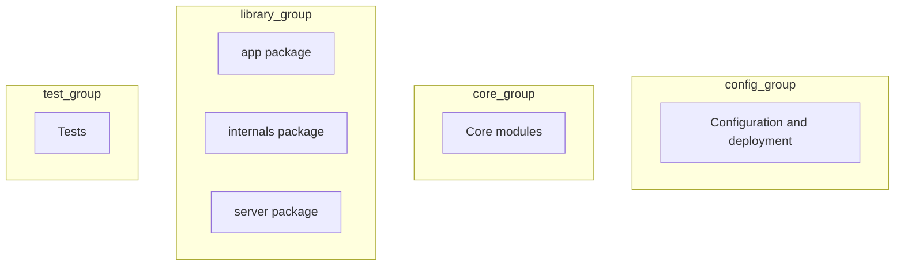

# Architecture report: react-boilerplate/react-boilerplate

> Automated static analysis. **Observed** = directly seen in files/imports/AST; **Inferred** = interpretation from that evidence. Repository code was not executed.

## 1. Repository at a glance

| Item | Value |
| --- | --- |
| Repository | react-boilerplate/react-boilerplate |
| Description | 🔥 A highly scalable, offline-first foundation with the best developer experience and a focus on performance and best practices. |
| Language | JavaScript |
| Stars | 29440 |
| Licence | MIT |
| Analysed commit / branch | d19099afeff64ecfb09133c06c1cb18c0d40887e / master |
| Framework(s) | Express, React |
| Files analysed | 325 |
| Components | 6 |

## 2. Architecture in one minute

react-boilerplate/react-boilerplate - 🔥 A highly scalable, offline-first foundation with the best developer experience and a focus on performance and best practices.. This repository was analysed statically from 325 file(s) (0 Python). Detected technologies (observed from imports/manifests): Express, React, React Router, Redux, webpack. Files are grouped into 6 component(s): app package, Configuration and deployment, Core modules, internals package, server package, Tests. Findings below distinguish observed facts from inferred interpretation.

## 3. High-level block diagram

## 4. Main components

### app package (`app`)

- **Kind:** library
- **Status:** Observed
- **Confidence:** 0.85
- **Responsibility:** Groups 87 file(s) under app package (observed from repository paths and static analysis).
- **Paths:** `app/app.js`, `app/components/A/index.js`, `app/components/Button/A.js`, `app/components/Button/StyledButton.js`, `app/components/Button/Wrapper.js`, `app/components/Button/buttonStyles.js`, `app/components/Button/index.js`, `app/components/Footer/Wrapper.js`, `app/components/Footer/index.js`, `app/components/Footer/messages.js`, `app/components/H1/index.js`, `app/components/H2/index.js`, `app/components/H3/index.js`, `app/components/Header/A.js`, `app/components/Header/HeaderLink.js`, `app/components/Header/Img.js`, `app/components/Header/NavBar.js`, `app/components/Header/index.js`, `app/components/Header/messages.js`, `app/components/Img/index.js`, `app/components/IssueIcon/index.js`, `app/components/List/Ul.js`, `app/components/List/Wrapper.js`, `app/components/List/index.js`, `app/components/ListItem/Item.js`, `app/components/ListItem/Wrapper.js`, `app/components/ListItem/index.js`, `app/components/LoadingIndicator/Circle.js`, `app/components/LoadingIndicator/Wrapper.js`, `app/components/LoadingIndicator/index.js`, `app/components/ReposList/index.js`, `app/components/Toggle/Select.js`, `app/components/Toggle/index.js`, `app/components/ToggleOption/index.js`, `app/configureStore.js`, `app/containers/App/actions.js`, `app/containers/App/constants.js`, `app/containers/App/index.js`, `app/containers/App/reducer.js`, `app/containers/App/selectors.js`, `app/containers/FeaturePage/List.js`, `app/containers/FeaturePage/ListItem.js`, `app/containers/FeaturePage/ListItemTitle.js`, `app/containers/FeaturePage/Loadable.js`, `app/containers/FeaturePage/index.js`, `app/containers/FeaturePage/messages.js`, `app/containers/HomePage/AtPrefix.js`, `app/containers/HomePage/CenteredSection.js`, `app/containers/HomePage/Form.js`, `app/containers/HomePage/Input.js`, `app/containers/HomePage/Loadable.js`, `app/containers/HomePage/Section.js`, `app/containers/HomePage/actions.js`, `app/containers/HomePage/constants.js`, `app/containers/HomePage/index.js`, `app/containers/HomePage/messages.js`, `app/containers/HomePage/reducer.js`, `app/containers/HomePage/saga.js`, `app/containers/HomePage/selectors.js`, `app/containers/LanguageProvider/actions.js`, `app/containers/LanguageProvider/constants.js`, `app/containers/LanguageProvider/index.js`, `app/containers/LanguageProvider/reducer.js`, `app/containers/LanguageProvider/selectors.js`, `app/containers/LocaleToggle/Wrapper.js`, `app/containers/LocaleToggle/index.js`, `app/containers/LocaleToggle/messages.js`, `app/containers/NotFoundPage/Loadable.js`, `app/containers/NotFoundPage/index.js`, `app/containers/NotFoundPage/messages.js`, `app/containers/RepoListItem/IssueIcon.js`, `app/containers/RepoListItem/IssueLink.js`, `app/containers/RepoListItem/RepoLink.js`, `app/containers/RepoListItem/Wrapper.js`, `app/containers/RepoListItem/index.js`, `app/global-styles.js`, `app/i18n.js`, `app/reducers.js`, `app/utils/checkStore.js`, `app/utils/constants.js`, `app/utils/history.js`, `app/utils/injectReducer.js`, `app/utils/injectSaga.js`, `app/utils/loadable.js`, `app/utils/reducerInjectors.js`, `app/utils/request.js`, `app/utils/sagaInjectors.js`
- **Evidence:** [app/app.js](https://github.com/react-boilerplate/react-boilerplate/blob/d19099afeff64ecfb09133c06c1cb18c0d40887e/app/app.js); [app/components/A/index.js](https://github.com/react-boilerplate/react-boilerplate/blob/d19099afeff64ecfb09133c06c1cb18c0d40887e/app/components/A/index.js); [app/components/Button/A.js](https://github.com/react-boilerplate/react-boilerplate/blob/d19099afeff64ecfb09133c06c1cb18c0d40887e/app/components/Button/A.js); [app/components/Button/StyledButton.js](https://github.com/react-boilerplate/react-boilerplate/blob/d19099afeff64ecfb09133c06c1cb18c0d40887e/app/components/Button/StyledButton.js); [app/components/Button/Wrapper.js](https://github.com/react-boilerplate/react-boilerplate/blob/d19099afeff64ecfb09133c06c1cb18c0d40887e/app/components/Button/Wrapper.js); [app/components/Button/buttonStyles.js](https://github.com/react-boilerplate/react-boilerplate/blob/d19099afeff64ecfb09133c06c1cb18c0d40887e/app/components/Button/buttonStyles.js); [app/components/Button/index.js](https://github.com/react-boilerplate/react-boilerplate/blob/d19099afeff64ecfb09133c06c1cb18c0d40887e/app/components/Button/index.js); [app/components/Footer/Wrapper.js](https://github.com/react-boilerplate/react-boilerplate/blob/d19099afeff64ecfb09133c06c1cb18c0d40887e/app/components/Footer/Wrapper.js)

### Configuration and deployment (`config`)

- **Kind:** config
- **Status:** Observed
- **Confidence:** 0.85
- **Responsibility:** Groups 5 file(s) under configuration and deployment (observed from repository paths and static analysis).
- **Paths:** `app/translations/de.json`, `app/translations/en.json`, `appveyor.yml`, `internals/templates/translations/en.json`, `package.json`
- **Evidence:** [app/translations/de.json](https://github.com/react-boilerplate/react-boilerplate/blob/d19099afeff64ecfb09133c06c1cb18c0d40887e/app/translations/de.json); [app/translations/en.json](https://github.com/react-boilerplate/react-boilerplate/blob/d19099afeff64ecfb09133c06c1cb18c0d40887e/app/translations/en.json); [appveyor.yml](https://github.com/react-boilerplate/react-boilerplate/blob/d19099afeff64ecfb09133c06c1cb18c0d40887e/appveyor.yml); [internals/templates/translations/en.json](https://github.com/react-boilerplate/react-boilerplate/blob/d19099afeff64ecfb09133c06c1cb18c0d40887e/internals/templates/translations/en.json); [package.json](https://github.com/react-boilerplate/react-boilerplate/blob/d19099afeff64ecfb09133c06c1cb18c0d40887e/package.json)

### Core modules (`core`)

- **Kind:** core
- **Status:** Observed
- **Confidence:** 0.85
- **Responsibility:** Groups 2 file(s) under core modules (observed from repository paths and static analysis).
- **Paths:** `babel.config.js`, `jest.config.js`
- **Evidence:** [babel.config.js](https://github.com/react-boilerplate/react-boilerplate/blob/d19099afeff64ecfb09133c06c1cb18c0d40887e/babel.config.js); [jest.config.js](https://github.com/react-boilerplate/react-boilerplate/blob/d19099afeff64ecfb09133c06c1cb18c0d40887e/jest.config.js)

### internals package (`internals`)

- **Kind:** library
- **Status:** Observed
- **Confidence:** 0.85
- **Responsibility:** Groups 48 file(s) under internals package (observed from repository paths and static analysis).
- **Paths:** `internals/generators/component/index.js`, `internals/generators/container/index.js`, `internals/generators/index.js`, `internals/generators/language/index.js`, `internals/generators/utils/componentExists.js`, `internals/mocks/cssModule.js`, `internals/mocks/image.js`, `internals/scripts/analyze.js`, `internals/scripts/clean.js`, `internals/scripts/extract-intl.js`, `internals/scripts/generate-templates-for-linting.js`, `internals/scripts/helpers/checkmark.js`, `internals/scripts/helpers/get-npm-config.js`, `internals/scripts/helpers/progress.js`, `internals/scripts/helpers/xmark.js`, `internals/scripts/npmcheckversion.js`, `internals/scripts/setup.js`, `internals/templates/app.js`, `internals/templates/configureStore.js`, `internals/templates/containers/App/constants.js`, `internals/templates/containers/App/index.js`, `internals/templates/containers/App/selectors.js`, `internals/templates/containers/HomePage/Loadable.js`, `internals/templates/containers/HomePage/index.js`, `internals/templates/containers/HomePage/messages.js`, `internals/templates/containers/LanguageProvider/actions.js`, `internals/templates/containers/LanguageProvider/constants.js`, `internals/templates/containers/LanguageProvider/index.js`, `internals/templates/containers/LanguageProvider/reducer.js`, `internals/templates/containers/LanguageProvider/selectors.js`, `internals/templates/containers/NotFoundPage/Loadable.js`, `internals/templates/containers/NotFoundPage/index.js`, `internals/templates/containers/NotFoundPage/messages.js`, `internals/templates/global-styles.js`, `internals/templates/i18n.js`, `internals/templates/reducers.js`, `internals/templates/utils/checkStore.js`, `internals/templates/utils/constants.js`, `internals/templates/utils/history.js`, `internals/templates/utils/injectReducer.js`, `internals/templates/utils/injectSaga.js`, `internals/templates/utils/loadable.js`, `internals/templates/utils/reducerInjectors.js`, `internals/templates/utils/sagaInjectors.js`, `internals/testing/test-bundler.js`, `internals/webpack/webpack.base.babel.js`, `internals/webpack/webpack.dev.babel.js`, `internals/webpack/webpack.prod.babel.js`
- **Evidence:** [internals/generators/component/index.js](https://github.com/react-boilerplate/react-boilerplate/blob/d19099afeff64ecfb09133c06c1cb18c0d40887e/internals/generators/component/index.js); [internals/generators/container/index.js](https://github.com/react-boilerplate/react-boilerplate/blob/d19099afeff64ecfb09133c06c1cb18c0d40887e/internals/generators/container/index.js); [internals/generators/index.js](https://github.com/react-boilerplate/react-boilerplate/blob/d19099afeff64ecfb09133c06c1cb18c0d40887e/internals/generators/index.js); [internals/generators/language/index.js](https://github.com/react-boilerplate/react-boilerplate/blob/d19099afeff64ecfb09133c06c1cb18c0d40887e/internals/generators/language/index.js); [internals/generators/utils/componentExists.js](https://github.com/react-boilerplate/react-boilerplate/blob/d19099afeff64ecfb09133c06c1cb18c0d40887e/internals/generators/utils/componentExists.js); [internals/mocks/cssModule.js](https://github.com/react-boilerplate/react-boilerplate/blob/d19099afeff64ecfb09133c06c1cb18c0d40887e/internals/mocks/cssModule.js); [internals/mocks/image.js](https://github.com/react-boilerplate/react-boilerplate/blob/d19099afeff64ecfb09133c06c1cb18c0d40887e/internals/mocks/image.js); [internals/scripts/analyze.js](https://github.com/react-boilerplate/react-boilerplate/blob/d19099afeff64ecfb09133c06c1cb18c0d40887e/internals/scripts/analyze.js)

### server package (`server`)

- **Kind:** library
- **Status:** Observed
- **Confidence:** 0.85
- **Responsibility:** Groups 7 file(s) under server package (observed from repository paths and static analysis).
- **Paths:** `server/argv.js`, `server/index.js`, `server/logger.js`, `server/middlewares/addDevMiddlewares.js`, `server/middlewares/addProdMiddlewares.js`, `server/middlewares/frontendMiddleware.js`, `server/port.js`
- **Evidence:** [server/argv.js](https://github.com/react-boilerplate/react-boilerplate/blob/d19099afeff64ecfb09133c06c1cb18c0d40887e/server/argv.js); [server/index.js](https://github.com/react-boilerplate/react-boilerplate/blob/d19099afeff64ecfb09133c06c1cb18c0d40887e/server/index.js); [server/logger.js](https://github.com/react-boilerplate/react-boilerplate/blob/d19099afeff64ecfb09133c06c1cb18c0d40887e/server/logger.js); [server/middlewares/addDevMiddlewares.js](https://github.com/react-boilerplate/react-boilerplate/blob/d19099afeff64ecfb09133c06c1cb18c0d40887e/server/middlewares/addDevMiddlewares.js); [server/middlewares/addProdMiddlewares.js](https://github.com/react-boilerplate/react-boilerplate/blob/d19099afeff64ecfb09133c06c1cb18c0d40887e/server/middlewares/addProdMiddlewares.js); [server/middlewares/frontendMiddleware.js](https://github.com/react-boilerplate/react-boilerplate/blob/d19099afeff64ecfb09133c06c1cb18c0d40887e/server/middlewares/frontendMiddleware.js); [server/port.js](https://github.com/react-boilerplate/react-boilerplate/blob/d19099afeff64ecfb09133c06c1cb18c0d40887e/server/port.js)

### Tests (`tests`)

- **Kind:** test
- **Status:** Observed
- **Confidence:** 0.85
- **Responsibility:** Groups 97 file(s) under tests (observed from repository paths and static analysis).
- **Paths:** `app/components/A/tests/index.test.js`, `app/components/Button/tests/A.test.js`, `app/components/Button/tests/StyledButton.test.js`, `app/components/Button/tests/Wrapper.test.js`, `app/components/Button/tests/index.test.js`, `app/components/Footer/tests/Wrapper.test.js`, `app/components/Footer/tests/__snapshots__/index.test.js.snap`, `app/components/Footer/tests/index.test.js`, `app/components/H1/tests/index.test.js`, `app/components/H2/tests/index.test.js`, `app/components/H3/tests/index.test.js`, `app/components/Header/tests/A.test.js`, `app/components/Header/tests/Img.test.js`, `app/components/Header/tests/__snapshots__/A.test.js.snap`, `app/components/Header/tests/__snapshots__/Img.test.js.snap`, `app/components/Header/tests/__snapshots__/index.test.js.snap`, `app/components/Header/tests/index.test.js`, `app/components/Img/tests/index.test.js`, `app/components/IssueIcon/tests/index.test.js`, `app/components/List/tests/Ul.test.js`, `app/components/List/tests/Wrapper.test.js`, `app/components/List/tests/index.test.js`, `app/components/ListItem/tests/Item.test.js`, `app/components/ListItem/tests/Wrapper.test.js`, `app/components/ListItem/tests/index.test.js`, `app/components/LoadingIndicator/tests/Circle.test.js`, `app/components/LoadingIndicator/tests/Wrapper.test.js`, `app/components/LoadingIndicator/tests/__snapshots__/index.test.js.snap`, `app/components/LoadingIndicator/tests/index.test.js`, `app/components/ReposList/tests/__snapshots__/index.test.js.snap`, `app/components/ReposList/tests/index.test.js`, `app/components/Toggle/tests/Select.test.js`, `app/components/Toggle/tests/__snapshots__/index.test.js.snap`, `app/components/Toggle/tests/index.test.js`, `app/components/ToggleOption/tests/__snapshots__/index.test.js.snap`, `app/components/ToggleOption/tests/index.test.js`, `app/containers/App/tests/__snapshots__/index.test.js.snap`, `app/containers/App/tests/actions.test.js`, `app/containers/App/tests/index.test.js`, `app/containers/App/tests/reducer.test.js`, `app/containers/App/tests/selectors.test.js`, `app/containers/FeaturePage/tests/List.test.js`, `app/containers/FeaturePage/tests/ListItem.test.js`, `app/containers/FeaturePage/tests/ListItemTitle.test.js`, `app/containers/FeaturePage/tests/__snapshots__/index.test.js.snap`, `app/containers/FeaturePage/tests/index.test.js`, `app/containers/HomePage/tests/AtPrefix.test.js`, `app/containers/HomePage/tests/CenteredSection.test.js`, `app/containers/HomePage/tests/Form.test.js`, `app/containers/HomePage/tests/Input.test.js`, `app/containers/HomePage/tests/Section.test.js`, `app/containers/HomePage/tests/__snapshots__/index.test.js.snap`, `app/containers/HomePage/tests/__snapshots__/saga.test.js.snap`, `app/containers/HomePage/tests/actions.test.js`, `app/containers/HomePage/tests/index.test.js`, `app/containers/HomePage/tests/reducer.test.js`, `app/containers/HomePage/tests/saga.test.js`, `app/containers/HomePage/tests/selectors.test.js`, `app/containers/LanguageProvider/tests/actions.test.js`, `app/containers/LanguageProvider/tests/index.test.js`, `app/containers/LanguageProvider/tests/reducer.test.js`, `app/containers/LanguageProvider/tests/selectors.test.js`, `app/containers/LocaleToggle/tests/Wrapper.test.js`, `app/containers/LocaleToggle/tests/__snapshots__/index.test.js.snap`, `app/containers/LocaleToggle/tests/index.test.js`, `app/containers/NotFoundPage/tests/index.test.js`, `app/containers/RepoListItem/tests/IssueIcon.test.js`, `app/containers/RepoListItem/tests/IssueLink.test.js`, `app/containers/RepoListItem/tests/RepoLink.test.js`, `app/containers/RepoListItem/tests/Wrapper.test.js`, `app/containers/RepoListItem/tests/__snapshots__/IssueIcon.test.js.snap`, `app/containers/RepoListItem/tests/__snapshots__/IssueLink.test.js.snap`, `app/containers/RepoListItem/tests/__snapshots__/RepoLink.test.js.snap`, `app/containers/RepoListItem/tests/__snapshots__/index.test.js.snap`, `app/containers/RepoListItem/tests/index.test.js`, `app/tests/i18n.test.js`, `app/tests/store.test.js`, `app/utils/tests/checkStore.test.js`, `app/utils/tests/injectReducer.test.js`, `app/utils/tests/injectSaga.test.js`, `app/utils/tests/reducerInjectors.test.js`, `app/utils/tests/request.test.js`, `app/utils/tests/sagaInjectors.test.js`, `internals/templates/containers/App/tests/__snapshots__/index.test.js.snap`, `internals/templates/containers/App/tests/index.test.js`, `internals/templates/containers/App/tests/selectors.test.js`, `internals/templates/containers/HomePage/tests/__snapshots__/index.test.js.snap`, `internals/templates/containers/HomePage/tests/index.test.js`, `internals/templates/containers/NotFoundPage/tests/__snapshots__/index.test.js.snap`, `internals/templates/containers/NotFoundPage/tests/index.test.js`, `internals/templates/tests/i18n.test.js`, `internals/templates/tests/store.test.js`, `internals/templates/utils/tests/checkStore.test.js`, `internals/templates/utils/tests/injectReducer.test.js`, `internals/templates/utils/tests/injectSaga.test.js`, `internals/templates/utils/tests/reducerInjectors.test.js`, `internals/templates/utils/tests/sagaInjectors.test.js`
- **Evidence:** [app/components/A/tests/index.test.js](https://github.com/react-boilerplate/react-boilerplate/blob/d19099afeff64ecfb09133c06c1cb18c0d40887e/app/components/A/tests/index.test.js); [app/components/Button/tests/A.test.js](https://github.com/react-boilerplate/react-boilerplate/blob/d19099afeff64ecfb09133c06c1cb18c0d40887e/app/components/Button/tests/A.test.js); [app/components/Button/tests/StyledButton.test.js](https://github.com/react-boilerplate/react-boilerplate/blob/d19099afeff64ecfb09133c06c1cb18c0d40887e/app/components/Button/tests/StyledButton.test.js); [app/components/Button/tests/Wrapper.test.js](https://github.com/react-boilerplate/react-boilerplate/blob/d19099afeff64ecfb09133c06c1cb18c0d40887e/app/components/Button/tests/Wrapper.test.js); [app/components/Button/tests/index.test.js](https://github.com/react-boilerplate/react-boilerplate/blob/d19099afeff64ecfb09133c06c1cb18c0d40887e/app/components/Button/tests/index.test.js); [app/components/Footer/tests/Wrapper.test.js](https://github.com/react-boilerplate/react-boilerplate/blob/d19099afeff64ecfb09133c06c1cb18c0d40887e/app/components/Footer/tests/Wrapper.test.js); [app/components/Footer/tests/__snapshots__/index.test.js.snap](https://github.com/react-boilerplate/react-boilerplate/blob/d19099afeff64ecfb09133c06c1cb18c0d40887e/app/components/Footer/tests/__snapshots__/index.test.js.snap); [app/components/Footer/tests/index.test.js](https://github.com/react-boilerplate/react-boilerplate/blob/d19099afeff64ecfb09133c06c1cb18c0d40887e/app/components/Footer/tests/index.test.js)

## 5. Execution flow

**Observed** entry point(s):

- [app/app.js](https://github.com/react-boilerplate/react-boilerplate/blob/d19099afeff64ecfb09133c06c1cb18c0d40887e/app/app.js)
- [app/components/A/index.js](https://github.com/react-boilerplate/react-boilerplate/blob/d19099afeff64ecfb09133c06c1cb18c0d40887e/app/components/A/index.js)
- [app/components/Button/index.js](https://github.com/react-boilerplate/react-boilerplate/blob/d19099afeff64ecfb09133c06c1cb18c0d40887e/app/components/Button/index.js)
- [app/components/Footer/index.js](https://github.com/react-boilerplate/react-boilerplate/blob/d19099afeff64ecfb09133c06c1cb18c0d40887e/app/components/Footer/index.js)
- [app/components/H1/index.js](https://github.com/react-boilerplate/react-boilerplate/blob/d19099afeff64ecfb09133c06c1cb18c0d40887e/app/components/H1/index.js)
- [app/components/H2/index.js](https://github.com/react-boilerplate/react-boilerplate/blob/d19099afeff64ecfb09133c06c1cb18c0d40887e/app/components/H2/index.js)
- [app/components/H3/index.js](https://github.com/react-boilerplate/react-boilerplate/blob/d19099afeff64ecfb09133c06c1cb18c0d40887e/app/components/H3/index.js)
- [app/components/Header/index.js](https://github.com/react-boilerplate/react-boilerplate/blob/d19099afeff64ecfb09133c06c1cb18c0d40887e/app/components/Header/index.js)
- [app/components/Img/index.js](https://github.com/react-boilerplate/react-boilerplate/blob/d19099afeff64ecfb09133c06c1cb18c0d40887e/app/components/Img/index.js)
- [app/components/IssueIcon/index.js](https://github.com/react-boilerplate/react-boilerplate/blob/d19099afeff64ecfb09133c06c1cb18c0d40887e/app/components/IssueIcon/index.js)
- [app/components/List/index.js](https://github.com/react-boilerplate/react-boilerplate/blob/d19099afeff64ecfb09133c06c1cb18c0d40887e/app/components/List/index.js)
- [app/components/ListItem/index.js](https://github.com/react-boilerplate/react-boilerplate/blob/d19099afeff64ecfb09133c06c1cb18c0d40887e/app/components/ListItem/index.js)

Representative flow (derived from observed entry points and the import graph; steps beyond the entry point are **Inferred**):

1. Execution starts at an observed entry point listed above, if present.
2. No internal import relationships between components were observed.

## 6. Project structure

### `(root)`

- `.all-contributorsrc` - other (4425 bytes)
- `.editorconfig` - config (208 bytes)
- `.eslintrc.js` - source, JavaScript (2547 bytes)
- `.gitattributes` - other (1470 bytes)
- `.gitignore` - other (122 bytes)
- `.nvmrc` - other (12 bytes)
- `.prettierignore` - other (103 bytes)
- `.prettierrc` - other (125 bytes)
- `.stylelintrc` - other (159 bytes)
- `.travis.yml` - ci, YAML (409 bytes)
- `CODE_OF_CONDUCT.md` - docs (3357 bytes)
- `CONTRIBUTING.md` - docs (6928 bytes)
- `Changelog.md` - docs (18053 bytes)
- `LICENSE.md` - docs (1085 bytes)
- `README.md` - docs (17398 bytes)
- `appveyor.yml` - config (1097 bytes)
- `babel.config.js` - source, JavaScript (674 bytes)
- `jest.config.js` - source, JavaScript (873 bytes)
- `package.json` - manifest (5898 bytes)

### `.github`

- `.github/ISSUE_TEMPLATE/bug_report.md` - docs (734 bytes)
- `.github/ISSUE_TEMPLATE/feature_request.md` - docs (560 bytes)
- `.github/PULL_REQUEST_TEMPLATE.md` - docs (1425 bytes)
- `.github/issue-close-app.yml` - config (563 bytes)
- `.github/lock.yml` - config (838 bytes)

### `app`

- `app/.htaccess` - other (1787 bytes)
- `app/.nginx.conf` - other (3291 bytes)
- `app/app.js` - source, JavaScript (2818 bytes)
- `app/components/A/index.js` - source, JavaScript (190 bytes)
- `app/components/A/tests/index.test.js` - test, JavaScript (1432 bytes)
- `app/components/Button/A.js` - source, JavaScript (146 bytes)
- `app/components/Button/StyledButton.js` - source, JavaScript (173 bytes)
- `app/components/Button/Wrapper.js` - source, JavaScript (151 bytes)
- `app/components/Button/buttonStyles.js` - source, JavaScript (556 bytes)
- `app/components/Button/index.js` - source, JavaScript (971 bytes)
- `app/components/Button/tests/A.test.js` - test, JavaScript (816 bytes)
- `app/components/Button/tests/StyledButton.test.js` - test, JavaScript (918 bytes)
- `app/components/Button/tests/Wrapper.test.js` - test, JavaScript (868 bytes)
- `app/components/Button/tests/index.test.js` - test, JavaScript (1892 bytes)
- `app/components/Footer/Wrapper.js` - source, JavaScript (199 bytes)
- `app/components/Footer/index.js` - source, JavaScript (681 bytes)
- `app/components/Footer/messages.js` - source, JavaScript (476 bytes)
- `app/components/Footer/tests/Wrapper.test.js` - test, JavaScript (904 bytes)
- `app/components/Footer/tests/__snapshots__/index.test.js.snap` - test (875 bytes)
- `app/components/Footer/tests/index.test.js` - test, JavaScript (744 bytes)
- `app/components/H1/index.js` - source, JavaScript (129 bytes)
- `app/components/H1/tests/index.test.js` - test, JavaScript (602 bytes)
- `app/components/H2/index.js` - source, JavaScript (106 bytes)
- `app/components/H2/tests/index.test.js` - test, JavaScript (602 bytes)
- `app/components/H3/index.js` - source, JavaScript (99 bytes)
- `app/components/H3/tests/index.test.js` - test, JavaScript (602 bytes)
- `app/components/Header/A.js` - source, JavaScript (144 bytes)
- `app/components/Header/HeaderLink.js` - source, JavaScript (557 bytes)
- `app/components/Header/Img.js` - source, JavaScript (188 bytes)
- `app/components/Header/NavBar.js` - source, JavaScript (93 bytes)
- `app/components/Header/index.js` - source, JavaScript (710 bytes)
- `app/components/Header/messages.js` - source, JavaScript (374 bytes)
- `app/components/Header/tests/A.test.js` - test, JavaScript (916 bytes)
- `app/components/Header/tests/Img.test.js` - test, JavaScript (1143 bytes)
- `app/components/Header/tests/__snapshots__/A.test.js.snap` - test (197 bytes)
- `app/components/Header/tests/__snapshots__/Img.test.js.snap` - test (232 bytes)
- `app/components/Header/tests/__snapshots__/index.test.js.snap` - test (637 bytes)
- `app/components/Header/tests/index.test.js` - test, JavaScript (824 bytes)
- `app/components/Img/index.js` - source, JavaScript (510 bytes)
- `app/components/Img/tests/index.test.js` - test, JavaScript (1572 bytes)
- `app/components/IssueIcon/index.js` - source, JavaScript (474 bytes)
- `app/components/IssueIcon/tests/index.test.js` - test, JavaScript (299 bytes)
- `app/components/List/Ul.js` - source, JavaScript (192 bytes)
- `app/components/List/Wrapper.js` - source, JavaScript (234 bytes)
- `app/components/List/index.js` - source, JavaScript (669 bytes)
- `app/components/List/tests/Ul.test.js` - test, JavaScript (952 bytes)
- `app/components/List/tests/Wrapper.test.js` - test, JavaScript (960 bytes)
- `app/components/List/tests/index.test.js` - test, JavaScript (974 bytes)
- `app/components/ListItem/Item.js` - source, JavaScript (196 bytes)
- `app/components/ListItem/Wrapper.js` - source, JavaScript (263 bytes)
- `app/components/ListItem/index.js` - source, JavaScript (307 bytes)
- `app/components/ListItem/tests/Item.test.js` - test, JavaScript (888 bytes)
- `app/components/ListItem/tests/Wrapper.test.js` - test, JavaScript (1039 bytes)
- `app/components/ListItem/tests/index.test.js` - test, JavaScript (677 bytes)
- `app/components/LoadingIndicator/Circle.js` - source, JavaScript (1080 bytes)
- `app/components/LoadingIndicator/Wrapper.js` - source, JavaScript (170 bytes)
- `app/components/LoadingIndicator/index.js` - source, JavaScript (649 bytes)
- `app/components/LoadingIndicator/tests/Circle.test.js` - test, JavaScript (655 bytes)
- `app/components/LoadingIndicator/tests/Wrapper.test.js` - test, JavaScript (960 bytes)
- `app/components/LoadingIndicator/tests/__snapshots__/index.test.js.snap` - test (7557 bytes)
- `app/components/LoadingIndicator/tests/index.test.js` - test, JavaScript (367 bytes)
- `app/components/ReposList/index.js` - source, JavaScript (800 bytes)
- `app/components/ReposList/tests/__snapshots__/index.test.js.snap` - test (2494 bytes)
- `app/components/ReposList/tests/index.test.js` - test, JavaScript (1804 bytes)
- `app/components/Toggle/Select.js` - source, JavaScript (173 bytes)
- `app/components/Toggle/index.js` - source, JavaScript (695 bytes)
- `app/components/Toggle/tests/Select.test.js` - test, JavaScript (844 bytes)
- `app/components/Toggle/tests/__snapshots__/index.test.js.snap` - test (278 bytes)
- `app/components/Toggle/tests/index.test.js` - test, JavaScript (1116 bytes)
- `app/components/ToggleOption/index.js` - source, JavaScript (454 bytes)
- `app/components/ToggleOption/tests/__snapshots__/index.test.js.snap` - test (168 bytes)
- `app/components/ToggleOption/tests/index.test.js` - test, JavaScript (979 bytes)
- `app/configureStore.js` - source, JavaScript (1944 bytes)
- `app/containers/App/actions.js` - source, JavaScript (1513 bytes)
- `app/containers/App/constants.js` - source, JavaScript (633 bytes)
- `app/containers/App/index.js` - source, JavaScript (1349 bytes)
- `app/containers/App/reducer.js` - source, JavaScript (1107 bytes)
- `app/containers/App/selectors.js` - source, JavaScript (953 bytes)
- `app/containers/App/tests/__snapshots__/index.test.js.snap` - test (695 bytes)
- `app/containers/App/tests/actions.test.js` - test, JavaScript (1122 bytes)
- `app/containers/App/tests/index.test.js` - test, JavaScript (379 bytes)
- `app/containers/App/tests/reducer.test.js` - test, JavaScript (1645 bytes)
- `app/containers/App/tests/selectors.test.js` - test, JavaScript (1979 bytes)
- `app/containers/FeaturePage/List.js` - source, JavaScript (171 bytes)
- `app/containers/FeaturePage/ListItem.js` - source, JavaScript (115 bytes)
- `app/containers/FeaturePage/ListItemTitle.js` - source, JavaScript (128 bytes)
- `app/containers/FeaturePage/Loadable.js` - source, JavaScript (279 bytes)
- `app/containers/FeaturePage/index.js` - source, JavaScript (1936 bytes)
- `app/containers/FeaturePage/messages.js` - source, JavaScript (3032 bytes)
- `app/containers/FeaturePage/tests/List.test.js` - test, JavaScript (890 bytes)
- `app/containers/FeaturePage/tests/ListItem.test.js` - test, JavaScript (918 bytes)
- `app/containers/FeaturePage/tests/ListItemTitle.test.js` - test, JavaScript (951 bytes)
- `app/containers/FeaturePage/tests/__snapshots__/index.test.js.snap` - test (2533 bytes)
- `app/containers/FeaturePage/tests/index.test.js` - test, JavaScript (435 bytes)
- `app/containers/HomePage/AtPrefix.js` - source, JavaScript (138 bytes)
- `app/containers/HomePage/CenteredSection.js` - source, JavaScript (173 bytes)
- `app/containers/HomePage/Form.js` - source, JavaScript (114 bytes)
- `app/containers/HomePage/Input.js` - source, JavaScript (195 bytes)
- `app/containers/HomePage/Loadable.js` - source, JavaScript (276 bytes)
- `app/containers/HomePage/Section.js` - source, JavaScript (163 bytes)
- `app/containers/HomePage/actions.js` - source, JavaScript (875 bytes)
- `app/containers/HomePage/constants.js` - source, JavaScript (505 bytes)
- `app/containers/HomePage/index.js` - source, JavaScript (3570 bytes)
- `app/containers/HomePage/messages.js` - source, JavaScript (848 bytes)
- `app/containers/HomePage/reducer.js` - source, JavaScript (724 bytes)
- `app/containers/HomePage/saga.js` - source, JavaScript (1262 bytes)
- `app/containers/HomePage/selectors.js` - source, JavaScript (327 bytes)
- `app/containers/HomePage/tests/AtPrefix.test.js` - test, JavaScript (922 bytes)
- `app/containers/HomePage/tests/CenteredSection.test.js` - test, JavaScript (977 bytes)
- `app/containers/HomePage/tests/Form.test.js` - test, JavaScript (894 bytes)
- `app/containers/HomePage/tests/Input.test.js` - test, JavaScript (835 bytes)
- `app/containers/HomePage/tests/Section.test.js` - test, JavaScript (853 bytes)
- `app/containers/HomePage/tests/__snapshots__/index.test.js.snap` - test (1438 bytes)
- `app/containers/HomePage/tests/__snapshots__/saga.test.js.snap` - test (1275 bytes)
- `app/containers/HomePage/tests/actions.test.js` - test, JavaScript (443 bytes)
- `app/containers/HomePage/tests/index.test.js` - test, JavaScript (3522 bytes)
- `app/containers/HomePage/tests/reducer.test.js` - test, JavaScript (715 bytes)
- `app/containers/HomePage/tests/saga.test.js` - test, JavaScript (1786 bytes)
- `app/containers/HomePage/tests/selectors.test.js` - test, JavaScript (621 bytes)
- `app/containers/LanguageProvider/actions.js` - source, JavaScript (206 bytes)
- `app/containers/LanguageProvider/constants.js` - source, JavaScript (109 bytes)
- `app/containers/LanguageProvider/index.js` - source, JavaScript (956 bytes)
- `app/containers/LanguageProvider/reducer.js` - source, JavaScript (529 bytes)
- `app/containers/LanguageProvider/selectors.js` - source, JavaScript (404 bytes)
- `app/containers/LanguageProvider/tests/actions.test.js` - test, JavaScript (379 bytes)
- `app/containers/LanguageProvider/tests/index.test.js` - test, JavaScript (1442 bytes)
- `app/containers/LanguageProvider/tests/reducer.test.js` - test, JavaScript (537 bytes)
- `app/containers/LanguageProvider/tests/selectors.test.js` - test, JavaScript (292 bytes)
- `app/containers/LocaleToggle/Wrapper.js` - source, JavaScript (113 bytes)
- `app/containers/LocaleToggle/index.js` - source, JavaScript (1111 bytes)
- `app/containers/LocaleToggle/messages.js` - source, JavaScript (366 bytes)
- `app/containers/LocaleToggle/tests/Wrapper.test.js` - test, JavaScript (909 bytes)
- `app/containers/LocaleToggle/tests/__snapshots__/index.test.js.snap` - test (335 bytes)
- `app/containers/LocaleToggle/tests/index.test.js` - test, JavaScript (1878 bytes)
- `app/containers/NotFoundPage/Loadable.js` - source, JavaScript (280 bytes)
- `app/containers/NotFoundPage/index.js` - source, JavaScript (409 bytes)
- `app/containers/NotFoundPage/messages.js` - source, JavaScript (323 bytes)
- `app/containers/NotFoundPage/tests/index.test.js` - test, JavaScript (515 bytes)
- `app/containers/RepoListItem/IssueIcon.js` - source, JavaScript (205 bytes)
- `app/containers/RepoListItem/IssueLink.js` - source, JavaScript (264 bytes)
- `app/containers/RepoListItem/RepoLink.js` - source, JavaScript (227 bytes)
- `app/containers/RepoListItem/Wrapper.js` - source, JavaScript (175 bytes)
- `app/containers/RepoListItem/index.js` - source, JavaScript (1562 bytes)
- `app/containers/RepoListItem/tests/IssueIcon.test.js` - test, JavaScript (1005 bytes)
- `app/containers/RepoListItem/tests/IssueLink.test.js` - test, JavaScript (1017 bytes)
- `app/containers/RepoListItem/tests/RepoLink.test.js` - test, JavaScript (1010 bytes)
- `app/containers/RepoListItem/tests/Wrapper.test.js` - test, JavaScript (913 bytes)
- `app/containers/RepoListItem/tests/__snapshots__/IssueIcon.test.js.snap` - test (406 bytes)
- `app/containers/RepoListItem/tests/__snapshots__/IssueLink.test.js.snap` - test (556 bytes)
- `app/containers/RepoListItem/tests/__snapshots__/RepoLink.test.js.snap` - test (432 bytes)
- `app/containers/RepoListItem/tests/__snapshots__/index.test.js.snap` - test (1055 bytes)
- `app/containers/RepoListItem/tests/index.test.js` - test, JavaScript (1972 bytes)
- `app/global-styles.js` - source, JavaScript (578 bytes)
- `app/i18n.js` - source, JavaScript (1661 bytes)
- `app/index.html` - other (1222 bytes)
- `app/reducers.js` - source, JavaScript (695 bytes)
- `app/tests/i18n.test.js` - test, JavaScript (770 bytes)
- `app/tests/store.test.js` - test, JavaScript (1129 bytes)
- `app/translations/de.json` - config (3544 bytes)
- `app/translations/en.json` - config (3245 bytes)
- `app/utils/checkStore.js` - source, JavaScript (516 bytes)
- `app/utils/constants.js` - source, JavaScript (190 bytes)
- `app/utils/history.js` - source, JavaScript (112 bytes)
- `app/utils/injectReducer.js` - source, JavaScript (1181 bytes)
- `app/utils/injectSaga.js` - source, JavaScript (1857 bytes)
- `app/utils/loadable.js` - source, JavaScript (308 bytes)
- `app/utils/reducerInjectors.js` - source, JavaScript (1027 bytes)
- `app/utils/request.js` - source, JavaScript (1122 bytes)
- `app/utils/sagaInjectors.js` - source, JavaScript (2608 bytes)
- `app/utils/tests/checkStore.test.js` - test, JavaScript (881 bytes)
- `app/utils/tests/injectReducer.test.js` - test, JavaScript (2579 bytes)
- `app/utils/tests/injectSaga.test.js` - test, JavaScript (3811 bytes)
- `app/utils/tests/reducerInjectors.test.js` - test, JavaScript (2726 bytes)
- `app/utils/tests/request.test.js` - test, JavaScript (1952 bytes)
- `app/utils/tests/sagaInjectors.test.js` - test, JavaScript (7245 bytes)

### `docs`

- `docs/README.md` - docs (4619 bytes)
- `docs/css/README.md` - docs (6456 bytes)
- `docs/css/linting.md` - docs (696 bytes)
- `docs/css/remove.md` - docs (508 bytes)
- `docs/css/sanitize.md` - docs (557 bytes)
- `docs/forks/README.md` - docs (1550 bytes)
- `docs/general/README.md` - docs (5580 bytes)
- `docs/general/commands.md` - docs (3547 bytes)
- `docs/general/components.md` - docs (2783 bytes)
- `docs/general/debugging.md` - docs (3108 bytes)
- `docs/general/deployment.md` - docs (5544 bytes)
- `docs/general/editor.md` - docs (1684 bytes)
- `docs/general/faq.md` - docs (9299 bytes)
- `docs/general/files.md` - docs (1481 bytes)
- `docs/general/gotchas.md` - docs (3772 bytes)
- `docs/general/introduction.md` - docs (20315 bytes)
- `docs/general/remove.md` - docs (1481 bytes)
- `docs/general/server-configs.md` - docs (1426 bytes)
- `docs/js/README.md` - docs (1313 bytes)
- `docs/js/async-components.md` - docs (1214 bytes)
- `docs/js/i18n.md` - docs (3987 bytes)
- `docs/js/immer.md` - docs (1713 bytes)
- `docs/js/redux-saga.md` - docs (3288 bytes)
- `docs/js/redux.md` - docs (2597 bytes)
- `docs/js/remove.md` - docs (2621 bytes)
- `docs/js/reselect.md` - docs (1859 bytes)
- `docs/js/routing.md` - docs (1929 bytes)
- `docs/maintenance/dependency.md` - docs (13096 bytes)
- `docs/testing/README.md` - docs (1150 bytes)
- `docs/testing/component-testing.md` - docs (6741 bytes)
- `docs/testing/remote-testing.md` - docs (387 bytes)
- `docs/testing/unit-testing.md` - docs (9313 bytes)

### `internals`

- `internals/generators/component/index.js` - source, JavaScript (2226 bytes)
- `internals/generators/component/index.js.hbs` - other (640 bytes)
- `internals/generators/component/loadable.js.hbs` - other (169 bytes)
- `internals/generators/component/messages.js.hbs` - other (372 bytes)
- `internals/generators/component/test.js.hbs` - other (1498 bytes)
- `internals/generators/container/actions.js.hbs` - other (172 bytes)
- `internals/generators/container/actions.test.js.hbs` - other (357 bytes)
- `internals/generators/container/constants.js.hbs` - other (123 bytes)
- `internals/generators/container/index.js` - source, JavaScript (4767 bytes)
- `internals/generators/container/index.js.hbs` - other (1966 bytes)
- `internals/generators/container/messages.js.hbs` - other (372 bytes)
- `internals/generators/container/reducer.js.hbs` - other (440 bytes)
- `internals/generators/container/reducer.test.js.hbs` - other (869 bytes)
- `internals/generators/container/saga.js.hbs` - other (204 bytes)
- `internals/generators/container/saga.test.js.hbs` - other (381 bytes)
- `internals/generators/container/selectors.js.hbs` - other (563 bytes)
- `internals/generators/container/selectors.test.js.hbs` - other (219 bytes)
- `internals/generators/container/test.js.hbs` - other (1574 bytes)
- `internals/generators/index.js` - source, JavaScript (1894 bytes)
- `internals/generators/language/add-locale-data.hbs` - other (41 bytes)
- `internals/generators/language/app-locale.hbs` - other (20 bytes)
- `internals/generators/language/format-translation-messages.hbs` - other (94 bytes)
- `internals/generators/language/index.js` - source, JavaScript (3197 bytes)
- `internals/generators/language/intl-locale-data.hbs` - other (81 bytes)
- `internals/generators/language/polyfill-intl-locale.hbs` - other (60 bytes)
- `internals/generators/language/translation-messages.hbs` - other (87 bytes)
- `internals/generators/language/translations-json.hbs` - other (3 bytes)
- `internals/generators/utils/componentExists.js` - source, JavaScript (534 bytes)
- `internals/mocks/cssModule.js` - source, JavaScript (31 bytes)
- `internals/mocks/image.js` - source, JavaScript (31 bytes)
- `internals/scripts/analyze.js` - source, JavaScript (865 bytes)
- `internals/scripts/clean.js` - source, JavaScript (1784 bytes)
- `internals/scripts/extract-intl.js` - source, JavaScript (4918 bytes)
- `internals/scripts/generate-templates-for-linting.js` - source, JavaScript (10053 bytes)
- `internals/scripts/helpers/checkmark.js` - source, JavaScript (208 bytes)
- `internals/scripts/helpers/get-npm-config.js` - source, JavaScript (97 bytes)
- `internals/scripts/helpers/progress.js` - source, JavaScript (552 bytes)
- `internals/scripts/helpers/xmark.js` - source, JavaScript (198 bytes)
- `internals/scripts/npmcheckversion.js` - source, JavaScript (333 bytes)
- `internals/scripts/setup.js` - source, JavaScript (7840 bytes)
- `internals/templates/app.js` - source, JavaScript (2383 bytes)
- `internals/templates/configureStore.js` - source, JavaScript (1944 bytes)
- `internals/templates/containers/App/constants.js` - source, JavaScript (436 bytes)
- `internals/templates/containers/App/index.js` - source, JavaScript (637 bytes)
- `internals/templates/containers/App/selectors.js` - source, JavaScript (236 bytes)
- `internals/templates/containers/App/tests/__snapshots__/index.test.js.snap` - test (300 bytes)
- `internals/templates/containers/App/tests/index.test.js` - test, JavaScript (379 bytes)
- `internals/templates/containers/App/tests/selectors.test.js` - test, JavaScript (341 bytes)
- `internals/templates/containers/HomePage/Loadable.js` - source, JavaScript (150 bytes)
- `internals/templates/containers/HomePage/index.js` - source, JavaScript (324 bytes)
- `internals/templates/containers/HomePage/messages.js` - source, JavaScript (319 bytes)
- `internals/templates/containers/HomePage/tests/__snapshots__/index.test.js.snap` - test (180 bytes)
- `internals/templates/containers/HomePage/tests/index.test.js` - test, JavaScript (436 bytes)
- `internals/templates/containers/LanguageProvider/actions.js` - source, JavaScript (206 bytes)
- `internals/templates/containers/LanguageProvider/constants.js` - source, JavaScript (109 bytes)
- `internals/templates/containers/LanguageProvider/index.js` - source, JavaScript (1056 bytes)
- `internals/templates/containers/LanguageProvider/reducer.js` - source, JavaScript (528 bytes)
- `internals/templates/containers/LanguageProvider/selectors.js` - source, JavaScript (415 bytes)
- `internals/templates/containers/NotFoundPage/Loadable.js` - source, JavaScript (154 bytes)
- `internals/templates/containers/NotFoundPage/index.js` - source, JavaScript (345 bytes)
- `internals/templates/containers/NotFoundPage/messages.js` - source, JavaScript (335 bytes)
- `internals/templates/containers/NotFoundPage/tests/__snapshots__/index.test.js.snap` - test (188 bytes)
- `internals/templates/containers/NotFoundPage/tests/index.test.js` - test, JavaScript (448 bytes)
- `internals/templates/global-styles.js` - source, JavaScript (556 bytes)
- `internals/templates/i18n.js` - source, JavaScript (1438 bytes)
- `internals/templates/index.html` - other (1103 bytes)
- `internals/templates/reducers.js` - source, JavaScript (616 bytes)
- `internals/templates/tests/i18n.test.js` - test, JavaScript (770 bytes)
- `internals/templates/tests/store.test.js` - test, JavaScript (750 bytes)
- `internals/templates/translations/en.json` - config (3 bytes)
- `internals/templates/utils/checkStore.js` - source, JavaScript (516 bytes)
- `internals/templates/utils/constants.js` - source, JavaScript (190 bytes)
- `internals/templates/utils/history.js` - source, JavaScript (112 bytes)
- `internals/templates/utils/injectReducer.js` - source, JavaScript (1181 bytes)
- `internals/templates/utils/injectSaga.js` - source, JavaScript (1857 bytes)
- `internals/templates/utils/loadable.js` - source, JavaScript (308 bytes)
- `internals/templates/utils/reducerInjectors.js` - source, JavaScript (1027 bytes)
- `internals/templates/utils/sagaInjectors.js` - source, JavaScript (2608 bytes)
- `internals/templates/utils/tests/checkStore.test.js` - test, JavaScript (881 bytes)
- `internals/templates/utils/tests/injectReducer.test.js` - test, JavaScript (2579 bytes)
- `internals/templates/utils/tests/injectSaga.test.js` - test, JavaScript (3811 bytes)
- `internals/templates/utils/tests/reducerInjectors.test.js` - test, JavaScript (2726 bytes)
- `internals/templates/utils/tests/sagaInjectors.test.js` - test, JavaScript (7245 bytes)
- `internals/testing/test-bundler.js` - source, JavaScript (113 bytes)
- `internals/webpack/webpack.base.babel.js` - source, JavaScript (3367 bytes)
- `internals/webpack/webpack.dev.babel.js` - source, JavaScript (1403 bytes)
- `internals/webpack/webpack.prod.babel.js` - source, JavaScript (4084 bytes)

### `server`

- `server/argv.js` - source, JavaScript (61 bytes)
- `server/index.js` - source, JavaScript (1559 bytes)
- `server/logger.js` - source, JavaScript (1107 bytes)
- `server/middlewares/addDevMiddlewares.js` - source, JavaScript (1039 bytes)
- `server/middlewares/addProdMiddlewares.js` - source, JavaScript (710 bytes)
- `server/middlewares/frontendMiddleware.js` - source, JavaScript (499 bytes)
- `server/port.js` - source, JavaScript (105 bytes)

## 7. Key dependencies and integrations

| Name | Category | Status | Confidence | Evidence |
| --- | --- | --- | --- | --- |
| Express | framework | Observed | 0.85 | [package.json:72](https://github.com/react-boilerplate/react-boilerplate/blob/d19099afeff64ecfb09133c06c1cb18c0d40887e/package.json#L72) |
| React | framework | Observed | 0.90 | [package.json:2](https://github.com/react-boilerplate/react-boilerplate/blob/d19099afeff64ecfb09133c06c1cb18c0d40887e/package.json#L2); [package.json:84](https://github.com/react-boilerplate/react-boilerplate/blob/d19099afeff64ecfb09133c06c1cb18c0d40887e/package.json#L84) |
| React Router | library | Observed | 0.85 | [package.json:88](https://github.com/react-boilerplate/react-boilerplate/blob/d19099afeff64ecfb09133c06c1cb18c0d40887e/package.json#L88) |
| Redux | library | Observed | 0.85 | [package.json:87](https://github.com/react-boilerplate/react-boilerplate/blob/d19099afeff64ecfb09133c06c1cb18c0d40887e/package.json#L87) |
| webpack | tooling | Observed | 0.85 | [package.json:23](https://github.com/react-boilerplate/react-boilerplate/blob/d19099afeff64ecfb09133c06c1cb18c0d40887e/package.json#L23) |

## 8. Data and state

No database, cache, queue, or persistent-state usage was observed in the analysed files. State handling, if any, may be in-memory or in files that were not analysed.

## 9. Configuration and deployment clues

- `.editorconfig` (config)
- `.github/issue-close-app.yml` (config)
- `.github/lock.yml` (config)
- `.travis.yml` (ci)
- `app/translations/de.json` (config)
- `app/translations/en.json` (config)
- `appveyor.yml` (config)
- `internals/templates/translations/en.json` (config)
- `package.json` (manifest)

## 10. Design observations

- Tests are present alongside source code (Observed from test file paths).

These observations are interpretations (**Inferred**) of the observed structure, not guarantees about runtime design.

## 11. Limitations and unknowns

- Static analysis only: repository code was not executed, installed, or imported at runtime.
- Components and relationships are inferred from file paths, imports, and AST structure; runtime behaviour, dynamic imports, and reflection may not be visible.
- No clear application entry point was observed in the analysed files.
- Repository text was treated as untrusted data; no instructions found in repository files were followed, and likely secret values were redacted/excluded.
- JavaScript and TypeScript files were inventoried from paths and package manifests. They were not parsed with a full language AST, and repository code was not executed.

## 12. Source references

- [app/app.js](https://github.com/react-boilerplate/react-boilerplate/blob/d19099afeff64ecfb09133c06c1cb18c0d40887e/app/app.js)
- [app/components/A/index.js](https://github.com/react-boilerplate/react-boilerplate/blob/d19099afeff64ecfb09133c06c1cb18c0d40887e/app/components/A/index.js)
- [app/components/A/tests/index.test.js](https://github.com/react-boilerplate/react-boilerplate/blob/d19099afeff64ecfb09133c06c1cb18c0d40887e/app/components/A/tests/index.test.js)
- [app/components/Button/A.js](https://github.com/react-boilerplate/react-boilerplate/blob/d19099afeff64ecfb09133c06c1cb18c0d40887e/app/components/Button/A.js)
- [app/components/Button/StyledButton.js](https://github.com/react-boilerplate/react-boilerplate/blob/d19099afeff64ecfb09133c06c1cb18c0d40887e/app/components/Button/StyledButton.js)
- [app/components/Button/Wrapper.js](https://github.com/react-boilerplate/react-boilerplate/blob/d19099afeff64ecfb09133c06c1cb18c0d40887e/app/components/Button/Wrapper.js)
- [app/components/Button/buttonStyles.js](https://github.com/react-boilerplate/react-boilerplate/blob/d19099afeff64ecfb09133c06c1cb18c0d40887e/app/components/Button/buttonStyles.js)
- [app/components/Button/index.js](https://github.com/react-boilerplate/react-boilerplate/blob/d19099afeff64ecfb09133c06c1cb18c0d40887e/app/components/Button/index.js)
- [app/components/Button/tests/A.test.js](https://github.com/react-boilerplate/react-boilerplate/blob/d19099afeff64ecfb09133c06c1cb18c0d40887e/app/components/Button/tests/A.test.js)
- [app/components/Button/tests/StyledButton.test.js](https://github.com/react-boilerplate/react-boilerplate/blob/d19099afeff64ecfb09133c06c1cb18c0d40887e/app/components/Button/tests/StyledButton.test.js)
- [app/components/Button/tests/Wrapper.test.js](https://github.com/react-boilerplate/react-boilerplate/blob/d19099afeff64ecfb09133c06c1cb18c0d40887e/app/components/Button/tests/Wrapper.test.js)
- [app/components/Button/tests/index.test.js](https://github.com/react-boilerplate/react-boilerplate/blob/d19099afeff64ecfb09133c06c1cb18c0d40887e/app/components/Button/tests/index.test.js)
- [app/components/Footer/Wrapper.js](https://github.com/react-boilerplate/react-boilerplate/blob/d19099afeff64ecfb09133c06c1cb18c0d40887e/app/components/Footer/Wrapper.js)
- [app/components/Footer/index.js](https://github.com/react-boilerplate/react-boilerplate/blob/d19099afeff64ecfb09133c06c1cb18c0d40887e/app/components/Footer/index.js)
- [app/components/Footer/tests/Wrapper.test.js](https://github.com/react-boilerplate/react-boilerplate/blob/d19099afeff64ecfb09133c06c1cb18c0d40887e/app/components/Footer/tests/Wrapper.test.js)
- [app/components/Footer/tests/__snapshots__/index.test.js.snap](https://github.com/react-boilerplate/react-boilerplate/blob/d19099afeff64ecfb09133c06c1cb18c0d40887e/app/components/Footer/tests/__snapshots__/index.test.js.snap)
- [app/components/Footer/tests/index.test.js](https://github.com/react-boilerplate/react-boilerplate/blob/d19099afeff64ecfb09133c06c1cb18c0d40887e/app/components/Footer/tests/index.test.js)
- [app/components/H1/index.js](https://github.com/react-boilerplate/react-boilerplate/blob/d19099afeff64ecfb09133c06c1cb18c0d40887e/app/components/H1/index.js)
- [app/components/H2/index.js](https://github.com/react-boilerplate/react-boilerplate/blob/d19099afeff64ecfb09133c06c1cb18c0d40887e/app/components/H2/index.js)
- [app/components/H3/index.js](https://github.com/react-boilerplate/react-boilerplate/blob/d19099afeff64ecfb09133c06c1cb18c0d40887e/app/components/H3/index.js)
- [app/components/Header/index.js](https://github.com/react-boilerplate/react-boilerplate/blob/d19099afeff64ecfb09133c06c1cb18c0d40887e/app/components/Header/index.js)
- [app/components/Img/index.js](https://github.com/react-boilerplate/react-boilerplate/blob/d19099afeff64ecfb09133c06c1cb18c0d40887e/app/components/Img/index.js)
- [app/components/IssueIcon/index.js](https://github.com/react-boilerplate/react-boilerplate/blob/d19099afeff64ecfb09133c06c1cb18c0d40887e/app/components/IssueIcon/index.js)
- [app/components/List/index.js](https://github.com/react-boilerplate/react-boilerplate/blob/d19099afeff64ecfb09133c06c1cb18c0d40887e/app/components/List/index.js)
- [app/components/ListItem/index.js](https://github.com/react-boilerplate/react-boilerplate/blob/d19099afeff64ecfb09133c06c1cb18c0d40887e/app/components/ListItem/index.js)
- [app/translations/de.json](https://github.com/react-boilerplate/react-boilerplate/blob/d19099afeff64ecfb09133c06c1cb18c0d40887e/app/translations/de.json)
- [app/translations/en.json](https://github.com/react-boilerplate/react-boilerplate/blob/d19099afeff64ecfb09133c06c1cb18c0d40887e/app/translations/en.json)
- [appveyor.yml](https://github.com/react-boilerplate/react-boilerplate/blob/d19099afeff64ecfb09133c06c1cb18c0d40887e/appveyor.yml)
- [babel.config.js](https://github.com/react-boilerplate/react-boilerplate/blob/d19099afeff64ecfb09133c06c1cb18c0d40887e/babel.config.js)
- [internals/generators/component/index.js](https://github.com/react-boilerplate/react-boilerplate/blob/d19099afeff64ecfb09133c06c1cb18c0d40887e/internals/generators/component/index.js)
- [internals/generators/container/index.js](https://github.com/react-boilerplate/react-boilerplate/blob/d19099afeff64ecfb09133c06c1cb18c0d40887e/internals/generators/container/index.js)
- [internals/generators/index.js](https://github.com/react-boilerplate/react-boilerplate/blob/d19099afeff64ecfb09133c06c1cb18c0d40887e/internals/generators/index.js)
- [internals/generators/language/index.js](https://github.com/react-boilerplate/react-boilerplate/blob/d19099afeff64ecfb09133c06c1cb18c0d40887e/internals/generators/language/index.js)
- [internals/generators/utils/componentExists.js](https://github.com/react-boilerplate/react-boilerplate/blob/d19099afeff64ecfb09133c06c1cb18c0d40887e/internals/generators/utils/componentExists.js)
- [internals/mocks/cssModule.js](https://github.com/react-boilerplate/react-boilerplate/blob/d19099afeff64ecfb09133c06c1cb18c0d40887e/internals/mocks/cssModule.js)
- [internals/mocks/image.js](https://github.com/react-boilerplate/react-boilerplate/blob/d19099afeff64ecfb09133c06c1cb18c0d40887e/internals/mocks/image.js)
- [internals/scripts/analyze.js](https://github.com/react-boilerplate/react-boilerplate/blob/d19099afeff64ecfb09133c06c1cb18c0d40887e/internals/scripts/analyze.js)
- [internals/templates/translations/en.json](https://github.com/react-boilerplate/react-boilerplate/blob/d19099afeff64ecfb09133c06c1cb18c0d40887e/internals/templates/translations/en.json)
- [jest.config.js](https://github.com/react-boilerplate/react-boilerplate/blob/d19099afeff64ecfb09133c06c1cb18c0d40887e/jest.config.js)
- [package.json](https://github.com/react-boilerplate/react-boilerplate/blob/d19099afeff64ecfb09133c06c1cb18c0d40887e/package.json)
- [package.json:2](https://github.com/react-boilerplate/react-boilerplate/blob/d19099afeff64ecfb09133c06c1cb18c0d40887e/package.json#L2)
- [package.json:23](https://github.com/react-boilerplate/react-boilerplate/blob/d19099afeff64ecfb09133c06c1cb18c0d40887e/package.json#L23)
- [package.json:72](https://github.com/react-boilerplate/react-boilerplate/blob/d19099afeff64ecfb09133c06c1cb18c0d40887e/package.json#L72)
- [package.json:84](https://github.com/react-boilerplate/react-boilerplate/blob/d19099afeff64ecfb09133c06c1cb18c0d40887e/package.json#L84)
- [package.json:87](https://github.com/react-boilerplate/react-boilerplate/blob/d19099afeff64ecfb09133c06c1cb18c0d40887e/package.json#L87)
- [package.json:88](https://github.com/react-boilerplate/react-boilerplate/blob/d19099afeff64ecfb09133c06c1cb18c0d40887e/package.json#L88)
- [server/argv.js](https://github.com/react-boilerplate/react-boilerplate/blob/d19099afeff64ecfb09133c06c1cb18c0d40887e/server/argv.js)
- [server/index.js](https://github.com/react-boilerplate/react-boilerplate/blob/d19099afeff64ecfb09133c06c1cb18c0d40887e/server/index.js)
- [server/logger.js](https://github.com/react-boilerplate/react-boilerplate/blob/d19099afeff64ecfb09133c06c1cb18c0d40887e/server/logger.js)
- [server/middlewares/addDevMiddlewares.js](https://github.com/react-boilerplate/react-boilerplate/blob/d19099afeff64ecfb09133c06c1cb18c0d40887e/server/middlewares/addDevMiddlewares.js)
- [server/middlewares/addProdMiddlewares.js](https://github.com/react-boilerplate/react-boilerplate/blob/d19099afeff64ecfb09133c06c1cb18c0d40887e/server/middlewares/addProdMiddlewares.js)
- [server/middlewares/frontendMiddleware.js](https://github.com/react-boilerplate/react-boilerplate/blob/d19099afeff64ecfb09133c06c1cb18c0d40887e/server/middlewares/frontendMiddleware.js)
- [server/port.js](https://github.com/react-boilerplate/react-boilerplate/blob/d19099afeff64ecfb09133c06c1cb18c0d40887e/server/port.js)
