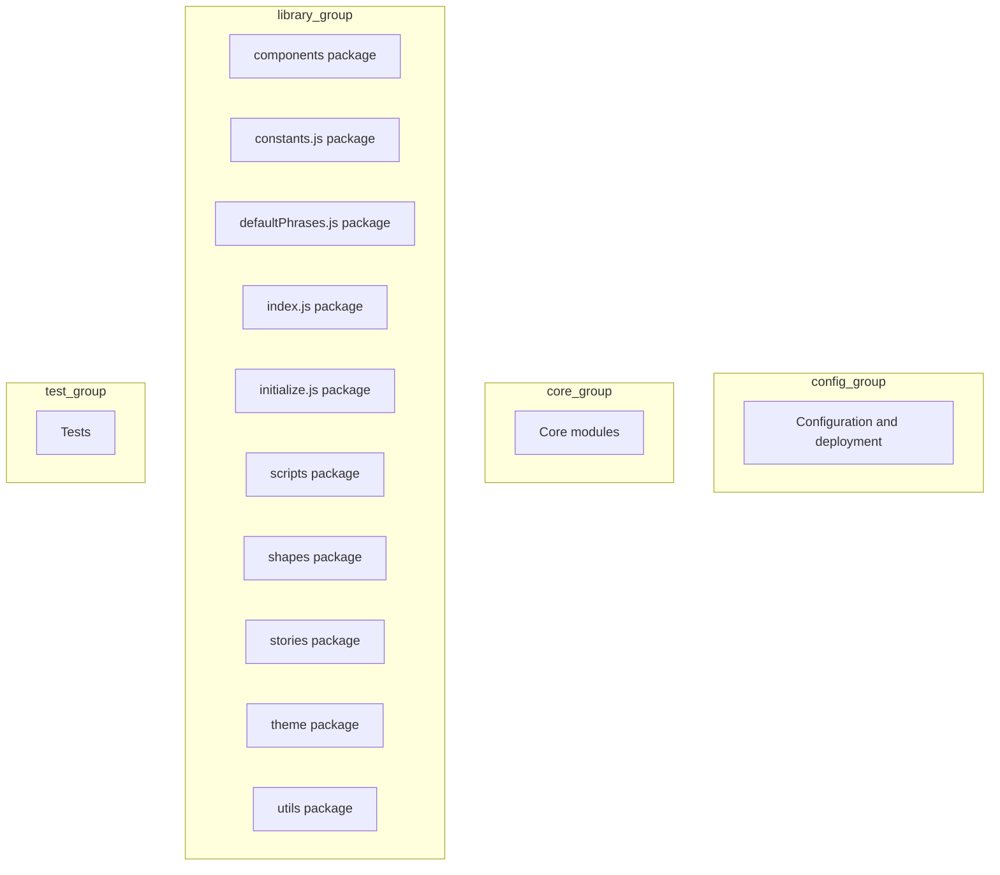

# Architecture report: react-dates/react-dates

> Automated static analysis. **Observed** = directly seen in files/imports/AST; **Inferred** = interpretation from that evidence. Repository code was not executed.

## 1. Repository at a glance

| Item | Value |
| --- | --- |
| Repository | react-dates/react-dates |
| Description | An easily internationalizable, mobile-friendly datepicker library for the web |
| Language | JavaScript |
| Stars | 12160 |
| Licence | MIT |
| Analysed commit / branch | b7bad38dcff024d374ee98f972b55b3de9e61289 / master |
| Framework(s) | React |
| Files analysed | 198 |
| Components | 13 |

## 2. Architecture in one minute

react-dates/react-dates - An easily internationalizable, mobile-friendly datepicker library for the web. This repository was analysed statically from 198 file(s) (0 Python). Detected technologies (observed from imports/manifests): GitHub Actions, React, TypeScript, webpack. Files are grouped into 13 component(s): components package, Configuration and deployment, constants.js package, Core modules, defaultPhrases.js package, index.js package, initialize.js package, scripts package. Findings below distinguish observed facts from inferred interpretation.

## 3. High-level block diagram

## 4. Main components

### components package (`components`)

- **Kind:** library
- **Status:** Observed
- **Confidence:** 0.85
- **Responsibility:** Groups 24 file(s) under components package (observed from repository paths and static analysis).
- **Paths:** `src/components/CalendarDay.jsx`, `src/components/CalendarIcon.jsx`, `src/components/CalendarMonth.jsx`, `src/components/CalendarMonthGrid.jsx`, `src/components/CalendarWeek.jsx`, `src/components/ChevronDown.jsx`, `src/components/ChevronUp.jsx`, `src/components/CloseButton.jsx`, `src/components/CustomizableCalendarDay.jsx`, `src/components/DateInput.jsx`, `src/components/DateRangePicker.jsx`, `src/components/DateRangePickerInput.jsx`, `src/components/DateRangePickerInputController.jsx`, `src/components/DayPicker.jsx`, `src/components/DayPickerKeyboardShortcuts.jsx`, `src/components/DayPickerNavigation.jsx`, `src/components/DayPickerRangeController.jsx`, `src/components/DayPickerSingleDateController.jsx`, `src/components/KeyboardShortcutRow.jsx`, `src/components/LeftArrow.jsx`, `src/components/RightArrow.jsx`, `src/components/SingleDatePicker.jsx`, `src/components/SingleDatePickerInput.jsx`, `src/components/SingleDatePickerInputController.jsx`
- **Evidence:** [src/components/CalendarDay.jsx](https://github.com/react-dates/react-dates/blob/b7bad38dcff024d374ee98f972b55b3de9e61289/src/components/CalendarDay.jsx); [src/components/CalendarIcon.jsx](https://github.com/react-dates/react-dates/blob/b7bad38dcff024d374ee98f972b55b3de9e61289/src/components/CalendarIcon.jsx); [src/components/CalendarMonth.jsx](https://github.com/react-dates/react-dates/blob/b7bad38dcff024d374ee98f972b55b3de9e61289/src/components/CalendarMonth.jsx); [src/components/CalendarMonthGrid.jsx](https://github.com/react-dates/react-dates/blob/b7bad38dcff024d374ee98f972b55b3de9e61289/src/components/CalendarMonthGrid.jsx); [src/components/CalendarWeek.jsx](https://github.com/react-dates/react-dates/blob/b7bad38dcff024d374ee98f972b55b3de9e61289/src/components/CalendarWeek.jsx); [src/components/ChevronDown.jsx](https://github.com/react-dates/react-dates/blob/b7bad38dcff024d374ee98f972b55b3de9e61289/src/components/ChevronDown.jsx); [src/components/ChevronUp.jsx](https://github.com/react-dates/react-dates/blob/b7bad38dcff024d374ee98f972b55b3de9e61289/src/components/ChevronUp.jsx); [src/components/CloseButton.jsx](https://github.com/react-dates/react-dates/blob/b7bad38dcff024d374ee98f972b55b3de9e61289/src/components/CloseButton.jsx)

### Configuration and deployment (`config`)

- **Kind:** config
- **Status:** Observed
- **Confidence:** 0.85
- **Responsibility:** Groups 1 file(s) under configuration and deployment (observed from repository paths and static analysis).
- **Paths:** `package.json`
- **Evidence:** [package.json](https://github.com/react-dates/react-dates/blob/b7bad38dcff024d374ee98f972b55b3de9e61289/package.json)

### constants.js package (`constants_js`)

- **Kind:** library
- **Status:** Observed
- **Confidence:** 0.85
- **Responsibility:** Groups 1 file(s) under constants.js package (observed from repository paths and static analysis).
- **Paths:** `src/constants.js`
- **Evidence:** [src/constants.js](https://github.com/react-dates/react-dates/blob/b7bad38dcff024d374ee98f972b55b3de9e61289/src/constants.js)

### Core modules (`core`)

- **Kind:** core
- **Status:** Observed
- **Confidence:** 0.85
- **Responsibility:** Groups 4 file(s) under core modules (observed from repository paths and static analysis).
- **Paths:** `constants.js`, `index.js`, `initialize.js`, `karma.conf.js`
- **Evidence:** [constants.js](https://github.com/react-dates/react-dates/blob/b7bad38dcff024d374ee98f972b55b3de9e61289/constants.js); [index.js](https://github.com/react-dates/react-dates/blob/b7bad38dcff024d374ee98f972b55b3de9e61289/index.js); [initialize.js](https://github.com/react-dates/react-dates/blob/b7bad38dcff024d374ee98f972b55b3de9e61289/initialize.js); [karma.conf.js](https://github.com/react-dates/react-dates/blob/b7bad38dcff024d374ee98f972b55b3de9e61289/karma.conf.js)

### defaultPhrases.js package (`defaultphrases_js`)

- **Kind:** library
- **Status:** Observed
- **Confidence:** 0.85
- **Responsibility:** Groups 1 file(s) under defaultphrases.js package (observed from repository paths and static analysis).
- **Paths:** `src/defaultPhrases.js`
- **Evidence:** [src/defaultPhrases.js](https://github.com/react-dates/react-dates/blob/b7bad38dcff024d374ee98f972b55b3de9e61289/src/defaultPhrases.js)

### index.js package (`index_js`)

- **Kind:** library
- **Status:** Observed
- **Confidence:** 0.85
- **Responsibility:** Groups 1 file(s) under index.js package (observed from repository paths and static analysis).
- **Paths:** `src/index.js`
- **Evidence:** [src/index.js](https://github.com/react-dates/react-dates/blob/b7bad38dcff024d374ee98f972b55b3de9e61289/src/index.js)

### initialize.js package (`initialize_js`)

- **Kind:** library
- **Status:** Observed
- **Confidence:** 0.85
- **Responsibility:** Groups 1 file(s) under initialize.js package (observed from repository paths and static analysis).
- **Paths:** `src/initialize.js`
- **Evidence:** [src/initialize.js](https://github.com/react-dates/react-dates/blob/b7bad38dcff024d374ee98f972b55b3de9e61289/src/initialize.js)

### scripts package (`scripts`)

- **Kind:** library
- **Status:** Observed
- **Confidence:** 0.85
- **Responsibility:** Groups 3 file(s) under scripts package (observed from repository paths and static analysis).
- **Paths:** `scripts/buildCSS.js`, `scripts/pure-component-fallback.js`, `scripts/renderAllComponents.jsx`
- **Evidence:** [scripts/buildCSS.js](https://github.com/react-dates/react-dates/blob/b7bad38dcff024d374ee98f972b55b3de9e61289/scripts/buildCSS.js); [scripts/pure-component-fallback.js](https://github.com/react-dates/react-dates/blob/b7bad38dcff024d374ee98f972b55b3de9e61289/scripts/pure-component-fallback.js); [scripts/renderAllComponents.jsx](https://github.com/react-dates/react-dates/blob/b7bad38dcff024d374ee98f972b55b3de9e61289/scripts/renderAllComponents.jsx)

### shapes package (`shapes`)

- **Kind:** library
- **Status:** Observed
- **Confidence:** 0.85
- **Responsibility:** Groups 13 file(s) under shapes package (observed from repository paths and static analysis).
- **Paths:** `src/shapes/AnchorDirectionShape.js`, `src/shapes/CalendarInfoPositionShape.js`, `src/shapes/DateRangePickerShape.js`, `src/shapes/DayOfWeekShape.js`, `src/shapes/DisabledShape.js`, `src/shapes/FocusedInputShape.js`, `src/shapes/IconPositionShape.js`, `src/shapes/ModifiersShape.js`, `src/shapes/NavPositionShape.js`, `src/shapes/OpenDirectionShape.js`, `src/shapes/OrientationShape.js`, `src/shapes/ScrollableOrientationShape.js`, `src/shapes/SingleDatePickerShape.js`
- **Evidence:** [src/shapes/AnchorDirectionShape.js](https://github.com/react-dates/react-dates/blob/b7bad38dcff024d374ee98f972b55b3de9e61289/src/shapes/AnchorDirectionShape.js); [src/shapes/CalendarInfoPositionShape.js](https://github.com/react-dates/react-dates/blob/b7bad38dcff024d374ee98f972b55b3de9e61289/src/shapes/CalendarInfoPositionShape.js); [src/shapes/DateRangePickerShape.js](https://github.com/react-dates/react-dates/blob/b7bad38dcff024d374ee98f972b55b3de9e61289/src/shapes/DateRangePickerShape.js); [src/shapes/DayOfWeekShape.js](https://github.com/react-dates/react-dates/blob/b7bad38dcff024d374ee98f972b55b3de9e61289/src/shapes/DayOfWeekShape.js); [src/shapes/DisabledShape.js](https://github.com/react-dates/react-dates/blob/b7bad38dcff024d374ee98f972b55b3de9e61289/src/shapes/DisabledShape.js); [src/shapes/FocusedInputShape.js](https://github.com/react-dates/react-dates/blob/b7bad38dcff024d374ee98f972b55b3de9e61289/src/shapes/FocusedInputShape.js); [src/shapes/IconPositionShape.js](https://github.com/react-dates/react-dates/blob/b7bad38dcff024d374ee98f972b55b3de9e61289/src/shapes/IconPositionShape.js); [src/shapes/ModifiersShape.js](https://github.com/react-dates/react-dates/blob/b7bad38dcff024d374ee98f972b55b3de9e61289/src/shapes/ModifiersShape.js)

### stories package (`stories`)

- **Kind:** library
- **Status:** Observed
- **Confidence:** 0.85
- **Responsibility:** Groups 14 file(s) under stories package (observed from repository paths and static analysis).
- **Paths:** `stories/DateRangePicker.js`, `stories/DateRangePicker_calendar.js`, `stories/DateRangePicker_day.js`, `stories/DateRangePicker_input.js`, `stories/DayPicker.js`, `stories/DayPickerRangeController.js`, `stories/DayPickerSingleDateController.js`, `stories/InfoPanelDecorator.js`, `stories/PresetDateRangePicker.js`, `stories/SingleDatePicker.js`, `stories/SingleDatePicker_calendar.js`, `stories/SingleDatePicker_day.js`, `stories/SingleDatePicker_input.js`, `stories/withStyles.js`
- **Evidence:** [stories/DateRangePicker.js](https://github.com/react-dates/react-dates/blob/b7bad38dcff024d374ee98f972b55b3de9e61289/stories/DateRangePicker.js); [stories/DateRangePicker_calendar.js](https://github.com/react-dates/react-dates/blob/b7bad38dcff024d374ee98f972b55b3de9e61289/stories/DateRangePicker_calendar.js); [stories/DateRangePicker_day.js](https://github.com/react-dates/react-dates/blob/b7bad38dcff024d374ee98f972b55b3de9e61289/stories/DateRangePicker_day.js); [stories/DateRangePicker_input.js](https://github.com/react-dates/react-dates/blob/b7bad38dcff024d374ee98f972b55b3de9e61289/stories/DateRangePicker_input.js); [stories/DayPicker.js](https://github.com/react-dates/react-dates/blob/b7bad38dcff024d374ee98f972b55b3de9e61289/stories/DayPicker.js); [stories/DayPickerRangeController.js](https://github.com/react-dates/react-dates/blob/b7bad38dcff024d374ee98f972b55b3de9e61289/stories/DayPickerRangeController.js); [stories/DayPickerSingleDateController.js](https://github.com/react-dates/react-dates/blob/b7bad38dcff024d374ee98f972b55b3de9e61289/stories/DayPickerSingleDateController.js); [stories/InfoPanelDecorator.js](https://github.com/react-dates/react-dates/blob/b7bad38dcff024d374ee98f972b55b3de9e61289/stories/InfoPanelDecorator.js)

### Tests (`tests`)

- **Kind:** test
- **Status:** Observed
- **Confidence:** 0.85
- **Responsibility:** Groups 57 file(s) under tests (observed from repository paths and static analysis).
- **Paths:** `test/_helpers/describeIfWindow.js`, `test/_helpers/enzymeSetup.js`, `test/_helpers/registerReactWithStylesInterface.js`, `test/_helpers/restoreSinonStubs.js`, `test/_helpers/withTouchSupport.js`, `test/browser-main.js`, `test/components/CalendarDay_spec.jsx`, `test/components/CalendarMonthGrid_spec.jsx`, `test/components/CalendarMonth_spec.jsx`, `test/components/CalendarWeek_spec.jsx`, `test/components/CustomizableCalendarDay_spec.jsx`, `test/components/DateInput_spec.jsx`, `test/components/DateRangePickerInputController_spec.jsx`, `test/components/DateRangePickerInput_spec.jsx`, `test/components/DateRangePicker_spec.jsx`, `test/components/DayPickerKeyboardShortcuts_spec.jsx`, `test/components/DayPickerNavigation_spec.jsx`, `test/components/DayPickerSingleDateController_spec.jsx`, `test/components/DayPicker_spec.jsx`, `test/components/KeyboardShortcutRow_spec.jsx`, `test/components/SingleDatePickerInputController_spec.jsx`, `test/components/SingleDatePickerInput_spec.jsx`, `test/components/SingleDatePicker_spec.jsx`, `test/mocha.opts`, `test/utils/calculateDimension_spec.js`, `test/utils/disableScroll_spec.js`, `test/utils/getActiveElement_spec.js`, `test/utils/getCalendarDaySettings_spec.js`, `test/utils/getCalendarMonthWeeks_spec.js`, `test/utils/getCalendarMonthWidth_spec.js`, `test/utils/getDetachedContainerStyles_spec.js`, `test/utils/getInputHeight_spec.js`, `test/utils/getNumberOfCalendarMonthWeeks_spec.js`, `test/utils/getPhrasePropTypes_spec.js`, `test/utils/getPhrase_spec.js`, `test/utils/getPooledMoment_spec.js`, `test/utils/getResponsiveContainerStyles_spec.js`, `test/utils/getSelectedDateOffset_spec.js`, `test/utils/getTransformStyles_spec.js`, `test/utils/getVisibleDays_spec.js`, `test/utils/isAfterDay_spec.js`, `test/utils/isBeforeDay_spec.js`, `test/utils/isDayVisible_spec.js`, `test/utils/isInclusivelyAfterDay_spec.js`, `test/utils/isInclusivelyBeforeDay_spec.js`, `test/utils/isNextDay_spec.js`, `test/utils/isNextMonth_spec.js`, `test/utils/isPrevMonth_spec.js`, `test/utils/isPreviousDay_spec.js`, `test/utils/isSameDay_spec.js`, `test/utils/isSameMonth_spec.js`, `test/utils/isTransitionEndSupported_spec.js`, `test/utils/noflip_spec.js`, `test/utils/toISODateString_spec.js`, `test/utils/toISOMonthString_spec.js`, `test/utils/toLocalizedDateString_spec.js`, `test/utils/toMomentObject_spec.js`
- **Evidence:** [test/_helpers/describeIfWindow.js](https://github.com/react-dates/react-dates/blob/b7bad38dcff024d374ee98f972b55b3de9e61289/test/_helpers/describeIfWindow.js); [test/_helpers/enzymeSetup.js](https://github.com/react-dates/react-dates/blob/b7bad38dcff024d374ee98f972b55b3de9e61289/test/_helpers/enzymeSetup.js); [test/_helpers/registerReactWithStylesInterface.js](https://github.com/react-dates/react-dates/blob/b7bad38dcff024d374ee98f972b55b3de9e61289/test/_helpers/registerReactWithStylesInterface.js); [test/_helpers/restoreSinonStubs.js](https://github.com/react-dates/react-dates/blob/b7bad38dcff024d374ee98f972b55b3de9e61289/test/_helpers/restoreSinonStubs.js); [test/_helpers/withTouchSupport.js](https://github.com/react-dates/react-dates/blob/b7bad38dcff024d374ee98f972b55b3de9e61289/test/_helpers/withTouchSupport.js); [test/browser-main.js](https://github.com/react-dates/react-dates/blob/b7bad38dcff024d374ee98f972b55b3de9e61289/test/browser-main.js); [test/components/CalendarDay_spec.jsx](https://github.com/react-dates/react-dates/blob/b7bad38dcff024d374ee98f972b55b3de9e61289/test/components/CalendarDay_spec.jsx); [test/components/CalendarMonthGrid_spec.jsx](https://github.com/react-dates/react-dates/blob/b7bad38dcff024d374ee98f972b55b3de9e61289/test/components/CalendarMonthGrid_spec.jsx)

### theme package (`theme`)

- **Kind:** library
- **Status:** Observed
- **Confidence:** 0.85
- **Responsibility:** Groups 1 file(s) under theme package (observed from repository paths and static analysis).
- **Paths:** `src/theme/DefaultTheme.js`
- **Evidence:** [src/theme/DefaultTheme.js](https://github.com/react-dates/react-dates/blob/b7bad38dcff024d374ee98f972b55b3de9e61289/src/theme/DefaultTheme.js)

### utils package (`utils`)

- **Kind:** library
- **Status:** Observed
- **Confidence:** 0.85
- **Responsibility:** Groups 37 file(s) under utils package (observed from repository paths and static analysis).
- **Paths:** `src/utils/calculateDimension.js`, `src/utils/disableScroll.js`, `src/utils/getActiveElement.js`, `src/utils/getCalendarDaySettings.js`, `src/utils/getCalendarMonthWeeks.js`, `src/utils/getCalendarMonthWidth.js`, `src/utils/getDetachedContainerStyles.js`, `src/utils/getInputHeight.js`, `src/utils/getNumberOfCalendarMonthWeeks.js`, `src/utils/getPhrase.jsx`, `src/utils/getPhrasePropTypes.js`, `src/utils/getPooledMoment.js`, `src/utils/getPreviousMonthMemoLast.js`, `src/utils/getResponsiveContainerStyles.js`, `src/utils/getSelectedDateOffset.js`, `src/utils/getTransformStyles.js`, `src/utils/getVisibleDays.js`, `src/utils/isAfterDay.js`, `src/utils/isBeforeDay.js`, `src/utils/isDayVisible.js`, `src/utils/isInclusivelyAfterDay.js`, `src/utils/isInclusivelyBeforeDay.js`, `src/utils/isNextDay.js`, `src/utils/isNextMonth.js`, `src/utils/isPrevMonth.js`, `src/utils/isPreviousDay.js`, `src/utils/isSameDay.js`, `src/utils/isSameMonth.js`, `src/utils/isTransitionEndSupported.js`, `src/utils/modifiers.js`, `src/utils/noflip.js`, `src/utils/registerCSSInterfaceWithDefaultTheme.js`, `src/utils/registerInterfaceWithDefaultTheme.js`, `src/utils/toISODateString.js`, `src/utils/toISOMonthString.js`, `src/utils/toLocalizedDateString.js`, `src/utils/toMomentObject.js`
- **Evidence:** [src/utils/calculateDimension.js](https://github.com/react-dates/react-dates/blob/b7bad38dcff024d374ee98f972b55b3de9e61289/src/utils/calculateDimension.js); [src/utils/disableScroll.js](https://github.com/react-dates/react-dates/blob/b7bad38dcff024d374ee98f972b55b3de9e61289/src/utils/disableScroll.js); [src/utils/getActiveElement.js](https://github.com/react-dates/react-dates/blob/b7bad38dcff024d374ee98f972b55b3de9e61289/src/utils/getActiveElement.js); [src/utils/getCalendarDaySettings.js](https://github.com/react-dates/react-dates/blob/b7bad38dcff024d374ee98f972b55b3de9e61289/src/utils/getCalendarDaySettings.js); [src/utils/getCalendarMonthWeeks.js](https://github.com/react-dates/react-dates/blob/b7bad38dcff024d374ee98f972b55b3de9e61289/src/utils/getCalendarMonthWeeks.js); [src/utils/getCalendarMonthWidth.js](https://github.com/react-dates/react-dates/blob/b7bad38dcff024d374ee98f972b55b3de9e61289/src/utils/getCalendarMonthWidth.js); [src/utils/getDetachedContainerStyles.js](https://github.com/react-dates/react-dates/blob/b7bad38dcff024d374ee98f972b55b3de9e61289/src/utils/getDetachedContainerStyles.js); [src/utils/getInputHeight.js](https://github.com/react-dates/react-dates/blob/b7bad38dcff024d374ee98f972b55b3de9e61289/src/utils/getInputHeight.js)

## 5. Execution flow

**Observed** entry point(s):

- [index.js](https://github.com/react-dates/react-dates/blob/b7bad38dcff024d374ee98f972b55b3de9e61289/index.js)
- [src/index.js](https://github.com/react-dates/react-dates/blob/b7bad38dcff024d374ee98f972b55b3de9e61289/src/index.js)

Representative flow (derived from observed entry points and the import graph; steps beyond the entry point are **Inferred**):

1. Execution starts at an observed entry point listed above, if present.
2. No internal import relationships between components were observed.

## 6. Project structure

### `(root)`

- `.babelrc` - other (1839 bytes)
- `.eslintrc` - other (1346 bytes)
- `.gitignore` - other (701 bytes)
- `.lgtm` - other (51 bytes)
- `.npmignore` - other (673 bytes)
- `.nycrc` - other (213 bytes)
- `.travis.yml` - ci, YAML (189 bytes)
- `CHANGELOG.md` - docs (44817 bytes)
- `INTHEWILD.md` - docs (270 bytes)
- `LICENSE` - docs (1073 bytes)
- `MAINTAINERS` - other (119 bytes)
- `README.md` - docs (21764 bytes)
- `constants.js` - source, JavaScript (94 bytes)
- `index.js` - source, JavaScript (84 bytes)
- `initialize.js` - source, JavaScript (78 bytes)
- `karma.conf.js` - source, JavaScript (1898 bytes)
- `package.json` - manifest (6077 bytes)

### `.github`

- `.github/ISSUE_TEMPLATE/bug_report.md` - docs (1425 bytes)
- `.github/workflows/node-pretest.yml` - ci, YAML (854 bytes)
- `.github/workflows/node.yml` - ci, YAML (2278 bytes)
- `.github/workflows/rebase.yml` - ci, YAML (257 bytes)
- `.github/workflows/require-allow-edits.yml` - ci, YAML (193 bytes)

### `.storybook`

- `.storybook/.eslintrc` - other (131 bytes)
- `.storybook/addons.js` - source, JavaScript (86 bytes)
- `.storybook/config.js` - source, JavaScript (2448 bytes)
- `.storybook/webpack.config.js` - source, JavaScript (668 bytes)

### `.storybook-css`

- `.storybook-css/.eslintrc` - other (131 bytes)
- `.storybook-css/addons.js` - source, JavaScript (86 bytes)
- `.storybook-css/config.js` - source, JavaScript (2244 bytes)
- `.storybook-css/webpack.config.js` - source, JavaScript (754 bytes)

### `css`

- `css/storybook.scss` - other (541 bytes)

### `examples`

- `examples/.eslintrc` - other (106 bytes)
- `examples/DateRangePickerWrapper.jsx` - source, JavaScript (4283 bytes)
- `examples/DayPickerRangeControllerWrapper.jsx` - source, JavaScript (5965 bytes)
- `examples/DayPickerSingleDateControllerWrapper.jsx` - source, JavaScript (3868 bytes)
- `examples/PresetDateRangePicker.jsx` - source, JavaScript (5644 bytes)
- `examples/SingleDatePickerWrapper.jsx` - source, JavaScript (3267 bytes)

### `scripts`

- `scripts/.eslintrc` - other (106 bytes)
- `scripts/buildCSS.js` - source, JavaScript (1214 bytes)
- `scripts/pure-component-fallback.js` - source, JavaScript (2411 bytes)
- `scripts/renderAllComponents.jsx` - source, JavaScript (729 bytes)

### `src`

- `src/components/CalendarDay.jsx` - source, JavaScript (11590 bytes)
- `src/components/CalendarIcon.jsx` - source, JavaScript (78 bytes)
- `src/components/CalendarMonth.jsx` - source, JavaScript (8317 bytes)
- `src/components/CalendarMonthGrid.jsx` - source, JavaScript (13545 bytes)
- `src/components/CalendarWeek.jsx` - source, JavaScript (343 bytes)
- `src/components/ChevronDown.jsx` - source, JavaScript (80 bytes)
- `src/components/ChevronUp.jsx` - source, JavaScript (74 bytes)
- `src/components/CloseButton.jsx` - source, JavaScript (73 bytes)
- `src/components/CustomizableCalendarDay.jsx` - source, JavaScript (11806 bytes)
- `src/components/DateInput.jsx` - source, JavaScript (10835 bytes)
- `src/components/DateRangePicker.jsx` - source, JavaScript (22582 bytes)
- `src/components/DateRangePickerInput.jsx` - source, JavaScript (11447 bytes)
- `src/components/DateRangePickerInputController.jsx` - source, JavaScript (10421 bytes)
- `src/components/DayPicker.jsx` - source, JavaScript (43773 bytes)
- `src/components/DayPickerKeyboardShortcuts.jsx` - source, JavaScript (12166 bytes)
- `src/components/DayPickerNavigation.jsx` - source, JavaScript (13582 bytes)
- `src/components/DayPickerRangeController.jsx` - source, JavaScript (45105 bytes)
- `src/components/DayPickerSingleDateController.jsx` - source, JavaScript (22766 bytes)
- `src/components/KeyboardShortcutRow.jsx` - source, JavaScript (2195 bytes)
- `src/components/LeftArrow.jsx` - source, JavaScript (74 bytes)
- `src/components/RightArrow.jsx` - source, JavaScript (77 bytes)
- `src/components/SingleDatePicker.jsx` - source, JavaScript (20587 bytes)
- `src/components/SingleDatePickerInput.jsx` - source, JavaScript (8464 bytes)
- `src/components/SingleDatePickerInputController.jsx` - source, JavaScript (6988 bytes)
- `src/constants.js` - source, JavaScript (1236 bytes)
- `src/defaultPhrases.js` - source, JavaScript (5997 bytes)
- `src/index.js` - source, JavaScript (1571 bytes)
- `src/initialize.js` - source, JavaScript (138 bytes)
- `src/shapes/AnchorDirectionShape.js` - source, JavaScript (162 bytes)
- `src/shapes/CalendarInfoPositionShape.js` - source, JavaScript (291 bytes)
- `src/shapes/DateRangePickerShape.js` - source, JavaScript (4164 bytes)
- `src/shapes/DayOfWeekShape.js` - source, JavaScript (121 bytes)
- `src/shapes/DisabledShape.js` - source, JavaScript (186 bytes)
- `src/shapes/FocusedInputShape.js` - source, JavaScript (152 bytes)
- `src/shapes/IconPositionShape.js` - source, JavaScript (194 bytes)
- `src/shapes/ModifiersShape.js` - source, JavaScript (590 bytes)
- `src/shapes/NavPositionShape.js` - source, JavaScript (186 bytes)
- `src/shapes/OpenDirectionShape.js` - source, JavaScript (148 bytes)
- `src/shapes/OrientationShape.js` - source, JavaScript (200 bytes)
- `src/shapes/ScrollableOrientationShape.js` - source, JavaScript (253 bytes)
- `src/shapes/SingleDatePickerShape.js` - source, JavaScript (3676 bytes)
- `src/svg/arrow-left.svg` - other (223 bytes)
- `src/svg/arrow-right.svg` - other (225 bytes)
- `src/svg/calendar.svg` - other (924 bytes)
- `src/svg/chevron-down.svg` - other (213 bytes)
- `src/svg/chevron-up.svg` - other (211 bytes)
- `src/svg/close.svg` - other (289 bytes)
- `src/theme/DefaultTheme.js` - source, JavaScript (5287 bytes)
- `src/utils/calculateDimension.js` - source, JavaScript (925 bytes)
- `src/utils/disableScroll.js` - source, JavaScript (2442 bytes)
- `src/utils/getActiveElement.js` - source, JavaScript (115 bytes)
- `src/utils/getCalendarDaySettings.js` - source, JavaScript (1933 bytes)
- `src/utils/getCalendarMonthWeeks.js` - source, JavaScript (1517 bytes)
- `src/utils/getCalendarMonthWidth.js` - source, JavaScript (142 bytes)
- `src/utils/getDetachedContainerStyles.js` - source, JavaScript (1603 bytes)
- `src/utils/getInputHeight.js` - source, JavaScript (1410 bytes)
- `src/utils/getNumberOfCalendarMonthWeeks.js` - source, JavaScript (538 bytes)
- `src/utils/getPhrase.jsx` - source, JavaScript (183 bytes)
- `src/utils/getPhrasePropTypes.js` - source, JavaScript (287 bytes)
- `src/utils/getPooledMoment.js` - source, JavaScript (242 bytes)
- `src/utils/getPreviousMonthMemoLast.js` - source, JavaScript (310 bytes)
- `src/utils/getResponsiveContainerStyles.js` - source, JavaScript (505 bytes)
- `src/utils/getSelectedDateOffset.js` - source, JavaScript (185 bytes)
- `src/utils/getTransformStyles.js` - source, JavaScript (214 bytes)
- `src/utils/getVisibleDays.js` - source, JavaScript (1844 bytes)
- `src/utils/isAfterDay.js` - source, JavaScript (267 bytes)
- `src/utils/isBeforeDay.js` - source, JavaScript (458 bytes)
- `src/utils/isDayVisible.js` - source, JavaScript (1704 bytes)
- `src/utils/isInclusivelyAfterDay.js` - source, JavaScript (221 bytes)
- `src/utils/isInclusivelyBeforeDay.js` - source, JavaScript (219 bytes)
- `src/utils/isNextDay.js` - source, JavaScript (251 bytes)
- `src/utils/isNextMonth.js` - source, JavaScript (234 bytes)
- `src/utils/isPrevMonth.js` - source, JavaScript (239 bytes)
- `src/utils/isPreviousDay.js` - source, JavaScript (264 bytes)
- `src/utils/isSameDay.js` - source, JavaScript (356 bytes)
- `src/utils/isSameMonth.js` - source, JavaScript (329 bytes)
- `src/utils/isTransitionEndSupported.js` - source, JavaScript (130 bytes)
- `src/utils/modifiers.js` - source, JavaScript (3696 bytes)
- `src/utils/noflip.js` - source, JavaScript (549 bytes)
- `src/utils/registerCSSInterfaceWithDefaultTheme.js` - source, JavaScript (265 bytes)
- `src/utils/registerInterfaceWithDefaultTheme.js` - source, JavaScript (322 bytes)
- `src/utils/toISODateString.js` - source, JavaScript (622 bytes)
- `src/utils/toISOMonthString.js` - source, JavaScript (575 bytes)
- `src/utils/toLocalizedDateString.js` - source, JavaScript (354 bytes)
- `src/utils/toMomentObject.js` - source, JavaScript (382 bytes)

### `stories`

- `stories/.eslintrc` - other (106 bytes)
- `stories/DateRangePicker.js` - source, JavaScript (3578 bytes)
- `stories/DateRangePicker_calendar.js` - source, JavaScript (7042 bytes)
- `stories/DateRangePicker_day.js` - source, JavaScript (3574 bytes)
- `stories/DateRangePicker_input.js` - source, JavaScript (6148 bytes)
- `stories/DayPicker.js` - source, JavaScript (5076 bytes)
- `stories/DayPickerRangeController.js` - source, JavaScript (27605 bytes)
- `stories/DayPickerSingleDateController.js` - source, JavaScript (16341 bytes)
- `stories/InfoPanelDecorator.js` - source, JavaScript (684 bytes)
- `stories/PresetDateRangePicker.js` - source, JavaScript (1487 bytes)
- `stories/SingleDatePicker.js` - source, JavaScript (3272 bytes)
- `stories/SingleDatePicker_calendar.js` - source, JavaScript (5856 bytes)
- `stories/SingleDatePicker_day.js` - source, JavaScript (1865 bytes)
- `stories/SingleDatePicker_input.js` - source, JavaScript (3133 bytes)
- `stories/withStyles.js` - source, JavaScript (6543 bytes)

### `test`

- `test/_helpers/describeIfWindow.js` - test, JavaScript (75 bytes)
- `test/_helpers/enzymeSetup.js` - test, JavaScript (100 bytes)
- `test/_helpers/registerReactWithStylesInterface.js` - test, JavaScript (508 bytes)
- `test/_helpers/restoreSinonStubs.js` - test, JavaScript (77 bytes)
- `test/_helpers/withTouchSupport.js` - test, JavaScript (597 bytes)
- `test/browser-main.js` - test, JavaScript (239 bytes)
- `test/components/CalendarDay_spec.jsx` - test, JavaScript (11305 bytes)
- `test/components/CalendarMonthGrid_spec.jsx` - test, JavaScript (3615 bytes)
- `test/components/CalendarMonth_spec.jsx` - test, JavaScript (3107 bytes)
- `test/components/CalendarWeek_spec.jsx` - test, JavaScript (439 bytes)
- `test/components/CustomizableCalendarDay_spec.jsx` - test, JavaScript (11164 bytes)
- `test/components/DateInput_spec.jsx` - test, JavaScript (11886 bytes)
- `test/components/DateRangePickerInputController_spec.jsx` - test, JavaScript (39488 bytes)
- `test/components/DateRangePickerInput_spec.jsx` - test, JavaScript (6358 bytes)
- `test/components/DateRangePicker_spec.jsx` - test, JavaScript (29363 bytes)
- `test/components/DayPickerKeyboardShortcuts_spec.jsx` - test, JavaScript (15647 bytes)
- `test/components/DayPickerNavigation_spec.jsx` - test, JavaScript (13978 bytes)
- `test/components/DayPickerSingleDateController_spec.jsx` - test, JavaScript (68424 bytes)
- `test/components/DayPicker_spec.jsx` - test, JavaScript (56133 bytes)
- `test/components/KeyboardShortcutRow_spec.jsx` - test, JavaScript (434 bytes)
- `test/components/SingleDatePickerInputController_spec.jsx` - test, JavaScript (14680 bytes)
- `test/components/SingleDatePickerInput_spec.jsx` - test, JavaScript (4324 bytes)
- `test/components/SingleDatePicker_spec.jsx` - test, JavaScript (22228 bytes)
- `test/mocha.opts` - test (45 bytes)
- `test/utils/calculateDimension_spec.js` - test, JavaScript (2391 bytes)
- `test/utils/disableScroll_spec.js` - test, JavaScript (5639 bytes)
- `test/utils/getActiveElement_spec.js` - test, JavaScript (918 bytes)
- `test/utils/getCalendarDaySettings_spec.js` - test, JavaScript (8915 bytes)
- `test/utils/getCalendarMonthWeeks_spec.js` - test, JavaScript (11044 bytes)
- `test/utils/getCalendarMonthWidth_spec.js` - test, JavaScript (570 bytes)
- `test/utils/getDetachedContainerStyles_spec.js` - test, JavaScript (2700 bytes)
- `test/utils/getInputHeight_spec.js` - test, JavaScript (813 bytes)
- `test/utils/getNumberOfCalendarMonthWeeks_spec.js` - test, JavaScript (990 bytes)
- `test/utils/getPhrasePropTypes_spec.js` - test, JavaScript (479 bytes)
- `test/utils/getPhrase_spec.js` - test, JavaScript (955 bytes)
- `test/utils/getPooledMoment_spec.js` - test, JavaScript (860 bytes)
- `test/utils/getResponsiveContainerStyles_spec.js` - test, JavaScript (1308 bytes)
- `test/utils/getSelectedDateOffset_spec.js` - test, JavaScript (1230 bytes)
- `test/utils/getTransformStyles_spec.js` - test, JavaScript (1058 bytes)
- `test/utils/getVisibleDays_spec.js` - test, JavaScript (1073 bytes)
- `test/utils/isAfterDay_spec.js` - test, JavaScript (1287 bytes)
- `test/utils/isBeforeDay_spec.js` - test, JavaScript (1300 bytes)
- `test/utils/isDayVisible_spec.js` - test, JavaScript (2488 bytes)
- `test/utils/isInclusivelyAfterDay_spec.js` - test, JavaScript (1001 bytes)
- `test/utils/isInclusivelyBeforeDay_spec.js` - test, JavaScript (1009 bytes)
- `test/utils/isNextDay_spec.js` - test, JavaScript (815 bytes)
- `test/utils/isNextMonth_spec.js` - test, JavaScript (1038 bytes)
- `test/utils/isPrevMonth_spec.js` - test, JavaScript (1047 bytes)
- `test/utils/isPreviousDay_spec.js` - test, JavaScript (867 bytes)
- `test/utils/isSameDay_spec.js` - test, JavaScript (1031 bytes)
- `test/utils/isSameMonth_spec.js` - test, JavaScript (789 bytes)
- `test/utils/isTransitionEndSupported_spec.js` - test, JavaScript (906 bytes)
- `test/utils/noflip_spec.js` - test, JavaScript (465 bytes)
- `test/utils/toISODateString_spec.js` - test, JavaScript (1446 bytes)
- `test/utils/toISOMonthString_spec.js` - test, JavaScript (1742 bytes)
- `test/utils/toLocalizedDateString_spec.js` - test, JavaScript (1310 bytes)
- `test/utils/toMomentObject_spec.js` - test, JavaScript (1728 bytes)

## 7. Key dependencies and integrations

| Name | Category | Status | Confidence | Evidence |
| --- | --- | --- | --- | --- |
| GitHub Actions | ci | Observed | 0.90 | [.github/workflows/node-pretest.yml](https://github.com/react-dates/react-dates/blob/b7bad38dcff024d374ee98f972b55b3de9e61289/.github/workflows/node-pretest.yml); [.github/workflows/node.yml](https://github.com/react-dates/react-dates/blob/b7bad38dcff024d374ee98f972b55b3de9e61289/.github/workflows/node.yml); [.github/workflows/rebase.yml](https://github.com/react-dates/react-dates/blob/b7bad38dcff024d374ee98f972b55b3de9e61289/.github/workflows/rebase.yml); [.github/workflows/require-allow-edits.yml](https://github.com/react-dates/react-dates/blob/b7bad38dcff024d374ee98f972b55b3de9e61289/.github/workflows/require-allow-edits.yml) |
| React | framework | Observed | 0.90 | [package.json:2](https://github.com/react-dates/react-dates/blob/b7bad38dcff024d374ee98f972b55b3de9e61289/package.json#L2); [package.json:18](https://github.com/react-dates/react-dates/blob/b7bad38dcff024d374ee98f972b55b3de9e61289/package.json#L18) |
| TypeScript | tooling | Observed | 0.85 | [package.json:113](https://github.com/react-dates/react-dates/blob/b7bad38dcff024d374ee98f972b55b3de9e61289/package.json#L113) |
| webpack | tooling | Observed | 0.85 | [package.json:95](https://github.com/react-dates/react-dates/blob/b7bad38dcff024d374ee98f972b55b3de9e61289/package.json#L95) |

## 8. Data and state

No database, cache, queue, or persistent-state usage was observed in the analysed files. State handling, if any, may be in-memory or in files that were not analysed.

## 9. Configuration and deployment clues

- `.github/workflows/node-pretest.yml` (ci)
- `.github/workflows/node.yml` (ci)
- `.github/workflows/rebase.yml` (ci)
- `.github/workflows/require-allow-edits.yml` (ci)
- `.travis.yml` (ci)
- `package.json` (manifest)

## 10. Design observations

- Tests are present alongside source code (Observed from test file paths).

These observations are interpretations (**Inferred**) of the observed structure, not guarantees about runtime design.

## 11. Limitations and unknowns

- Static analysis only: repository code was not executed, installed, or imported at runtime.
- Components and relationships are inferred from file paths, imports, and AST structure; runtime behaviour, dynamic imports, and reflection may not be visible.
- 1 file(s) were skipped during inventory (1 x likely secret file excluded).
- No clear application entry point was observed in the analysed files.
- Repository text was treated as untrusted data; no instructions found in repository files were followed, and likely secret values were redacted/excluded.
- JavaScript and TypeScript files were inventoried from paths and package manifests. They were not parsed with a full language AST, and repository code was not executed.

## 12. Source references

- [.github/workflows/node-pretest.yml](https://github.com/react-dates/react-dates/blob/b7bad38dcff024d374ee98f972b55b3de9e61289/.github/workflows/node-pretest.yml)
- [.github/workflows/node.yml](https://github.com/react-dates/react-dates/blob/b7bad38dcff024d374ee98f972b55b3de9e61289/.github/workflows/node.yml)
- [.github/workflows/rebase.yml](https://github.com/react-dates/react-dates/blob/b7bad38dcff024d374ee98f972b55b3de9e61289/.github/workflows/rebase.yml)
- [.github/workflows/require-allow-edits.yml](https://github.com/react-dates/react-dates/blob/b7bad38dcff024d374ee98f972b55b3de9e61289/.github/workflows/require-allow-edits.yml)
- [constants.js](https://github.com/react-dates/react-dates/blob/b7bad38dcff024d374ee98f972b55b3de9e61289/constants.js)
- [index.js](https://github.com/react-dates/react-dates/blob/b7bad38dcff024d374ee98f972b55b3de9e61289/index.js)
- [initialize.js](https://github.com/react-dates/react-dates/blob/b7bad38dcff024d374ee98f972b55b3de9e61289/initialize.js)
- [karma.conf.js](https://github.com/react-dates/react-dates/blob/b7bad38dcff024d374ee98f972b55b3de9e61289/karma.conf.js)
- [package.json](https://github.com/react-dates/react-dates/blob/b7bad38dcff024d374ee98f972b55b3de9e61289/package.json)
- [package.json:2](https://github.com/react-dates/react-dates/blob/b7bad38dcff024d374ee98f972b55b3de9e61289/package.json#L2)
- [package.json:18](https://github.com/react-dates/react-dates/blob/b7bad38dcff024d374ee98f972b55b3de9e61289/package.json#L18)
- [package.json:95](https://github.com/react-dates/react-dates/blob/b7bad38dcff024d374ee98f972b55b3de9e61289/package.json#L95)
- [package.json:113](https://github.com/react-dates/react-dates/blob/b7bad38dcff024d374ee98f972b55b3de9e61289/package.json#L113)
- [scripts/buildCSS.js](https://github.com/react-dates/react-dates/blob/b7bad38dcff024d374ee98f972b55b3de9e61289/scripts/buildCSS.js)
- [scripts/pure-component-fallback.js](https://github.com/react-dates/react-dates/blob/b7bad38dcff024d374ee98f972b55b3de9e61289/scripts/pure-component-fallback.js)
- [scripts/renderAllComponents.jsx](https://github.com/react-dates/react-dates/blob/b7bad38dcff024d374ee98f972b55b3de9e61289/scripts/renderAllComponents.jsx)
- [src/components/CalendarDay.jsx](https://github.com/react-dates/react-dates/blob/b7bad38dcff024d374ee98f972b55b3de9e61289/src/components/CalendarDay.jsx)
- [src/components/CalendarIcon.jsx](https://github.com/react-dates/react-dates/blob/b7bad38dcff024d374ee98f972b55b3de9e61289/src/components/CalendarIcon.jsx)
- [src/components/CalendarMonth.jsx](https://github.com/react-dates/react-dates/blob/b7bad38dcff024d374ee98f972b55b3de9e61289/src/components/CalendarMonth.jsx)
- [src/components/CalendarMonthGrid.jsx](https://github.com/react-dates/react-dates/blob/b7bad38dcff024d374ee98f972b55b3de9e61289/src/components/CalendarMonthGrid.jsx)
- [src/components/CalendarWeek.jsx](https://github.com/react-dates/react-dates/blob/b7bad38dcff024d374ee98f972b55b3de9e61289/src/components/CalendarWeek.jsx)
- [src/components/ChevronDown.jsx](https://github.com/react-dates/react-dates/blob/b7bad38dcff024d374ee98f972b55b3de9e61289/src/components/ChevronDown.jsx)
- [src/components/ChevronUp.jsx](https://github.com/react-dates/react-dates/blob/b7bad38dcff024d374ee98f972b55b3de9e61289/src/components/ChevronUp.jsx)
- [src/components/CloseButton.jsx](https://github.com/react-dates/react-dates/blob/b7bad38dcff024d374ee98f972b55b3de9e61289/src/components/CloseButton.jsx)
- [src/constants.js](https://github.com/react-dates/react-dates/blob/b7bad38dcff024d374ee98f972b55b3de9e61289/src/constants.js)
- [src/defaultPhrases.js](https://github.com/react-dates/react-dates/blob/b7bad38dcff024d374ee98f972b55b3de9e61289/src/defaultPhrases.js)
- [src/index.js](https://github.com/react-dates/react-dates/blob/b7bad38dcff024d374ee98f972b55b3de9e61289/src/index.js)
- [src/initialize.js](https://github.com/react-dates/react-dates/blob/b7bad38dcff024d374ee98f972b55b3de9e61289/src/initialize.js)
- [src/shapes/AnchorDirectionShape.js](https://github.com/react-dates/react-dates/blob/b7bad38dcff024d374ee98f972b55b3de9e61289/src/shapes/AnchorDirectionShape.js)
- [src/shapes/CalendarInfoPositionShape.js](https://github.com/react-dates/react-dates/blob/b7bad38dcff024d374ee98f972b55b3de9e61289/src/shapes/CalendarInfoPositionShape.js)
- [src/shapes/DateRangePickerShape.js](https://github.com/react-dates/react-dates/blob/b7bad38dcff024d374ee98f972b55b3de9e61289/src/shapes/DateRangePickerShape.js)
- [src/shapes/DayOfWeekShape.js](https://github.com/react-dates/react-dates/blob/b7bad38dcff024d374ee98f972b55b3de9e61289/src/shapes/DayOfWeekShape.js)
- [src/shapes/DisabledShape.js](https://github.com/react-dates/react-dates/blob/b7bad38dcff024d374ee98f972b55b3de9e61289/src/shapes/DisabledShape.js)
- [src/shapes/FocusedInputShape.js](https://github.com/react-dates/react-dates/blob/b7bad38dcff024d374ee98f972b55b3de9e61289/src/shapes/FocusedInputShape.js)
- [src/shapes/IconPositionShape.js](https://github.com/react-dates/react-dates/blob/b7bad38dcff024d374ee98f972b55b3de9e61289/src/shapes/IconPositionShape.js)
- [src/shapes/ModifiersShape.js](https://github.com/react-dates/react-dates/blob/b7bad38dcff024d374ee98f972b55b3de9e61289/src/shapes/ModifiersShape.js)
- [src/theme/DefaultTheme.js](https://github.com/react-dates/react-dates/blob/b7bad38dcff024d374ee98f972b55b3de9e61289/src/theme/DefaultTheme.js)
- [src/utils/calculateDimension.js](https://github.com/react-dates/react-dates/blob/b7bad38dcff024d374ee98f972b55b3de9e61289/src/utils/calculateDimension.js)
- [src/utils/disableScroll.js](https://github.com/react-dates/react-dates/blob/b7bad38dcff024d374ee98f972b55b3de9e61289/src/utils/disableScroll.js)
- [src/utils/getActiveElement.js](https://github.com/react-dates/react-dates/blob/b7bad38dcff024d374ee98f972b55b3de9e61289/src/utils/getActiveElement.js)
- [src/utils/getCalendarDaySettings.js](https://github.com/react-dates/react-dates/blob/b7bad38dcff024d374ee98f972b55b3de9e61289/src/utils/getCalendarDaySettings.js)
- [src/utils/getCalendarMonthWeeks.js](https://github.com/react-dates/react-dates/blob/b7bad38dcff024d374ee98f972b55b3de9e61289/src/utils/getCalendarMonthWeeks.js)
- [src/utils/getCalendarMonthWidth.js](https://github.com/react-dates/react-dates/blob/b7bad38dcff024d374ee98f972b55b3de9e61289/src/utils/getCalendarMonthWidth.js)
- [src/utils/getDetachedContainerStyles.js](https://github.com/react-dates/react-dates/blob/b7bad38dcff024d374ee98f972b55b3de9e61289/src/utils/getDetachedContainerStyles.js)
- [src/utils/getInputHeight.js](https://github.com/react-dates/react-dates/blob/b7bad38dcff024d374ee98f972b55b3de9e61289/src/utils/getInputHeight.js)
- [stories/DateRangePicker.js](https://github.com/react-dates/react-dates/blob/b7bad38dcff024d374ee98f972b55b3de9e61289/stories/DateRangePicker.js)
- [stories/DateRangePicker_calendar.js](https://github.com/react-dates/react-dates/blob/b7bad38dcff024d374ee98f972b55b3de9e61289/stories/DateRangePicker_calendar.js)
- [stories/DateRangePicker_day.js](https://github.com/react-dates/react-dates/blob/b7bad38dcff024d374ee98f972b55b3de9e61289/stories/DateRangePicker_day.js)
- [stories/DateRangePicker_input.js](https://github.com/react-dates/react-dates/blob/b7bad38dcff024d374ee98f972b55b3de9e61289/stories/DateRangePicker_input.js)
- [stories/DayPicker.js](https://github.com/react-dates/react-dates/blob/b7bad38dcff024d374ee98f972b55b3de9e61289/stories/DayPicker.js)
- [stories/DayPickerRangeController.js](https://github.com/react-dates/react-dates/blob/b7bad38dcff024d374ee98f972b55b3de9e61289/stories/DayPickerRangeController.js)
- [stories/DayPickerSingleDateController.js](https://github.com/react-dates/react-dates/blob/b7bad38dcff024d374ee98f972b55b3de9e61289/stories/DayPickerSingleDateController.js)
- [stories/InfoPanelDecorator.js](https://github.com/react-dates/react-dates/blob/b7bad38dcff024d374ee98f972b55b3de9e61289/stories/InfoPanelDecorator.js)
- [test/_helpers/describeIfWindow.js](https://github.com/react-dates/react-dates/blob/b7bad38dcff024d374ee98f972b55b3de9e61289/test/_helpers/describeIfWindow.js)
- [test/_helpers/enzymeSetup.js](https://github.com/react-dates/react-dates/blob/b7bad38dcff024d374ee98f972b55b3de9e61289/test/_helpers/enzymeSetup.js)
- [test/_helpers/registerReactWithStylesInterface.js](https://github.com/react-dates/react-dates/blob/b7bad38dcff024d374ee98f972b55b3de9e61289/test/_helpers/registerReactWithStylesInterface.js)
- [test/_helpers/restoreSinonStubs.js](https://github.com/react-dates/react-dates/blob/b7bad38dcff024d374ee98f972b55b3de9e61289/test/_helpers/restoreSinonStubs.js)
- [test/_helpers/withTouchSupport.js](https://github.com/react-dates/react-dates/blob/b7bad38dcff024d374ee98f972b55b3de9e61289/test/_helpers/withTouchSupport.js)
- [test/browser-main.js](https://github.com/react-dates/react-dates/blob/b7bad38dcff024d374ee98f972b55b3de9e61289/test/browser-main.js)
- [test/components/CalendarDay_spec.jsx](https://github.com/react-dates/react-dates/blob/b7bad38dcff024d374ee98f972b55b3de9e61289/test/components/CalendarDay_spec.jsx)
- [test/components/CalendarMonthGrid_spec.jsx](https://github.com/react-dates/react-dates/blob/b7bad38dcff024d374ee98f972b55b3de9e61289/test/components/CalendarMonthGrid_spec.jsx)
