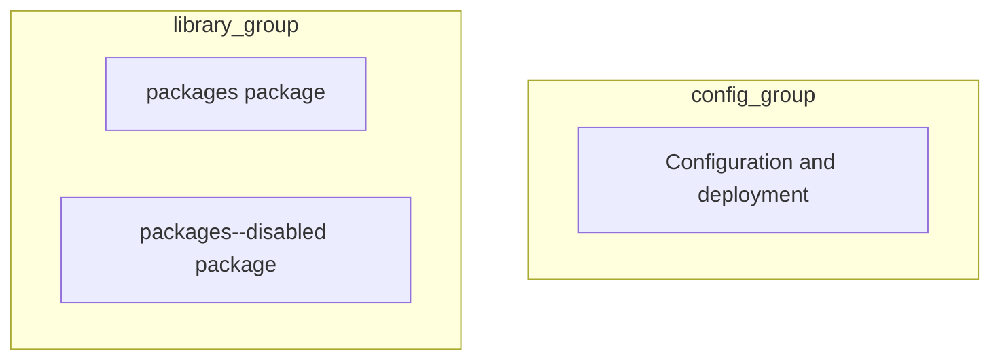

# Architecture report: react-static/react-static

> Automated static analysis. **Observed** = directly seen in files/imports/AST; **Inferred** = interpretation from that evidence. Repository code was not executed.

## 1. Repository at a glance

| Item | Value |
| --- | --- |
| Repository | react-static/react-static |
| Description | ⚛️ 🚀 A progressive static site generator for React. |
| Language | JavaScript |
| Stars | 10337 |
| Licence | MIT |
| Analysed commit / branch | 82c412265560c164cc19daabde9064b4679090d6 / master |
| Framework(s) | Express, React |
| Files analysed | 303 |
| Components | 3 |

## 2. Architecture in one minute

react-static/react-static - ⚛️ 🚀 A progressive static site generator for React.. This repository was analysed statically from 303 file(s) (0 Python). Detected technologies (observed from imports/manifests): Express, React, axios, React Router, Jest, TypeScript. Files are grouped into 3 component(s): Configuration and deployment, packages package, packages--disabled package. Findings below distinguish observed facts from inferred interpretation.

## 3. High-level block diagram

## 4. Main components

### Configuration and deployment (`config`)

- **Kind:** config
- **Status:** Observed
- **Confidence:** 0.85
- **Responsibility:** Groups 26 file(s) under configuration and deployment (observed from repository paths and static analysis).
- **Paths:** `lerna.json`, `package.json`, `packages--disabled/react-static-plugin-svgr/package.json`, `packages/react-static-plugin-css-modules/package.json`, `packages/react-static-plugin-emotion/package.json`, `packages/react-static-plugin-evergreen/package.json`, `packages/react-static-plugin-jss/package.json`, `packages/react-static-plugin-less/package.json`, `packages/react-static-plugin-mdx/package.json`, `packages/react-static-plugin-preact/package.json`, `packages/react-static-plugin-reach-router/package.json`, `packages/react-static-plugin-react-location/package.json`, `packages/react-static-plugin-react-router/package.json`, `packages/react-static-plugin-sass/package.json`, `packages/react-static-plugin-sitemap/package.json`, `packages/react-static-plugin-source-filesystem/package.json`, `packages/react-static-plugin-styled-components/package.json`, `packages/react-static-plugin-stylus/package.json`, `packages/react-static-plugin-typescript/package.json`, `packages/react-static/codecov.yml`, `packages/react-static/package.json`, `packages/react-static/templates/basic/package.json`, `packages/react-static/templates/blank/package.json`, `packages/react-static/templates/stress-test/package.json`, `packages/react-static/templates/typescript/package.json`, `packages/react-static/templates/typescript/tsconfig.json`
- **Evidence:** [lerna.json](https://github.com/react-static/react-static/blob/82c412265560c164cc19daabde9064b4679090d6/lerna.json); [package.json](https://github.com/react-static/react-static/blob/82c412265560c164cc19daabde9064b4679090d6/package.json); [packages--disabled/react-static-plugin-svgr/package.json](https://github.com/react-static/react-static/blob/82c412265560c164cc19daabde9064b4679090d6/packages--disabled/react-static-plugin-svgr/package.json); [packages/react-static-plugin-css-modules/package.json](https://github.com/react-static/react-static/blob/82c412265560c164cc19daabde9064b4679090d6/packages/react-static-plugin-css-modules/package.json); [packages/react-static-plugin-emotion/package.json](https://github.com/react-static/react-static/blob/82c412265560c164cc19daabde9064b4679090d6/packages/react-static-plugin-emotion/package.json); [packages/react-static-plugin-evergreen/package.json](https://github.com/react-static/react-static/blob/82c412265560c164cc19daabde9064b4679090d6/packages/react-static-plugin-evergreen/package.json); [packages/react-static-plugin-jss/package.json](https://github.com/react-static/react-static/blob/82c412265560c164cc19daabde9064b4679090d6/packages/react-static-plugin-jss/package.json); [packages/react-static-plugin-less/package.json](https://github.com/react-static/react-static/blob/82c412265560c164cc19daabde9064b4679090d6/packages/react-static-plugin-less/package.json)

### packages package (`packages`)

- **Kind:** library
- **Status:** Observed
- **Confidence:** 0.85
- **Responsibility:** Groups 149 file(s) under packages package (observed from repository paths and static analysis).
- **Paths:** `packages/react-static-plugin-css-modules/src/node.api.js`, `packages/react-static-plugin-emotion/src/browser.api.js`, `packages/react-static-plugin-emotion/src/node.api.js`, `packages/react-static-plugin-evergreen/src/node.api.js`, `packages/react-static-plugin-jss/src/node.api.js`, `packages/react-static-plugin-less/src/node.api.js`, `packages/react-static-plugin-mdx/src/loader/fm-loader.js`, `packages/react-static-plugin-mdx/src/node.api.js`, `packages/react-static-plugin-preact/src/node.api.js`, `packages/react-static-plugin-reach-router/src/browser.api.js`, `packages/react-static-plugin-react-location/src/browser.api.js`, `packages/react-static-plugin-react-router/src/browser.api.js`, `packages/react-static-plugin-sass/src/node.api.js`, `packages/react-static-plugin-sitemap/src/__test__/buildXML.test.js`, `packages/react-static-plugin-sitemap/src/buildXML.js`, `packages/react-static-plugin-sitemap/src/node.api.js`, `packages/react-static-plugin-source-filesystem/src/node.api.js`, `packages/react-static-plugin-styled-components/src/node.api.js`, `packages/react-static-plugin-stylus/src/node.api.js`, `packages/react-static-plugin-typescript/src/node.api.js`, `packages/react-static/babel-preset.js`, `packages/react-static/node/index.js`, `packages/react-static/setupTests.js`, `packages/react-static/src/Suspense.js`, `packages/react-static/src/bootstrapApp.js`, `packages/react-static/src/bootstrapPlugins.js`, `packages/react-static/src/bootstrapTemplates.js`, `packages/react-static/src/browser/__tests__/index.test.js`, `packages/react-static/src/browser/components/Default404.js`, `packages/react-static/src/browser/components/Root.js`, `packages/react-static/src/browser/components/RouteData.js`, `packages/react-static/src/browser/components/Routes.js`, `packages/react-static/src/browser/components/SiteData.js`, `packages/react-static/src/browser/context/routePathContext.js`, `packages/react-static/src/browser/context/staticInfoContext.js`, `packages/react-static/src/browser/hooks/useBasepath.js`, `packages/react-static/src/browser/hooks/useLocation.js`, `packages/react-static/src/browser/hooks/usePrefetch.js`, `packages/react-static/src/browser/hooks/useRouteData.js`, `packages/react-static/src/browser/hooks/useRoutePath.js`, `packages/react-static/src/browser/hooks/useSiteData.js`, `packages/react-static/src/browser/hooks/useStaticInfo.js`, `packages/react-static/src/browser/index.d.ts`, `packages/react-static/src/browser/index.js`, `packages/react-static/src/browser/utils/Visibility.js`, `packages/react-static/src/browser/utils/__tests__/shared.test.js`, `packages/react-static/src/browser/utils/index.js`, `packages/react-static/src/browser/utils/onLocationChange.js`, `packages/react-static/src/commands/build.js`, `packages/react-static/src/commands/bundle.js`, `packages/react-static/src/commands/create.js`, `packages/react-static/src/commands/export.js`, `packages/react-static/src/commands/start.js`, `packages/react-static/src/index.d.ts`, `packages/react-static/src/index.js`, `packages/react-static/src/index.node.js`, `packages/react-static/src/node/getWebpackConfig.js`, `packages/react-static/src/node/makePageRoutes.js`, `packages/react-static/src/static/__mocks__/config.development.mock.js`, `packages/react-static/src/static/__mocks__/config.production.mock.js`, `packages/react-static/src/static/__mocks__/config.with-plugin.mock.js`, `packages/react-static/src/static/__mocks__/mock-plugin/browser.api.js`, `packages/react-static/src/static/__mocks__/mock-plugin/node.api.js`, `packages/react-static/src/static/__mocks__/pages/404.js`, `packages/react-static/src/static/__mocks__/pages/about.js`, `packages/react-static/src/static/__mocks__/pages/index.js`, `packages/react-static/src/static/__mocks__/static.config.js.mock.js`, `packages/react-static/src/static/__mocks__/static.config.jsx.mock.jsx`, `packages/react-static/src/static/__tests__/exportRoute.test.js`, `packages/react-static/src/static/__tests__/extractTemplates.test.js`, `packages/react-static/src/static/__tests__/getConfig.test.js`, `packages/react-static/src/static/__tests__/getRoutes.test.js`, `packages/react-static/src/static/__tests__/webpack.test.js`, `packages/react-static/src/static/buildState.js`, `packages/react-static/src/static/cleanProjectFiles.js`, `packages/react-static/src/static/clientStats.js`, `packages/react-static/src/static/components/BodyWithMeta.js`, `packages/react-static/src/static/components/HeadWithMeta.js`, `packages/react-static/src/static/components/HtmlWithMeta.js`, `packages/react-static/src/static/components/Redirect.js`, `packages/react-static/src/static/components/RootComponents.js`, `packages/react-static/src/static/components/__tests__/BodyWithMeta.test.js`, `packages/react-static/src/static/components/__tests__/HeadWithMeta.test.js`, `packages/react-static/src/static/components/__tests__/HtmlWithMeta.test.js`, `packages/react-static/src/static/copyPublicFiles.js`, `packages/react-static/src/static/createSharedData.js`, `packages/react-static/src/static/exportRoute.js`, `packages/react-static/src/static/exportRoutes.js`, `packages/react-static/src/static/exportRoutes.sync.js`, `packages/react-static/src/static/exportRoutes.threaded.js`, `packages/react-static/src/static/exportSharedRouteData.js`, `packages/react-static/src/static/extractTemplates.js`, `packages/react-static/src/static/fetchRoutes.js`, `packages/react-static/src/static/fetchSiteData.js`, `packages/react-static/src/static/generateBrowserPlugins.js`, `packages/react-static/src/static/generateTemplates.js`, `packages/react-static/src/static/getConfig.js`, `packages/react-static/src/static/getRouteData.js`, `packages/react-static/src/static/getRoutes.js`, `packages/react-static/src/static/plugins.js`, `packages/react-static/src/static/webpack/buildProductionBundles.js`, `packages/react-static/src/static/webpack/makeWebpackConfig.js`, `packages/react-static/src/static/webpack/rules/cssLoader.js`, `packages/react-static/src/static/webpack/rules/fileLoader.js`, `packages/react-static/src/static/webpack/rules/index.js`, `packages/react-static/src/static/webpack/rules/jsLoader.js`, `packages/react-static/src/static/webpack/rules/jsLoaderExternal.js`, `packages/react-static/src/static/webpack/runDevServer.js`, `packages/react-static/src/static/webpack/webpack.config.dev.js`, `packages/react-static/src/static/webpack/webpack.config.prod.js`, `packages/react-static/src/utils/__tests__/chunkBuilder.test.js`, `packages/react-static/src/utils/binHelper.js`, `packages/react-static/src/utils/chunkBuilder.js`, `packages/react-static/src/utils/createIndexPlaceholder.js`, `packages/react-static/src/utils/index.js`, `packages/react-static/src/utils/progress.js`, `packages/react-static/templates/basic/src/App.js`, `packages/react-static/templates/basic/src/components/Router.js`, `packages/react-static/templates/basic/src/containers/Dynamic.js`, `packages/react-static/templates/basic/src/containers/Post.js`, `packages/react-static/templates/basic/src/index.js`, `packages/react-static/templates/basic/src/pages/404.js`, `packages/react-static/templates/basic/src/pages/about.js`, `packages/react-static/templates/basic/src/pages/blog.js`, `packages/react-static/templates/basic/src/pages/index.js`, `packages/react-static/templates/basic/static.config.js`, `packages/react-static/templates/blank/src/App.js`, `packages/react-static/templates/blank/src/index.js`, `packages/react-static/templates/blank/static.config.js`, `packages/react-static/templates/stress-test/src/App.js`, `packages/react-static/templates/stress-test/src/containers/Post.js`, `packages/react-static/templates/stress-test/src/index.js`, `packages/react-static/templates/stress-test/src/pages/404.js`, `packages/react-static/templates/stress-test/src/pages/about.js`, `packages/react-static/templates/stress-test/src/pages/blog.js`, `packages/react-static/templates/stress-test/src/pages/index.js`, `packages/react-static/templates/stress-test/static.config.js`, `packages/react-static/templates/typescript/index.d.ts`, `packages/react-static/templates/typescript/src/App.tsx`, `packages/react-static/templates/typescript/src/components/FancyDiv.tsx`, `packages/react-static/templates/typescript/src/containers/Dynamic.tsx`, `packages/react-static/templates/typescript/src/containers/Post.tsx`, `packages/react-static/templates/typescript/src/index.tsx`, `packages/react-static/templates/typescript/src/pages/404.tsx`, `packages/react-static/templates/typescript/src/pages/about.tsx`, `packages/react-static/templates/typescript/src/pages/blog.tsx`, `packages/react-static/templates/typescript/src/pages/index.tsx`, `packages/react-static/templates/typescript/static.config.js`, `packages/react-static/templates/typescript/types/index.ts`
- **Evidence:** [packages/react-static-plugin-css-modules/src/node.api.js](https://github.com/react-static/react-static/blob/82c412265560c164cc19daabde9064b4679090d6/packages/react-static-plugin-css-modules/src/node.api.js); [packages/react-static-plugin-emotion/src/browser.api.js](https://github.com/react-static/react-static/blob/82c412265560c164cc19daabde9064b4679090d6/packages/react-static-plugin-emotion/src/browser.api.js); [packages/react-static-plugin-emotion/src/node.api.js](https://github.com/react-static/react-static/blob/82c412265560c164cc19daabde9064b4679090d6/packages/react-static-plugin-emotion/src/node.api.js); [packages/react-static-plugin-evergreen/src/node.api.js](https://github.com/react-static/react-static/blob/82c412265560c164cc19daabde9064b4679090d6/packages/react-static-plugin-evergreen/src/node.api.js); [packages/react-static-plugin-jss/src/node.api.js](https://github.com/react-static/react-static/blob/82c412265560c164cc19daabde9064b4679090d6/packages/react-static-plugin-jss/src/node.api.js); [packages/react-static-plugin-less/src/node.api.js](https://github.com/react-static/react-static/blob/82c412265560c164cc19daabde9064b4679090d6/packages/react-static-plugin-less/src/node.api.js); [packages/react-static-plugin-mdx/src/loader/fm-loader.js](https://github.com/react-static/react-static/blob/82c412265560c164cc19daabde9064b4679090d6/packages/react-static-plugin-mdx/src/loader/fm-loader.js); [packages/react-static-plugin-mdx/src/node.api.js](https://github.com/react-static/react-static/blob/82c412265560c164cc19daabde9064b4679090d6/packages/react-static-plugin-mdx/src/node.api.js)

### packages--disabled package (`packages_disabled`)

- **Kind:** library
- **Status:** Observed
- **Confidence:** 0.85
- **Responsibility:** Groups 1 file(s) under packages--disabled package (observed from repository paths and static analysis).
- **Paths:** `packages--disabled/react-static-plugin-svgr/src/node.api.js`
- **Evidence:** [packages--disabled/react-static-plugin-svgr/src/node.api.js](https://github.com/react-static/react-static/blob/82c412265560c164cc19daabde9064b4679090d6/packages--disabled/react-static-plugin-svgr/src/node.api.js)

## 5. Execution flow

**Observed** entry point(s):

- [packages/react-static/bin/react-static](https://github.com/react-static/react-static/blob/82c412265560c164cc19daabde9064b4679090d6/packages/react-static/bin/react-static)
- [packages/react-static/node/index.js](https://github.com/react-static/react-static/blob/82c412265560c164cc19daabde9064b4679090d6/packages/react-static/node/index.js)
- [packages/react-static/src/index.js](https://github.com/react-static/react-static/blob/82c412265560c164cc19daabde9064b4679090d6/packages/react-static/src/index.js)

Representative flow (derived from observed entry points and the import graph; steps beyond the entry point are **Inferred**):

1. Execution starts at an observed entry point listed above, if present.
2. No internal import relationships between components were observed.

## 6. Project structure

### `(root)`

- `.eslintignore` - other (145 bytes)
- `.eslintrc.js` - source, JavaScript (178 bytes)
- `.gitattributes` - other (109 bytes)
- `.gitignore` - other (615 bytes)
- `.npmignore` - other (601 bytes)
- `.prettierrc` - other (69 bytes)
- `.travis.yml` - ci, YAML (54 bytes)
- `CHANGELOG.md` - docs (52801 bytes)
- `CODE_OF_CONDUCT.md` - docs (3231 bytes)
- `CONTRIBUTING.md` - docs (1666 bytes)
- `LICENSE` - docs (1077 bytes)
- `README.md` - docs (9927 bytes)
- `RELEASE.md` - docs (495 bytes)
- `ROADMAP.md` - docs (564 bytes)
- `lerna.json` - config (181 bytes)
- `package.json` - manifest (845 bytes)

### `.github`

- `.github/ISSUE_TEMPLATE/please_dont_open_issues.md` - docs (350 bytes)
- `.github/PULL_REQUEST_TEMPLATE.md` - docs (1180 bytes)
- `.github/stale.yml` - config (708 bytes)
- `.github/support.yml` - config (699 bytes)

### `archives`

- `archives/old-examples/README.md` - docs (223 bytes)

### `docs`

- `docs/README.md` - docs (795 bytes)
- `docs/api.md` - docs (12663 bytes)
- `docs/concepts.md` - docs (10677 bytes)
- `docs/config.md` - docs (15538 bytes)
- `docs/guides/README.md` - docs (1493 bytes)
- `docs/guides/algolia.md` - docs (1453 bytes)
- `docs/guides/animated-routes.md` - docs (1533 bytes)
- `docs/guides/apollo.md` - docs (4655 bytes)
- `docs/guides/aws-lambda.md` - docs (1291 bytes)
- `docs/guides/dynamic-routes-reach-router.md` - docs (1669 bytes)
- `docs/guides/dynamic-routes-react-router.md` - docs (1920 bytes)
- `docs/guides/emotion.md` - docs (186 bytes)
- `docs/guides/incremental-builds.md` - docs (2637 bytes)
- `docs/guides/jss.md` - docs (160 bytes)
- `docs/guides/material-ui.md` - docs (871 bytes)
- `docs/guides/pagination.md` - docs (2377 bytes)
- `docs/guides/styled-components.md` - docs (2579 bytes)
- `docs/plugins/README.md` - docs (6471 bytes)
- `docs/plugins/browser-api.md` - docs (1355 bytes)
- `docs/plugins/node-api.md` - docs (10999 bytes)

### `netlify-www`

- `netlify-www/_redirects` - other (458 bytes)

### `packages`

- `packages/react-static-plugin-css-modules/.babelrc` - other (39 bytes)
- `packages/react-static-plugin-css-modules/.gitignore` - other (42 bytes)
- `packages/react-static-plugin-css-modules/README.md` - docs (957 bytes)
- `packages/react-static-plugin-css-modules/package.json` - manifest (851 bytes)
- `packages/react-static-plugin-css-modules/src/node.api.js` - source, JavaScript (987 bytes)
- `packages/react-static-plugin-emotion/.babelrc` - other (62 bytes)
- `packages/react-static-plugin-emotion/.gitignore` - other (50 bytes)
- `packages/react-static-plugin-emotion/README.md` - docs (733 bytes)
- `packages/react-static-plugin-emotion/package.json` - manifest (1001 bytes)
- `packages/react-static-plugin-emotion/src/browser.api.js` - source, JavaScript (349 bytes)
- `packages/react-static-plugin-emotion/src/node.api.js` - source, JavaScript (664 bytes)
- `packages/react-static-plugin-evergreen/.babelrc` - other (74 bytes)
- `packages/react-static-plugin-evergreen/.gitignore` - other (74 bytes)
- `packages/react-static-plugin-evergreen/README.md` - docs (398 bytes)
- `packages/react-static-plugin-evergreen/package.json` - manifest (884 bytes)
- `packages/react-static-plugin-evergreen/src/node.api.js` - source, JavaScript (326 bytes)
- `packages/react-static-plugin-jss/.babelrc` - other (74 bytes)
- `packages/react-static-plugin-jss/.gitignore` - other (74 bytes)
- `packages/react-static-plugin-jss/README.md` - docs (661 bytes)
- `packages/react-static-plugin-jss/package.json` - manifest (886 bytes)
- `packages/react-static-plugin-jss/src/node.api.js` - source, JavaScript (778 bytes)
- `packages/react-static-plugin-less/.babelrc` - other (39 bytes)
- `packages/react-static-plugin-less/.gitignore` - other (57 bytes)
- `packages/react-static-plugin-less/README.md` - docs (703 bytes)
- `packages/react-static-plugin-less/package.json` - manifest (815 bytes)
- `packages/react-static-plugin-less/src/node.api.js` - source, JavaScript (2118 bytes)
- `packages/react-static-plugin-mdx/.babelrc` - other (39 bytes)
- `packages/react-static-plugin-mdx/.gitignore` - other (79 bytes)
- `packages/react-static-plugin-mdx/README.md` - docs (2315 bytes)
- `packages/react-static-plugin-mdx/package.json` - manifest (831 bytes)
- `packages/react-static-plugin-mdx/src/loader/fm-loader.js` - source, JavaScript (314 bytes)
- `packages/react-static-plugin-mdx/src/node.api.js` - source, JavaScript (839 bytes)
- `packages/react-static-plugin-preact/.babelrc` - other (39 bytes)
- `packages/react-static-plugin-preact/.gitignore` - other (57 bytes)
- `packages/react-static-plugin-preact/README.md` - docs (1169 bytes)
- `packages/react-static-plugin-preact/package.json` - manifest (835 bytes)
- `packages/react-static-plugin-preact/src/node.api.js` - source, JavaScript (516 bytes)
- `packages/react-static-plugin-reach-router/.babelrc` - other (74 bytes)
- `packages/react-static-plugin-reach-router/.gitignore` - other (74 bytes)
- `packages/react-static-plugin-reach-router/README.md` - docs (859 bytes)
- `packages/react-static-plugin-reach-router/package.json` - manifest (973 bytes)
- `packages/react-static-plugin-reach-router/src/browser.api.js` - source, JavaScript (1232 bytes)
- `packages/react-static-plugin-react-location/.babelrc` - other (62 bytes)
- `packages/react-static-plugin-react-location/.gitignore` - other (74 bytes)
- `packages/react-static-plugin-react-location/README.md` - docs (973 bytes)
- `packages/react-static-plugin-react-location/package.json` - manifest (978 bytes)
- `packages/react-static-plugin-react-location/src/browser.api.js` - source, JavaScript (1079 bytes)
- `packages/react-static-plugin-react-router/.babelrc` - other (74 bytes)
- `packages/react-static-plugin-react-router/.gitignore` - other (74 bytes)
- `packages/react-static-plugin-react-router/README.md` - docs (1076 bytes)
- `packages/react-static-plugin-react-router/package.json` - manifest (1038 bytes)
- `packages/react-static-plugin-react-router/src/browser.api.js` - source, JavaScript (1137 bytes)
- `packages/react-static-plugin-sass/.babelrc` - other (39 bytes)
- `packages/react-static-plugin-sass/.gitignore` - other (57 bytes)
- `packages/react-static-plugin-sass/README.md` - docs (755 bytes)
- `packages/react-static-plugin-sass/package.json` - manifest (1033 bytes)
- `packages/react-static-plugin-sass/src/node.api.js` - source, JavaScript (2297 bytes)
- `packages/react-static-plugin-sitemap/.babelrc` - other (39 bytes)
- `packages/react-static-plugin-sitemap/.gitignore` - other (57 bytes)
- `packages/react-static-plugin-sitemap/README.md` - docs (2770 bytes)
- `packages/react-static-plugin-sitemap/package.json` - manifest (986 bytes)
- `packages/react-static-plugin-sitemap/src/__test__/__snapshots__/buildXML.test.js.snap` - other (3243 bytes)
- `packages/react-static-plugin-sitemap/src/__test__/buildXML.test.js` - source, JavaScript (4378 bytes)
- `packages/react-static-plugin-sitemap/src/buildXML.js` - source, JavaScript (4105 bytes)
- `packages/react-static-plugin-sitemap/src/node.api.js` - source, JavaScript (770 bytes)
- `packages/react-static-plugin-source-filesystem/.babelrc` - other (39 bytes)
- `packages/react-static-plugin-source-filesystem/.gitignore` - other (57 bytes)
- `packages/react-static-plugin-source-filesystem/README.md` - docs (935 bytes)
- `packages/react-static-plugin-source-filesystem/package.json` - manifest (895 bytes)
- `packages/react-static-plugin-source-filesystem/src/node.api.js` - source, JavaScript (3634 bytes)
- `packages/react-static-plugin-styled-components/.babelrc` - other (74 bytes)
- `packages/react-static-plugin-styled-components/.gitignore` - other (74 bytes)
- `packages/react-static-plugin-styled-components/README.md` - docs (536 bytes)
- `packages/react-static-plugin-styled-components/package.json` - manifest (925 bytes)
- `packages/react-static-plugin-styled-components/src/node.api.js` - source, JavaScript (815 bytes)
- `packages/react-static-plugin-stylus/.babelrc` - other (39 bytes)
- `packages/react-static-plugin-stylus/.gitignore` - other (57 bytes)
- `packages/react-static-plugin-stylus/README.md` - docs (649 bytes)
- `packages/react-static-plugin-stylus/package.json` - manifest (843 bytes)
- `packages/react-static-plugin-stylus/src/node.api.js` - source, JavaScript (2074 bytes)
- `packages/react-static-plugin-typescript/.babelrc` - other (74 bytes)
- `packages/react-static-plugin-typescript/.gitignore` - other (74 bytes)
- `packages/react-static-plugin-typescript/README.md` - docs (2147 bytes)
- `packages/react-static-plugin-typescript/package.json` - manifest (1030 bytes)
- `packages/react-static-plugin-typescript/src/node.api.js` - source, JavaScript (3460 bytes)
- `packages/react-static/.babelrc` - other (36 bytes)
- `packages/react-static/.gitignore` - other (28 bytes)
- `packages/react-static/.nvmrc` - other (2 bytes)
- `packages/react-static/.prettierignore` - other (21 bytes)
- `packages/react-static/README.md` - docs (214 bytes)
- `packages/react-static/babel-preset.js` - source, JavaScript (2547 bytes)
- `packages/react-static/bin/react-static` - other (5464 bytes)
- `packages/react-static/codecov.yml` - config (0 bytes)
- `packages/react-static/node/index.js` - source, JavaScript (46 bytes)
- `packages/react-static/package.json` - manifest (5034 bytes)
- `packages/react-static/setupTests.js` - source, JavaScript (288 bytes)
- `packages/react-static/src/Suspense.js` - source, JavaScript (347 bytes)
- `packages/react-static/src/bootstrapApp.js` - source, JavaScript (708 bytes)
- `packages/react-static/src/bootstrapPlugins.js` - source, JavaScript (459 bytes)
- `packages/react-static/src/bootstrapTemplates.js` - source, JavaScript (600 bytes)
- `packages/react-static/src/browser/__tests__/index.test.js` - source, JavaScript (3241 bytes)
- `packages/react-static/src/browser/components/Default404.js` - source, JavaScript (117 bytes)
- `packages/react-static/src/browser/components/Root.js` - source, JavaScript (1449 bytes)
- `packages/react-static/src/browser/components/RouteData.js` - source, JavaScript (332 bytes)
- `packages/react-static/src/browser/components/Routes.js` - source, JavaScript (4279 bytes)
- `packages/react-static/src/browser/components/SiteData.js` - source, JavaScript (325 bytes)
- `packages/react-static/src/browser/context/routePathContext.js` - source, JavaScript (64 bytes)
- `packages/react-static/src/browser/context/staticInfoContext.js` - source, JavaScript (211 bytes)
- `packages/react-static/src/browser/hooks/useBasepath.js` - source, JavaScript (161 bytes)
- `packages/react-static/src/browser/hooks/useLocation.js` - source, JavaScript (433 bytes)
- `packages/react-static/src/browser/hooks/usePrefetch.js` - source, JavaScript (401 bytes)
- `packages/react-static/src/browser/hooks/useRouteData.js` - source, JavaScript (1857 bytes)
- `packages/react-static/src/browser/hooks/useRoutePath.js` - source, JavaScript (445 bytes)
- `packages/react-static/src/browser/hooks/useSiteData.js` - source, JavaScript (1024 bytes)
- `packages/react-static/src/browser/hooks/useStaticInfo.js` - source, JavaScript (192 bytes)
- `packages/react-static/src/browser/index.d.ts` - source, TypeScript (2499 bytes)
- `packages/react-static/src/browser/index.js` - source, JavaScript (12670 bytes)
- `packages/react-static/src/browser/utils/Visibility.js` - source, JavaScript (831 bytes)
- `packages/react-static/src/browser/utils/__tests__/shared.test.js` - source, JavaScript (5618 bytes)
- `packages/react-static/src/browser/utils/index.js` - source, JavaScript (6480 bytes)
- `packages/react-static/src/browser/utils/onLocationChange.js` - source, JavaScript (859 bytes)
- `packages/react-static/src/commands/build.js` - source, JavaScript (196 bytes)
- `packages/react-static/src/commands/bundle.js` - source, JavaScript (1858 bytes)
- `packages/react-static/src/commands/create.js` - source, JavaScript (6559 bytes)
- `packages/react-static/src/commands/export.js` - source, JavaScript (1658 bytes)
- `packages/react-static/src/commands/start.js` - source, JavaScript (1369 bytes)
- `packages/react-static/src/index.d.ts` - source, TypeScript (20414 bytes)
- `packages/react-static/src/index.js` - source, JavaScript (1302 bytes)
- `packages/react-static/src/index.node.js` - source, JavaScript (933 bytes)
- `packages/react-static/src/node/getWebpackConfig.js` - source, JavaScript (426 bytes)
- `packages/react-static/src/node/makePageRoutes.js` - source, JavaScript (956 bytes)
- `packages/react-static/src/static/__mocks__/config.development.mock.js` - source, JavaScript (629 bytes)
- `packages/react-static/src/static/__mocks__/config.production.mock.js` - source, JavaScript (656 bytes)
- `packages/react-static/src/static/__mocks__/config.with-plugin.mock.js` - source, JavaScript (80 bytes)
- `packages/react-static/src/static/__mocks__/mock-plugin/browser.api.js` - source, JavaScript (258 bytes)
- `packages/react-static/src/static/__mocks__/mock-plugin/node.api.js` - source, JavaScript (73 bytes)
- `packages/react-static/src/static/__mocks__/pages/404.js` - source, JavaScript (130 bytes)
- `packages/react-static/src/static/__mocks__/pages/about.js` - source, JavaScript (220 bytes)
- `packages/react-static/src/static/__mocks__/pages/index.js` - source, JavaScript (214 bytes)
- `packages/react-static/src/static/__mocks__/static.config.js.mock.js` - source, JavaScript (18 bytes)
- `packages/react-static/src/static/__mocks__/static.config.jsx.mock.jsx` - source, JavaScript (312 bytes)
- `packages/react-static/src/static/__tests__/exportRoute.test.js` - source, JavaScript (783 bytes)
- `packages/react-static/src/static/__tests__/extractTemplates.test.js` - source, JavaScript (1773 bytes)
- `packages/react-static/src/static/__tests__/getConfig.test.js` - source, JavaScript (5797 bytes)
- `packages/react-static/src/static/__tests__/getRoutes.test.js` - source, JavaScript (2776 bytes)
- `packages/react-static/src/static/__tests__/webpack.test.js` - source, JavaScript (1113 bytes)
- `packages/react-static/src/static/buildState.js` - source, JavaScript (406 bytes)
- `packages/react-static/src/static/cleanProjectFiles.js` - source, JavaScript (914 bytes)
- `packages/react-static/src/static/clientStats.js` - source, JavaScript (541 bytes)
- `packages/react-static/src/static/components/BodyWithMeta.js` - source, JavaScript (1195 bytes)
- `packages/react-static/src/static/components/HeadWithMeta.js` - source, JavaScript (3651 bytes)
- `packages/react-static/src/static/components/HtmlWithMeta.js` - source, JavaScript (459 bytes)
- `packages/react-static/src/static/components/Redirect.js` - source, JavaScript (883 bytes)
- `packages/react-static/src/static/components/RootComponents.js` - source, JavaScript (729 bytes)
- `packages/react-static/src/static/components/__tests__/BodyWithMeta.test.js` - source, JavaScript (1272 bytes)
- `packages/react-static/src/static/components/__tests__/HeadWithMeta.test.js` - source, JavaScript (2703 bytes)
- `packages/react-static/src/static/components/__tests__/HtmlWithMeta.test.js` - source, JavaScript (530 bytes)
- `packages/react-static/src/static/components/__tests__/__snapshots__/BodyWithMeta.test.js.snap` - other (848 bytes)
- `packages/react-static/src/static/components/__tests__/__snapshots__/HeadWithMeta.test.js.snap` - other (4888 bytes)
- `packages/react-static/src/static/components/__tests__/__snapshots__/HtmlWithMeta.test.js.snap` - other (280 bytes)
- `packages/react-static/src/static/copyPublicFiles.js` - source, JavaScript (541 bytes)
- `packages/react-static/src/static/createSharedData.js` - source, JavaScript (161 bytes)
- `packages/react-static/src/static/exportRoute.js` - source, JavaScript (8138 bytes)
- `packages/react-static/src/static/exportRoutes.js` - source, JavaScript (2444 bytes)
- `packages/react-static/src/static/exportRoutes.sync.js` - source, JavaScript (1069 bytes)
- `packages/react-static/src/static/exportRoutes.threaded.js` - source, JavaScript (1511 bytes)
- `packages/react-static/src/static/exportSharedRouteData.js` - source, JavaScript (983 bytes)
- `packages/react-static/src/static/extractTemplates.js` - source, JavaScript (1365 bytes)
- `packages/react-static/src/static/fetchRoutes.js` - source, JavaScript (1023 bytes)
- `packages/react-static/src/static/fetchSiteData.js` - source, JavaScript (373 bytes)
- `packages/react-static/src/static/generateBrowserPlugins.js` - source, JavaScript (1995 bytes)
- `packages/react-static/src/static/generateTemplates.js` - source, JavaScript (1900 bytes)
- `packages/react-static/src/static/getConfig.js` - source, JavaScript (10583 bytes)
- `packages/react-static/src/static/getRouteData.js` - source, JavaScript (739 bytes)
- `packages/react-static/src/static/getRoutes.js` - source, JavaScript (4838 bytes)
- `packages/react-static/src/static/plugins.js` - source, JavaScript (3254 bytes)
- `packages/react-static/src/static/webpack/buildProductionBundles.js` - source, JavaScript (2451 bytes)
- `packages/react-static/src/static/webpack/makeWebpackConfig.js` - source, JavaScript (873 bytes)
- `packages/react-static/src/static/webpack/rules/cssLoader.js` - source, JavaScript (1228 bytes)
- `packages/react-static/src/static/webpack/rules/fileLoader.js` - source, JavaScript (501 bytes)
- `packages/react-static/src/static/webpack/rules/index.js` - source, JavaScript (488 bytes)
- `packages/react-static/src/static/webpack/rules/jsLoader.js` - source, JavaScript (1309 bytes)
- `packages/react-static/src/static/webpack/rules/jsLoaderExternal.js` - source, JavaScript (544 bytes)
- `packages/react-static/src/static/webpack/runDevServer.js` - source, JavaScript (8126 bytes)
- `packages/react-static/src/static/webpack/webpack.config.dev.js` - source, JavaScript (2580 bytes)
- `packages/react-static/src/static/webpack/webpack.config.prod.js` - source, JavaScript (5584 bytes)
- `packages/react-static/src/utils/__tests__/chunkBuilder.test.js` - source, JavaScript (2588 bytes)
- `packages/react-static/src/utils/binHelper.js` - source, JavaScript (3382 bytes)
- `packages/react-static/src/utils/chunkBuilder.js` - source, JavaScript (1293 bytes)
- `packages/react-static/src/utils/createIndexPlaceholder.js` - source, JavaScript (734 bytes)
- `packages/react-static/src/utils/index.js` - source, JavaScript (1326 bytes)
- `packages/react-static/src/utils/progress.js` - source, JavaScript (1512 bytes)
- `packages/react-static/templates/README.md` - docs (652 bytes)
- `packages/react-static/templates/basic/.babelrc` - other (50 bytes)
- `packages/react-static/templates/basic/.eslintrc` - other (29 bytes)
- `packages/react-static/templates/basic/.gitignore` - other (224 bytes)
- `packages/react-static/templates/basic/README.md` - docs (111 bytes)
- `packages/react-static/templates/basic/package.json` - manifest (1017 bytes)
- `packages/react-static/templates/basic/public/robots.txt` - docs (14 bytes)
- `packages/react-static/templates/basic/src/App.js` - source, JavaScript (807 bytes)
- `packages/react-static/templates/basic/src/app.css` - other (486 bytes)
- `packages/react-static/templates/basic/src/components/Router.js` - source, JavaScript (45 bytes)
- `packages/react-static/templates/basic/src/containers/Dynamic.js` - source, JavaScript (165 bytes)
- `packages/react-static/templates/basic/src/containers/Post.js` - source, JavaScript (328 bytes)
- `packages/react-static/templates/basic/src/index.js` - source, JavaScript (732 bytes)
- `packages/react-static/templates/basic/src/pages/404.js` - source, JavaScript (127 bytes)
- `packages/react-static/templates/basic/src/pages/about.js` - source, JavaScript (143 bytes)
- `packages/react-static/templates/basic/src/pages/blog.js` - source, JavaScript (629 bytes)
- `packages/react-static/templates/basic/src/pages/index.js` - source, JavaScript (138 bytes)
- `packages/react-static/templates/basic/static.config.js` - source, JavaScript (778 bytes)
- `packages/react-static/templates/blank/.babelrc` - other (50 bytes)
- `packages/react-static/templates/blank/.eslintrc` - other (29 bytes)
- `packages/react-static/templates/blank/.gitignore` - other (224 bytes)
- `packages/react-static/templates/blank/README.md` - docs (114 bytes)
- `packages/react-static/templates/blank/package.json` - manifest (919 bytes)
- `packages/react-static/templates/blank/public/robots.txt` - docs (14 bytes)
- `packages/react-static/templates/blank/src/App.js` - source, JavaScript (953 bytes)
- `packages/react-static/templates/blank/src/app.css` - other (873 bytes)
- `packages/react-static/templates/blank/src/index.js` - source, JavaScript (732 bytes)
- `packages/react-static/templates/blank/static.config.js` - source, JavaScript (268 bytes)
- `packages/react-static/templates/stress-test/.babelrc` - other (50 bytes)
- `packages/react-static/templates/stress-test/.eslintrc` - other (38 bytes)
- `packages/react-static/templates/stress-test/.gitattributes` - other (66 bytes)
- `packages/react-static/templates/stress-test/.gitignore` - other (62 bytes)
- `packages/react-static/templates/stress-test/.nvmrc` - other (2 bytes)
- `packages/react-static/templates/stress-test/README.md` - docs (221 bytes)
- `packages/react-static/templates/stress-test/package.json` - manifest (1113 bytes)
- `packages/react-static/templates/stress-test/public/robots.txt` - docs (14 bytes)
- `packages/react-static/templates/stress-test/src/App.js` - source, JavaScript (442 bytes)
- `packages/react-static/templates/stress-test/src/app.css` - other (452 bytes)
- `packages/react-static/templates/stress-test/src/containers/Post.js` - source, JavaScript (645 bytes)
- `packages/react-static/templates/stress-test/src/index.js` - source, JavaScript (621 bytes)
- `packages/react-static/templates/stress-test/src/pages/404.js` - source, JavaScript (130 bytes)
- `packages/react-static/templates/stress-test/src/pages/about.js` - source, JavaScript (220 bytes)
- `packages/react-static/templates/stress-test/src/pages/blog.js` - source, JavaScript (1442 bytes)
- `packages/react-static/templates/stress-test/src/pages/index.js` - source, JavaScript (242 bytes)
- `packages/react-static/templates/stress-test/static.config.js` - source, JavaScript (2528 bytes)
- `packages/react-static/templates/typescript/.babelrc` - other (50 bytes)
- `packages/react-static/templates/typescript/.gitignore` - other (224 bytes)
- `packages/react-static/templates/typescript/README.md` - docs (537 bytes)
- `packages/react-static/templates/typescript/index.d.ts` - source, TypeScript (127 bytes)
- `packages/react-static/templates/typescript/package.json` - manifest (998 bytes)
- `packages/react-static/templates/typescript/public/robots.txt` - docs (14 bytes)
- `packages/react-static/templates/typescript/src/App.tsx` - source, TypeScript (984 bytes)
- `packages/react-static/templates/typescript/src/app.css` - other (671 bytes)
- `packages/react-static/templates/typescript/src/components/FancyDiv.tsx` - source, TypeScript (167 bytes)
- `packages/react-static/templates/typescript/src/containers/Dynamic.tsx` - source, TypeScript (231 bytes)
- `packages/react-static/templates/typescript/src/containers/Post.tsx` - source, TypeScript (363 bytes)
- `packages/react-static/templates/typescript/src/index.tsx` - source, TypeScript (744 bytes)
- `packages/react-static/templates/typescript/src/pages/404.tsx` - source, TypeScript (127 bytes)
- `packages/react-static/templates/typescript/src/pages/about.tsx` - source, TypeScript (143 bytes)
- `packages/react-static/templates/typescript/src/pages/blog.tsx` - source, TypeScript (492 bytes)
- `packages/react-static/templates/typescript/src/pages/index.tsx` - source, TypeScript (407 bytes)
- `packages/react-static/templates/typescript/static.config.js` - source, JavaScript (1038 bytes)
- `packages/react-static/templates/typescript/tsconfig.json` - config (716 bytes)
- `packages/react-static/templates/typescript/types/index.ts` - source, TypeScript (70 bytes)

### `packages--disabled`

- `packages--disabled/react-static-plugin-svgr/.babelrc` - other (39 bytes)
- `packages--disabled/react-static-plugin-svgr/.gitignore` - other (58 bytes)
- `packages--disabled/react-static-plugin-svgr/README.md` - docs (791 bytes)
- `packages--disabled/react-static-plugin-svgr/package.json` - manifest (702 bytes)
- `packages--disabled/react-static-plugin-svgr/src/node.api.js` - source, JavaScript (306 bytes)

## 7. Key dependencies and integrations

| Name | Category | Status | Confidence | Evidence |
| --- | --- | --- | --- | --- |
| Express | framework | Observed | 0.85 | [packages/react-static/package.json:123](https://github.com/react-static/react-static/blob/82c412265560c164cc19daabde9064b4679090d6/packages/react-static/package.json#L123) |
| React | framework | Observed | 0.90 | [packages/react-static-plugin-emotion/package.json:2](https://github.com/react-static/react-static/blob/82c412265560c164cc19daabde9064b4679090d6/packages/react-static-plugin-emotion/package.json#L2); [packages/react-static-plugin-evergreen/package.json:2](https://github.com/react-static/react-static/blob/82c412265560c164cc19daabde9064b4679090d6/packages/react-static-plugin-evergreen/package.json#L2); [packages/react-static-plugin-jss/package.json:2](https://github.com/react-static/react-static/blob/82c412265560c164cc19daabde9064b4679090d6/packages/react-static-plugin-jss/package.json#L2); [packages/react-static-plugin-reach-router/package.json:2](https://github.com/react-static/react-static/blob/82c412265560c164cc19daabde9064b4679090d6/packages/react-static-plugin-reach-router/package.json#L2) |
| axios | library | Observed | 0.90 | [packages/react-static/package.json:51](https://github.com/react-static/react-static/blob/82c412265560c164cc19daabde9064b4679090d6/packages/react-static/package.json#L51); [packages/react-static/templates/basic/package.json:13](https://github.com/react-static/react-static/blob/82c412265560c164cc19daabde9064b4679090d6/packages/react-static/templates/basic/package.json#L13); [packages/react-static/templates/stress-test/package.json:16](https://github.com/react-static/react-static/blob/82c412265560c164cc19daabde9064b4679090d6/packages/react-static/templates/stress-test/package.json#L16); [packages/react-static/templates/typescript/package.json:14](https://github.com/react-static/react-static/blob/82c412265560c164cc19daabde9064b4679090d6/packages/react-static/templates/typescript/package.json#L14) |
| React Router | library | Observed | 0.90 | [packages/react-static-plugin-react-router/package.json:2](https://github.com/react-static/react-static/blob/82c412265560c164cc19daabde9064b4679090d6/packages/react-static-plugin-react-router/package.json#L2); [packages/react-static-plugin-react-router/package.json:20](https://github.com/react-static/react-static/blob/82c412265560c164cc19daabde9064b4679090d6/packages/react-static-plugin-react-router/package.json#L20) |
| Jest | tooling | Observed | 0.85 | [packages/react-static/package.json:24](https://github.com/react-static/react-static/blob/82c412265560c164cc19daabde9064b4679090d6/packages/react-static/package.json#L24) |
| TypeScript | tooling | Observed | 0.90 | [packages/react-static-plugin-typescript/package.json:2](https://github.com/react-static/react-static/blob/82c412265560c164cc19daabde9064b4679090d6/packages/react-static-plugin-typescript/package.json#L2); [packages/react-static/templates/typescript/package.json:2](https://github.com/react-static/react-static/blob/82c412265560c164cc19daabde9064b4679090d6/packages/react-static/templates/typescript/package.json#L2) |
| webpack | tooling | Observed | 0.85 | [packages/react-static/package.json:57](https://github.com/react-static/react-static/blob/82c412265560c164cc19daabde9064b4679090d6/packages/react-static/package.json#L57) |

## 8. Data and state

No database, cache, queue, or persistent-state usage was observed in the analysed files. State handling, if any, may be in-memory or in files that were not analysed.

## 9. Configuration and deployment clues

- `.github/stale.yml` (config)
- `.github/support.yml` (config)
- `.travis.yml` (ci)
- `lerna.json` (config)
- `package.json` (manifest)
- `packages--disabled/react-static-plugin-svgr/package.json` (manifest)
- `packages/react-static-plugin-css-modules/package.json` (manifest)
- `packages/react-static-plugin-emotion/package.json` (manifest)
- `packages/react-static-plugin-evergreen/package.json` (manifest)
- `packages/react-static-plugin-jss/package.json` (manifest)
- `packages/react-static-plugin-less/package.json` (manifest)
- `packages/react-static-plugin-mdx/package.json` (manifest)
- `packages/react-static-plugin-preact/package.json` (manifest)
- `packages/react-static-plugin-reach-router/package.json` (manifest)
- `packages/react-static-plugin-react-location/package.json` (manifest)
- `packages/react-static-plugin-react-router/package.json` (manifest)
- `packages/react-static-plugin-sass/package.json` (manifest)
- `packages/react-static-plugin-sitemap/package.json` (manifest)
- `packages/react-static-plugin-source-filesystem/package.json` (manifest)
- `packages/react-static-plugin-styled-components/package.json` (manifest)
- `packages/react-static-plugin-stylus/package.json` (manifest)
- `packages/react-static-plugin-typescript/package.json` (manifest)
- `packages/react-static/codecov.yml` (config)
- `packages/react-static/package.json` (manifest)
- `packages/react-static/templates/basic/package.json` (manifest)
- `packages/react-static/templates/blank/package.json` (manifest)
- `packages/react-static/templates/stress-test/package.json` (manifest)
- `packages/react-static/templates/typescript/package.json` (manifest)
- `packages/react-static/templates/typescript/tsconfig.json` (config)

## 10. Design observations

- No strong design patterns could be established from the available evidence.

These observations are interpretations (**Inferred**) of the observed structure, not guarantees about runtime design.

## 11. Limitations and unknowns

- Static analysis only: repository code was not executed, installed, or imported at runtime.
- Components and relationships are inferred from file paths, imports, and AST structure; runtime behaviour, dynamic imports, and reflection may not be visible.
- No clear application entry point was observed in the analysed files.
- Repository text was treated as untrusted data; no instructions found in repository files were followed, and likely secret values were redacted/excluded.
- JavaScript and TypeScript files were inventoried from paths and package manifests. They were not parsed with a full language AST, and repository code was not executed.

## 12. Source references

- [lerna.json](https://github.com/react-static/react-static/blob/82c412265560c164cc19daabde9064b4679090d6/lerna.json)
- [package.json](https://github.com/react-static/react-static/blob/82c412265560c164cc19daabde9064b4679090d6/package.json)
- [packages--disabled/react-static-plugin-svgr/package.json](https://github.com/react-static/react-static/blob/82c412265560c164cc19daabde9064b4679090d6/packages--disabled/react-static-plugin-svgr/package.json)
- [packages--disabled/react-static-plugin-svgr/src/node.api.js](https://github.com/react-static/react-static/blob/82c412265560c164cc19daabde9064b4679090d6/packages--disabled/react-static-plugin-svgr/src/node.api.js)
- [packages/react-static-plugin-css-modules/package.json](https://github.com/react-static/react-static/blob/82c412265560c164cc19daabde9064b4679090d6/packages/react-static-plugin-css-modules/package.json)
- [packages/react-static-plugin-css-modules/src/node.api.js](https://github.com/react-static/react-static/blob/82c412265560c164cc19daabde9064b4679090d6/packages/react-static-plugin-css-modules/src/node.api.js)
- [packages/react-static-plugin-emotion/package.json](https://github.com/react-static/react-static/blob/82c412265560c164cc19daabde9064b4679090d6/packages/react-static-plugin-emotion/package.json)
- [packages/react-static-plugin-emotion/package.json:2](https://github.com/react-static/react-static/blob/82c412265560c164cc19daabde9064b4679090d6/packages/react-static-plugin-emotion/package.json#L2)
- [packages/react-static-plugin-emotion/src/browser.api.js](https://github.com/react-static/react-static/blob/82c412265560c164cc19daabde9064b4679090d6/packages/react-static-plugin-emotion/src/browser.api.js)
- [packages/react-static-plugin-emotion/src/node.api.js](https://github.com/react-static/react-static/blob/82c412265560c164cc19daabde9064b4679090d6/packages/react-static-plugin-emotion/src/node.api.js)
- [packages/react-static-plugin-evergreen/package.json](https://github.com/react-static/react-static/blob/82c412265560c164cc19daabde9064b4679090d6/packages/react-static-plugin-evergreen/package.json)
- [packages/react-static-plugin-evergreen/package.json:2](https://github.com/react-static/react-static/blob/82c412265560c164cc19daabde9064b4679090d6/packages/react-static-plugin-evergreen/package.json#L2)
- [packages/react-static-plugin-evergreen/src/node.api.js](https://github.com/react-static/react-static/blob/82c412265560c164cc19daabde9064b4679090d6/packages/react-static-plugin-evergreen/src/node.api.js)
- [packages/react-static-plugin-jss/package.json](https://github.com/react-static/react-static/blob/82c412265560c164cc19daabde9064b4679090d6/packages/react-static-plugin-jss/package.json)
- [packages/react-static-plugin-jss/package.json:2](https://github.com/react-static/react-static/blob/82c412265560c164cc19daabde9064b4679090d6/packages/react-static-plugin-jss/package.json#L2)
- [packages/react-static-plugin-jss/src/node.api.js](https://github.com/react-static/react-static/blob/82c412265560c164cc19daabde9064b4679090d6/packages/react-static-plugin-jss/src/node.api.js)
- [packages/react-static-plugin-less/package.json](https://github.com/react-static/react-static/blob/82c412265560c164cc19daabde9064b4679090d6/packages/react-static-plugin-less/package.json)
- [packages/react-static-plugin-less/src/node.api.js](https://github.com/react-static/react-static/blob/82c412265560c164cc19daabde9064b4679090d6/packages/react-static-plugin-less/src/node.api.js)
- [packages/react-static-plugin-mdx/src/loader/fm-loader.js](https://github.com/react-static/react-static/blob/82c412265560c164cc19daabde9064b4679090d6/packages/react-static-plugin-mdx/src/loader/fm-loader.js)
- [packages/react-static-plugin-mdx/src/node.api.js](https://github.com/react-static/react-static/blob/82c412265560c164cc19daabde9064b4679090d6/packages/react-static-plugin-mdx/src/node.api.js)
- [packages/react-static-plugin-reach-router/package.json:2](https://github.com/react-static/react-static/blob/82c412265560c164cc19daabde9064b4679090d6/packages/react-static-plugin-reach-router/package.json#L2)
- [packages/react-static-plugin-react-location/package.json:2](https://github.com/react-static/react-static/blob/82c412265560c164cc19daabde9064b4679090d6/packages/react-static-plugin-react-location/package.json#L2)
- [packages/react-static-plugin-react-router/package.json:2](https://github.com/react-static/react-static/blob/82c412265560c164cc19daabde9064b4679090d6/packages/react-static-plugin-react-router/package.json#L2)
- [packages/react-static-plugin-react-router/package.json:20](https://github.com/react-static/react-static/blob/82c412265560c164cc19daabde9064b4679090d6/packages/react-static-plugin-react-router/package.json#L20)
- [packages/react-static-plugin-styled-components/package.json:2](https://github.com/react-static/react-static/blob/82c412265560c164cc19daabde9064b4679090d6/packages/react-static-plugin-styled-components/package.json#L2)
- [packages/react-static-plugin-typescript/package.json:2](https://github.com/react-static/react-static/blob/82c412265560c164cc19daabde9064b4679090d6/packages/react-static-plugin-typescript/package.json#L2)
- [packages/react-static/bin/react-static](https://github.com/react-static/react-static/blob/82c412265560c164cc19daabde9064b4679090d6/packages/react-static/bin/react-static)
- [packages/react-static/node/index.js](https://github.com/react-static/react-static/blob/82c412265560c164cc19daabde9064b4679090d6/packages/react-static/node/index.js)
- [packages/react-static/package.json:2](https://github.com/react-static/react-static/blob/82c412265560c164cc19daabde9064b4679090d6/packages/react-static/package.json#L2)
- [packages/react-static/package.json:24](https://github.com/react-static/react-static/blob/82c412265560c164cc19daabde9064b4679090d6/packages/react-static/package.json#L24)
- [packages/react-static/package.json:51](https://github.com/react-static/react-static/blob/82c412265560c164cc19daabde9064b4679090d6/packages/react-static/package.json#L51)
- [packages/react-static/package.json:57](https://github.com/react-static/react-static/blob/82c412265560c164cc19daabde9064b4679090d6/packages/react-static/package.json#L57)
- [packages/react-static/package.json:123](https://github.com/react-static/react-static/blob/82c412265560c164cc19daabde9064b4679090d6/packages/react-static/package.json#L123)
- [packages/react-static/src/index.js](https://github.com/react-static/react-static/blob/82c412265560c164cc19daabde9064b4679090d6/packages/react-static/src/index.js)
- [packages/react-static/templates/basic/package.json:13](https://github.com/react-static/react-static/blob/82c412265560c164cc19daabde9064b4679090d6/packages/react-static/templates/basic/package.json#L13)
- [packages/react-static/templates/stress-test/package.json:16](https://github.com/react-static/react-static/blob/82c412265560c164cc19daabde9064b4679090d6/packages/react-static/templates/stress-test/package.json#L16)
- [packages/react-static/templates/typescript/package.json:2](https://github.com/react-static/react-static/blob/82c412265560c164cc19daabde9064b4679090d6/packages/react-static/templates/typescript/package.json#L2)
- [packages/react-static/templates/typescript/package.json:14](https://github.com/react-static/react-static/blob/82c412265560c164cc19daabde9064b4679090d6/packages/react-static/templates/typescript/package.json#L14)
