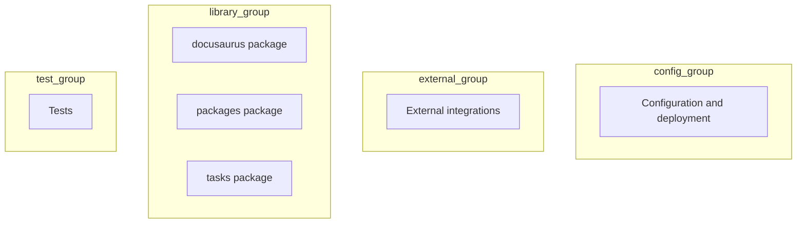

# Architecture report: react/create-react-app

> Automated static analysis. **Observed** = directly seen in files/imports/AST; **Inferred** = interpretation from that evidence. Repository code was not executed.

## 1. Repository at a glance

| Item | Value |
| --- | --- |
| Repository | react/create-react-app |
| Description | Set up a modern web app by running one command. |
| Language | JavaScript |
| Stars | 103224 |
| Licence | MIT |
| Analysed commit / branch | 6254386531d263688ccfa542d0e628fbc0de0b28 / main |
| Framework(s) | React |
| Files analysed | 501 |
| Components | 6 |

## 2. Architecture in one minute

react/create-react-app - Set up a modern web app by running one command.. This repository was analysed statically from 501 file(s) (0 Python). Detected technologies (observed from imports/manifests): GitHub Actions, React, Tailwind CSS, Jest, TypeScript, webpack. Files are grouped into 6 component(s): Configuration and deployment, docusaurus package, External integrations, packages package, tasks package, Tests. Findings below distinguish observed facts from inferred interpretation.

## 3. High-level block diagram

## 4. Main components

### Configuration and deployment (`config`)

- **Kind:** config
- **Status:** Observed
- **Confidence:** 0.85
- **Responsibility:** Groups 40 file(s) under configuration and deployment (observed from repository paths and static analysis).
- **Paths:** `docusaurus/website/package.json`, `docusaurus/website/sidebars.json`, `lerna.json`, `netlify.toml`, `package.json`, `packages/babel-plugin-named-asset-import/package.json`, `packages/babel-preset-react-app/package.json`, `packages/confusing-browser-globals/package.json`, `packages/cra-template-typescript/package.json`, `packages/cra-template-typescript/template.json`, `packages/cra-template-typescript/template/public/manifest.json`, `packages/cra-template/package.json`, `packages/cra-template/template.json`, `packages/cra-template/template/public/manifest.json`, `packages/create-react-app/package.json`, `packages/eslint-config-react-app/package.json`, `packages/react-app-polyfill/package.json`, `packages/react-dev-utils/package.json`, `packages/react-error-overlay/fixtures/bundle-default.json`, `packages/react-error-overlay/fixtures/bundle.json`, `packages/react-error-overlay/fixtures/bundle2.json`, `packages/react-error-overlay/package.json`, `packages/react-scripts/config/env.js`, `packages/react-scripts/config/getHttpsConfig.js`, `packages/react-scripts/config/jest/babelTransform.js`, `packages/react-scripts/config/jest/cssTransform.js`, `packages/react-scripts/config/jest/fileTransform.js`, `packages/react-scripts/config/modules.js`, `packages/react-scripts/config/paths.js`, `packages/react-scripts/config/webpack.config.js`, `packages/react-scripts/config/webpack/persistentCache/createEnvironmentHash.js`, `packages/react-scripts/config/webpackDevServer.config.js`, `packages/react-scripts/fixtures/kitchensink/package.json`, `packages/react-scripts/fixtures/kitchensink/template.json`, `packages/react-scripts/fixtures/kitchensink/template/jsconfig.json`, `packages/react-scripts/fixtures/kitchensink/template/src/features/config/BaseUrl.js`, `packages/react-scripts/fixtures/kitchensink/template/src/features/config/BaseUrl.test.js`, `packages/react-scripts/fixtures/kitchensink/template/src/features/webpack/assets/abstract.json`, `packages/react-scripts/package.json`, `tasks/verdaccio.yaml`
- **Evidence:** [docusaurus/website/package.json](https://github.com/react/create-react-app/blob/6254386531d263688ccfa542d0e628fbc0de0b28/docusaurus/website/package.json); [docusaurus/website/sidebars.json](https://github.com/react/create-react-app/blob/6254386531d263688ccfa542d0e628fbc0de0b28/docusaurus/website/sidebars.json); [lerna.json](https://github.com/react/create-react-app/blob/6254386531d263688ccfa542d0e628fbc0de0b28/lerna.json); [netlify.toml](https://github.com/react/create-react-app/blob/6254386531d263688ccfa542d0e628fbc0de0b28/netlify.toml); [package.json](https://github.com/react/create-react-app/blob/6254386531d263688ccfa542d0e628fbc0de0b28/package.json); [packages/babel-plugin-named-asset-import/package.json](https://github.com/react/create-react-app/blob/6254386531d263688ccfa542d0e628fbc0de0b28/packages/babel-plugin-named-asset-import/package.json); [packages/babel-preset-react-app/package.json](https://github.com/react/create-react-app/blob/6254386531d263688ccfa542d0e628fbc0de0b28/packages/babel-preset-react-app/package.json); [packages/confusing-browser-globals/package.json](https://github.com/react/create-react-app/blob/6254386531d263688ccfa542d0e628fbc0de0b28/packages/confusing-browser-globals/package.json)

### docusaurus package (`docusaurus`)

- **Kind:** library
- **Status:** Observed
- **Confidence:** 0.85
- **Responsibility:** Groups 2 file(s) under docusaurus package (observed from repository paths and static analysis).
- **Paths:** `docusaurus/website/docusaurus.config.js`, `docusaurus/website/src/pages/index.js`
- **Evidence:** [docusaurus/website/docusaurus.config.js](https://github.com/react/create-react-app/blob/6254386531d263688ccfa542d0e628fbc0de0b28/docusaurus/website/docusaurus.config.js); [docusaurus/website/src/pages/index.js](https://github.com/react/create-react-app/blob/6254386531d263688ccfa542d0e628fbc0de0b28/docusaurus/website/src/pages/index.js)

### External integrations (`external_integrations`)

- **Kind:** external
- **Status:** Observed
- **Confidence:** 0.85
- **Responsibility:** Groups 5 file(s) under external integrations (observed from repository paths and static analysis).
- **Paths:** `packages/react-scripts/fixtures/kitchensink/template/integration/config.test.js`, `packages/react-scripts/fixtures/kitchensink/template/integration/env.test.js`, `packages/react-scripts/fixtures/kitchensink/template/integration/initDOM.js`, `packages/react-scripts/fixtures/kitchensink/template/integration/syntax.test.js`, `packages/react-scripts/fixtures/kitchensink/template/integration/webpack.test.js`
- **Evidence:** [packages/react-scripts/fixtures/kitchensink/template/integration/config.test.js](https://github.com/react/create-react-app/blob/6254386531d263688ccfa542d0e628fbc0de0b28/packages/react-scripts/fixtures/kitchensink/template/integration/config.test.js); [packages/react-scripts/fixtures/kitchensink/template/integration/env.test.js](https://github.com/react/create-react-app/blob/6254386531d263688ccfa542d0e628fbc0de0b28/packages/react-scripts/fixtures/kitchensink/template/integration/env.test.js); [packages/react-scripts/fixtures/kitchensink/template/integration/initDOM.js](https://github.com/react/create-react-app/blob/6254386531d263688ccfa542d0e628fbc0de0b28/packages/react-scripts/fixtures/kitchensink/template/integration/initDOM.js); [packages/react-scripts/fixtures/kitchensink/template/integration/syntax.test.js](https://github.com/react/create-react-app/blob/6254386531d263688ccfa542d0e628fbc0de0b28/packages/react-scripts/fixtures/kitchensink/template/integration/syntax.test.js); [packages/react-scripts/fixtures/kitchensink/template/integration/webpack.test.js](https://github.com/react/create-react-app/blob/6254386531d263688ccfa542d0e628fbc0de0b28/packages/react-scripts/fixtures/kitchensink/template/integration/webpack.test.js)

### packages package (`packages`)

- **Kind:** library
- **Status:** Observed
- **Confidence:** 0.85
- **Responsibility:** Groups 210 file(s) under packages package (observed from repository paths and static analysis).
- **Paths:** `packages/babel-plugin-named-asset-import/index.js`, `packages/babel-plugin-named-asset-import/index.test.js`, `packages/babel-preset-react-app/create.js`, `packages/babel-preset-react-app/dependencies.js`, `packages/babel-preset-react-app/dev.js`, `packages/babel-preset-react-app/index.js`, `packages/babel-preset-react-app/prod.js`, `packages/babel-preset-react-app/test.js`, `packages/babel-preset-react-app/webpack-overrides.js`, `packages/confusing-browser-globals/index.js`, `packages/confusing-browser-globals/test.js`, `packages/cra-template-typescript/template/src/App.test.tsx`, `packages/cra-template-typescript/template/src/App.tsx`, `packages/cra-template-typescript/template/src/index.tsx`, `packages/cra-template-typescript/template/src/reportWebVitals.ts`, `packages/cra-template-typescript/template/src/setupTests.ts`, `packages/cra-template/template/src/App.js`, `packages/cra-template/template/src/App.test.js`, `packages/cra-template/template/src/index.js`, `packages/cra-template/template/src/reportWebVitals.js`, `packages/cra-template/template/src/setupTests.js`, `packages/create-react-app/__tests__/getTemplateInstallPackage.test.js`, `packages/create-react-app/createReactApp.js`, `packages/create-react-app/index.js`, `packages/eslint-config-react-app/base.js`, `packages/eslint-config-react-app/index.js`, `packages/eslint-config-react-app/jest.js`, `packages/react-app-polyfill/ie11.js`, `packages/react-app-polyfill/ie9.js`, `packages/react-app-polyfill/jsdom.js`, `packages/react-app-polyfill/stable.js`, `packages/react-dev-utils/FileSizeReporter.js`, `packages/react-dev-utils/ForkTsCheckerWarningWebpackPlugin.js`, `packages/react-dev-utils/ForkTsCheckerWebpackPlugin.js`, `packages/react-dev-utils/InlineChunkHtmlPlugin.js`, `packages/react-dev-utils/InterpolateHtmlPlugin.js`, `packages/react-dev-utils/ModuleNotFoundPlugin.js`, `packages/react-dev-utils/ModuleScopePlugin.js`, `packages/react-dev-utils/WebpackDevServerUtils.js`, `packages/react-dev-utils/__tests__/getCSSModuleLocalIdent.test.js`, `packages/react-dev-utils/__tests__/getPublicUrlOrPath.test.js`, `packages/react-dev-utils/__tests__/ignoredFiles.test.js`, `packages/react-dev-utils/browsersHelper.js`, `packages/react-dev-utils/chalk.js`, `packages/react-dev-utils/checkRequiredFiles.js`, `packages/react-dev-utils/clearConsole.js`, `packages/react-dev-utils/crossSpawn.js`, `packages/react-dev-utils/errorOverlayMiddleware.js`, `packages/react-dev-utils/eslintFormatter.js`, `packages/react-dev-utils/evalSourceMapMiddleware.js`, `packages/react-dev-utils/formatWebpackMessages.js`, `packages/react-dev-utils/getCSSModuleLocalIdent.js`, `packages/react-dev-utils/getCacheIdentifier.js`, `packages/react-dev-utils/getProcessForPort.js`, `packages/react-dev-utils/getPublicUrlOrPath.js`, `packages/react-dev-utils/globby.js`, `packages/react-dev-utils/ignoredFiles.js`, `packages/react-dev-utils/immer.js`, `packages/react-dev-utils/launchEditor.js`, `packages/react-dev-utils/launchEditorEndpoint.js`, `packages/react-dev-utils/noopServiceWorkerMiddleware.js`, `packages/react-dev-utils/openBrowser.js`, `packages/react-dev-utils/printBuildError.js`, `packages/react-dev-utils/printHostingInstructions.js`, `packages/react-dev-utils/redirectServedPathMiddleware.js`, `packages/react-dev-utils/refreshOverlayInterop.js`, `packages/react-dev-utils/webpackHotDevClient.js`, `packages/react-error-overlay/build.js`, `packages/react-error-overlay/fixtures/inline.es6.mjs`, `packages/react-error-overlay/fixtures/inline.mjs`, `packages/react-error-overlay/fixtures/junk-inline.mjs`, `packages/react-error-overlay/flow/env.js`, `packages/react-error-overlay/src/__tests__/extract-source-map.js`, `packages/react-error-overlay/src/__tests__/get-source-map.js`, `packages/react-error-overlay/src/__tests__/lines-around.js`, `packages/react-error-overlay/src/__tests__/mapper.js`, `packages/react-error-overlay/src/__tests__/parser/chrome.js`, `packages/react-error-overlay/src/__tests__/parser/firefox.js`, `packages/react-error-overlay/src/__tests__/parser/generic.js`, `packages/react-error-overlay/src/__tests__/parser/react.js`, `packages/react-error-overlay/src/__tests__/parser/safari.js`, `packages/react-error-overlay/src/__tests__/script-lines.js`, `packages/react-error-overlay/src/__tests__/setupJest.js`, `packages/react-error-overlay/src/__tests__/stack-frame.js`, `packages/react-error-overlay/src/__tests__/unmapper.js`, `packages/react-error-overlay/src/components/CloseButton.js`, `packages/react-error-overlay/src/components/CodeBlock.js`, `packages/react-error-overlay/src/components/Collapsible.js`, `packages/react-error-overlay/src/components/ErrorOverlay.js`, `packages/react-error-overlay/src/components/Footer.js`, `packages/react-error-overlay/src/components/Header.js`, `packages/react-error-overlay/src/components/NavigationBar.js`, `packages/react-error-overlay/src/containers/CompileErrorContainer.js`, `packages/react-error-overlay/src/containers/RuntimeError.js`, `packages/react-error-overlay/src/containers/RuntimeErrorContainer.js`, `packages/react-error-overlay/src/containers/StackFrame.js`, `packages/react-error-overlay/src/containers/StackFrameCodeBlock.js`, `packages/react-error-overlay/src/containers/StackTrace.js`, `packages/react-error-overlay/src/effects/proxyConsole.js`, `packages/react-error-overlay/src/effects/stackTraceLimit.js`, `packages/react-error-overlay/src/effects/unhandledError.js`, `packages/react-error-overlay/src/effects/unhandledRejection.js`, `packages/react-error-overlay/src/iframeScript.js`, `packages/react-error-overlay/src/index.js`, `packages/react-error-overlay/src/listenToRuntimeErrors.js`, `packages/react-error-overlay/src/styles.js`, `packages/react-error-overlay/src/utils/dom/absolutifyCaret.js`, `packages/react-error-overlay/src/utils/dom/css.js`, `packages/react-error-overlay/src/utils/generateAnsiHTML.js`, `packages/react-error-overlay/src/utils/getLinesAround.js`, `packages/react-error-overlay/src/utils/getPrettyURL.js`, `packages/react-error-overlay/src/utils/getSourceMap.js`, `packages/react-error-overlay/src/utils/getStackFrames.js`, `packages/react-error-overlay/src/utils/isBultinErrorName.js`, `packages/react-error-overlay/src/utils/isInternalFile.js`, `packages/react-error-overlay/src/utils/mapper.js`, `packages/react-error-overlay/src/utils/parseCompileError.js`, `packages/react-error-overlay/src/utils/parser.js`, `packages/react-error-overlay/src/utils/stack-frame.js`, `packages/react-error-overlay/src/utils/unmapper.js`, `packages/react-error-overlay/src/utils/warnings.js`, `packages/react-error-overlay/webpack.config.iframe.js`, `packages/react-error-overlay/webpack.config.js`, `packages/react-scripts/bin/react-scripts.js`, `packages/react-scripts/fixtures/kitchensink/template/jest.integration.config.js`, `packages/react-scripts/fixtures/kitchensink/template/jest.transform.js`, `packages/react-scripts/fixtures/kitchensink/template/src/App.js`, `packages/react-scripts/fixtures/kitchensink/template/src/absoluteLoad.js`, `packages/react-scripts/fixtures/kitchensink/template/src/features/env/ExpandEnvVariables.js`, `packages/react-scripts/fixtures/kitchensink/template/src/features/env/ExpandEnvVariables.test.js`, `packages/react-scripts/fixtures/kitchensink/template/src/features/env/FileEnvVariables.js`, `packages/react-scripts/fixtures/kitchensink/template/src/features/env/FileEnvVariables.test.js`, `packages/react-scripts/fixtures/kitchensink/template/src/features/env/PublicUrl.js`, `packages/react-scripts/fixtures/kitchensink/template/src/features/env/PublicUrl.test.js`, `packages/react-scripts/fixtures/kitchensink/template/src/features/env/ShellEnvVariables.js`, `packages/react-scripts/fixtures/kitchensink/template/src/features/env/ShellEnvVariables.test.js`, `packages/react-scripts/fixtures/kitchensink/template/src/features/syntax/ArrayDestructuring.js`, `packages/react-scripts/fixtures/kitchensink/template/src/features/syntax/ArrayDestructuring.test.js`, `packages/react-scripts/fixtures/kitchensink/template/src/features/syntax/ArraySpread.js`, `packages/react-scripts/fixtures/kitchensink/template/src/features/syntax/ArraySpread.test.js`, `packages/react-scripts/fixtures/kitchensink/template/src/features/syntax/AsyncAwait.js`, `packages/react-scripts/fixtures/kitchensink/template/src/features/syntax/AsyncAwait.test.js`, `packages/react-scripts/fixtures/kitchensink/template/src/features/syntax/ClassProperties.js`, `packages/react-scripts/fixtures/kitchensink/template/src/features/syntax/ClassProperties.test.js`, `packages/react-scripts/fixtures/kitchensink/template/src/features/syntax/ComputedProperties.js`, `packages/react-scripts/fixtures/kitchensink/template/src/features/syntax/ComputedProperties.test.js`, `packages/react-scripts/fixtures/kitchensink/template/src/features/syntax/CustomInterpolation.js`, `packages/react-scripts/fixtures/kitchensink/template/src/features/syntax/CustomInterpolation.test.js`, `packages/react-scripts/fixtures/kitchensink/template/src/features/syntax/DefaultParameters.js`, `packages/react-scripts/fixtures/kitchensink/template/src/features/syntax/DefaultParameters.test.js`, `packages/react-scripts/fixtures/kitchensink/template/src/features/syntax/DestructuringAndAwait.js`, `packages/react-scripts/fixtures/kitchensink/template/src/features/syntax/DestructuringAndAwait.test.js`, `packages/react-scripts/fixtures/kitchensink/template/src/features/syntax/Generators.js`, `packages/react-scripts/fixtures/kitchensink/template/src/features/syntax/Generators.test.js`, `packages/react-scripts/fixtures/kitchensink/template/src/features/syntax/NullishCoalescing.js`, `packages/react-scripts/fixtures/kitchensink/template/src/features/syntax/NullishCoalescing.test.js`, `packages/react-scripts/fixtures/kitchensink/template/src/features/syntax/ObjectDestructuring.js`, `packages/react-scripts/fixtures/kitchensink/template/src/features/syntax/ObjectDestructuring.test.js`, `packages/react-scripts/fixtures/kitchensink/template/src/features/syntax/ObjectSpread.js`, `packages/react-scripts/fixtures/kitchensink/template/src/features/syntax/ObjectSpread.test.js`, `packages/react-scripts/fixtures/kitchensink/template/src/features/syntax/OptionalChaining.js`, `packages/react-scripts/fixtures/kitchensink/template/src/features/syntax/OptionalChaining.test.js`, `packages/react-scripts/fixtures/kitchensink/template/src/features/syntax/Promises.js`, `packages/react-scripts/fixtures/kitchensink/template/src/features/syntax/Promises.test.js`, `packages/react-scripts/fixtures/kitchensink/template/src/features/syntax/RestAndDefault.js`, `packages/react-scripts/fixtures/kitchensink/template/src/features/syntax/RestAndDefault.test.js`, `packages/react-scripts/fixtures/kitchensink/template/src/features/syntax/RestParameters.js`, `packages/react-scripts/fixtures/kitchensink/template/src/features/syntax/RestParameters.test.js`, `packages/react-scripts/fixtures/kitchensink/template/src/features/syntax/TemplateInterpolation.js`, `packages/react-scripts/fixtures/kitchensink/template/src/features/syntax/TemplateInterpolation.test.js`, `packages/react-scripts/fixtures/kitchensink/template/src/features/webpack/CssInclusion.js`, `packages/react-scripts/fixtures/kitchensink/template/src/features/webpack/CssInclusion.test.js`, `packages/react-scripts/fixtures/kitchensink/template/src/features/webpack/CssModulesInclusion.js`, `packages/react-scripts/fixtures/kitchensink/template/src/features/webpack/CssModulesInclusion.test.js`, `packages/react-scripts/fixtures/kitchensink/template/src/features/webpack/DynamicImport.js`, `packages/react-scripts/fixtures/kitchensink/template/src/features/webpack/DynamicImport.test.js`, `packages/react-scripts/fixtures/kitchensink/template/src/features/webpack/ImageInclusion.js`, `packages/react-scripts/fixtures/kitchensink/template/src/features/webpack/ImageInclusion.test.js`, `packages/react-scripts/fixtures/kitchensink/template/src/features/webpack/JsonInclusion.js`, `packages/react-scripts/fixtures/kitchensink/template/src/features/webpack/JsonInclusion.test.js`, `packages/react-scripts/fixtures/kitchensink/template/src/features/webpack/LinkedModules.js`, `packages/react-scripts/fixtures/kitchensink/template/src/features/webpack/LinkedModules.test.js`, `packages/react-scripts/fixtures/kitchensink/template/src/features/webpack/NoExtInclusion.js`, `packages/react-scripts/fixtures/kitchensink/template/src/features/webpack/NoExtInclusion.test.js`, `packages/react-scripts/fixtures/kitchensink/template/src/features/webpack/SassInclusion.js`, `packages/react-scripts/fixtures/kitchensink/template/src/features/webpack/SassInclusion.test.js`, `packages/react-scripts/fixtures/kitchensink/template/src/features/webpack/SassModulesInclusion.js`, `packages/react-scripts/fixtures/kitchensink/template/src/features/webpack/SassModulesInclusion.test.js`, `packages/react-scripts/fixtures/kitchensink/template/src/features/webpack/ScssInclusion.js`, `packages/react-scripts/fixtures/kitchensink/template/src/features/webpack/ScssInclusion.test.js`, `packages/react-scripts/fixtures/kitchensink/template/src/features/webpack/ScssModulesInclusion.js`, `packages/react-scripts/fixtures/kitchensink/template/src/features/webpack/ScssModulesInclusion.test.js`, `packages/react-scripts/fixtures/kitchensink/template/src/features/webpack/SvgComponent.js`, `packages/react-scripts/fixtures/kitchensink/template/src/features/webpack/SvgComponent.test.js`, `packages/react-scripts/fixtures/kitchensink/template/src/features/webpack/SvgInCss.js`, `packages/react-scripts/fixtures/kitchensink/template/src/features/webpack/SvgInCss.test.js`, `packages/react-scripts/fixtures/kitchensink/template/src/features/webpack/SvgInclusion.js`, `packages/react-scripts/fixtures/kitchensink/template/src/features/webpack/SvgInclusion.test.js`, `packages/react-scripts/fixtures/kitchensink/template/src/features/webpack/UnknownExtInclusion.js`, `packages/react-scripts/fixtures/kitchensink/template/src/features/webpack/UnknownExtInclusion.test.js`, `packages/react-scripts/fixtures/kitchensink/template/src/index.js`, `packages/react-scripts/fixtures/kitchensink/template/src/subfolder/lol.js`, `packages/react-scripts/lib/react-app.d.ts`, `packages/react-scripts/scripts/build.js`, `packages/react-scripts/scripts/eject.js`, `packages/react-scripts/scripts/init.js`, `packages/react-scripts/scripts/start.js`, `packages/react-scripts/scripts/test.js`, `packages/react-scripts/scripts/utils/createJestConfig.js`, `packages/react-scripts/scripts/utils/verifyTypeScriptSetup.js`
- **Evidence:** [packages/babel-plugin-named-asset-import/index.js](https://github.com/react/create-react-app/blob/6254386531d263688ccfa542d0e628fbc0de0b28/packages/babel-plugin-named-asset-import/index.js); [packages/babel-plugin-named-asset-import/index.test.js](https://github.com/react/create-react-app/blob/6254386531d263688ccfa542d0e628fbc0de0b28/packages/babel-plugin-named-asset-import/index.test.js); [packages/babel-preset-react-app/create.js](https://github.com/react/create-react-app/blob/6254386531d263688ccfa542d0e628fbc0de0b28/packages/babel-preset-react-app/create.js); [packages/babel-preset-react-app/dependencies.js](https://github.com/react/create-react-app/blob/6254386531d263688ccfa542d0e628fbc0de0b28/packages/babel-preset-react-app/dependencies.js); [packages/babel-preset-react-app/dev.js](https://github.com/react/create-react-app/blob/6254386531d263688ccfa542d0e628fbc0de0b28/packages/babel-preset-react-app/dev.js); [packages/babel-preset-react-app/index.js](https://github.com/react/create-react-app/blob/6254386531d263688ccfa542d0e628fbc0de0b28/packages/babel-preset-react-app/index.js); [packages/babel-preset-react-app/prod.js](https://github.com/react/create-react-app/blob/6254386531d263688ccfa542d0e628fbc0de0b28/packages/babel-preset-react-app/prod.js); [packages/babel-preset-react-app/test.js](https://github.com/react/create-react-app/blob/6254386531d263688ccfa542d0e628fbc0de0b28/packages/babel-preset-react-app/test.js)

### tasks package (`tasks`)

- **Kind:** library
- **Status:** Observed
- **Confidence:** 0.85
- **Responsibility:** Groups 13 file(s) under tasks package (observed from repository paths and static analysis).
- **Paths:** `tasks/cra.js`, `tasks/e2e-behavior.sh`, `tasks/e2e-installs.sh`, `tasks/e2e-kitchensink-eject.sh`, `tasks/e2e-kitchensink.sh`, `tasks/e2e-old-node.sh`, `tasks/e2e-simple.sh`, `tasks/local-registry.sh`, `tasks/local-test.sh`, `tasks/publish.sh`, `tasks/screencast-start.js`, `tasks/screencast.js`, `tasks/screencast.sh`
- **Evidence:** [tasks/cra.js](https://github.com/react/create-react-app/blob/6254386531d263688ccfa542d0e628fbc0de0b28/tasks/cra.js); [tasks/e2e-behavior.sh](https://github.com/react/create-react-app/blob/6254386531d263688ccfa542d0e628fbc0de0b28/tasks/e2e-behavior.sh); [tasks/e2e-installs.sh](https://github.com/react/create-react-app/blob/6254386531d263688ccfa542d0e628fbc0de0b28/tasks/e2e-installs.sh); [tasks/e2e-kitchensink-eject.sh](https://github.com/react/create-react-app/blob/6254386531d263688ccfa542d0e628fbc0de0b28/tasks/e2e-kitchensink-eject.sh); [tasks/e2e-kitchensink.sh](https://github.com/react/create-react-app/blob/6254386531d263688ccfa542d0e628fbc0de0b28/tasks/e2e-kitchensink.sh); [tasks/e2e-old-node.sh](https://github.com/react/create-react-app/blob/6254386531d263688ccfa542d0e628fbc0de0b28/tasks/e2e-old-node.sh); [tasks/e2e-simple.sh](https://github.com/react/create-react-app/blob/6254386531d263688ccfa542d0e628fbc0de0b28/tasks/e2e-simple.sh); [tasks/local-registry.sh](https://github.com/react/create-react-app/blob/6254386531d263688ccfa542d0e628fbc0de0b28/tasks/local-registry.sh)

### Tests (`tests`)

- **Kind:** test
- **Status:** Observed
- **Confidence:** 0.85
- **Responsibility:** Groups 78 file(s) under tests (observed from repository paths and static analysis).
- **Paths:** `test/README.md`, `test/fixtures/__shared__/template/public/index.html`, `test/fixtures/__shared__/test-setup.js`, `test/fixtures/__shared__/util/scripts.js`, `test/fixtures/__shared__/util/setup.js`, `test/fixtures/boostrap-sass/index.test.js`, `test/fixtures/boostrap-sass/package.json`, `test/fixtures/boostrap-sass/src/index.js`, `test/fixtures/boostrap-sass/src/index.sass`, `test/fixtures/builds-with-multiple-runtimes/index.test.js`, `test/fixtures/builds-with-multiple-runtimes/package.json`, `test/fixtures/builds-with-multiple-runtimes/src/index.js`, `test/fixtures/global-scss-asset-resolution/index.test.js`, `test/fixtures/global-scss-asset-resolution/package.json`, `test/fixtures/global-scss-asset-resolution/src/images/logo.svg`, `test/fixtures/global-scss-asset-resolution/src/index.js`, `test/fixtures/global-scss-asset-resolution/src/index.scss`, `test/fixtures/issue-5176-flow-class-properties/index.test.js`, `test/fixtures/issue-5176-flow-class-properties/package.json`, `test/fixtures/issue-5176-flow-class-properties/src/App.js`, `test/fixtures/issue-5176-flow-class-properties/src/App.test.js`, `test/fixtures/issue-5947-not-typescript/index.test.js`, `test/fixtures/issue-5947-not-typescript/package.json`, `test/fixtures/jsconfig/index.test.js`, `test/fixtures/jsconfig/jsconfig.json`, `test/fixtures/jsconfig/package.json`, `test/fixtures/jsconfig/src/App.js`, `test/fixtures/jsconfig/src/App.test.js`, `test/fixtures/jsconfig/src/absoluteLoad.js`, `test/fixtures/jsconfig/src/index.js`, `test/fixtures/mjs-support/__snapshots__/index.test.js.snap`, `test/fixtures/mjs-support/index.test.js`, `test/fixtures/mjs-support/package.json`, `test/fixtures/mjs-support/src/App.js`, `test/fixtures/mjs-support/src/index.js`, `test/fixtures/relative-paths/index.test.js`, `test/fixtures/relative-paths/package.json`, `test/fixtures/relative-paths/src/index.css`, `test/fixtures/relative-paths/src/index.js`, `test/fixtures/relative-paths/src/logo.svg`, `test/fixtures/typescript-advanced/index.test.js`, `test/fixtures/typescript-advanced/package.json`, `test/fixtures/typescript-advanced/src/App.test.ts`, `test/fixtures/typescript-advanced/src/App.tsx`, `test/fixtures/typescript-advanced/src/index.tsx`, `test/fixtures/typescript-typecheck/index.test.js`, `test/fixtures/typescript-typecheck/package.json`, `test/fixtures/typescript-typecheck/src/App.tsx`, `test/fixtures/typescript-typecheck/src/index.tsx`, `test/fixtures/typescript/index.test.js`, `test/fixtures/typescript/package.json`, `test/fixtures/typescript/src/App.test.ts`, `test/fixtures/typescript/src/App.ts`, `test/fixtures/typescript/src/absoluteLoad.ts`, `test/fixtures/typescript/tsconfig.json`, `test/fixtures/webpack-message-formatting/__snapshots__/index.test.js.snap`, `test/fixtures/webpack-message-formatting/index.test.js`, `test/fixtures/webpack-message-formatting/package.json`, `test/fixtures/webpack-message-formatting/src/AppAliasUnknownExport.js`, `test/fixtures/webpack-message-formatting/src/AppBabel.js`, `test/fixtures/webpack-message-formatting/src/AppCss.css`, `test/fixtures/webpack-message-formatting/src/AppCss.js`, `test/fixtures/webpack-message-formatting/src/AppIncorrectCase.js`, `test/fixtures/webpack-message-formatting/src/AppLintError.js`, `test/fixtures/webpack-message-formatting/src/AppLintWarning.js`, `test/fixtures/webpack-message-formatting/src/AppMissingPackage.js`, `test/fixtures/webpack-message-formatting/src/AppNoDefault.js`, `test/fixtures/webpack-message-formatting/src/AppOutOfScopeImport.js`, `test/fixtures/webpack-message-formatting/src/AppSass.js`, `test/fixtures/webpack-message-formatting/src/AppSass.scss`, `test/fixtures/webpack-message-formatting/src/AppUnknownExport.js`, `test/fixtures/webpack-message-formatting/src/AppUnknownFile.js`, `test/fixtures/webpack-message-formatting/src/Export5.js`, `test/fixtures/webpack-message-formatting/src/ExportNoDefault.js`, `test/fixtures/webpack-message-formatting/src/FooExport.js`, `test/fixtures/webpack-message-formatting/src/index.js`, `test/integration/create-react-app/index.test.js`, `test/jest.config.js`
- **Evidence:** [test/README.md](https://github.com/react/create-react-app/blob/6254386531d263688ccfa542d0e628fbc0de0b28/test/README.md); [test/fixtures/__shared__/template/public/index.html](https://github.com/react/create-react-app/blob/6254386531d263688ccfa542d0e628fbc0de0b28/test/fixtures/__shared__/template/public/index.html); [test/fixtures/__shared__/test-setup.js](https://github.com/react/create-react-app/blob/6254386531d263688ccfa542d0e628fbc0de0b28/test/fixtures/__shared__/test-setup.js); [test/fixtures/__shared__/util/scripts.js](https://github.com/react/create-react-app/blob/6254386531d263688ccfa542d0e628fbc0de0b28/test/fixtures/__shared__/util/scripts.js); [test/fixtures/__shared__/util/setup.js](https://github.com/react/create-react-app/blob/6254386531d263688ccfa542d0e628fbc0de0b28/test/fixtures/__shared__/util/setup.js); [test/fixtures/boostrap-sass/index.test.js](https://github.com/react/create-react-app/blob/6254386531d263688ccfa542d0e628fbc0de0b28/test/fixtures/boostrap-sass/index.test.js); [test/fixtures/boostrap-sass/package.json](https://github.com/react/create-react-app/blob/6254386531d263688ccfa542d0e628fbc0de0b28/test/fixtures/boostrap-sass/package.json); [test/fixtures/boostrap-sass/src/index.js](https://github.com/react/create-react-app/blob/6254386531d263688ccfa542d0e628fbc0de0b28/test/fixtures/boostrap-sass/src/index.js)

## 5. Execution flow

**Observed** entry point(s):

- [packages/babel-plugin-named-asset-import/index.js](https://github.com/react/create-react-app/blob/6254386531d263688ccfa542d0e628fbc0de0b28/packages/babel-plugin-named-asset-import/index.js)
- [packages/babel-preset-react-app/index.js](https://github.com/react/create-react-app/blob/6254386531d263688ccfa542d0e628fbc0de0b28/packages/babel-preset-react-app/index.js)
- [packages/confusing-browser-globals/index.js](https://github.com/react/create-react-app/blob/6254386531d263688ccfa542d0e628fbc0de0b28/packages/confusing-browser-globals/index.js)
- [packages/create-react-app/index.js](https://github.com/react/create-react-app/blob/6254386531d263688ccfa542d0e628fbc0de0b28/packages/create-react-app/index.js)
- [packages/eslint-config-react-app/index.js](https://github.com/react/create-react-app/blob/6254386531d263688ccfa542d0e628fbc0de0b28/packages/eslint-config-react-app/index.js)
- [packages/react-error-overlay/src/index.js](https://github.com/react/create-react-app/blob/6254386531d263688ccfa542d0e628fbc0de0b28/packages/react-error-overlay/src/index.js)
- [packages/react-scripts/bin/react-scripts.js](https://github.com/react/create-react-app/blob/6254386531d263688ccfa542d0e628fbc0de0b28/packages/react-scripts/bin/react-scripts.js)
- [packages/react-scripts/fixtures/kitchensink/template.json](https://github.com/react/create-react-app/blob/6254386531d263688ccfa542d0e628fbc0de0b28/packages/react-scripts/fixtures/kitchensink/template.json)

Representative flow (derived from observed entry points and the import graph; steps beyond the entry point are **Inferred**):

1. Execution starts at an observed entry point listed above, if present.
2. No internal import relationships between components were observed.

## 6. Project structure

### `(root)`

- `.alexignore` - other (37 bytes)
- `.alexrc` - other (258 bytes)
- `.eslintignore` - other (112 bytes)
- `.eslintrc.json` - config (1271 bytes)
- `.gitattributes` - other (19 bytes)
- `.gitignore` - other (180 bytes)
- `.prettierignore` - other (347 bytes)
- `.prettierrc` - other (68 bytes)
- `CHANGELOG-0.x.md` - docs (88811 bytes)
- `CHANGELOG-1.x.md` - docs (101731 bytes)
- `CHANGELOG-2.x.md` - docs (96430 bytes)
- `CHANGELOG-3.x.md` - docs (88600 bytes)
- `CHANGELOG-4.x.md` - docs (35419 bytes)
- `CHANGELOG.md` - docs (16123 bytes)
- `CODE_OF_CONDUCT.md` - docs (3355 bytes)
- `CONTRIBUTING.md` - docs (12389 bytes)
- `LICENSE` - docs (1080 bytes)
- `README.md` - docs (11690 bytes)
- `SECURITY.md` - docs (411 bytes)
- `lerna.json` - config (566 bytes)
- `netlify.toml` - config (111 bytes)
- `package.json` - manifest (1802 bytes)
- `screencast-error.svg` - other (3700 bytes)
- `screencast.svg` - other (49162 bytes)

### `.github`

- `.github/CODEOWNERS` - other (54 bytes)
- `.github/FUNDING.yml` - config (34 bytes)
- `.github/ISSUE_TEMPLATE/bug_report.md` - docs (5065 bytes)
- `.github/ISSUE_TEMPLATE/proposal.md` - docs (807 bytes)
- `.github/ISSUE_TEMPLATE/question.md` - docs (674 bytes)
- `.github/PULL_REQUEST_TEMPLATE.md` - docs (197 bytes)
- `.github/lock.yml` - config (349 bytes)
- `.github/stale.yml` - config (2135 bytes)
- `.github/workflows/build-and-test.yml` - ci, YAML (1781 bytes)
- `.github/workflows/e2e-base.yml` - ci, YAML (840 bytes)
- `.github/workflows/lint.yml` - ci, YAML (472 bytes)

### `docusaurus`

- `docusaurus/docs/adding-a-css-modules-stylesheet.md` - docs (1803 bytes)
- `docusaurus/docs/adding-a-router.md` - docs (844 bytes)
- `docusaurus/docs/adding-a-sass-stylesheet.md` - docs (3306 bytes)
- `docusaurus/docs/adding-a-stylesheet.md` - docs (1542 bytes)
- `docusaurus/docs/adding-bootstrap.md` - docs (2310 bytes)
- `docusaurus/docs/adding-css-reset.md` - docs (1724 bytes)
- `docusaurus/docs/adding-custom-environment-variables.md` - docs (8021 bytes)
- `docusaurus/docs/adding-flow.md` - docs (1578 bytes)
- `docusaurus/docs/adding-images-fonts-and-files.md` - docs (3325 bytes)
- `docusaurus/docs/adding-relay.md` - docs (894 bytes)
- `docusaurus/docs/adding-typescript.md` - docs (3112 bytes)
- `docusaurus/docs/advanced-configuration.md` - docs (16744 bytes)
- `docusaurus/docs/alternatives-to-ejecting.md` - docs (599 bytes)
- `docusaurus/docs/analyzing-the-bundle-size.md` - docs (881 bytes)
- `docusaurus/docs/available-scripts.md` - docs (2373 bytes)
- `docusaurus/docs/can-i-use-decorators.md` - docs (910 bytes)
- `docusaurus/docs/code-splitting.md` - docs (1773 bytes)
- `docusaurus/docs/custom-templates.md` - docs (3323 bytes)
- `docusaurus/docs/debugging-tests.md` - docs (2303 bytes)
- `docusaurus/docs/deployment.md` - docs (23828 bytes)
- `docusaurus/docs/developing-components-in-isolation.md` - docs (3050 bytes)
- `docusaurus/docs/documentation-intro.md` - docs (901 bytes)
- `docusaurus/docs/fetching-data-with-ajax-requests.md` - docs (1628 bytes)
- `docusaurus/docs/folder-structure.md` - docs (1177 bytes)
- `docusaurus/docs/getting-started.md` - docs (5604 bytes)
- `docusaurus/docs/importing-a-component.md` - docs (2886 bytes)
- `docusaurus/docs/installing-a-dependency.md` - docs (475 bytes)
- `docusaurus/docs/integrating-with-an-api-backend.md` - docs (1322 bytes)
- `docusaurus/docs/loading-graphql-files.md` - docs (1411 bytes)
- `docusaurus/docs/making-a-progressive-web-app.md` - docs (10039 bytes)
- `docusaurus/docs/measuring-performance.md` - docs (2471 bytes)
- `docusaurus/docs/post-processing-css.md` - docs (1846 bytes)
- `docusaurus/docs/pre-rendering-into-static-html-files.md` - docs (1113 bytes)
- `docusaurus/docs/production-build.md` - docs (3914 bytes)
- `docusaurus/docs/proxying-api-requests-in-development.md` - docs (5721 bytes)
- `docusaurus/docs/running-tests.md` - docs (16435 bytes)
- `docusaurus/docs/setting-up-your-editor.md` - docs (6921 bytes)
- `docusaurus/docs/supported-browsers-features.md` - docs (3869 bytes)
- `docusaurus/docs/title-and-meta-tags.md` - docs (2847 bytes)
- `docusaurus/docs/troubleshooting.md` - docs (6530 bytes)
- `docusaurus/docs/updating-to-new-releases.md` - docs (1489 bytes)
- `docusaurus/docs/using-global-variables.md` - docs (604 bytes)
- `docusaurus/docs/using-https-in-development.md` - docs (1671 bytes)
- `docusaurus/docs/using-the-public-folder.md` - docs (3611 bytes)
- `docusaurus/website/.gitignore` - other (232 bytes)
- `docusaurus/website/README.md` - docs (701 bytes)
- `docusaurus/website/docusaurus.config.js` - source, JavaScript (3423 bytes)
- `docusaurus/website/package.json` - manifest (626 bytes)
- `docusaurus/website/sidebars.json` - config (1637 bytes)
- `docusaurus/website/src/css/custom.css` - other (1525 bytes)
- `docusaurus/website/src/pages/index.js` - source, JavaScript (5426 bytes)
- `docusaurus/website/src/pages/styles.module.css` - other (776 bytes)
- `docusaurus/website/static/CNAME` - other (22 bytes)
- `docusaurus/website/static/img/docusaurus.svg` - other (77880 bytes)
- `docusaurus/website/static/img/logo.svg` - other (8204 bytes)

### `packages`

- `packages/babel-plugin-named-asset-import/LICENSE` - docs (1080 bytes)
- `packages/babel-plugin-named-asset-import/index.js` - source, JavaScript (2682 bytes)
- `packages/babel-plugin-named-asset-import/index.test.js` - source, JavaScript (3036 bytes)
- `packages/babel-plugin-named-asset-import/package.json` - manifest (653 bytes)
- `packages/babel-preset-react-app/LICENSE` - docs (1080 bytes)
- `packages/babel-preset-react-app/README.md` - docs (2116 bytes)
- `packages/babel-preset-react-app/create.js` - source, JavaScript (8014 bytes)
- `packages/babel-preset-react-app/dependencies.js` - source, JavaScript (5148 bytes)
- `packages/babel-preset-react-app/dev.js` - source, JavaScript (356 bytes)
- `packages/babel-preset-react-app/index.js` - source, JavaScript (740 bytes)
- `packages/babel-preset-react-app/package.json` - manifest (1421 bytes)
- `packages/babel-preset-react-app/prod.js` - source, JavaScript (355 bytes)
- `packages/babel-preset-react-app/test.js` - source, JavaScript (349 bytes)
- `packages/babel-preset-react-app/webpack-overrides.js` - source, JavaScript (1123 bytes)
- `packages/confusing-browser-globals/LICENSE` - docs (1080 bytes)
- `packages/confusing-browser-globals/README.md` - docs (1180 bytes)
- `packages/confusing-browser-globals/index.js` - source, JavaScript (1013 bytes)
- `packages/confusing-browser-globals/package.json` - manifest (541 bytes)
- `packages/confusing-browser-globals/test.js` - source, JavaScript (443 bytes)
- `packages/cra-template-typescript/README.md` - docs (593 bytes)
- `packages/cra-template-typescript/package.json` - manifest (576 bytes)
- `packages/cra-template-typescript/template.json` - config (500 bytes)
- `packages/cra-template-typescript/template/README.md` - docs (2117 bytes)
- `packages/cra-template-typescript/template/gitignore` - other (310 bytes)
- `packages/cra-template-typescript/template/public/index.html` - other (1721 bytes)
- `packages/cra-template-typescript/template/public/manifest.json` - config (492 bytes)
- `packages/cra-template-typescript/template/public/robots.txt` - docs (67 bytes)
- `packages/cra-template-typescript/template/src/App.css` - other (564 bytes)
- `packages/cra-template-typescript/template/src/App.test.tsx` - source, TypeScript (273 bytes)
- `packages/cra-template-typescript/template/src/App.tsx` - source, TypeScript (556 bytes)
- `packages/cra-template-typescript/template/src/index.css` - other (366 bytes)
- `packages/cra-template-typescript/template/src/index.tsx` - source, TypeScript (554 bytes)
- `packages/cra-template-typescript/template/src/logo.svg` - other (2632 bytes)
- `packages/cra-template-typescript/template/src/reportWebVitals.ts` - source, TypeScript (425 bytes)
- `packages/cra-template-typescript/template/src/setupTests.ts` - source, TypeScript (241 bytes)
- `packages/cra-template/README.md` - docs (479 bytes)
- `packages/cra-template/package.json` - manifest (525 bytes)
- `packages/cra-template/template.json` - config (335 bytes)
- `packages/cra-template/template/README.md` - docs (3359 bytes)
- `packages/cra-template/template/gitignore` - other (310 bytes)
- `packages/cra-template/template/public/index.html` - other (1721 bytes)
- `packages/cra-template/template/public/manifest.json` - config (492 bytes)
- `packages/cra-template/template/public/robots.txt` - docs (67 bytes)
- `packages/cra-template/template/src/App.css` - other (564 bytes)
- `packages/cra-template/template/src/App.js` - source, JavaScript (528 bytes)
- `packages/cra-template/template/src/App.test.js` - source, JavaScript (246 bytes)
- `packages/cra-template/template/src/index.css` - other (366 bytes)
- `packages/cra-template/template/src/index.js` - source, JavaScript (535 bytes)
- `packages/cra-template/template/src/logo.svg` - other (2632 bytes)
- `packages/cra-template/template/src/reportWebVitals.js` - source, JavaScript (362 bytes)
- `packages/cra-template/template/src/setupTests.js` - source, JavaScript (241 bytes)
- `packages/create-react-app/LICENSE` - docs (1080 bytes)
- `packages/create-react-app/README.md` - docs (407 bytes)
- `packages/create-react-app/__tests__/.eslintrc` - other (36 bytes)
- `packages/create-react-app/__tests__/getTemplateInstallPackage.test.js` - source, JavaScript (2715 bytes)
- `packages/create-react-app/createReactApp.js` - source, JavaScript (34825 bytes)
- `packages/create-react-app/index.js` - source, JavaScript (1861 bytes)
- `packages/create-react-app/package.json` - manifest (1022 bytes)
- `packages/eslint-config-react-app/LICENSE` - docs (1080 bytes)
- `packages/eslint-config-react-app/README.md` - docs (4405 bytes)
- `packages/eslint-config-react-app/base.js` - source, JavaScript (1079 bytes)
- `packages/eslint-config-react-app/index.js` - source, JavaScript (9504 bytes)
- `packages/eslint-config-react-app/jest.js` - source, JavaScript (2476 bytes)
- `packages/eslint-config-react-app/package.json` - manifest (1141 bytes)
- `packages/react-app-polyfill/LICENSE` - docs (1080 bytes)
- `packages/react-app-polyfill/README.md` - docs (2447 bytes)
- `packages/react-app-polyfill/ie11.js` - source, JavaScript (1198 bytes)
- `packages/react-app-polyfill/ie9.js` - source, JavaScript (371 bytes)
- `packages/react-app-polyfill/jsdom.js` - source, JavaScript (458 bytes)
- `packages/react-app-polyfill/package.json` - manifest (717 bytes)
- `packages/react-app-polyfill/stable.js` - source, JavaScript (433 bytes)
- `packages/react-dev-utils/FileSizeReporter.js` - source, JavaScript (4641 bytes)
- `packages/react-dev-utils/ForkTsCheckerWarningWebpackPlugin.js` - source, JavaScript (823 bytes)
- `packages/react-dev-utils/ForkTsCheckerWebpackPlugin.js` - source, JavaScript (321 bytes)
- `packages/react-dev-utils/InlineChunkHtmlPlugin.js` - source, JavaScript (1921 bytes)
- `packages/react-dev-utils/InterpolateHtmlPlugin.js` - source, JavaScript (1445 bytes)
- `packages/react-dev-utils/LICENSE` - docs (1080 bytes)
- `packages/react-dev-utils/ModuleNotFoundPlugin.js` - source, JavaScript (4289 bytes)
- `packages/react-dev-utils/ModuleScopePlugin.js` - source, JavaScript (3511 bytes)
- `packages/react-dev-utils/README.md` - docs (13591 bytes)
- `packages/react-dev-utils/WebpackDevServerUtils.js` - source, JavaScript (13431 bytes)
- `packages/react-dev-utils/__tests__/.eslintrc` - other (36 bytes)
- `packages/react-dev-utils/__tests__/getCSSModuleLocalIdent.test.js` - source, JavaScript (1234 bytes)
- `packages/react-dev-utils/__tests__/getPublicUrlOrPath.test.js` - source, JavaScript (4523 bytes)
- `packages/react-dev-utils/__tests__/ignoredFiles.test.js` - source, JavaScript (1540 bytes)
- `packages/react-dev-utils/browsersHelper.js` - source, JavaScript (2507 bytes)
- `packages/react-dev-utils/chalk.js` - source, JavaScript (254 bytes)
- `packages/react-dev-utils/checkRequiredFiles.js` - source, JavaScript (856 bytes)
- `packages/react-dev-utils/clearConsole.js` - source, JavaScript (365 bytes)
- `packages/react-dev-utils/crossSpawn.js` - source, JavaScript (270 bytes)
- `packages/react-dev-utils/errorOverlayMiddleware.js` - source, JavaScript (732 bytes)
- `packages/react-dev-utils/eslintFormatter.js` - source, JavaScript (2808 bytes)
- `packages/react-dev-utils/evalSourceMapMiddleware.js` - source, JavaScript (1552 bytes)
- `packages/react-dev-utils/formatWebpackMessages.js` - source, JavaScript (4268 bytes)
- `packages/react-dev-utils/getCSSModuleLocalIdent.js` - source, JavaScript (1265 bytes)
- `packages/react-dev-utils/getCacheIdentifier.js` - source, JavaScript (584 bytes)
- `packages/react-dev-utils/getProcessForPort.js` - source, JavaScript (2047 bytes)
- `packages/react-dev-utils/getPublicUrlOrPath.js` - source, JavaScript (2069 bytes)
- `packages/react-dev-utils/globby.js` - source, JavaScript (257 bytes)
- `packages/react-dev-utils/ignoredFiles.js` - source, JavaScript (467 bytes)
- `packages/react-dev-utils/immer.js` - source, JavaScript (254 bytes)
- `packages/react-dev-utils/launchEditor.js` - source, JavaScript (19477 bytes)
- `packages/react-dev-utils/launchEditorEndpoint.js` - source, JavaScript (330 bytes)
- `packages/react-dev-utils/noopServiceWorkerMiddleware.js` - source, JavaScript (1360 bytes)
- `packages/react-dev-utils/openBrowser.js` - source, JavaScript (4479 bytes)
- `packages/react-dev-utils/openChrome.applescript` - other (2657 bytes)
- `packages/react-dev-utils/package.json` - manifest (2309 bytes)
- `packages/react-dev-utils/printBuildError.js` - source, JavaScript (1233 bytes)
- `packages/react-dev-utils/printHostingInstructions.js` - source, JavaScript (3706 bytes)
- `packages/react-dev-utils/redirectServedPathMiddleware.js` - source, JavaScript (771 bytes)
- `packages/react-dev-utils/refreshOverlayInterop.js` - source, JavaScript (447 bytes)
- `packages/react-dev-utils/webpackHotDevClient.js` - source, JavaScript (8875 bytes)
- `packages/react-error-overlay/.babelrc` - other (31 bytes)
- `packages/react-error-overlay/.flowconfig` - other (183 bytes)
- `packages/react-error-overlay/.gitattributes` - other (17 bytes)
- `packages/react-error-overlay/.gitignore` - other (15 bytes)
- `packages/react-error-overlay/.npmignore` - other (30 bytes)
- `packages/react-error-overlay/LICENSE` - docs (1080 bytes)
- `packages/react-error-overlay/README.md` - docs (539 bytes)
- `packages/react-error-overlay/build.js` - source, JavaScript (2438 bytes)
- `packages/react-error-overlay/fixtures/bundle-default.json` - config (1986 bytes)
- `packages/react-error-overlay/fixtures/bundle.json` - config (16024 bytes)
- `packages/react-error-overlay/fixtures/bundle2.json` - config (2913 bytes)
- `packages/react-error-overlay/fixtures/inline.es6.mjs` - source, JavaScript (56 bytes)
- `packages/react-error-overlay/fixtures/inline.mjs` - source, JavaScript (511 bytes)
- `packages/react-error-overlay/fixtures/junk-inline.mjs` - source, JavaScript (514 bytes)
- `packages/react-error-overlay/flow/env.js` - source, JavaScript (328 bytes)
- `packages/react-error-overlay/package.json` - manifest (1983 bytes)
- `packages/react-error-overlay/src/__tests__/__snapshots__/lines-around.js.snap` - other (1063 bytes)
- `packages/react-error-overlay/src/__tests__/__snapshots__/script-lines.js.snap` - other (301 bytes)
- `packages/react-error-overlay/src/__tests__/__snapshots__/stack-frame.js.snap` - other (693 bytes)
- `packages/react-error-overlay/src/__tests__/__snapshots__/unmapper.js.snap` - other (2545 bytes)
- `packages/react-error-overlay/src/__tests__/extract-source-map.js` - source, JavaScript (828 bytes)
- `packages/react-error-overlay/src/__tests__/get-source-map.js` - source, JavaScript (1822 bytes)
- `packages/react-error-overlay/src/__tests__/lines-around.js` - source, JavaScript (566 bytes)
- `packages/react-error-overlay/src/__tests__/mapper.js` - source, JavaScript (4066 bytes)
- `packages/react-error-overlay/src/__tests__/parser/__snapshots__/chrome.js.snap` - other (1566 bytes)
- `packages/react-error-overlay/src/__tests__/parser/__snapshots__/firefox.js.snap` - other (5995 bytes)
- `packages/react-error-overlay/src/__tests__/parser/__snapshots__/react.js.snap` - other (1335 bytes)
- `packages/react-error-overlay/src/__tests__/parser/__snapshots__/safari.js.snap` - other (1205 bytes)
- `packages/react-error-overlay/src/__tests__/parser/chrome.js` - source, JavaScript (722 bytes)
- `packages/react-error-overlay/src/__tests__/parser/firefox.js` - source, JavaScript (1474 bytes)
- `packages/react-error-overlay/src/__tests__/parser/generic.js` - source, JavaScript (700 bytes)
- `packages/react-error-overlay/src/__tests__/parser/react.js` - source, JavaScript (520 bytes)
- `packages/react-error-overlay/src/__tests__/parser/safari.js` - source, JavaScript (585 bytes)
- `packages/react-error-overlay/src/__tests__/script-lines.js` - source, JavaScript (456 bytes)
- `packages/react-error-overlay/src/__tests__/setupJest.js` - source, JavaScript (227 bytes)
- `packages/react-error-overlay/src/__tests__/stack-frame.js` - source, JavaScript (855 bytes)
- `packages/react-error-overlay/src/__tests__/unmapper.js` - source, JavaScript (2262 bytes)
- `packages/react-error-overlay/src/components/CloseButton.js` - source, JavaScript (883 bytes)
- `packages/react-error-overlay/src/components/CodeBlock.js` - source, JavaScript (1271 bytes)
- `packages/react-error-overlay/src/components/Collapsible.js` - source, JavaScript (1972 bytes)
- `packages/react-error-overlay/src/components/ErrorOverlay.js` - source, JavaScript (1924 bytes)
- `packages/react-error-overlay/src/components/Footer.js` - source, JavaScript (761 bytes)
- `packages/react-error-overlay/src/components/Header.js` - source, JavaScript (882 bytes)
- `packages/react-error-overlay/src/components/NavigationBar.js` - source, JavaScript (1709 bytes)
- `packages/react-error-overlay/src/containers/CompileErrorContainer.js` - source, JavaScript (1593 bytes)
- `packages/react-error-overlay/src/containers/RuntimeError.js` - source, JavaScript (1892 bytes)
- `packages/react-error-overlay/src/containers/RuntimeErrorContainer.js` - source, JavaScript (2471 bytes)
- `packages/react-error-overlay/src/containers/StackFrame.js` - source, JavaScript (4539 bytes)
- `packages/react-error-overlay/src/containers/StackFrameCodeBlock.js` - source, JavaScript (2709 bytes)
- `packages/react-error-overlay/src/containers/StackTrace.js` - source, JavaScript (2570 bytes)
- `packages/react-error-overlay/src/effects/proxyConsole.js` - source, JavaScript (2066 bytes)
- `packages/react-error-overlay/src/effects/stackTraceLimit.js` - source, JavaScript (1134 bytes)
- `packages/react-error-overlay/src/effects/unhandledError.js` - source, JavaScript (1189 bytes)
- `packages/react-error-overlay/src/effects/unhandledRejection.js` - source, JavaScript (1347 bytes)
- `packages/react-error-overlay/src/iframeScript.js` - source, JavaScript (1970 bytes)
- `packages/react-error-overlay/src/index.js` - source, JavaScript (5386 bytes)
- `packages/react-error-overlay/src/listenToRuntimeErrors.js` - source, JavaScript (2348 bytes)
- `packages/react-error-overlay/src/styles.js` - source, JavaScript (4343 bytes)
- `packages/react-error-overlay/src/utils/dom/absolutifyCaret.js` - source, JavaScript (993 bytes)
- `packages/react-error-overlay/src/utils/dom/css.js` - source, JavaScript (1434 bytes)
- `packages/react-error-overlay/src/utils/generateAnsiHTML.js` - source, JavaScript (2464 bytes)
- `packages/react-error-overlay/src/utils/getLinesAround.js` - source, JavaScript (927 bytes)
- `packages/react-error-overlay/src/utils/getPrettyURL.js` - source, JavaScript (1404 bytes)
- `packages/react-error-overlay/src/utils/getSourceMap.js` - source, JavaScript (3620 bytes)
- `packages/react-error-overlay/src/utils/getStackFrames.js` - source, JavaScript (1287 bytes)
- `packages/react-error-overlay/src/utils/isBultinErrorName.js` - source, JavaScript (556 bytes)
- `packages/react-error-overlay/src/utils/isInternalFile.js` - source, JavaScript (563 bytes)
- `packages/react-error-overlay/src/utils/mapper.js` - source, JavaScript (2231 bytes)
- `packages/react-error-overlay/src/utils/parseCompileError.js` - source, JavaScript (1552 bytes)
- `packages/react-error-overlay/src/utils/parser.js` - source, JavaScript (2589 bytes)
- `packages/react-error-overlay/src/utils/stack-frame.js` - source, JavaScript (3434 bytes)
- `packages/react-error-overlay/src/utils/unmapper.js` - source, JavaScript (3872 bytes)
- `packages/react-error-overlay/src/utils/warnings.js` - source, JavaScript (1388 bytes)
- `packages/react-error-overlay/webpack.config.iframe.js` - source, JavaScript (2058 bytes)
- `packages/react-error-overlay/webpack.config.js` - source, JavaScript (989 bytes)
- `packages/react-scripts/.npmignore` - other (10 bytes)
- `packages/react-scripts/LICENSE` - docs (1080 bytes)
- `packages/react-scripts/README.md` - docs (415 bytes)
- `packages/react-scripts/bin/react-scripts.js` - source, JavaScript (1895 bytes)
- `packages/react-scripts/config/env.js` - source, JavaScript (4440 bytes)
- `packages/react-scripts/config/getHttpsConfig.js` - source, JavaScript (2094 bytes)
- `packages/react-scripts/config/jest/babelTransform.js` - source, JavaScript (767 bytes)
- `packages/react-scripts/config/jest/cssTransform.js` - source, JavaScript (547 bytes)
- `packages/react-scripts/config/jest/fileTransform.js` - source, JavaScript (1261 bytes)
- `packages/react-scripts/config/modules.js` - source, JavaScript (3725 bytes)
- `packages/react-scripts/config/paths.js` - source, JavaScript (5754 bytes)
- `packages/react-scripts/config/webpack.config.js` - source, JavaScript (32177 bytes)
- `packages/react-scripts/config/webpack/persistentCache/createEnvironmentHash.js` - source, JavaScript (186 bytes)
- `packages/react-scripts/config/webpackDevServer.config.js` - source, JavaScript (6594 bytes)
- `packages/react-scripts/fixtures/kitchensink/package.json` - manifest (77 bytes)
- `packages/react-scripts/fixtures/kitchensink/template.json` - config (223 bytes)
- `packages/react-scripts/fixtures/kitchensink/template/.flowconfig` - other (75 bytes)
- `packages/react-scripts/fixtures/kitchensink/template/README.md` - docs (2417 bytes)
- `packages/react-scripts/fixtures/kitchensink/template/gitignore` - other (180 bytes)
- `packages/react-scripts/fixtures/kitchensink/template/integration/config.test.js` - source, JavaScript (600 bytes)
- `packages/react-scripts/fixtures/kitchensink/template/integration/env.test.js` - source, JavaScript (2223 bytes)
- `packages/react-scripts/fixtures/kitchensink/template/integration/initDOM.js` - source, JavaScript (2833 bytes)
- `packages/react-scripts/fixtures/kitchensink/template/integration/syntax.test.js` - source, JavaScript (3421 bytes)
- `packages/react-scripts/fixtures/kitchensink/template/integration/webpack.test.js` - source, JavaScript (4186 bytes)
- `packages/react-scripts/fixtures/kitchensink/template/jest.integration.config.js` - source, JavaScript (160 bytes)
- `packages/react-scripts/fixtures/kitchensink/template/jest.transform.js` - source, JavaScript (175 bytes)
- `packages/react-scripts/fixtures/kitchensink/template/jsconfig.json` - config (52 bytes)
- `packages/react-scripts/fixtures/kitchensink/template/public/index.html` - other (294 bytes)
- `packages/react-scripts/fixtures/kitchensink/template/src/App.js` - source, JavaScript (7918 bytes)
- `packages/react-scripts/fixtures/kitchensink/template/src/absoluteLoad.js` - source, JavaScript (342 bytes)
- `packages/react-scripts/fixtures/kitchensink/template/src/features/config/BaseUrl.js` - source, JavaScript (824 bytes)
- `packages/react-scripts/fixtures/kitchensink/template/src/features/config/BaseUrl.test.js` - source, JavaScript (541 bytes)
- `packages/react-scripts/fixtures/kitchensink/template/src/features/env/ExpandEnvVariables.js` - source, JavaScript (659 bytes)
- `packages/react-scripts/fixtures/kitchensink/template/src/features/env/ExpandEnvVariables.test.js` - source, JavaScript (592 bytes)
- `packages/react-scripts/fixtures/kitchensink/template/src/features/env/FileEnvVariables.js` - source, JavaScript (690 bytes)
- `packages/react-scripts/fixtures/kitchensink/template/src/features/env/FileEnvVariables.test.js` - source, JavaScript (579 bytes)
- `packages/react-scripts/fixtures/kitchensink/template/src/features/env/PublicUrl.js` - source, JavaScript (333 bytes)
- `packages/react-scripts/fixtures/kitchensink/template/src/features/env/PublicUrl.test.js` - source, JavaScript (554 bytes)
- `packages/react-scripts/fixtures/kitchensink/template/src/features/env/ShellEnvVariables.js` - source, JavaScript (383 bytes)
- `packages/react-scripts/fixtures/kitchensink/template/src/features/env/ShellEnvVariables.test.js` - source, JavaScript (587 bytes)
- `packages/react-scripts/fixtures/kitchensink/template/src/features/syntax/ArrayDestructuring.js` - source, JavaScript (939 bytes)
- `packages/react-scripts/fixtures/kitchensink/template/src/features/syntax/ArrayDestructuring.test.js` - source, JavaScript (599 bytes)
- `packages/react-scripts/fixtures/kitchensink/template/src/features/syntax/ArraySpread.js` - source, JavaScript (957 bytes)
- `packages/react-scripts/fixtures/kitchensink/template/src/features/syntax/ArraySpread.test.js` - source, JavaScript (555 bytes)
- `packages/react-scripts/fixtures/kitchensink/template/src/features/syntax/AsyncAwait.js` - source, JavaScript (1155 bytes)
- `packages/react-scripts/fixtures/kitchensink/template/src/features/syntax/AsyncAwait.test.js` - source, JavaScript (551 bytes)
- `packages/react-scripts/fixtures/kitchensink/template/src/features/syntax/ClassProperties.js` - source, JavaScript (753 bytes)
- `packages/react-scripts/fixtures/kitchensink/template/src/features/syntax/ClassProperties.test.js` - source, JavaScript (587 bytes)
- `packages/react-scripts/fixtures/kitchensink/template/src/features/syntax/ComputedProperties.js` - source, JavaScript (1028 bytes)
- `packages/react-scripts/fixtures/kitchensink/template/src/features/syntax/ComputedProperties.test.js` - source, JavaScript (599 bytes)
- `packages/react-scripts/fixtures/kitchensink/template/src/features/syntax/CustomInterpolation.js` - source, JavaScript (1287 bytes)
- `packages/react-scripts/fixtures/kitchensink/template/src/features/syntax/CustomInterpolation.test.js` - source, JavaScript (603 bytes)
- `packages/react-scripts/fixtures/kitchensink/template/src/features/syntax/DefaultParameters.js` - source, JavaScript (978 bytes)
- `packages/react-scripts/fixtures/kitchensink/template/src/features/syntax/DefaultParameters.test.js` - source, JavaScript (595 bytes)
- `packages/react-scripts/fixtures/kitchensink/template/src/features/syntax/DestructuringAndAwait.js` - source, JavaScript (1005 bytes)
- `packages/react-scripts/fixtures/kitchensink/template/src/features/syntax/DestructuringAndAwait.test.js` - source, JavaScript (612 bytes)
- `packages/react-scripts/fixtures/kitchensink/template/src/features/syntax/Generators.js` - source, JavaScript (954 bytes)
- `packages/react-scripts/fixtures/kitchensink/template/src/features/syntax/Generators.test.js` - source, JavaScript (550 bytes)
- `packages/react-scripts/fixtures/kitchensink/template/src/features/syntax/NullishCoalescing.js` - source, JavaScript (966 bytes)
- `packages/react-scripts/fixtures/kitchensink/template/src/features/syntax/NullishCoalescing.test.js` - source, JavaScript (595 bytes)
- `packages/react-scripts/fixtures/kitchensink/template/src/features/syntax/ObjectDestructuring.js` - source, JavaScript (1105 bytes)
- `packages/react-scripts/fixtures/kitchensink/template/src/features/syntax/ObjectDestructuring.test.js` - source, JavaScript (603 bytes)
- `packages/react-scripts/fixtures/kitchensink/template/src/features/syntax/ObjectSpread.js` - source, JavaScript (1049 bytes)
- `packages/react-scripts/fixtures/kitchensink/template/src/features/syntax/ObjectSpread.test.js` - source, JavaScript (559 bytes)
- `packages/react-scripts/fixtures/kitchensink/template/src/features/syntax/OptionalChaining.js` - source, JavaScript (953 bytes)
- `packages/react-scripts/fixtures/kitchensink/template/src/features/syntax/OptionalChaining.test.js` - source, JavaScript (591 bytes)
- `packages/react-scripts/fixtures/kitchensink/template/src/features/syntax/Promises.js` - source, JavaScript (955 bytes)
- `packages/react-scripts/fixtures/kitchensink/template/src/features/syntax/Promises.test.js` - source, JavaScript (587 bytes)
- `packages/react-scripts/fixtures/kitchensink/template/src/features/syntax/RestAndDefault.js` - source, JavaScript (1008 bytes)
- `packages/react-scripts/fixtures/kitchensink/template/src/features/syntax/RestAndDefault.test.js` - source, JavaScript (582 bytes)
- `packages/react-scripts/fixtures/kitchensink/template/src/features/syntax/RestParameters.js` - source, JavaScript (1008 bytes)
- `packages/react-scripts/fixtures/kitchensink/template/src/features/syntax/RestParameters.test.js` - source, JavaScript (583 bytes)
- `packages/react-scripts/fixtures/kitchensink/template/src/features/syntax/TemplateInterpolation.js` - source, JavaScript (999 bytes)
- `packages/react-scripts/fixtures/kitchensink/template/src/features/syntax/TemplateInterpolation.test.js` - source, JavaScript (611 bytes)
- `packages/react-scripts/fixtures/kitchensink/template/src/features/webpack/CssInclusion.js` - source, JavaScript (361 bytes)
- `packages/react-scripts/fixtures/kitchensink/template/src/features/webpack/CssInclusion.test.js` - source, JavaScript (566 bytes)
- `packages/react-scripts/fixtures/kitchensink/template/src/features/webpack/CssModulesInclusion.js` - source, JavaScript (584 bytes)
- `packages/react-scripts/fixtures/kitchensink/template/src/features/webpack/CssModulesInclusion.test.js` - source, JavaScript (595 bytes)
- `packages/react-scripts/fixtures/kitchensink/template/src/features/webpack/DynamicImport.js` - source, JavaScript (304 bytes)
- `packages/react-scripts/fixtures/kitchensink/template/src/features/webpack/DynamicImport.test.js` - source, JavaScript (650 bytes)
- `packages/react-scripts/fixtures/kitchensink/template/src/features/webpack/ImageInclusion.js` - source, JavaScript (403 bytes)
- `packages/react-scripts/fixtures/kitchensink/template/src/features/webpack/ImageInclusion.test.js` - source, JavaScript (574 bytes)
- `packages/react-scripts/fixtures/kitchensink/template/src/features/webpack/JsonInclusion.js` - source, JavaScript (423 bytes)
- `packages/react-scripts/fixtures/kitchensink/template/src/features/webpack/JsonInclusion.test.js` - source, JavaScript (570 bytes)
- `packages/react-scripts/fixtures/kitchensink/template/src/features/webpack/LinkedModules.js` - source, JavaScript (520 bytes)
- `packages/react-scripts/fixtures/kitchensink/template/src/features/webpack/LinkedModules.test.js` - source, JavaScript (736 bytes)
- `packages/react-scripts/fixtures/kitchensink/template/src/features/webpack/NoExtInclusion.js` - source, JavaScript (532 bytes)
- `packages/react-scripts/fixtures/kitchensink/template/src/features/webpack/NoExtInclusion.test.js` - source, JavaScript (575 bytes)
- `packages/react-scripts/fixtures/kitchensink/template/src/features/webpack/SassInclusion.js` - source, JavaScript (371 bytes)
- `packages/react-scripts/fixtures/kitchensink/template/src/features/webpack/SassInclusion.test.js` - source, JavaScript (570 bytes)
- `packages/react-scripts/fixtures/kitchensink/template/src/features/webpack/SassModulesInclusion.js` - source, JavaScript (603 bytes)
- `packages/react-scripts/fixtures/kitchensink/template/src/features/webpack/SassModulesInclusion.test.js` - source, JavaScript (599 bytes)
- `packages/react-scripts/fixtures/kitchensink/template/src/features/webpack/ScssInclusion.js` - source, JavaScript (371 bytes)
- `packages/react-scripts/fixtures/kitchensink/template/src/features/webpack/ScssInclusion.test.js` - source, JavaScript (570 bytes)
- `packages/react-scripts/fixtures/kitchensink/template/src/features/webpack/ScssModulesInclusion.js` - source, JavaScript (603 bytes)
- `packages/react-scripts/fixtures/kitchensink/template/src/features/webpack/ScssModulesInclusion.test.js` - source, JavaScript (599 bytes)
- `packages/react-scripts/fixtures/kitchensink/template/src/features/webpack/SvgComponent.js` - source, JavaScript (512 bytes)
- `packages/react-scripts/fixtures/kitchensink/template/src/features/webpack/SvgComponent.test.js` - source, JavaScript (1151 bytes)
- `packages/react-scripts/fixtures/kitchensink/template/src/features/webpack/SvgInCss.js` - source, JavaScript (137 bytes)
- `packages/react-scripts/fixtures/kitchensink/template/src/features/webpack/SvgInCss.test.js` - source, JavaScript (367 bytes)
- `packages/react-scripts/fixtures/kitchensink/template/src/features/webpack/SvgInclusion.js` - source, JavaScript (371 bytes)
- `packages/react-scripts/fixtures/kitchensink/template/src/features/webpack/SvgInclusion.test.js` - source, JavaScript (566 bytes)
- `packages/react-scripts/fixtures/kitchensink/template/src/features/webpack/UnknownExtInclusion.js` - source, JavaScript (572 bytes)
- `packages/react-scripts/fixtures/kitchensink/template/src/features/webpack/UnknownExtInclusion.test.js` - source, JavaScript (595 bytes)
- `packages/react-scripts/fixtures/kitchensink/template/src/features/webpack/assets/aFileWithExt.unknown` - other (16 bytes)
- `packages/react-scripts/fixtures/kitchensink/template/src/features/webpack/assets/aFileWithoutExt` - other (41 bytes)
- `packages/react-scripts/fixtures/kitchensink/template/src/features/webpack/assets/abstract.json` - config (41 bytes)
- `packages/react-scripts/fixtures/kitchensink/template/src/features/webpack/assets/index.module.css` - other (74 bytes)
- `packages/react-scripts/fixtures/kitchensink/template/src/features/webpack/assets/index.module.sass` - other (70 bytes)
- `packages/react-scripts/fixtures/kitchensink/template/src/features/webpack/assets/index.module.scss` - other (75 bytes)
- `packages/react-scripts/fixtures/kitchensink/template/src/features/webpack/assets/logo.svg` - other (2632 bytes)
- `packages/react-scripts/fixtures/kitchensink/template/src/features/webpack/assets/sass-styles.module.sass` - other (64 bytes)
- `packages/react-scripts/fixtures/kitchensink/template/src/features/webpack/assets/sass-styles.sass` - other (66 bytes)
- `packages/react-scripts/fixtures/kitchensink/template/src/features/webpack/assets/scss-styles.module.scss` - other (70 bytes)
- `packages/react-scripts/fixtures/kitchensink/template/src/features/webpack/assets/scss-styles.scss` - other (346 bytes)
- `packages/react-scripts/fixtures/kitchensink/template/src/features/webpack/assets/style.css` - other (225 bytes)
- `packages/react-scripts/fixtures/kitchensink/template/src/features/webpack/assets/style.module.css` - other (69 bytes)
- `packages/react-scripts/fixtures/kitchensink/template/src/features/webpack/assets/svg.css` - other (63 bytes)
- `packages/react-scripts/fixtures/kitchensink/template/src/index.js` - source, JavaScript (360 bytes)
- `packages/react-scripts/fixtures/kitchensink/template/src/subfolder/lol.js` - source, JavaScript (235 bytes)
- `packages/react-scripts/lib/react-app.d.ts` - source, TypeScript (1320 bytes)
- `packages/react-scripts/package.json` - manifest (2769 bytes)
- `packages/react-scripts/scripts/build.js` - source, JavaScript (7187 bytes)
- `packages/react-scripts/scripts/eject.js` - source, JavaScript (10159 bytes)
- `packages/react-scripts/scripts/init.js` - source, JavaScript (11618 bytes)
- `packages/react-scripts/scripts/start.js` - source, JavaScript (4966 bytes)
- `packages/react-scripts/scripts/test.js` - source, JavaScript (3353 bytes)
- `packages/react-scripts/scripts/utils/createJestConfig.js` - source, JavaScript (5031 bytes)
- `packages/react-scripts/scripts/utils/verifyTypeScriptSetup.js` - source, JavaScript (8401 bytes)
- `packages/react-scripts/template-typescript/README.md` - docs (135 bytes)
- `packages/react-scripts/template/README.md` - docs (124 bytes)

### `tasks`

- `tasks/.gitignore` - other (17 bytes)
- `tasks/cra.js` - source, JavaScript (3976 bytes)
- `tasks/e2e-behavior.sh` - source, Shell (2384 bytes)
- `tasks/e2e-installs.sh` - source, Shell (9438 bytes)
- `tasks/e2e-kitchensink-eject.sh` - source, Shell (4720 bytes)
- `tasks/e2e-kitchensink.sh` - source, Shell (4591 bytes)
- `tasks/e2e-old-node.sh` - source, Shell (1692 bytes)
- `tasks/e2e-simple.sh` - source, Shell (8206 bytes)
- `tasks/local-registry.sh` - source, Shell (1034 bytes)
- `tasks/local-test.sh` - source, Shell (3135 bytes)
- `tasks/publish.sh` - source, Shell (1265 bytes)
- `tasks/screencast-start.js` - source, JavaScript (1226 bytes)
- `tasks/screencast.js` - source, JavaScript (2007 bytes)
- `tasks/screencast.sh` - source, Shell (989 bytes)
- `tasks/verdaccio.yaml` - config (1758 bytes)

### `test`

- `test/README.md` - test (1605 bytes)
- `test/fixtures/__shared__/template/public/index.html` - test (134 bytes)
- `test/fixtures/__shared__/test-setup.js` - test, JavaScript (596 bytes)
- `test/fixtures/__shared__/util/scripts.js` - test, JavaScript (2060 bytes)
- `test/fixtures/__shared__/util/setup.js` - test, JavaScript (2709 bytes)
- `test/fixtures/boostrap-sass/index.test.js` - test, JavaScript (483 bytes)
- `test/fixtures/boostrap-sass/package.json` - test (127 bytes)
- `test/fixtures/boostrap-sass/src/index.js` - test, JavaScript (144 bytes)
- `test/fixtures/boostrap-sass/src/index.sass` - test (42 bytes)
- `test/fixtures/builds-with-multiple-runtimes/index.test.js` - test, JavaScript (359 bytes)
- `test/fixtures/builds-with-multiple-runtimes/package.json` - test (143 bytes)
- `test/fixtures/builds-with-multiple-runtimes/src/index.js` - test, JavaScript (378 bytes)
- `test/fixtures/global-scss-asset-resolution/index.test.js` - test, JavaScript (483 bytes)
- `test/fixtures/global-scss-asset-resolution/package.json` - test (102 bytes)
- `test/fixtures/global-scss-asset-resolution/src/images/logo.svg` - test (2671 bytes)
- `test/fixtures/global-scss-asset-resolution/src/index.js` - test, JavaScript (144 bytes)
- `test/fixtures/global-scss-asset-resolution/src/index.scss` - test (103 bytes)
- `test/fixtures/issue-5176-flow-class-properties/index.test.js` - test, JavaScript (232 bytes)
- `test/fixtures/issue-5176-flow-class-properties/package.json` - test (3 bytes)
- `test/fixtures/issue-5176-flow-class-properties/src/App.js` - test, JavaScript (146 bytes)
- `test/fixtures/issue-5176-flow-class-properties/src/App.test.js` - test, JavaScript (127 bytes)
- `test/fixtures/issue-5947-not-typescript/index.test.js` - test, JavaScript (1614 bytes)
- `test/fixtures/issue-5947-not-typescript/package.json` - test (25 bytes)
- `test/fixtures/jsconfig/index.test.js` - test, JavaScript (486 bytes)
- `test/fixtures/jsconfig/jsconfig.json` - test (52 bytes)
- `test/fixtures/jsconfig/package.json` - test (106 bytes)
- `test/fixtures/jsconfig/src/App.js` - test, JavaScript (799 bytes)
- `test/fixtures/jsconfig/src/App.test.js` - test, JavaScript (467 bytes)
- `test/fixtures/jsconfig/src/absoluteLoad.js` - test, JavaScript (342 bytes)
- `test/fixtures/jsconfig/src/index.js` - test, JavaScript (146 bytes)
- `test/fixtures/mjs-support/__snapshots__/index.test.js.snap` - test (166 bytes)
- `test/fixtures/mjs-support/index.test.js` - test, JavaScript (1334 bytes)
- `test/fixtures/mjs-support/package.json` - test (127 bytes)
- `test/fixtures/mjs-support/src/App.js` - test, JavaScript (702 bytes)
- `test/fixtures/mjs-support/src/index.js` - test, JavaScript (146 bytes)
- `test/fixtures/relative-paths/index.test.js` - test, JavaScript (741 bytes)
- `test/fixtures/relative-paths/package.json` - test (96 bytes)
- `test/fixtures/relative-paths/src/index.css` - test (152 bytes)
- `test/fixtures/relative-paths/src/index.js` - test, JavaScript (22 bytes)
- `test/fixtures/relative-paths/src/logo.svg` - test (2632 bytes)
- `test/fixtures/typescript-advanced/index.test.js` - test, JavaScript (520 bytes)
- `test/fixtures/typescript-advanced/package.json` - test (173 bytes)
- `test/fixtures/typescript-advanced/src/App.test.ts` - test, TypeScript (213 bytes)
- `test/fixtures/typescript-advanced/src/App.tsx` - test, TypeScript (524 bytes)
- `test/fixtures/typescript-advanced/src/index.tsx` - test, TypeScript (156 bytes)
- `test/fixtures/typescript-typecheck/index.test.js` - test, JavaScript (1166 bytes)
- `test/fixtures/typescript-typecheck/package.json` - test (149 bytes)
- `test/fixtures/typescript-typecheck/src/App.tsx` - test, TypeScript (198 bytes)
- `test/fixtures/typescript-typecheck/src/index.tsx` - test, TypeScript (156 bytes)
- `test/fixtures/typescript/index.test.js` - test, JavaScript (232 bytes)
- `test/fixtures/typescript/package.json` - test (55 bytes)
- `test/fixtures/typescript/src/App.test.ts` - test, TypeScript (577 bytes)
- `test/fixtures/typescript/src/App.ts` - test, TypeScript (647 bytes)
- `test/fixtures/typescript/src/absoluteLoad.ts` - test, TypeScript (306 bytes)
- `test/fixtures/typescript/tsconfig.json` - test (88 bytes)
- `test/fixtures/webpack-message-formatting/__snapshots__/index.test.js.snap` - test (2962 bytes)
- `test/fixtures/webpack-message-formatting/index.test.js` - test, JavaScript (4825 bytes)
- `test/fixtures/webpack-message-formatting/package.json` - test (114 bytes)
- `test/fixtures/webpack-message-formatting/src/AppAliasUnknownExport.js` - test, JavaScript (223 bytes)
- `test/fixtures/webpack-message-formatting/src/AppBabel.js` - test, JavaScript (173 bytes)
- `test/fixtures/webpack-message-formatting/src/AppCss.css` - test (24 bytes)
- `test/fixtures/webpack-message-formatting/src/AppCss.js` - test, JavaScript (172 bytes)
- `test/fixtures/webpack-message-formatting/src/AppIncorrectCase.js` - test, JavaScript (189 bytes)
- `test/fixtures/webpack-message-formatting/src/AppLintError.js` - test, JavaScript (168 bytes)
- `test/fixtures/webpack-message-formatting/src/AppLintWarning.js` - test, JavaScript (152 bytes)
- `test/fixtures/webpack-message-formatting/src/AppMissingPackage.js` - test, JavaScript (211 bytes)
- `test/fixtures/webpack-message-formatting/src/AppNoDefault.js` - test, JavaScript (205 bytes)
- `test/fixtures/webpack-message-formatting/src/AppOutOfScopeImport.js` - test, JavaScript (207 bytes)
- `test/fixtures/webpack-message-formatting/src/AppSass.js` - test, JavaScript (174 bytes)
- `test/fixtures/webpack-message-formatting/src/AppSass.scss` - test (23 bytes)
- `test/fixtures/webpack-message-formatting/src/AppUnknownExport.js` - test, JavaScript (214 bytes)
- `test/fixtures/webpack-message-formatting/src/AppUnknownFile.js` - test, JavaScript (202 bytes)
- `test/fixtures/webpack-message-formatting/src/Export5.js` - test, JavaScript (18 bytes)
- `test/fixtures/webpack-message-formatting/src/ExportNoDefault.js` - test, JavaScript (22 bytes)
- `test/fixtures/webpack-message-formatting/src/FooExport.js` - test, JavaScript (48 bytes)
- `test/fixtures/webpack-message-formatting/src/index.js` - test, JavaScript (146 bytes)
- `test/integration/create-react-app/index.test.js` - test, JavaScript (4424 bytes)
- `test/jest.config.js` - test, JavaScript (158 bytes)

## 7. Key dependencies and integrations

| Name | Category | Status | Confidence | Evidence |
| --- | --- | --- | --- | --- |
| GitHub Actions | ci | Observed | 0.90 | [.github/workflows/build-and-test.yml](https://github.com/react/create-react-app/blob/6254386531d263688ccfa542d0e628fbc0de0b28/.github/workflows/build-and-test.yml); [.github/workflows/e2e-base.yml](https://github.com/react/create-react-app/blob/6254386531d263688ccfa542d0e628fbc0de0b28/.github/workflows/e2e-base.yml); [.github/workflows/lint.yml](https://github.com/react/create-react-app/blob/6254386531d263688ccfa542d0e628fbc0de0b28/.github/workflows/lint.yml) |
| React | framework | Observed | 0.90 | [docusaurus/website/package.json:14](https://github.com/react/create-react-app/blob/6254386531d263688ccfa542d0e628fbc0de0b28/docusaurus/website/package.json#L14); [docusaurus/website/package.json:15](https://github.com/react/create-react-app/blob/6254386531d263688ccfa542d0e628fbc0de0b28/docusaurus/website/package.json#L15); [packages/react-error-overlay/package.json:2](https://github.com/react/create-react-app/blob/6254386531d263688ccfa542d0e628fbc0de0b28/packages/react-error-overlay/package.json#L2); [packages/react-error-overlay/package.json:56](https://github.com/react/create-react-app/blob/6254386531d263688ccfa542d0e628fbc0de0b28/packages/react-error-overlay/package.json#L56) |
| Tailwind CSS | library | Observed | 0.85 | [packages/react-scripts/package.json:72](https://github.com/react/create-react-app/blob/6254386531d263688ccfa542d0e628fbc0de0b28/packages/react-scripts/package.json#L72) |
| Jest | tooling | Observed | 0.90 | [package.json:19](https://github.com/react/create-react-app/blob/6254386531d263688ccfa542d0e628fbc0de0b28/package.json#L19); [packages/babel-plugin-named-asset-import/package.json:23](https://github.com/react/create-react-app/blob/6254386531d263688ccfa542d0e628fbc0de0b28/packages/babel-plugin-named-asset-import/package.json#L23); [packages/confusing-browser-globals/package.json:8](https://github.com/react/create-react-app/blob/6254386531d263688ccfa542d0e628fbc0de0b28/packages/confusing-browser-globals/package.json#L8); [packages/create-react-app/package.json:28](https://github.com/react/create-react-app/blob/6254386531d263688ccfa542d0e628fbc0de0b28/packages/create-react-app/package.json#L28) |
| TypeScript | tooling | Observed | 0.90 | [packages/react-scripts/package.json:23](https://github.com/react/create-react-app/blob/6254386531d263688ccfa542d0e628fbc0de0b28/packages/react-scripts/package.json#L23); [test/fixtures/typescript-advanced/package.json:8](https://github.com/react/create-react-app/blob/6254386531d263688ccfa542d0e628fbc0de0b28/test/fixtures/typescript-advanced/package.json#L8); [test/fixtures/typescript-typecheck/package.json:7](https://github.com/react/create-react-app/blob/6254386531d263688ccfa542d0e628fbc0de0b28/test/fixtures/typescript-typecheck/package.json#L7); [test/fixtures/typescript/package.json:3](https://github.com/react/create-react-app/blob/6254386531d263688ccfa542d0e628fbc0de0b28/test/fixtures/typescript/package.json#L3) |
| webpack | tooling | Observed | 0.90 | [packages/react-error-overlay/package.json:60](https://github.com/react/create-react-app/blob/6254386531d263688ccfa542d0e628fbc0de0b28/packages/react-error-overlay/package.json#L60); [packages/react-scripts/package.json:32](https://github.com/react/create-react-app/blob/6254386531d263688ccfa542d0e628fbc0de0b28/packages/react-scripts/package.json#L32) |

## 8. Data and state

No database, cache, queue, or persistent-state usage was observed in the analysed files. State handling, if any, may be in-memory or in files that were not analysed.

## 9. Configuration and deployment clues

- `.eslintrc.json` (config)
- `.github/FUNDING.yml` (config)
- `.github/lock.yml` (config)
- `.github/stale.yml` (config)
- `.github/workflows/build-and-test.yml` (ci)
- `.github/workflows/e2e-base.yml` (ci)
- `.github/workflows/lint.yml` (ci)
- `docusaurus/website/package.json` (manifest)
- `docusaurus/website/sidebars.json` (config)
- `lerna.json` (config)
- `netlify.toml` (config)
- `package.json` (manifest)
- `packages/babel-plugin-named-asset-import/package.json` (manifest)
- `packages/babel-preset-react-app/package.json` (manifest)
- `packages/confusing-browser-globals/package.json` (manifest)
- `packages/cra-template-typescript/package.json` (manifest)
- `packages/cra-template-typescript/template.json` (config)
- `packages/cra-template-typescript/template/public/manifest.json` (config)
- `packages/cra-template/package.json` (manifest)
- `packages/cra-template/template.json` (config)
- `packages/cra-template/template/public/manifest.json` (config)
- `packages/create-react-app/package.json` (manifest)
- `packages/eslint-config-react-app/package.json` (manifest)
- `packages/react-app-polyfill/package.json` (manifest)
- `packages/react-dev-utils/package.json` (manifest)
- `packages/react-error-overlay/fixtures/bundle-default.json` (config)
- `packages/react-error-overlay/fixtures/bundle.json` (config)
- `packages/react-error-overlay/fixtures/bundle2.json` (config)
- `packages/react-error-overlay/package.json` (manifest)
- `packages/react-scripts/fixtures/kitchensink/package.json` (manifest)
- `packages/react-scripts/fixtures/kitchensink/template.json` (config)
- `packages/react-scripts/fixtures/kitchensink/template/jsconfig.json` (config)
- `packages/react-scripts/fixtures/kitchensink/template/src/features/webpack/assets/abstract.json` (config)
- `packages/react-scripts/package.json` (manifest)
- `tasks/verdaccio.yaml` (config)

## 10. Design observations

- Tests are present alongside source code (Observed from test file paths).
- External integrations appear isolated behind a boundary component (Inferred from imports/paths).

These observations are interpretations (**Inferred**) of the observed structure, not guarantees about runtime design.

## 11. Limitations and unknowns

- Static analysis only: repository code was not executed, installed, or imported at runtime.
- Components and relationships are inferred from file paths, imports, and AST structure; runtime behaviour, dynamic imports, and reflection may not be visible.
- 4 file(s) were skipped during inventory (4 x likely secret file excluded).
- No clear application entry point was observed in the analysed files.
- Repository text was treated as untrusted data; no instructions found in repository files were followed, and likely secret values were redacted/excluded.
- JavaScript and TypeScript files were inventoried from paths and package manifests. They were not parsed with a full language AST, and repository code was not executed.

## 12. Source references

- [.github/workflows/build-and-test.yml](https://github.com/react/create-react-app/blob/6254386531d263688ccfa542d0e628fbc0de0b28/.github/workflows/build-and-test.yml)
- [.github/workflows/e2e-base.yml](https://github.com/react/create-react-app/blob/6254386531d263688ccfa542d0e628fbc0de0b28/.github/workflows/e2e-base.yml)
- [.github/workflows/lint.yml](https://github.com/react/create-react-app/blob/6254386531d263688ccfa542d0e628fbc0de0b28/.github/workflows/lint.yml)
- [docusaurus/website/docusaurus.config.js](https://github.com/react/create-react-app/blob/6254386531d263688ccfa542d0e628fbc0de0b28/docusaurus/website/docusaurus.config.js)
- [docusaurus/website/package.json](https://github.com/react/create-react-app/blob/6254386531d263688ccfa542d0e628fbc0de0b28/docusaurus/website/package.json)
- [docusaurus/website/package.json:14](https://github.com/react/create-react-app/blob/6254386531d263688ccfa542d0e628fbc0de0b28/docusaurus/website/package.json#L14)
- [docusaurus/website/package.json:15](https://github.com/react/create-react-app/blob/6254386531d263688ccfa542d0e628fbc0de0b28/docusaurus/website/package.json#L15)
- [docusaurus/website/sidebars.json](https://github.com/react/create-react-app/blob/6254386531d263688ccfa542d0e628fbc0de0b28/docusaurus/website/sidebars.json)
- [docusaurus/website/src/pages/index.js](https://github.com/react/create-react-app/blob/6254386531d263688ccfa542d0e628fbc0de0b28/docusaurus/website/src/pages/index.js)
- [lerna.json](https://github.com/react/create-react-app/blob/6254386531d263688ccfa542d0e628fbc0de0b28/lerna.json)
- [netlify.toml](https://github.com/react/create-react-app/blob/6254386531d263688ccfa542d0e628fbc0de0b28/netlify.toml)
- [package.json](https://github.com/react/create-react-app/blob/6254386531d263688ccfa542d0e628fbc0de0b28/package.json)
- [package.json:19](https://github.com/react/create-react-app/blob/6254386531d263688ccfa542d0e628fbc0de0b28/package.json#L19)
- [packages/babel-plugin-named-asset-import/index.js](https://github.com/react/create-react-app/blob/6254386531d263688ccfa542d0e628fbc0de0b28/packages/babel-plugin-named-asset-import/index.js)
- [packages/babel-plugin-named-asset-import/index.test.js](https://github.com/react/create-react-app/blob/6254386531d263688ccfa542d0e628fbc0de0b28/packages/babel-plugin-named-asset-import/index.test.js)
- [packages/babel-plugin-named-asset-import/package.json](https://github.com/react/create-react-app/blob/6254386531d263688ccfa542d0e628fbc0de0b28/packages/babel-plugin-named-asset-import/package.json)
- [packages/babel-plugin-named-asset-import/package.json:23](https://github.com/react/create-react-app/blob/6254386531d263688ccfa542d0e628fbc0de0b28/packages/babel-plugin-named-asset-import/package.json#L23)
- [packages/babel-preset-react-app/create.js](https://github.com/react/create-react-app/blob/6254386531d263688ccfa542d0e628fbc0de0b28/packages/babel-preset-react-app/create.js)
- [packages/babel-preset-react-app/dependencies.js](https://github.com/react/create-react-app/blob/6254386531d263688ccfa542d0e628fbc0de0b28/packages/babel-preset-react-app/dependencies.js)
- [packages/babel-preset-react-app/dev.js](https://github.com/react/create-react-app/blob/6254386531d263688ccfa542d0e628fbc0de0b28/packages/babel-preset-react-app/dev.js)
- [packages/babel-preset-react-app/index.js](https://github.com/react/create-react-app/blob/6254386531d263688ccfa542d0e628fbc0de0b28/packages/babel-preset-react-app/index.js)
- [packages/babel-preset-react-app/package.json](https://github.com/react/create-react-app/blob/6254386531d263688ccfa542d0e628fbc0de0b28/packages/babel-preset-react-app/package.json)
- [packages/babel-preset-react-app/prod.js](https://github.com/react/create-react-app/blob/6254386531d263688ccfa542d0e628fbc0de0b28/packages/babel-preset-react-app/prod.js)
- [packages/babel-preset-react-app/test.js](https://github.com/react/create-react-app/blob/6254386531d263688ccfa542d0e628fbc0de0b28/packages/babel-preset-react-app/test.js)
- [packages/confusing-browser-globals/index.js](https://github.com/react/create-react-app/blob/6254386531d263688ccfa542d0e628fbc0de0b28/packages/confusing-browser-globals/index.js)
- [packages/confusing-browser-globals/package.json](https://github.com/react/create-react-app/blob/6254386531d263688ccfa542d0e628fbc0de0b28/packages/confusing-browser-globals/package.json)
- [packages/confusing-browser-globals/package.json:8](https://github.com/react/create-react-app/blob/6254386531d263688ccfa542d0e628fbc0de0b28/packages/confusing-browser-globals/package.json#L8)
- [packages/create-react-app/index.js](https://github.com/react/create-react-app/blob/6254386531d263688ccfa542d0e628fbc0de0b28/packages/create-react-app/index.js)
- [packages/create-react-app/package.json:28](https://github.com/react/create-react-app/blob/6254386531d263688ccfa542d0e628fbc0de0b28/packages/create-react-app/package.json#L28)
- [packages/eslint-config-react-app/index.js](https://github.com/react/create-react-app/blob/6254386531d263688ccfa542d0e628fbc0de0b28/packages/eslint-config-react-app/index.js)
- [packages/react-dev-utils/package.json:82](https://github.com/react/create-react-app/blob/6254386531d263688ccfa542d0e628fbc0de0b28/packages/react-dev-utils/package.json#L82)
- [packages/react-error-overlay/package.json:2](https://github.com/react/create-react-app/blob/6254386531d263688ccfa542d0e628fbc0de0b28/packages/react-error-overlay/package.json#L2)
- [packages/react-error-overlay/package.json:9](https://github.com/react/create-react-app/blob/6254386531d263688ccfa542d0e628fbc0de0b28/packages/react-error-overlay/package.json#L9)
- [packages/react-error-overlay/package.json:56](https://github.com/react/create-react-app/blob/6254386531d263688ccfa542d0e628fbc0de0b28/packages/react-error-overlay/package.json#L56)
- [packages/react-error-overlay/package.json:60](https://github.com/react/create-react-app/blob/6254386531d263688ccfa542d0e628fbc0de0b28/packages/react-error-overlay/package.json#L60)
- [packages/react-error-overlay/src/index.js](https://github.com/react/create-react-app/blob/6254386531d263688ccfa542d0e628fbc0de0b28/packages/react-error-overlay/src/index.js)
- [packages/react-scripts/bin/react-scripts.js](https://github.com/react/create-react-app/blob/6254386531d263688ccfa542d0e628fbc0de0b28/packages/react-scripts/bin/react-scripts.js)
- [packages/react-scripts/fixtures/kitchensink/template.json](https://github.com/react/create-react-app/blob/6254386531d263688ccfa542d0e628fbc0de0b28/packages/react-scripts/fixtures/kitchensink/template.json)
- [packages/react-scripts/fixtures/kitchensink/template/integration/config.test.js](https://github.com/react/create-react-app/blob/6254386531d263688ccfa542d0e628fbc0de0b28/packages/react-scripts/fixtures/kitchensink/template/integration/config.test.js)
- [packages/react-scripts/fixtures/kitchensink/template/integration/env.test.js](https://github.com/react/create-react-app/blob/6254386531d263688ccfa542d0e628fbc0de0b28/packages/react-scripts/fixtures/kitchensink/template/integration/env.test.js)
- [packages/react-scripts/fixtures/kitchensink/template/integration/initDOM.js](https://github.com/react/create-react-app/blob/6254386531d263688ccfa542d0e628fbc0de0b28/packages/react-scripts/fixtures/kitchensink/template/integration/initDOM.js)
- [packages/react-scripts/fixtures/kitchensink/template/integration/syntax.test.js](https://github.com/react/create-react-app/blob/6254386531d263688ccfa542d0e628fbc0de0b28/packages/react-scripts/fixtures/kitchensink/template/integration/syntax.test.js)
- [packages/react-scripts/fixtures/kitchensink/template/integration/webpack.test.js](https://github.com/react/create-react-app/blob/6254386531d263688ccfa542d0e628fbc0de0b28/packages/react-scripts/fixtures/kitchensink/template/integration/webpack.test.js)
- [packages/react-scripts/package.json:2](https://github.com/react/create-react-app/blob/6254386531d263688ccfa542d0e628fbc0de0b28/packages/react-scripts/package.json#L2)
- [packages/react-scripts/package.json:23](https://github.com/react/create-react-app/blob/6254386531d263688ccfa542d0e628fbc0de0b28/packages/react-scripts/package.json#L23)
- [packages/react-scripts/package.json:32](https://github.com/react/create-react-app/blob/6254386531d263688ccfa542d0e628fbc0de0b28/packages/react-scripts/package.json#L32)
- [packages/react-scripts/package.json:34](https://github.com/react/create-react-app/blob/6254386531d263688ccfa542d0e628fbc0de0b28/packages/react-scripts/package.json#L34)
- [packages/react-scripts/package.json:72](https://github.com/react/create-react-app/blob/6254386531d263688ccfa542d0e628fbc0de0b28/packages/react-scripts/package.json#L72)
- [packages/react-scripts/package.json:81](https://github.com/react/create-react-app/blob/6254386531d263688ccfa542d0e628fbc0de0b28/packages/react-scripts/package.json#L81)
- [tasks/cra.js](https://github.com/react/create-react-app/blob/6254386531d263688ccfa542d0e628fbc0de0b28/tasks/cra.js)
- [tasks/e2e-behavior.sh](https://github.com/react/create-react-app/blob/6254386531d263688ccfa542d0e628fbc0de0b28/tasks/e2e-behavior.sh)
- [tasks/e2e-installs.sh](https://github.com/react/create-react-app/blob/6254386531d263688ccfa542d0e628fbc0de0b28/tasks/e2e-installs.sh)
- [tasks/e2e-kitchensink-eject.sh](https://github.com/react/create-react-app/blob/6254386531d263688ccfa542d0e628fbc0de0b28/tasks/e2e-kitchensink-eject.sh)
- [tasks/e2e-kitchensink.sh](https://github.com/react/create-react-app/blob/6254386531d263688ccfa542d0e628fbc0de0b28/tasks/e2e-kitchensink.sh)
- [tasks/e2e-old-node.sh](https://github.com/react/create-react-app/blob/6254386531d263688ccfa542d0e628fbc0de0b28/tasks/e2e-old-node.sh)
- [tasks/e2e-simple.sh](https://github.com/react/create-react-app/blob/6254386531d263688ccfa542d0e628fbc0de0b28/tasks/e2e-simple.sh)
- [tasks/local-registry.sh](https://github.com/react/create-react-app/blob/6254386531d263688ccfa542d0e628fbc0de0b28/tasks/local-registry.sh)
- [test/README.md](https://github.com/react/create-react-app/blob/6254386531d263688ccfa542d0e628fbc0de0b28/test/README.md)
- [test/fixtures/__shared__/template/public/index.html](https://github.com/react/create-react-app/blob/6254386531d263688ccfa542d0e628fbc0de0b28/test/fixtures/__shared__/template/public/index.html)
- [test/fixtures/__shared__/test-setup.js](https://github.com/react/create-react-app/blob/6254386531d263688ccfa542d0e628fbc0de0b28/test/fixtures/__shared__/test-setup.js)
- [test/fixtures/__shared__/util/scripts.js](https://github.com/react/create-react-app/blob/6254386531d263688ccfa542d0e628fbc0de0b28/test/fixtures/__shared__/util/scripts.js)
- [test/fixtures/__shared__/util/setup.js](https://github.com/react/create-react-app/blob/6254386531d263688ccfa542d0e628fbc0de0b28/test/fixtures/__shared__/util/setup.js)
- [test/fixtures/boostrap-sass/index.test.js](https://github.com/react/create-react-app/blob/6254386531d263688ccfa542d0e628fbc0de0b28/test/fixtures/boostrap-sass/index.test.js)
- [test/fixtures/boostrap-sass/package.json](https://github.com/react/create-react-app/blob/6254386531d263688ccfa542d0e628fbc0de0b28/test/fixtures/boostrap-sass/package.json)
- [test/fixtures/boostrap-sass/package.json:5](https://github.com/react/create-react-app/blob/6254386531d263688ccfa542d0e628fbc0de0b28/test/fixtures/boostrap-sass/package.json#L5)
- [test/fixtures/boostrap-sass/package.json:6](https://github.com/react/create-react-app/blob/6254386531d263688ccfa542d0e628fbc0de0b28/test/fixtures/boostrap-sass/package.json#L6)
- [test/fixtures/boostrap-sass/src/index.js](https://github.com/react/create-react-app/blob/6254386531d263688ccfa542d0e628fbc0de0b28/test/fixtures/boostrap-sass/src/index.js)
- [test/fixtures/typescript-advanced/package.json:8](https://github.com/react/create-react-app/blob/6254386531d263688ccfa542d0e628fbc0de0b28/test/fixtures/typescript-advanced/package.json#L8)
- [test/fixtures/typescript-typecheck/package.json:7](https://github.com/react/create-react-app/blob/6254386531d263688ccfa542d0e628fbc0de0b28/test/fixtures/typescript-typecheck/package.json#L7)
- [test/fixtures/typescript/package.json:3](https://github.com/react/create-react-app/blob/6254386531d263688ccfa542d0e628fbc0de0b28/test/fixtures/typescript/package.json#L3)
