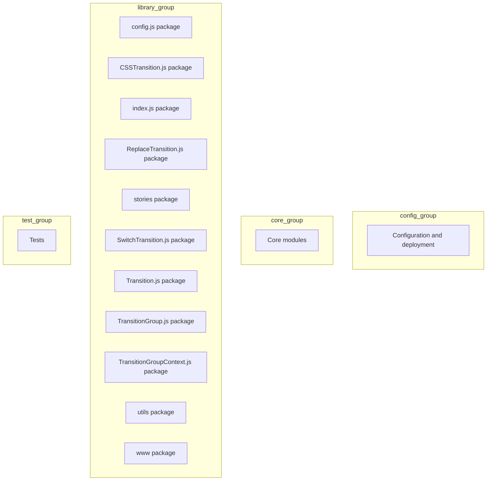

# Architecture report: reactjs/react-transition-group

> Automated static analysis. **Observed** = directly seen in files/imports/AST; **Inferred** = interpretation from that evidence. Repository code was not executed.

## 1. Repository at a glance

| Item | Value |
| --- | --- |
| Repository | reactjs/react-transition-group |
| Description | An easy way to perform animations when a React component enters or leaves the DOM |
| Language | JavaScript |
| Stars | 10213 |
| Licence | Other |
| Analysed commit / branch | 2989b5b87b4b4d1001f21c8efa503049ffb4fe8d / master |
| Framework(s) | React |
| Files analysed | 68 |
| Components | 14 |

## 2. Architecture in one minute

reactjs/react-transition-group - An easy way to perform animations when a React component enters or leaves the DOM. This repository was analysed statically from 68 file(s) (0 Python). Detected technologies (observed from imports/manifests): GitHub Actions, React, Jest, TypeScript. Files are grouped into 14 component(s): Configuration and deployment, config.js package, Core modules, CSSTransition.js package, index.js package, ReplaceTransition.js package, stories package, SwitchTransition.js package. Findings below distinguish observed facts from inferred interpretation.

## 3. High-level block diagram

## 4. Main components

### Configuration and deployment (`config`)

- **Kind:** config
- **Status:** Observed
- **Confidence:** 0.85
- **Responsibility:** Groups 3 file(s) under configuration and deployment (observed from repository paths and static analysis).
- **Paths:** `package.json`, `stories/.eslintrc.yml`, `www/package.json`
- **Evidence:** [package.json](https://github.com/reactjs/react-transition-group/blob/2989b5b87b4b4d1001f21c8efa503049ffb4fe8d/package.json); [stories/.eslintrc.yml](https://github.com/reactjs/react-transition-group/blob/2989b5b87b4b4d1001f21c8efa503049ffb4fe8d/stories/.eslintrc.yml); [www/package.json](https://github.com/reactjs/react-transition-group/blob/2989b5b87b4b4d1001f21c8efa503049ffb4fe8d/www/package.json)

### config.js package (`config_js`)

- **Kind:** library
- **Status:** Observed
- **Confidence:** 0.85
- **Responsibility:** Groups 1 file(s) under config.js package (observed from repository paths and static analysis).
- **Paths:** `src/config.js`
- **Evidence:** [src/config.js](https://github.com/reactjs/react-transition-group/blob/2989b5b87b4b4d1001f21c8efa503049ffb4fe8d/src/config.js)

### Core modules (`core`)

- **Kind:** core
- **Status:** Observed
- **Confidence:** 0.85
- **Responsibility:** Groups 2 file(s) under core modules (observed from repository paths and static analysis).
- **Paths:** `prettier.config.js`, `rollup.config.js`
- **Evidence:** [prettier.config.js](https://github.com/reactjs/react-transition-group/blob/2989b5b87b4b4d1001f21c8efa503049ffb4fe8d/prettier.config.js); [rollup.config.js](https://github.com/reactjs/react-transition-group/blob/2989b5b87b4b4d1001f21c8efa503049ffb4fe8d/rollup.config.js)

### CSSTransition.js package (`csstransition_js`)

- **Kind:** library
- **Status:** Observed
- **Confidence:** 0.85
- **Responsibility:** Groups 1 file(s) under csstransition.js package (observed from repository paths and static analysis).
- **Paths:** `src/CSSTransition.js`
- **Evidence:** [src/CSSTransition.js](https://github.com/reactjs/react-transition-group/blob/2989b5b87b4b4d1001f21c8efa503049ffb4fe8d/src/CSSTransition.js)

### index.js package (`index_js`)

- **Kind:** library
- **Status:** Observed
- **Confidence:** 0.85
- **Responsibility:** Groups 1 file(s) under index.js package (observed from repository paths and static analysis).
- **Paths:** `src/index.js`
- **Evidence:** [src/index.js](https://github.com/reactjs/react-transition-group/blob/2989b5b87b4b4d1001f21c8efa503049ffb4fe8d/src/index.js)

### ReplaceTransition.js package (`replacetransition_js`)

- **Kind:** library
- **Status:** Observed
- **Confidence:** 0.85
- **Responsibility:** Groups 1 file(s) under replacetransition.js package (observed from repository paths and static analysis).
- **Paths:** `src/ReplaceTransition.js`
- **Evidence:** [src/ReplaceTransition.js](https://github.com/reactjs/react-transition-group/blob/2989b5b87b4b4d1001f21c8efa503049ffb4fe8d/src/ReplaceTransition.js)

### stories package (`stories`)

- **Kind:** library
- **Status:** Observed
- **Confidence:** 0.85
- **Responsibility:** Groups 12 file(s) under stories package (observed from repository paths and static analysis).
- **Paths:** `stories/CSSTransition.js`, `stories/CSSTransitionGroupFixture.js`, `stories/NestedTransition.js`, `stories/ReplaceTransition.js`, `stories/StoryFixture.js`, `stories/Transition.js`, `stories/TransitionGroup.js`, `stories/index.js`, `stories/transitions/Bootstrap.js`, `stories/transitions/CSSFade.js`, `stories/transitions/CSSFadeForTransitionGroup.js`, `stories/transitions/Scale.js`
- **Evidence:** [stories/CSSTransition.js](https://github.com/reactjs/react-transition-group/blob/2989b5b87b4b4d1001f21c8efa503049ffb4fe8d/stories/CSSTransition.js); [stories/CSSTransitionGroupFixture.js](https://github.com/reactjs/react-transition-group/blob/2989b5b87b4b4d1001f21c8efa503049ffb4fe8d/stories/CSSTransitionGroupFixture.js); [stories/NestedTransition.js](https://github.com/reactjs/react-transition-group/blob/2989b5b87b4b4d1001f21c8efa503049ffb4fe8d/stories/NestedTransition.js); [stories/ReplaceTransition.js](https://github.com/reactjs/react-transition-group/blob/2989b5b87b4b4d1001f21c8efa503049ffb4fe8d/stories/ReplaceTransition.js); [stories/StoryFixture.js](https://github.com/reactjs/react-transition-group/blob/2989b5b87b4b4d1001f21c8efa503049ffb4fe8d/stories/StoryFixture.js); [stories/Transition.js](https://github.com/reactjs/react-transition-group/blob/2989b5b87b4b4d1001f21c8efa503049ffb4fe8d/stories/Transition.js); [stories/TransitionGroup.js](https://github.com/reactjs/react-transition-group/blob/2989b5b87b4b4d1001f21c8efa503049ffb4fe8d/stories/TransitionGroup.js); [stories/index.js](https://github.com/reactjs/react-transition-group/blob/2989b5b87b4b4d1001f21c8efa503049ffb4fe8d/stories/index.js)

### SwitchTransition.js package (`switchtransition_js`)

- **Kind:** library
- **Status:** Observed
- **Confidence:** 0.85
- **Responsibility:** Groups 1 file(s) under switchtransition.js package (observed from repository paths and static analysis).
- **Paths:** `src/SwitchTransition.js`
- **Evidence:** [src/SwitchTransition.js](https://github.com/reactjs/react-transition-group/blob/2989b5b87b4b4d1001f21c8efa503049ffb4fe8d/src/SwitchTransition.js)

### Tests (`tests`)

- **Kind:** test
- **Status:** Observed
- **Confidence:** 0.85
- **Responsibility:** Groups 11 file(s) under tests (observed from repository paths and static analysis).
- **Paths:** `test/.eslintrc.yml`, `test/CSSTransition-test.js`, `test/CSSTransitionGroup-test.js`, `test/ChildMapping-test.js`, `test/SSR-test.js`, `test/SwitchTransition-test.js`, `test/Transition-test.js`, `test/TransitionGroup-test.js`, `test/setup.js`, `test/setupAfterEnv.js`, `test/utils.js`
- **Evidence:** [test/.eslintrc.yml](https://github.com/reactjs/react-transition-group/blob/2989b5b87b4b4d1001f21c8efa503049ffb4fe8d/test/.eslintrc.yml); [test/CSSTransition-test.js](https://github.com/reactjs/react-transition-group/blob/2989b5b87b4b4d1001f21c8efa503049ffb4fe8d/test/CSSTransition-test.js); [test/CSSTransitionGroup-test.js](https://github.com/reactjs/react-transition-group/blob/2989b5b87b4b4d1001f21c8efa503049ffb4fe8d/test/CSSTransitionGroup-test.js); [test/ChildMapping-test.js](https://github.com/reactjs/react-transition-group/blob/2989b5b87b4b4d1001f21c8efa503049ffb4fe8d/test/ChildMapping-test.js); [test/SSR-test.js](https://github.com/reactjs/react-transition-group/blob/2989b5b87b4b4d1001f21c8efa503049ffb4fe8d/test/SSR-test.js); [test/SwitchTransition-test.js](https://github.com/reactjs/react-transition-group/blob/2989b5b87b4b4d1001f21c8efa503049ffb4fe8d/test/SwitchTransition-test.js); [test/Transition-test.js](https://github.com/reactjs/react-transition-group/blob/2989b5b87b4b4d1001f21c8efa503049ffb4fe8d/test/Transition-test.js); [test/TransitionGroup-test.js](https://github.com/reactjs/react-transition-group/blob/2989b5b87b4b4d1001f21c8efa503049ffb4fe8d/test/TransitionGroup-test.js)

### Transition.js package (`transition_js`)

- **Kind:** library
- **Status:** Observed
- **Confidence:** 0.85
- **Responsibility:** Groups 1 file(s) under transition.js package (observed from repository paths and static analysis).
- **Paths:** `src/Transition.js`
- **Evidence:** [src/Transition.js](https://github.com/reactjs/react-transition-group/blob/2989b5b87b4b4d1001f21c8efa503049ffb4fe8d/src/Transition.js)

### TransitionGroup.js package (`transitiongroup_js`)

- **Kind:** library
- **Status:** Observed
- **Confidence:** 0.85
- **Responsibility:** Groups 1 file(s) under transitiongroup.js package (observed from repository paths and static analysis).
- **Paths:** `src/TransitionGroup.js`
- **Evidence:** [src/TransitionGroup.js](https://github.com/reactjs/react-transition-group/blob/2989b5b87b4b4d1001f21c8efa503049ffb4fe8d/src/TransitionGroup.js)

### TransitionGroupContext.js package (`transitiongroupcontext_js`)

- **Kind:** library
- **Status:** Observed
- **Confidence:** 0.85
- **Responsibility:** Groups 1 file(s) under transitiongroupcontext.js package (observed from repository paths and static analysis).
- **Paths:** `src/TransitionGroupContext.js`
- **Evidence:** [src/TransitionGroupContext.js](https://github.com/reactjs/react-transition-group/blob/2989b5b87b4b4d1001f21c8efa503049ffb4fe8d/src/TransitionGroupContext.js)

### utils package (`utils`)

- **Kind:** library
- **Status:** Observed
- **Confidence:** 0.85
- **Responsibility:** Groups 4 file(s) under utils package (observed from repository paths and static analysis).
- **Paths:** `src/utils/ChildMapping.js`, `src/utils/PropTypes.js`, `src/utils/SimpleSet.js`, `src/utils/reflow.js`
- **Evidence:** [src/utils/ChildMapping.js](https://github.com/reactjs/react-transition-group/blob/2989b5b87b4b4d1001f21c8efa503049ffb4fe8d/src/utils/ChildMapping.js); [src/utils/PropTypes.js](https://github.com/reactjs/react-transition-group/blob/2989b5b87b4b4d1001f21c8efa503049ffb4fe8d/src/utils/PropTypes.js); [src/utils/SimpleSet.js](https://github.com/reactjs/react-transition-group/blob/2989b5b87b4b4d1001f21c8efa503049ffb4fe8d/src/utils/SimpleSet.js); [src/utils/reflow.js](https://github.com/reactjs/react-transition-group/blob/2989b5b87b4b4d1001f21c8efa503049ffb4fe8d/src/utils/reflow.js)

### www package (`www`)

- **Kind:** library
- **Status:** Observed
- **Confidence:** 0.85
- **Responsibility:** Groups 9 file(s) under www package (observed from repository paths and static analysis).
- **Paths:** `www/.babelrc.js`, `www/gatsby-config.js`, `www/gatsby-node.js`, `www/src/components/Example.js`, `www/src/components/Layout.js`, `www/src/pages/index.js`, `www/src/pages/testing.js`, `www/src/pages/with-react-router.js`, `www/src/templates/component.js`
- **Evidence:** [www/.babelrc.js](https://github.com/reactjs/react-transition-group/blob/2989b5b87b4b4d1001f21c8efa503049ffb4fe8d/www/.babelrc.js); [www/gatsby-config.js](https://github.com/reactjs/react-transition-group/blob/2989b5b87b4b4d1001f21c8efa503049ffb4fe8d/www/gatsby-config.js); [www/gatsby-node.js](https://github.com/reactjs/react-transition-group/blob/2989b5b87b4b4d1001f21c8efa503049ffb4fe8d/www/gatsby-node.js); [www/src/components/Example.js](https://github.com/reactjs/react-transition-group/blob/2989b5b87b4b4d1001f21c8efa503049ffb4fe8d/www/src/components/Example.js); [www/src/components/Layout.js](https://github.com/reactjs/react-transition-group/blob/2989b5b87b4b4d1001f21c8efa503049ffb4fe8d/www/src/components/Layout.js); [www/src/pages/index.js](https://github.com/reactjs/react-transition-group/blob/2989b5b87b4b4d1001f21c8efa503049ffb4fe8d/www/src/pages/index.js); [www/src/pages/testing.js](https://github.com/reactjs/react-transition-group/blob/2989b5b87b4b4d1001f21c8efa503049ffb4fe8d/www/src/pages/testing.js); [www/src/pages/with-react-router.js](https://github.com/reactjs/react-transition-group/blob/2989b5b87b4b4d1001f21c8efa503049ffb4fe8d/www/src/pages/with-react-router.js)

## 5. Execution flow

**Observed** entry point(s):

- [.storybook/main.js](https://github.com/reactjs/react-transition-group/blob/2989b5b87b4b4d1001f21c8efa503049ffb4fe8d/.storybook/main.js)
- [src/index.js](https://github.com/reactjs/react-transition-group/blob/2989b5b87b4b4d1001f21c8efa503049ffb4fe8d/src/index.js)
- [stories/index.js](https://github.com/reactjs/react-transition-group/blob/2989b5b87b4b4d1001f21c8efa503049ffb4fe8d/stories/index.js)
- [www/src/pages/index.js](https://github.com/reactjs/react-transition-group/blob/2989b5b87b4b4d1001f21c8efa503049ffb4fe8d/www/src/pages/index.js)

Representative flow (derived from observed entry points and the import graph; steps beyond the entry point are **Inferred**):

1. Execution starts at an observed entry point listed above, if present.
2. No internal import relationships between components were observed.

## 6. Project structure

### `(root)`

- `.babelrc.js` - source, JavaScript (264 bytes)
- `.eslintignore` - other (44 bytes)
- `.eslintrc.yml` - config (300 bytes)
- `.gitignore` - other (628 bytes)
- `.prettierignore` - other (48 bytes)
- `.size-snapshot.json` - config (235 bytes)
- `CHANGELOG.md` - docs (14242 bytes)
- `LICENSE` - docs (1608 bytes)
- `Migration.md` - docs (7198 bytes)
- `README.md` - docs (1568 bytes)
- `package.json` - manifest (4264 bytes)
- `prettier.config.js` - source, JavaScript (43 bytes)
- `rollup.config.js` - source, JavaScript (1451 bytes)

### `.github`

- `.github/ISSUE_TEMPLATE/bug-report.md` - docs (347 bytes)
- `.github/ISSUE_TEMPLATE/feature-request.md` - docs (135 bytes)
- `.github/workflows/ci.yml` - ci, YAML (2251 bytes)

### `.storybook`

- `.storybook/main.js` - source, JavaScript (338 bytes)
- `.storybook/preview.js` - source, JavaScript (142 bytes)

### `src`

- `src/CSSTransition.js` - source, JavaScript (11881 bytes)
- `src/ReplaceTransition.js` - source, JavaScript (2466 bytes)
- `src/SwitchTransition.js` - source, JavaScript (5750 bytes)
- `src/Transition.js` - source, JavaScript (18414 bytes)
- `src/TransitionGroup.js` - source, JavaScript (5428 bytes)
- `src/TransitionGroupContext.js` - source, JavaScript (70 bytes)
- `src/config.js` - source, JavaScript (39 bytes)
- `src/index.js` - source, JavaScript (358 bytes)
- `src/utils/ChildMapping.js` - source, JavaScript (4666 bytes)
- `src/utils/PropTypes.js` - source, JavaScript (890 bytes)
- `src/utils/SimpleSet.js` - source, JavaScript (360 bytes)
- `src/utils/reflow.js` - source, JavaScript (53 bytes)

### `stories`

- `stories/.eslintrc.yml` - config (167 bytes)
- `stories/CSSTransition.js` - source, JavaScript (1224 bytes)
- `stories/CSSTransitionGroupFixture.js` - source, JavaScript (1693 bytes)
- `stories/NestedTransition.js` - source, JavaScript (1215 bytes)
- `stories/ReplaceTransition.js` - source, JavaScript (2129 bytes)
- `stories/StoryFixture.js` - source, JavaScript (323 bytes)
- `stories/Transition.js` - source, JavaScript (1813 bytes)
- `stories/TransitionGroup.js` - source, JavaScript (3501 bytes)
- `stories/index.js` - source, JavaScript (107 bytes)
- `stories/transitions/Bootstrap.js` - source, JavaScript (3841 bytes)
- `stories/transitions/CSSFade.js` - source, JavaScript (926 bytes)
- `stories/transitions/CSSFadeForTransitionGroup.js` - source, JavaScript (814 bytes)
- `stories/transitions/Scale.js` - source, JavaScript (833 bytes)

### `test`

- `test/.eslintrc.yml` - test (387 bytes)
- `test/CSSTransition-test.js` - test, JavaScript (12370 bytes)
- `test/CSSTransitionGroup-test.js` - test, JavaScript (7917 bytes)
- `test/ChildMapping-test.js` - test, JavaScript (2646 bytes)
- `test/SSR-test.js` - test, JavaScript (253 bytes)
- `test/SwitchTransition-test.js` - test, JavaScript (4128 bytes)
- `test/Transition-test.js` - test, JavaScript (14673 bytes)
- `test/TransitionGroup-test.js` - test, JavaScript (3264 bytes)
- `test/setup.js` - test, JavaScript (83 bytes)
- `test/setupAfterEnv.js` - test, JavaScript (91 bytes)
- `test/utils.js` - test, JavaScript (348 bytes)

### `www`

- `www/.babelrc.js` - source, JavaScript (58 bytes)
- `www/.gitignore` - other (13 bytes)
- `www/gatsby-config.js` - source, JavaScript (1296 bytes)
- `www/gatsby-node.js` - source, JavaScript (1210 bytes)
- `www/package.json` - manifest (1079 bytes)
- `www/src/components/Example.js` - source, JavaScript (847 bytes)
- `www/src/components/Layout.js` - source, JavaScript (2027 bytes)
- `www/src/css/_variables.scss` - other (762 bytes)
- `www/src/css/bootstrap.scss` - other (629 bytes)
- `www/src/css/prism-theme.scss` - other (3035 bytes)
- `www/src/pages/index.js` - source, JavaScript (2958 bytes)
- `www/src/pages/testing.js` - source, JavaScript (1996 bytes)
- `www/src/pages/with-react-router.js` - source, JavaScript (3353 bytes)
- `www/src/templates/component.js` - source, JavaScript (7680 bytes)

## 7. Key dependencies and integrations

| Name | Category | Status | Confidence | Evidence |
| --- | --- | --- | --- | --- |
| GitHub Actions | ci | Observed | 0.85 | [.github/workflows/ci.yml](https://github.com/reactjs/react-transition-group/blob/2989b5b87b4b4d1001f21c8efa503049ffb4fe8d/.github/workflows/ci.yml) |
| React | framework | Observed | 0.90 | [package.json:2](https://github.com/reactjs/react-transition-group/blob/2989b5b87b4b4d1001f21c8efa503049ffb4fe8d/package.json#L2); [package.json:65](https://github.com/reactjs/react-transition-group/blob/2989b5b87b4b4d1001f21c8efa503049ffb4fe8d/package.json#L65); [www/package.json:3](https://github.com/reactjs/react-transition-group/blob/2989b5b87b4b4d1001f21c8efa503049ffb4fe8d/www/package.json#L3); [www/package.json:33](https://github.com/reactjs/react-transition-group/blob/2989b5b87b4b4d1001f21c8efa503049ffb4fe8d/www/package.json#L33) |
| Jest | tooling | Observed | 0.85 | [package.json:9](https://github.com/reactjs/react-transition-group/blob/2989b5b87b4b4d1001f21c8efa503049ffb4fe8d/package.json#L9) |
| TypeScript | tooling | Observed | 0.85 | [package.json:84](https://github.com/reactjs/react-transition-group/blob/2989b5b87b4b4d1001f21c8efa503049ffb4fe8d/package.json#L84) |

## 8. Data and state

No database, cache, queue, or persistent-state usage was observed in the analysed files. State handling, if any, may be in-memory or in files that were not analysed.

## 9. Configuration and deployment clues

- `.eslintrc.yml` (config)
- `.github/workflows/ci.yml` (ci)
- `.size-snapshot.json` (config)
- `package.json` (manifest)
- `stories/.eslintrc.yml` (config)
- `www/package.json` (manifest)

## 10. Design observations

- Tests are present alongside source code (Observed from test file paths).

These observations are interpretations (**Inferred**) of the observed structure, not guarantees about runtime design.

## 11. Limitations and unknowns

- Static analysis only: repository code was not executed, installed, or imported at runtime.
- Components and relationships are inferred from file paths, imports, and AST structure; runtime behaviour, dynamic imports, and reflection may not be visible.
- 1 file(s) were skipped during inventory (1 x likely secret file excluded).
- No clear application entry point was observed in the analysed files.
- Repository text was treated as untrusted data; no instructions found in repository files were followed, and likely secret values were redacted/excluded.
- JavaScript and TypeScript files were inventoried from paths and package manifests. They were not parsed with a full language AST, and repository code was not executed.

## 12. Source references

- [.github/workflows/ci.yml](https://github.com/reactjs/react-transition-group/blob/2989b5b87b4b4d1001f21c8efa503049ffb4fe8d/.github/workflows/ci.yml)
- [.storybook/main.js](https://github.com/reactjs/react-transition-group/blob/2989b5b87b4b4d1001f21c8efa503049ffb4fe8d/.storybook/main.js)
- [package.json](https://github.com/reactjs/react-transition-group/blob/2989b5b87b4b4d1001f21c8efa503049ffb4fe8d/package.json)
- [package.json:2](https://github.com/reactjs/react-transition-group/blob/2989b5b87b4b4d1001f21c8efa503049ffb4fe8d/package.json#L2)
- [package.json:9](https://github.com/reactjs/react-transition-group/blob/2989b5b87b4b4d1001f21c8efa503049ffb4fe8d/package.json#L9)
- [package.json:65](https://github.com/reactjs/react-transition-group/blob/2989b5b87b4b4d1001f21c8efa503049ffb4fe8d/package.json#L65)
- [package.json:84](https://github.com/reactjs/react-transition-group/blob/2989b5b87b4b4d1001f21c8efa503049ffb4fe8d/package.json#L84)
- [prettier.config.js](https://github.com/reactjs/react-transition-group/blob/2989b5b87b4b4d1001f21c8efa503049ffb4fe8d/prettier.config.js)
- [rollup.config.js](https://github.com/reactjs/react-transition-group/blob/2989b5b87b4b4d1001f21c8efa503049ffb4fe8d/rollup.config.js)
- [src/CSSTransition.js](https://github.com/reactjs/react-transition-group/blob/2989b5b87b4b4d1001f21c8efa503049ffb4fe8d/src/CSSTransition.js)
- [src/ReplaceTransition.js](https://github.com/reactjs/react-transition-group/blob/2989b5b87b4b4d1001f21c8efa503049ffb4fe8d/src/ReplaceTransition.js)
- [src/SwitchTransition.js](https://github.com/reactjs/react-transition-group/blob/2989b5b87b4b4d1001f21c8efa503049ffb4fe8d/src/SwitchTransition.js)
- [src/Transition.js](https://github.com/reactjs/react-transition-group/blob/2989b5b87b4b4d1001f21c8efa503049ffb4fe8d/src/Transition.js)
- [src/TransitionGroup.js](https://github.com/reactjs/react-transition-group/blob/2989b5b87b4b4d1001f21c8efa503049ffb4fe8d/src/TransitionGroup.js)
- [src/TransitionGroupContext.js](https://github.com/reactjs/react-transition-group/blob/2989b5b87b4b4d1001f21c8efa503049ffb4fe8d/src/TransitionGroupContext.js)
- [src/config.js](https://github.com/reactjs/react-transition-group/blob/2989b5b87b4b4d1001f21c8efa503049ffb4fe8d/src/config.js)
- [src/index.js](https://github.com/reactjs/react-transition-group/blob/2989b5b87b4b4d1001f21c8efa503049ffb4fe8d/src/index.js)
- [src/utils/ChildMapping.js](https://github.com/reactjs/react-transition-group/blob/2989b5b87b4b4d1001f21c8efa503049ffb4fe8d/src/utils/ChildMapping.js)
- [src/utils/PropTypes.js](https://github.com/reactjs/react-transition-group/blob/2989b5b87b4b4d1001f21c8efa503049ffb4fe8d/src/utils/PropTypes.js)
- [src/utils/SimpleSet.js](https://github.com/reactjs/react-transition-group/blob/2989b5b87b4b4d1001f21c8efa503049ffb4fe8d/src/utils/SimpleSet.js)
- [src/utils/reflow.js](https://github.com/reactjs/react-transition-group/blob/2989b5b87b4b4d1001f21c8efa503049ffb4fe8d/src/utils/reflow.js)
- [stories/.eslintrc.yml](https://github.com/reactjs/react-transition-group/blob/2989b5b87b4b4d1001f21c8efa503049ffb4fe8d/stories/.eslintrc.yml)
- [stories/CSSTransition.js](https://github.com/reactjs/react-transition-group/blob/2989b5b87b4b4d1001f21c8efa503049ffb4fe8d/stories/CSSTransition.js)
- [stories/CSSTransitionGroupFixture.js](https://github.com/reactjs/react-transition-group/blob/2989b5b87b4b4d1001f21c8efa503049ffb4fe8d/stories/CSSTransitionGroupFixture.js)
- [stories/NestedTransition.js](https://github.com/reactjs/react-transition-group/blob/2989b5b87b4b4d1001f21c8efa503049ffb4fe8d/stories/NestedTransition.js)
- [stories/ReplaceTransition.js](https://github.com/reactjs/react-transition-group/blob/2989b5b87b4b4d1001f21c8efa503049ffb4fe8d/stories/ReplaceTransition.js)
- [stories/StoryFixture.js](https://github.com/reactjs/react-transition-group/blob/2989b5b87b4b4d1001f21c8efa503049ffb4fe8d/stories/StoryFixture.js)
- [stories/Transition.js](https://github.com/reactjs/react-transition-group/blob/2989b5b87b4b4d1001f21c8efa503049ffb4fe8d/stories/Transition.js)
- [stories/TransitionGroup.js](https://github.com/reactjs/react-transition-group/blob/2989b5b87b4b4d1001f21c8efa503049ffb4fe8d/stories/TransitionGroup.js)
- [stories/index.js](https://github.com/reactjs/react-transition-group/blob/2989b5b87b4b4d1001f21c8efa503049ffb4fe8d/stories/index.js)
- [test/.eslintrc.yml](https://github.com/reactjs/react-transition-group/blob/2989b5b87b4b4d1001f21c8efa503049ffb4fe8d/test/.eslintrc.yml)
- [test/CSSTransition-test.js](https://github.com/reactjs/react-transition-group/blob/2989b5b87b4b4d1001f21c8efa503049ffb4fe8d/test/CSSTransition-test.js)
- [test/CSSTransitionGroup-test.js](https://github.com/reactjs/react-transition-group/blob/2989b5b87b4b4d1001f21c8efa503049ffb4fe8d/test/CSSTransitionGroup-test.js)
- [test/ChildMapping-test.js](https://github.com/reactjs/react-transition-group/blob/2989b5b87b4b4d1001f21c8efa503049ffb4fe8d/test/ChildMapping-test.js)
- [test/SSR-test.js](https://github.com/reactjs/react-transition-group/blob/2989b5b87b4b4d1001f21c8efa503049ffb4fe8d/test/SSR-test.js)
- [test/SwitchTransition-test.js](https://github.com/reactjs/react-transition-group/blob/2989b5b87b4b4d1001f21c8efa503049ffb4fe8d/test/SwitchTransition-test.js)
- [test/Transition-test.js](https://github.com/reactjs/react-transition-group/blob/2989b5b87b4b4d1001f21c8efa503049ffb4fe8d/test/Transition-test.js)
- [test/TransitionGroup-test.js](https://github.com/reactjs/react-transition-group/blob/2989b5b87b4b4d1001f21c8efa503049ffb4fe8d/test/TransitionGroup-test.js)
- [www/.babelrc.js](https://github.com/reactjs/react-transition-group/blob/2989b5b87b4b4d1001f21c8efa503049ffb4fe8d/www/.babelrc.js)
- [www/gatsby-config.js](https://github.com/reactjs/react-transition-group/blob/2989b5b87b4b4d1001f21c8efa503049ffb4fe8d/www/gatsby-config.js)
- [www/gatsby-node.js](https://github.com/reactjs/react-transition-group/blob/2989b5b87b4b4d1001f21c8efa503049ffb4fe8d/www/gatsby-node.js)
- [www/package.json](https://github.com/reactjs/react-transition-group/blob/2989b5b87b4b4d1001f21c8efa503049ffb4fe8d/www/package.json)
- [www/package.json:3](https://github.com/reactjs/react-transition-group/blob/2989b5b87b4b4d1001f21c8efa503049ffb4fe8d/www/package.json#L3)
- [www/package.json:33](https://github.com/reactjs/react-transition-group/blob/2989b5b87b4b4d1001f21c8efa503049ffb4fe8d/www/package.json#L33)
- [www/src/components/Example.js](https://github.com/reactjs/react-transition-group/blob/2989b5b87b4b4d1001f21c8efa503049ffb4fe8d/www/src/components/Example.js)
- [www/src/components/Layout.js](https://github.com/reactjs/react-transition-group/blob/2989b5b87b4b4d1001f21c8efa503049ffb4fe8d/www/src/components/Layout.js)
- [www/src/pages/index.js](https://github.com/reactjs/react-transition-group/blob/2989b5b87b4b4d1001f21c8efa503049ffb4fe8d/www/src/pages/index.js)
- [www/src/pages/testing.js](https://github.com/reactjs/react-transition-group/blob/2989b5b87b4b4d1001f21c8efa503049ffb4fe8d/www/src/pages/testing.js)
- [www/src/pages/with-react-router.js](https://github.com/reactjs/react-transition-group/blob/2989b5b87b4b4d1001f21c8efa503049ffb4fe8d/www/src/pages/with-react-router.js)
