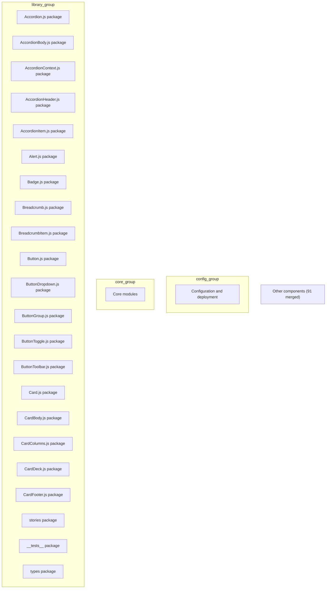

# Architecture report: reactstrap/reactstrap

> Automated static analysis. **Observed** = directly seen in files/imports/AST; **Inferred** = interpretation from that evidence. Repository code was not executed.

## 1. Repository at a glance

| Item | Value |
| --- | --- |
| Repository | reactstrap/reactstrap |
| Description | Simple React Bootstrap 5 components |
| Language | JavaScript |
| Stars | 10510 |
| Licence | MIT |
| Analysed commit / branch | 090bc1eeb19bcc269970151d330c6bc03f731635 / master |
| Framework(s) | React |
| Files analysed | 605 |
| Components | 115 |

## 2. Architecture in one minute

reactstrap/reactstrap - Simple React Bootstrap 5 components. This repository was analysed statically from 605 file(s) (0 Python). Detected technologies (observed from imports/manifests): GitHub Actions, React, React Router, Jest, TypeScript, webpack. Files are grouped into 115 component(s): Accordion.js package, AccordionBody.js package, AccordionContext.js package, AccordionHeader.js package, AccordionItem.js package, Alert.js package, Badge.js package, Breadcrumb.js package. Findings below distinguish observed facts from inferred interpretation.

## 3. High-level block diagram

## 4. Main components

### Accordion.js package (`accordion_js`)

- **Kind:** library
- **Status:** Observed
- **Confidence:** 0.85
- **Responsibility:** Groups 1 file(s) under accordion.js package (observed from repository paths and static analysis).
- **Paths:** `src/Accordion.js`
- **Evidence:** [src/Accordion.js](https://github.com/reactstrap/reactstrap/blob/090bc1eeb19bcc269970151d330c6bc03f731635/src/Accordion.js)

### AccordionBody.js package (`accordionbody_js`)

- **Kind:** library
- **Status:** Observed
- **Confidence:** 0.85
- **Responsibility:** Groups 1 file(s) under accordionbody.js package (observed from repository paths and static analysis).
- **Paths:** `src/AccordionBody.js`
- **Evidence:** [src/AccordionBody.js](https://github.com/reactstrap/reactstrap/blob/090bc1eeb19bcc269970151d330c6bc03f731635/src/AccordionBody.js)

### AccordionContext.js package (`accordioncontext_js`)

- **Kind:** library
- **Status:** Observed
- **Confidence:** 0.85
- **Responsibility:** Groups 1 file(s) under accordioncontext.js package (observed from repository paths and static analysis).
- **Paths:** `src/AccordionContext.js`
- **Evidence:** [src/AccordionContext.js](https://github.com/reactstrap/reactstrap/blob/090bc1eeb19bcc269970151d330c6bc03f731635/src/AccordionContext.js)

### AccordionHeader.js package (`accordionheader_js`)

- **Kind:** library
- **Status:** Observed
- **Confidence:** 0.85
- **Responsibility:** Groups 1 file(s) under accordionheader.js package (observed from repository paths and static analysis).
- **Paths:** `src/AccordionHeader.js`
- **Evidence:** [src/AccordionHeader.js](https://github.com/reactstrap/reactstrap/blob/090bc1eeb19bcc269970151d330c6bc03f731635/src/AccordionHeader.js)

### AccordionItem.js package (`accordionitem_js`)

- **Kind:** library
- **Status:** Observed
- **Confidence:** 0.85
- **Responsibility:** Groups 1 file(s) under accordionitem.js package (observed from repository paths and static analysis).
- **Paths:** `src/AccordionItem.js`
- **Evidence:** [src/AccordionItem.js](https://github.com/reactstrap/reactstrap/blob/090bc1eeb19bcc269970151d330c6bc03f731635/src/AccordionItem.js)

### Alert.js package (`alert_js`)

- **Kind:** library
- **Status:** Observed
- **Confidence:** 0.85
- **Responsibility:** Groups 1 file(s) under alert.js package (observed from repository paths and static analysis).
- **Paths:** `src/Alert.js`
- **Evidence:** [src/Alert.js](https://github.com/reactstrap/reactstrap/blob/090bc1eeb19bcc269970151d330c6bc03f731635/src/Alert.js)

### Badge.js package (`badge_js`)

- **Kind:** library
- **Status:** Observed
- **Confidence:** 0.85
- **Responsibility:** Groups 1 file(s) under badge.js package (observed from repository paths and static analysis).
- **Paths:** `src/Badge.js`
- **Evidence:** [src/Badge.js](https://github.com/reactstrap/reactstrap/blob/090bc1eeb19bcc269970151d330c6bc03f731635/src/Badge.js)

### Breadcrumb.js package (`breadcrumb_js`)

- **Kind:** library
- **Status:** Observed
- **Confidence:** 0.85
- **Responsibility:** Groups 1 file(s) under breadcrumb.js package (observed from repository paths and static analysis).
- **Paths:** `src/Breadcrumb.js`
- **Evidence:** [src/Breadcrumb.js](https://github.com/reactstrap/reactstrap/blob/090bc1eeb19bcc269970151d330c6bc03f731635/src/Breadcrumb.js)

### BreadcrumbItem.js package (`breadcrumbitem_js`)

- **Kind:** library
- **Status:** Observed
- **Confidence:** 0.85
- **Responsibility:** Groups 1 file(s) under breadcrumbitem.js package (observed from repository paths and static analysis).
- **Paths:** `src/BreadcrumbItem.js`
- **Evidence:** [src/BreadcrumbItem.js](https://github.com/reactstrap/reactstrap/blob/090bc1eeb19bcc269970151d330c6bc03f731635/src/BreadcrumbItem.js)

### Button.js package (`button_js`)

- **Kind:** library
- **Status:** Observed
- **Confidence:** 0.85
- **Responsibility:** Groups 1 file(s) under button.js package (observed from repository paths and static analysis).
- **Paths:** `src/Button.js`
- **Evidence:** [src/Button.js](https://github.com/reactstrap/reactstrap/blob/090bc1eeb19bcc269970151d330c6bc03f731635/src/Button.js)

### ButtonDropdown.js package (`buttondropdown_js`)

- **Kind:** library
- **Status:** Observed
- **Confidence:** 0.85
- **Responsibility:** Groups 1 file(s) under buttondropdown.js package (observed from repository paths and static analysis).
- **Paths:** `src/ButtonDropdown.js`
- **Evidence:** [src/ButtonDropdown.js](https://github.com/reactstrap/reactstrap/blob/090bc1eeb19bcc269970151d330c6bc03f731635/src/ButtonDropdown.js)

### ButtonGroup.js package (`buttongroup_js`)

- **Kind:** library
- **Status:** Observed
- **Confidence:** 0.85
- **Responsibility:** Groups 1 file(s) under buttongroup.js package (observed from repository paths and static analysis).
- **Paths:** `src/ButtonGroup.js`
- **Evidence:** [src/ButtonGroup.js](https://github.com/reactstrap/reactstrap/blob/090bc1eeb19bcc269970151d330c6bc03f731635/src/ButtonGroup.js)

### ButtonToggle.js package (`buttontoggle_js`)

- **Kind:** library
- **Status:** Observed
- **Confidence:** 0.85
- **Responsibility:** Groups 1 file(s) under buttontoggle.js package (observed from repository paths and static analysis).
- **Paths:** `src/ButtonToggle.js`
- **Evidence:** [src/ButtonToggle.js](https://github.com/reactstrap/reactstrap/blob/090bc1eeb19bcc269970151d330c6bc03f731635/src/ButtonToggle.js)

### ButtonToolbar.js package (`buttontoolbar_js`)

- **Kind:** library
- **Status:** Observed
- **Confidence:** 0.85
- **Responsibility:** Groups 1 file(s) under buttontoolbar.js package (observed from repository paths and static analysis).
- **Paths:** `src/ButtonToolbar.js`
- **Evidence:** [src/ButtonToolbar.js](https://github.com/reactstrap/reactstrap/blob/090bc1eeb19bcc269970151d330c6bc03f731635/src/ButtonToolbar.js)

### Card.js package (`card_js`)

- **Kind:** library
- **Status:** Observed
- **Confidence:** 0.85
- **Responsibility:** Groups 1 file(s) under card.js package (observed from repository paths and static analysis).
- **Paths:** `src/Card.js`
- **Evidence:** [src/Card.js](https://github.com/reactstrap/reactstrap/blob/090bc1eeb19bcc269970151d330c6bc03f731635/src/Card.js)

### CardBody.js package (`cardbody_js`)

- **Kind:** library
- **Status:** Observed
- **Confidence:** 0.85
- **Responsibility:** Groups 1 file(s) under cardbody.js package (observed from repository paths and static analysis).
- **Paths:** `src/CardBody.js`
- **Evidence:** [src/CardBody.js](https://github.com/reactstrap/reactstrap/blob/090bc1eeb19bcc269970151d330c6bc03f731635/src/CardBody.js)

### CardColumns.js package (`cardcolumns_js`)

- **Kind:** library
- **Status:** Observed
- **Confidence:** 0.85
- **Responsibility:** Groups 1 file(s) under cardcolumns.js package (observed from repository paths and static analysis).
- **Paths:** `src/CardColumns.js`
- **Evidence:** [src/CardColumns.js](https://github.com/reactstrap/reactstrap/blob/090bc1eeb19bcc269970151d330c6bc03f731635/src/CardColumns.js)

### CardDeck.js package (`carddeck_js`)

- **Kind:** library
- **Status:** Observed
- **Confidence:** 0.85
- **Responsibility:** Groups 1 file(s) under carddeck.js package (observed from repository paths and static analysis).
- **Paths:** `src/CardDeck.js`
- **Evidence:** [src/CardDeck.js](https://github.com/reactstrap/reactstrap/blob/090bc1eeb19bcc269970151d330c6bc03f731635/src/CardDeck.js)

### CardFooter.js package (`cardfooter_js`)

- **Kind:** library
- **Status:** Observed
- **Confidence:** 0.85
- **Responsibility:** Groups 1 file(s) under cardfooter.js package (observed from repository paths and static analysis).
- **Paths:** `src/CardFooter.js`
- **Evidence:** [src/CardFooter.js](https://github.com/reactstrap/reactstrap/blob/090bc1eeb19bcc269970151d330c6bc03f731635/src/CardFooter.js)

### CardGroup.js package (`cardgroup_js`)

- **Kind:** library
- **Status:** Observed
- **Confidence:** 0.85
- **Responsibility:** Groups 1 file(s) under cardgroup.js package (observed from repository paths and static analysis).
- **Paths:** `src/CardGroup.js`
- **Evidence:** [src/CardGroup.js](https://github.com/reactstrap/reactstrap/blob/090bc1eeb19bcc269970151d330c6bc03f731635/src/CardGroup.js)

### CardHeader.js package (`cardheader_js`)

- **Kind:** library
- **Status:** Observed
- **Confidence:** 0.85
- **Responsibility:** Groups 1 file(s) under cardheader.js package (observed from repository paths and static analysis).
- **Paths:** `src/CardHeader.js`
- **Evidence:** [src/CardHeader.js](https://github.com/reactstrap/reactstrap/blob/090bc1eeb19bcc269970151d330c6bc03f731635/src/CardHeader.js)

### CardImg.js package (`cardimg_js`)

- **Kind:** library
- **Status:** Observed
- **Confidence:** 0.85
- **Responsibility:** Groups 1 file(s) under cardimg.js package (observed from repository paths and static analysis).
- **Paths:** `src/CardImg.js`
- **Evidence:** [src/CardImg.js](https://github.com/reactstrap/reactstrap/blob/090bc1eeb19bcc269970151d330c6bc03f731635/src/CardImg.js)

### CardImgOverlay.js package (`cardimgoverlay_js`)

- **Kind:** library
- **Status:** Observed
- **Confidence:** 0.85
- **Responsibility:** Groups 1 file(s) under cardimgoverlay.js package (observed from repository paths and static analysis).
- **Paths:** `src/CardImgOverlay.js`
- **Evidence:** [src/CardImgOverlay.js](https://github.com/reactstrap/reactstrap/blob/090bc1eeb19bcc269970151d330c6bc03f731635/src/CardImgOverlay.js)

### CardLink.js package (`cardlink_js`)

- **Kind:** library
- **Status:** Observed
- **Confidence:** 0.85
- **Responsibility:** Groups 1 file(s) under cardlink.js package (observed from repository paths and static analysis).
- **Paths:** `src/CardLink.js`
- **Evidence:** [src/CardLink.js](https://github.com/reactstrap/reactstrap/blob/090bc1eeb19bcc269970151d330c6bc03f731635/src/CardLink.js)

### CardSubtitle.js package (`cardsubtitle_js`)

- **Kind:** library
- **Status:** Observed
- **Confidence:** 0.85
- **Responsibility:** Groups 1 file(s) under cardsubtitle.js package (observed from repository paths and static analysis).
- **Paths:** `src/CardSubtitle.js`
- **Evidence:** [src/CardSubtitle.js](https://github.com/reactstrap/reactstrap/blob/090bc1eeb19bcc269970151d330c6bc03f731635/src/CardSubtitle.js)

### CardText.js package (`cardtext_js`)

- **Kind:** library
- **Status:** Observed
- **Confidence:** 0.85
- **Responsibility:** Groups 1 file(s) under cardtext.js package (observed from repository paths and static analysis).
- **Paths:** `src/CardText.js`
- **Evidence:** [src/CardText.js](https://github.com/reactstrap/reactstrap/blob/090bc1eeb19bcc269970151d330c6bc03f731635/src/CardText.js)

### CardTitle.js package (`cardtitle_js`)

- **Kind:** library
- **Status:** Observed
- **Confidence:** 0.85
- **Responsibility:** Groups 1 file(s) under cardtitle.js package (observed from repository paths and static analysis).
- **Paths:** `src/CardTitle.js`
- **Evidence:** [src/CardTitle.js](https://github.com/reactstrap/reactstrap/blob/090bc1eeb19bcc269970151d330c6bc03f731635/src/CardTitle.js)

### Carousel.js package (`carousel_js`)

- **Kind:** library
- **Status:** Observed
- **Confidence:** 0.85
- **Responsibility:** Groups 1 file(s) under carousel.js package (observed from repository paths and static analysis).
- **Paths:** `src/Carousel.js`
- **Evidence:** [src/Carousel.js](https://github.com/reactstrap/reactstrap/blob/090bc1eeb19bcc269970151d330c6bc03f731635/src/Carousel.js)

### CarouselCaption.js package (`carouselcaption_js`)

- **Kind:** library
- **Status:** Observed
- **Confidence:** 0.85
- **Responsibility:** Groups 1 file(s) under carouselcaption.js package (observed from repository paths and static analysis).
- **Paths:** `src/CarouselCaption.js`
- **Evidence:** [src/CarouselCaption.js](https://github.com/reactstrap/reactstrap/blob/090bc1eeb19bcc269970151d330c6bc03f731635/src/CarouselCaption.js)

### CarouselContext.js package (`carouselcontext_js`)

- **Kind:** library
- **Status:** Observed
- **Confidence:** 0.85
- **Responsibility:** Groups 1 file(s) under carouselcontext.js package (observed from repository paths and static analysis).
- **Paths:** `src/CarouselContext.js`
- **Evidence:** [src/CarouselContext.js](https://github.com/reactstrap/reactstrap/blob/090bc1eeb19bcc269970151d330c6bc03f731635/src/CarouselContext.js)

### CarouselControl.js package (`carouselcontrol_js`)

- **Kind:** library
- **Status:** Observed
- **Confidence:** 0.85
- **Responsibility:** Groups 1 file(s) under carouselcontrol.js package (observed from repository paths and static analysis).
- **Paths:** `src/CarouselControl.js`
- **Evidence:** [src/CarouselControl.js](https://github.com/reactstrap/reactstrap/blob/090bc1eeb19bcc269970151d330c6bc03f731635/src/CarouselControl.js)

### CarouselIndicators.js package (`carouselindicators_js`)

- **Kind:** library
- **Status:** Observed
- **Confidence:** 0.85
- **Responsibility:** Groups 1 file(s) under carouselindicators.js package (observed from repository paths and static analysis).
- **Paths:** `src/CarouselIndicators.js`
- **Evidence:** [src/CarouselIndicators.js](https://github.com/reactstrap/reactstrap/blob/090bc1eeb19bcc269970151d330c6bc03f731635/src/CarouselIndicators.js)

### CarouselItem.js package (`carouselitem_js`)

- **Kind:** library
- **Status:** Observed
- **Confidence:** 0.85
- **Responsibility:** Groups 1 file(s) under carouselitem.js package (observed from repository paths and static analysis).
- **Paths:** `src/CarouselItem.js`
- **Evidence:** [src/CarouselItem.js](https://github.com/reactstrap/reactstrap/blob/090bc1eeb19bcc269970151d330c6bc03f731635/src/CarouselItem.js)

### CloseButton.js package (`closebutton_js`)

- **Kind:** library
- **Status:** Observed
- **Confidence:** 0.85
- **Responsibility:** Groups 1 file(s) under closebutton.js package (observed from repository paths and static analysis).
- **Paths:** `src/CloseButton.js`
- **Evidence:** [src/CloseButton.js](https://github.com/reactstrap/reactstrap/blob/090bc1eeb19bcc269970151d330c6bc03f731635/src/CloseButton.js)

### Col.js package (`col_js`)

- **Kind:** library
- **Status:** Observed
- **Confidence:** 0.85
- **Responsibility:** Groups 1 file(s) under col.js package (observed from repository paths and static analysis).
- **Paths:** `src/Col.js`
- **Evidence:** [src/Col.js](https://github.com/reactstrap/reactstrap/blob/090bc1eeb19bcc269970151d330c6bc03f731635/src/Col.js)

### Collapse.js package (`collapse_js`)

- **Kind:** library
- **Status:** Observed
- **Confidence:** 0.85
- **Responsibility:** Groups 1 file(s) under collapse.js package (observed from repository paths and static analysis).
- **Paths:** `src/Collapse.js`
- **Evidence:** [src/Collapse.js](https://github.com/reactstrap/reactstrap/blob/090bc1eeb19bcc269970151d330c6bc03f731635/src/Collapse.js)

### Configuration and deployment (`config`)

- **Kind:** config
- **Status:** Observed
- **Confidence:** 0.85
- **Responsibility:** Groups 5 file(s) under configuration and deployment (observed from repository paths and static analysis).
- **Paths:** `config-overrides/package.json`, `package.json`, `stories/.eslintrc.json`, `types/tsconfig.json`, `types/tslint.json`
- **Evidence:** [config-overrides/package.json](https://github.com/reactstrap/reactstrap/blob/090bc1eeb19bcc269970151d330c6bc03f731635/config-overrides/package.json); [package.json](https://github.com/reactstrap/reactstrap/blob/090bc1eeb19bcc269970151d330c6bc03f731635/package.json); [stories/.eslintrc.json](https://github.com/reactstrap/reactstrap/blob/090bc1eeb19bcc269970151d330c6bc03f731635/stories/.eslintrc.json); [types/tsconfig.json](https://github.com/reactstrap/reactstrap/blob/090bc1eeb19bcc269970151d330c6bc03f731635/types/tsconfig.json); [types/tslint.json](https://github.com/reactstrap/reactstrap/blob/090bc1eeb19bcc269970151d330c6bc03f731635/types/tslint.json)

### config-overrides package (`config_overrides`)

- **Kind:** library
- **Status:** Observed
- **Confidence:** 0.85
- **Responsibility:** Groups 1 file(s) under config-overrides package (observed from repository paths and static analysis).
- **Paths:** `config-overrides/index.cjs`
- **Evidence:** [config-overrides/index.cjs](https://github.com/reactstrap/reactstrap/blob/090bc1eeb19bcc269970151d330c6bc03f731635/config-overrides/index.cjs)

### Container.js package (`container_js`)

- **Kind:** library
- **Status:** Observed
- **Confidence:** 0.85
- **Responsibility:** Groups 1 file(s) under container.js package (observed from repository paths and static analysis).
- **Paths:** `src/Container.js`
- **Evidence:** [src/Container.js](https://github.com/reactstrap/reactstrap/blob/090bc1eeb19bcc269970151d330c6bc03f731635/src/Container.js)

### Core modules (`core`)

- **Kind:** core
- **Status:** Observed
- **Confidence:** 0.85
- **Responsibility:** Groups 4 file(s) under core modules (observed from repository paths and static analysis).
- **Paths:** `babel.build.config.cjs`, `babel.config.cjs`, `babel.esm.config.cjs`, `jest.config.js`
- **Evidence:** [babel.build.config.cjs](https://github.com/reactstrap/reactstrap/blob/090bc1eeb19bcc269970151d330c6bc03f731635/babel.build.config.cjs); [babel.config.cjs](https://github.com/reactstrap/reactstrap/blob/090bc1eeb19bcc269970151d330c6bc03f731635/babel.config.cjs); [babel.esm.config.cjs](https://github.com/reactstrap/reactstrap/blob/090bc1eeb19bcc269970151d330c6bc03f731635/babel.esm.config.cjs); [jest.config.js](https://github.com/reactstrap/reactstrap/blob/090bc1eeb19bcc269970151d330c6bc03f731635/jest.config.js)

### Dropdown.js package (`dropdown_js`)

- **Kind:** library
- **Status:** Observed
- **Confidence:** 0.85
- **Responsibility:** Groups 1 file(s) under dropdown.js package (observed from repository paths and static analysis).
- **Paths:** `src/Dropdown.js`
- **Evidence:** [src/Dropdown.js](https://github.com/reactstrap/reactstrap/blob/090bc1eeb19bcc269970151d330c6bc03f731635/src/Dropdown.js)

### DropdownContext.js package (`dropdowncontext_js`)

- **Kind:** library
- **Status:** Observed
- **Confidence:** 0.85
- **Responsibility:** Groups 1 file(s) under dropdowncontext.js package (observed from repository paths and static analysis).
- **Paths:** `src/DropdownContext.js`
- **Evidence:** [src/DropdownContext.js](https://github.com/reactstrap/reactstrap/blob/090bc1eeb19bcc269970151d330c6bc03f731635/src/DropdownContext.js)

### DropdownItem.js package (`dropdownitem_js`)

- **Kind:** library
- **Status:** Observed
- **Confidence:** 0.85
- **Responsibility:** Groups 1 file(s) under dropdownitem.js package (observed from repository paths and static analysis).
- **Paths:** `src/DropdownItem.js`
- **Evidence:** [src/DropdownItem.js](https://github.com/reactstrap/reactstrap/blob/090bc1eeb19bcc269970151d330c6bc03f731635/src/DropdownItem.js)

### DropdownMenu.js package (`dropdownmenu_js`)

- **Kind:** library
- **Status:** Observed
- **Confidence:** 0.85
- **Responsibility:** Groups 1 file(s) under dropdownmenu.js package (observed from repository paths and static analysis).
- **Paths:** `src/DropdownMenu.js`
- **Evidence:** [src/DropdownMenu.js](https://github.com/reactstrap/reactstrap/blob/090bc1eeb19bcc269970151d330c6bc03f731635/src/DropdownMenu.js)

### DropdownToggle.js package (`dropdowntoggle_js`)

- **Kind:** library
- **Status:** Observed
- **Confidence:** 0.85
- **Responsibility:** Groups 1 file(s) under dropdowntoggle.js package (observed from repository paths and static analysis).
- **Paths:** `src/DropdownToggle.js`
- **Evidence:** [src/DropdownToggle.js](https://github.com/reactstrap/reactstrap/blob/090bc1eeb19bcc269970151d330c6bc03f731635/src/DropdownToggle.js)

### Fade.js package (`fade_js`)

- **Kind:** library
- **Status:** Observed
- **Confidence:** 0.85
- **Responsibility:** Groups 1 file(s) under fade.js package (observed from repository paths and static analysis).
- **Paths:** `src/Fade.js`
- **Evidence:** [src/Fade.js](https://github.com/reactstrap/reactstrap/blob/090bc1eeb19bcc269970151d330c6bc03f731635/src/Fade.js)

### Form.js package (`form_js`)

- **Kind:** library
- **Status:** Observed
- **Confidence:** 0.85
- **Responsibility:** Groups 1 file(s) under form.js package (observed from repository paths and static analysis).
- **Paths:** `src/Form.js`
- **Evidence:** [src/Form.js](https://github.com/reactstrap/reactstrap/blob/090bc1eeb19bcc269970151d330c6bc03f731635/src/Form.js)

### FormFeedback.js package (`formfeedback_js`)

- **Kind:** library
- **Status:** Observed
- **Confidence:** 0.85
- **Responsibility:** Groups 1 file(s) under formfeedback.js package (observed from repository paths and static analysis).
- **Paths:** `src/FormFeedback.js`
- **Evidence:** [src/FormFeedback.js](https://github.com/reactstrap/reactstrap/blob/090bc1eeb19bcc269970151d330c6bc03f731635/src/FormFeedback.js)

### FormGroup.js package (`formgroup_js`)

- **Kind:** library
- **Status:** Observed
- **Confidence:** 0.85
- **Responsibility:** Groups 1 file(s) under formgroup.js package (observed from repository paths and static analysis).
- **Paths:** `src/FormGroup.js`
- **Evidence:** [src/FormGroup.js](https://github.com/reactstrap/reactstrap/blob/090bc1eeb19bcc269970151d330c6bc03f731635/src/FormGroup.js)

### FormText.js package (`formtext_js`)

- **Kind:** library
- **Status:** Observed
- **Confidence:** 0.85
- **Responsibility:** Groups 1 file(s) under formtext.js package (observed from repository paths and static analysis).
- **Paths:** `src/FormText.js`
- **Evidence:** [src/FormText.js](https://github.com/reactstrap/reactstrap/blob/090bc1eeb19bcc269970151d330c6bc03f731635/src/FormText.js)

### index.js package (`index_js`)

- **Kind:** library
- **Status:** Observed
- **Confidence:** 0.85
- **Responsibility:** Groups 1 file(s) under index.js package (observed from repository paths and static analysis).
- **Paths:** `src/index.js`
- **Evidence:** [src/index.js](https://github.com/reactstrap/reactstrap/blob/090bc1eeb19bcc269970151d330c6bc03f731635/src/index.js)

### Input.js package (`input_js`)

- **Kind:** library
- **Status:** Observed
- **Confidence:** 0.85
- **Responsibility:** Groups 1 file(s) under input.js package (observed from repository paths and static analysis).
- **Paths:** `src/Input.js`
- **Evidence:** [src/Input.js](https://github.com/reactstrap/reactstrap/blob/090bc1eeb19bcc269970151d330c6bc03f731635/src/Input.js)

### InputGroup.js package (`inputgroup_js`)

- **Kind:** library
- **Status:** Observed
- **Confidence:** 0.85
- **Responsibility:** Groups 1 file(s) under inputgroup.js package (observed from repository paths and static analysis).
- **Paths:** `src/InputGroup.js`
- **Evidence:** [src/InputGroup.js](https://github.com/reactstrap/reactstrap/blob/090bc1eeb19bcc269970151d330c6bc03f731635/src/InputGroup.js)

### InputGroupContext.js package (`inputgroupcontext_js`)

- **Kind:** library
- **Status:** Observed
- **Confidence:** 0.85
- **Responsibility:** Groups 1 file(s) under inputgroupcontext.js package (observed from repository paths and static analysis).
- **Paths:** `src/InputGroupContext.js`
- **Evidence:** [src/InputGroupContext.js](https://github.com/reactstrap/reactstrap/blob/090bc1eeb19bcc269970151d330c6bc03f731635/src/InputGroupContext.js)

### InputGroupText.js package (`inputgrouptext_js`)

- **Kind:** library
- **Status:** Observed
- **Confidence:** 0.85
- **Responsibility:** Groups 1 file(s) under inputgrouptext.js package (observed from repository paths and static analysis).
- **Paths:** `src/InputGroupText.js`
- **Evidence:** [src/InputGroupText.js](https://github.com/reactstrap/reactstrap/blob/090bc1eeb19bcc269970151d330c6bc03f731635/src/InputGroupText.js)

### Label.js package (`label_js`)

- **Kind:** library
- **Status:** Observed
- **Confidence:** 0.85
- **Responsibility:** Groups 1 file(s) under label.js package (observed from repository paths and static analysis).
- **Paths:** `src/Label.js`
- **Evidence:** [src/Label.js](https://github.com/reactstrap/reactstrap/blob/090bc1eeb19bcc269970151d330c6bc03f731635/src/Label.js)

### List.js package (`list_js`)

- **Kind:** library
- **Status:** Observed
- **Confidence:** 0.85
- **Responsibility:** Groups 1 file(s) under list.js package (observed from repository paths and static analysis).
- **Paths:** `src/List.js`
- **Evidence:** [src/List.js](https://github.com/reactstrap/reactstrap/blob/090bc1eeb19bcc269970151d330c6bc03f731635/src/List.js)

### ListGroup.js package (`listgroup_js`)

- **Kind:** library
- **Status:** Observed
- **Confidence:** 0.85
- **Responsibility:** Groups 1 file(s) under listgroup.js package (observed from repository paths and static analysis).
- **Paths:** `src/ListGroup.js`
- **Evidence:** [src/ListGroup.js](https://github.com/reactstrap/reactstrap/blob/090bc1eeb19bcc269970151d330c6bc03f731635/src/ListGroup.js)

### ListGroupItem.js package (`listgroupitem_js`)

- **Kind:** library
- **Status:** Observed
- **Confidence:** 0.85
- **Responsibility:** Groups 1 file(s) under listgroupitem.js package (observed from repository paths and static analysis).
- **Paths:** `src/ListGroupItem.js`
- **Evidence:** [src/ListGroupItem.js](https://github.com/reactstrap/reactstrap/blob/090bc1eeb19bcc269970151d330c6bc03f731635/src/ListGroupItem.js)

### ListGroupItemHeading.js package (`listgroupitemheading_js`)

- **Kind:** library
- **Status:** Observed
- **Confidence:** 0.85
- **Responsibility:** Groups 1 file(s) under listgroupitemheading.js package (observed from repository paths and static analysis).
- **Paths:** `src/ListGroupItemHeading.js`
- **Evidence:** [src/ListGroupItemHeading.js](https://github.com/reactstrap/reactstrap/blob/090bc1eeb19bcc269970151d330c6bc03f731635/src/ListGroupItemHeading.js)

### ListGroupItemText.js package (`listgroupitemtext_js`)

- **Kind:** library
- **Status:** Observed
- **Confidence:** 0.85
- **Responsibility:** Groups 1 file(s) under listgroupitemtext.js package (observed from repository paths and static analysis).
- **Paths:** `src/ListGroupItemText.js`
- **Evidence:** [src/ListGroupItemText.js](https://github.com/reactstrap/reactstrap/blob/090bc1eeb19bcc269970151d330c6bc03f731635/src/ListGroupItemText.js)

### ListInlineItem.js package (`listinlineitem_js`)

- **Kind:** library
- **Status:** Observed
- **Confidence:** 0.85
- **Responsibility:** Groups 1 file(s) under listinlineitem.js package (observed from repository paths and static analysis).
- **Paths:** `src/ListInlineItem.js`
- **Evidence:** [src/ListInlineItem.js](https://github.com/reactstrap/reactstrap/blob/090bc1eeb19bcc269970151d330c6bc03f731635/src/ListInlineItem.js)

### Media.js package (`media_js`)

- **Kind:** library
- **Status:** Observed
- **Confidence:** 0.85
- **Responsibility:** Groups 1 file(s) under media.js package (observed from repository paths and static analysis).
- **Paths:** `src/Media.js`
- **Evidence:** [src/Media.js](https://github.com/reactstrap/reactstrap/blob/090bc1eeb19bcc269970151d330c6bc03f731635/src/Media.js)

### __mocks__ package (`mocks`)

- **Kind:** library
- **Status:** Observed
- **Confidence:** 0.85
- **Responsibility:** Groups 1 file(s) under __mocks__ package (observed from repository paths and static analysis).
- **Paths:** `__mocks__/react-popper.js`
- **Evidence:** [__mocks__/react-popper.js](https://github.com/reactstrap/reactstrap/blob/090bc1eeb19bcc269970151d330c6bc03f731635/__mocks__/react-popper.js)

### Modal.js package (`modal_js`)

- **Kind:** library
- **Status:** Observed
- **Confidence:** 0.85
- **Responsibility:** Groups 1 file(s) under modal.js package (observed from repository paths and static analysis).
- **Paths:** `src/Modal.js`
- **Evidence:** [src/Modal.js](https://github.com/reactstrap/reactstrap/blob/090bc1eeb19bcc269970151d330c6bc03f731635/src/Modal.js)

### ModalBody.js package (`modalbody_js`)

- **Kind:** library
- **Status:** Observed
- **Confidence:** 0.85
- **Responsibility:** Groups 1 file(s) under modalbody.js package (observed from repository paths and static analysis).
- **Paths:** `src/ModalBody.js`
- **Evidence:** [src/ModalBody.js](https://github.com/reactstrap/reactstrap/blob/090bc1eeb19bcc269970151d330c6bc03f731635/src/ModalBody.js)

### ModalFooter.js package (`modalfooter_js`)

- **Kind:** library
- **Status:** Observed
- **Confidence:** 0.85
- **Responsibility:** Groups 1 file(s) under modalfooter.js package (observed from repository paths and static analysis).
- **Paths:** `src/ModalFooter.js`
- **Evidence:** [src/ModalFooter.js](https://github.com/reactstrap/reactstrap/blob/090bc1eeb19bcc269970151d330c6bc03f731635/src/ModalFooter.js)

### ModalHeader.js package (`modalheader_js`)

- **Kind:** library
- **Status:** Observed
- **Confidence:** 0.85
- **Responsibility:** Groups 1 file(s) under modalheader.js package (observed from repository paths and static analysis).
- **Paths:** `src/ModalHeader.js`
- **Evidence:** [src/ModalHeader.js](https://github.com/reactstrap/reactstrap/blob/090bc1eeb19bcc269970151d330c6bc03f731635/src/ModalHeader.js)

### Nav.js package (`nav_js`)

- **Kind:** library
- **Status:** Observed
- **Confidence:** 0.85
- **Responsibility:** Groups 1 file(s) under nav.js package (observed from repository paths and static analysis).
- **Paths:** `src/Nav.js`
- **Evidence:** [src/Nav.js](https://github.com/reactstrap/reactstrap/blob/090bc1eeb19bcc269970151d330c6bc03f731635/src/Nav.js)

### Navbar.js package (`navbar_js`)

- **Kind:** library
- **Status:** Observed
- **Confidence:** 0.85
- **Responsibility:** Groups 1 file(s) under navbar.js package (observed from repository paths and static analysis).
- **Paths:** `src/Navbar.js`
- **Evidence:** [src/Navbar.js](https://github.com/reactstrap/reactstrap/blob/090bc1eeb19bcc269970151d330c6bc03f731635/src/Navbar.js)

### NavbarBrand.js package (`navbarbrand_js`)

- **Kind:** library
- **Status:** Observed
- **Confidence:** 0.85
- **Responsibility:** Groups 1 file(s) under navbarbrand.js package (observed from repository paths and static analysis).
- **Paths:** `src/NavbarBrand.js`
- **Evidence:** [src/NavbarBrand.js](https://github.com/reactstrap/reactstrap/blob/090bc1eeb19bcc269970151d330c6bc03f731635/src/NavbarBrand.js)

### NavbarText.js package (`navbartext_js`)

- **Kind:** library
- **Status:** Observed
- **Confidence:** 0.85
- **Responsibility:** Groups 1 file(s) under navbartext.js package (observed from repository paths and static analysis).
- **Paths:** `src/NavbarText.js`
- **Evidence:** [src/NavbarText.js](https://github.com/reactstrap/reactstrap/blob/090bc1eeb19bcc269970151d330c6bc03f731635/src/NavbarText.js)

### NavbarToggler.js package (`navbartoggler_js`)

- **Kind:** library
- **Status:** Observed
- **Confidence:** 0.85
- **Responsibility:** Groups 1 file(s) under navbartoggler.js package (observed from repository paths and static analysis).
- **Paths:** `src/NavbarToggler.js`
- **Evidence:** [src/NavbarToggler.js](https://github.com/reactstrap/reactstrap/blob/090bc1eeb19bcc269970151d330c6bc03f731635/src/NavbarToggler.js)

### NavItem.js package (`navitem_js`)

- **Kind:** library
- **Status:** Observed
- **Confidence:** 0.85
- **Responsibility:** Groups 1 file(s) under navitem.js package (observed from repository paths and static analysis).
- **Paths:** `src/NavItem.js`
- **Evidence:** [src/NavItem.js](https://github.com/reactstrap/reactstrap/blob/090bc1eeb19bcc269970151d330c6bc03f731635/src/NavItem.js)

### NavLink.js package (`navlink_js`)

- **Kind:** library
- **Status:** Observed
- **Confidence:** 0.85
- **Responsibility:** Groups 1 file(s) under navlink.js package (observed from repository paths and static analysis).
- **Paths:** `src/NavLink.js`
- **Evidence:** [src/NavLink.js](https://github.com/reactstrap/reactstrap/blob/090bc1eeb19bcc269970151d330c6bc03f731635/src/NavLink.js)

### Offcanvas.js package (`offcanvas_js`)

- **Kind:** library
- **Status:** Observed
- **Confidence:** 0.85
- **Responsibility:** Groups 1 file(s) under offcanvas.js package (observed from repository paths and static analysis).
- **Paths:** `src/Offcanvas.js`
- **Evidence:** [src/Offcanvas.js](https://github.com/reactstrap/reactstrap/blob/090bc1eeb19bcc269970151d330c6bc03f731635/src/Offcanvas.js)

### OffcanvasBody.js package (`offcanvasbody_js`)

- **Kind:** library
- **Status:** Observed
- **Confidence:** 0.85
- **Responsibility:** Groups 1 file(s) under offcanvasbody.js package (observed from repository paths and static analysis).
- **Paths:** `src/OffcanvasBody.js`
- **Evidence:** [src/OffcanvasBody.js](https://github.com/reactstrap/reactstrap/blob/090bc1eeb19bcc269970151d330c6bc03f731635/src/OffcanvasBody.js)

### OffcanvasHeader.js package (`offcanvasheader_js`)

- **Kind:** library
- **Status:** Observed
- **Confidence:** 0.85
- **Responsibility:** Groups 1 file(s) under offcanvasheader.js package (observed from repository paths and static analysis).
- **Paths:** `src/OffcanvasHeader.js`
- **Evidence:** [src/OffcanvasHeader.js](https://github.com/reactstrap/reactstrap/blob/090bc1eeb19bcc269970151d330c6bc03f731635/src/OffcanvasHeader.js)

### Pagination.js package (`pagination_js`)

- **Kind:** library
- **Status:** Observed
- **Confidence:** 0.85
- **Responsibility:** Groups 1 file(s) under pagination.js package (observed from repository paths and static analysis).
- **Paths:** `src/Pagination.js`
- **Evidence:** [src/Pagination.js](https://github.com/reactstrap/reactstrap/blob/090bc1eeb19bcc269970151d330c6bc03f731635/src/Pagination.js)

### PaginationItem.js package (`paginationitem_js`)

- **Kind:** library
- **Status:** Observed
- **Confidence:** 0.85
- **Responsibility:** Groups 1 file(s) under paginationitem.js package (observed from repository paths and static analysis).
- **Paths:** `src/PaginationItem.js`
- **Evidence:** [src/PaginationItem.js](https://github.com/reactstrap/reactstrap/blob/090bc1eeb19bcc269970151d330c6bc03f731635/src/PaginationItem.js)

### PaginationLink.js package (`paginationlink_js`)

- **Kind:** library
- **Status:** Observed
- **Confidence:** 0.85
- **Responsibility:** Groups 1 file(s) under paginationlink.js package (observed from repository paths and static analysis).
- **Paths:** `src/PaginationLink.js`
- **Evidence:** [src/PaginationLink.js](https://github.com/reactstrap/reactstrap/blob/090bc1eeb19bcc269970151d330c6bc03f731635/src/PaginationLink.js)

### Placeholder.js package (`placeholder_js`)

- **Kind:** library
- **Status:** Observed
- **Confidence:** 0.85
- **Responsibility:** Groups 1 file(s) under placeholder.js package (observed from repository paths and static analysis).
- **Paths:** `src/Placeholder.js`
- **Evidence:** [src/Placeholder.js](https://github.com/reactstrap/reactstrap/blob/090bc1eeb19bcc269970151d330c6bc03f731635/src/Placeholder.js)

### PlaceholderButton.js package (`placeholderbutton_js`)

- **Kind:** library
- **Status:** Observed
- **Confidence:** 0.85
- **Responsibility:** Groups 1 file(s) under placeholderbutton.js package (observed from repository paths and static analysis).
- **Paths:** `src/PlaceholderButton.js`
- **Evidence:** [src/PlaceholderButton.js](https://github.com/reactstrap/reactstrap/blob/090bc1eeb19bcc269970151d330c6bc03f731635/src/PlaceholderButton.js)

### polyfill.js package (`polyfill_js`)

- **Kind:** library
- **Status:** Observed
- **Confidence:** 0.85
- **Responsibility:** Groups 1 file(s) under polyfill.js package (observed from repository paths and static analysis).
- **Paths:** `src/polyfill.js`
- **Evidence:** [src/polyfill.js](https://github.com/reactstrap/reactstrap/blob/090bc1eeb19bcc269970151d330c6bc03f731635/src/polyfill.js)

### Popover.js package (`popover_js`)

- **Kind:** library
- **Status:** Observed
- **Confidence:** 0.85
- **Responsibility:** Groups 1 file(s) under popover.js package (observed from repository paths and static analysis).
- **Paths:** `src/Popover.js`
- **Evidence:** [src/Popover.js](https://github.com/reactstrap/reactstrap/blob/090bc1eeb19bcc269970151d330c6bc03f731635/src/Popover.js)

### PopoverBody.js package (`popoverbody_js`)

- **Kind:** library
- **Status:** Observed
- **Confidence:** 0.85
- **Responsibility:** Groups 1 file(s) under popoverbody.js package (observed from repository paths and static analysis).
- **Paths:** `src/PopoverBody.js`
- **Evidence:** [src/PopoverBody.js](https://github.com/reactstrap/reactstrap/blob/090bc1eeb19bcc269970151d330c6bc03f731635/src/PopoverBody.js)

### PopoverHeader.js package (`popoverheader_js`)

- **Kind:** library
- **Status:** Observed
- **Confidence:** 0.85
- **Responsibility:** Groups 1 file(s) under popoverheader.js package (observed from repository paths and static analysis).
- **Paths:** `src/PopoverHeader.js`
- **Evidence:** [src/PopoverHeader.js](https://github.com/reactstrap/reactstrap/blob/090bc1eeb19bcc269970151d330c6bc03f731635/src/PopoverHeader.js)

### PopperContent.js package (`poppercontent_js`)

- **Kind:** library
- **Status:** Observed
- **Confidence:** 0.85
- **Responsibility:** Groups 1 file(s) under poppercontent.js package (observed from repository paths and static analysis).
- **Paths:** `src/PopperContent.js`
- **Evidence:** [src/PopperContent.js](https://github.com/reactstrap/reactstrap/blob/090bc1eeb19bcc269970151d330c6bc03f731635/src/PopperContent.js)

### PopperTargetHelper.js package (`poppertargethelper_js`)

- **Kind:** library
- **Status:** Observed
- **Confidence:** 0.85
- **Responsibility:** Groups 1 file(s) under poppertargethelper.js package (observed from repository paths and static analysis).
- **Paths:** `src/PopperTargetHelper.js`
- **Evidence:** [src/PopperTargetHelper.js](https://github.com/reactstrap/reactstrap/blob/090bc1eeb19bcc269970151d330c6bc03f731635/src/PopperTargetHelper.js)

### Portal.js package (`portal_js`)

- **Kind:** library
- **Status:** Observed
- **Confidence:** 0.85
- **Responsibility:** Groups 1 file(s) under portal.js package (observed from repository paths and static analysis).
- **Paths:** `src/Portal.js`
- **Evidence:** [src/Portal.js](https://github.com/reactstrap/reactstrap/blob/090bc1eeb19bcc269970151d330c6bc03f731635/src/Portal.js)

### Progress.js package (`progress_js`)

- **Kind:** library
- **Status:** Observed
- **Confidence:** 0.85
- **Responsibility:** Groups 1 file(s) under progress.js package (observed from repository paths and static analysis).
- **Paths:** `src/Progress.js`
- **Evidence:** [src/Progress.js](https://github.com/reactstrap/reactstrap/blob/090bc1eeb19bcc269970151d330c6bc03f731635/src/Progress.js)

### Row.js package (`row_js`)

- **Kind:** library
- **Status:** Observed
- **Confidence:** 0.85
- **Responsibility:** Groups 1 file(s) under row.js package (observed from repository paths and static analysis).
- **Paths:** `src/Row.js`
- **Evidence:** [src/Row.js](https://github.com/reactstrap/reactstrap/blob/090bc1eeb19bcc269970151d330c6bc03f731635/src/Row.js)

### Spinner.js package (`spinner_js`)

- **Kind:** library
- **Status:** Observed
- **Confidence:** 0.85
- **Responsibility:** Groups 1 file(s) under spinner.js package (observed from repository paths and static analysis).
- **Paths:** `src/Spinner.js`
- **Evidence:** [src/Spinner.js](https://github.com/reactstrap/reactstrap/blob/090bc1eeb19bcc269970151d330c6bc03f731635/src/Spinner.js)

### stories package (`stories`)

- **Kind:** library
- **Status:** Observed
- **Confidence:** 0.85
- **Responsibility:** Groups 269 file(s) under stories package (observed from repository paths and static analysis).
- **Paths:** `stories/Accordion.stories.js`, `stories/Alert.stories.js`, `stories/Badge.stories.js`, `stories/Breadcrumb.stories.js`, `stories/Button.stories.js`, `stories/ButtonGroup.stories.js`, `stories/Card.stories.js`, `stories/Carousel.stories.js`, `stories/CloseButton.stories.js`, `stories/Collapse.stories.js`, `stories/Dropdown.stories.js`, `stories/Fade.stories.js`, `stories/Forms.stories.js`, `stories/InputGroup.stories.js`, `stories/Layout.stories.js`, `stories/List.stories.js`, `stories/ListGroup.stories.js`, `stories/Modal.stories.js`, `stories/Nav.stories.js`, `stories/Navbar.stories.js`, `stories/Offcanvas.stories.js`, `stories/Pagination.stories.js`, `stories/Placeholder.stories.js`, `stories/Popover.stories.js`, `stories/Progress.stories.js`, `stories/Spinner.stories.js`, `stories/Table.stories.js`, `stories/Toast.stories.js`, `stories/Tooltip.stories.js`, `stories/examples/Accordion/Accordion.js`, `stories/examples/Accordion/AccordionExample.js`, `stories/examples/Accordion/AccordionFlush.js`, `stories/examples/Accordion/AccordionFlushExample.js`, `stories/examples/Accordion/AccordionProps.js`, `stories/examples/Accordion/AccordionStayOpen.js`, `stories/examples/Accordion/AccordionUncontrolled.js`, `stories/examples/Accordion/AccordionUncontrolledExample.js`, `stories/examples/Alert/Alert.js`, `stories/examples/Alert/Colors.js`, `stories/examples/Alert/Content.js`, `stories/examples/Alert/Dismiss.js`, `stories/examples/Alert/DismissExample.js`, `stories/examples/Alert/Fadeless.js`, `stories/examples/Alert/Link.js`, `stories/examples/Alert/Props.js`, `stories/examples/Alert/UncontrolledDismiss.js`, `stories/examples/Badge/Badge.js`, `stories/examples/Badge/Button.js`, `stories/examples/Badge/Headings.js`, `stories/examples/Badge/Links.js`, `stories/examples/Badge/Pills.js`, `stories/examples/Badge/Props.js`, `stories/examples/Badge/Variations.js`, `stories/examples/Breadcrump/Breadcrumb.js`, `stories/examples/Breadcrump/NoList.js`, `stories/examples/Breadcrump/Props.js`, `stories/examples/Button/Button.js`, `stories/examples/Button/Colors.js`, `stories/examples/Button/Disabled.js`, `stories/examples/Button/Outline.js`, `stories/examples/Button/Props.js`, `stories/examples/Button/Size.js`, `stories/examples/Button/Tags.js`, `stories/examples/ButtonDropdown.js`, `stories/examples/ButtonDropdownMulti.js`, `stories/examples/ButtonDropdownMultiSplit.js`, `stories/examples/ButtonDropdownUncontrolled.js`, `stories/examples/ButtonGroup/ButtonCloseIcon.js`, `stories/examples/ButtonGroup/ButtonGroup.js`, `stories/examples/ButtonGroup/MixedStyles.js`, `stories/examples/ButtonGroup/Nesting.js`, `stories/examples/ButtonGroup/Props.js`, `stories/examples/ButtonGroup/Sizing.js`, `stories/examples/ButtonGroup/Stateful.js`, `stories/examples/ButtonGroup/StatefulExample.js`, `stories/examples/ButtonGroup/Toolbar.js`, `stories/examples/ButtonGroup/Vertical.js`, `stories/examples/Card/Alignment.js`, `stories/examples/Card/Backgrounds.js`, `stories/examples/Card/Body.js`, `stories/examples/Card/Card.js`, `stories/examples/Card/Columns.js`, `stories/examples/Card/ContentTypes.js`, `stories/examples/Card/Decks.js`, `stories/examples/Card/Groups.js`, `stories/examples/Card/HeaderFooter.js`, `stories/examples/Card/ImageCaps.js`, `stories/examples/Card/ImageOverlay.js`, `stories/examples/Card/KitchenSInk.js`, `stories/examples/Card/ListGroup.js`, `stories/examples/Card/Outline.js`, `stories/examples/Card/Props.js`, `stories/examples/Card/Sizing.js`, `stories/examples/Carousel/Carousel.js`, `stories/examples/Carousel/CarouselExample.js`, `stories/examples/Carousel/CustomTag.js`, `stories/examples/Carousel/CustomTagExample.js`, `stories/examples/Carousel/Props.js`, `stories/examples/Carousel/Uncontrolled.js`, `stories/examples/Clearfix.js`, `stories/examples/CloseButton/CloseButton.js`, `stories/examples/CloseButton/Disabled.js`, `stories/examples/CloseButton/Props.js`, `stories/examples/CloseButton/White.js`, `stories/examples/Collapse/Collapse.js`, `stories/examples/Collapse/CollapseExample.js`, `stories/examples/Collapse/Events.js`, `stories/examples/Collapse/EventsExample.js`, `stories/examples/Collapse/Horizontal.js`, `stories/examples/Collapse/Props.js`, `stories/examples/Collapse/Uncontrolled.js`, `stories/examples/Color.js`, `stories/examples/ContainerResponsive.js`, `stories/examples/Dropdown/Container.js`, `stories/examples/Dropdown/Custom.js`, `stories/examples/Dropdown/Dark.js`, `stories/examples/Dropdown/DirectionKitchen.js`, `stories/examples/Dropdown/Dropdown.js`, `stories/examples/Dropdown/DropdownExample.js`, `stories/examples/Dropdown/Props.js`, `stories/examples/Dropdown/SetActiveFromChild.js`, `stories/examples/Dropdown/Sizing.js`, `stories/examples/Dropdown/SizingExample.js`, `stories/examples/Dropdown/Split.js`, `stories/examples/Dropdown/Uncontrolled.js`, `stories/examples/Fade.js`, `stories/examples/FadeProps.js`, `stories/examples/Form/Form.js`, `stories/examples/Form/FormFeedback.js`, `stories/examples/Form/FormGrid.js`, `stories/examples/Form/FormGridFormRow.js`, `stories/examples/Form/FormInline.js`, `stories/examples/Form/FormProps.js`, `stories/examples/Form/InlineCheckboxes.js`, `stories/examples/Form/Input.js`, `stories/examples/Form/InputGridSizing.js`, `stories/examples/Form/InputSizing.js`, `stories/examples/Form/InputType.js`, `stories/examples/Form/LabelFloating.js`, `stories/examples/Form/LabelHidden.js`, `stories/examples/Form/Switches.js`, `stories/examples/Form/SwitchesExample.js`, `stories/examples/InputGroup/Addon.js`, `stories/examples/InputGroup/Button.js`, `stories/examples/InputGroup/ButtonShorthand.js`, `stories/examples/InputGroup/Overview.js`, `stories/examples/InputGroup/Props.js`, `stories/examples/InputGroup/Sizing.js`, `stories/examples/Layout.js`, `stories/examples/LayoutProps.js`, `stories/examples/LayoutRowCols.js`, `stories/examples/List/Inline.js`, `stories/examples/List/List.js`, `stories/examples/List/Props.js`, `stories/examples/List/Unstyled.js`, `stories/examples/ListGroup/Active.js`, `stories/examples/ListGroup/Badge.js`, `stories/examples/ListGroup/ContextualClasses.js`, `stories/examples/ListGroup/CustomContent.js`, `stories/examples/ListGroup/DisabledItems.js`, `stories/examples/ListGroup/Flush.js`, `stories/examples/ListGroup/Horizontal.js`, `stories/examples/ListGroup/LinksAndButtons.js`, `stories/examples/ListGroup/ListGroup.js`, `stories/examples/ListGroup/Numbered.js`, `stories/examples/ListGroup/Props.js`, `stories/examples/Media.js`, `stories/examples/MediaAlignment.js`, `stories/examples/MediaList.js`, `stories/examples/MediaNested.js`, `stories/examples/Modal/Backdrop.js`, `stories/examples/Modal/BackdropExample.js`, `stories/examples/Modal/CustomCloseButton.js`, `stories/examples/Modal/CustomCloseButtonExample.js`, `stories/examples/Modal/CustomTimeout.js`, `stories/examples/Modal/CustomTimeoutExample.js`, `stories/examples/Modal/Destructuring.js`, `stories/examples/Modal/DestructuringExample.js`, `stories/examples/Modal/External.js`, `stories/examples/Modal/ExternalExample.js`, `stories/examples/Modal/Fadeless.js`, `stories/examples/Modal/FadelessExample.js`, `stories/examples/Modal/FocusAfterClose.js`, `stories/examples/Modal/FocusAfterCloseExample.js`, `stories/examples/Modal/Fullscreen.js`, `stories/examples/Modal/FullscreenExample.js`, `stories/examples/Modal/Modal.js`, `stories/examples/Modal/ModalExample.js`, `stories/examples/Modal/Nested.js`, `stories/examples/Modal/NestedExample.js`, `stories/examples/Modal/Props.js`, `stories/examples/Nav/Fill.js`, `stories/examples/Nav/Justify.js`, `stories/examples/Nav/Navs.js`, `stories/examples/Nav/Pills.js`, `stories/examples/Nav/Props.js`, `stories/examples/Nav/TabPane.js`, `stories/examples/Nav/Tabs.js`, `stories/examples/Nav/TabsExample.js`, `stories/examples/Nav/Vertical.js`, `stories/examples/Navbar/Brand.js`, `stories/examples/Navbar/Navbar.js`, `stories/examples/Navbar/NavbarExample.js`, `stories/examples/Navbar/Props.js`, `stories/examples/Navbar/Toggler.js`, `stories/examples/Navbar/TogglerExample.js`, `stories/examples/Offcanvas/Offcanvas.js`, `stories/examples/Offcanvas/OffcanvasExample.js`, `stories/examples/Offcanvas/OffcanvasProps.js`, `stories/examples/Pagination/Pagination.js`, `stories/examples/Pagination/Props.js`, `stories/examples/Pagination/SizingLarge.js`, `stories/examples/Pagination/SizingSmall.js`, `stories/examples/Pagination/State.js`, `stories/examples/Placeholder/Animation.js`, `stories/examples/Placeholder/Color.js`, `stories/examples/Placeholder/Placeholder.js`, `stories/examples/Placeholder/Props.js`, `stories/examples/Placeholder/Size.js`, `stories/examples/Popover/Focus.js`, `stories/examples/Popover/Multi.js`, `stories/examples/Popover/Popover.js`, `stories/examples/Popover/Props.js`, `stories/examples/Popover/Uncontrolled.js`, `stories/examples/Popover/Update.js`, `stories/examples/Progress/Animated.js`, `stories/examples/Progress/Color.js`, `stories/examples/Progress/Height.js`, `stories/examples/Progress/Labels.js`, `stories/examples/Progress/Max.js`, `stories/examples/Progress/Multi.js`, `stories/examples/Progress/Progress.js`, `stories/examples/Progress/Props.js`, `stories/examples/Progress/Striped.js`, `stories/examples/Props.js`, `stories/examples/Spinner/Alignment.js`, `stories/examples/Spinner/Button.js`, `stories/examples/Spinner/Colors.js`, `stories/examples/Spinner/CustomSize.js`, `stories/examples/Spinner/Grower.js`, `stories/examples/Spinner/Props.js`, `stories/examples/Spinner/Size.js`, `stories/examples/Spinner/Spinner.js`, `stories/examples/Table/Bordered.js`, `stories/examples/Table/Borderless.js`, `stories/examples/Table/Dark.js`, `stories/examples/Table/Hover.js`, `stories/examples/Table/Props.js`, `stories/examples/Table/Responsive.js`, `stories/examples/Table/Sizing.js`, `stories/examples/Table/Striped.js`, `stories/examples/Table/Table.js`, `stories/examples/Table/Variants.js`, `stories/examples/Toast.js`, `stories/examples/ToastDismiss.js`, `stories/examples/ToastHeaderIcon.js`, `stories/examples/ToastProps.js`, `stories/examples/Tooltip/AutoHide.js`, `stories/examples/Tooltip/AutoHideExample.js`, `stories/examples/Tooltip/Directions.js`, `stories/examples/Tooltip/DirectionsExample.js`, `stories/examples/Tooltip/Props.js`, `stories/examples/Tooltip/Tooltip.js`, `stories/examples/Tooltip/TooltipExample.js`, `stories/examples/Tooltip/Uncontrolled.js`, `stories/examples/Tooltip/Update.js`, `stories/examples/UncontrolledAccordion.js`, `stories/examples/options.js`, `stories/themes/index.js`
- **Evidence:** [stories/Accordion.stories.js](https://github.com/reactstrap/reactstrap/blob/090bc1eeb19bcc269970151d330c6bc03f731635/stories/Accordion.stories.js); [stories/Alert.stories.js](https://github.com/reactstrap/reactstrap/blob/090bc1eeb19bcc269970151d330c6bc03f731635/stories/Alert.stories.js); [stories/Badge.stories.js](https://github.com/reactstrap/reactstrap/blob/090bc1eeb19bcc269970151d330c6bc03f731635/stories/Badge.stories.js); [stories/Breadcrumb.stories.js](https://github.com/reactstrap/reactstrap/blob/090bc1eeb19bcc269970151d330c6bc03f731635/stories/Breadcrumb.stories.js); [stories/Button.stories.js](https://github.com/reactstrap/reactstrap/blob/090bc1eeb19bcc269970151d330c6bc03f731635/stories/Button.stories.js); [stories/ButtonGroup.stories.js](https://github.com/reactstrap/reactstrap/blob/090bc1eeb19bcc269970151d330c6bc03f731635/stories/ButtonGroup.stories.js); [stories/Card.stories.js](https://github.com/reactstrap/reactstrap/blob/090bc1eeb19bcc269970151d330c6bc03f731635/stories/Card.stories.js); [stories/Carousel.stories.js](https://github.com/reactstrap/reactstrap/blob/090bc1eeb19bcc269970151d330c6bc03f731635/stories/Carousel.stories.js)

### TabContent.js package (`tabcontent_js`)

- **Kind:** library
- **Status:** Observed
- **Confidence:** 0.85
- **Responsibility:** Groups 1 file(s) under tabcontent.js package (observed from repository paths and static analysis).
- **Paths:** `src/TabContent.js`
- **Evidence:** [src/TabContent.js](https://github.com/reactstrap/reactstrap/blob/090bc1eeb19bcc269970151d330c6bc03f731635/src/TabContent.js)

### TabContext.js package (`tabcontext_js`)

- **Kind:** library
- **Status:** Observed
- **Confidence:** 0.85
- **Responsibility:** Groups 1 file(s) under tabcontext.js package (observed from repository paths and static analysis).
- **Paths:** `src/TabContext.js`
- **Evidence:** [src/TabContext.js](https://github.com/reactstrap/reactstrap/blob/090bc1eeb19bcc269970151d330c6bc03f731635/src/TabContext.js)

### Table.js package (`table_js`)

- **Kind:** library
- **Status:** Observed
- **Confidence:** 0.85
- **Responsibility:** Groups 1 file(s) under table.js package (observed from repository paths and static analysis).
- **Paths:** `src/Table.js`
- **Evidence:** [src/Table.js](https://github.com/reactstrap/reactstrap/blob/090bc1eeb19bcc269970151d330c6bc03f731635/src/Table.js)

### TabPane.js package (`tabpane_js`)

- **Kind:** library
- **Status:** Observed
- **Confidence:** 0.85
- **Responsibility:** Groups 1 file(s) under tabpane.js package (observed from repository paths and static analysis).
- **Paths:** `src/TabPane.js`
- **Evidence:** [src/TabPane.js](https://github.com/reactstrap/reactstrap/blob/090bc1eeb19bcc269970151d330c6bc03f731635/src/TabPane.js)

### __tests__ package (`tests`)

- **Kind:** library
- **Status:** Observed
- **Confidence:** 0.85
- **Responsibility:** Groups 89 file(s) under __tests__ package (observed from repository paths and static analysis).
- **Paths:** `src/__tests__/Accordion.spec.js`, `src/__tests__/AccordionBody.spec.js`, `src/__tests__/AccordionHeader.spec.js`, `src/__tests__/AccordionItem.spec.js`, `src/__tests__/Alert.spec.js`, `src/__tests__/Badge.spec.js`, `src/__tests__/Breadcrumb.spec.js`, `src/__tests__/BreadcrumbList.spec.js`, `src/__tests__/Button.spec.js`, `src/__tests__/ButtonDropdown.spec.js`, `src/__tests__/ButtonGroup.spec.js`, `src/__tests__/ButtonToggle.spec.js`, `src/__tests__/ButtonToolbar.spec.js`, `src/__tests__/Card.spec.js`, `src/__tests__/CardBody.spec.js`, `src/__tests__/CardColumns.spec.js`, `src/__tests__/CardDeck.spec.js`, `src/__tests__/CardFooter.spec.js`, `src/__tests__/CardGroup.spec.js`, `src/__tests__/CardHeader.spec.js`, `src/__tests__/CardImg.spec.js`, `src/__tests__/CardImgOverlay.spec.js`, `src/__tests__/CardLink.spec.js`, `src/__tests__/CardSubtitle.spec.js`, `src/__tests__/CardText.spec.js`, `src/__tests__/CardTitle.spec.js`, `src/__tests__/Carousel.spec.js`, `src/__tests__/CloseButton.spec.js`, `src/__tests__/Col.spec.js`, `src/__tests__/Collapse.spec.js`, `src/__tests__/Container.spec.js`, `src/__tests__/Dropdown.spec.js`, `src/__tests__/DropdownItem.spec.js`, `src/__tests__/DropdownMenu.spec.js`, `src/__tests__/DropdownToggle.spec.js`, `src/__tests__/Fade.spec.js`, `src/__tests__/Form.spec.js`, `src/__tests__/FormFeedback.spec.js`, `src/__tests__/FormGroup.spec.js`, `src/__tests__/FormText.spec.js`, `src/__tests__/Input.spec.js`, `src/__tests__/InputGroup.spec.js`, `src/__tests__/InputGroupText.spec.js`, `src/__tests__/Label.spec.js`, `src/__tests__/List.spec.js`, `src/__tests__/ListGroup.spec.js`, `src/__tests__/ListGroupItem.spec.js`, `src/__tests__/ListGroupItemHeading.spec.js`, `src/__tests__/ListGroupItemText.spec.js`, `src/__tests__/ListInlineItem.spec.js`, `src/__tests__/Media.spec.js`, `src/__tests__/Modal.spec.js`, `src/__tests__/ModalBody.spec.js`, `src/__tests__/ModalFooter.spec.js`, `src/__tests__/ModalHeader.spec.js`, `src/__tests__/Nav.spec.js`, `src/__tests__/NavBrand.spec.js`, `src/__tests__/NavItem.spec.js`, `src/__tests__/NavLink.spec.js`, `src/__tests__/Navbar.spec.js`, `src/__tests__/NavbarText.spec.js`, `src/__tests__/NavbarToggler.spec.js`, `src/__tests__/Offcanvas.spec.js`, `src/__tests__/OffcanvasBody.spec.js`, `src/__tests__/OffcanvasHeader.spec.js`, `src/__tests__/Pagination.spec.js`, `src/__tests__/PaginationItem.spec.js`, `src/__tests__/PaginationLink.spec.js`, `src/__tests__/Placeholder.spec.js`, `src/__tests__/PlaceholderButton.spec.js`, `src/__tests__/Popover.spec.js`, `src/__tests__/PopoverBody.spec.js`, `src/__tests__/PopoverHeader.spec.js`, `src/__tests__/PopperContent.spec.js`, `src/__tests__/Progress.spec.js`, `src/__tests__/Row.spec.js`, `src/__tests__/Spinner.spec.js`, `src/__tests__/Table.spec.js`, `src/__tests__/Tabs.spec.js`, `src/__tests__/Toast.spec.js`, `src/__tests__/ToastBody.spec.js`, `src/__tests__/ToastHeader.spec.js`, `src/__tests__/Tooltip.spec.js`, `src/__tests__/TooltipPopoverWrapper.spec.js`, `src/__tests__/Uncontrolled.spec.js`, `src/__tests__/UncontrolledAccordion.spec.js`, `src/__tests__/UncontrolledCarousel.spec.js`, `src/__tests__/UncontrolledCollapse.spec.js`, `src/__tests__/utils.spec.js`
- **Evidence:** [src/__tests__/Accordion.spec.js](https://github.com/reactstrap/reactstrap/blob/090bc1eeb19bcc269970151d330c6bc03f731635/src/__tests__/Accordion.spec.js); [src/__tests__/AccordionBody.spec.js](https://github.com/reactstrap/reactstrap/blob/090bc1eeb19bcc269970151d330c6bc03f731635/src/__tests__/AccordionBody.spec.js); [src/__tests__/AccordionHeader.spec.js](https://github.com/reactstrap/reactstrap/blob/090bc1eeb19bcc269970151d330c6bc03f731635/src/__tests__/AccordionHeader.spec.js); [src/__tests__/AccordionItem.spec.js](https://github.com/reactstrap/reactstrap/blob/090bc1eeb19bcc269970151d330c6bc03f731635/src/__tests__/AccordionItem.spec.js); [src/__tests__/Alert.spec.js](https://github.com/reactstrap/reactstrap/blob/090bc1eeb19bcc269970151d330c6bc03f731635/src/__tests__/Alert.spec.js); [src/__tests__/Badge.spec.js](https://github.com/reactstrap/reactstrap/blob/090bc1eeb19bcc269970151d330c6bc03f731635/src/__tests__/Badge.spec.js); [src/__tests__/Breadcrumb.spec.js](https://github.com/reactstrap/reactstrap/blob/090bc1eeb19bcc269970151d330c6bc03f731635/src/__tests__/Breadcrumb.spec.js); [src/__tests__/BreadcrumbList.spec.js](https://github.com/reactstrap/reactstrap/blob/090bc1eeb19bcc269970151d330c6bc03f731635/src/__tests__/BreadcrumbList.spec.js)

### testUtils.js package (`testutils_js`)

- **Kind:** library
- **Status:** Observed
- **Confidence:** 0.85
- **Responsibility:** Groups 1 file(s) under testutils.js package (observed from repository paths and static analysis).
- **Paths:** `src/testUtils.js`
- **Evidence:** [src/testUtils.js](https://github.com/reactstrap/reactstrap/blob/090bc1eeb19bcc269970151d330c6bc03f731635/src/testUtils.js)

### Toast.js package (`toast_js`)

- **Kind:** library
- **Status:** Observed
- **Confidence:** 0.85
- **Responsibility:** Groups 1 file(s) under toast.js package (observed from repository paths and static analysis).
- **Paths:** `src/Toast.js`
- **Evidence:** [src/Toast.js](https://github.com/reactstrap/reactstrap/blob/090bc1eeb19bcc269970151d330c6bc03f731635/src/Toast.js)

### ToastBody.js package (`toastbody_js`)

- **Kind:** library
- **Status:** Observed
- **Confidence:** 0.85
- **Responsibility:** Groups 1 file(s) under toastbody.js package (observed from repository paths and static analysis).
- **Paths:** `src/ToastBody.js`
- **Evidence:** [src/ToastBody.js](https://github.com/reactstrap/reactstrap/blob/090bc1eeb19bcc269970151d330c6bc03f731635/src/ToastBody.js)

### ToastHeader.js package (`toastheader_js`)

- **Kind:** library
- **Status:** Observed
- **Confidence:** 0.85
- **Responsibility:** Groups 1 file(s) under toastheader.js package (observed from repository paths and static analysis).
- **Paths:** `src/ToastHeader.js`
- **Evidence:** [src/ToastHeader.js](https://github.com/reactstrap/reactstrap/blob/090bc1eeb19bcc269970151d330c6bc03f731635/src/ToastHeader.js)

### Tooltip.js package (`tooltip_js`)

- **Kind:** library
- **Status:** Observed
- **Confidence:** 0.85
- **Responsibility:** Groups 1 file(s) under tooltip.js package (observed from repository paths and static analysis).
- **Paths:** `src/Tooltip.js`
- **Evidence:** [src/Tooltip.js](https://github.com/reactstrap/reactstrap/blob/090bc1eeb19bcc269970151d330c6bc03f731635/src/Tooltip.js)

### TooltipPopoverWrapper.js package (`tooltippopoverwrapper_js`)

- **Kind:** library
- **Status:** Observed
- **Confidence:** 0.85
- **Responsibility:** Groups 1 file(s) under tooltippopoverwrapper.js package (observed from repository paths and static analysis).
- **Paths:** `src/TooltipPopoverWrapper.js`
- **Evidence:** [src/TooltipPopoverWrapper.js](https://github.com/reactstrap/reactstrap/blob/090bc1eeb19bcc269970151d330c6bc03f731635/src/TooltipPopoverWrapper.js)

### types package (`types`)

- **Kind:** library
- **Status:** Observed
- **Confidence:** 0.85
- **Responsibility:** Groups 92 file(s) under types package (observed from repository paths and static analysis).
- **Paths:** `types/index.d.ts`, `types/lib/Accordion.d.ts`, `types/lib/AccordionBody.d.ts`, `types/lib/AccordionHeader.d.ts`, `types/lib/AccordionItem.d.ts`, `types/lib/Alert.d.ts`, `types/lib/Badge.d.ts`, `types/lib/Breadcrumb.d.ts`, `types/lib/BreadcrumbItem.d.ts`, `types/lib/Button.d.ts`, `types/lib/ButtonDropdown.d.ts`, `types/lib/ButtonGroup.d.ts`, `types/lib/ButtonToggle.d.ts`, `types/lib/ButtonToolbar.d.ts`, `types/lib/Card.d.ts`, `types/lib/CardBody.d.ts`, `types/lib/CardColumns.d.ts`, `types/lib/CardDeck.d.ts`, `types/lib/CardFooter.d.ts`, `types/lib/CardGroup.d.ts`, `types/lib/CardHeader.d.ts`, `types/lib/CardImg.d.ts`, `types/lib/CardImgOverlay.d.ts`, `types/lib/CardLink.d.ts`, `types/lib/CardSubtitle.d.ts`, `types/lib/CardText.d.ts`, `types/lib/CardTitle.d.ts`, `types/lib/Carousel.d.ts`, `types/lib/CarouselCaption.d.ts`, `types/lib/CarouselControl.d.ts`, `types/lib/CarouselIndicators.d.ts`, `types/lib/CarouselItem.d.ts`, `types/lib/CloseButton.d.ts`, `types/lib/Col.d.ts`, `types/lib/Collapse.d.ts`, `types/lib/Container.d.ts`, `types/lib/Dropdown.d.ts`, `types/lib/DropdownItem.d.ts`, `types/lib/DropdownMenu.d.ts`, `types/lib/DropdownToggle.d.ts`, `types/lib/Fade.d.ts`, `types/lib/Form.d.ts`, `types/lib/FormFeedback.d.ts`, `types/lib/FormGroup.d.ts`, `types/lib/FormText.d.ts`, `types/lib/Input.d.ts`, `types/lib/InputGroup.d.ts`, `types/lib/InputGroupText.d.ts`, `types/lib/Label.d.ts`, `types/lib/List.d.ts`, `types/lib/ListGroup.d.ts`, `types/lib/ListGroupItem.d.ts`, `types/lib/ListGroupItemHeading.d.ts`, `types/lib/ListGroupItemText.d.ts`, `types/lib/ListInlineItem.d.ts`, `types/lib/Media.d.ts`, `types/lib/Modal.d.ts`, `types/lib/ModalBody.d.ts`, `types/lib/ModalFooter.d.ts`, `types/lib/ModalHeader.d.ts`, `types/lib/Nav.d.ts`, `types/lib/NavItem.d.ts`, `types/lib/NavLink.d.ts`, `types/lib/Navbar.d.ts`, `types/lib/NavbarBrand.d.ts`, `types/lib/NavbarText.d.ts`, `types/lib/NavbarToggler.d.ts`, `types/lib/Offcanvas.d.ts`, `types/lib/OffcanvasBody.d.ts`, `types/lib/OffcanvasHeader.d.ts`, `types/lib/Pagination.d.ts`, `types/lib/PaginationItem.d.ts`, `types/lib/PaginationLink.d.ts`, `types/lib/Placeholder.d.ts`, `types/lib/PlaceholderButton.d.ts`, `types/lib/Popover.d.ts`, `types/lib/PopoverBody.d.ts`, `types/lib/PopoverHeader.d.ts`, `types/lib/Progress.d.ts`, `types/lib/Row.d.ts`, `types/lib/Spinner.d.ts`, `types/lib/TabContent.d.ts`, `types/lib/TabPane.d.ts`, `types/lib/Table.d.ts`, `types/lib/Tag.d.ts`, `types/lib/Toast.d.ts`, `types/lib/ToastBody.d.ts`, `types/lib/ToastHeader.d.ts`, `types/lib/Tooltip.d.ts`, `types/lib/Uncontrolled.d.ts`, `types/lib/utils.d.ts`, `types/reactstrap-tests.tsx`
- **Evidence:** [types/index.d.ts](https://github.com/reactstrap/reactstrap/blob/090bc1eeb19bcc269970151d330c6bc03f731635/types/index.d.ts); [types/lib/Accordion.d.ts](https://github.com/reactstrap/reactstrap/blob/090bc1eeb19bcc269970151d330c6bc03f731635/types/lib/Accordion.d.ts); [types/lib/AccordionBody.d.ts](https://github.com/reactstrap/reactstrap/blob/090bc1eeb19bcc269970151d330c6bc03f731635/types/lib/AccordionBody.d.ts); [types/lib/AccordionHeader.d.ts](https://github.com/reactstrap/reactstrap/blob/090bc1eeb19bcc269970151d330c6bc03f731635/types/lib/AccordionHeader.d.ts); [types/lib/AccordionItem.d.ts](https://github.com/reactstrap/reactstrap/blob/090bc1eeb19bcc269970151d330c6bc03f731635/types/lib/AccordionItem.d.ts); [types/lib/Alert.d.ts](https://github.com/reactstrap/reactstrap/blob/090bc1eeb19bcc269970151d330c6bc03f731635/types/lib/Alert.d.ts); [types/lib/Badge.d.ts](https://github.com/reactstrap/reactstrap/blob/090bc1eeb19bcc269970151d330c6bc03f731635/types/lib/Badge.d.ts); [types/lib/Breadcrumb.d.ts](https://github.com/reactstrap/reactstrap/blob/090bc1eeb19bcc269970151d330c6bc03f731635/types/lib/Breadcrumb.d.ts)

### UncontrolledAccordion.js package (`uncontrolledaccordion_js`)

- **Kind:** library
- **Status:** Observed
- **Confidence:** 0.85
- **Responsibility:** Groups 1 file(s) under uncontrolledaccordion.js package (observed from repository paths and static analysis).
- **Paths:** `src/UncontrolledAccordion.js`
- **Evidence:** [src/UncontrolledAccordion.js](https://github.com/reactstrap/reactstrap/blob/090bc1eeb19bcc269970151d330c6bc03f731635/src/UncontrolledAccordion.js)

### UncontrolledAlert.js package (`uncontrolledalert_js`)

- **Kind:** library
- **Status:** Observed
- **Confidence:** 0.85
- **Responsibility:** Groups 1 file(s) under uncontrolledalert.js package (observed from repository paths and static analysis).
- **Paths:** `src/UncontrolledAlert.js`
- **Evidence:** [src/UncontrolledAlert.js](https://github.com/reactstrap/reactstrap/blob/090bc1eeb19bcc269970151d330c6bc03f731635/src/UncontrolledAlert.js)

### UncontrolledButtonDropdown.js package (`uncontrolledbuttondropdown_js`)

- **Kind:** library
- **Status:** Observed
- **Confidence:** 0.85
- **Responsibility:** Groups 1 file(s) under uncontrolledbuttondropdown.js package (observed from repository paths and static analysis).
- **Paths:** `src/UncontrolledButtonDropdown.js`
- **Evidence:** [src/UncontrolledButtonDropdown.js](https://github.com/reactstrap/reactstrap/blob/090bc1eeb19bcc269970151d330c6bc03f731635/src/UncontrolledButtonDropdown.js)

### UncontrolledCarousel.js package (`uncontrolledcarousel_js`)

- **Kind:** library
- **Status:** Observed
- **Confidence:** 0.85
- **Responsibility:** Groups 1 file(s) under uncontrolledcarousel.js package (observed from repository paths and static analysis).
- **Paths:** `src/UncontrolledCarousel.js`
- **Evidence:** [src/UncontrolledCarousel.js](https://github.com/reactstrap/reactstrap/blob/090bc1eeb19bcc269970151d330c6bc03f731635/src/UncontrolledCarousel.js)

### UncontrolledCollapse.js package (`uncontrolledcollapse_js`)

- **Kind:** library
- **Status:** Observed
- **Confidence:** 0.85
- **Responsibility:** Groups 1 file(s) under uncontrolledcollapse.js package (observed from repository paths and static analysis).
- **Paths:** `src/UncontrolledCollapse.js`
- **Evidence:** [src/UncontrolledCollapse.js](https://github.com/reactstrap/reactstrap/blob/090bc1eeb19bcc269970151d330c6bc03f731635/src/UncontrolledCollapse.js)

### UncontrolledDropdown.js package (`uncontrolleddropdown_js`)

- **Kind:** library
- **Status:** Observed
- **Confidence:** 0.85
- **Responsibility:** Groups 1 file(s) under uncontrolleddropdown.js package (observed from repository paths and static analysis).
- **Paths:** `src/UncontrolledDropdown.js`
- **Evidence:** [src/UncontrolledDropdown.js](https://github.com/reactstrap/reactstrap/blob/090bc1eeb19bcc269970151d330c6bc03f731635/src/UncontrolledDropdown.js)

### UncontrolledPopover.js package (`uncontrolledpopover_js`)

- **Kind:** library
- **Status:** Observed
- **Confidence:** 0.85
- **Responsibility:** Groups 1 file(s) under uncontrolledpopover.js package (observed from repository paths and static analysis).
- **Paths:** `src/UncontrolledPopover.js`
- **Evidence:** [src/UncontrolledPopover.js](https://github.com/reactstrap/reactstrap/blob/090bc1eeb19bcc269970151d330c6bc03f731635/src/UncontrolledPopover.js)

### UncontrolledTooltip.js package (`uncontrolledtooltip_js`)

- **Kind:** library
- **Status:** Observed
- **Confidence:** 0.85
- **Responsibility:** Groups 1 file(s) under uncontrolledtooltip.js package (observed from repository paths and static analysis).
- **Paths:** `src/UncontrolledTooltip.js`
- **Evidence:** [src/UncontrolledTooltip.js](https://github.com/reactstrap/reactstrap/blob/090bc1eeb19bcc269970151d330c6bc03f731635/src/UncontrolledTooltip.js)

### utils.js package (`utils_js`)

- **Kind:** library
- **Status:** Observed
- **Confidence:** 0.85
- **Responsibility:** Groups 1 file(s) under utils.js package (observed from repository paths and static analysis).
- **Paths:** `src/utils.js`
- **Evidence:** [src/utils.js](https://github.com/reactstrap/reactstrap/blob/090bc1eeb19bcc269970151d330c6bc03f731635/src/utils.js)

## 5. Execution flow

**Observed** entry point(s):

- [config-overrides/index.cjs](https://github.com/reactstrap/reactstrap/blob/090bc1eeb19bcc269970151d330c6bc03f731635/config-overrides/index.cjs)
- [src/index.js](https://github.com/reactstrap/reactstrap/blob/090bc1eeb19bcc269970151d330c6bc03f731635/src/index.js)
- [stories/themes/index.js](https://github.com/reactstrap/reactstrap/blob/090bc1eeb19bcc269970151d330c6bc03f731635/stories/themes/index.js)

Representative flow (derived from observed entry points and the import graph; steps beyond the entry point are **Inferred**):

1. Execution starts at an observed entry point listed above, if present.
2. No internal import relationships between components were observed.

## 6. Project structure

### `(root)`

- `.eslintignore` - other (21 bytes)
- `.eslintrc.json` - config (2244 bytes)
- `.gitignore` - other (107 bytes)
- `.nvmrc` - other (3 bytes)
- `.prettierrc.json` - config (3 bytes)
- `CHANGELOG.md` - docs (123824 bytes)
- `CODE_OF_CONDUCT.md` - docs (3352 bytes)
- `CONTRIBUTING.md` - docs (2983 bytes)
- `ISSUE_TEMPLATE.md` - docs (1080 bytes)
- `LICENSE` - docs (1116 bytes)
- `PULL_REQUEST_TEMPLATE.md` - docs (1390 bytes)
- `README.md` - docs (7382 bytes)
- `SECURITY.md` - docs (316 bytes)
- `babel.build.config.cjs` - source, JavaScript (177 bytes)
- `babel.config.cjs` - source, JavaScript (480 bytes)
- `babel.esm.config.cjs` - source, JavaScript (168 bytes)
- `jest.config.js` - source, JavaScript (6485 bytes)
- `package.json` - manifest (16149 bytes)

### `.github`

- `.github/FUNDING.yml` - config (65 bytes)
- `.github/ISSUE_TEMPLATE/bug-report.md` - docs (722 bytes)
- `.github/dependabot.yml` - config (2124 bytes)
- `.github/workflows/coverage.yml` - ci, YAML (617 bytes)
- `.github/workflows/docs.yml` - ci, YAML (553 bytes)
- `.github/workflows/release-please.yml` - ci, YAML (1608 bytes)
- `.github/workflows/test.yml` - ci, YAML (953 bytes)

### `.storybook`

- `.storybook/main.cjs` - source, JavaScript (211 bytes)
- `.storybook/manager-head.html` - other (41 bytes)
- `.storybook/manager.cjs` - source, JavaScript (945 bytes)
- `.storybook/preview-head.html` - other (296 bytes)
- `.storybook/preview.cjs` - source, JavaScript (360 bytes)
- `.storybook/webpack.config.cjs` - source, JavaScript (192 bytes)

### `__mocks__`

- `__mocks__/.eslintrc` - other (36 bytes)
- `__mocks__/react-popper.js` - source, JavaScript (334 bytes)

### `config-overrides`

- `config-overrides/index.cjs` - source, JavaScript (205 bytes)
- `config-overrides/package.json` - manifest (80 bytes)

### `scripts`

- `scripts/docs` - docs (1326 bytes)
- `scripts/tag_release` - other (672 bytes)

### `src`

- `src/Accordion.js` - source, JavaScript (1559 bytes)
- `src/AccordionBody.js` - source, JavaScript (1456 bytes)
- `src/AccordionContext.js` - source, JavaScript (192 bytes)
- `src/AccordionHeader.js` - source, JavaScript (1560 bytes)
- `src/AccordionItem.js` - source, JavaScript (916 bytes)
- `src/Alert.js` - source, JavaScript (2362 bytes)
- `src/Badge.js` - source, JavaScript (1260 bytes)
- `src/Breadcrumb.js` - source, JavaScript (1288 bytes)
- `src/BreadcrumbItem.js` - source, JavaScript (962 bytes)
- `src/Button.js` - source, JavaScript (2448 bytes)
- `src/ButtonDropdown.js` - source, JavaScript (297 bytes)
- `src/ButtonGroup.js` - source, JavaScript (1353 bytes)
- `src/ButtonToggle.js` - source, JavaScript (1444 bytes)
- `src/ButtonToolbar.js` - source, JavaScript (1090 bytes)
- `src/Card.js` - source, JavaScript (1319 bytes)
- `src/CardBody.js` - source, JavaScript (861 bytes)
- `src/CardColumns.js` - source, JavaScript (588 bytes)
- `src/CardDeck.js` - source, JavaScript (576 bytes)
- `src/CardFooter.js` - source, JavaScript (718 bytes)
- `src/CardGroup.js` - source, JavaScript (580 bytes)
- `src/CardHeader.js` - source, JavaScript (718 bytes)
- `src/CardImg.js` - source, JavaScript (1062 bytes)
- `src/CardImgOverlay.js` - source, JavaScript (601 bytes)
- `src/CardLink.js` - source, JavaScript (725 bytes)
- `src/CardSubtitle.js` - source, JavaScript (726 bytes)
- `src/CardText.js` - source, JavaScript (708 bytes)
- `src/CardTitle.js` - source, JavaScript (714 bytes)
- `src/Carousel.js` - source, JavaScript (9114 bytes)
- `src/CarouselCaption.js` - source, JavaScript (840 bytes)
- `src/CarouselContext.js` - source, JavaScript (182 bytes)
- `src/CarouselControl.js` - source, JavaScript (1780 bytes)
- `src/CarouselIndicators.js` - source, JavaScript (1456 bytes)
- `src/CarouselItem.js` - source, JavaScript (3491 bytes)
- `src/CloseButton.js` - source, JavaScript (1042 bytes)
- `src/Col.js` - source, JavaScript (2841 bytes)
- `src/Collapse.js` - source, JavaScript (4324 bytes)
- `src/Container.js` - source, JavaScript (848 bytes)
- `src/Dropdown.js` - source, JavaScript (10492 bytes)
- `src/DropdownContext.js` - source, JavaScript (344 bytes)
- `src/DropdownItem.js` - source, JavaScript (2598 bytes)
- `src/DropdownMenu.js` - source, JavaScript (4105 bytes)
- `src/DropdownToggle.js` - source, JavaScript (3191 bytes)
- `src/Fade.js` - source, JavaScript (1798 bytes)
- `src/Form.js` - source, JavaScript (1041 bytes)
- `src/FormFeedback.js` - source, JavaScript (839 bytes)
- `src/FormGroup.js` - source, JavaScript (1316 bytes)
- `src/FormText.js` - source, JavaScript (787 bytes)
- `src/Input.js` - source, JavaScript (3267 bytes)
- `src/InputGroup.js` - source, JavaScript (1185 bytes)
- `src/InputGroupContext.js` - source, JavaScript (86 bytes)
- `src/InputGroupText.js` - source, JavaScript (737 bytes)
- `src/Label.js` - source, JavaScript (2938 bytes)
- `src/List.js` - source, JavaScript (859 bytes)
- `src/ListGroup.js` - source, JavaScript (1588 bytes)
- `src/ListGroupItem.js` - source, JavaScript (1490 bytes)
- `src/ListGroupItemHeading.js` - source, JavaScript (759 bytes)
- `src/ListGroupItemText.js` - source, JavaScript (746 bytes)
- `src/ListInlineItem.js` - source, JavaScript (821 bytes)
- `src/Media.js` - source, JavaScript (1640 bytes)
- `src/Modal.js` - source, JavaScript (15813 bytes)
- `src/ModalBody.js` - source, JavaScript (714 bytes)
- `src/ModalFooter.js` - source, JavaScript (722 bytes)
- `src/ModalHeader.js` - source, JavaScript (1467 bytes)
- `src/Nav.js` - source, JavaScript (2180 bytes)
- `src/NavItem.js` - source, JavaScript (826 bytes)
- `src/NavLink.js` - source, JavaScript (1609 bytes)
- `src/Navbar.js` - source, JavaScript (2191 bytes)
- `src/NavbarBrand.js` - source, JavaScript (721 bytes)
- `src/NavbarText.js` - source, JavaScript (776 bytes)
- `src/NavbarToggler.js` - source, JavaScript (1094 bytes)
- `src/Offcanvas.js` - source, JavaScript (12286 bytes)
- `src/OffcanvasBody.js` - source, JavaScript (596 bytes)
- `src/OffcanvasHeader.js` - source, JavaScript (1261 bytes)
- `src/Pagination.js` - source, JavaScript (1318 bytes)
- `src/PaginationItem.js` - source, JavaScript (951 bytes)
- `src/PaginationLink.js` - source, JavaScript (2240 bytes)
- `src/Placeholder.js` - source, JavaScript (1334 bytes)
- `src/PlaceholderButton.js` - source, JavaScript (910 bytes)
- `src/Popover.js` - source, JavaScript (777 bytes)
- `src/PopoverBody.js` - source, JavaScript (589 bytes)
- `src/PopoverHeader.js` - source, JavaScript (596 bytes)
- `src/PopperContent.js` - source, JavaScript (5568 bytes)
- `src/PopperTargetHelper.js` - source, JavaScript (413 bytes)
- `src/Portal.js` - source, JavaScript (802 bytes)
- `src/Progress.js` - source, JavaScript (2644 bytes)
- `src/Row.js` - source, JavaScript (1439 bytes)
- `src/Spinner.js` - source, JavaScript (1504 bytes)
- `src/TabContent.js` - source, JavaScript (1205 bytes)
- `src/TabContext.js` - source, JavaScript (142 bytes)
- `src/TabPane.js` - source, JavaScript (843 bytes)
- `src/Table.js` - source, JavaScript (2183 bytes)
- `src/Toast.js` - source, JavaScript (1303 bytes)
- `src/ToastBody.js` - source, JavaScript (731 bytes)
- `src/ToastHeader.js` - source, JavaScript (2014 bytes)
- `src/Tooltip.js` - source, JavaScript (844 bytes)
- `src/TooltipPopoverWrapper.js` - source, JavaScript (10493 bytes)
- `src/UncontrolledAccordion.js` - source, JavaScript (1115 bytes)
- `src/UncontrolledAlert.js` - source, JavaScript (479 bytes)
- `src/UncontrolledButtonDropdown.js` - source, JavaScript (773 bytes)
- `src/UncontrolledCarousel.js` - source, JavaScript (3414 bytes)
- `src/UncontrolledCollapse.js` - source, JavaScript (1642 bytes)
- `src/UncontrolledDropdown.js` - source, JavaScript (900 bytes)
- `src/UncontrolledPopover.js` - source, JavaScript (731 bytes)
- `src/UncontrolledTooltip.js` - source, JavaScript (731 bytes)
- `src/__tests__/.eslintrc` - other (620 bytes)
- `src/__tests__/Accordion.spec.js` - source, JavaScript (4289 bytes)
- `src/__tests__/AccordionBody.spec.js` - source, JavaScript (1599 bytes)
- `src/__tests__/AccordionHeader.spec.js` - source, JavaScript (1961 bytes)
- `src/__tests__/AccordionItem.spec.js` - source, JavaScript (649 bytes)
- `src/__tests__/Alert.spec.js` - source, JavaScript (3655 bytes)
- `src/__tests__/Badge.spec.js` - source, JavaScript (1337 bytes)
- `src/__tests__/Breadcrumb.spec.js` - source, JavaScript (880 bytes)
- `src/__tests__/BreadcrumbList.spec.js` - source, JavaScript (1127 bytes)
- `src/__tests__/Button.spec.js` - source, JavaScript (4116 bytes)
- `src/__tests__/ButtonDropdown.spec.js` - source, JavaScript (982 bytes)
- `src/__tests__/ButtonGroup.spec.js` - source, JavaScript (951 bytes)
- `src/__tests__/ButtonToggle.spec.js` - source, JavaScript (1853 bytes)
- `src/__tests__/ButtonToolbar.spec.js` - source, JavaScript (478 bytes)
- `src/__tests__/Card.spec.js` - source, JavaScript (1259 bytes)
- `src/__tests__/CardBody.spec.js` - source, JavaScript (439 bytes)
- `src/__tests__/CardColumns.spec.js` - source, JavaScript (460 bytes)
- `src/__tests__/CardDeck.spec.js` - source, JavaScript (439 bytes)
- `src/__tests__/CardFooter.spec.js` - source, JavaScript (453 bytes)
- `src/__tests__/CardGroup.spec.js` - source, JavaScript (446 bytes)
- `src/__tests__/CardHeader.spec.js` - source, JavaScript (453 bytes)
- `src/__tests__/CardImg.spec.js` - source, JavaScript (948 bytes)
- `src/__tests__/CardImgOverlay.spec.js` - source, JavaScript (483 bytes)
- `src/__tests__/CardLink.spec.js` - source, JavaScript (439 bytes)
- `src/__tests__/CardSubtitle.spec.js` - source, JavaScript (592 bytes)
- `src/__tests__/CardText.spec.js` - source, JavaScript (439 bytes)
- `src/__tests__/CardTitle.spec.js` - source, JavaScript (568 bytes)
- `src/__tests__/Carousel.spec.js` - source, JavaScript (22085 bytes)
- `src/__tests__/CloseButton.spec.js` - source, JavaScript (1494 bytes)
- `src/__tests__/Col.spec.js` - source, JavaScript (3628 bytes)
- `src/__tests__/Collapse.spec.js` - source, JavaScript (4345 bytes)
- `src/__tests__/Container.spec.js` - source, JavaScript (1221 bytes)
- `src/__tests__/Dropdown.spec.js` - source, JavaScript (36784 bytes)
- `src/__tests__/DropdownItem.spec.js` - source, JavaScript (4468 bytes)
- `src/__tests__/DropdownMenu.spec.js` - source, JavaScript (6422 bytes)
- `src/__tests__/DropdownToggle.spec.js` - source, JavaScript (5051 bytes)
- `src/__tests__/Fade.spec.js` - source, JavaScript (3683 bytes)
- `src/__tests__/Form.spec.js` - source, JavaScript (517 bytes)
- `src/__tests__/FormFeedback.spec.js` - source, JavaScript (1212 bytes)
- `src/__tests__/FormGroup.spec.js` - source, JavaScript (5321 bytes)
- `src/__tests__/FormText.spec.js` - source, JavaScript (1574 bytes)
- `src/__tests__/Input.spec.js` - source, JavaScript (10676 bytes)
- `src/__tests__/InputGroup.spec.js` - source, JavaScript (1980 bytes)
- `src/__tests__/InputGroupText.spec.js` - source, JavaScript (615 bytes)
- `src/__tests__/Label.spec.js` - source, JavaScript (5324 bytes)
- `src/__tests__/List.spec.js` - source, JavaScript (877 bytes)
- `src/__tests__/ListGroup.spec.js` - source, JavaScript (1753 bytes)
- `src/__tests__/ListGroupItem.spec.js` - source, JavaScript (1675 bytes)
- `src/__tests__/ListGroupItemHeading.spec.js` - source, JavaScript (409 bytes)
- `src/__tests__/ListGroupItemText.spec.js` - source, JavaScript (421 bytes)
- `src/__tests__/ListInlineItem.spec.js` - source, JavaScript (607 bytes)
- `src/__tests__/Media.spec.js` - source, JavaScript (3312 bytes)
- `src/__tests__/Modal.spec.js` - source, JavaScript (29937 bytes)
- `src/__tests__/ModalBody.spec.js` - source, JavaScript (450 bytes)
- `src/__tests__/ModalFooter.spec.js` - source, JavaScript (460 bytes)
- `src/__tests__/ModalHeader.spec.js` - source, JavaScript (1195 bytes)
- `src/__tests__/Nav.spec.js` - source, JavaScript (2522 bytes)
- `src/__tests__/NavBrand.spec.js` - source, JavaScript (668 bytes)
- `src/__tests__/NavItem.spec.js` - source, JavaScript (791 bytes)
- `src/__tests__/NavLink.spec.js` - source, JavaScript (2070 bytes)
- `src/__tests__/Navbar.spec.js` - source, JavaScript (3350 bytes)
- `src/__tests__/NavbarText.spec.js` - source, JavaScript (569 bytes)
- `src/__tests__/NavbarToggler.spec.js` - source, JavaScript (622 bytes)
- `src/__tests__/Offcanvas.spec.js` - source, JavaScript (21997 bytes)
- `src/__tests__/OffcanvasBody.spec.js` - source, JavaScript (476 bytes)
- `src/__tests__/OffcanvasHeader.spec.js` - source, JavaScript (1196 bytes)
- `src/__tests__/Pagination.spec.js` - source, JavaScript (1518 bytes)
- `src/__tests__/PaginationItem.spec.js` - source, JavaScript (896 bytes)
- `src/__tests__/PaginationLink.spec.js` - source, JavaScript (4113 bytes)
- `src/__tests__/Placeholder.spec.js` - source, JavaScript (2169 bytes)
- `src/__tests__/PlaceholderButton.spec.js` - source, JavaScript (543 bytes)
- `src/__tests__/Popover.spec.js` - source, JavaScript (1037 bytes)
- `src/__tests__/PopoverBody.spec.js` - source, JavaScript (247 bytes)
- `src/__tests__/PopoverHeader.spec.js` - source, JavaScript (253 bytes)
- `src/__tests__/PopperContent.spec.js` - source, JavaScript (6032 bytes)
- `src/__tests__/Progress.spec.js` - source, JavaScript (7150 bytes)
- `src/__tests__/Row.spec.js` - source, JavaScript (1087 bytes)
- `src/__tests__/Spinner.spec.js` - source, JavaScript (1663 bytes)
- `src/__tests__/Table.spec.js` - source, JavaScript (2204 bytes)
- `src/__tests__/Tabs.spec.js` - source, JavaScript (2440 bytes)
- `src/__tests__/Toast.spec.js` - source, JavaScript (1421 bytes)
- `src/__tests__/ToastBody.spec.js` - source, JavaScript (446 bytes)
- `src/__tests__/ToastHeader.spec.js` - source, JavaScript (979 bytes)
- `src/__tests__/Tooltip.spec.js` - source, JavaScript (1036 bytes)
- `src/__tests__/TooltipPopoverWrapper.spec.js` - source, JavaScript (20591 bytes)
- `src/__tests__/Uncontrolled.spec.js` - source, JavaScript (8648 bytes)
- `src/__tests__/UncontrolledAccordion.spec.js` - source, JavaScript (3287 bytes)
- `src/__tests__/UncontrolledCarousel.spec.js` - source, JavaScript (4483 bytes)
- `src/__tests__/UncontrolledCollapse.spec.js` - source, JavaScript (1976 bytes)
- `src/__tests__/utils.spec.js` - source, JavaScript (12434 bytes)
- `src/index.js` - source, JavaScript (4120 bytes)
- `src/polyfill.js` - source, JavaScript (603 bytes)
- `src/testUtils.js` - source, JavaScript (1677 bytes)
- `src/utils.js` - source, JavaScript (10007 bytes)

### `static`

- `static/logo-white.svg` - other (13526 bytes)
- `static/logo.svg` - other (13538 bytes)

### `stories`

- `stories/.eslintrc.json` - config (73 bytes)
- `stories/Accordion.stories.js` - source, JavaScript (663 bytes)
- `stories/Alert.stories.js` - source, JavaScript (800 bytes)
- `stories/Badge.stories.js` - source, JavaScript (705 bytes)
- `stories/Breadcrumb.stories.js` - source, JavaScript (550 bytes)
- `stories/Button.stories.js` - source, JavaScript (774 bytes)
- `stories/ButtonGroup.stories.js` - source, JavaScript (902 bytes)
- `stories/Card.stories.js` - source, JavaScript (1244 bytes)
- `stories/Carousel.stories.js` - source, JavaScript (614 bytes)
- `stories/CloseButton.stories.js` - source, JavaScript (619 bytes)
- `stories/Collapse.stories.js` - source, JavaScript (667 bytes)
- `stories/Dropdown.stories.js` - source, JavaScript (1032 bytes)
- `stories/Fade.stories.js` - source, JavaScript (157 bytes)
- `stories/Forms.stories.js` - source, JavaScript (1273 bytes)
- `stories/GitHub.stories.mdx` - other (325 bytes)
- `stories/Index.stories.mdx` - other (3162 bytes)
- `stories/InputGroup.stories.js` - source, JavaScript (803 bytes)
- `stories/Layout.stories.js` - source, JavaScript (625 bytes)
- `stories/List.stories.js` - source, JavaScript (468 bytes)
- `stories/ListGroup.stories.js` - source, JavaScript (1102 bytes)
- `stories/Modal.stories.js` - source, JavaScript (1070 bytes)
- `stories/Nav.stories.js` - source, JavaScript (726 bytes)
- `stories/Navbar.stories.js` - source, JavaScript (586 bytes)
- `stories/Offcanvas.stories.js` - source, JavaScript (460 bytes)
- `stories/Pagination.stories.js` - source, JavaScript (671 bytes)
- `stories/Placeholder.stories.js` - source, JavaScript (693 bytes)
- `stories/Popover.stories.js` - source, JavaScript (626 bytes)
- `stories/Progress.stories.js` - source, JavaScript (806 bytes)
- `stories/Spinner.stories.js` - source, JavaScript (820 bytes)
- `stories/Table.stories.js` - source, JavaScript (860 bytes)
- `stories/Toast.stories.js` - source, JavaScript (580 bytes)
- `stories/Tooltip.stories.js` - source, JavaScript (633 bytes)
- `stories/Upgrading.stories.mdx` - other (1778 bytes)
- `stories/examples/Accordion/Accordion.js` - source, JavaScript (307 bytes)
- `stories/examples/Accordion/AccordionExample.js` - source, JavaScript (2062 bytes)
- `stories/examples/Accordion/AccordionFlush.js` - source, JavaScript (521 bytes)
- `stories/examples/Accordion/AccordionFlushExample.js` - source, JavaScript (2067 bytes)
- `stories/examples/Accordion/AccordionProps.js` - source, JavaScript (314 bytes)
- `stories/examples/Accordion/AccordionStayOpen.js` - source, JavaScript (2021 bytes)
- `stories/examples/Accordion/AccordionUncontrolled.js` - source, JavaScript (2007 bytes)
- `stories/examples/Accordion/AccordionUncontrolledExample.js` - source, JavaScript (1918 bytes)
- `stories/examples/Alert/Alert.js` - source, JavaScript (361 bytes)
- `stories/examples/Alert/Colors.js` - source, JavaScript (337 bytes)
- `stories/examples/Alert/Content.js` - source, JavaScript (793 bytes)
- `stories/examples/Alert/Dismiss.js` - source, JavaScript (373 bytes)
- `stories/examples/Alert/DismissExample.js` - source, JavaScript (370 bytes)
- `stories/examples/Alert/Fadeless.js` - source, JavaScript (711 bytes)
- `stories/examples/Alert/Link.js` - source, JavaScript (687 bytes)
- `stories/examples/Alert/Props.js` - source, JavaScript (180 bytes)
- `stories/examples/Alert/UncontrolledDismiss.js` - source, JavaScript (424 bytes)
- `stories/examples/Badge/Badge.js` - source, JavaScript (353 bytes)
- `stories/examples/Badge/Button.js` - source, JavaScript (435 bytes)
- `stories/examples/Badge/Headings.js` - source, JavaScript (743 bytes)
- `stories/examples/Badge/Links.js` - source, JavaScript (700 bytes)
- `stories/examples/Badge/Pills.js` - source, JavaScript (859 bytes)
- `stories/examples/Badge/Props.js` - source, JavaScript (180 bytes)
- `stories/examples/Badge/Variations.js` - source, JavaScript (772 bytes)
- `stories/examples/Breadcrump/Breadcrumb.js` - source, JavaScript (901 bytes)
- `stories/examples/Breadcrump/NoList.js` - source, JavaScript (530 bytes)
- `stories/examples/Breadcrump/Props.js` - source, JavaScript (225 bytes)
- `stories/examples/Button/Button.js` - source, JavaScript (543 bytes)
- `stories/examples/Button/Colors.js` - source, JavaScript (714 bytes)
- `stories/examples/Button/Disabled.js` - source, JavaScript (509 bytes)
- `stories/examples/Button/Outline.js` - source, JavaScript (840 bytes)
- `stories/examples/Button/Props.js` - source, JavaScript (185 bytes)
- `stories/examples/Button/Size.js` - source, JavaScript (560 bytes)
- `stories/examples/Button/Tags.js` - source, JavaScript (628 bytes)
- `stories/examples/ButtonDropdown.js` - source, JavaScript (735 bytes)
- `stories/examples/ButtonDropdownMulti.js` - source, JavaScript (728 bytes)
- `stories/examples/ButtonDropdownMultiSplit.js` - source, JavaScript (758 bytes)
- `stories/examples/ButtonDropdownUncontrolled.js` - source, JavaScript (669 bytes)
- `stories/examples/ButtonGroup/ButtonCloseIcon.js` - source, JavaScript (178 bytes)
- `stories/examples/ButtonGroup/ButtonGroup.js` - source, JavaScript (271 bytes)
- `stories/examples/ButtonGroup/MixedStyles.js` - source, JavaScript (318 bytes)
- `stories/examples/ButtonGroup/Nesting.js` - source, JavaScript (1052 bytes)
- `stories/examples/ButtonGroup/Props.js` - source, JavaScript (225 bytes)
- `stories/examples/ButtonGroup/Sizing.js` - source, JavaScript (988 bytes)
- `stories/examples/ButtonGroup/Stateful.js` - source, JavaScript (449 bytes)
- `stories/examples/ButtonGroup/StatefulExample.js` - source, JavaScript (1895 bytes)
- `stories/examples/ButtonGroup/Toolbar.js` - source, JavaScript (949 bytes)
- `stories/examples/ButtonGroup/Vertical.js` - source, JavaScript (547 bytes)
- `stories/examples/Card/Alignment.js` - source, JavaScript (1323 bytes)
- `stories/examples/Card/Backgrounds.js` - source, JavaScript (904 bytes)
- `stories/examples/Card/Body.js` - source, JavaScript (656 bytes)
- `stories/examples/Card/Card.js` - source, JavaScript (930 bytes)
- `stories/examples/Card/Columns.js` - source, JavaScript (2773 bytes)
- `stories/examples/Card/ContentTypes.js` - source, JavaScript (1267 bytes)
- `stories/examples/Card/Decks.js` - source, JavaScript (2076 bytes)
- `stories/examples/Card/Groups.js` - source, JavaScript (2271 bytes)
- `stories/examples/Card/HeaderFooter.js` - source, JavaScript (746 bytes)
- `stories/examples/Card/ImageCaps.js` - source, JavaScript (1655 bytes)
- `stories/examples/Card/ImageOverlay.js` - source, JavaScript (1064 bytes)
- `stories/examples/Card/KitchenSInk.js` - source, JavaScript (1106 bytes)
- `stories/examples/Card/ListGroup.js` - source, JavaScript (601 bytes)
- `stories/examples/Card/Outline.js` - source, JavaScript (884 bytes)
- `stories/examples/Card/Props.js` - source, JavaScript (447 bytes)
- `stories/examples/Card/Sizing.js` - source, JavaScript (1153 bytes)
- `stories/examples/Carousel/Carousel.js` - source, JavaScript (375 bytes)
- `stories/examples/Carousel/CarouselExample.js` - source, JavaScript (2045 bytes)
- `stories/examples/Carousel/CustomTag.js` - source, JavaScript (329 bytes)
- `stories/examples/Carousel/CustomTagExample.js` - source, JavaScript (2105 bytes)
- `stories/examples/Carousel/Props.js` - source, JavaScript (405 bytes)
- `stories/examples/Carousel/Uncontrolled.js` - source, JavaScript (558 bytes)
- `stories/examples/Clearfix.js` - source, JavaScript (419 bytes)
- `stories/examples/CloseButton/CloseButton.js` - source, JavaScript (198 bytes)
- `stories/examples/CloseButton/Disabled.js` - source, JavaScript (410 bytes)
- `stories/examples/CloseButton/Props.js` - source, JavaScript (195 bytes)
- `stories/examples/CloseButton/White.js` - source, JavaScript (384 bytes)
- `stories/examples/Collapse/Collapse.js` - source, JavaScript (351 bytes)
- `stories/examples/Collapse/CollapseExample.js` - source, JavaScript (789 bytes)
- `stories/examples/Collapse/Events.js` - source, JavaScript (374 bytes)
- `stories/examples/Collapse/EventsExample.js` - source, JavaScript (1184 bytes)
- `stories/examples/Collapse/Horizontal.js` - source, JavaScript (736 bytes)
- `stories/examples/Collapse/Props.js` - source, JavaScript (233 bytes)
- `stories/examples/Collapse/Uncontrolled.js` - source, JavaScript (839 bytes)
- `stories/examples/Color.js` - source, JavaScript (879 bytes)
- `stories/examples/ContainerResponsive.js` - source, JavaScript (708 bytes)
- `stories/examples/Dropdown/Container.js` - source, JavaScript (1171 bytes)
- `stories/examples/Dropdown/Custom.js` - source, JavaScript (821 bytes)
- `stories/examples/Dropdown/Dark.js` - source, JavaScript (1009 bytes)
- `stories/examples/Dropdown/DirectionKitchen.js` - source, JavaScript (1106 bytes)
- `stories/examples/Dropdown/Dropdown.js` - source, JavaScript (483 bytes)
- `stories/examples/Dropdown/DropdownExample.js` - source, JavaScript (1111 bytes)
- `stories/examples/Dropdown/Props.js` - source, JavaScript (306 bytes)
- `stories/examples/Dropdown/SetActiveFromChild.js` - source, JavaScript (804 bytes)
- `stories/examples/Dropdown/Sizing.js` - source, JavaScript (448 bytes)
- `stories/examples/Dropdown/SizingExample.js` - source, JavaScript (631 bytes)
- `stories/examples/Dropdown/Split.js` - source, JavaScript (1001 bytes)
- `stories/examples/Dropdown/Uncontrolled.js` - source, JavaScript (759 bytes)
- `stories/examples/Fade.js` - source, JavaScript (482 bytes)
- `stories/examples/FadeProps.js` - source, JavaScript (177 bytes)
- `stories/examples/Form/Form.js` - source, JavaScript (2738 bytes)
- `stories/examples/Form/FormFeedback.js` - source, JavaScript (1897 bytes)
- `stories/examples/Form/FormGrid.js` - source, JavaScript (3681 bytes)
- `stories/examples/Form/FormGridFormRow.js` - source, JavaScript (2145 bytes)
- `stories/examples/Form/FormInline.js` - source, JavaScript (1168 bytes)
- `stories/examples/Form/FormProps.js` - source, JavaScript (251 bytes)
- `stories/examples/Form/InlineCheckboxes.js` - source, JavaScript (434 bytes)
- `stories/examples/Form/Input.js` - source, JavaScript (895 bytes)
- `stories/examples/Form/InputGridSizing.js` - source, JavaScript (810 bytes)
- `stories/examples/Form/InputSizing.js` - source, JavaScript (661 bytes)
- `stories/examples/Form/InputType.js` - source, JavaScript (4201 bytes)
- `stories/examples/Form/LabelFloating.js` - source, JavaScript (1327 bytes)
- `stories/examples/Form/LabelHidden.js` - source, JavaScript (730 bytes)
- `stories/examples/Form/Switches.js` - source, JavaScript (784 bytes)
- `stories/examples/Form/SwitchesExample.js` - source, JavaScript (953 bytes)
- `stories/examples/InputGroup/Addon.js` - source, JavaScript (798 bytes)
- `stories/examples/InputGroup/Button.js` - source, JavaScript (1817 bytes)
- `stories/examples/InputGroup/ButtonShorthand.js` - source, JavaScript (595 bytes)
- `stories/examples/InputGroup/Overview.js` - source, JavaScript (1013 bytes)
- `stories/examples/InputGroup/Props.js` - source, JavaScript (225 bytes)
- `stories/examples/InputGroup/Sizing.js` - source, JavaScript (811 bytes)
- `stories/examples/Layout.js` - source, JavaScript (1885 bytes)
- `stories/examples/LayoutProps.js` - source, JavaScript (210 bytes)
- `stories/examples/LayoutRowCols.js` - source, JavaScript (1681 bytes)
- `stories/examples/List/Inline.js` - source, JavaScript (485 bytes)
- `stories/examples/List/List.js` - source, JavaScript (245 bytes)
- `stories/examples/List/Props.js` - source, JavaScript (213 bytes)
- `stories/examples/List/Unstyled.js` - source, JavaScript (938 bytes)
- `stories/examples/ListGroup/Active.js` - source, JavaScript (658 bytes)
- `stories/examples/ListGroup/Badge.js` - source, JavaScript (751 bytes)
- `stories/examples/ListGroup/ContextualClasses.js` - source, JavaScript (646 bytes)
- `stories/examples/ListGroup/CustomContent.js` - source, JavaScript (1292 bytes)
- `stories/examples/ListGroup/DisabledItems.js` - source, JavaScript (807 bytes)
- `stories/examples/ListGroup/Flush.js` - source, JavaScript (879 bytes)
- `stories/examples/ListGroup/Horizontal.js` - source, JavaScript (2058 bytes)
- `stories/examples/ListGroup/LinksAndButtons.js` - source, JavaScript (1497 bytes)
- `stories/examples/ListGroup/ListGroup.js` - source, JavaScript (555 bytes)
- `stories/examples/ListGroup/Numbered.js` - source, JavaScript (960 bytes)
- `stories/examples/ListGroup/Props.js` - source, JavaScript (373 bytes)
- `stories/examples/Media.js` - source, JavaScript (694 bytes)
- `stories/examples/MediaAlignment.js` - source, JavaScript (2003 bytes)
- `stories/examples/MediaList.js` - source, JavaScript (3442 bytes)
- `stories/examples/MediaNested.js` - source, JavaScript (1326 bytes)
- `stories/examples/Modal/Backdrop.js` - source, JavaScript (476 bytes)
- `stories/examples/Modal/BackdropExample.js` - source, JavaScript (2703 bytes)
- `stories/examples/Modal/CustomCloseButton.js` - source, JavaScript (413 bytes)
- `stories/examples/Modal/CustomCloseButtonExample.js` - source, JavaScript (1602 bytes)
- `stories/examples/Modal/CustomTimeout.js` - source, JavaScript (392 bytes)
- `stories/examples/Modal/CustomTimeoutExample.js` - source, JavaScript (1570 bytes)
- `stories/examples/Modal/Destructuring.js` - source, JavaScript (415 bytes)
- `stories/examples/Modal/DestructuringExample.js` - source, JavaScript (1709 bytes)
- `stories/examples/Modal/External.js` - source, JavaScript (420 bytes)
- `stories/examples/Modal/ExternalExample.js` - source, JavaScript (1616 bytes)
- `stories/examples/Modal/Fadeless.js` - source, JavaScript (386 bytes)
- `stories/examples/Modal/FadelessExample.js` - source, JavaScript (1325 bytes)
- `stories/examples/Modal/FocusAfterClose.js` - source, JavaScript (517 bytes)
- `stories/examples/Modal/FocusAfterCloseExample.js` - source, JavaScript (1531 bytes)
- `stories/examples/Modal/Fullscreen.js` - source, JavaScript (372 bytes)
- `stories/examples/Modal/FullscreenExample.js` - source, JavaScript (1343 bytes)
- `stories/examples/Modal/Modal.js` - source, JavaScript (700 bytes)
- `stories/examples/Modal/ModalExample.js` - source, JavaScript (1311 bytes)
- `stories/examples/Modal/Nested.js` - source, JavaScript (376 bytes)
- `stories/examples/Modal/NestedExample.js` - source, JavaScript (2282 bytes)
- `stories/examples/Modal/Props.js` - source, JavaScript (257 bytes)
- `stories/examples/Nav/Fill.js` - source, JavaScript (903 bytes)
- `stories/examples/Nav/Justify.js` - source, JavaScript (826 bytes)
- `stories/examples/Nav/Navs.js` - source, JavaScript (595 bytes)
- `stories/examples/Nav/Pills.js` - source, JavaScript (675 bytes)
- `stories/examples/Nav/Props.js` - source, JavaScript (215 bytes)
- `stories/examples/Nav/TabPane.js` - source, JavaScript (1993 bytes)
- `stories/examples/Nav/Tabs.js` - source, JavaScript (431 bytes)
- `stories/examples/Nav/TabsExample.js` - source, JavaScript (1198 bytes)
- `stories/examples/Nav/Vertical.js` - source, JavaScript (795 bytes)
- `stories/examples/Navbar/Brand.js` - source, JavaScript (995 bytes)
- `stories/examples/Navbar/Navbar.js` - source, JavaScript (841 bytes)
- `stories/examples/Navbar/NavbarExample.js` - source, JavaScript (1450 bytes)
- `stories/examples/Navbar/Props.js` - source, JavaScript (275 bytes)
- `stories/examples/Navbar/Toggler.js` - source, JavaScript (425 bytes)
- `stories/examples/Navbar/TogglerExample.js` - source, JavaScript (946 bytes)
- `stories/examples/Offcanvas/Offcanvas.js` - source, JavaScript (513 bytes)
- `stories/examples/Offcanvas/OffcanvasExample.js` - source, JavaScript (675 bytes)
- `stories/examples/Offcanvas/OffcanvasProps.js` - source, JavaScript (255 bytes)
- `stories/examples/Pagination/Pagination.js` - source, JavaScript (1170 bytes)
- `stories/examples/Pagination/Props.js` - source, JavaScript (257 bytes)
- `stories/examples/Pagination/SizingLarge.js` - source, JavaScript (1200 bytes)
- `stories/examples/Pagination/SizingSmall.js` - source, JavaScript (1054 bytes)
- `stories/examples/Pagination/State.js` - source, JavaScript (1386 bytes)
- `stories/examples/Placeholder/Animation.js` - source, JavaScript (492 bytes)
- `stories/examples/Placeholder/Color.js` - source, JavaScript (665 bytes)
- `stories/examples/Placeholder/Placeholder.js` - source, JavaScript (934 bytes)
- `stories/examples/Placeholder/Props.js` - source, JavaScript (192 bytes)
- `stories/examples/Placeholder/Size.js` - source, JavaScript (476 bytes)
- `stories/examples/Popover/Focus.js` - source, JavaScript (2421 bytes)
- `stories/examples/Popover/Multi.js` - source, JavaScript (1717 bytes)
- `stories/examples/Popover/Popover.js` - source, JavaScript (954 bytes)
- `stories/examples/Popover/Props.js` - source, JavaScript (243 bytes)
- `stories/examples/Popover/Uncontrolled.js` - source, JavaScript (871 bytes)
- `stories/examples/Popover/Update.js` - source, JavaScript (1425 bytes)
- `stories/examples/Progress/Animated.js` - source, JavaScript (1014 bytes)
- `stories/examples/Progress/Color.js` - source, JavaScript (612 bytes)
- `stories/examples/Progress/Height.js` - source, JavaScript (465 bytes)
- `stories/examples/Progress/Labels.js` - source, JavaScript (1133 bytes)
- `stories/examples/Progress/Max.js` - source, JavaScript (1126 bytes)
- `stories/examples/Progress/Multi.js` - source, JavaScript (1440 bytes)
- `stories/examples/Progress/Progress.js` - source, JavaScript (444 bytes)
- `stories/examples/Progress/Props.js` - source, JavaScript (186 bytes)
- `stories/examples/Progress/Striped.js` - source, JavaScript (965 bytes)
- `stories/examples/Props.js` - source, JavaScript (687 bytes)
- `stories/examples/Spinner/Alignment.js` - source, JavaScript (500 bytes)
- `stories/examples/Spinner/Button.js` - source, JavaScript (522 bytes)
- `stories/examples/Spinner/Colors.js` - source, JavaScript (432 bytes)
- `stories/examples/Spinner/CustomSize.js` - source, JavaScript (456 bytes)
- `stories/examples/Spinner/Grower.js` - source, JavaScript (557 bytes)
- `stories/examples/Spinner/Props.js` - source, JavaScript (184 bytes)
- `stories/examples/Spinner/Size.js` - source, JavaScript (433 bytes)
- `stories/examples/Spinner/Spinner.js` - source, JavaScript (474 bytes)
- `stories/examples/Table/Bordered.js` - source, JavaScript (918 bytes)
- `stories/examples/Table/Borderless.js` - source, JavaScript (902 bytes)
- `stories/examples/Table/Dark.js` - source, JavaScript (954 bytes)
- `stories/examples/Table/Hover.js` - source, JavaScript (934 bytes)
- `stories/examples/Table/Props.js` - source, JavaScript (180 bytes)
- `stories/examples/Table/Responsive.js` - source, JavaScript (1355 bytes)
- `stories/examples/Table/Sizing.js` - source, JavaScript (935 bytes)
- `stories/examples/Table/Striped.js` - source, JavaScript (941 bytes)
- `stories/examples/Table/Table.js` - source, JavaScript (999 bytes)
- `stories/examples/Table/Variants.js` - source, JavaScript (720 bytes)
- `stories/examples/Toast.js` - source, JavaScript (2799 bytes)
- `stories/examples/ToastDismiss.js` - source, JavaScript (1137 bytes)
- `stories/examples/ToastHeaderIcon.js` - source, JavaScript (1882 bytes)
- `stories/examples/ToastProps.js` - source, JavaScript (230 bytes)
- `stories/examples/Tooltip/AutoHide.js` - source, JavaScript (401 bytes)
- `stories/examples/Tooltip/AutoHideExample.js` - source, JavaScript (781 bytes)
- `stories/examples/Tooltip/Directions.js` - source, JavaScript (449 bytes)
- `stories/examples/Tooltip/DirectionsExample.js` - source, JavaScript (1348 bytes)
- `stories/examples/Tooltip/Props.js` - source, JavaScript (229 bytes)
- `stories/examples/Tooltip/Tooltip.js` - source, JavaScript (542 bytes)
- `stories/examples/Tooltip/TooltipExample.js` - source, JavaScript (863 bytes)
- `stories/examples/Tooltip/Uncontrolled.js` - source, JavaScript (764 bytes)
- `stories/examples/Tooltip/Update.js` - source, JavaScript (1070 bytes)
- `stories/examples/UncontrolledAccordion.js` - source, JavaScript (1930 bytes)
- `stories/examples/options.js` - source, JavaScript (329 bytes)
- `stories/themes/Themes.stories.mdx` - other (2777 bytes)
- `stories/themes/index.js` - source, JavaScript (6448 bytes)

### `types`

- `types/index.d.ts` - source, TypeScript (10079 bytes)
- `types/lib/Accordion.d.ts` - source, TypeScript (558 bytes)
- `types/lib/AccordionBody.d.ts` - source, TypeScript (370 bytes)
- `types/lib/AccordionHeader.d.ts` - source, TypeScript (375 bytes)
- `types/lib/AccordionItem.d.ts` - source, TypeScript (347 bytes)
- `types/lib/Alert.d.ts` - source, TypeScript (627 bytes)
- `types/lib/Badge.d.ts` - source, TypeScript (373 bytes)
- `types/lib/Breadcrumb.d.ts` - source, TypeScript (377 bytes)
- `types/lib/BreadcrumbItem.d.ts` - source, TypeScript (356 bytes)
- `types/lib/Button.d.ts` - source, TypeScript (475 bytes)
- `types/lib/ButtonDropdown.d.ts` - source, TypeScript (322 bytes)
- `types/lib/ButtonGroup.d.ts` - source, TypeScript (363 bytes)
- `types/lib/ButtonToggle.d.ts` - source, TypeScript (350 bytes)
- `types/lib/ButtonToolbar.d.ts` - source, TypeScript (332 bytes)
- `types/lib/Card.d.ts` - source, TypeScript (411 bytes)
- `types/lib/CardBody.d.ts` - source, TypeScript (349 bytes)
- `types/lib/CardColumns.d.ts` - source, TypeScript (324 bytes)
- `types/lib/CardDeck.d.ts` - source, TypeScript (312 bytes)
- `types/lib/CardFooter.d.ts` - source, TypeScript (320 bytes)
- `types/lib/CardGroup.d.ts` - source, TypeScript (316 bytes)
- `types/lib/CardHeader.d.ts` - source, TypeScript (320 bytes)
- `types/lib/CardImg.d.ts` - source, TypeScript (355 bytes)
- `types/lib/CardImgOverlay.d.ts` - source, TypeScript (336 bytes)
- `types/lib/CardLink.d.ts` - source, TypeScript (369 bytes)
- `types/lib/CardSubtitle.d.ts` - source, TypeScript (328 bytes)
- `types/lib/CardText.d.ts` - source, TypeScript (312 bytes)
- `types/lib/CardTitle.d.ts` - source, TypeScript (316 bytes)
- `types/lib/Carousel.d.ts` - source, TypeScript (865 bytes)
- `types/lib/CarouselCaption.d.ts` - source, TypeScript (382 bytes)
- `types/lib/CarouselControl.d.ts` - source, TypeScript (380 bytes)
- `types/lib/CarouselIndicators.d.ts` - source, TypeScript (414 bytes)
- `types/lib/CarouselItem.d.ts` - source, TypeScript (514 bytes)
- `types/lib/CloseButton.d.ts` - source, TypeScript (340 bytes)
- `types/lib/Col.d.ts` - source, TypeScript (634 bytes)
- `types/lib/Collapse.d.ts` - source, TypeScript (784 bytes)
- `types/lib/Container.d.ts` - source, TypeScript (344 bytes)
- `types/lib/Dropdown.d.ts` - source, TypeScript (929 bytes)
- `types/lib/DropdownItem.d.ts` - source, TypeScript (466 bytes)
- `types/lib/DropdownMenu.d.ts` - source, TypeScript (607 bytes)
- `types/lib/DropdownToggle.d.ts` - source, TypeScript (524 bytes)
- `types/lib/Fade.d.ts` - source, TypeScript (637 bytes)
- `types/lib/Form.d.ts` - source, TypeScript (345 bytes)
- `types/lib/FormFeedback.d.ts` - source, TypeScript (357 bytes)
- `types/lib/FormGroup.d.ts` - source, TypeScript (462 bytes)
- `types/lib/FormText.d.ts` - source, TypeScript (350 bytes)
- `types/lib/Input.d.ts` - source, TypeScript (859 bytes)
- `types/lib/InputGroup.d.ts` - source, TypeScript (337 bytes)
- `types/lib/InputGroupText.d.ts` - source, TypeScript (336 bytes)
- `types/lib/Label.d.ts` - source, TypeScript (605 bytes)
- `types/lib/List.d.ts` - source, TypeScript (313 bytes)
- `types/lib/ListGroup.d.ts` - source, TypeScript (390 bytes)
- `types/lib/ListGroupItem.d.ts` - source, TypeScript (429 bytes)
- `types/lib/ListGroupItemHeading.d.ts` - source, TypeScript (366 bytes)
- `types/lib/ListGroupItemText.d.ts` - source, TypeScript (354 bytes)
- `types/lib/ListInlineItem.d.ts` - source, TypeScript (336 bytes)
- `types/lib/Media.d.ts` - source, TypeScript (520 bytes)
- `types/lib/Modal.d.ts` - source, TypeScript (1160 bytes)
- `types/lib/ModalBody.d.ts` - source, TypeScript (316 bytes)
- `types/lib/ModalFooter.d.ts` - source, TypeScript (324 bytes)
- `types/lib/ModalHeader.d.ts` - source, TypeScript (396 bytes)
- `types/lib/Nav.d.ts` - source, TypeScript (467 bytes)
- `types/lib/NavItem.d.ts` - source, TypeScript (328 bytes)
- `types/lib/NavLink.d.ts` - source, TypeScript (407 bytes)
- `types/lib/Navbar.d.ts` - source, TypeScript (512 bytes)
- `types/lib/NavbarBrand.d.ts` - source, TypeScript (338 bytes)
- `types/lib/NavbarText.d.ts` - source, TypeScript (320 bytes)
- `types/lib/NavbarToggler.d.ts` - source, TypeScript (346 bytes)
- `types/lib/Offcanvas.d.ts` - source, TypeScript (1149 bytes)
- `types/lib/OffcanvasBody.d.ts` - source, TypeScript (332 bytes)
- `types/lib/OffcanvasHeader.d.ts` - source, TypeScript (412 bytes)
- `types/lib/Pagination.d.ts` - source, TypeScript (419 bytes)
- `types/lib/PaginationItem.d.ts` - source, TypeScript (378 bytes)
- `types/lib/PaginationLink.d.ts` - source, TypeScript (452 bytes)
- `types/lib/Placeholder.d.ts` - source, TypeScript (460 bytes)
- `types/lib/PlaceholderButton.d.ts` - source, TypeScript (403 bytes)
- `types/lib/Popover.d.ts` - source, TypeScript (1069 bytes)
- `types/lib/PopoverBody.d.ts` - source, TypeScript (324 bytes)
- `types/lib/PopoverHeader.d.ts` - source, TypeScript (332 bytes)
- `types/lib/Progress.d.ts` - source, TypeScript (593 bytes)
- `types/lib/Row.d.ts` - source, TypeScript (525 bytes)
- `types/lib/Spinner.d.ts` - source, TypeScript (357 bytes)
- `types/lib/TabContent.d.ts` - source, TypeScript (351 bytes)
- `types/lib/TabPane.d.ts` - source, TypeScript (335 bytes)
- `types/lib/Table.d.ts` - source, TypeScript (568 bytes)
- `types/lib/Tag.d.ts` - source, TypeScript (328 bytes)
- `types/lib/Toast.d.ts` - source, TypeScript (437 bytes)
- `types/lib/ToastBody.d.ts` - source, TypeScript (353 bytes)
- `types/lib/ToastHeader.d.ts` - source, TypeScript (485 bytes)
- `types/lib/Tooltip.d.ts` - source, TypeScript (955 bytes)
- `types/lib/Uncontrolled.d.ts` - source, TypeScript (1617 bytes)
- `types/lib/utils.d.ts` - source, TypeScript (128 bytes)
- `types/reactstrap-tests.tsx` - source, TypeScript (153956 bytes)
- `types/tsconfig.json` - config (451 bytes)
- `types/tslint.json` - config (38 bytes)

## 7. Key dependencies and integrations

| Name | Category | Status | Confidence | Evidence |
| --- | --- | --- | --- | --- |
| GitHub Actions | ci | Observed | 0.90 | [.github/workflows/coverage.yml](https://github.com/reactstrap/reactstrap/blob/090bc1eeb19bcc269970151d330c6bc03f731635/.github/workflows/coverage.yml); [.github/workflows/docs.yml](https://github.com/reactstrap/reactstrap/blob/090bc1eeb19bcc269970151d330c6bc03f731635/.github/workflows/docs.yml); [.github/workflows/release-please.yml](https://github.com/reactstrap/reactstrap/blob/090bc1eeb19bcc269970151d330c6bc03f731635/.github/workflows/release-please.yml); [.github/workflows/test.yml](https://github.com/reactstrap/reactstrap/blob/090bc1eeb19bcc269970151d330c6bc03f731635/.github/workflows/test.yml) |
| React | framework | Observed | 0.90 | [package.json:2](https://github.com/reactstrap/reactstrap/blob/090bc1eeb19bcc269970151d330c6bc03f731635/package.json#L2); [package.json:271](https://github.com/reactstrap/reactstrap/blob/090bc1eeb19bcc269970151d330c6bc03f731635/package.json#L271) |
| React Router | library | Observed | 0.85 | [package.json:323](https://github.com/reactstrap/reactstrap/blob/090bc1eeb19bcc269970151d330c6bc03f731635/package.json#L323) |
| Jest | tooling | Observed | 0.85 | [package.json:11](https://github.com/reactstrap/reactstrap/blob/090bc1eeb19bcc269970151d330c6bc03f731635/package.json#L11) |
| TypeScript | tooling | Observed | 0.85 | [package.json:325](https://github.com/reactstrap/reactstrap/blob/090bc1eeb19bcc269970151d330c6bc03f731635/package.json#L325) |
| webpack | tooling | Observed | 0.85 | [package.json:326](https://github.com/reactstrap/reactstrap/blob/090bc1eeb19bcc269970151d330c6bc03f731635/package.json#L326) |

## 8. Data and state

No database, cache, queue, or persistent-state usage was observed in the analysed files. State handling, if any, may be in-memory or in files that were not analysed.

## 9. Configuration and deployment clues

- `.eslintrc.json` (config)
- `.github/FUNDING.yml` (config)
- `.github/dependabot.yml` (config)
- `.github/workflows/coverage.yml` (ci)
- `.github/workflows/docs.yml` (ci)
- `.github/workflows/release-please.yml` (ci)
- `.github/workflows/test.yml` (ci)
- `.prettierrc.json` (config)
- `config-overrides/package.json` (manifest)
- `package.json` (manifest)
- `stories/.eslintrc.json` (config)
- `types/tsconfig.json` (config)
- `types/tslint.json` (config)

## 10. Design observations

- No strong design patterns could be established from the available evidence.

These observations are interpretations (**Inferred**) of the observed structure, not guarantees about runtime design.

## 11. Limitations and unknowns

- Static analysis only: repository code was not executed, installed, or imported at runtime.
- Components and relationships are inferred from file paths, imports, and AST structure; runtime behaviour, dynamic imports, and reflection may not be visible.
- No clear application entry point was observed in the analysed files.
- Repository text was treated as untrusted data; no instructions found in repository files were followed, and likely secret values were redacted/excluded.
- JavaScript and TypeScript files were inventoried from paths and package manifests. They were not parsed with a full language AST, and repository code was not executed.

## 12. Source references

- [.github/workflows/coverage.yml](https://github.com/reactstrap/reactstrap/blob/090bc1eeb19bcc269970151d330c6bc03f731635/.github/workflows/coverage.yml)
- [.github/workflows/docs.yml](https://github.com/reactstrap/reactstrap/blob/090bc1eeb19bcc269970151d330c6bc03f731635/.github/workflows/docs.yml)
- [.github/workflows/release-please.yml](https://github.com/reactstrap/reactstrap/blob/090bc1eeb19bcc269970151d330c6bc03f731635/.github/workflows/release-please.yml)
- [.github/workflows/test.yml](https://github.com/reactstrap/reactstrap/blob/090bc1eeb19bcc269970151d330c6bc03f731635/.github/workflows/test.yml)
- [__mocks__/react-popper.js](https://github.com/reactstrap/reactstrap/blob/090bc1eeb19bcc269970151d330c6bc03f731635/__mocks__/react-popper.js)
- [babel.build.config.cjs](https://github.com/reactstrap/reactstrap/blob/090bc1eeb19bcc269970151d330c6bc03f731635/babel.build.config.cjs)
- [babel.config.cjs](https://github.com/reactstrap/reactstrap/blob/090bc1eeb19bcc269970151d330c6bc03f731635/babel.config.cjs)
- [babel.esm.config.cjs](https://github.com/reactstrap/reactstrap/blob/090bc1eeb19bcc269970151d330c6bc03f731635/babel.esm.config.cjs)
- [config-overrides/index.cjs](https://github.com/reactstrap/reactstrap/blob/090bc1eeb19bcc269970151d330c6bc03f731635/config-overrides/index.cjs)
- [config-overrides/package.json](https://github.com/reactstrap/reactstrap/blob/090bc1eeb19bcc269970151d330c6bc03f731635/config-overrides/package.json)
- [jest.config.js](https://github.com/reactstrap/reactstrap/blob/090bc1eeb19bcc269970151d330c6bc03f731635/jest.config.js)
- [package.json](https://github.com/reactstrap/reactstrap/blob/090bc1eeb19bcc269970151d330c6bc03f731635/package.json)
- [package.json:2](https://github.com/reactstrap/reactstrap/blob/090bc1eeb19bcc269970151d330c6bc03f731635/package.json#L2)
- [package.json:11](https://github.com/reactstrap/reactstrap/blob/090bc1eeb19bcc269970151d330c6bc03f731635/package.json#L11)
- [package.json:271](https://github.com/reactstrap/reactstrap/blob/090bc1eeb19bcc269970151d330c6bc03f731635/package.json#L271)
- [package.json:323](https://github.com/reactstrap/reactstrap/blob/090bc1eeb19bcc269970151d330c6bc03f731635/package.json#L323)
- [package.json:325](https://github.com/reactstrap/reactstrap/blob/090bc1eeb19bcc269970151d330c6bc03f731635/package.json#L325)
- [package.json:326](https://github.com/reactstrap/reactstrap/blob/090bc1eeb19bcc269970151d330c6bc03f731635/package.json#L326)
- [src/Accordion.js](https://github.com/reactstrap/reactstrap/blob/090bc1eeb19bcc269970151d330c6bc03f731635/src/Accordion.js)
- [src/AccordionBody.js](https://github.com/reactstrap/reactstrap/blob/090bc1eeb19bcc269970151d330c6bc03f731635/src/AccordionBody.js)
- [src/AccordionContext.js](https://github.com/reactstrap/reactstrap/blob/090bc1eeb19bcc269970151d330c6bc03f731635/src/AccordionContext.js)
- [src/AccordionHeader.js](https://github.com/reactstrap/reactstrap/blob/090bc1eeb19bcc269970151d330c6bc03f731635/src/AccordionHeader.js)
- [src/AccordionItem.js](https://github.com/reactstrap/reactstrap/blob/090bc1eeb19bcc269970151d330c6bc03f731635/src/AccordionItem.js)
- [src/Alert.js](https://github.com/reactstrap/reactstrap/blob/090bc1eeb19bcc269970151d330c6bc03f731635/src/Alert.js)
- [src/Badge.js](https://github.com/reactstrap/reactstrap/blob/090bc1eeb19bcc269970151d330c6bc03f731635/src/Badge.js)
- [src/Breadcrumb.js](https://github.com/reactstrap/reactstrap/blob/090bc1eeb19bcc269970151d330c6bc03f731635/src/Breadcrumb.js)
- [src/BreadcrumbItem.js](https://github.com/reactstrap/reactstrap/blob/090bc1eeb19bcc269970151d330c6bc03f731635/src/BreadcrumbItem.js)
- [src/Button.js](https://github.com/reactstrap/reactstrap/blob/090bc1eeb19bcc269970151d330c6bc03f731635/src/Button.js)
- [src/ButtonDropdown.js](https://github.com/reactstrap/reactstrap/blob/090bc1eeb19bcc269970151d330c6bc03f731635/src/ButtonDropdown.js)
- [src/ButtonGroup.js](https://github.com/reactstrap/reactstrap/blob/090bc1eeb19bcc269970151d330c6bc03f731635/src/ButtonGroup.js)
- [src/ButtonToggle.js](https://github.com/reactstrap/reactstrap/blob/090bc1eeb19bcc269970151d330c6bc03f731635/src/ButtonToggle.js)
- [src/ButtonToolbar.js](https://github.com/reactstrap/reactstrap/blob/090bc1eeb19bcc269970151d330c6bc03f731635/src/ButtonToolbar.js)
- [src/Card.js](https://github.com/reactstrap/reactstrap/blob/090bc1eeb19bcc269970151d330c6bc03f731635/src/Card.js)
- [src/CardBody.js](https://github.com/reactstrap/reactstrap/blob/090bc1eeb19bcc269970151d330c6bc03f731635/src/CardBody.js)
- [src/CardColumns.js](https://github.com/reactstrap/reactstrap/blob/090bc1eeb19bcc269970151d330c6bc03f731635/src/CardColumns.js)
- [src/CardDeck.js](https://github.com/reactstrap/reactstrap/blob/090bc1eeb19bcc269970151d330c6bc03f731635/src/CardDeck.js)
- [src/CardFooter.js](https://github.com/reactstrap/reactstrap/blob/090bc1eeb19bcc269970151d330c6bc03f731635/src/CardFooter.js)
- [src/CardGroup.js](https://github.com/reactstrap/reactstrap/blob/090bc1eeb19bcc269970151d330c6bc03f731635/src/CardGroup.js)
- [src/CardHeader.js](https://github.com/reactstrap/reactstrap/blob/090bc1eeb19bcc269970151d330c6bc03f731635/src/CardHeader.js)
- [src/CardImg.js](https://github.com/reactstrap/reactstrap/blob/090bc1eeb19bcc269970151d330c6bc03f731635/src/CardImg.js)
- [src/CardImgOverlay.js](https://github.com/reactstrap/reactstrap/blob/090bc1eeb19bcc269970151d330c6bc03f731635/src/CardImgOverlay.js)
- [src/CardLink.js](https://github.com/reactstrap/reactstrap/blob/090bc1eeb19bcc269970151d330c6bc03f731635/src/CardLink.js)
- [src/CardSubtitle.js](https://github.com/reactstrap/reactstrap/blob/090bc1eeb19bcc269970151d330c6bc03f731635/src/CardSubtitle.js)
- [src/CardText.js](https://github.com/reactstrap/reactstrap/blob/090bc1eeb19bcc269970151d330c6bc03f731635/src/CardText.js)
- [src/CardTitle.js](https://github.com/reactstrap/reactstrap/blob/090bc1eeb19bcc269970151d330c6bc03f731635/src/CardTitle.js)
- [src/Carousel.js](https://github.com/reactstrap/reactstrap/blob/090bc1eeb19bcc269970151d330c6bc03f731635/src/Carousel.js)
- [src/CarouselCaption.js](https://github.com/reactstrap/reactstrap/blob/090bc1eeb19bcc269970151d330c6bc03f731635/src/CarouselCaption.js)
- [src/CarouselContext.js](https://github.com/reactstrap/reactstrap/blob/090bc1eeb19bcc269970151d330c6bc03f731635/src/CarouselContext.js)
- [src/CarouselControl.js](https://github.com/reactstrap/reactstrap/blob/090bc1eeb19bcc269970151d330c6bc03f731635/src/CarouselControl.js)
- [src/CarouselIndicators.js](https://github.com/reactstrap/reactstrap/blob/090bc1eeb19bcc269970151d330c6bc03f731635/src/CarouselIndicators.js)
- [src/CarouselItem.js](https://github.com/reactstrap/reactstrap/blob/090bc1eeb19bcc269970151d330c6bc03f731635/src/CarouselItem.js)
- [src/CloseButton.js](https://github.com/reactstrap/reactstrap/blob/090bc1eeb19bcc269970151d330c6bc03f731635/src/CloseButton.js)
- [src/Col.js](https://github.com/reactstrap/reactstrap/blob/090bc1eeb19bcc269970151d330c6bc03f731635/src/Col.js)
- [src/Collapse.js](https://github.com/reactstrap/reactstrap/blob/090bc1eeb19bcc269970151d330c6bc03f731635/src/Collapse.js)
- [src/Container.js](https://github.com/reactstrap/reactstrap/blob/090bc1eeb19bcc269970151d330c6bc03f731635/src/Container.js)
- [src/Dropdown.js](https://github.com/reactstrap/reactstrap/blob/090bc1eeb19bcc269970151d330c6bc03f731635/src/Dropdown.js)
- [src/DropdownContext.js](https://github.com/reactstrap/reactstrap/blob/090bc1eeb19bcc269970151d330c6bc03f731635/src/DropdownContext.js)
- [src/DropdownItem.js](https://github.com/reactstrap/reactstrap/blob/090bc1eeb19bcc269970151d330c6bc03f731635/src/DropdownItem.js)
- [src/DropdownMenu.js](https://github.com/reactstrap/reactstrap/blob/090bc1eeb19bcc269970151d330c6bc03f731635/src/DropdownMenu.js)
- [src/DropdownToggle.js](https://github.com/reactstrap/reactstrap/blob/090bc1eeb19bcc269970151d330c6bc03f731635/src/DropdownToggle.js)
- [src/Fade.js](https://github.com/reactstrap/reactstrap/blob/090bc1eeb19bcc269970151d330c6bc03f731635/src/Fade.js)
- [src/Form.js](https://github.com/reactstrap/reactstrap/blob/090bc1eeb19bcc269970151d330c6bc03f731635/src/Form.js)
- [src/FormFeedback.js](https://github.com/reactstrap/reactstrap/blob/090bc1eeb19bcc269970151d330c6bc03f731635/src/FormFeedback.js)
- [src/FormGroup.js](https://github.com/reactstrap/reactstrap/blob/090bc1eeb19bcc269970151d330c6bc03f731635/src/FormGroup.js)
- [src/FormText.js](https://github.com/reactstrap/reactstrap/blob/090bc1eeb19bcc269970151d330c6bc03f731635/src/FormText.js)
- [src/Input.js](https://github.com/reactstrap/reactstrap/blob/090bc1eeb19bcc269970151d330c6bc03f731635/src/Input.js)
- [src/InputGroup.js](https://github.com/reactstrap/reactstrap/blob/090bc1eeb19bcc269970151d330c6bc03f731635/src/InputGroup.js)
- [src/InputGroupContext.js](https://github.com/reactstrap/reactstrap/blob/090bc1eeb19bcc269970151d330c6bc03f731635/src/InputGroupContext.js)
- [src/InputGroupText.js](https://github.com/reactstrap/reactstrap/blob/090bc1eeb19bcc269970151d330c6bc03f731635/src/InputGroupText.js)
- [src/Label.js](https://github.com/reactstrap/reactstrap/blob/090bc1eeb19bcc269970151d330c6bc03f731635/src/Label.js)
- [src/List.js](https://github.com/reactstrap/reactstrap/blob/090bc1eeb19bcc269970151d330c6bc03f731635/src/List.js)
- [src/ListGroup.js](https://github.com/reactstrap/reactstrap/blob/090bc1eeb19bcc269970151d330c6bc03f731635/src/ListGroup.js)
- [src/ListGroupItem.js](https://github.com/reactstrap/reactstrap/blob/090bc1eeb19bcc269970151d330c6bc03f731635/src/ListGroupItem.js)
- [src/ListGroupItemHeading.js](https://github.com/reactstrap/reactstrap/blob/090bc1eeb19bcc269970151d330c6bc03f731635/src/ListGroupItemHeading.js)
- [src/ListGroupItemText.js](https://github.com/reactstrap/reactstrap/blob/090bc1eeb19bcc269970151d330c6bc03f731635/src/ListGroupItemText.js)
- [src/ListInlineItem.js](https://github.com/reactstrap/reactstrap/blob/090bc1eeb19bcc269970151d330c6bc03f731635/src/ListInlineItem.js)
- [src/Media.js](https://github.com/reactstrap/reactstrap/blob/090bc1eeb19bcc269970151d330c6bc03f731635/src/Media.js)
- [src/Modal.js](https://github.com/reactstrap/reactstrap/blob/090bc1eeb19bcc269970151d330c6bc03f731635/src/Modal.js)
- [src/ModalBody.js](https://github.com/reactstrap/reactstrap/blob/090bc1eeb19bcc269970151d330c6bc03f731635/src/ModalBody.js)
- [src/ModalFooter.js](https://github.com/reactstrap/reactstrap/blob/090bc1eeb19bcc269970151d330c6bc03f731635/src/ModalFooter.js)
- [src/ModalHeader.js](https://github.com/reactstrap/reactstrap/blob/090bc1eeb19bcc269970151d330c6bc03f731635/src/ModalHeader.js)
- [src/Nav.js](https://github.com/reactstrap/reactstrap/blob/090bc1eeb19bcc269970151d330c6bc03f731635/src/Nav.js)
- [src/NavItem.js](https://github.com/reactstrap/reactstrap/blob/090bc1eeb19bcc269970151d330c6bc03f731635/src/NavItem.js)
- [src/NavLink.js](https://github.com/reactstrap/reactstrap/blob/090bc1eeb19bcc269970151d330c6bc03f731635/src/NavLink.js)
- [src/Navbar.js](https://github.com/reactstrap/reactstrap/blob/090bc1eeb19bcc269970151d330c6bc03f731635/src/Navbar.js)
- [src/NavbarBrand.js](https://github.com/reactstrap/reactstrap/blob/090bc1eeb19bcc269970151d330c6bc03f731635/src/NavbarBrand.js)
- [src/NavbarText.js](https://github.com/reactstrap/reactstrap/blob/090bc1eeb19bcc269970151d330c6bc03f731635/src/NavbarText.js)
- [src/NavbarToggler.js](https://github.com/reactstrap/reactstrap/blob/090bc1eeb19bcc269970151d330c6bc03f731635/src/NavbarToggler.js)
- [src/Offcanvas.js](https://github.com/reactstrap/reactstrap/blob/090bc1eeb19bcc269970151d330c6bc03f731635/src/Offcanvas.js)
- [src/OffcanvasBody.js](https://github.com/reactstrap/reactstrap/blob/090bc1eeb19bcc269970151d330c6bc03f731635/src/OffcanvasBody.js)
- [src/OffcanvasHeader.js](https://github.com/reactstrap/reactstrap/blob/090bc1eeb19bcc269970151d330c6bc03f731635/src/OffcanvasHeader.js)
- [src/Pagination.js](https://github.com/reactstrap/reactstrap/blob/090bc1eeb19bcc269970151d330c6bc03f731635/src/Pagination.js)
- [src/PaginationItem.js](https://github.com/reactstrap/reactstrap/blob/090bc1eeb19bcc269970151d330c6bc03f731635/src/PaginationItem.js)
- [src/PaginationLink.js](https://github.com/reactstrap/reactstrap/blob/090bc1eeb19bcc269970151d330c6bc03f731635/src/PaginationLink.js)
- [src/Placeholder.js](https://github.com/reactstrap/reactstrap/blob/090bc1eeb19bcc269970151d330c6bc03f731635/src/Placeholder.js)
- [src/PlaceholderButton.js](https://github.com/reactstrap/reactstrap/blob/090bc1eeb19bcc269970151d330c6bc03f731635/src/PlaceholderButton.js)
- [src/Popover.js](https://github.com/reactstrap/reactstrap/blob/090bc1eeb19bcc269970151d330c6bc03f731635/src/Popover.js)
- [src/PopoverBody.js](https://github.com/reactstrap/reactstrap/blob/090bc1eeb19bcc269970151d330c6bc03f731635/src/PopoverBody.js)
- [src/PopoverHeader.js](https://github.com/reactstrap/reactstrap/blob/090bc1eeb19bcc269970151d330c6bc03f731635/src/PopoverHeader.js)
- [src/PopperContent.js](https://github.com/reactstrap/reactstrap/blob/090bc1eeb19bcc269970151d330c6bc03f731635/src/PopperContent.js)
- [src/PopperTargetHelper.js](https://github.com/reactstrap/reactstrap/blob/090bc1eeb19bcc269970151d330c6bc03f731635/src/PopperTargetHelper.js)
- [src/Portal.js](https://github.com/reactstrap/reactstrap/blob/090bc1eeb19bcc269970151d330c6bc03f731635/src/Portal.js)
- [src/Progress.js](https://github.com/reactstrap/reactstrap/blob/090bc1eeb19bcc269970151d330c6bc03f731635/src/Progress.js)
- [src/Row.js](https://github.com/reactstrap/reactstrap/blob/090bc1eeb19bcc269970151d330c6bc03f731635/src/Row.js)
- [src/Spinner.js](https://github.com/reactstrap/reactstrap/blob/090bc1eeb19bcc269970151d330c6bc03f731635/src/Spinner.js)
- [src/TabContent.js](https://github.com/reactstrap/reactstrap/blob/090bc1eeb19bcc269970151d330c6bc03f731635/src/TabContent.js)
- [src/TabContext.js](https://github.com/reactstrap/reactstrap/blob/090bc1eeb19bcc269970151d330c6bc03f731635/src/TabContext.js)
- [src/TabPane.js](https://github.com/reactstrap/reactstrap/blob/090bc1eeb19bcc269970151d330c6bc03f731635/src/TabPane.js)
- [src/Table.js](https://github.com/reactstrap/reactstrap/blob/090bc1eeb19bcc269970151d330c6bc03f731635/src/Table.js)
- [src/Toast.js](https://github.com/reactstrap/reactstrap/blob/090bc1eeb19bcc269970151d330c6bc03f731635/src/Toast.js)
- [src/ToastBody.js](https://github.com/reactstrap/reactstrap/blob/090bc1eeb19bcc269970151d330c6bc03f731635/src/ToastBody.js)
- [src/ToastHeader.js](https://github.com/reactstrap/reactstrap/blob/090bc1eeb19bcc269970151d330c6bc03f731635/src/ToastHeader.js)
- [src/Tooltip.js](https://github.com/reactstrap/reactstrap/blob/090bc1eeb19bcc269970151d330c6bc03f731635/src/Tooltip.js)
- [src/TooltipPopoverWrapper.js](https://github.com/reactstrap/reactstrap/blob/090bc1eeb19bcc269970151d330c6bc03f731635/src/TooltipPopoverWrapper.js)
- [src/UncontrolledAccordion.js](https://github.com/reactstrap/reactstrap/blob/090bc1eeb19bcc269970151d330c6bc03f731635/src/UncontrolledAccordion.js)
- [src/UncontrolledAlert.js](https://github.com/reactstrap/reactstrap/blob/090bc1eeb19bcc269970151d330c6bc03f731635/src/UncontrolledAlert.js)
- [src/UncontrolledButtonDropdown.js](https://github.com/reactstrap/reactstrap/blob/090bc1eeb19bcc269970151d330c6bc03f731635/src/UncontrolledButtonDropdown.js)
- [src/UncontrolledCarousel.js](https://github.com/reactstrap/reactstrap/blob/090bc1eeb19bcc269970151d330c6bc03f731635/src/UncontrolledCarousel.js)
- [src/UncontrolledCollapse.js](https://github.com/reactstrap/reactstrap/blob/090bc1eeb19bcc269970151d330c6bc03f731635/src/UncontrolledCollapse.js)
- [src/UncontrolledDropdown.js](https://github.com/reactstrap/reactstrap/blob/090bc1eeb19bcc269970151d330c6bc03f731635/src/UncontrolledDropdown.js)
- [src/UncontrolledPopover.js](https://github.com/reactstrap/reactstrap/blob/090bc1eeb19bcc269970151d330c6bc03f731635/src/UncontrolledPopover.js)
- [src/UncontrolledTooltip.js](https://github.com/reactstrap/reactstrap/blob/090bc1eeb19bcc269970151d330c6bc03f731635/src/UncontrolledTooltip.js)
- [src/__tests__/Accordion.spec.js](https://github.com/reactstrap/reactstrap/blob/090bc1eeb19bcc269970151d330c6bc03f731635/src/__tests__/Accordion.spec.js)
- [src/__tests__/AccordionBody.spec.js](https://github.com/reactstrap/reactstrap/blob/090bc1eeb19bcc269970151d330c6bc03f731635/src/__tests__/AccordionBody.spec.js)
- [src/__tests__/AccordionHeader.spec.js](https://github.com/reactstrap/reactstrap/blob/090bc1eeb19bcc269970151d330c6bc03f731635/src/__tests__/AccordionHeader.spec.js)
- [src/__tests__/AccordionItem.spec.js](https://github.com/reactstrap/reactstrap/blob/090bc1eeb19bcc269970151d330c6bc03f731635/src/__tests__/AccordionItem.spec.js)
- [src/__tests__/Alert.spec.js](https://github.com/reactstrap/reactstrap/blob/090bc1eeb19bcc269970151d330c6bc03f731635/src/__tests__/Alert.spec.js)
- [src/__tests__/Badge.spec.js](https://github.com/reactstrap/reactstrap/blob/090bc1eeb19bcc269970151d330c6bc03f731635/src/__tests__/Badge.spec.js)
- [src/__tests__/Breadcrumb.spec.js](https://github.com/reactstrap/reactstrap/blob/090bc1eeb19bcc269970151d330c6bc03f731635/src/__tests__/Breadcrumb.spec.js)
- [src/__tests__/BreadcrumbList.spec.js](https://github.com/reactstrap/reactstrap/blob/090bc1eeb19bcc269970151d330c6bc03f731635/src/__tests__/BreadcrumbList.spec.js)
- [src/index.js](https://github.com/reactstrap/reactstrap/blob/090bc1eeb19bcc269970151d330c6bc03f731635/src/index.js)
- [src/polyfill.js](https://github.com/reactstrap/reactstrap/blob/090bc1eeb19bcc269970151d330c6bc03f731635/src/polyfill.js)
- [src/testUtils.js](https://github.com/reactstrap/reactstrap/blob/090bc1eeb19bcc269970151d330c6bc03f731635/src/testUtils.js)
- [src/utils.js](https://github.com/reactstrap/reactstrap/blob/090bc1eeb19bcc269970151d330c6bc03f731635/src/utils.js)
- [stories/.eslintrc.json](https://github.com/reactstrap/reactstrap/blob/090bc1eeb19bcc269970151d330c6bc03f731635/stories/.eslintrc.json)
- [stories/Accordion.stories.js](https://github.com/reactstrap/reactstrap/blob/090bc1eeb19bcc269970151d330c6bc03f731635/stories/Accordion.stories.js)
- [stories/Alert.stories.js](https://github.com/reactstrap/reactstrap/blob/090bc1eeb19bcc269970151d330c6bc03f731635/stories/Alert.stories.js)
- [stories/Badge.stories.js](https://github.com/reactstrap/reactstrap/blob/090bc1eeb19bcc269970151d330c6bc03f731635/stories/Badge.stories.js)
- [stories/Breadcrumb.stories.js](https://github.com/reactstrap/reactstrap/blob/090bc1eeb19bcc269970151d330c6bc03f731635/stories/Breadcrumb.stories.js)
- [stories/Button.stories.js](https://github.com/reactstrap/reactstrap/blob/090bc1eeb19bcc269970151d330c6bc03f731635/stories/Button.stories.js)
- [stories/ButtonGroup.stories.js](https://github.com/reactstrap/reactstrap/blob/090bc1eeb19bcc269970151d330c6bc03f731635/stories/ButtonGroup.stories.js)
- [stories/Card.stories.js](https://github.com/reactstrap/reactstrap/blob/090bc1eeb19bcc269970151d330c6bc03f731635/stories/Card.stories.js)
- [stories/Carousel.stories.js](https://github.com/reactstrap/reactstrap/blob/090bc1eeb19bcc269970151d330c6bc03f731635/stories/Carousel.stories.js)
- [stories/themes/index.js](https://github.com/reactstrap/reactstrap/blob/090bc1eeb19bcc269970151d330c6bc03f731635/stories/themes/index.js)
- [types/index.d.ts](https://github.com/reactstrap/reactstrap/blob/090bc1eeb19bcc269970151d330c6bc03f731635/types/index.d.ts)
- [types/lib/Accordion.d.ts](https://github.com/reactstrap/reactstrap/blob/090bc1eeb19bcc269970151d330c6bc03f731635/types/lib/Accordion.d.ts)
- [types/lib/AccordionBody.d.ts](https://github.com/reactstrap/reactstrap/blob/090bc1eeb19bcc269970151d330c6bc03f731635/types/lib/AccordionBody.d.ts)
- [types/lib/AccordionHeader.d.ts](https://github.com/reactstrap/reactstrap/blob/090bc1eeb19bcc269970151d330c6bc03f731635/types/lib/AccordionHeader.d.ts)
- [types/lib/AccordionItem.d.ts](https://github.com/reactstrap/reactstrap/blob/090bc1eeb19bcc269970151d330c6bc03f731635/types/lib/AccordionItem.d.ts)
- [types/lib/Alert.d.ts](https://github.com/reactstrap/reactstrap/blob/090bc1eeb19bcc269970151d330c6bc03f731635/types/lib/Alert.d.ts)
- [types/lib/Badge.d.ts](https://github.com/reactstrap/reactstrap/blob/090bc1eeb19bcc269970151d330c6bc03f731635/types/lib/Badge.d.ts)
- [types/lib/Breadcrumb.d.ts](https://github.com/reactstrap/reactstrap/blob/090bc1eeb19bcc269970151d330c6bc03f731635/types/lib/Breadcrumb.d.ts)
- [types/tsconfig.json](https://github.com/reactstrap/reactstrap/blob/090bc1eeb19bcc269970151d330c6bc03f731635/types/tsconfig.json)
- [types/tslint.json](https://github.com/reactstrap/reactstrap/blob/090bc1eeb19bcc269970151d330c6bc03f731635/types/tslint.json)
