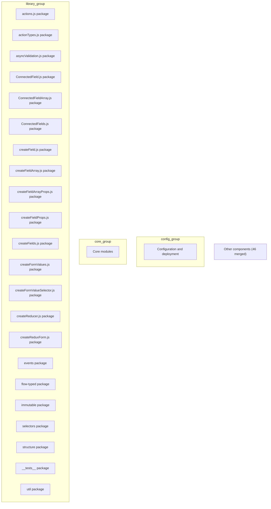

# Architecture report: redux-form/redux-form

> Automated static analysis. **Observed** = directly seen in files/imports/AST; **Inferred** = interpretation from that evidence. Repository code was not executed.

## 1. Repository at a glance

| Item | Value |
| --- | --- |
| Repository | redux-form/redux-form |
| Description | A Higher Order Component using react-redux to keep form state in a Redux store |
| Language | JavaScript |
| Stars | 12473 |
| Licence | MIT |
| Analysed commit / branch | 88866f08120c1297daf54a5b887b90708e7f35e9 / master |
| Framework(s) | React |
| Files analysed | 330 |
| Components | 70 |

## 2. Architecture in one minute

redux-form/redux-form - A Higher Order Component using react-redux to keep form state in a Redux store. This repository was analysed statically from 330 file(s) (0 Python). Detected technologies (observed from imports/manifests): React, Redux, Jest, webpack. Files are grouped into 70 component(s): actions.js package, actionTypes.js package, asyncValidation.js package, Configuration and deployment, ConnectedField.js package, ConnectedFieldArray.js package, ConnectedFields.js package, Core modules. Findings below distinguish observed facts from inferred interpretation.

## 3. High-level block diagram

## 4. Main components

### actions.js package (`actions_js`)

- **Kind:** library
- **Status:** Observed
- **Confidence:** 0.85
- **Responsibility:** Groups 1 file(s) under actions.js package (observed from repository paths and static analysis).
- **Paths:** `src/actions.js`
- **Evidence:** [src/actions.js](https://github.com/redux-form/redux-form/blob/88866f08120c1297daf54a5b887b90708e7f35e9/src/actions.js)

### actionTypes.js package (`actiontypes_js`)

- **Kind:** library
- **Status:** Observed
- **Confidence:** 0.85
- **Responsibility:** Groups 1 file(s) under actiontypes.js package (observed from repository paths and static analysis).
- **Paths:** `src/actionTypes.js`
- **Evidence:** [src/actionTypes.js](https://github.com/redux-form/redux-form/blob/88866f08120c1297daf54a5b887b90708e7f35e9/src/actionTypes.js)

### asyncValidation.js package (`asyncvalidation_js`)

- **Kind:** library
- **Status:** Observed
- **Confidence:** 0.85
- **Responsibility:** Groups 1 file(s) under asyncvalidation.js package (observed from repository paths and static analysis).
- **Paths:** `src/asyncValidation.js`
- **Evidence:** [src/asyncValidation.js](https://github.com/redux-form/redux-form/blob/88866f08120c1297daf54a5b887b90708e7f35e9/src/asyncValidation.js)

### Configuration and deployment (`config`)

- **Kind:** config
- **Status:** Observed
- **Confidence:** 0.85
- **Responsibility:** Groups 1 file(s) under configuration and deployment (observed from repository paths and static analysis).
- **Paths:** `package.json`
- **Evidence:** [package.json](https://github.com/redux-form/redux-form/blob/88866f08120c1297daf54a5b887b90708e7f35e9/package.json)

### ConnectedField.js package (`connectedfield_js`)

- **Kind:** library
- **Status:** Observed
- **Confidence:** 0.85
- **Responsibility:** Groups 1 file(s) under connectedfield.js package (observed from repository paths and static analysis).
- **Paths:** `src/ConnectedField.js`
- **Evidence:** [src/ConnectedField.js](https://github.com/redux-form/redux-form/blob/88866f08120c1297daf54a5b887b90708e7f35e9/src/ConnectedField.js)

### ConnectedFieldArray.js package (`connectedfieldarray_js`)

- **Kind:** library
- **Status:** Observed
- **Confidence:** 0.85
- **Responsibility:** Groups 1 file(s) under connectedfieldarray.js package (observed from repository paths and static analysis).
- **Paths:** `src/ConnectedFieldArray.js`
- **Evidence:** [src/ConnectedFieldArray.js](https://github.com/redux-form/redux-form/blob/88866f08120c1297daf54a5b887b90708e7f35e9/src/ConnectedFieldArray.js)

### ConnectedFields.js package (`connectedfields_js`)

- **Kind:** library
- **Status:** Observed
- **Confidence:** 0.85
- **Responsibility:** Groups 1 file(s) under connectedfields.js package (observed from repository paths and static analysis).
- **Paths:** `src/ConnectedFields.js`
- **Evidence:** [src/ConnectedFields.js](https://github.com/redux-form/redux-form/blob/88866f08120c1297daf54a5b887b90708e7f35e9/src/ConnectedFields.js)

### Core modules (`core`)

- **Kind:** core
- **Status:** Observed
- **Confidence:** 0.85
- **Responsibility:** Groups 2 file(s) under core modules (observed from repository paths and static analysis).
- **Paths:** `immutable.js`, `webpack.config.js`
- **Evidence:** [immutable.js](https://github.com/redux-form/redux-form/blob/88866f08120c1297daf54a5b887b90708e7f35e9/immutable.js); [webpack.config.js](https://github.com/redux-form/redux-form/blob/88866f08120c1297daf54a5b887b90708e7f35e9/webpack.config.js)

### createField.js package (`createfield_js`)

- **Kind:** library
- **Status:** Observed
- **Confidence:** 0.85
- **Responsibility:** Groups 1 file(s) under createfield.js package (observed from repository paths and static analysis).
- **Paths:** `src/createField.js`
- **Evidence:** [src/createField.js](https://github.com/redux-form/redux-form/blob/88866f08120c1297daf54a5b887b90708e7f35e9/src/createField.js)

### createFieldArray.js package (`createfieldarray_js`)

- **Kind:** library
- **Status:** Observed
- **Confidence:** 0.85
- **Responsibility:** Groups 1 file(s) under createfieldarray.js package (observed from repository paths and static analysis).
- **Paths:** `src/createFieldArray.js`
- **Evidence:** [src/createFieldArray.js](https://github.com/redux-form/redux-form/blob/88866f08120c1297daf54a5b887b90708e7f35e9/src/createFieldArray.js)

### createFieldArrayProps.js package (`createfieldarrayprops_js`)

- **Kind:** library
- **Status:** Observed
- **Confidence:** 0.85
- **Responsibility:** Groups 1 file(s) under createfieldarrayprops.js package (observed from repository paths and static analysis).
- **Paths:** `src/createFieldArrayProps.js`
- **Evidence:** [src/createFieldArrayProps.js](https://github.com/redux-form/redux-form/blob/88866f08120c1297daf54a5b887b90708e7f35e9/src/createFieldArrayProps.js)

### createFieldProps.js package (`createfieldprops_js`)

- **Kind:** library
- **Status:** Observed
- **Confidence:** 0.85
- **Responsibility:** Groups 1 file(s) under createfieldprops.js package (observed from repository paths and static analysis).
- **Paths:** `src/createFieldProps.js`
- **Evidence:** [src/createFieldProps.js](https://github.com/redux-form/redux-form/blob/88866f08120c1297daf54a5b887b90708e7f35e9/src/createFieldProps.js)

### createFields.js package (`createfields_js`)

- **Kind:** library
- **Status:** Observed
- **Confidence:** 0.85
- **Responsibility:** Groups 1 file(s) under createfields.js package (observed from repository paths and static analysis).
- **Paths:** `src/createFields.js`
- **Evidence:** [src/createFields.js](https://github.com/redux-form/redux-form/blob/88866f08120c1297daf54a5b887b90708e7f35e9/src/createFields.js)

### createFormValues.js package (`createformvalues_js`)

- **Kind:** library
- **Status:** Observed
- **Confidence:** 0.85
- **Responsibility:** Groups 1 file(s) under createformvalues.js package (observed from repository paths and static analysis).
- **Paths:** `src/createFormValues.js`
- **Evidence:** [src/createFormValues.js](https://github.com/redux-form/redux-form/blob/88866f08120c1297daf54a5b887b90708e7f35e9/src/createFormValues.js)

### createFormValueSelector.js package (`createformvalueselector_js`)

- **Kind:** library
- **Status:** Observed
- **Confidence:** 0.85
- **Responsibility:** Groups 1 file(s) under createformvalueselector.js package (observed from repository paths and static analysis).
- **Paths:** `src/createFormValueSelector.js`
- **Evidence:** [src/createFormValueSelector.js](https://github.com/redux-form/redux-form/blob/88866f08120c1297daf54a5b887b90708e7f35e9/src/createFormValueSelector.js)

### createReducer.js package (`createreducer_js`)

- **Kind:** library
- **Status:** Observed
- **Confidence:** 0.85
- **Responsibility:** Groups 1 file(s) under createreducer.js package (observed from repository paths and static analysis).
- **Paths:** `src/createReducer.js`
- **Evidence:** [src/createReducer.js](https://github.com/redux-form/redux-form/blob/88866f08120c1297daf54a5b887b90708e7f35e9/src/createReducer.js)

### createReduxForm.js package (`createreduxform_js`)

- **Kind:** library
- **Status:** Observed
- **Confidence:** 0.85
- **Responsibility:** Groups 1 file(s) under createreduxform.js package (observed from repository paths and static analysis).
- **Paths:** `src/createReduxForm.js`
- **Evidence:** [src/createReduxForm.js](https://github.com/redux-form/redux-form/blob/88866f08120c1297daf54a5b887b90708e7f35e9/src/createReduxForm.js)

### createValues.js package (`createvalues_js`)

- **Kind:** library
- **Status:** Observed
- **Confidence:** 0.85
- **Responsibility:** Groups 1 file(s) under createvalues.js package (observed from repository paths and static analysis).
- **Paths:** `src/createValues.js`
- **Evidence:** [src/createValues.js](https://github.com/redux-form/redux-form/blob/88866f08120c1297daf54a5b887b90708e7f35e9/src/createValues.js)

### defaultShouldAsyncValidate.js package (`defaultshouldasyncvalidate_js`)

- **Kind:** library
- **Status:** Observed
- **Confidence:** 0.85
- **Responsibility:** Groups 1 file(s) under defaultshouldasyncvalidate.js package (observed from repository paths and static analysis).
- **Paths:** `src/defaultShouldAsyncValidate.js`
- **Evidence:** [src/defaultShouldAsyncValidate.js](https://github.com/redux-form/redux-form/blob/88866f08120c1297daf54a5b887b90708e7f35e9/src/defaultShouldAsyncValidate.js)

### defaultShouldError.js package (`defaultshoulderror_js`)

- **Kind:** library
- **Status:** Observed
- **Confidence:** 0.85
- **Responsibility:** Groups 1 file(s) under defaultshoulderror.js package (observed from repository paths and static analysis).
- **Paths:** `src/defaultShouldError.js`
- **Evidence:** [src/defaultShouldError.js](https://github.com/redux-form/redux-form/blob/88866f08120c1297daf54a5b887b90708e7f35e9/src/defaultShouldError.js)

### defaultShouldValidate.js package (`defaultshouldvalidate_js`)

- **Kind:** library
- **Status:** Observed
- **Confidence:** 0.85
- **Responsibility:** Groups 1 file(s) under defaultshouldvalidate.js package (observed from repository paths and static analysis).
- **Paths:** `src/defaultShouldValidate.js`
- **Evidence:** [src/defaultShouldValidate.js](https://github.com/redux-form/redux-form/blob/88866f08120c1297daf54a5b887b90708e7f35e9/src/defaultShouldValidate.js)

### defaultShouldWarn.js package (`defaultshouldwarn_js`)

- **Kind:** library
- **Status:** Observed
- **Confidence:** 0.85
- **Responsibility:** Groups 1 file(s) under defaultshouldwarn.js package (observed from repository paths and static analysis).
- **Paths:** `src/defaultShouldWarn.js`
- **Evidence:** [src/defaultShouldWarn.js](https://github.com/redux-form/redux-form/blob/88866f08120c1297daf54a5b887b90708e7f35e9/src/defaultShouldWarn.js)

### deleteInWithCleanUp.js package (`deleteinwithcleanup_js`)

- **Kind:** library
- **Status:** Observed
- **Confidence:** 0.85
- **Responsibility:** Groups 1 file(s) under deleteinwithcleanup.js package (observed from repository paths and static analysis).
- **Paths:** `src/deleteInWithCleanUp.js`
- **Evidence:** [src/deleteInWithCleanUp.js](https://github.com/redux-form/redux-form/blob/88866f08120c1297daf54a5b887b90708e7f35e9/src/deleteInWithCleanUp.js)

### events package (`events`)

- **Kind:** library
- **Status:** Observed
- **Confidence:** 0.85
- **Responsibility:** Groups 10 file(s) under events package (observed from repository paths and static analysis).
- **Paths:** `src/events/__tests__/getValue.spec.js`, `src/events/__tests__/isEvent.spec.js`, `src/events/__tests__/onChangeValue.spec.js`, `src/events/__tests__/silenceEvent.spec.js`, `src/events/__tests__/silenceEvents.spec.js`, `src/events/getValue.js`, `src/events/isEvent.js`, `src/events/onChangeValue.js`, `src/events/silenceEvent.js`, `src/events/silenceEvents.js`
- **Evidence:** [src/events/__tests__/getValue.spec.js](https://github.com/redux-form/redux-form/blob/88866f08120c1297daf54a5b887b90708e7f35e9/src/events/__tests__/getValue.spec.js); [src/events/__tests__/isEvent.spec.js](https://github.com/redux-form/redux-form/blob/88866f08120c1297daf54a5b887b90708e7f35e9/src/events/__tests__/isEvent.spec.js); [src/events/__tests__/onChangeValue.spec.js](https://github.com/redux-form/redux-form/blob/88866f08120c1297daf54a5b887b90708e7f35e9/src/events/__tests__/onChangeValue.spec.js); [src/events/__tests__/silenceEvent.spec.js](https://github.com/redux-form/redux-form/blob/88866f08120c1297daf54a5b887b90708e7f35e9/src/events/__tests__/silenceEvent.spec.js); [src/events/__tests__/silenceEvents.spec.js](https://github.com/redux-form/redux-form/blob/88866f08120c1297daf54a5b887b90708e7f35e9/src/events/__tests__/silenceEvents.spec.js); [src/events/getValue.js](https://github.com/redux-form/redux-form/blob/88866f08120c1297daf54a5b887b90708e7f35e9/src/events/getValue.js); [src/events/isEvent.js](https://github.com/redux-form/redux-form/blob/88866f08120c1297daf54a5b887b90708e7f35e9/src/events/isEvent.js); [src/events/onChangeValue.js](https://github.com/redux-form/redux-form/blob/88866f08120c1297daf54a5b887b90708e7f35e9/src/events/onChangeValue.js)

### Field.js package (`field_js`)

- **Kind:** library
- **Status:** Observed
- **Confidence:** 0.85
- **Responsibility:** Groups 1 file(s) under field.js package (observed from repository paths and static analysis).
- **Paths:** `src/Field.js`
- **Evidence:** [src/Field.js](https://github.com/redux-form/redux-form/blob/88866f08120c1297daf54a5b887b90708e7f35e9/src/Field.js)

### FieldArray.js package (`fieldarray_js`)

- **Kind:** library
- **Status:** Observed
- **Confidence:** 0.85
- **Responsibility:** Groups 1 file(s) under fieldarray.js package (observed from repository paths and static analysis).
- **Paths:** `src/FieldArray.js`
- **Evidence:** [src/FieldArray.js](https://github.com/redux-form/redux-form/blob/88866f08120c1297daf54a5b887b90708e7f35e9/src/FieldArray.js)

### fieldKeys.js package (`fieldkeys_js`)

- **Kind:** library
- **Status:** Observed
- **Confidence:** 0.85
- **Responsibility:** Groups 1 file(s) under fieldkeys.js package (observed from repository paths and static analysis).
- **Paths:** `src/fieldKeys.js`
- **Evidence:** [src/fieldKeys.js](https://github.com/redux-form/redux-form/blob/88866f08120c1297daf54a5b887b90708e7f35e9/src/fieldKeys.js)

### Fields.js package (`fields_js`)

- **Kind:** library
- **Status:** Observed
- **Confidence:** 0.85
- **Responsibility:** Groups 1 file(s) under fields.js package (observed from repository paths and static analysis).
- **Paths:** `src/Fields.js`
- **Evidence:** [src/Fields.js](https://github.com/redux-form/redux-form/blob/88866f08120c1297daf54a5b887b90708e7f35e9/src/Fields.js)

### flow-typed package (`flow_typed`)

- **Kind:** library
- **Status:** Observed
- **Confidence:** 0.85
- **Responsibility:** Groups 3 file(s) under flow-typed package (observed from repository paths and static analysis).
- **Paths:** `flow-typed/npm/jest_v25.x.x.js`, `flow-typed/npm/lodash_v4.x.x.js`, `flow-typed/npm/redux_v4.x.x.js`
- **Evidence:** [flow-typed/npm/jest_v25.x.x.js](https://github.com/redux-form/redux-form/blob/88866f08120c1297daf54a5b887b90708e7f35e9/flow-typed/npm/jest_v25.x.x.js); [flow-typed/npm/lodash_v4.x.x.js](https://github.com/redux-form/redux-form/blob/88866f08120c1297daf54a5b887b90708e7f35e9/flow-typed/npm/lodash_v4.x.x.js); [flow-typed/npm/redux_v4.x.x.js](https://github.com/redux-form/redux-form/blob/88866f08120c1297daf54a5b887b90708e7f35e9/flow-typed/npm/redux_v4.x.x.js)

### Form.js package (`form_js`)

- **Kind:** library
- **Status:** Observed
- **Confidence:** 0.85
- **Responsibility:** Groups 1 file(s) under form.js package (observed from repository paths and static analysis).
- **Paths:** `src/Form.js`
- **Evidence:** [src/Form.js](https://github.com/redux-form/redux-form/blob/88866f08120c1297daf54a5b887b90708e7f35e9/src/Form.js)

### FormName.js package (`formname_js`)

- **Kind:** library
- **Status:** Observed
- **Confidence:** 0.85
- **Responsibility:** Groups 1 file(s) under formname.js package (observed from repository paths and static analysis).
- **Paths:** `src/FormName.js`
- **Evidence:** [src/FormName.js](https://github.com/redux-form/redux-form/blob/88866f08120c1297daf54a5b887b90708e7f35e9/src/FormName.js)

### FormSection.js package (`formsection_js`)

- **Kind:** library
- **Status:** Observed
- **Confidence:** 0.85
- **Responsibility:** Groups 1 file(s) under formsection.js package (observed from repository paths and static analysis).
- **Paths:** `src/FormSection.js`
- **Evidence:** [src/FormSection.js](https://github.com/redux-form/redux-form/blob/88866f08120c1297daf54a5b887b90708e7f35e9/src/FormSection.js)

### formValues.js package (`formvalues_js`)

- **Kind:** library
- **Status:** Observed
- **Confidence:** 0.85
- **Responsibility:** Groups 1 file(s) under formvalues.js package (observed from repository paths and static analysis).
- **Paths:** `src/formValues.js`
- **Evidence:** [src/formValues.js](https://github.com/redux-form/redux-form/blob/88866f08120c1297daf54a5b887b90708e7f35e9/src/formValues.js)

### formValueSelector.js package (`formvalueselector_js`)

- **Kind:** library
- **Status:** Observed
- **Confidence:** 0.85
- **Responsibility:** Groups 1 file(s) under formvalueselector.js package (observed from repository paths and static analysis).
- **Paths:** `src/formValueSelector.js`
- **Evidence:** [src/formValueSelector.js](https://github.com/redux-form/redux-form/blob/88866f08120c1297daf54a5b887b90708e7f35e9/src/formValueSelector.js)

### generateFields.js package (`generatefields_js`)

- **Kind:** library
- **Status:** Observed
- **Confidence:** 0.85
- **Responsibility:** Groups 1 file(s) under generatefields.js package (observed from repository paths and static analysis).
- **Paths:** `src/generateFields.js`
- **Evidence:** [src/generateFields.js](https://github.com/redux-form/redux-form/blob/88866f08120c1297daf54a5b887b90708e7f35e9/src/generateFields.js)

### generateValidator.js package (`generatevalidator_js`)

- **Kind:** library
- **Status:** Observed
- **Confidence:** 0.85
- **Responsibility:** Groups 1 file(s) under generatevalidator.js package (observed from repository paths and static analysis).
- **Paths:** `src/generateValidator.js`
- **Evidence:** [src/generateValidator.js](https://github.com/redux-form/redux-form/blob/88866f08120c1297daf54a5b887b90708e7f35e9/src/generateValidator.js)

### getFormAsyncErrors.js package (`getformasyncerrors_js`)

- **Kind:** library
- **Status:** Observed
- **Confidence:** 0.85
- **Responsibility:** Groups 1 file(s) under getformasyncerrors.js package (observed from repository paths and static analysis).
- **Paths:** `src/getFormAsyncErrors.js`
- **Evidence:** [src/getFormAsyncErrors.js](https://github.com/redux-form/redux-form/blob/88866f08120c1297daf54a5b887b90708e7f35e9/src/getFormAsyncErrors.js)

### getFormError.js package (`getformerror_js`)

- **Kind:** library
- **Status:** Observed
- **Confidence:** 0.85
- **Responsibility:** Groups 1 file(s) under getformerror.js package (observed from repository paths and static analysis).
- **Paths:** `src/getFormError.js`
- **Evidence:** [src/getFormError.js](https://github.com/redux-form/redux-form/blob/88866f08120c1297daf54a5b887b90708e7f35e9/src/getFormError.js)

### getFormInitialValues.js package (`getforminitialvalues_js`)

- **Kind:** library
- **Status:** Observed
- **Confidence:** 0.85
- **Responsibility:** Groups 1 file(s) under getforminitialvalues.js package (observed from repository paths and static analysis).
- **Paths:** `src/getFormInitialValues.js`
- **Evidence:** [src/getFormInitialValues.js](https://github.com/redux-form/redux-form/blob/88866f08120c1297daf54a5b887b90708e7f35e9/src/getFormInitialValues.js)

### getFormMeta.js package (`getformmeta_js`)

- **Kind:** library
- **Status:** Observed
- **Confidence:** 0.85
- **Responsibility:** Groups 1 file(s) under getformmeta.js package (observed from repository paths and static analysis).
- **Paths:** `src/getFormMeta.js`
- **Evidence:** [src/getFormMeta.js](https://github.com/redux-form/redux-form/blob/88866f08120c1297daf54a5b887b90708e7f35e9/src/getFormMeta.js)

### getFormNames.js package (`getformnames_js`)

- **Kind:** library
- **Status:** Observed
- **Confidence:** 0.85
- **Responsibility:** Groups 1 file(s) under getformnames.js package (observed from repository paths and static analysis).
- **Paths:** `src/getFormNames.js`
- **Evidence:** [src/getFormNames.js](https://github.com/redux-form/redux-form/blob/88866f08120c1297daf54a5b887b90708e7f35e9/src/getFormNames.js)

### getFormSubmitErrors.js package (`getformsubmiterrors_js`)

- **Kind:** library
- **Status:** Observed
- **Confidence:** 0.85
- **Responsibility:** Groups 1 file(s) under getformsubmiterrors.js package (observed from repository paths and static analysis).
- **Paths:** `src/getFormSubmitErrors.js`
- **Evidence:** [src/getFormSubmitErrors.js](https://github.com/redux-form/redux-form/blob/88866f08120c1297daf54a5b887b90708e7f35e9/src/getFormSubmitErrors.js)

### getFormSyncErrors.js package (`getformsyncerrors_js`)

- **Kind:** library
- **Status:** Observed
- **Confidence:** 0.85
- **Responsibility:** Groups 1 file(s) under getformsyncerrors.js package (observed from repository paths and static analysis).
- **Paths:** `src/getFormSyncErrors.js`
- **Evidence:** [src/getFormSyncErrors.js](https://github.com/redux-form/redux-form/blob/88866f08120c1297daf54a5b887b90708e7f35e9/src/getFormSyncErrors.js)

### getFormSyncWarnings.js package (`getformsyncwarnings_js`)

- **Kind:** library
- **Status:** Observed
- **Confidence:** 0.85
- **Responsibility:** Groups 1 file(s) under getformsyncwarnings.js package (observed from repository paths and static analysis).
- **Paths:** `src/getFormSyncWarnings.js`
- **Evidence:** [src/getFormSyncWarnings.js](https://github.com/redux-form/redux-form/blob/88866f08120c1297daf54a5b887b90708e7f35e9/src/getFormSyncWarnings.js)

### getFormValues.js package (`getformvalues_js`)

- **Kind:** library
- **Status:** Observed
- **Confidence:** 0.85
- **Responsibility:** Groups 1 file(s) under getformvalues.js package (observed from repository paths and static analysis).
- **Paths:** `src/getFormValues.js`
- **Evidence:** [src/getFormValues.js](https://github.com/redux-form/redux-form/blob/88866f08120c1297daf54a5b887b90708e7f35e9/src/getFormValues.js)

### handleSubmit.js package (`handlesubmit_js`)

- **Kind:** library
- **Status:** Observed
- **Confidence:** 0.85
- **Responsibility:** Groups 1 file(s) under handlesubmit.js package (observed from repository paths and static analysis).
- **Paths:** `src/handleSubmit.js`
- **Evidence:** [src/handleSubmit.js](https://github.com/redux-form/redux-form/blob/88866f08120c1297daf54a5b887b90708e7f35e9/src/handleSubmit.js)

### hasError.js package (`haserror_js`)

- **Kind:** library
- **Status:** Observed
- **Confidence:** 0.85
- **Responsibility:** Groups 1 file(s) under haserror.js package (observed from repository paths and static analysis).
- **Paths:** `src/hasError.js`
- **Evidence:** [src/hasError.js](https://github.com/redux-form/redux-form/blob/88866f08120c1297daf54a5b887b90708e7f35e9/src/hasError.js)

### hasSubmitFailed.js package (`hassubmitfailed_js`)

- **Kind:** library
- **Status:** Observed
- **Confidence:** 0.85
- **Responsibility:** Groups 1 file(s) under hassubmitfailed.js package (observed from repository paths and static analysis).
- **Paths:** `src/hasSubmitFailed.js`
- **Evidence:** [src/hasSubmitFailed.js](https://github.com/redux-form/redux-form/blob/88866f08120c1297daf54a5b887b90708e7f35e9/src/hasSubmitFailed.js)

### hasSubmitSucceeded.js package (`hassubmitsucceeded_js`)

- **Kind:** library
- **Status:** Observed
- **Confidence:** 0.85
- **Responsibility:** Groups 1 file(s) under hassubmitsucceeded.js package (observed from repository paths and static analysis).
- **Paths:** `src/hasSubmitSucceeded.js`
- **Evidence:** [src/hasSubmitSucceeded.js](https://github.com/redux-form/redux-form/blob/88866f08120c1297daf54a5b887b90708e7f35e9/src/hasSubmitSucceeded.js)

### immutable package (`immutable`)

- **Kind:** library
- **Status:** Observed
- **Confidence:** 0.85
- **Responsibility:** Groups 25 file(s) under immutable package (observed from repository paths and static analysis).
- **Paths:** `src/immutable/Field.js`, `src/immutable/FieldArray.js`, `src/immutable/Fields.js`, `src/immutable/formValueSelector.js`, `src/immutable/formValues.js`, `src/immutable/getFormAsyncErrors.js`, `src/immutable/getFormError.js`, `src/immutable/getFormInitialValues.js`, `src/immutable/getFormMeta.js`, `src/immutable/getFormNames.js`, `src/immutable/getFormSubmitErrors.js`, `src/immutable/getFormSyncErrors.js`, `src/immutable/getFormSyncWarnings.js`, `src/immutable/getFormValues.js`, `src/immutable/hasSubmitFailed.js`, `src/immutable/hasSubmitSucceeded.js`, `src/immutable/isAsyncValidating.js`, `src/immutable/isDirty.js`, `src/immutable/isInvalid.js`, `src/immutable/isPristine.js`, `src/immutable/isSubmitting.js`, `src/immutable/isValid.js`, `src/immutable/reducer.js`, `src/immutable/reduxForm.js`, `src/immutable/values.js`
- **Evidence:** [src/immutable/Field.js](https://github.com/redux-form/redux-form/blob/88866f08120c1297daf54a5b887b90708e7f35e9/src/immutable/Field.js); [src/immutable/FieldArray.js](https://github.com/redux-form/redux-form/blob/88866f08120c1297daf54a5b887b90708e7f35e9/src/immutable/FieldArray.js); [src/immutable/Fields.js](https://github.com/redux-form/redux-form/blob/88866f08120c1297daf54a5b887b90708e7f35e9/src/immutable/Fields.js); [src/immutable/formValueSelector.js](https://github.com/redux-form/redux-form/blob/88866f08120c1297daf54a5b887b90708e7f35e9/src/immutable/formValueSelector.js); [src/immutable/formValues.js](https://github.com/redux-form/redux-form/blob/88866f08120c1297daf54a5b887b90708e7f35e9/src/immutable/formValues.js); [src/immutable/getFormAsyncErrors.js](https://github.com/redux-form/redux-form/blob/88866f08120c1297daf54a5b887b90708e7f35e9/src/immutable/getFormAsyncErrors.js); [src/immutable/getFormError.js](https://github.com/redux-form/redux-form/blob/88866f08120c1297daf54a5b887b90708e7f35e9/src/immutable/getFormError.js); [src/immutable/getFormInitialValues.js](https://github.com/redux-form/redux-form/blob/88866f08120c1297daf54a5b887b90708e7f35e9/src/immutable/getFormInitialValues.js)

### immutable.js package (`immutable_js`)

- **Kind:** library
- **Status:** Observed
- **Confidence:** 0.85
- **Responsibility:** Groups 1 file(s) under immutable.js package (observed from repository paths and static analysis).
- **Paths:** `src/immutable.js`
- **Evidence:** [src/immutable.js](https://github.com/redux-form/redux-form/blob/88866f08120c1297daf54a5b887b90708e7f35e9/src/immutable.js)

### index.js package (`index_js`)

- **Kind:** library
- **Status:** Observed
- **Confidence:** 0.85
- **Responsibility:** Groups 1 file(s) under index.js package (observed from repository paths and static analysis).
- **Paths:** `src/index.js`
- **Evidence:** [src/index.js](https://github.com/redux-form/redux-form/blob/88866f08120c1297daf54a5b887b90708e7f35e9/src/index.js)

### isAsyncValidating.js package (`isasyncvalidating_js`)

- **Kind:** library
- **Status:** Observed
- **Confidence:** 0.85
- **Responsibility:** Groups 1 file(s) under isasyncvalidating.js package (observed from repository paths and static analysis).
- **Paths:** `src/isAsyncValidating.js`
- **Evidence:** [src/isAsyncValidating.js](https://github.com/redux-form/redux-form/blob/88866f08120c1297daf54a5b887b90708e7f35e9/src/isAsyncValidating.js)

### isDirty.js package (`isdirty_js`)

- **Kind:** library
- **Status:** Observed
- **Confidence:** 0.85
- **Responsibility:** Groups 1 file(s) under isdirty.js package (observed from repository paths and static analysis).
- **Paths:** `src/isDirty.js`
- **Evidence:** [src/isDirty.js](https://github.com/redux-form/redux-form/blob/88866f08120c1297daf54a5b887b90708e7f35e9/src/isDirty.js)

### isInvalid.js package (`isinvalid_js`)

- **Kind:** library
- **Status:** Observed
- **Confidence:** 0.85
- **Responsibility:** Groups 1 file(s) under isinvalid.js package (observed from repository paths and static analysis).
- **Paths:** `src/isInvalid.js`
- **Evidence:** [src/isInvalid.js](https://github.com/redux-form/redux-form/blob/88866f08120c1297daf54a5b887b90708e7f35e9/src/isInvalid.js)

### isPristine.js package (`ispristine_js`)

- **Kind:** library
- **Status:** Observed
- **Confidence:** 0.85
- **Responsibility:** Groups 1 file(s) under ispristine.js package (observed from repository paths and static analysis).
- **Paths:** `src/isPristine.js`
- **Evidence:** [src/isPristine.js](https://github.com/redux-form/redux-form/blob/88866f08120c1297daf54a5b887b90708e7f35e9/src/isPristine.js)

### isReactNative.js package (`isreactnative_js`)

- **Kind:** library
- **Status:** Observed
- **Confidence:** 0.85
- **Responsibility:** Groups 1 file(s) under isreactnative.js package (observed from repository paths and static analysis).
- **Paths:** `src/isReactNative.js`
- **Evidence:** [src/isReactNative.js](https://github.com/redux-form/redux-form/blob/88866f08120c1297daf54a5b887b90708e7f35e9/src/isReactNative.js)

### isSubmitting.js package (`issubmitting_js`)

- **Kind:** library
- **Status:** Observed
- **Confidence:** 0.85
- **Responsibility:** Groups 1 file(s) under issubmitting.js package (observed from repository paths and static analysis).
- **Paths:** `src/isSubmitting.js`
- **Evidence:** [src/isSubmitting.js](https://github.com/redux-form/redux-form/blob/88866f08120c1297daf54a5b887b90708e7f35e9/src/isSubmitting.js)

### isValid.js package (`isvalid_js`)

- **Kind:** library
- **Status:** Observed
- **Confidence:** 0.85
- **Responsibility:** Groups 1 file(s) under isvalid.js package (observed from repository paths and static analysis).
- **Paths:** `src/isValid.js`
- **Evidence:** [src/isValid.js](https://github.com/redux-form/redux-form/blob/88866f08120c1297daf54a5b887b90708e7f35e9/src/isValid.js)

### propTypes.js package (`proptypes_js`)

- **Kind:** library
- **Status:** Observed
- **Confidence:** 0.85
- **Responsibility:** Groups 1 file(s) under proptypes.js package (observed from repository paths and static analysis).
- **Paths:** `src/propTypes.js`
- **Evidence:** [src/propTypes.js](https://github.com/redux-form/redux-form/blob/88866f08120c1297daf54a5b887b90708e7f35e9/src/propTypes.js)

### reducer.js package (`reducer_js`)

- **Kind:** library
- **Status:** Observed
- **Confidence:** 0.85
- **Responsibility:** Groups 1 file(s) under reducer.js package (observed from repository paths and static analysis).
- **Paths:** `src/reducer.js`
- **Evidence:** [src/reducer.js](https://github.com/redux-form/redux-form/blob/88866f08120c1297daf54a5b887b90708e7f35e9/src/reducer.js)

### reduxForm.js package (`reduxform_js`)

- **Kind:** library
- **Status:** Observed
- **Confidence:** 0.85
- **Responsibility:** Groups 1 file(s) under reduxform.js package (observed from repository paths and static analysis).
- **Paths:** `src/reduxForm.js`
- **Evidence:** [src/reduxForm.js](https://github.com/redux-form/redux-form/blob/88866f08120c1297daf54a5b887b90708e7f35e9/src/reduxForm.js)

### ReduxFormContext.js package (`reduxformcontext_js`)

- **Kind:** library
- **Status:** Observed
- **Confidence:** 0.85
- **Responsibility:** Groups 1 file(s) under reduxformcontext.js package (observed from repository paths and static analysis).
- **Paths:** `src/ReduxFormContext.js`
- **Evidence:** [src/ReduxFormContext.js](https://github.com/redux-form/redux-form/blob/88866f08120c1297daf54a5b887b90708e7f35e9/src/ReduxFormContext.js)

### scripts package (`scripts`)

- **Kind:** library
- **Status:** Observed
- **Confidence:** 0.85
- **Responsibility:** Groups 1 file(s) under scripts package (observed from repository paths and static analysis).
- **Paths:** `scripts/patch-immutable-flow-error.js`
- **Evidence:** [scripts/patch-immutable-flow-error.js](https://github.com/redux-form/redux-form/blob/88866f08120c1297daf54a5b887b90708e7f35e9/scripts/patch-immutable-flow-error.js)

### selectors package (`selectors`)

- **Kind:** library
- **Status:** Observed
- **Confidence:** 0.85
- **Responsibility:** Groups 34 file(s) under selectors package (observed from repository paths and static analysis).
- **Paths:** `src/selectors/__tests__/getFormAsyncErrors.spec.js`, `src/selectors/__tests__/getFormError.spec.js`, `src/selectors/__tests__/getFormInitialValues.spec.js`, `src/selectors/__tests__/getFormMeta.spec.js`, `src/selectors/__tests__/getFormNames.spec.js`, `src/selectors/__tests__/getFormSubmitErrors.spec.js`, `src/selectors/__tests__/getFormSyncErrors.spec.js`, `src/selectors/__tests__/getFormSyncWarnings.spec.js`, `src/selectors/__tests__/getFormValues.spec.js`, `src/selectors/__tests__/hasSubmitFailed.spec.js`, `src/selectors/__tests__/hasSubmitSucceeded.spec.js`, `src/selectors/__tests__/isAsyncValidating.spec.js`, `src/selectors/__tests__/isDirty.spec.js`, `src/selectors/__tests__/isInvalid.spec.js`, `src/selectors/__tests__/isPristine.spec.js`, `src/selectors/__tests__/isSubmitting.spec.js`, `src/selectors/__tests__/isValid.spec.js`, `src/selectors/getFormAsyncErrors.js`, `src/selectors/getFormError.js`, `src/selectors/getFormInitialValues.js`, `src/selectors/getFormMeta.js`, `src/selectors/getFormNames.js`, `src/selectors/getFormSubmitErrors.js`, `src/selectors/getFormSyncErrors.js`, `src/selectors/getFormSyncWarnings.js`, `src/selectors/getFormValues.js`, `src/selectors/hasSubmitFailed.js`, `src/selectors/hasSubmitSucceeded.js`, `src/selectors/isAsyncValidating.js`, `src/selectors/isDirty.js`, `src/selectors/isInvalid.js`, `src/selectors/isPristine.js`, `src/selectors/isSubmitting.js`, `src/selectors/isValid.js`
- **Evidence:** [src/selectors/__tests__/getFormAsyncErrors.spec.js](https://github.com/redux-form/redux-form/blob/88866f08120c1297daf54a5b887b90708e7f35e9/src/selectors/__tests__/getFormAsyncErrors.spec.js); [src/selectors/__tests__/getFormError.spec.js](https://github.com/redux-form/redux-form/blob/88866f08120c1297daf54a5b887b90708e7f35e9/src/selectors/__tests__/getFormError.spec.js); [src/selectors/__tests__/getFormInitialValues.spec.js](https://github.com/redux-form/redux-form/blob/88866f08120c1297daf54a5b887b90708e7f35e9/src/selectors/__tests__/getFormInitialValues.spec.js); [src/selectors/__tests__/getFormMeta.spec.js](https://github.com/redux-form/redux-form/blob/88866f08120c1297daf54a5b887b90708e7f35e9/src/selectors/__tests__/getFormMeta.spec.js); [src/selectors/__tests__/getFormNames.spec.js](https://github.com/redux-form/redux-form/blob/88866f08120c1297daf54a5b887b90708e7f35e9/src/selectors/__tests__/getFormNames.spec.js); [src/selectors/__tests__/getFormSubmitErrors.spec.js](https://github.com/redux-form/redux-form/blob/88866f08120c1297daf54a5b887b90708e7f35e9/src/selectors/__tests__/getFormSubmitErrors.spec.js); [src/selectors/__tests__/getFormSyncErrors.spec.js](https://github.com/redux-form/redux-form/blob/88866f08120c1297daf54a5b887b90708e7f35e9/src/selectors/__tests__/getFormSyncErrors.spec.js); [src/selectors/__tests__/getFormSyncWarnings.spec.js](https://github.com/redux-form/redux-form/blob/88866f08120c1297daf54a5b887b90708e7f35e9/src/selectors/__tests__/getFormSyncWarnings.spec.js)

### structure package (`structure`)

- **Kind:** library
- **Status:** Observed
- **Confidence:** 0.85
- **Responsibility:** Groups 24 file(s) under structure package (observed from repository paths and static analysis).
- **Paths:** `src/structure/immutable/__tests__/deepEqual.spec.js`, `src/structure/immutable/__tests__/expectations.js`, `src/structure/immutable/__tests__/keys.spec.js`, `src/structure/immutable/__tests__/setIn.spec.js`, `src/structure/immutable/__tests__/splice.spec.js`, `src/structure/immutable/deepEqual.js`, `src/structure/immutable/index.js`, `src/structure/immutable/keys.js`, `src/structure/immutable/setIn.js`, `src/structure/immutable/splice.js`, `src/structure/plain/__tests__/deepEqual.spec.js`, `src/structure/plain/__tests__/deleteIn.spec.js`, `src/structure/plain/__tests__/expectations.js`, `src/structure/plain/__tests__/getIn.spec.js`, `src/structure/plain/__tests__/keys.spec.js`, `src/structure/plain/__tests__/setIn.spec.js`, `src/structure/plain/__tests__/splice.spec.js`, `src/structure/plain/deepEqual.js`, `src/structure/plain/deleteIn.js`, `src/structure/plain/getIn.js`, `src/structure/plain/index.js`, `src/structure/plain/keys.js`, `src/structure/plain/setIn.js`, `src/structure/plain/splice.js`
- **Evidence:** [src/structure/immutable/__tests__/deepEqual.spec.js](https://github.com/redux-form/redux-form/blob/88866f08120c1297daf54a5b887b90708e7f35e9/src/structure/immutable/__tests__/deepEqual.spec.js); [src/structure/immutable/__tests__/expectations.js](https://github.com/redux-form/redux-form/blob/88866f08120c1297daf54a5b887b90708e7f35e9/src/structure/immutable/__tests__/expectations.js); [src/structure/immutable/__tests__/keys.spec.js](https://github.com/redux-form/redux-form/blob/88866f08120c1297daf54a5b887b90708e7f35e9/src/structure/immutable/__tests__/keys.spec.js); [src/structure/immutable/__tests__/setIn.spec.js](https://github.com/redux-form/redux-form/blob/88866f08120c1297daf54a5b887b90708e7f35e9/src/structure/immutable/__tests__/setIn.spec.js); [src/structure/immutable/__tests__/splice.spec.js](https://github.com/redux-form/redux-form/blob/88866f08120c1297daf54a5b887b90708e7f35e9/src/structure/immutable/__tests__/splice.spec.js); [src/structure/immutable/deepEqual.js](https://github.com/redux-form/redux-form/blob/88866f08120c1297daf54a5b887b90708e7f35e9/src/structure/immutable/deepEqual.js); [src/structure/immutable/index.js](https://github.com/redux-form/redux-form/blob/88866f08120c1297daf54a5b887b90708e7f35e9/src/structure/immutable/index.js); [src/structure/immutable/keys.js](https://github.com/redux-form/redux-form/blob/88866f08120c1297daf54a5b887b90708e7f35e9/src/structure/immutable/keys.js)

### SubmissionError.js package (`submissionerror_js`)

- **Kind:** library
- **Status:** Observed
- **Confidence:** 0.85
- **Responsibility:** Groups 1 file(s) under submissionerror.js package (observed from repository paths and static analysis).
- **Paths:** `src/SubmissionError.js`
- **Evidence:** [src/SubmissionError.js](https://github.com/redux-form/redux-form/blob/88866f08120c1297daf54a5b887b90708e7f35e9/src/SubmissionError.js)

### __tests__ package (`tests`)

- **Kind:** library
- **Status:** Observed
- **Confidence:** 0.85
- **Responsibility:** Groups 63 file(s) under __tests__ package (observed from repository paths and static analysis).
- **Paths:** `src/__tests__/Field.spec.js`, `src/__tests__/FieldArray.spec.js`, `src/__tests__/Fields.spec.js`, `src/__tests__/Form.spec.js`, `src/__tests__/FormName.spec.js`, `src/__tests__/FormSection.spec.js`, `src/__tests__/SubmissionError.spec.js`, `src/__tests__/actions.spec.js`, `src/__tests__/asyncValidation.spec.js`, `src/__tests__/createFieldArrayProps.spec.js`, `src/__tests__/createFieldProps.spec.js`, `src/__tests__/defaultShouldAsyncValidate.spec.js`, `src/__tests__/defaultShouldError.spec.js`, `src/__tests__/defaultShouldValidate.spec.js`, `src/__tests__/defaultShouldWarn.spec.js`, `src/__tests__/deleteInWithCleanUp.spec.js`, `src/__tests__/formValueSelector.spec.js`, `src/__tests__/formValues.spec.js`, `src/__tests__/generateValidator.spec.js`, `src/__tests__/handleSubmit.spec.js`, `src/__tests__/hasError.spec.js`, `src/__tests__/helpers/reducer.arrayInsert.js`, `src/__tests__/helpers/reducer.arrayMove.js`, `src/__tests__/helpers/reducer.arrayPop.js`, `src/__tests__/helpers/reducer.arrayPush.js`, `src/__tests__/helpers/reducer.arrayRemove.js`, `src/__tests__/helpers/reducer.arrayRemoveAll.js`, `src/__tests__/helpers/reducer.arrayShift.js`, `src/__tests__/helpers/reducer.arraySplice.js`, `src/__tests__/helpers/reducer.arraySwap.js`, `src/__tests__/helpers/reducer.arrayUnshift.js`, `src/__tests__/helpers/reducer.autofill.js`, `src/__tests__/helpers/reducer.blur.js`, `src/__tests__/helpers/reducer.change.js`, `src/__tests__/helpers/reducer.clearAsyncError.js`, `src/__tests__/helpers/reducer.clearFields.js`, `src/__tests__/helpers/reducer.clearSubmit.js`, `src/__tests__/helpers/reducer.clearSubmitErrors.js`, `src/__tests__/helpers/reducer.destroy.js`, `src/__tests__/helpers/reducer.focus.js`, `src/__tests__/helpers/reducer.initialize.js`, `src/__tests__/helpers/reducer.plugin.js`, `src/__tests__/helpers/reducer.registerField.js`, `src/__tests__/helpers/reducer.reset.js`, `src/__tests__/helpers/reducer.resetSection.js`, `src/__tests__/helpers/reducer.setSubmitFailed.js`, `src/__tests__/helpers/reducer.setSubmitSuceeded.js`, `src/__tests__/helpers/reducer.startAsyncValidation.js`, `src/__tests__/helpers/reducer.startSubmit.js`, `src/__tests__/helpers/reducer.stopAsyncValidation.js`, `src/__tests__/helpers/reducer.stopSubmit.js`, `src/__tests__/helpers/reducer.submit.js`, `src/__tests__/helpers/reducer.touch.js`, `src/__tests__/helpers/reducer.unregisterField.js`, `src/__tests__/helpers/reducer.untouch.js`, `src/__tests__/helpers/reducer.updateSyncErrors.js`, `src/__tests__/helpers/reducer.updateSyncWarnings.js`, `src/__tests__/immutable.spec.js`, `src/__tests__/index.spec.js`, `src/__tests__/reducer.spec.js`, `src/__tests__/reduxForm.spec.js`, `src/__tests__/reduxFormContext.spec.js`, `src/__tests__/values.spec.js`
- **Evidence:** [src/__tests__/Field.spec.js](https://github.com/redux-form/redux-form/blob/88866f08120c1297daf54a5b887b90708e7f35e9/src/__tests__/Field.spec.js); [src/__tests__/FieldArray.spec.js](https://github.com/redux-form/redux-form/blob/88866f08120c1297daf54a5b887b90708e7f35e9/src/__tests__/FieldArray.spec.js); [src/__tests__/Fields.spec.js](https://github.com/redux-form/redux-form/blob/88866f08120c1297daf54a5b887b90708e7f35e9/src/__tests__/Fields.spec.js); [src/__tests__/Form.spec.js](https://github.com/redux-form/redux-form/blob/88866f08120c1297daf54a5b887b90708e7f35e9/src/__tests__/Form.spec.js); [src/__tests__/FormName.spec.js](https://github.com/redux-form/redux-form/blob/88866f08120c1297daf54a5b887b90708e7f35e9/src/__tests__/FormName.spec.js); [src/__tests__/FormSection.spec.js](https://github.com/redux-form/redux-form/blob/88866f08120c1297daf54a5b887b90708e7f35e9/src/__tests__/FormSection.spec.js); [src/__tests__/SubmissionError.spec.js](https://github.com/redux-form/redux-form/blob/88866f08120c1297daf54a5b887b90708e7f35e9/src/__tests__/SubmissionError.spec.js); [src/__tests__/actions.spec.js](https://github.com/redux-form/redux-form/blob/88866f08120c1297daf54a5b887b90708e7f35e9/src/__tests__/actions.spec.js)

### util package (`util`)

- **Kind:** library
- **Status:** Observed
- **Confidence:** 0.85
- **Responsibility:** Groups 12 file(s) under util package (observed from repository paths and static analysis).
- **Paths:** `src/util/FormNameProps.types.js.flow.js`, `src/util/__tests__/eventMocks.spec.js`, `src/util/__tests__/getDisplayName.spec.js`, `src/util/__tests__/prefixName.spec.js`, `src/util/__tests__/shallowCompare.spec.js`, `src/util/eventConsts.js`, `src/util/eventMocks.js`, `src/util/getDisplayName.js`, `src/util/isHotReloading.js`, `src/util/prefixName.js`, `src/util/shallowCompare.js`, `src/util/validateComponentProp.js`
- **Evidence:** [src/util/FormNameProps.types.js.flow.js](https://github.com/redux-form/redux-form/blob/88866f08120c1297daf54a5b887b90708e7f35e9/src/util/FormNameProps.types.js.flow.js); [src/util/__tests__/eventMocks.spec.js](https://github.com/redux-form/redux-form/blob/88866f08120c1297daf54a5b887b90708e7f35e9/src/util/__tests__/eventMocks.spec.js); [src/util/__tests__/getDisplayName.spec.js](https://github.com/redux-form/redux-form/blob/88866f08120c1297daf54a5b887b90708e7f35e9/src/util/__tests__/getDisplayName.spec.js); [src/util/__tests__/prefixName.spec.js](https://github.com/redux-form/redux-form/blob/88866f08120c1297daf54a5b887b90708e7f35e9/src/util/__tests__/prefixName.spec.js); [src/util/__tests__/shallowCompare.spec.js](https://github.com/redux-form/redux-form/blob/88866f08120c1297daf54a5b887b90708e7f35e9/src/util/__tests__/shallowCompare.spec.js); [src/util/eventConsts.js](https://github.com/redux-form/redux-form/blob/88866f08120c1297daf54a5b887b90708e7f35e9/src/util/eventConsts.js); [src/util/eventMocks.js](https://github.com/redux-form/redux-form/blob/88866f08120c1297daf54a5b887b90708e7f35e9/src/util/eventMocks.js); [src/util/getDisplayName.js](https://github.com/redux-form/redux-form/blob/88866f08120c1297daf54a5b887b90708e7f35e9/src/util/getDisplayName.js)

### values.js package (`values_js`)

- **Kind:** library
- **Status:** Observed
- **Confidence:** 0.85
- **Responsibility:** Groups 1 file(s) under values.js package (observed from repository paths and static analysis).
- **Paths:** `src/values.js`
- **Evidence:** [src/values.js](https://github.com/redux-form/redux-form/blob/88866f08120c1297daf54a5b887b90708e7f35e9/src/values.js)

## 5. Execution flow

**Observed** entry point(s):

- [src/index.js](https://github.com/redux-form/redux-form/blob/88866f08120c1297daf54a5b887b90708e7f35e9/src/index.js)
- [src/structure/immutable/index.js](https://github.com/redux-form/redux-form/blob/88866f08120c1297daf54a5b887b90708e7f35e9/src/structure/immutable/index.js)
- [src/structure/plain/index.js](https://github.com/redux-form/redux-form/blob/88866f08120c1297daf54a5b887b90708e7f35e9/src/structure/plain/index.js)

Representative flow (derived from observed entry points and the import graph; steps beyond the entry point are **Inferred**):

1. Execution starts at an observed entry point listed above, if present.
2. No internal import relationships between components were observed.

## 6. Project structure

### `(root)`

- `.babelrc.js` - source, JavaScript (426 bytes)
- `.codeclimate.yml` - config (521 bytes)
- `.editorconfig` - config (234 bytes)
- `.eslintignore` - other (55 bytes)
- `.eslintrc` - other (484 bytes)
- `.flowconfig` - other (322 bytes)
- `.gitignore` - other (115 bytes)
- `.npmignore` - other (133 bytes)
- `.nvmrc` - other (5 bytes)
- `.prettierignore` - other (11 bytes)
- `.prettierrc` - other (66 bytes)
- `.size-limit.json` - config (250 bytes)
- `.travis.yml` - ci, YAML (112 bytes)
- `CHANGELOG.md` - docs (233 bytes)
- `CODE_OF_CONDUCT.md` - docs (3355 bytes)
- `CONTRIBUTING.md` - docs (2338 bytes)
- `LICENSE` - docs (1081 bytes)
- `README.md` - docs (7981 bytes)
- `immutable.js` - source, JavaScript (44 bytes)
- `package.json` - manifest (4781 bytes)
- `tools.md` - docs (783 bytes)
- `webpack.config.js` - source, JavaScript (1159 bytes)

### `.github`

- `.github/ISSUE_TEMPLATE/1-bug.md` - docs (1879 bytes)
- `.github/ISSUE_TEMPLATE/2-feature.md` - docs (708 bytes)
- `.github/ISSUE_TEMPLATE/config.yml` - config (343 bytes)
- `.github/funding.yml` - config (545 bytes)
- `.github/lock.yml` - config (860 bytes)
- `.github/pull-request-template.md` - docs (546 bytes)
- `.github/security.md` - docs (2365 bytes)
- `.github/stale.yml` - config (1954 bytes)
- `.github/support.md` - docs (358 bytes)

### `docs`

- `docs/DocumentationVersions.md` - docs (2829 bytes)
- `docs/Flow.md` - docs (3211 bytes)
- `docs/GettingStarted.md` - docs (7081 bytes)
- `docs/MigrationGuide.md` - docs (10037 bytes)
- `docs/ValueLifecycle.md` - docs (1262 bytes)
- `docs/api/ActionCreators.md` - docs (5779 bytes)
- `docs/api/Field.md` - docs (16064 bytes)
- `docs/api/FieldArray.md` - docs (9869 bytes)
- `docs/api/Fields.md` - docs (8901 bytes)
- `docs/api/Form.md` - docs (1254 bytes)
- `docs/api/FormName.md` - docs (716 bytes)
- `docs/api/FormSection.md` - docs (3783 bytes)
- `docs/api/FormValueSelector.md` - docs (2797 bytes)
- `docs/api/FormValues.md` - docs (1852 bytes)
- `docs/api/Props.md` - docs (9686 bytes)
- `docs/api/README.md` - docs (3167 bytes)
- `docs/api/Reducer.md` - docs (1278 bytes)
- `docs/api/ReducerPlugin.md` - docs (2418 bytes)
- `docs/api/ReduxForm.md` - docs (14803 bytes)
- `docs/api/ReduxFormContext.md` - docs (2680 bytes)
- `docs/api/Selectors.md` - docs (4900 bytes)
- `docs/api/SubmissionError.md` - docs (1351 bytes)
- `docs/faq/BundleSize.md` - docs (1887 bytes)
- `docs/faq/ButtonType.md` - docs (924 bytes)
- `docs/faq/CustomComponent.md` - docs (1160 bytes)
- `docs/faq/EnterToSubmit.md` - docs (1177 bytes)
- `docs/faq/HandleVsOn.md` - docs (2245 bytes)
- `docs/faq/HowToClear.md` - docs (1994 bytes)
- `docs/faq/HowToConnect.md` - docs (540 bytes)
- `docs/faq/ImmutableJs.md` - docs (407 bytes)
- `docs/faq/README.md` - docs (899 bytes)
- `docs/faq/ReactNative.md` - docs (435 bytes)
- `docs/faq/SubmitFunction.md` - docs (448 bytes)
- `docs/faq/WebsocketSubmit.md` - docs (1504 bytes)
- `docs/sponsor.json` - config (170 bytes)

### `flow-typed`

- `flow-typed/npm/jest_v25.x.x.js` - source, JavaScript (35557 bytes)
- `flow-typed/npm/lodash_v4.x.x.js` - source, JavaScript (192470 bytes)
- `flow-typed/npm/redux_v4.x.x.js` - source, JavaScript (2439 bytes)

### `scripts`

- `scripts/patch-immutable-flow-error.js` - source, JavaScript (411 bytes)

### `src`

- `src/ConnectedField.js` - source, JavaScript (10437 bytes)
- `src/ConnectedField.types.js.flow` - other (1324 bytes)
- `src/ConnectedFieldArray.js` - source, JavaScript (6090 bytes)
- `src/ConnectedFieldArray.types.js.flow` - other (1368 bytes)
- `src/ConnectedFields.js` - source, JavaScript (6776 bytes)
- `src/ConnectedFields.types.js.flow` - other (1253 bytes)
- `src/Field.js` - source, JavaScript (122 bytes)
- `src/FieldArray.js` - source, JavaScript (137 bytes)
- `src/FieldArrayProps.types.js.flow` - other (1223 bytes)
- `src/FieldProps.types.js.flow` - other (2137 bytes)
- `src/Fields.js` - source, JavaScript (125 bytes)
- `src/FieldsProps.types.js.flow` - other (481 bytes)
- `src/Form.js` - source, JavaScript (1003 bytes)
- `src/FormName.js` - source, JavaScript (518 bytes)
- `src/FormNameProps.types.js.flow` - other (113 bytes)
- `src/FormSection.js` - source, JavaScript (1709 bytes)
- `src/ReduxFormContext.js` - source, JavaScript (713 bytes)
- `src/SubmissionError.js` - source, JavaScript (476 bytes)
- `src/__tests__/Field.spec.js` - source, JavaScript (85705 bytes)
- `src/__tests__/FieldArray.spec.js` - source, JavaScript (74338 bytes)
- `src/__tests__/Fields.spec.js` - source, JavaScript (55911 bytes)
- `src/__tests__/Form.spec.js` - source, JavaScript (11222 bytes)
- `src/__tests__/FormName.spec.js` - source, JavaScript (2196 bytes)
- `src/__tests__/FormSection.spec.js` - source, JavaScript (11034 bytes)
- `src/__tests__/SubmissionError.spec.js` - source, JavaScript (687 bytes)
- `src/__tests__/actions.spec.js` - source, JavaScript (16583 bytes)
- `src/__tests__/asyncValidation.spec.js` - source, JavaScript (1894 bytes)
- `src/__tests__/createFieldArrayProps.spec.js` - source, JavaScript (12551 bytes)
- `src/__tests__/createFieldProps.spec.js` - source, JavaScript (15137 bytes)
- `src/__tests__/defaultShouldAsyncValidate.spec.js` - source, JavaScript (1515 bytes)
- `src/__tests__/defaultShouldError.spec.js` - source, JavaScript (2200 bytes)
- `src/__tests__/defaultShouldValidate.spec.js` - source, JavaScript (2233 bytes)
- `src/__tests__/defaultShouldWarn.spec.js` - source, JavaScript (2169 bytes)
- `src/__tests__/deleteInWithCleanUp.spec.js` - source, JavaScript (3846 bytes)
- `src/__tests__/formValueSelector.spec.js` - source, JavaScript (6254 bytes)
- `src/__tests__/formValues.spec.js` - source, JavaScript (5384 bytes)
- `src/__tests__/generateValidator.spec.js` - source, JavaScript (9246 bytes)
- `src/__tests__/handleSubmit.spec.js` - source, JavaScript (18001 bytes)
- `src/__tests__/hasError.spec.js` - source, JavaScript (4927 bytes)
- `src/__tests__/helpers/reducer.arrayInsert.js` - source, JavaScript (3234 bytes)
- `src/__tests__/helpers/reducer.arrayMove.js` - source, JavaScript (2035 bytes)
- `src/__tests__/helpers/reducer.arrayPop.js` - source, JavaScript (1336 bytes)
- `src/__tests__/helpers/reducer.arrayPush.js` - source, JavaScript (2296 bytes)
- `src/__tests__/helpers/reducer.arrayRemove.js` - source, JavaScript (14716 bytes)
- `src/__tests__/helpers/reducer.arrayRemoveAll.js` - source, JavaScript (2070 bytes)
- `src/__tests__/helpers/reducer.arrayShift.js` - source, JavaScript (1116 bytes)
- `src/__tests__/helpers/reducer.arraySplice.js` - source, JavaScript (7279 bytes)
- `src/__tests__/helpers/reducer.arraySwap.js` - source, JavaScript (2007 bytes)
- `src/__tests__/helpers/reducer.arrayUnshift.js` - source, JavaScript (1358 bytes)
- `src/__tests__/helpers/reducer.autofill.js` - source, JavaScript (1817 bytes)
- `src/__tests__/helpers/reducer.blur.js` - source, JavaScript (8894 bytes)
- `src/__tests__/helpers/reducer.change.js` - source, JavaScript (6654 bytes)
- `src/__tests__/helpers/reducer.clearAsyncError.js` - source, JavaScript (843 bytes)
- `src/__tests__/helpers/reducer.clearFields.js` - source, JavaScript (11473 bytes)
- `src/__tests__/helpers/reducer.clearSubmit.js` - source, JavaScript (1250 bytes)
- `src/__tests__/helpers/reducer.clearSubmitErrors.js` - source, JavaScript (1417 bytes)
- `src/__tests__/helpers/reducer.destroy.js` - source, JavaScript (1124 bytes)
- `src/__tests__/helpers/reducer.focus.js` - source, JavaScript (1850 bytes)
- `src/__tests__/helpers/reducer.initialize.js` - source, JavaScript (15332 bytes)
- `src/__tests__/helpers/reducer.plugin.js` - source, JavaScript (5663 bytes)
- `src/__tests__/helpers/reducer.registerField.js` - source, JavaScript (1467 bytes)
- `src/__tests__/helpers/reducer.reset.js` - source, JavaScript (3142 bytes)
- `src/__tests__/helpers/reducer.resetSection.js` - source, JavaScript (6047 bytes)
- `src/__tests__/helpers/reducer.setSubmitFailed.js` - source, JavaScript (2084 bytes)
- `src/__tests__/helpers/reducer.setSubmitSuceeded.js` - source, JavaScript (1488 bytes)
- `src/__tests__/helpers/reducer.startAsyncValidation.js` - source, JavaScript (1170 bytes)
- `src/__tests__/helpers/reducer.startSubmit.js` - source, JavaScript (989 bytes)
- `src/__tests__/helpers/reducer.stopAsyncValidation.js` - source, JavaScript (4900 bytes)
- `src/__tests__/helpers/reducer.stopSubmit.js` - source, JavaScript (9909 bytes)
- `src/__tests__/helpers/reducer.submit.js` - source, JavaScript (1247 bytes)
- `src/__tests__/helpers/reducer.touch.js` - source, JavaScript (2140 bytes)
- `src/__tests__/helpers/reducer.unregisterField.js` - source, JavaScript (8859 bytes)
- `src/__tests__/helpers/reducer.untouch.js` - source, JavaScript (4529 bytes)
- `src/__tests__/helpers/reducer.updateSyncErrors.js` - source, JavaScript (3020 bytes)
- `src/__tests__/helpers/reducer.updateSyncWarnings.js` - source, JavaScript (3016 bytes)
- `src/__tests__/immutable.spec.js` - source, JavaScript (7388 bytes)
- `src/__tests__/index.spec.js` - source, JavaScript (7501 bytes)
- `src/__tests__/reducer.spec.js` - source, JavaScript (5483 bytes)
- `src/__tests__/reduxForm.spec.js` - source, JavaScript (171942 bytes)
- `src/__tests__/reduxFormContext.spec.js` - source, JavaScript (756 bytes)
- `src/__tests__/values.spec.js` - source, JavaScript (2047 bytes)
- `src/actionTypes.js` - source, JavaScript (2453 bytes)
- `src/actionTypes.types.js.flow` - other (880 bytes)
- `src/actions.js` - source, JavaScript (8939 bytes)
- `src/actions.types.js.flow` - other (8623 bytes)
- `src/asyncValidation.js` - source, JavaScript (908 bytes)
- `src/createField.js` - source, JavaScript (4137 bytes)
- `src/createFieldArray.js` - source, JavaScript (3299 bytes)
- `src/createFieldArrayProps.js` - source, JavaScript (2816 bytes)
- `src/createFieldProps.js` - source, JavaScript (3459 bytes)
- `src/createFields.js` - source, JavaScript (4369 bytes)
- `src/createFormValueSelector.js` - source, JavaScript (1130 bytes)
- `src/createFormValues.js` - source, JavaScript (3579 bytes)
- `src/createReducer.js` - source, JavaScript (24233 bytes)
- `src/createReduxForm.js` - source, JavaScript (38648 bytes)
- `src/createValues.js` - source, JavaScript (519 bytes)
- `src/defaultShouldAsyncValidate.js` - source, JavaScript (800 bytes)
- `src/defaultShouldError.js` - source, JavaScript (751 bytes)
- `src/defaultShouldValidate.js` - source, JavaScript (757 bytes)
- `src/defaultShouldWarn.js` - source, JavaScript (749 bytes)
- `src/deleteInWithCleanUp.js` - source, JavaScript (1603 bytes)
- `src/events/__tests__/getValue.spec.js` - source, JavaScript (9685 bytes)
- `src/events/__tests__/isEvent.spec.js` - source, JavaScript (1038 bytes)
- `src/events/__tests__/onChangeValue.spec.js` - source, JavaScript (1188 bytes)
- `src/events/__tests__/silenceEvent.spec.js` - source, JavaScript (951 bytes)
- `src/events/__tests__/silenceEvents.spec.js` - source, JavaScript (1579 bytes)
- `src/events/getValue.js` - source, JavaScript (1139 bytes)
- `src/events/isEvent.js` - source, JavaScript (142 bytes)
- `src/events/onChangeValue.js` - source, JavaScript (563 bytes)
- `src/events/silenceEvent.js` - source, JavaScript (195 bytes)
- `src/events/silenceEvents.js` - source, JavaScript (216 bytes)
- `src/fieldKeys.js` - source, JavaScript (1318 bytes)
- `src/formValueSelector.js` - source, JavaScript (158 bytes)
- `src/formValueSelector.types.js.flow` - other (142 bytes)
- `src/formValues.js` - source, JavaScript (137 bytes)
- `src/formValues.types.js.flow` - other (160 bytes)
- `src/generateFields.js` - source, JavaScript (2639 bytes)
- `src/generateValidator.js` - source, JavaScript (947 bytes)
- `src/getFormAsyncErrors.js` - source, JavaScript (165 bytes)
- `src/getFormError.js` - source, JavaScript (147 bytes)
- `src/getFormInitialValues.js` - source, JavaScript (171 bytes)
- `src/getFormMeta.js` - source, JavaScript (144 bytes)
- `src/getFormNames.js` - source, JavaScript (147 bytes)
- `src/getFormSubmitErrors.js` - source, JavaScript (168 bytes)
- `src/getFormSyncErrors.js` - source, JavaScript (162 bytes)
- `src/getFormSyncWarnings.js` - source, JavaScript (168 bytes)
- `src/getFormValues.js` - source, JavaScript (150 bytes)
- `src/handleSubmit.js` - source, JavaScript (3374 bytes)
- `src/hasError.js` - source, JavaScript (740 bytes)
- `src/hasSubmitFailed.js` - source, JavaScript (156 bytes)
- `src/hasSubmitSucceeded.js` - source, JavaScript (165 bytes)
- `src/immutable.js` - source, JavaScript (4145 bytes)
- `src/immutable.js.flow` - other (8238 bytes)
- `src/immutable/Field.js` - source, JavaScript (136 bytes)
- `src/immutable/FieldArray.js` - source, JavaScript (151 bytes)
- `src/immutable/Fields.js` - source, JavaScript (139 bytes)
- `src/immutable/formValueSelector.js` - source, JavaScript (172 bytes)
- `src/immutable/formValues.js` - source, JavaScript (151 bytes)
- `src/immutable/getFormAsyncErrors.js` - source, JavaScript (179 bytes)
- `src/immutable/getFormError.js` - source, JavaScript (161 bytes)
- `src/immutable/getFormInitialValues.js` - source, JavaScript (185 bytes)
- `src/immutable/getFormMeta.js` - source, JavaScript (158 bytes)
- `src/immutable/getFormNames.js` - source, JavaScript (161 bytes)
- `src/immutable/getFormSubmitErrors.js` - source, JavaScript (182 bytes)
- `src/immutable/getFormSyncErrors.js` - source, JavaScript (176 bytes)
- `src/immutable/getFormSyncWarnings.js` - source, JavaScript (182 bytes)
- `src/immutable/getFormValues.js` - source, JavaScript (164 bytes)
- `src/immutable/hasSubmitFailed.js` - source, JavaScript (170 bytes)
- `src/immutable/hasSubmitSucceeded.js` - source, JavaScript (179 bytes)
- `src/immutable/isAsyncValidating.js` - source, JavaScript (176 bytes)
- `src/immutable/isDirty.js` - source, JavaScript (146 bytes)
- `src/immutable/isInvalid.js` - source, JavaScript (152 bytes)
- `src/immutable/isPristine.js` - source, JavaScript (155 bytes)
- `src/immutable/isSubmitting.js` - source, JavaScript (161 bytes)
- `src/immutable/isValid.js` - source, JavaScript (146 bytes)
- `src/immutable/reducer.js` - source, JavaScript (142 bytes)
- `src/immutable/reduxForm.js` - source, JavaScript (148 bytes)
- `src/immutable/values.js` - source, JavaScript (139 bytes)
- `src/index.js` - source, JavaScript (3966 bytes)
- `src/index.js.flow` - other (8249 bytes)
- `src/isAsyncValidating.js` - source, JavaScript (162 bytes)
- `src/isDirty.js` - source, JavaScript (132 bytes)
- `src/isInvalid.js` - source, JavaScript (138 bytes)
- `src/isPristine.js` - source, JavaScript (141 bytes)
- `src/isReactNative.js` - source, JavaScript (193 bytes)
- `src/isSubmitting.js` - source, JavaScript (147 bytes)
- `src/isValid.js` - source, JavaScript (132 bytes)
- `src/propTypes.js` - source, JavaScript (5417 bytes)
- `src/reducer.js` - source, JavaScript (128 bytes)
- `src/reduxForm.js` - source, JavaScript (134 bytes)
- `src/selectors/__tests__/getFormAsyncErrors.spec.js` - source, JavaScript (2044 bytes)
- `src/selectors/__tests__/getFormError.spec.js` - source, JavaScript (1634 bytes)
- `src/selectors/__tests__/getFormInitialValues.spec.js` - source, JavaScript (1810 bytes)
- `src/selectors/__tests__/getFormMeta.spec.js` - source, JavaScript (2472 bytes)
- `src/selectors/__tests__/getFormNames.spec.js` - source, JavaScript (1896 bytes)
- `src/selectors/__tests__/getFormSubmitErrors.spec.js` - source, JavaScript (2058 bytes)
- `src/selectors/__tests__/getFormSyncErrors.spec.js` - source, JavaScript (2026 bytes)
- `src/selectors/__tests__/getFormSyncWarnings.spec.js` - source, JavaScript (2046 bytes)
- `src/selectors/__tests__/getFormValues.spec.js` - source, JavaScript (1716 bytes)
- `src/selectors/__tests__/hasSubmitFailed.spec.js` - source, JavaScript (1671 bytes)
- `src/selectors/__tests__/hasSubmitSucceeded.spec.js` - source, JavaScript (1716 bytes)
- `src/selectors/__tests__/isAsyncValidating.spec.js` - source, JavaScript (1718 bytes)
- `src/selectors/__tests__/isDirty.spec.js` - source, JavaScript (3389 bytes)
- `src/selectors/__tests__/isInvalid.spec.js` - source, JavaScript (9259 bytes)
- `src/selectors/__tests__/isPristine.spec.js` - source, JavaScript (3439 bytes)
- `src/selectors/__tests__/isSubmitting.spec.js` - source, JavaScript (1628 bytes)
- `src/selectors/__tests__/isValid.spec.js` - source, JavaScript (11320 bytes)
- `src/selectors/getFormAsyncErrors.js` - source, JavaScript (521 bytes)
- `src/selectors/getFormAsyncErrors.types.js.flow` - other (71 bytes)
- `src/selectors/getFormError.js` - source, JavaScript (491 bytes)
- `src/selectors/getFormError.types.js.flow` - other (65 bytes)
- `src/selectors/getFormInitialValues.js` - source, JavaScript (525 bytes)
- `src/selectors/getFormInitialValues.types.js.flow` - other (73 bytes)
- `src/selectors/getFormMeta.js` - source, JavaScript (504 bytes)
- `src/selectors/getFormMeta.types.js.flow` - other (67 bytes)
- `src/selectors/getFormNames.js` - source, JavaScript (469 bytes)
- `src/selectors/getFormNames.types.js.flow` - other (66 bytes)
- `src/selectors/getFormSubmitErrors.js` - source, JavaScript (542 bytes)
- `src/selectors/getFormSubmitErrors.types.js.flow` - other (75 bytes)
- `src/selectors/getFormSyncErrors.js` - source, JavaScript (532 bytes)
- `src/selectors/getFormSyncErrors.types.js.flow` - other (73 bytes)
- `src/selectors/getFormSyncWarnings.js` - source, JavaScript (542 bytes)
- `src/selectors/getFormSyncWarnings.types.js.flow` - other (75 bytes)
- `src/selectors/getFormValues.js` - source, JavaScript (496 bytes)
- `src/selectors/getFormValues.types.js.flow` - other (66 bytes)
- `src/selectors/hasSubmitFailed.js` - source, JavaScript (512 bytes)
- `src/selectors/hasSubmitFailed.types.js.flow` - other (72 bytes)
- `src/selectors/hasSubmitSucceeded.js` - source, JavaScript (527 bytes)
- `src/selectors/hasSubmitSucceeded.types.js.flow` - other (75 bytes)
- `src/selectors/isAsyncValidating.js` - source, JavaScript (523 bytes)
- `src/selectors/isAsyncValidating.types.js.flow` - other (74 bytes)
- `src/selectors/isDirty.js` - source, JavaScript (469 bytes)
- `src/selectors/isDirty.types.js.flow` - other (86 bytes)
- `src/selectors/isInvalid.js` - source, JavaScript (430 bytes)
- `src/selectors/isInvalid.types.js.flow` - other (66 bytes)
- `src/selectors/isPristine.js` - source, JavaScript (949 bytes)
- `src/selectors/isPristine.types.js.flow` - other (89 bytes)
- `src/selectors/isSubmitting.js` - source, JavaScript (498 bytes)
- `src/selectors/isSubmitting.types.js.flow` - other (69 bytes)
- `src/selectors/isValid.js` - source, JavaScript (1594 bytes)
- `src/selectors/isValid.types.js.flow` - other (64 bytes)
- `src/structure/immutable/__tests__/deepEqual.spec.js` - source, JavaScript (6387 bytes)
- `src/structure/immutable/__tests__/expectations.js` - source, JavaScript (2042 bytes)
- `src/structure/immutable/__tests__/keys.spec.js` - source, JavaScript (751 bytes)
- `src/structure/immutable/__tests__/setIn.spec.js` - source, JavaScript (7874 bytes)
- `src/structure/immutable/__tests__/splice.spec.js` - source, JavaScript (2531 bytes)
- `src/structure/immutable/deepEqual.js` - source, JavaScript (690 bytes)
- `src/structure/immutable/index.js` - source, JavaScript (1373 bytes)
- `src/structure/immutable/keys.js` - source, JavaScript (349 bytes)
- `src/structure/immutable/setIn.js` - source, JavaScript (1971 bytes)
- `src/structure/immutable/splice.js` - source, JavaScript (866 bytes)
- `src/structure/plain/__tests__/deepEqual.spec.js` - source, JavaScript (4471 bytes)
- `src/structure/plain/__tests__/deleteIn.spec.js` - source, JavaScript (3562 bytes)
- `src/structure/plain/__tests__/expectations.js` - source, JavaScript (1560 bytes)
- `src/structure/plain/__tests__/getIn.spec.js` - source, JavaScript (2156 bytes)
- `src/structure/plain/__tests__/keys.spec.js` - source, JavaScript (414 bytes)
- `src/structure/plain/__tests__/setIn.spec.js` - source, JavaScript (2799 bytes)
- `src/structure/plain/__tests__/splice.spec.js` - source, JavaScript (1873 bytes)
- `src/structure/plain/deepEqual.js` - source, JavaScript (622 bytes)
- `src/structure/plain/deleteIn.js` - source, JavaScript (1638 bytes)
- `src/structure/plain/getIn.js` - source, JavaScript (406 bytes)
- `src/structure/plain/index.js` - source, JavaScript (757 bytes)
- `src/structure/plain/keys.js` - source, JavaScript (257 bytes)
- `src/structure/plain/setIn.js` - source, JavaScript (916 bytes)
- `src/structure/plain/splice.js` - source, JavaScript (880 bytes)
- `src/types.js.flow` - other (3805 bytes)
- `src/util/FormNameProps.types.js.flow.js` - source, JavaScript (113 bytes)
- `src/util/__tests__/eventMocks.spec.js` - source, JavaScript (875 bytes)
- `src/util/__tests__/getDisplayName.spec.js` - source, JavaScript (388 bytes)
- `src/util/__tests__/prefixName.spec.js` - source, JavaScript (468 bytes)
- `src/util/__tests__/shallowCompare.spec.js` - source, JavaScript (1071 bytes)
- `src/util/eventConsts.js` - source, JavaScript (39 bytes)
- `src/util/eventMocks.js` - source, JavaScript (414 bytes)
- `src/util/getDisplayName.js` - source, JavaScript (192 bytes)
- `src/util/isHotReloading.js` - source, JavaScript (296 bytes)
- `src/util/prefixName.js` - source, JavaScript (226 bytes)
- `src/util/shallowCompare.js` - source, JavaScript (838 bytes)
- `src/util/validateComponentProp.js` - source, JavaScript (410 bytes)
- `src/values.js` - source, JavaScript (125 bytes)
- `src/values.types.js.flow` - other (142 bytes)

## 7. Key dependencies and integrations

| Name | Category | Status | Confidence | Evidence |
| --- | --- | --- | --- | --- |
| React | framework | Observed | 0.90 | [package.json:4](https://github.com/redux-form/redux-form/blob/88866f08120c1297daf54a5b887b90708e7f35e9/package.json#L4); [package.json:95](https://github.com/redux-form/redux-form/blob/88866f08120c1297daf54a5b887b90708e7f35e9/package.json#L95) |
| Redux | library | Observed | 0.90 | [package.json:2](https://github.com/redux-form/redux-form/blob/88866f08120c1297daf54a5b887b90708e7f35e9/package.json#L2) |
| Jest | tooling | Observed | 0.85 | [package.json:29](https://github.com/redux-form/redux-form/blob/88866f08120c1297daf54a5b887b90708e7f35e9/package.json#L29) |
| webpack | tooling | Observed | 0.85 | [package.json:18](https://github.com/redux-form/redux-form/blob/88866f08120c1297daf54a5b887b90708e7f35e9/package.json#L18) |

## 8. Data and state

No database, cache, queue, or persistent-state usage was observed in the analysed files. State handling, if any, may be in-memory or in files that were not analysed.

## 9. Configuration and deployment clues

- `.codeclimate.yml` (config)
- `.editorconfig` (config)
- `.github/ISSUE_TEMPLATE/config.yml` (config)
- `.github/funding.yml` (config)
- `.github/lock.yml` (config)
- `.github/stale.yml` (config)
- `.size-limit.json` (config)
- `.travis.yml` (ci)
- `docs/sponsor.json` (config)
- `package.json` (manifest)

## 10. Design observations

- No strong design patterns could be established from the available evidence.

These observations are interpretations (**Inferred**) of the observed structure, not guarantees about runtime design.

## 11. Limitations and unknowns

- Static analysis only: repository code was not executed, installed, or imported at runtime.
- Components and relationships are inferred from file paths, imports, and AST structure; runtime behaviour, dynamic imports, and reflection may not be visible.
- No clear application entry point was observed in the analysed files.
- Repository text was treated as untrusted data; no instructions found in repository files were followed, and likely secret values were redacted/excluded.
- JavaScript and TypeScript files were inventoried from paths and package manifests. They were not parsed with a full language AST, and repository code was not executed.

## 12. Source references

- [flow-typed/npm/jest_v25.x.x.js](https://github.com/redux-form/redux-form/blob/88866f08120c1297daf54a5b887b90708e7f35e9/flow-typed/npm/jest_v25.x.x.js)
- [flow-typed/npm/lodash_v4.x.x.js](https://github.com/redux-form/redux-form/blob/88866f08120c1297daf54a5b887b90708e7f35e9/flow-typed/npm/lodash_v4.x.x.js)
- [flow-typed/npm/redux_v4.x.x.js](https://github.com/redux-form/redux-form/blob/88866f08120c1297daf54a5b887b90708e7f35e9/flow-typed/npm/redux_v4.x.x.js)
- [immutable.js](https://github.com/redux-form/redux-form/blob/88866f08120c1297daf54a5b887b90708e7f35e9/immutable.js)
- [package.json](https://github.com/redux-form/redux-form/blob/88866f08120c1297daf54a5b887b90708e7f35e9/package.json)
- [package.json:2](https://github.com/redux-form/redux-form/blob/88866f08120c1297daf54a5b887b90708e7f35e9/package.json#L2)
- [package.json:4](https://github.com/redux-form/redux-form/blob/88866f08120c1297daf54a5b887b90708e7f35e9/package.json#L4)
- [package.json:18](https://github.com/redux-form/redux-form/blob/88866f08120c1297daf54a5b887b90708e7f35e9/package.json#L18)
- [package.json:29](https://github.com/redux-form/redux-form/blob/88866f08120c1297daf54a5b887b90708e7f35e9/package.json#L29)
- [package.json:95](https://github.com/redux-form/redux-form/blob/88866f08120c1297daf54a5b887b90708e7f35e9/package.json#L95)
- [scripts/patch-immutable-flow-error.js](https://github.com/redux-form/redux-form/blob/88866f08120c1297daf54a5b887b90708e7f35e9/scripts/patch-immutable-flow-error.js)
- [src/ConnectedField.js](https://github.com/redux-form/redux-form/blob/88866f08120c1297daf54a5b887b90708e7f35e9/src/ConnectedField.js)
- [src/ConnectedFieldArray.js](https://github.com/redux-form/redux-form/blob/88866f08120c1297daf54a5b887b90708e7f35e9/src/ConnectedFieldArray.js)
- [src/ConnectedFields.js](https://github.com/redux-form/redux-form/blob/88866f08120c1297daf54a5b887b90708e7f35e9/src/ConnectedFields.js)
- [src/Field.js](https://github.com/redux-form/redux-form/blob/88866f08120c1297daf54a5b887b90708e7f35e9/src/Field.js)
- [src/FieldArray.js](https://github.com/redux-form/redux-form/blob/88866f08120c1297daf54a5b887b90708e7f35e9/src/FieldArray.js)
- [src/Fields.js](https://github.com/redux-form/redux-form/blob/88866f08120c1297daf54a5b887b90708e7f35e9/src/Fields.js)
- [src/Form.js](https://github.com/redux-form/redux-form/blob/88866f08120c1297daf54a5b887b90708e7f35e9/src/Form.js)
- [src/FormName.js](https://github.com/redux-form/redux-form/blob/88866f08120c1297daf54a5b887b90708e7f35e9/src/FormName.js)
- [src/FormSection.js](https://github.com/redux-form/redux-form/blob/88866f08120c1297daf54a5b887b90708e7f35e9/src/FormSection.js)
- [src/ReduxFormContext.js](https://github.com/redux-form/redux-form/blob/88866f08120c1297daf54a5b887b90708e7f35e9/src/ReduxFormContext.js)
- [src/SubmissionError.js](https://github.com/redux-form/redux-form/blob/88866f08120c1297daf54a5b887b90708e7f35e9/src/SubmissionError.js)
- [src/__tests__/Field.spec.js](https://github.com/redux-form/redux-form/blob/88866f08120c1297daf54a5b887b90708e7f35e9/src/__tests__/Field.spec.js)
- [src/__tests__/FieldArray.spec.js](https://github.com/redux-form/redux-form/blob/88866f08120c1297daf54a5b887b90708e7f35e9/src/__tests__/FieldArray.spec.js)
- [src/__tests__/Fields.spec.js](https://github.com/redux-form/redux-form/blob/88866f08120c1297daf54a5b887b90708e7f35e9/src/__tests__/Fields.spec.js)
- [src/__tests__/Form.spec.js](https://github.com/redux-form/redux-form/blob/88866f08120c1297daf54a5b887b90708e7f35e9/src/__tests__/Form.spec.js)
- [src/__tests__/FormName.spec.js](https://github.com/redux-form/redux-form/blob/88866f08120c1297daf54a5b887b90708e7f35e9/src/__tests__/FormName.spec.js)
- [src/__tests__/FormSection.spec.js](https://github.com/redux-form/redux-form/blob/88866f08120c1297daf54a5b887b90708e7f35e9/src/__tests__/FormSection.spec.js)
- [src/__tests__/SubmissionError.spec.js](https://github.com/redux-form/redux-form/blob/88866f08120c1297daf54a5b887b90708e7f35e9/src/__tests__/SubmissionError.spec.js)
- [src/__tests__/actions.spec.js](https://github.com/redux-form/redux-form/blob/88866f08120c1297daf54a5b887b90708e7f35e9/src/__tests__/actions.spec.js)
- [src/actionTypes.js](https://github.com/redux-form/redux-form/blob/88866f08120c1297daf54a5b887b90708e7f35e9/src/actionTypes.js)
- [src/actions.js](https://github.com/redux-form/redux-form/blob/88866f08120c1297daf54a5b887b90708e7f35e9/src/actions.js)
- [src/asyncValidation.js](https://github.com/redux-form/redux-form/blob/88866f08120c1297daf54a5b887b90708e7f35e9/src/asyncValidation.js)
- [src/createField.js](https://github.com/redux-form/redux-form/blob/88866f08120c1297daf54a5b887b90708e7f35e9/src/createField.js)
- [src/createFieldArray.js](https://github.com/redux-form/redux-form/blob/88866f08120c1297daf54a5b887b90708e7f35e9/src/createFieldArray.js)
- [src/createFieldArrayProps.js](https://github.com/redux-form/redux-form/blob/88866f08120c1297daf54a5b887b90708e7f35e9/src/createFieldArrayProps.js)
- [src/createFieldProps.js](https://github.com/redux-form/redux-form/blob/88866f08120c1297daf54a5b887b90708e7f35e9/src/createFieldProps.js)
- [src/createFields.js](https://github.com/redux-form/redux-form/blob/88866f08120c1297daf54a5b887b90708e7f35e9/src/createFields.js)
- [src/createFormValueSelector.js](https://github.com/redux-form/redux-form/blob/88866f08120c1297daf54a5b887b90708e7f35e9/src/createFormValueSelector.js)
- [src/createFormValues.js](https://github.com/redux-form/redux-form/blob/88866f08120c1297daf54a5b887b90708e7f35e9/src/createFormValues.js)
- [src/createReducer.js](https://github.com/redux-form/redux-form/blob/88866f08120c1297daf54a5b887b90708e7f35e9/src/createReducer.js)
- [src/createReduxForm.js](https://github.com/redux-form/redux-form/blob/88866f08120c1297daf54a5b887b90708e7f35e9/src/createReduxForm.js)
- [src/createValues.js](https://github.com/redux-form/redux-form/blob/88866f08120c1297daf54a5b887b90708e7f35e9/src/createValues.js)
- [src/defaultShouldAsyncValidate.js](https://github.com/redux-form/redux-form/blob/88866f08120c1297daf54a5b887b90708e7f35e9/src/defaultShouldAsyncValidate.js)
- [src/defaultShouldError.js](https://github.com/redux-form/redux-form/blob/88866f08120c1297daf54a5b887b90708e7f35e9/src/defaultShouldError.js)
- [src/defaultShouldValidate.js](https://github.com/redux-form/redux-form/blob/88866f08120c1297daf54a5b887b90708e7f35e9/src/defaultShouldValidate.js)
- [src/defaultShouldWarn.js](https://github.com/redux-form/redux-form/blob/88866f08120c1297daf54a5b887b90708e7f35e9/src/defaultShouldWarn.js)
- [src/deleteInWithCleanUp.js](https://github.com/redux-form/redux-form/blob/88866f08120c1297daf54a5b887b90708e7f35e9/src/deleteInWithCleanUp.js)
- [src/events/__tests__/getValue.spec.js](https://github.com/redux-form/redux-form/blob/88866f08120c1297daf54a5b887b90708e7f35e9/src/events/__tests__/getValue.spec.js)
- [src/events/__tests__/isEvent.spec.js](https://github.com/redux-form/redux-form/blob/88866f08120c1297daf54a5b887b90708e7f35e9/src/events/__tests__/isEvent.spec.js)
- [src/events/__tests__/onChangeValue.spec.js](https://github.com/redux-form/redux-form/blob/88866f08120c1297daf54a5b887b90708e7f35e9/src/events/__tests__/onChangeValue.spec.js)
- [src/events/__tests__/silenceEvent.spec.js](https://github.com/redux-form/redux-form/blob/88866f08120c1297daf54a5b887b90708e7f35e9/src/events/__tests__/silenceEvent.spec.js)
- [src/events/__tests__/silenceEvents.spec.js](https://github.com/redux-form/redux-form/blob/88866f08120c1297daf54a5b887b90708e7f35e9/src/events/__tests__/silenceEvents.spec.js)
- [src/events/getValue.js](https://github.com/redux-form/redux-form/blob/88866f08120c1297daf54a5b887b90708e7f35e9/src/events/getValue.js)
- [src/events/isEvent.js](https://github.com/redux-form/redux-form/blob/88866f08120c1297daf54a5b887b90708e7f35e9/src/events/isEvent.js)
- [src/events/onChangeValue.js](https://github.com/redux-form/redux-form/blob/88866f08120c1297daf54a5b887b90708e7f35e9/src/events/onChangeValue.js)
- [src/fieldKeys.js](https://github.com/redux-form/redux-form/blob/88866f08120c1297daf54a5b887b90708e7f35e9/src/fieldKeys.js)
- [src/formValueSelector.js](https://github.com/redux-form/redux-form/blob/88866f08120c1297daf54a5b887b90708e7f35e9/src/formValueSelector.js)
- [src/formValues.js](https://github.com/redux-form/redux-form/blob/88866f08120c1297daf54a5b887b90708e7f35e9/src/formValues.js)
- [src/generateFields.js](https://github.com/redux-form/redux-form/blob/88866f08120c1297daf54a5b887b90708e7f35e9/src/generateFields.js)
- [src/generateValidator.js](https://github.com/redux-form/redux-form/blob/88866f08120c1297daf54a5b887b90708e7f35e9/src/generateValidator.js)
- [src/getFormAsyncErrors.js](https://github.com/redux-form/redux-form/blob/88866f08120c1297daf54a5b887b90708e7f35e9/src/getFormAsyncErrors.js)
- [src/getFormError.js](https://github.com/redux-form/redux-form/blob/88866f08120c1297daf54a5b887b90708e7f35e9/src/getFormError.js)
- [src/getFormInitialValues.js](https://github.com/redux-form/redux-form/blob/88866f08120c1297daf54a5b887b90708e7f35e9/src/getFormInitialValues.js)
- [src/getFormMeta.js](https://github.com/redux-form/redux-form/blob/88866f08120c1297daf54a5b887b90708e7f35e9/src/getFormMeta.js)
- [src/getFormNames.js](https://github.com/redux-form/redux-form/blob/88866f08120c1297daf54a5b887b90708e7f35e9/src/getFormNames.js)
- [src/getFormSubmitErrors.js](https://github.com/redux-form/redux-form/blob/88866f08120c1297daf54a5b887b90708e7f35e9/src/getFormSubmitErrors.js)
- [src/getFormSyncErrors.js](https://github.com/redux-form/redux-form/blob/88866f08120c1297daf54a5b887b90708e7f35e9/src/getFormSyncErrors.js)
- [src/getFormSyncWarnings.js](https://github.com/redux-form/redux-form/blob/88866f08120c1297daf54a5b887b90708e7f35e9/src/getFormSyncWarnings.js)
- [src/getFormValues.js](https://github.com/redux-form/redux-form/blob/88866f08120c1297daf54a5b887b90708e7f35e9/src/getFormValues.js)
- [src/handleSubmit.js](https://github.com/redux-form/redux-form/blob/88866f08120c1297daf54a5b887b90708e7f35e9/src/handleSubmit.js)
- [src/hasError.js](https://github.com/redux-form/redux-form/blob/88866f08120c1297daf54a5b887b90708e7f35e9/src/hasError.js)
- [src/hasSubmitFailed.js](https://github.com/redux-form/redux-form/blob/88866f08120c1297daf54a5b887b90708e7f35e9/src/hasSubmitFailed.js)
- [src/hasSubmitSucceeded.js](https://github.com/redux-form/redux-form/blob/88866f08120c1297daf54a5b887b90708e7f35e9/src/hasSubmitSucceeded.js)
- [src/immutable.js](https://github.com/redux-form/redux-form/blob/88866f08120c1297daf54a5b887b90708e7f35e9/src/immutable.js)
- [src/immutable/Field.js](https://github.com/redux-form/redux-form/blob/88866f08120c1297daf54a5b887b90708e7f35e9/src/immutable/Field.js)
- [src/immutable/FieldArray.js](https://github.com/redux-form/redux-form/blob/88866f08120c1297daf54a5b887b90708e7f35e9/src/immutable/FieldArray.js)
- [src/immutable/Fields.js](https://github.com/redux-form/redux-form/blob/88866f08120c1297daf54a5b887b90708e7f35e9/src/immutable/Fields.js)
- [src/immutable/formValueSelector.js](https://github.com/redux-form/redux-form/blob/88866f08120c1297daf54a5b887b90708e7f35e9/src/immutable/formValueSelector.js)
- [src/immutable/formValues.js](https://github.com/redux-form/redux-form/blob/88866f08120c1297daf54a5b887b90708e7f35e9/src/immutable/formValues.js)
- [src/immutable/getFormAsyncErrors.js](https://github.com/redux-form/redux-form/blob/88866f08120c1297daf54a5b887b90708e7f35e9/src/immutable/getFormAsyncErrors.js)
- [src/immutable/getFormError.js](https://github.com/redux-form/redux-form/blob/88866f08120c1297daf54a5b887b90708e7f35e9/src/immutable/getFormError.js)
- [src/immutable/getFormInitialValues.js](https://github.com/redux-form/redux-form/blob/88866f08120c1297daf54a5b887b90708e7f35e9/src/immutable/getFormInitialValues.js)
- [src/index.js](https://github.com/redux-form/redux-form/blob/88866f08120c1297daf54a5b887b90708e7f35e9/src/index.js)
- [src/isAsyncValidating.js](https://github.com/redux-form/redux-form/blob/88866f08120c1297daf54a5b887b90708e7f35e9/src/isAsyncValidating.js)
- [src/isDirty.js](https://github.com/redux-form/redux-form/blob/88866f08120c1297daf54a5b887b90708e7f35e9/src/isDirty.js)
- [src/isInvalid.js](https://github.com/redux-form/redux-form/blob/88866f08120c1297daf54a5b887b90708e7f35e9/src/isInvalid.js)
- [src/isPristine.js](https://github.com/redux-form/redux-form/blob/88866f08120c1297daf54a5b887b90708e7f35e9/src/isPristine.js)
- [src/isReactNative.js](https://github.com/redux-form/redux-form/blob/88866f08120c1297daf54a5b887b90708e7f35e9/src/isReactNative.js)
- [src/isSubmitting.js](https://github.com/redux-form/redux-form/blob/88866f08120c1297daf54a5b887b90708e7f35e9/src/isSubmitting.js)
- [src/isValid.js](https://github.com/redux-form/redux-form/blob/88866f08120c1297daf54a5b887b90708e7f35e9/src/isValid.js)
- [src/propTypes.js](https://github.com/redux-form/redux-form/blob/88866f08120c1297daf54a5b887b90708e7f35e9/src/propTypes.js)
- [src/reducer.js](https://github.com/redux-form/redux-form/blob/88866f08120c1297daf54a5b887b90708e7f35e9/src/reducer.js)
- [src/reduxForm.js](https://github.com/redux-form/redux-form/blob/88866f08120c1297daf54a5b887b90708e7f35e9/src/reduxForm.js)
- [src/selectors/__tests__/getFormAsyncErrors.spec.js](https://github.com/redux-form/redux-form/blob/88866f08120c1297daf54a5b887b90708e7f35e9/src/selectors/__tests__/getFormAsyncErrors.spec.js)
- [src/selectors/__tests__/getFormError.spec.js](https://github.com/redux-form/redux-form/blob/88866f08120c1297daf54a5b887b90708e7f35e9/src/selectors/__tests__/getFormError.spec.js)
- [src/selectors/__tests__/getFormInitialValues.spec.js](https://github.com/redux-form/redux-form/blob/88866f08120c1297daf54a5b887b90708e7f35e9/src/selectors/__tests__/getFormInitialValues.spec.js)
- [src/selectors/__tests__/getFormMeta.spec.js](https://github.com/redux-form/redux-form/blob/88866f08120c1297daf54a5b887b90708e7f35e9/src/selectors/__tests__/getFormMeta.spec.js)
- [src/selectors/__tests__/getFormNames.spec.js](https://github.com/redux-form/redux-form/blob/88866f08120c1297daf54a5b887b90708e7f35e9/src/selectors/__tests__/getFormNames.spec.js)
- [src/selectors/__tests__/getFormSubmitErrors.spec.js](https://github.com/redux-form/redux-form/blob/88866f08120c1297daf54a5b887b90708e7f35e9/src/selectors/__tests__/getFormSubmitErrors.spec.js)
- [src/selectors/__tests__/getFormSyncErrors.spec.js](https://github.com/redux-form/redux-form/blob/88866f08120c1297daf54a5b887b90708e7f35e9/src/selectors/__tests__/getFormSyncErrors.spec.js)
- [src/selectors/__tests__/getFormSyncWarnings.spec.js](https://github.com/redux-form/redux-form/blob/88866f08120c1297daf54a5b887b90708e7f35e9/src/selectors/__tests__/getFormSyncWarnings.spec.js)
- [src/structure/immutable/__tests__/deepEqual.spec.js](https://github.com/redux-form/redux-form/blob/88866f08120c1297daf54a5b887b90708e7f35e9/src/structure/immutable/__tests__/deepEqual.spec.js)
- [src/structure/immutable/__tests__/expectations.js](https://github.com/redux-form/redux-form/blob/88866f08120c1297daf54a5b887b90708e7f35e9/src/structure/immutable/__tests__/expectations.js)
- [src/structure/immutable/__tests__/keys.spec.js](https://github.com/redux-form/redux-form/blob/88866f08120c1297daf54a5b887b90708e7f35e9/src/structure/immutable/__tests__/keys.spec.js)
- [src/structure/immutable/__tests__/setIn.spec.js](https://github.com/redux-form/redux-form/blob/88866f08120c1297daf54a5b887b90708e7f35e9/src/structure/immutable/__tests__/setIn.spec.js)
- [src/structure/immutable/__tests__/splice.spec.js](https://github.com/redux-form/redux-form/blob/88866f08120c1297daf54a5b887b90708e7f35e9/src/structure/immutable/__tests__/splice.spec.js)
- [src/structure/immutable/deepEqual.js](https://github.com/redux-form/redux-form/blob/88866f08120c1297daf54a5b887b90708e7f35e9/src/structure/immutable/deepEqual.js)
- [src/structure/immutable/index.js](https://github.com/redux-form/redux-form/blob/88866f08120c1297daf54a5b887b90708e7f35e9/src/structure/immutable/index.js)
- [src/structure/immutable/keys.js](https://github.com/redux-form/redux-form/blob/88866f08120c1297daf54a5b887b90708e7f35e9/src/structure/immutable/keys.js)
- [src/structure/plain/index.js](https://github.com/redux-form/redux-form/blob/88866f08120c1297daf54a5b887b90708e7f35e9/src/structure/plain/index.js)
- [src/util/FormNameProps.types.js.flow.js](https://github.com/redux-form/redux-form/blob/88866f08120c1297daf54a5b887b90708e7f35e9/src/util/FormNameProps.types.js.flow.js)
- [src/util/__tests__/eventMocks.spec.js](https://github.com/redux-form/redux-form/blob/88866f08120c1297daf54a5b887b90708e7f35e9/src/util/__tests__/eventMocks.spec.js)
- [src/util/__tests__/getDisplayName.spec.js](https://github.com/redux-form/redux-form/blob/88866f08120c1297daf54a5b887b90708e7f35e9/src/util/__tests__/getDisplayName.spec.js)
- [src/util/__tests__/prefixName.spec.js](https://github.com/redux-form/redux-form/blob/88866f08120c1297daf54a5b887b90708e7f35e9/src/util/__tests__/prefixName.spec.js)
- [src/util/__tests__/shallowCompare.spec.js](https://github.com/redux-form/redux-form/blob/88866f08120c1297daf54a5b887b90708e7f35e9/src/util/__tests__/shallowCompare.spec.js)
- [src/util/eventConsts.js](https://github.com/redux-form/redux-form/blob/88866f08120c1297daf54a5b887b90708e7f35e9/src/util/eventConsts.js)
- [src/util/eventMocks.js](https://github.com/redux-form/redux-form/blob/88866f08120c1297daf54a5b887b90708e7f35e9/src/util/eventMocks.js)
- [src/util/getDisplayName.js](https://github.com/redux-form/redux-form/blob/88866f08120c1297daf54a5b887b90708e7f35e9/src/util/getDisplayName.js)
- [src/values.js](https://github.com/redux-form/redux-form/blob/88866f08120c1297daf54a5b887b90708e7f35e9/src/values.js)
- [webpack.config.js](https://github.com/redux-form/redux-form/blob/88866f08120c1297daf54a5b887b90708e7f35e9/webpack.config.js)
