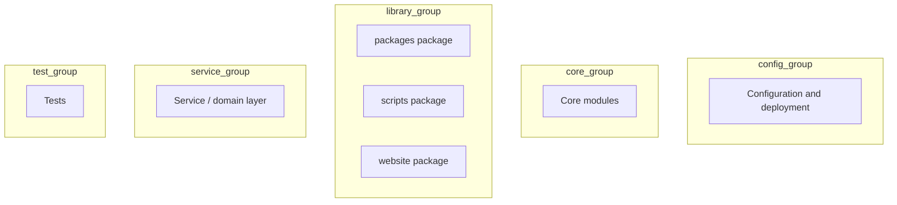

# Architecture report: redux-saga/redux-saga

> Automated static analysis. **Observed** = directly seen in files/imports/AST; **Inferred** = interpretation from that evidence. Repository code was not executed.

## 1. Repository at a glance

| Item | Value |
| --- | --- |
| Repository | redux-saga/redux-saga |
| Description | An alternative side effect model for Redux apps |
| Language | JavaScript |
| Stars | 22410 |
| Licence | MIT |
| Analysed commit / branch | 1bfaded683f1161a6b749d62c5c2a70cbcbc6a94 / main |
| Framework(s) | React |
| Files analysed | 399 |
| Components | 7 |

## 2. Architecture in one minute

redux-saga/redux-saga - An alternative side effect model for Redux apps. This repository was analysed statically from 399 file(s) (0 Python). Detected technologies (observed from imports/manifests): GitHub Actions, React, React Router, Redux, Redux Toolkit, TypeScript. Files are grouped into 7 component(s): Configuration and deployment, Core modules, packages package, scripts package, Service / domain layer, Tests, website package. Findings below distinguish observed facts from inferred interpretation.

## 3. High-level block diagram

## 4. Main components

### Configuration and deployment (`config`)

- **Kind:** config
- **Status:** Observed
- **Confidence:** 0.85
- **Responsibility:** Groups 28 file(s) under configuration and deployment (observed from repository paths and static analysis).
- **Paths:** `package.json`, `packages/babel-plugin-redux-saga/package.json`, `packages/core/effects/package.json`, `packages/core/package.json`, `packages/core/types/tsconfig.json`, `packages/deferred/package.json`, `packages/delay-p/package.json`, `packages/is/package.json`, `packages/redux-saga/effects/package.json`, `packages/redux-saga/package.json`, `packages/simple-saga-monitor/package.json`, `packages/symbols/package.json`, `packages/testing-utils/package.json`, `packages/testing-utils/types/tsconfig.json`, `packages/types/package.json`, `packages/unplugin/esbuild/package.json`, `packages/unplugin/package.json`, `packages/unplugin/rolldown/package.json`, `packages/unplugin/rollup/package.json`, `packages/unplugin/rspack/package.json`, `packages/unplugin/src/package.json`, `packages/unplugin/types/tsconfig.adapters.json`, `packages/unplugin/types/tsconfig.json`, `packages/unplugin/vite/package.json`, `packages/unplugin/webpack/package.json`, `pnpm-workspace.yaml`, `tsconfig.json`, `website/package.json`
- **Evidence:** [package.json](https://github.com/redux-saga/redux-saga/blob/1bfaded683f1161a6b749d62c5c2a70cbcbc6a94/package.json); [packages/babel-plugin-redux-saga/package.json](https://github.com/redux-saga/redux-saga/blob/1bfaded683f1161a6b749d62c5c2a70cbcbc6a94/packages/babel-plugin-redux-saga/package.json); [packages/core/effects/package.json](https://github.com/redux-saga/redux-saga/blob/1bfaded683f1161a6b749d62c5c2a70cbcbc6a94/packages/core/effects/package.json); [packages/core/package.json](https://github.com/redux-saga/redux-saga/blob/1bfaded683f1161a6b749d62c5c2a70cbcbc6a94/packages/core/package.json); [packages/core/types/tsconfig.json](https://github.com/redux-saga/redux-saga/blob/1bfaded683f1161a6b749d62c5c2a70cbcbc6a94/packages/core/types/tsconfig.json); [packages/deferred/package.json](https://github.com/redux-saga/redux-saga/blob/1bfaded683f1161a6b749d62c5c2a70cbcbc6a94/packages/deferred/package.json); [packages/delay-p/package.json](https://github.com/redux-saga/redux-saga/blob/1bfaded683f1161a6b749d62c5c2a70cbcbc6a94/packages/delay-p/package.json); [packages/is/package.json](https://github.com/redux-saga/redux-saga/blob/1bfaded683f1161a6b749d62c5c2a70cbcbc6a94/packages/is/package.json)

### Core modules (`core`)

- **Kind:** core
- **Status:** Observed
- **Confidence:** 0.85
- **Responsibility:** Groups 3 file(s) under core modules (observed from repository paths and static analysis).
- **Paths:** `babel.config.js`, `eslint.config.js`, `vitest.config.mjs`
- **Evidence:** [babel.config.js](https://github.com/redux-saga/redux-saga/blob/1bfaded683f1161a6b749d62c5c2a70cbcbc6a94/babel.config.js); [eslint.config.js](https://github.com/redux-saga/redux-saga/blob/1bfaded683f1161a6b749d62c5c2a70cbcbc6a94/eslint.config.js); [vitest.config.mjs](https://github.com/redux-saga/redux-saga/blob/1bfaded683f1161a6b749d62c5c2a70cbcbc6a94/vitest.config.mjs)

### packages package (`packages`)

- **Kind:** library
- **Status:** Observed
- **Confidence:** 0.85
- **Responsibility:** Groups 53 file(s) under packages package (observed from repository paths and static analysis).
- **Paths:** `packages/babel-plugin-redux-saga/src/index.js`, `packages/deferred/src/index.d.ts`, `packages/deferred/src/index.js`, `packages/delay-p/src/index.d.ts`, `packages/delay-p/src/index.js`, `packages/delay-p/src/resolved-conditions/development.js`, `packages/delay-p/src/resolved-conditions/production.js`, `packages/is/src/index.d.ts`, `packages/is/src/index.js`, `packages/redux-saga/src/effects.d.ts`, `packages/redux-saga/src/effects.js`, `packages/redux-saga/src/index.d.ts`, `packages/redux-saga/src/index.js`, `packages/simple-saga-monitor/src/index.js`, `packages/simple-saga-monitor/src/modules/BrowserFormatter.js`, `packages/simple-saga-monitor/src/modules/DescriptorFormatter.js`, `packages/simple-saga-monitor/src/modules/FormatterBase.js`, `packages/simple-saga-monitor/src/modules/Manager.js`, `packages/simple-saga-monitor/src/modules/NodeFormatter.js`, `packages/simple-saga-monitor/src/modules/checkers.js`, `packages/simple-saga-monitor/src/modules/consoleGroup.js`, `packages/simple-saga-monitor/src/modules/constants.js`, `packages/simple-saga-monitor/src/modules/isPrimitive.js`, `packages/simple-saga-monitor/src/modules/logSaga.js`, `packages/symbols/src/index.d.ts`, `packages/symbols/src/index.js`, `packages/testing-utils/__tests__/cloneableGenerator.js`, `packages/testing-utils/__tests__/createMockTask.js`, `packages/testing-utils/src/index.d.ts`, `packages/testing-utils/src/index.js`, `packages/testing-utils/types/cloneableGenerator.test.ts`, `packages/testing-utils/types/index.d.ts`, `packages/types/src/index.d.ts`, `packages/types/src/index.js`, `packages/types/types/index.d.ts`, `packages/unplugin/src/esbuild.d.ts`, `packages/unplugin/src/esbuild.js`, `packages/unplugin/src/index.d.ts`, `packages/unplugin/src/index.js`, `packages/unplugin/src/options.d.ts`, `packages/unplugin/src/rolldown.d.ts`, `packages/unplugin/src/rolldown.js`, `packages/unplugin/src/rollup.d.ts`, `packages/unplugin/src/rollup.js`, `packages/unplugin/src/rspack.d.ts`, `packages/unplugin/src/rspack.js`, `packages/unplugin/src/transform.js`, `packages/unplugin/src/vite.d.ts`, `packages/unplugin/src/vite.js`, `packages/unplugin/src/webpack.d.ts`, `packages/unplugin/src/webpack.js`, `packages/unplugin/types/adapters.test.ts`, `packages/unplugin/types/root.test.ts`
- **Evidence:** [packages/babel-plugin-redux-saga/src/index.js](https://github.com/redux-saga/redux-saga/blob/1bfaded683f1161a6b749d62c5c2a70cbcbc6a94/packages/babel-plugin-redux-saga/src/index.js); [packages/deferred/src/index.d.ts](https://github.com/redux-saga/redux-saga/blob/1bfaded683f1161a6b749d62c5c2a70cbcbc6a94/packages/deferred/src/index.d.ts); [packages/deferred/src/index.js](https://github.com/redux-saga/redux-saga/blob/1bfaded683f1161a6b749d62c5c2a70cbcbc6a94/packages/deferred/src/index.js); [packages/delay-p/src/index.d.ts](https://github.com/redux-saga/redux-saga/blob/1bfaded683f1161a6b749d62c5c2a70cbcbc6a94/packages/delay-p/src/index.d.ts); [packages/delay-p/src/index.js](https://github.com/redux-saga/redux-saga/blob/1bfaded683f1161a6b749d62c5c2a70cbcbc6a94/packages/delay-p/src/index.js); [packages/delay-p/src/resolved-conditions/development.js](https://github.com/redux-saga/redux-saga/blob/1bfaded683f1161a6b749d62c5c2a70cbcbc6a94/packages/delay-p/src/resolved-conditions/development.js); [packages/delay-p/src/resolved-conditions/production.js](https://github.com/redux-saga/redux-saga/blob/1bfaded683f1161a6b749d62c5c2a70cbcbc6a94/packages/delay-p/src/resolved-conditions/production.js); [packages/is/src/index.d.ts](https://github.com/redux-saga/redux-saga/blob/1bfaded683f1161a6b749d62c5c2a70cbcbc6a94/packages/is/src/index.d.ts)

### scripts package (`scripts`)

- **Kind:** library
- **Status:** Observed
- **Confidence:** 0.85
- **Responsibility:** Groups 1 file(s) under scripts package (observed from repository paths and static analysis).
- **Paths:** `scripts/combine-umd-builds.js`
- **Evidence:** [scripts/combine-umd-builds.js](https://github.com/redux-saga/redux-saga/blob/1bfaded683f1161a6b749d62c5c2a70cbcbc6a94/scripts/combine-umd-builds.js)

### Service / domain layer (`service_layer`)

- **Kind:** service
- **Status:** Observed
- **Confidence:** 0.85
- **Responsibility:** Groups 73 file(s) under service / domain layer (observed from repository paths and static analysis).
- **Paths:** `packages/core/__tests__/channel-recipes.js`, `packages/core/__tests__/channel.js`, `packages/core/__tests__/interpreter/all.js`, `packages/core/__tests__/interpreter/base.js`, `packages/core/__tests__/interpreter/call.js`, `packages/core/__tests__/interpreter/cancellation.js`, `packages/core/__tests__/interpreter/channel.js`, `packages/core/__tests__/interpreter/context.js`, `packages/core/__tests__/interpreter/cps.js`, `packages/core/__tests__/interpreter/effectMiddlewares.js`, `packages/core/__tests__/interpreter/flush.js`, `packages/core/__tests__/interpreter/fork.js`, `packages/core/__tests__/interpreter/forkJoinErrors.js`, `packages/core/__tests__/interpreter/forkjoin.js`, `packages/core/__tests__/interpreter/iterators.js`, `packages/core/__tests__/interpreter/onerror.js`, `packages/core/__tests__/interpreter/promise.js`, `packages/core/__tests__/interpreter/put.js`, `packages/core/__tests__/interpreter/race.js`, `packages/core/__tests__/interpreter/select.js`, `packages/core/__tests__/interpreter/stackoverflow.js`, `packages/core/__tests__/interpreter/take.js`, `packages/core/__tests__/interpreter/takeSync.js`, `packages/core/__tests__/middleware.js`, `packages/core/__tests__/monitoring.js`, `packages/core/__tests__/runSaga.js`, `packages/core/__tests__/sagaHelpers/debounce.js`, `packages/core/__tests__/sagaHelpers/delay.js`, `packages/core/__tests__/sagaHelpers/retry.js`, `packages/core/__tests__/sagaHelpers/takeEvery.js`, `packages/core/__tests__/sagaHelpers/takeLatest.js`, `packages/core/__tests__/sagaHelpers/takeLeading.js`, `packages/core/__tests__/sagaHelpers/throttle.js`, `packages/core/__tests__/scheduler.js`, `packages/core/__tests__/taskToPromise.js`, `packages/core/src/effects.d.ts`, `packages/core/src/effects.js`, `packages/core/src/index.d.ts`, `packages/core/src/index.js`, `packages/core/src/internal/buffers.js`, `packages/core/src/internal/channel.js`, `packages/core/src/internal/effectRunnerMap.js`, `packages/core/src/internal/effectTypes.js`, `packages/core/src/internal/forkQueue.js`, `packages/core/src/internal/io-helpers.js`, `packages/core/src/internal/io.js`, `packages/core/src/internal/matcher.js`, `packages/core/src/internal/middleware.js`, `packages/core/src/internal/newTask.js`, `packages/core/src/internal/proc.js`, `packages/core/src/internal/resolvePromise.js`, `packages/core/src/internal/runSaga.js`, `packages/core/src/internal/sagaError.js`, `packages/core/src/internal/sagaHelpers/debounce.js`, `packages/core/src/internal/sagaHelpers/fsmIterator.js`, `packages/core/src/internal/sagaHelpers/index.js`, `packages/core/src/internal/sagaHelpers/retry.js`, `packages/core/src/internal/sagaHelpers/takeEvery.js`, `packages/core/src/internal/sagaHelpers/takeLatest.js`, `packages/core/src/internal/sagaHelpers/takeLeading.js`, `packages/core/src/internal/sagaHelpers/throttle.js`, `packages/core/src/internal/scheduler.js`, `packages/core/src/internal/task-status.js`, `packages/core/src/internal/uid.js`, `packages/core/src/internal/utils.js`, `packages/core/src/resolved-conditions/development.js`, `packages/core/src/resolved-conditions/production.js`, `packages/core/types/channels.test.ts`, `packages/core/types/effects.d.ts`, `packages/core/types/effects.test.ts`, `packages/core/types/index.d.ts`, `packages/core/types/middleware.test.ts`, `packages/core/types/runSaga.test.ts`
- **Evidence:** [packages/core/__tests__/channel-recipes.js](https://github.com/redux-saga/redux-saga/blob/1bfaded683f1161a6b749d62c5c2a70cbcbc6a94/packages/core/__tests__/channel-recipes.js); [packages/core/__tests__/channel.js](https://github.com/redux-saga/redux-saga/blob/1bfaded683f1161a6b749d62c5c2a70cbcbc6a94/packages/core/__tests__/channel.js); [packages/core/__tests__/interpreter/all.js](https://github.com/redux-saga/redux-saga/blob/1bfaded683f1161a6b749d62c5c2a70cbcbc6a94/packages/core/__tests__/interpreter/all.js); [packages/core/__tests__/interpreter/base.js](https://github.com/redux-saga/redux-saga/blob/1bfaded683f1161a6b749d62c5c2a70cbcbc6a94/packages/core/__tests__/interpreter/base.js); [packages/core/__tests__/interpreter/call.js](https://github.com/redux-saga/redux-saga/blob/1bfaded683f1161a6b749d62c5c2a70cbcbc6a94/packages/core/__tests__/interpreter/call.js); [packages/core/__tests__/interpreter/cancellation.js](https://github.com/redux-saga/redux-saga/blob/1bfaded683f1161a6b749d62c5c2a70cbcbc6a94/packages/core/__tests__/interpreter/cancellation.js); [packages/core/__tests__/interpreter/channel.js](https://github.com/redux-saga/redux-saga/blob/1bfaded683f1161a6b749d62c5c2a70cbcbc6a94/packages/core/__tests__/interpreter/channel.js); [packages/core/__tests__/interpreter/context.js](https://github.com/redux-saga/redux-saga/blob/1bfaded683f1161a6b749d62c5c2a70cbcbc6a94/packages/core/__tests__/interpreter/context.js)

### Tests (`tests`)

- **Kind:** test
- **Status:** Observed
- **Confidence:** 0.85
- **Responsibility:** Groups 57 file(s) under tests (observed from repository paths and static analysis).
- **Paths:** `examples/async/test/sagas.js`, `examples/cancellable-counter/test/sagas.js`, `examples/counter/test/sagas.js`, `examples/error-demo/test/sagas.js`, `examples/shopping-cart/test/sagas.js`, `packages/babel-plugin-redux-saga/test/fixtures/declaration-es6-modules/babel6-expected.js`, `packages/babel-plugin-redux-saga/test/fixtures/declaration-es6-modules/babel7-expected.js`, `packages/babel-plugin-redux-saga/test/fixtures/declaration-es6-modules/source.js`, `packages/babel-plugin-redux-saga/test/fixtures/declaration-regenerator/babel6-expected.js`, `packages/babel-plugin-redux-saga/test/fixtures/declaration-regenerator/babel7-expected.js`, `packages/babel-plugin-redux-saga/test/fixtures/declaration-regenerator/source.js`, `packages/babel-plugin-redux-saga/test/fixtures/declaration/babel6-expected.js`, `packages/babel-plugin-redux-saga/test/fixtures/declaration/babel7-expected.js`, `packages/babel-plugin-redux-saga/test/fixtures/declaration/source.js`, `packages/babel-plugin-redux-saga/test/fixtures/effect-basic/babel6-expected.js`, `packages/babel-plugin-redux-saga/test/fixtures/effect-basic/babel7-expected.js`, `packages/babel-plugin-redux-saga/test/fixtures/effect-basic/source.js`, `packages/babel-plugin-redux-saga/test/fixtures/effect-delegate/babel6-expected.js`, `packages/babel-plugin-redux-saga/test/fixtures/effect-delegate/babel7-expected.js`, `packages/babel-plugin-redux-saga/test/fixtures/effect-delegate/source.js`, `packages/babel-plugin-redux-saga/test/fixtures/effect-expression/babel6-expected.js`, `packages/babel-plugin-redux-saga/test/fixtures/effect-expression/babel7-expected.js`, `packages/babel-plugin-redux-saga/test/fixtures/effect-expression/source.js`, `packages/babel-plugin-redux-saga/test/fixtures/effect-method/babel6-expected.js`, `packages/babel-plugin-redux-saga/test/fixtures/effect-method/babel7-expected.js`, `packages/babel-plugin-redux-saga/test/fixtures/effect-method/source.js`, `packages/babel-plugin-redux-saga/test/fixtures/effect-nested/babel6-expected.js`, `packages/babel-plugin-redux-saga/test/fixtures/effect-nested/babel7-expected.js`, `packages/babel-plugin-redux-saga/test/fixtures/effect-nested/source.js`, `packages/babel-plugin-redux-saga/test/fixtures/effect-object-props/babel6-expected.js`, `packages/babel-plugin-redux-saga/test/fixtures/effect-object-props/babel7-expected.js`, `packages/babel-plugin-redux-saga/test/fixtures/effect-object-props/source.js`, `packages/babel-plugin-redux-saga/test/fixtures/effect-primitive-yield/babel6-expected.js`, `packages/babel-plugin-redux-saga/test/fixtures/effect-primitive-yield/babel7-expected.js`, `packages/babel-plugin-redux-saga/test/fixtures/effect-primitive-yield/source.js`, `packages/babel-plugin-redux-saga/test/fixtures/expression/babel6-expected.js`, `packages/babel-plugin-redux-saga/test/fixtures/expression/babel7-expected.js`, `packages/babel-plugin-redux-saga/test/fixtures/expression/source.js`, `packages/babel-plugin-redux-saga/test/fixtures/preset-env/babel6-expected.js`, `packages/babel-plugin-redux-saga/test/fixtures/preset-env/babel7-expected.js`, `packages/babel-plugin-redux-saga/test/fixtures/preset-env/source.js`, `packages/babel-plugin-redux-saga/test/fixtures/regenerator/babel6-expected.js`, `packages/babel-plugin-redux-saga/test/fixtures/regenerator/babel7-expected.js`, `packages/babel-plugin-redux-saga/test/fixtures/regenerator/source.js`, `packages/babel-plugin-redux-saga/test/fixtures/typescript/README.md`, `packages/babel-plugin-redux-saga/test/fixtures/typescript/babel6-expected.js`, `packages/babel-plugin-redux-saga/test/fixtures/typescript/babel7-expected.js`, `packages/babel-plugin-redux-saga/test/fixtures/typescript/source.js`, `packages/babel-plugin-redux-saga/test/fixtures/typescript/source.ts`, `packages/babel-plugin-redux-saga/test/fixtures/use-absolute-path/babel6-expected.js`, `packages/babel-plugin-redux-saga/test/fixtures/use-absolute-path/babel7-expected.js`, `packages/babel-plugin-redux-saga/test/fixtures/use-absolute-path/source.js`, `packages/babel-plugin-redux-saga/test/runner.test.js`, `packages/babel-plugin-redux-saga/test/runtime.test.js`, `packages/unplugin/test/parity.test.js`, `packages/unplugin/test/plugin.test.js`, `packages/unplugin/test/transform.test.js`
- **Evidence:** [examples/async/test/sagas.js](https://github.com/redux-saga/redux-saga/blob/1bfaded683f1161a6b749d62c5c2a70cbcbc6a94/examples/async/test/sagas.js); [examples/cancellable-counter/test/sagas.js](https://github.com/redux-saga/redux-saga/blob/1bfaded683f1161a6b749d62c5c2a70cbcbc6a94/examples/cancellable-counter/test/sagas.js); [examples/counter/test/sagas.js](https://github.com/redux-saga/redux-saga/blob/1bfaded683f1161a6b749d62c5c2a70cbcbc6a94/examples/counter/test/sagas.js); [examples/error-demo/test/sagas.js](https://github.com/redux-saga/redux-saga/blob/1bfaded683f1161a6b749d62c5c2a70cbcbc6a94/examples/error-demo/test/sagas.js); [examples/shopping-cart/test/sagas.js](https://github.com/redux-saga/redux-saga/blob/1bfaded683f1161a6b749d62c5c2a70cbcbc6a94/examples/shopping-cart/test/sagas.js); [packages/babel-plugin-redux-saga/test/fixtures/declaration-es6-modules/babel6-expected.js](https://github.com/redux-saga/redux-saga/blob/1bfaded683f1161a6b749d62c5c2a70cbcbc6a94/packages/babel-plugin-redux-saga/test/fixtures/declaration-es6-modules/babel6-expected.js); [packages/babel-plugin-redux-saga/test/fixtures/declaration-es6-modules/babel7-expected.js](https://github.com/redux-saga/redux-saga/blob/1bfaded683f1161a6b749d62c5c2a70cbcbc6a94/packages/babel-plugin-redux-saga/test/fixtures/declaration-es6-modules/babel7-expected.js); [packages/babel-plugin-redux-saga/test/fixtures/declaration-es6-modules/source.js](https://github.com/redux-saga/redux-saga/blob/1bfaded683f1161a6b749d62c5c2a70cbcbc6a94/packages/babel-plugin-redux-saga/test/fixtures/declaration-es6-modules/source.js)

### website package (`website`)

- **Kind:** library
- **Status:** Observed
- **Confidence:** 0.85
- **Responsibility:** Groups 8 file(s) under website package (observed from repository paths and static analysis).
- **Paths:** `website/babel.config.js`, `website/docusaurus.config.js`, `website/sidebars.js`, `website/src/components/CodeSnippet.jsx`, `website/src/components/Feature.jsx`, `website/src/components/Header.jsx`, `website/src/components/Supporters.jsx`, `website/src/pages/index.js`
- **Evidence:** [website/babel.config.js](https://github.com/redux-saga/redux-saga/blob/1bfaded683f1161a6b749d62c5c2a70cbcbc6a94/website/babel.config.js); [website/docusaurus.config.js](https://github.com/redux-saga/redux-saga/blob/1bfaded683f1161a6b749d62c5c2a70cbcbc6a94/website/docusaurus.config.js); [website/sidebars.js](https://github.com/redux-saga/redux-saga/blob/1bfaded683f1161a6b749d62c5c2a70cbcbc6a94/website/sidebars.js); [website/src/components/CodeSnippet.jsx](https://github.com/redux-saga/redux-saga/blob/1bfaded683f1161a6b749d62c5c2a70cbcbc6a94/website/src/components/CodeSnippet.jsx); [website/src/components/Feature.jsx](https://github.com/redux-saga/redux-saga/blob/1bfaded683f1161a6b749d62c5c2a70cbcbc6a94/website/src/components/Feature.jsx); [website/src/components/Header.jsx](https://github.com/redux-saga/redux-saga/blob/1bfaded683f1161a6b749d62c5c2a70cbcbc6a94/website/src/components/Header.jsx); [website/src/components/Supporters.jsx](https://github.com/redux-saga/redux-saga/blob/1bfaded683f1161a6b749d62c5c2a70cbcbc6a94/website/src/components/Supporters.jsx); [website/src/pages/index.js](https://github.com/redux-saga/redux-saga/blob/1bfaded683f1161a6b749d62c5c2a70cbcbc6a94/website/src/pages/index.js)

## 5. Execution flow

**Observed** entry point(s):

- [examples/counter-vanilla/index.html](https://github.com/redux-saga/redux-saga/blob/1bfaded683f1161a6b749d62c5c2a70cbcbc6a94/examples/counter-vanilla/index.html)
- [packages/babel-plugin-redux-saga/src/index.js](https://github.com/redux-saga/redux-saga/blob/1bfaded683f1161a6b749d62c5c2a70cbcbc6a94/packages/babel-plugin-redux-saga/src/index.js)
- [packages/core/src/index.js](https://github.com/redux-saga/redux-saga/blob/1bfaded683f1161a6b749d62c5c2a70cbcbc6a94/packages/core/src/index.js)
- [packages/deferred/src/index.js](https://github.com/redux-saga/redux-saga/blob/1bfaded683f1161a6b749d62c5c2a70cbcbc6a94/packages/deferred/src/index.js)
- [packages/delay-p/src/index.js](https://github.com/redux-saga/redux-saga/blob/1bfaded683f1161a6b749d62c5c2a70cbcbc6a94/packages/delay-p/src/index.js)
- [packages/is/src/index.js](https://github.com/redux-saga/redux-saga/blob/1bfaded683f1161a6b749d62c5c2a70cbcbc6a94/packages/is/src/index.js)
- [packages/redux-saga/src/index.js](https://github.com/redux-saga/redux-saga/blob/1bfaded683f1161a6b749d62c5c2a70cbcbc6a94/packages/redux-saga/src/index.js)
- [packages/simple-saga-monitor/src/index.js](https://github.com/redux-saga/redux-saga/blob/1bfaded683f1161a6b749d62c5c2a70cbcbc6a94/packages/simple-saga-monitor/src/index.js)
- [packages/symbols/src/index.js](https://github.com/redux-saga/redux-saga/blob/1bfaded683f1161a6b749d62c5c2a70cbcbc6a94/packages/symbols/src/index.js)
- [packages/testing-utils/src/index.js](https://github.com/redux-saga/redux-saga/blob/1bfaded683f1161a6b749d62c5c2a70cbcbc6a94/packages/testing-utils/src/index.js)
- [packages/types/src/index.js](https://github.com/redux-saga/redux-saga/blob/1bfaded683f1161a6b749d62c5c2a70cbcbc6a94/packages/types/src/index.js)
- [packages/unplugin/src/index.js](https://github.com/redux-saga/redux-saga/blob/1bfaded683f1161a6b749d62c5c2a70cbcbc6a94/packages/unplugin/src/index.js)

Representative flow (derived from observed entry points and the import graph; steps beyond the entry point are **Inferred**):

1. Execution starts at an observed entry point listed above, if present.
2. No internal import relationships between components were observed.

## 6. Project structure

### `(root)`

- `.browserslistrc` - other (42 bytes)
- `.gitignore` - other (670 bytes)
- `.lintstagedrc` - other (236 bytes)
- `.prettierignore` - other (13 bytes)
- `.prettierrc` - other (90 bytes)
- `CHANGELOG.md` - docs (3892 bytes)
- `CONTRIBUTING.md` - docs (2786 bytes)
- `LICENSE` - docs (1090 bytes)
- `LICENSE-logo.md` - docs (6963 bytes)
- `README.md` - docs (18840 bytes)
- `README_es.md` - docs (19414 bytes)
- `README_ja.md` - docs (20297 bytes)
- `README_ru.md` - docs (20394 bytes)
- `README_zh-cn.md` - docs (18456 bytes)
- `README_zh-hant.md` - docs (18525 bytes)
- `SECURITY.md` - docs (221 bytes)
- `SUMMARY.md` - docs (1722 bytes)
- `babel.config.js` - source, JavaScript (447 bytes)
- `eslint.config.js` - source, JavaScript (815 bytes)
- `package.json` - manifest (3254 bytes)
- `pnpm-workspace.yaml` - config (1355 bytes)
- `tsconfig.json` - config (129 bytes)
- `vitest.config.mjs` - source, JavaScript (1441 bytes)

### `.changeset`

- `.changeset/README.md` - docs (510 bytes)
- `.changeset/config.json` - config (415 bytes)

### `.github`

- `.github/CODEOWNERS` - other (32 bytes)
- `.github/FUNDING.yml` - config (604 bytes)
- `.github/ISSUE_TEMPLATE/bug_report.md` - docs (791 bytes)
- `.github/ISSUE_TEMPLATE/custom.md` - docs (688 bytes)
- `.github/PULL_REQUEST_TEMPLATE.md` - docs (1262 bytes)
- `.github/actions/ci-setup/action.yml` - config (1043 bytes)
- `.github/dependabot.yml` - config (440 bytes)
- `.github/workflows/ci.yml` - ci, YAML (2772 bytes)
- `.github/workflows/docs.yml` - ci, YAML (1489 bytes)
- `.github/workflows/publish.yml` - ci, YAML (2966 bytes)
- `.github/workflows/size.yml` - ci, YAML (1035 bytes)

### `.husky`

- `.husky/pre-commit` - other (22 bytes)

### `docs`

- `docs/API.md` - docs (53836 bytes)
- `docs/About.md` - docs (1319 bytes)
- `docs/ExternalResources.md` - docs (5471 bytes)
- `docs/Glossary.md` - docs (2307 bytes)
- `docs/Recipes.md` - docs (8143 bytes)
- `docs/Troubleshooting.md` - docs (5316 bytes)
- `docs/advanced/Channels.md` - docs (15981 bytes)
- `docs/advanced/ComposingSagas.md` - docs (2055 bytes)
- `docs/advanced/Concurrency.md` - docs (1307 bytes)
- `docs/advanced/ForkModel.md` - docs (5164 bytes)
- `docs/advanced/FutureActions.md` - docs (5022 bytes)
- `docs/advanced/NonBlockingCalls.md` - docs (11094 bytes)
- `docs/advanced/RacingEffects.md` - docs (1644 bytes)
- `docs/advanced/RootSaga.md` - docs (6361 bytes)
- `docs/advanced/RunningTasksInParallel.md` - docs (862 bytes)
- `docs/advanced/SequencingSagas.md` - docs (869 bytes)
- `docs/advanced/TaskCancellation.md` - docs (6183 bytes)
- `docs/advanced/Testing.md` - docs (14103 bytes)
- `docs/advanced/UsingRunSaga.md` - docs (1267 bytes)
- `docs/basics/DeclarativeEffects.md` - docs (6771 bytes)
- `docs/basics/DispatchingActions.md` - docs (2532 bytes)
- `docs/basics/Effect.md` - docs (1039 bytes)
- `docs/basics/ErrorHandling.md` - docs (3149 bytes)
- `docs/basics/UsingSagaHelpers.md` - docs (2731 bytes)
- `docs/introduction/BeginnerTutorial.md` - docs (12943 bytes)
- `docs/introduction/GettingStarted.md` - docs (3693 bytes)

### `examples`

- `examples/async/README.md` - docs (140 bytes)
- `examples/async/index.html` - other (294 bytes)
- `examples/async/package.json` - manifest (443 bytes)
- `examples/async/src/actions/index.js` - source, JavaScript (621 bytes)
- `examples/async/src/components/Picker.jsx` - source, JavaScript (349 bytes)
- `examples/async/src/components/Posts.jsx` - source, JavaScript (168 bytes)
- `examples/async/src/containers/App.jsx` - source, JavaScript (1358 bytes)
- `examples/async/src/main.jsx` - source, JavaScript (368 bytes)
- `examples/async/src/reducers/index.js` - source, JavaScript (1025 bytes)
- `examples/async/src/reducers/selectors.js` - source, JavaScript (134 bytes)
- `examples/async/src/sagas/index.js` - source, JavaScript (1567 bytes)
- `examples/async/src/store/configureStore.js` - source, JavaScript (439 bytes)
- `examples/async/test/sagas.js` - test, JavaScript (3274 bytes)
- `examples/async/vite.config.js` - source, JavaScript (133 bytes)
- `examples/cancellable-counter/README.md` - docs (154 bytes)
- `examples/cancellable-counter/index.html` - other (296 bytes)
- `examples/cancellable-counter/package.json` - manifest (457 bytes)
- `examples/cancellable-counter/src/actionTypes.js` - source, JavaScript (314 bytes)
- `examples/cancellable-counter/src/components/Counter.jsx` - source, JavaScript (943 bytes)
- `examples/cancellable-counter/src/main.jsx` - source, JavaScript (610 bytes)
- `examples/cancellable-counter/src/reducers/counter.js` - source, JavaScript (655 bytes)
- `examples/cancellable-counter/src/reducers/index.js` - source, JavaScript (192 bytes)
- `examples/cancellable-counter/src/sagas/index.js` - source, JavaScript (1683 bytes)
- `examples/cancellable-counter/test/sagas.js` - test, JavaScript (2523 bytes)
- `examples/cancellable-counter/vite.config.js` - source, JavaScript (133 bytes)
- `examples/counter-vanilla/README.md` - docs (49 bytes)
- `examples/counter-vanilla/index.html` - other (2679 bytes)
- `examples/counter-vanilla/package.json` - manifest (122 bytes)
- `examples/counter/README.md` - docs (142 bytes)
- `examples/counter/index.html` - other (296 bytes)
- `examples/counter/package.json` - manifest (416 bytes)
- `examples/counter/src/components/Counter.jsx` - source, JavaScript (395 bytes)
- `examples/counter/src/main.jsx` - source, JavaScript (902 bytes)
- `examples/counter/src/reducers/index.js` - source, JavaScript (284 bytes)
- `examples/counter/src/sagas/index.js` - source, JavaScript (291 bytes)
- `examples/counter/test/sagas.js` - test, JavaScript (527 bytes)
- `examples/counter/vite.config.js` - source, JavaScript (133 bytes)
- `examples/error-demo/README.md` - docs (479 bytes)
- `examples/error-demo/index.html` - other (289 bytes)
- `examples/error-demo/package.json` - manifest (477 bytes)
- `examples/error-demo/src/components/ErrorGenerator.jsx` - source, JavaScript (1496 bytes)
- `examples/error-demo/src/main.jsx` - source, JavaScript (611 bytes)
- `examples/error-demo/src/reducers/index.js` - source, JavaScript (321 bytes)
- `examples/error-demo/src/sagas/index.js` - source, JavaScript (2752 bytes)
- `examples/error-demo/test/sagas.js` - test, JavaScript (7559 bytes)
- `examples/error-demo/vite.config.js` - source, JavaScript (309 bytes)
- `examples/real-world/.gitignore` - other (22 bytes)
- `examples/real-world/README.md` - docs (1899 bytes)
- `examples/real-world/app/actions/index.js` - source, JavaScript (2243 bytes)
- `examples/real-world/app/components/Explore.jsx` - source, JavaScript (801 bytes)
- `examples/real-world/app/components/List.jsx` - source, JavaScript (726 bytes)
- `examples/real-world/app/components/Repo.jsx` - source, JavaScript (387 bytes)
- `examples/real-world/app/components/User.jsx` - source, JavaScript (359 bytes)
- `examples/real-world/app/preload.server.js` - source, JavaScript (1232 bytes)
- `examples/real-world/app/reducers/index.js` - source, JavaScript (2115 bytes)
- `examples/real-world/app/reducers/paginate.js` - source, JavaScript (1801 bytes)
- `examples/real-world/app/reducers/selectors.js` - source, JavaScript (650 bytes)
- `examples/real-world/app/root.jsx` - source, JavaScript (2530 bytes)
- `examples/real-world/app/routes.js` - source, JavaScript (144 bytes)
- `examples/real-world/app/routes/repo.jsx` - source, JavaScript (2279 bytes)
- `examples/real-world/app/routes/user.jsx` - source, JavaScript (2052 bytes)
- `examples/real-world/app/sagas/index.js` - source, JavaScript (4149 bytes)
- `examples/real-world/app/services/api.js` - source, JavaScript (2714 bytes)
- `examples/real-world/app/store.client.js` - source, JavaScript (839 bytes)
- `examples/real-world/app/store.js` - source, JavaScript (585 bytes)
- `examples/real-world/package.json` - manifest (753 bytes)
- `examples/real-world/react-router.config.js` - source, JavaScript (184 bytes)
- `examples/real-world/vite.config.js` - source, JavaScript (151 bytes)
- `examples/shopping-cart/README.md` - docs (148 bytes)
- `examples/shopping-cart/index.html` - other (302 bytes)
- `examples/shopping-cart/package.json` - manifest (451 bytes)
- `examples/shopping-cart/src/actions/index.js` - source, JavaScript (1013 bytes)
- `examples/shopping-cart/src/components/App.jsx` - source, JavaScript (237 bytes)
- `examples/shopping-cart/src/components/Cart.jsx` - source, JavaScript (1218 bytes)
- `examples/shopping-cart/src/components/CartItem.jsx` - source, JavaScript (240 bytes)
- `examples/shopping-cart/src/components/Product.jsx` - source, JavaScript (182 bytes)
- `examples/shopping-cart/src/components/ProductItem.jsx` - source, JavaScript (440 bytes)
- `examples/shopping-cart/src/components/ProductList.jsx` - source, JavaScript (570 bytes)
- `examples/shopping-cart/src/main.jsx` - source, JavaScript (615 bytes)
- `examples/shopping-cart/src/reducers/cart.js` - source, JavaScript (1482 bytes)
- `examples/shopping-cart/src/reducers/index.js` - source, JavaScript (1140 bytes)
- `examples/shopping-cart/src/reducers/products.js` - source, JavaScript (1404 bytes)
- `examples/shopping-cart/src/sagas/index.js` - source, JavaScript (1426 bytes)
- `examples/shopping-cart/src/services/index.js` - source, JavaScript (575 bytes)
- `examples/shopping-cart/src/services/products.js` - source, JavaScript (227 bytes)
- `examples/shopping-cart/test/sagas.js` - test, JavaScript (1192 bytes)
- `examples/shopping-cart/vite.config.js` - source, JavaScript (133 bytes)

### `logo`

- `logo/README.md` - docs (1620 bytes)

### `packages`

- `packages/babel-plugin-redux-saga/CHANGELOG.md` - docs (1749 bytes)
- `packages/babel-plugin-redux-saga/LICENSE` - docs (1090 bytes)
- `packages/babel-plugin-redux-saga/README.md` - docs (3357 bytes)
- `packages/babel-plugin-redux-saga/package.json` - manifest (1347 bytes)
- `packages/babel-plugin-redux-saga/src/index.js` - source, JavaScript (6790 bytes)
- `packages/babel-plugin-redux-saga/test/fixtures/declaration-es6-modules/babel6-expected.js` - test, JavaScript (842 bytes)
- `packages/babel-plugin-redux-saga/test/fixtures/declaration-es6-modules/babel7-expected.js` - test, JavaScript (839 bytes)
- `packages/babel-plugin-redux-saga/test/fixtures/declaration-es6-modules/source.js` - test, JavaScript (98 bytes)
- `packages/babel-plugin-redux-saga/test/fixtures/declaration-regenerator/babel6-expected.js` - test, JavaScript (1879 bytes)
- `packages/babel-plugin-redux-saga/test/fixtures/declaration-regenerator/babel7-expected.js` - test, JavaScript (5086 bytes)
- `packages/babel-plugin-redux-saga/test/fixtures/declaration-regenerator/source.js` - test, JavaScript (76 bytes)
- `packages/babel-plugin-redux-saga/test/fixtures/declaration/babel6-expected.js` - test, JavaScript (784 bytes)
- `packages/babel-plugin-redux-saga/test/fixtures/declaration/babel7-expected.js` - test, JavaScript (781 bytes)
- `packages/babel-plugin-redux-saga/test/fixtures/declaration/source.js` - test, JavaScript (76 bytes)
- `packages/babel-plugin-redux-saga/test/fixtures/effect-basic/babel6-expected.js` - test, JavaScript (787 bytes)
- `packages/babel-plugin-redux-saga/test/fixtures/effect-basic/babel7-expected.js` - test, JavaScript (784 bytes)
- `packages/babel-plugin-redux-saga/test/fixtures/effect-basic/source.js` - test, JavaScript (76 bytes)
- `packages/babel-plugin-redux-saga/test/fixtures/effect-delegate/babel6-expected.js` - test, JavaScript (209 bytes)
- `packages/babel-plugin-redux-saga/test/fixtures/effect-delegate/babel7-expected.js` - test, JavaScript (209 bytes)
- `packages/babel-plugin-redux-saga/test/fixtures/effect-delegate/source.js` - test, JavaScript (44 bytes)
- `packages/babel-plugin-redux-saga/test/fixtures/effect-expression/babel6-expected.js` - test, JavaScript (826 bytes)
- `packages/babel-plugin-redux-saga/test/fixtures/effect-expression/babel7-expected.js` - test, JavaScript (823 bytes)
- `packages/babel-plugin-redux-saga/test/fixtures/effect-expression/source.js` - test, JavaScript (90 bytes)
- `packages/babel-plugin-redux-saga/test/fixtures/effect-method/babel6-expected.js` - test, JavaScript (601 bytes)
- `packages/babel-plugin-redux-saga/test/fixtures/effect-method/babel7-expected.js` - test, JavaScript (599 bytes)
- `packages/babel-plugin-redux-saga/test/fixtures/effect-method/source.js` - test, JavaScript (47 bytes)
- `packages/babel-plugin-redux-saga/test/fixtures/effect-nested/babel6-expected.js` - test, JavaScript (1028 bytes)
- `packages/babel-plugin-redux-saga/test/fixtures/effect-nested/babel7-expected.js` - test, JavaScript (1026 bytes)
- `packages/babel-plugin-redux-saga/test/fixtures/effect-nested/source.js` - test, JavaScript (84 bytes)
- `packages/babel-plugin-redux-saga/test/fixtures/effect-object-props/babel6-expected.js` - test, JavaScript (759 bytes)
- `packages/babel-plugin-redux-saga/test/fixtures/effect-object-props/babel7-expected.js` - test, JavaScript (755 bytes)
- `packages/babel-plugin-redux-saga/test/fixtures/effect-object-props/source.js` - test, JavaScript (118 bytes)
- `packages/babel-plugin-redux-saga/test/fixtures/effect-primitive-yield/babel6-expected.js` - test, JavaScript (1646 bytes)
- `packages/babel-plugin-redux-saga/test/fixtures/effect-primitive-yield/babel7-expected.js` - test, JavaScript (1639 bytes)
- `packages/babel-plugin-redux-saga/test/fixtures/effect-primitive-yield/source.js` - test, JavaScript (240 bytes)
- `packages/babel-plugin-redux-saga/test/fixtures/expression/babel6-expected.js` - test, JavaScript (231 bytes)
- `packages/babel-plugin-redux-saga/test/fixtures/expression/babel7-expected.js` - test, JavaScript (231 bytes)
- `packages/babel-plugin-redux-saga/test/fixtures/expression/source.js` - test, JavaScript (45 bytes)
- `packages/babel-plugin-redux-saga/test/fixtures/preset-env/babel6-expected.js` - test, JavaScript (4464 bytes)
- `packages/babel-plugin-redux-saga/test/fixtures/preset-env/babel7-expected.js` - test, JavaScript (9639 bytes)
- `packages/babel-plugin-redux-saga/test/fixtures/preset-env/source.js` - test, JavaScript (226 bytes)
- `packages/babel-plugin-redux-saga/test/fixtures/regenerator/babel6-expected.js` - test, JavaScript (1843 bytes)
- `packages/babel-plugin-redux-saga/test/fixtures/regenerator/babel7-expected.js` - test, JavaScript (5050 bytes)
- `packages/babel-plugin-redux-saga/test/fixtures/regenerator/source.js` - test, JavaScript (76 bytes)
- `packages/babel-plugin-redux-saga/test/fixtures/typescript/README.md` - test (112 bytes)
- `packages/babel-plugin-redux-saga/test/fixtures/typescript/babel6-expected.js` - test, JavaScript (812 bytes)
- `packages/babel-plugin-redux-saga/test/fixtures/typescript/babel7-expected.js` - test, JavaScript (810 bytes)
- `packages/babel-plugin-redux-saga/test/fixtures/typescript/source.js` - test, JavaScript (242 bytes)
- `packages/babel-plugin-redux-saga/test/fixtures/typescript/source.ts` - test, TypeScript (271 bytes)
- `packages/babel-plugin-redux-saga/test/fixtures/use-absolute-path/babel6-expected.js` - test, JavaScript (727 bytes)
- `packages/babel-plugin-redux-saga/test/fixtures/use-absolute-path/babel7-expected.js` - test, JavaScript (724 bytes)
- `packages/babel-plugin-redux-saga/test/fixtures/use-absolute-path/source.js` - test, JavaScript (76 bytes)
- `packages/babel-plugin-redux-saga/test/runner.test.js` - test, JavaScript (4060 bytes)
- `packages/babel-plugin-redux-saga/test/runtime.test.js` - test, JavaScript (3123 bytes)
- `packages/core/CHANGELOG.md` - docs (8378 bytes)
- `packages/core/LICENSE` - docs (1090 bytes)
- `packages/core/README.md` - docs (88 bytes)
- `packages/core/__tests__/channel-recipes.js` - source, JavaScript (3806 bytes)
- `packages/core/__tests__/channel.js` - source, JavaScript (5082 bytes)
- `packages/core/__tests__/interpreter/all.js` - source, JavaScript (3472 bytes)
- `packages/core/__tests__/interpreter/base.js` - source, JavaScript (3653 bytes)
- `packages/core/__tests__/interpreter/call.js` - source, JavaScript (5954 bytes)
- `packages/core/__tests__/interpreter/cancellation.js` - source, JavaScript (23224 bytes)
- `packages/core/__tests__/interpreter/channel.js` - source, JavaScript (1733 bytes)
- `packages/core/__tests__/interpreter/context.js` - source, JavaScript (1006 bytes)
- `packages/core/__tests__/interpreter/cps.js` - source, JavaScript (2546 bytes)
- `packages/core/__tests__/interpreter/effectMiddlewares.js` - source, JavaScript (4734 bytes)
- `packages/core/__tests__/interpreter/flush.js` - source, JavaScript (917 bytes)
- `packages/core/__tests__/interpreter/fork.js` - source, JavaScript (2377 bytes)
- `packages/core/__tests__/interpreter/forkJoinErrors.js` - source, JavaScript (5730 bytes)
- `packages/core/__tests__/interpreter/forkjoin.js` - source, JavaScript (13892 bytes)
- `packages/core/__tests__/interpreter/iterators.js` - source, JavaScript (1590 bytes)
- `packages/core/__tests__/interpreter/onerror.js` - source, JavaScript (2844 bytes)
- `packages/core/__tests__/interpreter/promise.js` - source, JavaScript (1186 bytes)
- `packages/core/__tests__/interpreter/put.js` - source, JavaScript (7355 bytes)
- `packages/core/__tests__/interpreter/race.js` - source, JavaScript (4022 bytes)
- `packages/core/__tests__/interpreter/select.js` - source, JavaScript (1422 bytes)
- `packages/core/__tests__/interpreter/stackoverflow.js` - source, JavaScript (17350 bytes)
- `packages/core/__tests__/interpreter/take.js` - source, JavaScript (4821 bytes)
- `packages/core/__tests__/interpreter/takeSync.js` - source, JavaScript (15305 bytes)
- `packages/core/__tests__/middleware.js` - source, JavaScript (4846 bytes)
- `packages/core/__tests__/monitoring.js` - source, JavaScript (6096 bytes)
- `packages/core/__tests__/runSaga.js` - source, JavaScript (1545 bytes)
- `packages/core/__tests__/sagaHelpers/debounce.js` - source, JavaScript (7106 bytes)
- `packages/core/__tests__/sagaHelpers/delay.js` - source, JavaScript (1130 bytes)
- `packages/core/__tests__/sagaHelpers/retry.js` - source, JavaScript (1596 bytes)
- `packages/core/__tests__/sagaHelpers/takeEvery.js` - source, JavaScript (2083 bytes)
- `packages/core/__tests__/sagaHelpers/takeLatest.js` - source, JavaScript (2616 bytes)
- `packages/core/__tests__/sagaHelpers/takeLeading.js` - source, JavaScript (2641 bytes)
- `packages/core/__tests__/sagaHelpers/throttle.js` - source, JavaScript (4440 bytes)
- `packages/core/__tests__/scheduler.js` - source, JavaScript (706 bytes)
- `packages/core/__tests__/taskToPromise.js` - source, JavaScript (2159 bytes)
- `packages/core/effects/package.json` - manifest (196 bytes)
- `packages/core/package.json` - manifest (3200 bytes)
- `packages/core/src/effects.d.ts` - source, TypeScript (36 bytes)
- `packages/core/src/effects.js` - source, JavaScript (416 bytes)
- `packages/core/src/index.d.ts` - source, TypeScript (78 bytes)
- `packages/core/src/index.js` - source, JavaScript (384 bytes)
- `packages/core/src/internal/buffers.js` - source, JavaScript (1965 bytes)
- `packages/core/src/internal/channel.js` - source, JavaScript (5078 bytes)
- `packages/core/src/internal/effectRunnerMap.js` - source, JavaScript (8360 bytes)
- `packages/core/src/internal/effectTypes.js` - source, JavaScript (467 bytes)
- `packages/core/src/internal/forkQueue.js` - source, JavaScript (1701 bytes)
- `packages/core/src/internal/io-helpers.js` - source, JavaScript (1771 bytes)
- `packages/core/src/internal/io.js` - source, JavaScript (9119 bytes)
- `packages/core/src/internal/matcher.js` - source, JavaScript (894 bytes)
- `packages/core/src/internal/middleware.js` - source, JavaScript (1447 bytes)
- `packages/core/src/internal/newTask.js` - source, JavaScript (4841 bytes)
- `packages/core/src/internal/proc.js` - source, JavaScript (8162 bytes)
- `packages/core/src/internal/resolvePromise.js` - source, JavaScript (304 bytes)
- `packages/core/src/internal/runSaga.js` - source, JavaScript (2834 bytes)
- `packages/core/src/internal/sagaError.js` - source, JavaScript (2310 bytes)
- `packages/core/src/internal/sagaHelpers/debounce.js` - source, JavaScript (1157 bytes)
- `packages/core/src/internal/sagaHelpers/fsmIterator.js` - source, JavaScript (1086 bytes)
- `packages/core/src/internal/sagaHelpers/index.js` - source, JavaScript (336 bytes)
- `packages/core/src/internal/sagaHelpers/retry.js` - source, JavaScript (684 bytes)
- `packages/core/src/internal/sagaHelpers/takeEvery.js` - source, JavaScript (646 bytes)
- `packages/core/src/internal/sagaHelpers/takeLatest.js` - source, JavaScript (966 bytes)
- `packages/core/src/internal/sagaHelpers/takeLeading.js` - source, JavaScript (653 bytes)
- `packages/core/src/internal/sagaHelpers/throttle.js` - source, JavaScript (1296 bytes)
- `packages/core/src/internal/scheduler.js` - source, JavaScript (1495 bytes)
- `packages/core/src/internal/task-status.js` - source, JavaScript (99 bytes)
- `packages/core/src/internal/uid.js` - source, JavaScript (55 bytes)
- `packages/core/src/internal/utils.js` - source, JavaScript (5356 bytes)
- `packages/core/src/resolved-conditions/development.js` - source, JavaScript (34 bytes)
- `packages/core/src/resolved-conditions/production.js` - source, JavaScript (35 bytes)
- `packages/core/types/channels.test.ts` - source, TypeScript (4240 bytes)
- `packages/core/types/effects.d.ts` - source, TypeScript (52095 bytes)
- `packages/core/types/effects.test.ts` - source, TypeScript (45857 bytes)
- `packages/core/types/index.d.ts` - source, TypeScript (13452 bytes)
- `packages/core/types/middleware.test.ts` - source, TypeScript (2746 bytes)
- `packages/core/types/runSaga.test.ts` - source, TypeScript (2159 bytes)
- `packages/core/types/tsconfig.json` - config (183 bytes)
- `packages/deferred/CHANGELOG.md` - docs (1612 bytes)
- `packages/deferred/LICENSE` - docs (1090 bytes)
- `packages/deferred/package.json` - manifest (1471 bytes)
- `packages/deferred/src/index.d.ts` - source, TypeScript (228 bytes)
- `packages/deferred/src/index.js` - source, JavaScript (318 bytes)
- `packages/delay-p/CHANGELOG.md` - docs (2553 bytes)
- `packages/delay-p/LICENSE` - docs (1090 bytes)
- `packages/delay-p/package.json` - manifest (2048 bytes)
- `packages/delay-p/src/index.d.ts` - source, TypeScript (74 bytes)
- `packages/delay-p/src/index.js` - source, JavaScript (618 bytes)
- `packages/delay-p/src/resolved-conditions/development.js` - source, JavaScript (34 bytes)
- `packages/delay-p/src/resolved-conditions/production.js` - source, JavaScript (35 bytes)
- `packages/is/CHANGELOG.md` - docs (1641 bytes)
- `packages/is/LICENSE` - docs (1090 bytes)
- `packages/is/package.json` - manifest (1397 bytes)
- `packages/is/src/index.d.ts` - source, TypeScript (1064 bytes)
- `packages/is/src/index.js` - source, JavaScript (1428 bytes)
- `packages/redux-saga/CHANGELOG.md` - docs (7709 bytes)
- `packages/redux-saga/LICENSE` - docs (1090 bytes)
- `packages/redux-saga/README.md` - docs (82 bytes)
- `packages/redux-saga/effects/package.json` - manifest (255 bytes)
- `packages/redux-saga/package.json` - manifest (2223 bytes)
- `packages/redux-saga/src/effects.d.ts` - source, TypeScript (41 bytes)
- `packages/redux-saga/src/effects.js` - source, JavaScript (41 bytes)
- `packages/redux-saga/src/index.d.ts` - source, TypeScript (76 bytes)
- `packages/redux-saga/src/index.js` - source, JavaScript (121 bytes)
- `packages/simple-saga-monitor/CHANGELOG.md` - docs (1096 bytes)
- `packages/simple-saga-monitor/LICENSE` - docs (1090 bytes)
- `packages/simple-saga-monitor/package.json` - manifest (1937 bytes)
- `packages/simple-saga-monitor/src/index.js` - source, JavaScript (3415 bytes)
- `packages/simple-saga-monitor/src/modules/BrowserFormatter.js` - source, JavaScript (288 bytes)
- `packages/simple-saga-monitor/src/modules/DescriptorFormatter.js` - source, JavaScript (1555 bytes)
- `packages/simple-saga-monitor/src/modules/FormatterBase.js` - source, JavaScript (892 bytes)
- `packages/simple-saga-monitor/src/modules/Manager.js` - source, JavaScript (813 bytes)
- `packages/simple-saga-monitor/src/modules/NodeFormatter.js` - source, JavaScript (770 bytes)
- `packages/simple-saga-monitor/src/modules/checkers.js` - source, JavaScript (172 bytes)
- `packages/simple-saga-monitor/src/modules/consoleGroup.js` - source, JavaScript (751 bytes)
- `packages/simple-saga-monitor/src/modules/constants.js` - source, JavaScript (140 bytes)
- `packages/simple-saga-monitor/src/modules/isPrimitive.js` - source, JavaScript (227 bytes)
- `packages/simple-saga-monitor/src/modules/logSaga.js` - source, JavaScript (4303 bytes)
- `packages/symbols/CHANGELOG.md` - docs (1066 bytes)
- `packages/symbols/LICENSE` - docs (1090 bytes)
- `packages/symbols/package.json` - manifest (1408 bytes)
- `packages/symbols/src/index.d.ts` - source, TypeScript (345 bytes)
- `packages/symbols/src/index.js` - source, JavaScript (623 bytes)
- `packages/testing-utils/CHANGELOG.md` - docs (3219 bytes)
- `packages/testing-utils/LICENSE` - docs (1090 bytes)
- `packages/testing-utils/__tests__/cloneableGenerator.js` - source, JavaScript (3526 bytes)
- `packages/testing-utils/__tests__/createMockTask.js` - source, JavaScript (5400 bytes)
- `packages/testing-utils/package.json` - manifest (1718 bytes)
- `packages/testing-utils/src/index.d.ts` - source, TypeScript (2633 bytes)
- `packages/testing-utils/src/index.js` - source, JavaScript (2495 bytes)
- `packages/testing-utils/types/cloneableGenerator.test.ts` - source, TypeScript (2385 bytes)
- `packages/testing-utils/types/index.d.ts` - source, TypeScript (2773 bytes)
- `packages/testing-utils/types/tsconfig.json` - config (183 bytes)
- `packages/types/CHANGELOG.md` - docs (3102 bytes)
- `packages/types/LICENSE` - docs (1090 bytes)
- `packages/types/README.md` - docs (184 bytes)
- `packages/types/package.json` - manifest (1271 bytes)
- `packages/types/src/index.d.ts` - source, TypeScript (25 bytes)
- `packages/types/src/index.js` - source, JavaScript (0 bytes)
- `packages/types/types/index.d.ts` - source, TypeScript (5788 bytes)
- `packages/unplugin/CHANGELOG.md` - docs (1381 bytes)
- `packages/unplugin/LICENSE` - docs (1090 bytes)
- `packages/unplugin/README.md` - docs (8180 bytes)
- `packages/unplugin/esbuild/package.json` - manifest (111 bytes)
- `packages/unplugin/package.json` - manifest (4484 bytes)
- `packages/unplugin/rolldown/package.json` - manifest (113 bytes)
- `packages/unplugin/rollup/package.json` - manifest (109 bytes)
- `packages/unplugin/rspack/package.json` - manifest (109 bytes)
- `packages/unplugin/src/esbuild.d.ts` - source, TypeScript (319 bytes)
- `packages/unplugin/src/esbuild.js` - source, JavaScript (71 bytes)
- `packages/unplugin/src/index.d.ts` - source, TypeScript (771 bytes)
- `packages/unplugin/src/index.js` - source, JavaScript (7152 bytes)
- `packages/unplugin/src/options.d.ts` - source, TypeScript (222 bytes)
- `packages/unplugin/src/package.json` - manifest (23 bytes)
- `packages/unplugin/src/rolldown.d.ts` - source, TypeScript (320 bytes)
- `packages/unplugin/src/rolldown.js` - source, JavaScript (72 bytes)
- `packages/unplugin/src/rollup.d.ts` - source, TypeScript (318 bytes)
- `packages/unplugin/src/rollup.js` - source, JavaScript (70 bytes)
- `packages/unplugin/src/rspack.d.ts` - source, TypeScript (352 bytes)
- `packages/unplugin/src/rspack.js` - source, JavaScript (70 bytes)
- `packages/unplugin/src/transform.js` - source, JavaScript (19200 bytes)
- `packages/unplugin/src/vite.d.ts` - source, TypeScript (316 bytes)
- `packages/unplugin/src/vite.js` - source, JavaScript (68 bytes)
- `packages/unplugin/src/webpack.d.ts` - source, TypeScript (349 bytes)
- `packages/unplugin/src/webpack.js` - source, JavaScript (71 bytes)
- `packages/unplugin/test/parity.test.js` - test, JavaScript (3830 bytes)
- `packages/unplugin/test/plugin.test.js` - test, JavaScript (12088 bytes)
- `packages/unplugin/test/transform.test.js` - test, JavaScript (22731 bytes)
- `packages/unplugin/types/adapters.test.ts` - source, TypeScript (972 bytes)
- `packages/unplugin/types/root.test.ts` - source, TypeScript (534 bytes)
- `packages/unplugin/types/tsconfig.adapters.json` - config (196 bytes)
- `packages/unplugin/types/tsconfig.json` - config (238 bytes)
- `packages/unplugin/vite/package.json` - manifest (105 bytes)
- `packages/unplugin/webpack/package.json` - manifest (111 bytes)

### `patches`

- `patches/@preconstruct__cli@2.8.13.patch` - other (1513 bytes)

### `scripts`

- `scripts/combine-umd-builds.js` - source, JavaScript (2145 bytes)

### `website`

- `website/.gitignore` - other (233 bytes)
- `website/README.md` - docs (727 bytes)
- `website/babel.config.js` - source, JavaScript (88 bytes)
- `website/docusaurus.config.js` - source, JavaScript (4287 bytes)
- `website/package.json` - manifest (1212 bytes)
- `website/sidebars.js` - source, JavaScript (1267 bytes)
- `website/src/components/CodeSnippet.jsx` - source, JavaScript (1278 bytes)
- `website/src/components/Feature.jsx` - source, JavaScript (421 bytes)
- `website/src/components/Header.jsx` - source, JavaScript (1159 bytes)
- `website/src/components/Supporters.jsx` - source, JavaScript (844 bytes)
- `website/src/css/custom.scss` - other (1443 bytes)
- `website/src/css/theme-dark.scss` - other (797 bytes)
- `website/src/css/theme-light.scss` - other (1572 bytes)
- `website/src/pages/index.js` - source, JavaScript (6044 bytes)
- `website/src/pages/styles.module.css` - other (559 bytes)
- `website/static/.nojekyll` - other (0 bytes)
- `website/static/CNAME` - other (17 bytes)

## 7. Key dependencies and integrations

| Name | Category | Status | Confidence | Evidence |
| --- | --- | --- | --- | --- |
| GitHub Actions | ci | Observed | 0.90 | [.github/workflows/ci.yml](https://github.com/redux-saga/redux-saga/blob/1bfaded683f1161a6b749d62c5c2a70cbcbc6a94/.github/workflows/ci.yml); [.github/workflows/docs.yml](https://github.com/redux-saga/redux-saga/blob/1bfaded683f1161a6b749d62c5c2a70cbcbc6a94/.github/workflows/docs.yml); [.github/workflows/publish.yml](https://github.com/redux-saga/redux-saga/blob/1bfaded683f1161a6b749d62c5c2a70cbcbc6a94/.github/workflows/publish.yml); [.github/workflows/size.yml](https://github.com/redux-saga/redux-saga/blob/1bfaded683f1161a6b749d62c5c2a70cbcbc6a94/.github/workflows/size.yml) |
| React | framework | Observed | 0.90 | [examples/async/package.json:13](https://github.com/redux-saga/redux-saga/blob/1bfaded683f1161a6b749d62c5c2a70cbcbc6a94/examples/async/package.json#L13); [examples/async/package.json:14](https://github.com/redux-saga/redux-saga/blob/1bfaded683f1161a6b749d62c5c2a70cbcbc6a94/examples/async/package.json#L14); [examples/cancellable-counter/package.json:13](https://github.com/redux-saga/redux-saga/blob/1bfaded683f1161a6b749d62c5c2a70cbcbc6a94/examples/cancellable-counter/package.json#L13); [examples/cancellable-counter/package.json:14](https://github.com/redux-saga/redux-saga/blob/1bfaded683f1161a6b749d62c5c2a70cbcbc6a94/examples/cancellable-counter/package.json#L14) |
| React Router | library | Observed | 0.85 | [examples/real-world/package.json:7](https://github.com/redux-saga/redux-saga/blob/1bfaded683f1161a6b749d62c5c2a70cbcbc6a94/examples/real-world/package.json#L7) |
| Redux | library | Observed | 0.90 | [examples/error-demo/package.json:12](https://github.com/redux-saga/redux-saga/blob/1bfaded683f1161a6b749d62c5c2a70cbcbc6a94/examples/error-demo/package.json#L12); [package.json:2](https://github.com/redux-saga/redux-saga/blob/1bfaded683f1161a6b749d62c5c2a70cbcbc6a94/package.json#L2); [packages/core/package.json:2](https://github.com/redux-saga/redux-saga/blob/1bfaded683f1161a6b749d62c5c2a70cbcbc6a94/packages/core/package.json#L2) |
| Redux Toolkit | library | Observed | 0.90 | [examples/async/package.json:12](https://github.com/redux-saga/redux-saga/blob/1bfaded683f1161a6b749d62c5c2a70cbcbc6a94/examples/async/package.json#L12); [examples/cancellable-counter/package.json:12](https://github.com/redux-saga/redux-saga/blob/1bfaded683f1161a6b749d62c5c2a70cbcbc6a94/examples/cancellable-counter/package.json#L12); [examples/counter/package.json:12](https://github.com/redux-saga/redux-saga/blob/1bfaded683f1161a6b749d62c5c2a70cbcbc6a94/examples/counter/package.json#L12); [examples/error-demo/package.json:12](https://github.com/redux-saga/redux-saga/blob/1bfaded683f1161a6b749d62c5c2a70cbcbc6a94/examples/error-demo/package.json#L12) |
| TypeScript | tooling | Observed | 0.90 | [package.json:75](https://github.com/redux-saga/redux-saga/blob/1bfaded683f1161a6b749d62c5c2a70cbcbc6a94/package.json#L75); [packages/babel-plugin-redux-saga/package.json:39](https://github.com/redux-saga/redux-saga/blob/1bfaded683f1161a6b749d62c5c2a70cbcbc6a94/packages/babel-plugin-redux-saga/package.json#L39); [packages/core/package.json:92](https://github.com/redux-saga/redux-saga/blob/1bfaded683f1161a6b749d62c5c2a70cbcbc6a94/packages/core/package.json#L92); [packages/testing-utils/package.json:54](https://github.com/redux-saga/redux-saga/blob/1bfaded683f1161a6b749d62c5c2a70cbcbc6a94/packages/testing-utils/package.json#L54) |
| Vite | tooling | Observed | 0.90 | [examples/async/package.json:7](https://github.com/redux-saga/redux-saga/blob/1bfaded683f1161a6b749d62c5c2a70cbcbc6a94/examples/async/package.json#L7); [examples/cancellable-counter/package.json:7](https://github.com/redux-saga/redux-saga/blob/1bfaded683f1161a6b749d62c5c2a70cbcbc6a94/examples/cancellable-counter/package.json#L7); [examples/counter/package.json:7](https://github.com/redux-saga/redux-saga/blob/1bfaded683f1161a6b749d62c5c2a70cbcbc6a94/examples/counter/package.json#L7); [examples/error-demo/package.json:7](https://github.com/redux-saga/redux-saga/blob/1bfaded683f1161a6b749d62c5c2a70cbcbc6a94/examples/error-demo/package.json#L7) |
| Vitest | tooling | Observed | 0.85 | [package.json:11](https://github.com/redux-saga/redux-saga/blob/1bfaded683f1161a6b749d62c5c2a70cbcbc6a94/package.json#L11) |
| webpack | tooling | Observed | 0.85 | [packages/unplugin/package.json:4](https://github.com/redux-saga/redux-saga/blob/1bfaded683f1161a6b749d62c5c2a70cbcbc6a94/packages/unplugin/package.json#L4) |

## 8. Data and state

No database, cache, queue, or persistent-state usage was observed in the analysed files. State handling, if any, may be in-memory or in files that were not analysed.

## 9. Configuration and deployment clues

- `.changeset/config.json` (config)
- `.github/FUNDING.yml` (config)
- `.github/actions/ci-setup/action.yml` (config)
- `.github/dependabot.yml` (config)
- `.github/workflows/ci.yml` (ci)
- `.github/workflows/docs.yml` (ci)
- `.github/workflows/publish.yml` (ci)
- `.github/workflows/size.yml` (ci)
- `examples/async/package.json` (manifest)
- `examples/cancellable-counter/package.json` (manifest)
- `examples/counter-vanilla/package.json` (manifest)
- `examples/counter/package.json` (manifest)
- `examples/error-demo/package.json` (manifest)
- `examples/real-world/package.json` (manifest)
- `examples/shopping-cart/package.json` (manifest)
- `package.json` (manifest)
- `packages/babel-plugin-redux-saga/package.json` (manifest)
- `packages/core/effects/package.json` (manifest)
- `packages/core/package.json` (manifest)
- `packages/core/types/tsconfig.json` (config)
- `packages/deferred/package.json` (manifest)
- `packages/delay-p/package.json` (manifest)
- `packages/is/package.json` (manifest)
- `packages/redux-saga/effects/package.json` (manifest)
- `packages/redux-saga/package.json` (manifest)
- `packages/simple-saga-monitor/package.json` (manifest)
- `packages/symbols/package.json` (manifest)
- `packages/testing-utils/package.json` (manifest)
- `packages/testing-utils/types/tsconfig.json` (config)
- `packages/types/package.json` (manifest)
- `packages/unplugin/esbuild/package.json` (manifest)
- `packages/unplugin/package.json` (manifest)
- `packages/unplugin/rolldown/package.json` (manifest)
- `packages/unplugin/rollup/package.json` (manifest)
- `packages/unplugin/rspack/package.json` (manifest)
- `packages/unplugin/src/package.json` (manifest)
- `packages/unplugin/types/tsconfig.adapters.json` (config)
- `packages/unplugin/types/tsconfig.json` (config)
- `packages/unplugin/vite/package.json` (manifest)
- `packages/unplugin/webpack/package.json` (manifest)
- `pnpm-workspace.yaml` (config)
- `tsconfig.json` (config)
- `website/package.json` (manifest)

## 10. Design observations

- Service/domain code is distinct from entry and data code, suggesting layered separation (Inferred).
- Tests are present alongside source code (Observed from test file paths).

These observations are interpretations (**Inferred**) of the observed structure, not guarantees about runtime design.

## 11. Limitations and unknowns

- Static analysis only: repository code was not executed, installed, or imported at runtime.
- Components and relationships are inferred from file paths, imports, and AST structure; runtime behaviour, dynamic imports, and reflection may not be visible.
- 1 file(s) were skipped during inventory (1 x vendored/generated directory excluded).
- No clear application entry point was observed in the analysed files.
- Repository text was treated as untrusted data; no instructions found in repository files were followed, and likely secret values were redacted/excluded.
- JavaScript and TypeScript files were inventoried from paths and package manifests. They were not parsed with a full language AST, and repository code was not executed.

## 12. Source references

- [.github/workflows/ci.yml](https://github.com/redux-saga/redux-saga/blob/1bfaded683f1161a6b749d62c5c2a70cbcbc6a94/.github/workflows/ci.yml)
- [.github/workflows/docs.yml](https://github.com/redux-saga/redux-saga/blob/1bfaded683f1161a6b749d62c5c2a70cbcbc6a94/.github/workflows/docs.yml)
- [.github/workflows/publish.yml](https://github.com/redux-saga/redux-saga/blob/1bfaded683f1161a6b749d62c5c2a70cbcbc6a94/.github/workflows/publish.yml)
- [.github/workflows/size.yml](https://github.com/redux-saga/redux-saga/blob/1bfaded683f1161a6b749d62c5c2a70cbcbc6a94/.github/workflows/size.yml)
- [babel.config.js](https://github.com/redux-saga/redux-saga/blob/1bfaded683f1161a6b749d62c5c2a70cbcbc6a94/babel.config.js)
- [eslint.config.js](https://github.com/redux-saga/redux-saga/blob/1bfaded683f1161a6b749d62c5c2a70cbcbc6a94/eslint.config.js)
- [examples/async/package.json:7](https://github.com/redux-saga/redux-saga/blob/1bfaded683f1161a6b749d62c5c2a70cbcbc6a94/examples/async/package.json#L7)
- [examples/async/package.json:12](https://github.com/redux-saga/redux-saga/blob/1bfaded683f1161a6b749d62c5c2a70cbcbc6a94/examples/async/package.json#L12)
- [examples/async/package.json:13](https://github.com/redux-saga/redux-saga/blob/1bfaded683f1161a6b749d62c5c2a70cbcbc6a94/examples/async/package.json#L13)
- [examples/async/package.json:14](https://github.com/redux-saga/redux-saga/blob/1bfaded683f1161a6b749d62c5c2a70cbcbc6a94/examples/async/package.json#L14)
- [examples/async/test/sagas.js](https://github.com/redux-saga/redux-saga/blob/1bfaded683f1161a6b749d62c5c2a70cbcbc6a94/examples/async/test/sagas.js)
- [examples/cancellable-counter/package.json:7](https://github.com/redux-saga/redux-saga/blob/1bfaded683f1161a6b749d62c5c2a70cbcbc6a94/examples/cancellable-counter/package.json#L7)
- [examples/cancellable-counter/package.json:12](https://github.com/redux-saga/redux-saga/blob/1bfaded683f1161a6b749d62c5c2a70cbcbc6a94/examples/cancellable-counter/package.json#L12)
- [examples/cancellable-counter/package.json:13](https://github.com/redux-saga/redux-saga/blob/1bfaded683f1161a6b749d62c5c2a70cbcbc6a94/examples/cancellable-counter/package.json#L13)
- [examples/cancellable-counter/package.json:14](https://github.com/redux-saga/redux-saga/blob/1bfaded683f1161a6b749d62c5c2a70cbcbc6a94/examples/cancellable-counter/package.json#L14)
- [examples/cancellable-counter/test/sagas.js](https://github.com/redux-saga/redux-saga/blob/1bfaded683f1161a6b749d62c5c2a70cbcbc6a94/examples/cancellable-counter/test/sagas.js)
- [examples/counter-vanilla/index.html](https://github.com/redux-saga/redux-saga/blob/1bfaded683f1161a6b749d62c5c2a70cbcbc6a94/examples/counter-vanilla/index.html)
- [examples/counter/package.json:7](https://github.com/redux-saga/redux-saga/blob/1bfaded683f1161a6b749d62c5c2a70cbcbc6a94/examples/counter/package.json#L7)
- [examples/counter/package.json:12](https://github.com/redux-saga/redux-saga/blob/1bfaded683f1161a6b749d62c5c2a70cbcbc6a94/examples/counter/package.json#L12)
- [examples/counter/package.json:13](https://github.com/redux-saga/redux-saga/blob/1bfaded683f1161a6b749d62c5c2a70cbcbc6a94/examples/counter/package.json#L13)
- [examples/counter/package.json:14](https://github.com/redux-saga/redux-saga/blob/1bfaded683f1161a6b749d62c5c2a70cbcbc6a94/examples/counter/package.json#L14)
- [examples/counter/test/sagas.js](https://github.com/redux-saga/redux-saga/blob/1bfaded683f1161a6b749d62c5c2a70cbcbc6a94/examples/counter/test/sagas.js)
- [examples/error-demo/package.json:7](https://github.com/redux-saga/redux-saga/blob/1bfaded683f1161a6b749d62c5c2a70cbcbc6a94/examples/error-demo/package.json#L7)
- [examples/error-demo/package.json:12](https://github.com/redux-saga/redux-saga/blob/1bfaded683f1161a6b749d62c5c2a70cbcbc6a94/examples/error-demo/package.json#L12)
- [examples/error-demo/package.json:13](https://github.com/redux-saga/redux-saga/blob/1bfaded683f1161a6b749d62c5c2a70cbcbc6a94/examples/error-demo/package.json#L13)
- [examples/error-demo/package.json:14](https://github.com/redux-saga/redux-saga/blob/1bfaded683f1161a6b749d62c5c2a70cbcbc6a94/examples/error-demo/package.json#L14)
- [examples/error-demo/test/sagas.js](https://github.com/redux-saga/redux-saga/blob/1bfaded683f1161a6b749d62c5c2a70cbcbc6a94/examples/error-demo/test/sagas.js)
- [examples/real-world/package.json:7](https://github.com/redux-saga/redux-saga/blob/1bfaded683f1161a6b749d62c5c2a70cbcbc6a94/examples/real-world/package.json#L7)
- [examples/real-world/package.json:15](https://github.com/redux-saga/redux-saga/blob/1bfaded683f1161a6b749d62c5c2a70cbcbc6a94/examples/real-world/package.json#L15)
- [examples/real-world/package.json:28](https://github.com/redux-saga/redux-saga/blob/1bfaded683f1161a6b749d62c5c2a70cbcbc6a94/examples/real-world/package.json#L28)
- [examples/shopping-cart/package.json:7](https://github.com/redux-saga/redux-saga/blob/1bfaded683f1161a6b749d62c5c2a70cbcbc6a94/examples/shopping-cart/package.json#L7)
- [examples/shopping-cart/package.json:12](https://github.com/redux-saga/redux-saga/blob/1bfaded683f1161a6b749d62c5c2a70cbcbc6a94/examples/shopping-cart/package.json#L12)
- [examples/shopping-cart/test/sagas.js](https://github.com/redux-saga/redux-saga/blob/1bfaded683f1161a6b749d62c5c2a70cbcbc6a94/examples/shopping-cart/test/sagas.js)
- [package.json](https://github.com/redux-saga/redux-saga/blob/1bfaded683f1161a6b749d62c5c2a70cbcbc6a94/package.json)
- [package.json:2](https://github.com/redux-saga/redux-saga/blob/1bfaded683f1161a6b749d62c5c2a70cbcbc6a94/package.json#L2)
- [package.json:11](https://github.com/redux-saga/redux-saga/blob/1bfaded683f1161a6b749d62c5c2a70cbcbc6a94/package.json#L11)
- [package.json:75](https://github.com/redux-saga/redux-saga/blob/1bfaded683f1161a6b749d62c5c2a70cbcbc6a94/package.json#L75)
- [packages/babel-plugin-redux-saga/package.json](https://github.com/redux-saga/redux-saga/blob/1bfaded683f1161a6b749d62c5c2a70cbcbc6a94/packages/babel-plugin-redux-saga/package.json)
- [packages/babel-plugin-redux-saga/package.json:39](https://github.com/redux-saga/redux-saga/blob/1bfaded683f1161a6b749d62c5c2a70cbcbc6a94/packages/babel-plugin-redux-saga/package.json#L39)
- [packages/babel-plugin-redux-saga/src/index.js](https://github.com/redux-saga/redux-saga/blob/1bfaded683f1161a6b749d62c5c2a70cbcbc6a94/packages/babel-plugin-redux-saga/src/index.js)
- [packages/babel-plugin-redux-saga/test/fixtures/declaration-es6-modules/babel6-expected.js](https://github.com/redux-saga/redux-saga/blob/1bfaded683f1161a6b749d62c5c2a70cbcbc6a94/packages/babel-plugin-redux-saga/test/fixtures/declaration-es6-modules/babel6-expected.js)
- [packages/babel-plugin-redux-saga/test/fixtures/declaration-es6-modules/babel7-expected.js](https://github.com/redux-saga/redux-saga/blob/1bfaded683f1161a6b749d62c5c2a70cbcbc6a94/packages/babel-plugin-redux-saga/test/fixtures/declaration-es6-modules/babel7-expected.js)
- [packages/babel-plugin-redux-saga/test/fixtures/declaration-es6-modules/source.js](https://github.com/redux-saga/redux-saga/blob/1bfaded683f1161a6b749d62c5c2a70cbcbc6a94/packages/babel-plugin-redux-saga/test/fixtures/declaration-es6-modules/source.js)
- [packages/core/__tests__/channel-recipes.js](https://github.com/redux-saga/redux-saga/blob/1bfaded683f1161a6b749d62c5c2a70cbcbc6a94/packages/core/__tests__/channel-recipes.js)
- [packages/core/__tests__/channel.js](https://github.com/redux-saga/redux-saga/blob/1bfaded683f1161a6b749d62c5c2a70cbcbc6a94/packages/core/__tests__/channel.js)
- [packages/core/__tests__/interpreter/all.js](https://github.com/redux-saga/redux-saga/blob/1bfaded683f1161a6b749d62c5c2a70cbcbc6a94/packages/core/__tests__/interpreter/all.js)
- [packages/core/__tests__/interpreter/base.js](https://github.com/redux-saga/redux-saga/blob/1bfaded683f1161a6b749d62c5c2a70cbcbc6a94/packages/core/__tests__/interpreter/base.js)
- [packages/core/__tests__/interpreter/call.js](https://github.com/redux-saga/redux-saga/blob/1bfaded683f1161a6b749d62c5c2a70cbcbc6a94/packages/core/__tests__/interpreter/call.js)
- [packages/core/__tests__/interpreter/cancellation.js](https://github.com/redux-saga/redux-saga/blob/1bfaded683f1161a6b749d62c5c2a70cbcbc6a94/packages/core/__tests__/interpreter/cancellation.js)
- [packages/core/__tests__/interpreter/channel.js](https://github.com/redux-saga/redux-saga/blob/1bfaded683f1161a6b749d62c5c2a70cbcbc6a94/packages/core/__tests__/interpreter/channel.js)
- [packages/core/__tests__/interpreter/context.js](https://github.com/redux-saga/redux-saga/blob/1bfaded683f1161a6b749d62c5c2a70cbcbc6a94/packages/core/__tests__/interpreter/context.js)
- [packages/core/effects/package.json](https://github.com/redux-saga/redux-saga/blob/1bfaded683f1161a6b749d62c5c2a70cbcbc6a94/packages/core/effects/package.json)
- [packages/core/package.json](https://github.com/redux-saga/redux-saga/blob/1bfaded683f1161a6b749d62c5c2a70cbcbc6a94/packages/core/package.json)
- [packages/core/package.json:2](https://github.com/redux-saga/redux-saga/blob/1bfaded683f1161a6b749d62c5c2a70cbcbc6a94/packages/core/package.json#L2)
- [packages/core/package.json:92](https://github.com/redux-saga/redux-saga/blob/1bfaded683f1161a6b749d62c5c2a70cbcbc6a94/packages/core/package.json#L92)
- [packages/core/src/index.js](https://github.com/redux-saga/redux-saga/blob/1bfaded683f1161a6b749d62c5c2a70cbcbc6a94/packages/core/src/index.js)
- [packages/core/types/tsconfig.json](https://github.com/redux-saga/redux-saga/blob/1bfaded683f1161a6b749d62c5c2a70cbcbc6a94/packages/core/types/tsconfig.json)
- [packages/deferred/package.json](https://github.com/redux-saga/redux-saga/blob/1bfaded683f1161a6b749d62c5c2a70cbcbc6a94/packages/deferred/package.json)
- [packages/deferred/src/index.d.ts](https://github.com/redux-saga/redux-saga/blob/1bfaded683f1161a6b749d62c5c2a70cbcbc6a94/packages/deferred/src/index.d.ts)
- [packages/deferred/src/index.js](https://github.com/redux-saga/redux-saga/blob/1bfaded683f1161a6b749d62c5c2a70cbcbc6a94/packages/deferred/src/index.js)
- [packages/delay-p/package.json](https://github.com/redux-saga/redux-saga/blob/1bfaded683f1161a6b749d62c5c2a70cbcbc6a94/packages/delay-p/package.json)
- [packages/delay-p/src/index.d.ts](https://github.com/redux-saga/redux-saga/blob/1bfaded683f1161a6b749d62c5c2a70cbcbc6a94/packages/delay-p/src/index.d.ts)
- [packages/delay-p/src/index.js](https://github.com/redux-saga/redux-saga/blob/1bfaded683f1161a6b749d62c5c2a70cbcbc6a94/packages/delay-p/src/index.js)
- [packages/delay-p/src/resolved-conditions/development.js](https://github.com/redux-saga/redux-saga/blob/1bfaded683f1161a6b749d62c5c2a70cbcbc6a94/packages/delay-p/src/resolved-conditions/development.js)
- [packages/delay-p/src/resolved-conditions/production.js](https://github.com/redux-saga/redux-saga/blob/1bfaded683f1161a6b749d62c5c2a70cbcbc6a94/packages/delay-p/src/resolved-conditions/production.js)
- [packages/is/package.json](https://github.com/redux-saga/redux-saga/blob/1bfaded683f1161a6b749d62c5c2a70cbcbc6a94/packages/is/package.json)
- [packages/is/src/index.d.ts](https://github.com/redux-saga/redux-saga/blob/1bfaded683f1161a6b749d62c5c2a70cbcbc6a94/packages/is/src/index.d.ts)
- [packages/is/src/index.js](https://github.com/redux-saga/redux-saga/blob/1bfaded683f1161a6b749d62c5c2a70cbcbc6a94/packages/is/src/index.js)
- [packages/redux-saga/src/index.js](https://github.com/redux-saga/redux-saga/blob/1bfaded683f1161a6b749d62c5c2a70cbcbc6a94/packages/redux-saga/src/index.js)
- [packages/simple-saga-monitor/src/index.js](https://github.com/redux-saga/redux-saga/blob/1bfaded683f1161a6b749d62c5c2a70cbcbc6a94/packages/simple-saga-monitor/src/index.js)
- [packages/symbols/src/index.js](https://github.com/redux-saga/redux-saga/blob/1bfaded683f1161a6b749d62c5c2a70cbcbc6a94/packages/symbols/src/index.js)
- [packages/testing-utils/package.json:54](https://github.com/redux-saga/redux-saga/blob/1bfaded683f1161a6b749d62c5c2a70cbcbc6a94/packages/testing-utils/package.json#L54)
- [packages/testing-utils/src/index.js](https://github.com/redux-saga/redux-saga/blob/1bfaded683f1161a6b749d62c5c2a70cbcbc6a94/packages/testing-utils/src/index.js)
- [packages/types/src/index.js](https://github.com/redux-saga/redux-saga/blob/1bfaded683f1161a6b749d62c5c2a70cbcbc6a94/packages/types/src/index.js)
- [packages/unplugin/package.json:4](https://github.com/redux-saga/redux-saga/blob/1bfaded683f1161a6b749d62c5c2a70cbcbc6a94/packages/unplugin/package.json#L4)
- [packages/unplugin/package.json:130](https://github.com/redux-saga/redux-saga/blob/1bfaded683f1161a6b749d62c5c2a70cbcbc6a94/packages/unplugin/package.json#L130)
- [packages/unplugin/src/index.js](https://github.com/redux-saga/redux-saga/blob/1bfaded683f1161a6b749d62c5c2a70cbcbc6a94/packages/unplugin/src/index.js)
- [scripts/combine-umd-builds.js](https://github.com/redux-saga/redux-saga/blob/1bfaded683f1161a6b749d62c5c2a70cbcbc6a94/scripts/combine-umd-builds.js)
- [vitest.config.mjs](https://github.com/redux-saga/redux-saga/blob/1bfaded683f1161a6b749d62c5c2a70cbcbc6a94/vitest.config.mjs)
- [website/babel.config.js](https://github.com/redux-saga/redux-saga/blob/1bfaded683f1161a6b749d62c5c2a70cbcbc6a94/website/babel.config.js)
- [website/docusaurus.config.js](https://github.com/redux-saga/redux-saga/blob/1bfaded683f1161a6b749d62c5c2a70cbcbc6a94/website/docusaurus.config.js)
- [website/sidebars.js](https://github.com/redux-saga/redux-saga/blob/1bfaded683f1161a6b749d62c5c2a70cbcbc6a94/website/sidebars.js)
- [website/src/components/CodeSnippet.jsx](https://github.com/redux-saga/redux-saga/blob/1bfaded683f1161a6b749d62c5c2a70cbcbc6a94/website/src/components/CodeSnippet.jsx)
- [website/src/components/Feature.jsx](https://github.com/redux-saga/redux-saga/blob/1bfaded683f1161a6b749d62c5c2a70cbcbc6a94/website/src/components/Feature.jsx)
- [website/src/components/Header.jsx](https://github.com/redux-saga/redux-saga/blob/1bfaded683f1161a6b749d62c5c2a70cbcbc6a94/website/src/components/Header.jsx)
- [website/src/components/Supporters.jsx](https://github.com/redux-saga/redux-saga/blob/1bfaded683f1161a6b749d62c5c2a70cbcbc6a94/website/src/components/Supporters.jsx)
- [website/src/pages/index.js](https://github.com/redux-saga/redux-saga/blob/1bfaded683f1161a6b749d62c5c2a70cbcbc6a94/website/src/pages/index.js)
