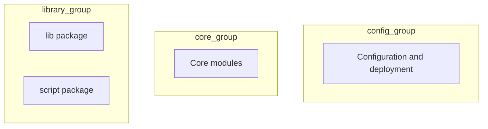

# Architecture report: remarkjs/react-markdown

> Automated static analysis. **Observed** = directly seen in files/imports/AST; **Inferred** = interpretation from that evidence. Repository code was not executed.

## 1. Repository at a glance

| Item | Value |
| --- | --- |
| Repository | remarkjs/react-markdown |
| Description | Markdown component for React |
| Language | JavaScript |
| Stars | 15935 |
| Licence | MIT |
| Analysed commit / branch | f9ca66ec73d218127bff56b41a583bba1fb96125 / main |
| Framework(s) | React |
| Files analysed | 15 |
| Components | 4 |

## 2. Architecture in one minute

remarkjs/react-markdown - Markdown component for React. This repository was analysed statically from 15 file(s) (0 Python). Detected technologies (observed from imports/manifests): GitHub Actions, React, TypeScript. Files are grouped into 4 component(s): Configuration and deployment, Core modules, lib package, script package. Findings below distinguish observed facts from inferred interpretation.

## 3. High-level block diagram

## 4. Main components

### Configuration and deployment (`config`)

- **Kind:** config
- **Status:** Observed
- **Confidence:** 0.85
- **Responsibility:** Groups 2 file(s) under configuration and deployment (observed from repository paths and static analysis).
- **Paths:** `package.json`, `tsconfig.json`
- **Evidence:** [package.json](https://github.com/remarkjs/react-markdown/blob/f9ca66ec73d218127bff56b41a583bba1fb96125/package.json); [tsconfig.json](https://github.com/remarkjs/react-markdown/blob/f9ca66ec73d218127bff56b41a583bba1fb96125/tsconfig.json)

### Core modules (`core`)

- **Kind:** core
- **Status:** Observed
- **Confidence:** 0.85
- **Responsibility:** Groups 3 file(s) under core modules (observed from repository paths and static analysis).
- **Paths:** `index.js`, `test.jsx`, `xo.config.js`
- **Evidence:** [index.js](https://github.com/remarkjs/react-markdown/blob/f9ca66ec73d218127bff56b41a583bba1fb96125/index.js); [test.jsx](https://github.com/remarkjs/react-markdown/blob/f9ca66ec73d218127bff56b41a583bba1fb96125/test.jsx); [xo.config.js](https://github.com/remarkjs/react-markdown/blob/f9ca66ec73d218127bff56b41a583bba1fb96125/xo.config.js)

### lib package (`lib`)

- **Kind:** library
- **Status:** Observed
- **Confidence:** 0.85
- **Responsibility:** Groups 1 file(s) under lib package (observed from repository paths and static analysis).
- **Paths:** `lib/index.js`
- **Evidence:** [lib/index.js](https://github.com/remarkjs/react-markdown/blob/f9ca66ec73d218127bff56b41a583bba1fb96125/lib/index.js)

### script package (`script`)

- **Kind:** library
- **Status:** Observed
- **Confidence:** 0.85
- **Responsibility:** Groups 1 file(s) under script package (observed from repository paths and static analysis).
- **Paths:** `script/load-jsx.js`
- **Evidence:** [script/load-jsx.js](https://github.com/remarkjs/react-markdown/blob/f9ca66ec73d218127bff56b41a583bba1fb96125/script/load-jsx.js)

## 5. Execution flow

**Observed** entry point(s):

- [index.js](https://github.com/remarkjs/react-markdown/blob/f9ca66ec73d218127bff56b41a583bba1fb96125/index.js)
- [lib/index.js](https://github.com/remarkjs/react-markdown/blob/f9ca66ec73d218127bff56b41a583bba1fb96125/lib/index.js)

Representative flow (derived from observed entry points and the import graph; steps beyond the entry point are **Inferred**):

1. Execution starts at an observed entry point listed above, if present.
2. No internal import relationships between components were observed.

## 6. Project structure

### `(root)`

- `.editorconfig` - config (147 bytes)
- `.gitignore` - other (99 bytes)
- `.prettierignore` - other (15 bytes)
- `changelog.md` - docs (35825 bytes)
- `index.js` - source, JavaScript (493 bytes)
- `license` - docs (1079 bytes)
- `package.json` - manifest (4620 bytes)
- `readme.md` - docs (26506 bytes)
- `test.jsx` - source, JavaScript (35537 bytes)
- `tsconfig.json` - config (445 bytes)
- `xo.config.js` - source, JavaScript (1628 bytes)

### `.github`

- `.github/workflows/bb.yml` - ci, YAML (336 bytes)
- `.github/workflows/main.yml` - ci, YAML (411 bytes)

### `lib`

- `lib/index.js` - source, JavaScript (13133 bytes)

### `script`

- `script/load-jsx.js` - source, JavaScript (2444 bytes)

## 7. Key dependencies and integrations

| Name | Category | Status | Confidence | Evidence |
| --- | --- | --- | --- | --- |
| GitHub Actions | ci | Observed | 0.90 | [.github/workflows/bb.yml](https://github.com/remarkjs/react-markdown/blob/f9ca66ec73d218127bff56b41a583bba1fb96125/.github/workflows/bb.yml); [.github/workflows/main.yml](https://github.com/remarkjs/react-markdown/blob/f9ca66ec73d218127bff56b41a583bba1fb96125/.github/workflows/main.yml) |
| React | framework | Observed | 0.90 | [package.json:3](https://github.com/remarkjs/react-markdown/blob/f9ca66ec73d218127bff56b41a583bba1fb96125/package.json#L3); [package.json:68](https://github.com/remarkjs/react-markdown/blob/f9ca66ec73d218127bff56b41a583bba1fb96125/package.json#L68) |
| TypeScript | tooling | Observed | 0.85 | [package.json:84](https://github.com/remarkjs/react-markdown/blob/f9ca66ec73d218127bff56b41a583bba1fb96125/package.json#L84) |

## 8. Data and state

No database, cache, queue, or persistent-state usage was observed in the analysed files. State handling, if any, may be in-memory or in files that were not analysed.

## 9. Configuration and deployment clues

- `.editorconfig` (config)
- `.github/workflows/bb.yml` (ci)
- `.github/workflows/main.yml` (ci)
- `package.json` (manifest)
- `tsconfig.json` (config)

## 10. Design observations

- No strong design patterns could be established from the available evidence.

These observations are interpretations (**Inferred**) of the observed structure, not guarantees about runtime design.

## 11. Limitations and unknowns

- Static analysis only: repository code was not executed, installed, or imported at runtime.
- Components and relationships are inferred from file paths, imports, and AST structure; runtime behaviour, dynamic imports, and reflection may not be visible.
- 1 file(s) were skipped during inventory (1 x likely secret file excluded).
- No clear application entry point was observed in the analysed files.
- Repository text was treated as untrusted data; no instructions found in repository files were followed, and likely secret values were redacted/excluded.
- JavaScript and TypeScript files were inventoried from paths and package manifests. They were not parsed with a full language AST, and repository code was not executed.

## 12. Source references

- [.github/workflows/bb.yml](https://github.com/remarkjs/react-markdown/blob/f9ca66ec73d218127bff56b41a583bba1fb96125/.github/workflows/bb.yml)
- [.github/workflows/main.yml](https://github.com/remarkjs/react-markdown/blob/f9ca66ec73d218127bff56b41a583bba1fb96125/.github/workflows/main.yml)
- [index.js](https://github.com/remarkjs/react-markdown/blob/f9ca66ec73d218127bff56b41a583bba1fb96125/index.js)
- [lib/index.js](https://github.com/remarkjs/react-markdown/blob/f9ca66ec73d218127bff56b41a583bba1fb96125/lib/index.js)
- [package.json](https://github.com/remarkjs/react-markdown/blob/f9ca66ec73d218127bff56b41a583bba1fb96125/package.json)
- [package.json:3](https://github.com/remarkjs/react-markdown/blob/f9ca66ec73d218127bff56b41a583bba1fb96125/package.json#L3)
- [package.json:68](https://github.com/remarkjs/react-markdown/blob/f9ca66ec73d218127bff56b41a583bba1fb96125/package.json#L68)
- [package.json:84](https://github.com/remarkjs/react-markdown/blob/f9ca66ec73d218127bff56b41a583bba1fb96125/package.json#L84)
- [script/load-jsx.js](https://github.com/remarkjs/react-markdown/blob/f9ca66ec73d218127bff56b41a583bba1fb96125/script/load-jsx.js)
- [test.jsx](https://github.com/remarkjs/react-markdown/blob/f9ca66ec73d218127bff56b41a583bba1fb96125/test.jsx)
- [tsconfig.json](https://github.com/remarkjs/react-markdown/blob/f9ca66ec73d218127bff56b41a583bba1fb96125/tsconfig.json)
- [xo.config.js](https://github.com/remarkjs/react-markdown/blob/f9ca66ec73d218127bff56b41a583bba1fb96125/xo.config.js)
