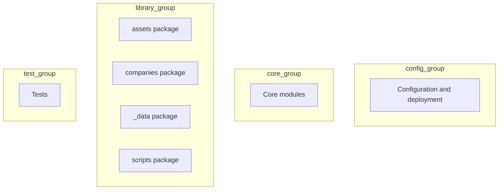

# Architecture report: remoteintech/remote-jobs

> Automated static analysis. **Observed** = directly seen in files/imports/AST; **Inferred** = interpretation from that evidence. Repository code was not executed.

## 1. Repository at a glance

| Item | Value |
| --- | --- |
| Repository | remoteintech/remote-jobs |
| Description | Source for remoteintech.company — a community-maintained directory of remote-friendly tech companies |
| Language | JavaScript |
| Stars | 41155 |
| Licence | Other |
| Analysed commit / branch | 155939ad935d22afa8edbaaf0770b99f9d0dbf0d / main |
| Framework(s) | None detected |
| Files analysed | 800 |
| Components | 7 |

## 2. Architecture in one minute

remoteintech/remote-jobs - Source for remoteintech.company — a community-maintained directory of remote-friendly tech companies. This repository was analysed statically from 800 file(s) (0 Python). Detected technologies (observed from imports/manifests): GitHub Actions, Tailwind CSS. Files are grouped into 7 component(s): assets package, companies package, Configuration and deployment, Core modules, _data package, scripts package, Tests. Findings below distinguish observed facts from inferred interpretation.

## 3. High-level block diagram

## 4. Main components

### assets package (`assets`)

- **Kind:** library
- **Status:** Observed
- **Confidence:** 0.85
- **Responsibility:** Groups 8 file(s) under assets package (observed from repository paths and static analysis).
- **Paths:** `src/assets/scripts/bundle/details.js`, `src/assets/scripts/bundle/dialog.js`, `src/assets/scripts/bundle/is-land.js`, `src/assets/scripts/bundle/nav-drawer.js`, `src/assets/scripts/bundle/nav-sub.js`, `src/assets/scripts/bundle/theme-toggle.js`, `src/assets/scripts/components/custom-masonry.js`, `src/assets/scripts/outbound-tracking.js`
- **Evidence:** [src/assets/scripts/bundle/details.js](https://github.com/remoteintech/remote-jobs/blob/155939ad935d22afa8edbaaf0770b99f9d0dbf0d/src/assets/scripts/bundle/details.js); [src/assets/scripts/bundle/dialog.js](https://github.com/remoteintech/remote-jobs/blob/155939ad935d22afa8edbaaf0770b99f9d0dbf0d/src/assets/scripts/bundle/dialog.js); [src/assets/scripts/bundle/is-land.js](https://github.com/remoteintech/remote-jobs/blob/155939ad935d22afa8edbaaf0770b99f9d0dbf0d/src/assets/scripts/bundle/is-land.js); [src/assets/scripts/bundle/nav-drawer.js](https://github.com/remoteintech/remote-jobs/blob/155939ad935d22afa8edbaaf0770b99f9d0dbf0d/src/assets/scripts/bundle/nav-drawer.js); [src/assets/scripts/bundle/nav-sub.js](https://github.com/remoteintech/remote-jobs/blob/155939ad935d22afa8edbaaf0770b99f9d0dbf0d/src/assets/scripts/bundle/nav-sub.js); [src/assets/scripts/bundle/theme-toggle.js](https://github.com/remoteintech/remote-jobs/blob/155939ad935d22afa8edbaaf0770b99f9d0dbf0d/src/assets/scripts/bundle/theme-toggle.js); [src/assets/scripts/components/custom-masonry.js](https://github.com/remoteintech/remote-jobs/blob/155939ad935d22afa8edbaaf0770b99f9d0dbf0d/src/assets/scripts/components/custom-masonry.js); [src/assets/scripts/outbound-tracking.js](https://github.com/remoteintech/remote-jobs/blob/155939ad935d22afa8edbaaf0770b99f9d0dbf0d/src/assets/scripts/outbound-tracking.js)

### companies package (`companies`)

- **Kind:** library
- **Status:** Observed
- **Confidence:** 0.85
- **Responsibility:** Groups 1 file(s) under companies package (observed from repository paths and static analysis).
- **Paths:** `src/companies/companies.11tydata.js`
- **Evidence:** [src/companies/companies.11tydata.js](https://github.com/remoteintech/remote-jobs/blob/155939ad935d22afa8edbaaf0770b99f9d0dbf0d/src/companies/companies.11tydata.js)

### Configuration and deployment (`config`)

- **Kind:** config
- **Status:** Observed
- **Confidence:** 0.85
- **Responsibility:** Groups 39 file(s) under configuration and deployment (observed from repository paths and static analysis).
- **Paths:** `package.json`, `src/_config/collections.js`, `src/_config/events.js`, `src/_config/events/build-css.js`, `src/_config/events/build-js.js`, `src/_config/events/svg-to-jpeg.js`, `src/_config/filters.js`, `src/_config/filters/dates.js`, `src/_config/filters/fileExists.js`, `src/_config/filters/markdown-format.js`, `src/_config/filters/slugify.js`, `src/_config/filters/sort-alphabetic.js`, `src/_config/filters/sort-random.js`, `src/_config/filters/split.js`, `src/_config/filters/splitlines.js`, `src/_config/filters/striptags.js`, `src/_config/plugins.js`, `src/_config/plugins/drafts.js`, `src/_config/plugins/html-config.js`, `src/_config/plugins/markdown.js`, `src/_config/setup/create-colors.js`, `src/_config/setup/generate-favicons.js`, `src/_config/shortcodes.js`, `src/_config/shortcodes/image.js`, `src/_config/shortcodes/svg.js`, `src/_config/utils/clamp-generator.js`, `src/_config/utils/tokens-to-tailwind.js`, `src/_data/changelog.json`, `src/_data/designTokens/borderRadius.json`, `src/_data/designTokens/colors.json`, `src/_data/designTokens/colorsBase.json`, `src/_data/designTokens/fonts.json`, `src/_data/designTokens/spacing.json`, `src/_data/designTokens/textLeading.json`, `src/_data/designTokens/textSizes.json`, `src/_data/designTokens/textWeights.json`, `src/_data/designTokens/viewports.json`, `src/blog/blog.json`, `src/companies/companies.json`
- **Evidence:** [package.json](https://github.com/remoteintech/remote-jobs/blob/155939ad935d22afa8edbaaf0770b99f9d0dbf0d/package.json); [src/_config/collections.js](https://github.com/remoteintech/remote-jobs/blob/155939ad935d22afa8edbaaf0770b99f9d0dbf0d/src/_config/collections.js); [src/_config/events.js](https://github.com/remoteintech/remote-jobs/blob/155939ad935d22afa8edbaaf0770b99f9d0dbf0d/src/_config/events.js); [src/_config/events/build-css.js](https://github.com/remoteintech/remote-jobs/blob/155939ad935d22afa8edbaaf0770b99f9d0dbf0d/src/_config/events/build-css.js); [src/_config/events/build-js.js](https://github.com/remoteintech/remote-jobs/blob/155939ad935d22afa8edbaaf0770b99f9d0dbf0d/src/_config/events/build-js.js); [src/_config/events/svg-to-jpeg.js](https://github.com/remoteintech/remote-jobs/blob/155939ad935d22afa8edbaaf0770b99f9d0dbf0d/src/_config/events/svg-to-jpeg.js); [src/_config/filters.js](https://github.com/remoteintech/remote-jobs/blob/155939ad935d22afa8edbaaf0770b99f9d0dbf0d/src/_config/filters.js); [src/_config/filters/dates.js](https://github.com/remoteintech/remote-jobs/blob/155939ad935d22afa8edbaaf0770b99f9d0dbf0d/src/_config/filters/dates.js)

### Core modules (`core`)

- **Kind:** core
- **Status:** Observed
- **Confidence:** 0.85
- **Responsibility:** Groups 1 file(s) under core modules (observed from repository paths and static analysis).
- **Paths:** `eleventy.config.js`
- **Evidence:** [eleventy.config.js](https://github.com/remoteintech/remote-jobs/blob/155939ad935d22afa8edbaaf0770b99f9d0dbf0d/eleventy.config.js)

### _data package (`data`)

- **Kind:** library
- **Status:** Observed
- **Confidence:** 0.85
- **Responsibility:** Groups 6 file(s) under _data package (observed from repository paths and static analysis).
- **Paths:** `src/_data/companyHelpers.js`, `src/_data/helpers.js`, `src/_data/labels.js`, `src/_data/meta.js`, `src/_data/navigation.js`, `src/_data/personal.js`
- **Evidence:** [src/_data/companyHelpers.js](https://github.com/remoteintech/remote-jobs/blob/155939ad935d22afa8edbaaf0770b99f9d0dbf0d/src/_data/companyHelpers.js); [src/_data/helpers.js](https://github.com/remoteintech/remote-jobs/blob/155939ad935d22afa8edbaaf0770b99f9d0dbf0d/src/_data/helpers.js); [src/_data/labels.js](https://github.com/remoteintech/remote-jobs/blob/155939ad935d22afa8edbaaf0770b99f9d0dbf0d/src/_data/labels.js); [src/_data/meta.js](https://github.com/remoteintech/remote-jobs/blob/155939ad935d22afa8edbaaf0770b99f9d0dbf0d/src/_data/meta.js); [src/_data/navigation.js](https://github.com/remoteintech/remote-jobs/blob/155939ad935d22afa8edbaaf0770b99f9d0dbf0d/src/_data/navigation.js); [src/_data/personal.js](https://github.com/remoteintech/remote-jobs/blob/155939ad935d22afa8edbaaf0770b99f9d0dbf0d/src/_data/personal.js)

### scripts package (`scripts`)

- **Kind:** library
- **Status:** Observed
- **Confidence:** 0.85
- **Responsibility:** Groups 2 file(s) under scripts package (observed from repository paths and static analysis).
- **Paths:** `scripts/check-links.sh`, `scripts/fix-links.mjs`
- **Evidence:** [scripts/check-links.sh](https://github.com/remoteintech/remote-jobs/blob/155939ad935d22afa8edbaaf0770b99f9d0dbf0d/scripts/check-links.sh); [scripts/fix-links.mjs](https://github.com/remoteintech/remote-jobs/blob/155939ad935d22afa8edbaaf0770b99f9d0dbf0d/scripts/fix-links.mjs)

### Tests (`tests`)

- **Kind:** test
- **Status:** Observed
- **Confidence:** 0.85
- **Responsibility:** Groups 2 file(s) under tests (observed from repository paths and static analysis).
- **Paths:** `src/assets/css/global/tests/debug.css`, `src/assets/css/global/tests/is-land.css`
- **Evidence:** [src/assets/css/global/tests/debug.css](https://github.com/remoteintech/remote-jobs/blob/155939ad935d22afa8edbaaf0770b99f9d0dbf0d/src/assets/css/global/tests/debug.css); [src/assets/css/global/tests/is-land.css](https://github.com/remoteintech/remote-jobs/blob/155939ad935d22afa8edbaaf0770b99f9d0dbf0d/src/assets/css/global/tests/is-land.css)

## 5. Execution flow

No entry point was observed; the startup flow below is therefore limited.

Representative flow (derived from observed entry points and the import graph; steps beyond the entry point are **Inferred**):

1. Execution starts at an observed entry point listed above, if present.
2. No internal import relationships between components were observed.

## 6. Project structure

### `(root)`

- `.eleventyignore` - other (506 bytes)
- `.env-sample` - other (25 bytes)
- `.gitignore` - other (911 bytes)
- `.nojekyll` - other (0 bytes)
- `.nvmrc` - other (3 bytes)
- `.prettierignore` - other (89 bytes)
- `.prettierrc` - other (343 bytes)
- `CLAUDE.md` - docs (9506 bytes)
- `CONTRIBUTING.md` - docs (3604 bytes)
- `LICENSE` - docs (2332 bytes)
- `README.md` - docs (980 bytes)
- `SECURITY.md` - docs (167 bytes)
- `eleventy.config.js` - source, JavaScript (4866 bytes)
- `package.json` - manifest (2413 bytes)

### `.github`

- `.github/CODE_OF_CONDUCT.md` - docs (5603 bytes)
- `.github/CONTRIBUTING.md` - docs (7205 bytes)
- `.github/FUNDING.yml` - config (66 bytes)
- `.github/ISSUE_TEMPLATE/bug_report.md` - docs (840 bytes)
- `.github/ISSUE_TEMPLATE/config.yml` - config (398 bytes)
- `.github/ISSUE_TEMPLATE/new_company.md` - docs (1548 bytes)
- `.github/PULL_REQUEST_TEMPLATE.MD` - docs (1868 bytes)
- `.github/dependabot.yml` - config (683 bytes)
- `.github/scripts/validate-companies.js` - source, JavaScript (7070 bytes)
- `.github/workflows/ci.yml` - ci, YAML (684 bytes)
- `.github/workflows/codeql-analysis.yml` - ci, YAML (1281 bytes)
- `.github/workflows/validate-companies.yml` - ci, YAML (9245 bytes)

### `scripts`

- `scripts/README.md` - docs (3638 bytes)
- `scripts/check-links.sh` - source, Shell (8054 bytes)
- `scripts/fix-links.mjs` - source, JavaScript (24450 bytes)

### `src`

- `src/_config/collections.js` - source, JavaScript (5687 bytes)
- `src/_config/events.js` - source, JavaScript (213 bytes)
- `src/_config/events/build-css.js` - source, JavaScript (1496 bytes)
- `src/_config/events/build-js.js` - source, JavaScript (1467 bytes)
- `src/_config/events/svg-to-jpeg.js` - source, JavaScript (1081 bytes)
- `src/_config/filters.js` - source, JavaScript (590 bytes)
- `src/_config/filters/dates.js` - source, JavaScript (323 bytes)
- `src/_config/filters/fileExists.js` - source, JavaScript (202 bytes)
- `src/_config/filters/markdown-format.js` - source, JavaScript (252 bytes)
- `src/_config/filters/slugify.js` - source, JavaScript (223 bytes)
- `src/_config/filters/sort-alphabetic.js` - source, JavaScript (195 bytes)
- `src/_config/filters/sort-random.js` - source, JavaScript (258 bytes)
- `src/_config/filters/split.js` - source, JavaScript (346 bytes)
- `src/_config/filters/splitlines.js` - source, JavaScript (414 bytes)
- `src/_config/filters/striptags.js` - source, JavaScript (242 bytes)
- `src/_config/plugins.js` - source, JavaScript (621 bytes)
- `src/_config/plugins/drafts.js` - source, JavaScript (990 bytes)
- `src/_config/plugins/html-config.js` - source, JavaScript (540 bytes)
- `src/_config/plugins/markdown.js` - source, JavaScript (2060 bytes)
- `src/_config/setup/create-colors.js` - source, JavaScript (3263 bytes)
- `src/_config/setup/generate-favicons.js` - source, JavaScript (1156 bytes)
- `src/_config/shortcodes.js` - source, JavaScript (152 bytes)
- `src/_config/shortcodes/image.js` - source, JavaScript (2122 bytes)
- `src/_config/shortcodes/svg.js` - source, JavaScript (917 bytes)
- `src/_config/utils/clamp-generator.js` - source, JavaScript (1230 bytes)
- `src/_config/utils/tokens-to-tailwind.js` - source, JavaScript (500 bytes)
- `src/_data/changelog.json` - config (35334 bytes)
- `src/_data/companyHelpers.js` - source, JavaScript (1105 bytes)
- `src/_data/designTokens/borderRadius.json` - config (207 bytes)
- `src/_data/designTokens/colors.json` - config (1511 bytes)
- `src/_data/designTokens/colorsBase.json` - config (793 bytes)
- `src/_data/designTokens/fonts.json` - config (1178 bytes)
- `src/_data/designTokens/spacing.json` - config (1547 bytes)
- `src/_data/designTokens/textLeading.json` - config (265 bytes)
- `src/_data/designTokens/textSizes.json` - config (1063 bytes)
- `src/_data/designTokens/textWeights.json` - config (313 bytes)
- `src/_data/designTokens/viewports.json` - config (200 bytes)
- `src/_data/helpers.js` - source, JavaScript (1390 bytes)
- `src/_data/labels.js` - source, JavaScript (1678 bytes)
- `src/_data/meta.js` - source, JavaScript (3167 bytes)
- `src/_data/navigation.js` - source, JavaScript (526 bytes)
- `src/_data/personal.js` - source, JavaScript (86 bytes)
- `src/_includes/head/css-inline.njk` - other (509 bytes)
- `src/_includes/head/js-defer.njk` - other (75 bytes)
- `src/_includes/head/js-inline.njk` - other (187 bytes)
- `src/_includes/head/meta-info.njk` - other (3885 bytes)
- `src/_includes/head/preloads.njk` - other (644 bytes)
- `src/_includes/head/schema.njk` - other (155 bytes)
- `src/_includes/partials/carbon-ad.njk` - other (980 bytes)
- `src/_includes/partials/card-tag.njk` - other (480 bytes)
- `src/_includes/partials/company-card.njk` - other (1077 bytes)
- `src/_includes/partials/date.njk` - other (105 bytes)
- `src/_includes/partials/details.njk` - other (657 bytes)
- `src/_includes/partials/edit-on.njk` - other (273 bytes)
- `src/_includes/partials/footer.njk` - other (1869 bytes)
- `src/_includes/partials/header.njk` - other (492 bytes)
- `src/_includes/partials/main-nav.njk` - other (2573 bytes)
- `src/_includes/partials/nav-search.njk` - other (5112 bytes)
- `src/_includes/partials/pagination.njk` - other (1372 bytes)
- `src/_includes/partials/theme-switch.njk` - other (666 bytes)
- `src/_includes/schemas/BlogPosting.njk` - other (847 bytes)
- `src/_includes/schemas/BreadcrumbList.njk` - other (1363 bytes)
- `src/_includes/schemas/Organization.njk` - other (237 bytes)
- `src/_includes/schemas/WebSite.njk` - other (649 bytes)
- `src/_includes/webc/custom-card.webc` - other (273 bytes)
- `src/_includes/webc/custom-masonry.webc` - other (313 bytes)
- `src/_layouts/base.njk` - other (2138 bytes)
- `src/_layouts/company.njk` - other (4361 bytes)
- `src/_layouts/page.njk` - other (185 bytes)
- `src/_layouts/post.njk` - other (1525 bytes)
- `src/_layouts/tags.njk` - other (179 bytes)
- `src/assets/css/global/base/fonts.css` - other (893 bytes)
- `src/assets/css/global/base/global-styles.css` - other (2394 bytes)
- `src/assets/css/global/base/reset.css` - other (2036 bytes)
- `src/assets/css/global/base/variables.css` - other (2297 bytes)
- `src/assets/css/global/blocks/button.css` - other (3683 bytes)
- `src/assets/css/global/blocks/carbon-ad.css` - other (1402 bytes)
- `src/assets/css/global/blocks/code.css` - other (3656 bytes)
- `src/assets/css/global/blocks/company-card.css` - other (1782 bytes)
- `src/assets/css/global/blocks/external-link.css` - other (879 bytes)
- `src/assets/css/global/blocks/main-nav.css` - other (7620 bytes)
- `src/assets/css/global/blocks/prose.css` - other (1756 bytes)
- `src/assets/css/global/blocks/section.css` - other (398 bytes)
- `src/assets/css/global/blocks/seperator.css` - other (173 bytes)
- `src/assets/css/global/blocks/site-footer.css` - other (397 bytes)
- `src/assets/css/global/blocks/site-logo.css` - other (126 bytes)
- `src/assets/css/global/blocks/skip-link.css` - other (659 bytes)
- `src/assets/css/global/blocks/textgradient.css` - other (327 bytes)
- `src/assets/css/global/blocks/theme-switch.css` - other (429 bytes)
- `src/assets/css/global/compositions/cluster.css` - other (792 bytes)
- `src/assets/css/global/compositions/flow.css` - other (228 bytes)
- `src/assets/css/global/compositions/grid.css` - other (1102 bytes)
- `src/assets/css/global/compositions/repel.css` - other (576 bytes)
- `src/assets/css/global/compositions/sidebar.css` - other (1353 bytes)
- `src/assets/css/global/compositions/wrapper.css` - other (759 bytes)
- `src/assets/css/global/global.css` - other (554 bytes)
- `src/assets/css/global/tests/debug.css` - test (2469 bytes)
- `src/assets/css/global/tests/is-land.css` - test (340 bytes)
- `src/assets/css/global/utilities/grayscale.css` - other (42 bytes)
- `src/assets/css/global/utilities/heading-line.css` - other (291 bytes)
- `src/assets/css/global/utilities/ontop.css` - other (104 bytes)
- `src/assets/css/global/utilities/region.css` - other (411 bytes)
- `src/assets/css/global/utilities/spin.css` - other (218 bytes)
- `src/assets/css/global/utilities/visually-hidden.css` - other (259 bytes)
- `src/assets/css/local/custom-card.css` - other (2014 bytes)
- `src/assets/css/local/details.css` - other (1825 bytes)
- `src/assets/css/local/footnotes.css` - other (495 bytes)
- `src/assets/css/local/forms.css` - other (1274 bytes)
- `src/assets/css/local/gallery.css` - other (906 bytes)
- `src/assets/css/local/nav-main-drawer-cls.css` - other (107 bytes)
- `src/assets/css/local/pagination.css` - other (935 bytes)
- `src/assets/css/local/post.css` - other (817 bytes)
- `src/assets/css/local/styleguide.css` - other (1474 bytes)
- `src/assets/css/local/table.css` - other (1263 bytes)
- `src/assets/images/favicon/favicon.svg` - other (624 bytes)
- `src/assets/images/template/external.svg` - other (343 bytes)
- `src/assets/scripts/bundle/details.js` - source, JavaScript (785 bytes)
- `src/assets/scripts/bundle/dialog.js` - source, JavaScript (2315 bytes)
- `src/assets/scripts/bundle/is-land.js` - source, JavaScript (32 bytes)
- `src/assets/scripts/bundle/nav-drawer.js` - source, JavaScript (1224 bytes)
- `src/assets/scripts/bundle/nav-sub.js` - source, JavaScript (1578 bytes)
- `src/assets/scripts/bundle/theme-toggle.js` - source, JavaScript (2105 bytes)
- `src/assets/scripts/components/custom-masonry.js` - source, JavaScript (1346 bytes)
- `src/assets/scripts/outbound-tracking.js` - source, JavaScript (598 bytes)
- `src/assets/svg/divider/edgy.svg` - other (593 bytes)
- `src/assets/svg/divider/pixels.svg` - other (1573 bytes)
- `src/assets/svg/divider/soft-bottom.svg` - other (255 bytes)
- `src/assets/svg/divider/soft-top.svg` - other (255 bytes)
- `src/assets/svg/divider/waves.svg` - other (859 bytes)
- `src/assets/svg/misc/11ty.svg` - other (3264 bytes)
- `src/assets/svg/misc/arrow-left.svg` - other (235 bytes)
- `src/assets/svg/misc/arrow-right.svg` - other (234 bytes)
- `src/assets/svg/misc/chev-down.svg` - other (201 bytes)
- `src/assets/svg/misc/heart.svg` - other (352 bytes)
- `src/assets/svg/misc/logo.svg` - other (624 bytes)
- `src/assets/svg/misc/rss.svg` - other (317 bytes)
- `src/assets/svg/misc/search.svg` - other (245 bytes)
- `src/assets/svg/misc/star.svg` - other (470 bytes)
- `src/assets/svg/platform/bluesky.svg` - other (742 bytes)
- `src/assets/svg/platform/github.svg` - other (517 bytes)
- `src/assets/svg/platform/gitlab.svg` - other (497 bytes)
- `src/assets/svg/platform/instagram.svg` - other (383 bytes)
- `src/assets/svg/platform/kofi.svg` - other (825 bytes)
- `src/assets/svg/platform/linkedin.svg` - other (382 bytes)
- `src/assets/svg/platform/mastodon.svg` - other (1638 bytes)
- `src/assets/svg/platform/peertube.svg` - other (236 bytes)
- `src/assets/svg/platform/youtube.svg` - other (436 bytes)
- `src/blog/2017-10-03-announcing-remote-in-tech-company.md` - docs (1580 bytes)
- `src/blog/2017-10-09-so-is-this-just-another-job-board.md` - docs (670 bytes)
- `src/blog/2017-12-06-popular-company-profiles-and-the-github-traffic-charts.md` - docs (2811 bytes)
- `src/blog/2017-12-28-highest-view-count.md` - docs (1466 bytes)
- `src/blog/2018-01-01-new-year-new-job.md` - docs (429 bytes)
- `src/blog/2018-01-06-advice-from-a-constant-job-seeker.md` - docs (494 bytes)
- `src/blog/2018-09-19-website-updates.md` - docs (6970 bytes)
- `src/blog/2018-09-25-hacktoberfest-is-back.md` - docs (393 bytes)
- `src/blog/2026-01-13-the-big-redesign.md` - docs (3150 bytes)
- `src/blog/2026-01-17-seo-improvements.md` - docs (4169 bytes)
- `src/blog/2026-02-15-keeping-things-tidy.md` - docs (3582 bytes)
- `src/blog/2026-05-07-anatomy-of-a-traffic-spike.md` - docs (7891 bytes)
- `src/blog/blog.json` - config (88 bytes)
- `src/common/404.njk` - other (3865 bytes)
- `src/common/_redirects.njk` - other (1831 bytes)
- `src/common/carbon.njk` - other (727 bytes)
- `src/common/feed-atom.njk` - other (1135 bytes)
- `src/common/feed-json.njk` - other (1023 bytes)
- `src/common/humans.njk` - other (314 bytes)
- `src/common/og-images.njk` - other (2773 bytes)
- `src/common/robots.njk` - other (2907 bytes)
- `src/common/site-manifest.njk` - other (695 bytes)
- `src/common/sitemap.njk` - other (731 bytes)
- `src/common/tagList.njk` - other (816 bytes)
- `src/common/tags.njk` - other (457 bytes)
- `src/companies/10up.md` - docs (2209 bytes)
- `src/companies/15five.md` - docs (1187 bytes)
- `src/companies/1password.md` - docs (1070 bytes)
- `src/companies/37signals.md` - docs (906 bytes)
- `src/companies/3blocks.md` - docs (1228 bytes)
- `src/companies/42-technologies.md` - docs (842 bytes)
- `src/companies/90-seconds.md` - docs (1214 bytes)
- `src/companies/a-1-auto-transport.md` - docs (3561 bytes)
- `src/companies/abiturma.md` - docs (1430 bytes)
- `src/companies/ably.md` - docs (2744 bytes)
- `src/companies/abstract.md` - docs (1028 bytes)
- `src/companies/acquia.md` - docs (1680 bytes)
- `src/companies/activecampaign.md` - docs (666 bytes)
- `src/companies/ad-hoc.md` - docs (1011 bytes)
- `src/companies/adaface.md` - docs (984 bytes)
- `src/companies/addstructure.md` - docs (668 bytes)
- `src/companies/adeva.md` - docs (2202 bytes)
- `src/companies/adzuna.md` - docs (1387 bytes)
- `src/companies/aerolab.md` - docs (811 bytes)
- `src/companies/aerostrat.md` - docs (1165 bytes)
- `src/companies/aestudio.md` - docs (1172 bytes)
- `src/companies/aha.md` - docs (1263 bytes)
- `src/companies/aiir.md` - docs (1156 bytes)
- `src/companies/aim-india.md` - docs (1551 bytes)
- `src/companies/airbyte.md` - docs (1357 bytes)
- `src/companies/airgarage.md` - docs (1544 bytes)
- `src/companies/airtreks.md` - docs (867 bytes)
- `src/companies/aivitex.md` - docs (1076 bytes)
- `src/companies/akamai.md` - docs (2462 bytes)
- `src/companies/akka.md` - docs (1303 bytes)
- `src/companies/alami.md` - docs (957 bytes)
- `src/companies/alan.md` - docs (2337 bytes)
- `src/companies/algorand.md` - docs (751 bytes)
- `src/companies/alice.md` - docs (3770 bytes)
- `src/companies/alight-solutions.md` - docs (1118 bytes)
- `src/companies/alley.md` - docs (2409 bytes)
- `src/companies/allydvm.md` - docs (2052 bytes)
- `src/companies/alphasights.md` - docs (2465 bytes)
- `src/companies/amazon.md` - docs (2000 bytes)
- `src/companies/ambaum.md` - docs (1021 bytes)
- `src/companies/andela.md` - docs (604 bytes)
- `src/companies/animalz.md` - docs (579 bytes)
- `src/companies/annertech.md` - docs (917 bytes)
- `src/companies/anomali.md` - docs (1594 bytes)
- `src/companies/apartment-therapy.md` - docs (1933 bytes)
- `src/companies/appcues.md` - docs (1252 bytes)
- `src/companies/appen.md` - docs (3629 bytes)
- `src/companies/appinio.md` - docs (845 bytes)
- `src/companies/applaudo.md` - docs (2082 bytes)
- `src/companies/applied-ai-company-aaico.md` - docs (1219 bytes)
- `src/companies/appstractor.md` - docs (797 bytes)
- `src/companies/appwrite.md` - docs (1201 bytes)
- `src/companies/argyle.md` - docs (2080 bytes)
- `src/companies/arkency.md` - docs (611 bytes)
- `src/companies/art-and-logic.md` - docs (3967 bytes)
- `src/companies/artefactual.md` - docs (1846 bytes)
- `src/companies/articulate.md` - docs (1033 bytes)
- `src/companies/asana.md` - docs (1368 bytes)
- `src/companies/astronomer.md` - docs (2095 bytes)
- `src/companies/atento.md` - docs (1119 bytes)
- `src/companies/atlassian.md` - docs (1340 bytes)
- `src/companies/atozdebug.md` - docs (1573 bytes)
- `src/companies/audiense.md` - docs (1163 bytes)
- `src/companies/aula.md` - docs (2044 bytes)
- `src/companies/auth0.md` - docs (1417 bytes)
- `src/companies/automattic.md` - docs (2522 bytes)
- `src/companies/axelerant.md` - docs (1267 bytes)
- `src/companies/axios.md` - docs (1213 bytes)
- `src/companies/bairesdev.md` - docs (2060 bytes)
- `src/companies/balena.md` - docs (2024 bytes)
- `src/companies/balsamiq.md` - docs (1178 bytes)
- `src/companies/bandcamp.md` - docs (1589 bytes)
- `src/companies/bandlab.md` - docs (1307 bytes)
- `src/companies/bandzoogle.md` - docs (1568 bytes)
- `src/companies/baremetrics.md` - docs (1165 bytes)
- `src/companies/basecamp.md` - docs (1143 bytes)
- `src/companies/bear-group.md` - docs (1115 bytes)
- `src/companies/bebanjo.md` - docs (1183 bytes)
- `src/companies/beenverified.md` - docs (1489 bytes)
- `src/companies/best-practical-solutions.md` - docs (814 bytes)
- `src/companies/betable.md` - docs (809 bytes)
- `src/companies/betapeak.md` - docs (1035 bytes)
- `src/companies/betterup.md` - docs (2161 bytes)
- `src/companies/beyond-company.md` - docs (1350 bytes)
- `src/companies/beyondpricing.md` - docs (1473 bytes)
- `src/companies/bharatpe.md` - docs (2245 bytes)
- `src/companies/big-cartel.md` - docs (934 bytes)
- `src/companies/bigdata-boutique.md` - docs (1521 bytes)
- `src/companies/bill.md` - docs (911 bytes)
- `src/companies/bilstein-group.md` - docs (1722 bytes)
- `src/companies/bit-zesty.md` - docs (912 bytes)
- `src/companies/bitnami.md` - docs (2370 bytes)
- `src/companies/bitovi.md` - docs (862 bytes)
- `src/companies/bitwarden.md` - docs (1366 bytes)
- `src/companies/bizink.md` - docs (702 bytes)
- `src/companies/blameless.md` - docs (1388 bytes)
- `src/companies/bloc.md` - docs (1457 bytes)
- `src/companies/bluecat-networks.md` - docs (1092 bytes)
- `src/companies/bluespark.md` - docs (952 bytes)
- `src/companies/boldare.md` - docs (1372 bytes)
- `src/companies/bonsai.md` - docs (919 bytes)
- `src/companies/bounteous.md` - docs (1033 bytes)
- `src/companies/brainstorm-force.md` - docs (804 bytes)
- `src/companies/brave.md` - docs (1743 bytes)
- `src/companies/bright-funds.md` - docs (1331 bytes)
- `src/companies/brikl.md` - docs (1148 bytes)
- `src/companies/britecore.md` - docs (1702 bytes)
- `src/companies/broadwing.md` - docs (2725 bytes)
- `src/companies/buffer.md` - docs (1133 bytes)
- `src/companies/bugfender.md` - docs (1239 bytes)
- `src/companies/buysellads.md` - docs (938 bytes)
- `src/companies/cabify.md` - docs (1419 bytes)
- `src/companies/cal-com.md` - docs (1246 bytes)
- `src/companies/calamari.md` - docs (1452 bytes)
- `src/companies/calendly.md` - docs (2436 bytes)
- `src/companies/calibre.md` - docs (2335 bytes)
- `src/companies/cancom.md` - docs (1180 bytes)
- `src/companies/canonical.md` - docs (1793 bytes)
- `src/companies/capchase.md` - docs (1419 bytes)
- `src/companies/capgemini.md` - docs (1740 bytes)
- `src/companies/capital-one.md` - docs (1358 bytes)
- `src/companies/capital-placement.md` - docs (1470 bytes)
- `src/companies/capmo.md` - docs (2452 bytes)
- `src/companies/carbon-black.md` - docs (2897 bytes)
- `src/companies/cards-against-humanity.md` - docs (1098 bytes)
- `src/companies/carecru.md` - docs (1396 bytes)
- `src/companies/caremessage.md` - docs (1361 bytes)
- `src/companies/carmatec.md` - docs (987 bytes)
- `src/companies/cartodb.md` - docs (1912 bytes)
- `src/companies/cartstack.md` - docs (908 bytes)
- `src/companies/casumo.md` - docs (2218 bytes)
- `src/companies/chainguard.md` - docs (1582 bytes)
- `src/companies/chainlink.md` - docs (1056 bytes)
- `src/companies/chargify.md` - docs (1908 bytes)
- `src/companies/charity-water.md` - docs (1722 bytes)
- `src/companies/chatgen.md` - docs (910 bytes)
- `src/companies/checkly.md` - docs (1041 bytes)
- `src/companies/chef.md` - docs (1000 bytes)
- `src/companies/chess.md` - docs (958 bytes)
- `src/companies/chroma.md` - docs (1618 bytes)
- `src/companies/circleci.md` - docs (1351 bytes)
- `src/companies/circonus.md` - docs (1228 bytes)
- `src/companies/civicactions.md` - docs (1765 bytes)
- `src/companies/civo.md` - docs (891 bytes)
- `src/companies/clevertech.md` - docs (1204 bytes)
- `src/companies/clickup.md` - docs (1243 bytes)
- `src/companies/clootrack.md` - docs (1105 bytes)
- `src/companies/close.md` - docs (779 bytes)
- `src/companies/cloudapp.md` - docs (1354 bytes)
- `src/companies/cloudbees.md` - docs (1707 bytes)
- `src/companies/cloudera.md` - docs (1113 bytes)
- `src/companies/cloudlinux.md` - docs (1033 bytes)
- `src/companies/coalition-technologies.md` - docs (1608 bytes)
- `src/companies/code-b-solutions.md` - docs (1630 bytes)
- `src/companies/code-like-a-girl.md` - docs (1585 bytes)
- `src/companies/codea-it.md` - docs (1176 bytes)
- `src/companies/codepen.md` - docs (1250 bytes)
- `src/companies/codesandbox.md` - docs (1167 bytes)
- `src/companies/codingcops.md` - docs (1370 bytes)
- `src/companies/cofense.md` - docs (996 bytes)
- `src/companies/coforma.md` - docs (969 bytes)
- `src/companies/cognizant.md` - docs (1456 bytes)
- `src/companies/coinbase.md` - docs (923 bytes)
- `src/companies/coingape.md` - docs (677 bytes)
- `src/companies/collabora.md` - docs (1156 bytes)
- `src/companies/comet.md` - docs (1829 bytes)
- `src/companies/companies.11tydata.js` - source, JavaScript (1964 bytes)
- `src/companies/companies.json` - config (26 bytes)
- `src/companies/compucorp.md` - docs (1848 bytes)
- `src/companies/connexa.md` - docs (1593 bytes)
- `src/companies/consensys.md` - docs (1669 bytes)
- `src/companies/consumer-financial-protection-bureau.md` - docs (1270 bytes)
- `src/companies/continu.md` - docs (1163 bytes)
- `src/companies/conversio.md` - docs (613 bytes)
- `src/companies/convert.md` - docs (2067 bytes)
- `src/companies/coodesh.md` - docs (1074 bytes)
- `src/companies/core-apps.md` - docs (2492 bytes)
- `src/companies/coreos.md` - docs (724 bytes)
- `src/companies/corgibytes.md` - docs (2351 bytes)
- `src/companies/cosmic-chimps.md` - docs (717 bytes)
- `src/companies/coursera.md` - docs (710 bytes)
- `src/companies/cratedb.md` - docs (1666 bytes)
- `src/companies/crazygames.md` - docs (817 bytes)
- `src/companies/creex-team.md` - docs (1677 bytes)
- `src/companies/crossover.md` - docs (938 bytes)
- `src/companies/crowdstrike.md` - docs (664 bytes)
- `src/companies/cueup.md` - docs (1306 bytes)
- `src/companies/customer-io.md` - docs (1634 bytes)
- `src/companies/cvs-health.md` - docs (2482 bytes)
- `src/companies/cwt.md` - docs (1244 bytes)
- `src/companies/cyber-whale.md` - docs (977 bytes)
- `src/companies/daktronics.md` - docs (1415 bytes)
- `src/companies/dappradar.md` - docs (759 bytes)
- `src/companies/darecode.md` - docs (1312 bytes)
- `src/companies/dashboardhub.md` - docs (892 bytes)
- `src/companies/dashlane.md` - docs (1126 bytes)
- `src/companies/data-science-brigade.md` - docs (959 bytes)
- `src/companies/data-science-dojo.md` - docs (1778 bytes)
- `src/companies/datacamp.md` - docs (1431 bytes)
- `src/companies/datadog.md` - docs (1110 bytes)
- `src/companies/datarobot.md` - docs (1682 bytes)
- `src/companies/datastax.md` - docs (2369 bytes)
- `src/companies/datawebot.md` - docs (1287 bytes)
- `src/companies/dave.md` - docs (1307 bytes)
- `src/companies/dealdash.md` - docs (924 bytes)
- `src/companies/deel.md` - docs (1590 bytes)
- `src/companies/delighted.md` - docs (1017 bytes)
- `src/companies/designcode.md` - docs (779 bytes)
- `src/companies/deskpass.md` - docs (1290 bytes)
- `src/companies/dev-spotlight.md` - docs (2048 bytes)
- `src/companies/devsquad.md` - docs (1399 bytes)
- `src/companies/dgraph.md` - docs (1301 bytes)
- `src/companies/digitalocean.md` - docs (1173 bytes)
- `src/companies/discord.md` - docs (983 bytes)
- `src/companies/discourse.md` - docs (1378 bytes)
- `src/companies/dnsimple.md` - docs (1658 bytes)
- `src/companies/docker.md` - docs (960 bytes)
- `src/companies/doist.md` - docs (1116 bytes)
- `src/companies/doit.md` - docs (838 bytes)
- `src/companies/dow-jones.md` - docs (1404 bytes)
- `src/companies/doximity.md` - docs (1554 bytes)
- `src/companies/dribbble.md` - docs (1692 bytes)
- `src/companies/dronedeploy.md` - docs (2403 bytes)
- `src/companies/dropbox.md` - docs (1055 bytes)
- `src/companies/drupal-jedi.md` - docs (914 bytes)
- `src/companies/duckduckgo.md` - docs (883 bytes)
- `src/companies/dynapictures.md` - docs (945 bytes)
- `src/companies/eatstreet.md` - docs (1119 bytes)
- `src/companies/ebsco-information-services.md` - docs (1948 bytes)
- `src/companies/ebury.md` - docs (1701 bytes)
- `src/companies/ecosmic.md` - docs (1758 bytes)
- `src/companies/edgar.md` - docs (1959 bytes)
- `src/companies/edify.md` - docs (1288 bytes)
- `src/companies/elastic.md` - docs (1552 bytes)
- `src/companies/elsewhen.md` - docs (987 bytes)
- `src/companies/embraer.md` - docs (1296 bytes)
- `src/companies/employment-hero.md` - docs (1339 bytes)
- `src/companies/emsisoft.md` - docs (1771 bytes)
- `src/companies/encora.md` - docs (2575 bytes)
- `src/companies/engineyard.md` - docs (928 bytes)
- `src/companies/enjoei.md` - docs (1475 bytes)
- `src/companies/enok.md` - docs (782 bytes)
- `src/companies/entrision.md` - docs (1012 bytes)
- `src/companies/envato.md` - docs (1362 bytes)
- `src/companies/envoy.md` - docs (1546 bytes)
- `src/companies/epam.md` - docs (867 bytes)
- `src/companies/epic-games.md` - docs (1175 bytes)
- `src/companies/epilocal.md` - docs (1110 bytes)
- `src/companies/episource.md` - docs (751 bytes)
- `src/companies/epsy-health.md` - docs (1783 bytes)
- `src/companies/equal-experts-portugal.md` - docs (1794 bytes)
- `src/companies/ergeon.md` - docs (1269 bytes)
- `src/companies/estately.md` - docs (1503 bytes)
- `src/companies/etch.md` - docs (1039 bytes)
- `src/companies/etsy.md` - docs (1223 bytes)
- `src/companies/evelo.md` - docs (1123 bytes)
- `src/companies/evil-martians.md` - docs (2784 bytes)
- `src/companies/evrone.md` - docs (2032 bytes)
- `src/companies/exoscale.md` - docs (2010 bytes)
- `src/companies/exportdata.md` - docs (1083 bytes)
- `src/companies/extreme-networks.md` - docs (1603 bytes)
- `src/companies/eyeo.md` - docs (2395 bytes)
- `src/companies/factorialhr.md` - docs (1412 bytes)
- `src/companies/fairwinds.md` - docs (994 bytes)
- `src/companies/faithlife.md` - docs (2767 bytes)
- `src/companies/fastly.md` - docs (1015 bytes)
- `src/companies/fdte.md` - docs (1404 bytes)
- `src/companies/fetlife.md` - docs (1208 bytes)
- `src/companies/ffw-agency.md` - docs (967 bytes)
- `src/companies/figma.md` - docs (635 bytes)
- `src/companies/filament-group.md` - docs (658 bytes)
- `src/companies/findem.md` - docs (1651 bytes)
- `src/companies/findify.md` - docs (1800 bytes)
- `src/companies/fingerprint.md` - docs (940 bytes)
- `src/companies/fire-engine-red.md` - docs (1305 bytes)
- `src/companies/firehire.md` - docs (2194 bytes)
- `src/companies/first-point.md` - docs (1126 bytes)
- `src/companies/fis-global.md` - docs (696 bytes)
- `src/companies/fiverr.md` - docs (855 bytes)
- `src/companies/fivexl.md` - docs (1066 bytes)
- `src/companies/fleetio.md` - docs (983 bytes)
- `src/companies/flexera.md` - docs (1905 bytes)
- `src/companies/flightaware.md` - docs (1297 bytes)
- `src/companies/flip.md` - docs (2057 bytes)
- `src/companies/flowing.md` - docs (1630 bytes)
- `src/companies/flowpath.md` - docs (926 bytes)
- `src/companies/fly-io.md` - docs (784 bytes)
- `src/companies/fmx.md` - docs (1291 bytes)
- `src/companies/focusnetworks.md` - docs (1332 bytes)
- `src/companies/foh-and-boh.md` - docs (1517 bytes)
- `src/companies/folotop.md` - docs (1008 bytes)
- `src/companies/formidable.md` - docs (2986 bytes)
- `src/companies/formstack.md` - docs (1264 bytes)
- `src/companies/four-kitchens.md` - docs (2435 bytes)
- `src/companies/fraudio.md` - docs (1725 bytes)
- `src/companies/freeagent.md` - docs (896 bytes)
- `src/companies/freeletics.md` - docs (1414 bytes)
- `src/companies/fuel-made.md` - docs (1434 bytes)
- `src/companies/full-fabric.md` - docs (928 bytes)
- `src/companies/functionize.md` - docs (1244 bytes)
- `src/companies/fyle.md` - docs (1227 bytes)
- `src/companies/gaggle.md` - docs (1283 bytes)
- `src/companies/geckoboard.md` - docs (1160 bytes)
- `src/companies/general-assembly.md` - docs (2916 bytes)
- `src/companies/geo-jobe.md` - docs (2361 bytes)
- `src/companies/gerencianet.md` - docs (1370 bytes)
- `src/companies/gft.md` - docs (1870 bytes)
- `src/companies/ghost-inspector.md` - docs (1468 bytes)
- `src/companies/giant-swarm.md` - docs (992 bytes)
- `src/companies/giant.md` - docs (937 bytes)
- `src/companies/gigsalad.md` - docs (1012 bytes)
- `src/companies/gitbook.md` - docs (2055 bytes)
- `src/companies/github.md` - docs (1465 bytes)
- `src/companies/gitlab.md` - docs (2012 bytes)
- `src/companies/glenn-website-design.md` - docs (936 bytes)
- `src/companies/glitch.md` - docs (1084 bytes)
- `src/companies/gluware.md` - docs (1307 bytes)
- `src/companies/gmbapi.md` - docs (1341 bytes)
- `src/companies/godaddy.md` - docs (1053 bytes)
- `src/companies/gohiring.md` - docs (1248 bytes)
- `src/companies/gojob.md` - docs (1276 bytes)
- `src/companies/goldfire-agency.md` - docs (1326 bytes)
- `src/companies/gorman-health-group.md` - docs (2492 bytes)
- `src/companies/got-soccer.md` - docs (762 bytes)
- `src/companies/grafana.md` - docs (801 bytes)
- `src/companies/granicus.md` - docs (1687 bytes)
- `src/companies/graylog.md` - docs (715 bytes)
- `src/companies/greenstitch-io.md` - docs (1351 bytes)
- `src/companies/gremlin.md` - docs (1049 bytes)
- `src/companies/gridium.md` - docs (2087 bytes)
- `src/companies/groove.md` - docs (843 bytes)
- `src/companies/grubhub.md` - docs (1833 bytes)
- `src/companies/gruntwork.md` - docs (3410 bytes)
- `src/companies/guidesmiths.md` - docs (1602 bytes)
- `src/companies/hack-reactor-remote.md` - docs (1819 bytes)
- `src/companies/hanzo.md` - docs (1741 bytes)
- `src/companies/happy-cog.md` - docs (1480 bytes)
- `src/companies/harris-consult.md` - docs (1588 bytes)
- `src/companies/harvest.md` - docs (1879 bytes)
- `src/companies/hashex.md` - docs (1197 bytes)
- `src/companies/hashicorp.md` - docs (1985 bytes)
- `src/companies/he-labs.md` - docs (895 bytes)
- `src/companies/headforwards.md` - docs (1137 bytes)
- `src/companies/headway.md` - docs (2565 bytes)
- `src/companies/healthfinch.md` - docs (1062 bytes)
- `src/companies/heap.md` - docs (1452 bytes)
- `src/companies/heetch.md` - docs (1182 bytes)
- `src/companies/help-scout.md` - docs (1097 bytes)
- `src/companies/heroku.md` - docs (1744 bytes)
- `src/companies/hireology.md` - docs (1775 bytes)
- `src/companies/homeflic-wegrow.md` - docs (1601 bytes)
- `src/companies/homevalet.md` - docs (1287 bytes)
- `src/companies/honeybadger.md` - docs (836 bytes)
- `src/companies/honeycomb.md` - docs (1216 bytes)
- `src/companies/hopper.md` - docs (1197 bytes)
- `src/companies/hotjar.md` - docs (4120 bytes)
- `src/companies/hubspot.md` - docs (1670 bytes)
- `src/companies/hubstaff.md` - docs (568 bytes)
- `src/companies/hudl.md` - docs (1108 bytes)
- `src/companies/hugging-face.md` - docs (1618 bytes)
- `src/companies/hugo.md` - docs (1405 bytes)
- `src/companies/human-made.md` - docs (1600 bytes)
- `src/companies/husl-digital.md` - docs (897 bytes)
- `src/companies/hypergiant.md` - docs (1026 bytes)
- `src/companies/hyperion.md` - docs (1900 bytes)
- `src/companies/hypothesis.md` - docs (1064 bytes)
- `src/companies/i-stem.md` - docs (1125 bytes)
- `src/companies/ibm.md` - docs (779 bytes)
- `src/companies/iclinic.md` - docs (939 bytes)
- `src/companies/idonethis.md` - docs (975 bytes)
- `src/companies/ifit.md` - docs (1188 bytes)
- `src/companies/igalia.md` - docs (1274 bytes)
- `src/companies/imagine-learning.md` - docs (1075 bytes)
- `src/companies/impala.md` - docs (1613 bytes)
- `src/companies/implisense.md` - docs (1732 bytes)
- `src/companies/incsub.md` - docs (1389 bytes)
- `src/companies/indrive.md` - docs (912 bytes)
- `src/companies/infinite-red.md` - docs (976 bytes)
- `src/companies/influxdata.md` - docs (1589 bytes)
- `src/companies/inquicker.md` - docs (1694 bytes)
- `src/companies/inshorts.md` - docs (1946 bytes)
- `src/companies/instamobile.md` - docs (1951 bytes)
- `src/companies/instructure.md` - docs (1313 bytes)
- `src/companies/intellum.md` - docs (1329 bytes)
- `src/companies/intent.md` - docs (767 bytes)
- `src/companies/inter-link.md` - docs (2675 bytes)
- `src/companies/intercom.md` - docs (1348 bytes)
- `src/companies/interpersonal-frequency-i-f.md` - docs (1155 bytes)
- `src/companies/intevity.md` - docs (1914 bytes)
- `src/companies/intuit.md` - docs (4340 bytes)
- `src/companies/intuition-machines-inc.md` - docs (1722 bytes)
- `src/companies/invesco.md` - docs (1560 bytes)
- `src/companies/iohk.md` - docs (1326 bytes)
- `src/companies/iopipe.md` - docs (1153 bytes)
- `src/companies/ios-app-templates.md` - docs (636 bytes)
- `src/companies/ipinfo.md` - docs (1095 bytes)
- `src/companies/ips-group-inc.md` - docs (1259 bytes)
- `src/companies/iqvia.md` - docs (1515 bytes)
- `src/companies/ironin.md` - docs (979 bytes)
- `src/companies/iterative.md` - docs (3310 bytes)
- `src/companies/iwantmyname.md` - docs (2110 bytes)
- `src/companies/jackson-river.md` - docs (976 bytes)
- `src/companies/jaya-tech.md` - docs (759 bytes)
- `src/companies/jbs-custom-software-solutions.md` - docs (864 bytes)
- `src/companies/jitbit.md` - docs (831 bytes)
- `src/companies/jitera.md` - docs (1101 bytes)
- `src/companies/jobsity.md` - docs (971 bytes)
- `src/companies/jolly-good-code.md` - docs (513 bytes)
- `src/companies/joor.md` - docs (1899 bytes)
- `src/companies/journy-io.md` - docs (1063 bytes)
- `src/companies/joyent.md` - docs (1305 bytes)
- `src/companies/jupiterone.md` - docs (958 bytes)
- `src/companies/kake.md` - docs (1343 bytes)
- `src/companies/karat.md` - docs (1291 bytes)
- `src/companies/kaufland-e-commerce.md` - docs (1868 bytes)
- `src/companies/kea.md` - docs (627 bytes)
- `src/companies/keen-io.md` - docs (911 bytes)
- `src/companies/kentik.md` - docs (1940 bytes)
- `src/companies/kestra.md` - docs (1472 bytes)
- `src/companies/khan-academy.md` - docs (2281 bytes)
- `src/companies/kickback-rewards-systems.md` - docs (2382 bytes)
- `src/companies/kindred.md` - docs (1295 bytes)
- `src/companies/kinsta.md` - docs (2666 bytes)
- `src/companies/kiprosh.md` - docs (2900 bytes)
- `src/companies/kissmetrics.md` - docs (926 bytes)
- `src/companies/klanik.md` - docs (919 bytes)
- `src/companies/klaviyo.md` - docs (1496 bytes)
- `src/companies/knack.md` - docs (1615 bytes)
- `src/companies/kodify.md` - docs (927 bytes)
- `src/companies/koding.md` - docs (1202 bytes)
- `src/companies/komoot.md` - docs (1456 bytes)
- `src/companies/kona.md` - docs (1423 bytes)
- `src/companies/konkurenta.md` - docs (1309 bytes)
- `src/companies/kraken.md` - docs (794 bytes)
- `src/companies/kuali.md` - docs (2653 bytes)
- `src/companies/labelbox.md` - docs (1421 bytes)
- `src/companies/lambda-school.md` - docs (1068 bytes)
- `src/companies/lambert-labs.md` - docs (1137 bytes)
- `src/companies/laterpay.md` - docs (1159 bytes)
- `src/companies/launch-potato.md` - docs (1638 bytes)
- `src/companies/leadership-success.md` - docs (1149 bytes)
- `src/companies/leadfeeder.md` - docs (1294 bytes)
- `src/companies/leadiq.md` - docs (1117 bytes)
- `src/companies/lets-encrypt.md` - docs (652 bytes)
- `src/companies/lifen.md` - docs (1638 bytes)
- `src/companies/lifetime-value-company.md` - docs (1514 bytes)
- `src/companies/lightspeed.md` - docs (1190 bytes)
- `src/companies/linaro.md` - docs (952 bytes)
- `src/companies/lincoln-loop.md` - docs (912 bytes)
- `src/companies/line-plus-corporation.md` - docs (1303 bytes)
- `src/companies/linear.md` - docs (1332 bytes)
- `src/companies/link11.md` - docs (1175 bytes)
- `src/companies/linux-foundation.md` - docs (1175 bytes)
- `src/companies/lionsher.md` - docs (820 bytes)
- `src/companies/litmus.md` - docs (1368 bytes)
- `src/companies/liveperson.md` - docs (2028 bytes)
- `src/companies/loadsys.md` - docs (1395 bytes)
- `src/companies/localistico.md` - docs (1611 bytes)
- `src/companies/locus-robotics.md` - docs (2180 bytes)
- `src/companies/logdna.md` - docs (318 bytes)
- `src/companies/logdog.md` - docs (1206 bytes)
- `src/companies/logrocket.md` - docs (595 bytes)
- `src/companies/lorum.md` - docs (1853 bytes)
- `src/companies/lullabot.md` - docs (1335 bytes)
- `src/companies/luxoft.md` - docs (1432 bytes)
- `src/companies/luxor.md` - docs (1218 bytes)
- `src/companies/lyseon-tech.md` - docs (1076 bytes)
- `src/companies/lytx.md` - docs (589 bytes)
- `src/companies/madewithlove.md` - docs (1294 bytes)
- `src/companies/madisoft.md` - docs (1562 bytes)
- `src/companies/mailerlite.md` - docs (1607 bytes)
- `src/companies/maintainnow.md` - docs (816 bytes)
- `src/companies/manifold.md` - docs (1490 bytes)
- `src/companies/mapbox.md` - docs (4827 bytes)
- `src/companies/marco-polo.md` - docs (1136 bytes)
- `src/companies/mariadb.md` - docs (916 bytes)
- `src/companies/marketade.md` - docs (1540 bytes)
- `src/companies/marsbased.md` - docs (1832 bytes)
- `src/companies/massive-pixel-creation.md` - docs (1472 bytes)
- `src/companies/mattermost.md` - docs (783 bytes)
- `src/companies/maxicus.md` - docs (914 bytes)
- `src/companies/mayven-studios.md` - docs (3005 bytes)
- `src/companies/mayvue.md` - docs (1650 bytes)
- `src/companies/meant4.md` - docs (1144 bytes)
- `src/companies/mediacurrent.md` - docs (903 bytes)
- `src/companies/mediavine.md` - docs (789 bytes)
- `src/companies/medium.md` - docs (951 bytes)
- `src/companies/meduzzen.md` - docs (997 bytes)
- `src/companies/memberful.md` - docs (1254 bytes)
- `src/companies/memory.md` - docs (1439 bytes)
- `src/companies/mercari.md` - docs (2156 bytes)
- `src/companies/merico.md` - docs (1127 bytes)
- `src/companies/meridianlink.md` - docs (1021 bytes)
- `src/companies/messagebird.md` - docs (1066 bytes)
- `src/companies/metalab.md` - docs (840 bytes)
- `src/companies/metamask.md` - docs (1684 bytes)
- `src/companies/meteorops.md` - docs (949 bytes)
- `src/companies/microsoft.md` - docs (1002 bytes)
- `src/companies/mindful.md` - docs (1264 bytes)
- `src/companies/mixcloud.md` - docs (1091 bytes)
- `src/companies/mixmax.md` - docs (1730 bytes)
- `src/companies/mixrank.md` - docs (918 bytes)
- `src/companies/modern-health.md` - docs (1196 bytes)
- `src/companies/modern-tribe.md` - docs (1288 bytes)
- `src/companies/modsquad.md` - docs (817 bytes)
- `src/companies/molteo.md` - docs (1667 bytes)
- `src/companies/mongodb.md` - docs (1950 bytes)
- `src/companies/monthly.md` - docs (844 bytes)
- `src/companies/mozilla.md` - docs (1849 bytes)
- `src/companies/mtc.md` - docs (1839 bytes)
- `src/companies/muck-rack.md` - docs (957 bytes)
- `src/companies/mux.md` - docs (1446 bytes)
- `src/companies/mvpmule.md` - docs (1528 bytes)
- `src/companies/mycelium.md` - docs (889 bytes)
- `src/companies/mysql.md` - docs (1046 bytes)
- `src/companies/nagarro.md` - docs (1333 bytes)
- `src/companies/namecheap.md` - docs (1333 bytes)
- `src/companies/nationwide.md` - docs (1810 bytes)
- `src/companies/nearform.md` - docs (2051 bytes)
- `src/companies/nerdwallet.md` - docs (1507 bytes)
- `src/companies/netapp.md` - docs (1185 bytes)
- `src/companies/netguru.md` - docs (993 bytes)
- `src/companies/netlify.md` - docs (583 bytes)
- `src/companies/netris.md` - docs (815 bytes)
- `src/companies/netsparker.md` - docs (1792 bytes)
- `src/companies/nettl-edinburgh.md` - docs (1125 bytes)
- `src/companies/new-context.md` - docs (1820 bytes)
- `src/companies/next.md` - docs (990 bytes)
- `src/companies/no-code-no-problem.md` - docs (1492 bytes)
- `src/companies/nodesource.md` - docs (1504 bytes)
- `src/companies/noredink.md` - docs (1873 bytes)
- `src/companies/novoda.md` - docs (1475 bytes)
- `src/companies/nozbe.md` - docs (1572 bytes)
- `src/companies/npm.md` - docs (1160 bytes)
- `src/companies/nuage.md` - docs (1774 bytes)
- `src/companies/nuharbor-security.md` - docs (1461 bytes)
- `src/companies/nuna.md` - docs (2789 bytes)
- `src/companies/nvidia.md` - docs (1709 bytes)
- `src/companies/ocient.md` - docs (766 bytes)
- `src/companies/octopus-deploy.md` - docs (1102 bytes)
- `src/companies/oddball.md` - docs (1357 bytes)
- `src/companies/okta.md` - docs (1153 bytes)
- `src/companies/olark.md` - docs (1278 bytes)
- `src/companies/olist.md` - docs (1083 bytes)
- `src/companies/ollie-order.md` - docs (2326 bytes)
- `src/companies/ollie.md` - docs (1427 bytes)
- `src/companies/olo.md` - docs (1146 bytes)
- `src/companies/ombu-labs.md` - docs (1086 bytes)
- `src/companies/omniti.md` - docs (2263 bytes)
- `src/companies/on-the-go-systems.md` - docs (2259 bytes)
- `src/companies/onna.md` - docs (1318 bytes)
- `src/companies/opencity-labs.md` - docs (1328 bytes)
- `src/companies/opencraft.md` - docs (2030 bytes)
- `src/companies/openrouter.md` - docs (1682 bytes)
- `src/companies/openzeppelin.md` - docs (997 bytes)
- `src/companies/optoro.md` - docs (943 bytes)
- `src/companies/oracle.md` - docs (1176 bytes)
- `src/companies/ordermentum.md` - docs (611 bytes)
- `src/companies/oreilly-media.md` - docs (1517 bytes)
- `src/companies/oreilly-online-learning.md` - docs (1669 bytes)
- `src/companies/our-hometown-inc.md` - docs (1140 bytes)
- `src/companies/outsourcingdev.md` - docs (1138 bytes)
- `src/companies/over.md` - docs (1915 bytes)
- `src/companies/oyster-hr.md` - docs (1232 bytes)
- `src/companies/packlink.md` - docs (1781 bytes)
- `src/companies/pagepro.md` - docs (677 bytes)
- `src/companies/pagerduty.md` - docs (2373 bytes)
- `src/companies/paktor.md` - docs (1716 bytes)
- `src/companies/palantir-net.md` - docs (1218 bytes)
- `src/companies/panther-labs.md` - docs (1795 bytes)
- `src/companies/parabol.md` - docs (1346 bytes)
- `src/companies/parexel.md` - docs (1499 bytes)
- `src/companies/parsely.md` - docs (2066 bytes)
- `src/companies/particular-software.md` - docs (4538 bytes)
- `src/companies/payfully.md` - docs (1597 bytes)
- `src/companies/paylocity.md` - docs (1029 bytes)
- `src/companies/paypay.md` - docs (1350 bytes)
- `src/companies/payscale.md` - docs (1614 bytes)
- `src/companies/paytm-labs.md` - docs (1542 bytes)
- `src/companies/payu.md` - docs (1497 bytes)
- `src/companies/peachworks.md` - docs (1628 bytes)
- `src/companies/peakforce.md` - docs (1554 bytes)
- `src/companies/percona.md` - docs (727 bytes)
- `src/companies/pex.md` - docs (1458 bytes)
- `src/companies/phantombuster.md` - docs (883 bytes)
- `src/companies/picpay.md` - docs (1667 bytes)
- `src/companies/pindrop.md` - docs (1107 bytes)
- `src/companies/plai.md` - docs (1090 bytes)
- `src/companies/plaid.md` - docs (1062 bytes)
- `src/companies/platform-builders.md` - docs (1275 bytes)
- `src/companies/platform-sh.md` - docs (3159 bytes)
- `src/companies/pleo.md` - docs (2121 bytes)
- `src/companies/plex.md` - docs (1304 bytes)
- `src/companies/pluralsight.md` - docs (1858 bytes)
- `src/companies/pnc-financial-services.md` - docs (1152 bytes)
- `src/companies/polygon.md` - docs (1078 bytes)
- `src/companies/positiwise.md` - docs (964 bytes)
- `src/companies/posthog.md` - docs (1399 bytes)
- `src/companies/powerschool.md` - docs (1247 bytes)

## 7. Key dependencies and integrations

| Name | Category | Status | Confidence | Evidence |
| --- | --- | --- | --- | --- |
| GitHub Actions | ci | Observed | 0.90 | [.github/workflows/ci.yml](https://github.com/remoteintech/remote-jobs/blob/155939ad935d22afa8edbaaf0770b99f9d0dbf0d/.github/workflows/ci.yml); [.github/workflows/codeql-analysis.yml](https://github.com/remoteintech/remote-jobs/blob/155939ad935d22afa8edbaaf0770b99f9d0dbf0d/.github/workflows/codeql-analysis.yml); [.github/workflows/validate-companies.yml](https://github.com/remoteintech/remote-jobs/blob/155939ad935d22afa8edbaaf0770b99f9d0dbf0d/.github/workflows/validate-companies.yml) |
| Tailwind CSS | library | Observed | 0.85 | [package.json:34](https://github.com/remoteintech/remote-jobs/blob/155939ad935d22afa8edbaaf0770b99f9d0dbf0d/package.json#L34) |

## 8. Data and state

No database, cache, queue, or persistent-state usage was observed in the analysed files. State handling, if any, may be in-memory or in files that were not analysed.

## 9. Configuration and deployment clues

- `.github/FUNDING.yml` (config)
- `.github/ISSUE_TEMPLATE/config.yml` (config)
- `.github/dependabot.yml` (config)
- `.github/workflows/ci.yml` (ci)
- `.github/workflows/codeql-analysis.yml` (ci)
- `.github/workflows/validate-companies.yml` (ci)
- `package.json` (manifest)
- `src/_data/changelog.json` (config)
- `src/_data/designTokens/borderRadius.json` (config)
- `src/_data/designTokens/colors.json` (config)
- `src/_data/designTokens/colorsBase.json` (config)
- `src/_data/designTokens/fonts.json` (config)
- `src/_data/designTokens/spacing.json` (config)
- `src/_data/designTokens/textLeading.json` (config)
- `src/_data/designTokens/textSizes.json` (config)
- `src/_data/designTokens/textWeights.json` (config)
- `src/_data/designTokens/viewports.json` (config)
- `src/blog/blog.json` (config)
- `src/companies/companies.json` (config)

## 10. Design observations

- Tests are present alongside source code (Observed from test file paths).

These observations are interpretations (**Inferred**) of the observed structure, not guarantees about runtime design.

## 11. Limitations and unknowns

- Static analysis only: repository code was not executed, installed, or imported at runtime.
- Components and relationships are inferred from file paths, imports, and AST structure; runtime behaviour, dynamic imports, and reflection may not be visible.
- No clear application entry point was observed in the analysed files.
- Repository text was treated as untrusted data; no instructions found in repository files were followed, and likely secret values were redacted/excluded.
- JavaScript and TypeScript files were inventoried from paths and package manifests. They were not parsed with a full language AST, and repository code was not executed.

## 12. Source references

- [.github/workflows/ci.yml](https://github.com/remoteintech/remote-jobs/blob/155939ad935d22afa8edbaaf0770b99f9d0dbf0d/.github/workflows/ci.yml)
- [.github/workflows/codeql-analysis.yml](https://github.com/remoteintech/remote-jobs/blob/155939ad935d22afa8edbaaf0770b99f9d0dbf0d/.github/workflows/codeql-analysis.yml)
- [.github/workflows/validate-companies.yml](https://github.com/remoteintech/remote-jobs/blob/155939ad935d22afa8edbaaf0770b99f9d0dbf0d/.github/workflows/validate-companies.yml)
- [eleventy.config.js](https://github.com/remoteintech/remote-jobs/blob/155939ad935d22afa8edbaaf0770b99f9d0dbf0d/eleventy.config.js)
- [package.json](https://github.com/remoteintech/remote-jobs/blob/155939ad935d22afa8edbaaf0770b99f9d0dbf0d/package.json)
- [package.json:34](https://github.com/remoteintech/remote-jobs/blob/155939ad935d22afa8edbaaf0770b99f9d0dbf0d/package.json#L34)
- [scripts/check-links.sh](https://github.com/remoteintech/remote-jobs/blob/155939ad935d22afa8edbaaf0770b99f9d0dbf0d/scripts/check-links.sh)
- [scripts/fix-links.mjs](https://github.com/remoteintech/remote-jobs/blob/155939ad935d22afa8edbaaf0770b99f9d0dbf0d/scripts/fix-links.mjs)
- [src/_config/collections.js](https://github.com/remoteintech/remote-jobs/blob/155939ad935d22afa8edbaaf0770b99f9d0dbf0d/src/_config/collections.js)
- [src/_config/events.js](https://github.com/remoteintech/remote-jobs/blob/155939ad935d22afa8edbaaf0770b99f9d0dbf0d/src/_config/events.js)
- [src/_config/events/build-css.js](https://github.com/remoteintech/remote-jobs/blob/155939ad935d22afa8edbaaf0770b99f9d0dbf0d/src/_config/events/build-css.js)
- [src/_config/events/build-js.js](https://github.com/remoteintech/remote-jobs/blob/155939ad935d22afa8edbaaf0770b99f9d0dbf0d/src/_config/events/build-js.js)
- [src/_config/events/svg-to-jpeg.js](https://github.com/remoteintech/remote-jobs/blob/155939ad935d22afa8edbaaf0770b99f9d0dbf0d/src/_config/events/svg-to-jpeg.js)
- [src/_config/filters.js](https://github.com/remoteintech/remote-jobs/blob/155939ad935d22afa8edbaaf0770b99f9d0dbf0d/src/_config/filters.js)
- [src/_config/filters/dates.js](https://github.com/remoteintech/remote-jobs/blob/155939ad935d22afa8edbaaf0770b99f9d0dbf0d/src/_config/filters/dates.js)
- [src/_data/companyHelpers.js](https://github.com/remoteintech/remote-jobs/blob/155939ad935d22afa8edbaaf0770b99f9d0dbf0d/src/_data/companyHelpers.js)
- [src/_data/helpers.js](https://github.com/remoteintech/remote-jobs/blob/155939ad935d22afa8edbaaf0770b99f9d0dbf0d/src/_data/helpers.js)
- [src/_data/labels.js](https://github.com/remoteintech/remote-jobs/blob/155939ad935d22afa8edbaaf0770b99f9d0dbf0d/src/_data/labels.js)
- [src/_data/meta.js](https://github.com/remoteintech/remote-jobs/blob/155939ad935d22afa8edbaaf0770b99f9d0dbf0d/src/_data/meta.js)
- [src/_data/navigation.js](https://github.com/remoteintech/remote-jobs/blob/155939ad935d22afa8edbaaf0770b99f9d0dbf0d/src/_data/navigation.js)
- [src/_data/personal.js](https://github.com/remoteintech/remote-jobs/blob/155939ad935d22afa8edbaaf0770b99f9d0dbf0d/src/_data/personal.js)
- [src/assets/css/global/tests/debug.css](https://github.com/remoteintech/remote-jobs/blob/155939ad935d22afa8edbaaf0770b99f9d0dbf0d/src/assets/css/global/tests/debug.css)
- [src/assets/css/global/tests/is-land.css](https://github.com/remoteintech/remote-jobs/blob/155939ad935d22afa8edbaaf0770b99f9d0dbf0d/src/assets/css/global/tests/is-land.css)
- [src/assets/scripts/bundle/details.js](https://github.com/remoteintech/remote-jobs/blob/155939ad935d22afa8edbaaf0770b99f9d0dbf0d/src/assets/scripts/bundle/details.js)
- [src/assets/scripts/bundle/dialog.js](https://github.com/remoteintech/remote-jobs/blob/155939ad935d22afa8edbaaf0770b99f9d0dbf0d/src/assets/scripts/bundle/dialog.js)
- [src/assets/scripts/bundle/is-land.js](https://github.com/remoteintech/remote-jobs/blob/155939ad935d22afa8edbaaf0770b99f9d0dbf0d/src/assets/scripts/bundle/is-land.js)
- [src/assets/scripts/bundle/nav-drawer.js](https://github.com/remoteintech/remote-jobs/blob/155939ad935d22afa8edbaaf0770b99f9d0dbf0d/src/assets/scripts/bundle/nav-drawer.js)
- [src/assets/scripts/bundle/nav-sub.js](https://github.com/remoteintech/remote-jobs/blob/155939ad935d22afa8edbaaf0770b99f9d0dbf0d/src/assets/scripts/bundle/nav-sub.js)
- [src/assets/scripts/bundle/theme-toggle.js](https://github.com/remoteintech/remote-jobs/blob/155939ad935d22afa8edbaaf0770b99f9d0dbf0d/src/assets/scripts/bundle/theme-toggle.js)
- [src/assets/scripts/components/custom-masonry.js](https://github.com/remoteintech/remote-jobs/blob/155939ad935d22afa8edbaaf0770b99f9d0dbf0d/src/assets/scripts/components/custom-masonry.js)
- [src/assets/scripts/outbound-tracking.js](https://github.com/remoteintech/remote-jobs/blob/155939ad935d22afa8edbaaf0770b99f9d0dbf0d/src/assets/scripts/outbound-tracking.js)
- [src/companies/companies.11tydata.js](https://github.com/remoteintech/remote-jobs/blob/155939ad935d22afa8edbaaf0770b99f9d0dbf0d/src/companies/companies.11tydata.js)
