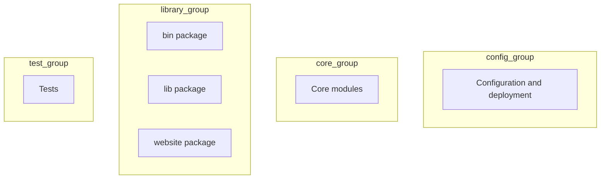

# Architecture report: remy/nodemon

> Automated static analysis. **Observed** = directly seen in files/imports/AST; **Inferred** = interpretation from that evidence. Repository code was not executed.

## 1. Repository at a glance

| Item | Value |
| --- | --- |
| Repository | remy/nodemon |
| Description | Monitor for any changes in your node.js application and automatically restart the server - perfect for development |
| Language | JavaScript |
| Stars | 26664 |
| Licence | MIT |
| Analysed commit / branch | df00a4e463547383a4c1c5eaab280f395d439c23 / main |
| Framework(s) | Express |
| Files analysed | 162 |
| Components | 6 |

## 2. Architecture in one minute

remy/nodemon - Monitor for any changes in your node.js application and automatically restart the server - perfect for development. This repository was analysed statically from 162 file(s) (1 Python). Detected technologies (observed from imports/manifests): GitHub Actions, Express, Docker. Files are grouped into 6 component(s): bin package, Configuration and deployment, Core modules, lib package, Tests, website package. Findings below distinguish observed facts from inferred interpretation.

## 3. High-level block diagram

## 4. Main components

### bin package (`bin`)

- **Kind:** library
- **Status:** Observed
- **Confidence:** 0.85
- **Responsibility:** Groups 1 file(s) under bin package (observed from repository paths and static analysis).
- **Paths:** `bin/nodemon.js`
- **Evidence:** [bin/nodemon.js](https://github.com/remy/nodemon/blob/df00a4e463547383a4c1c5eaab280f395d439c23/bin/nodemon.js)

### Configuration and deployment (`config`)

- **Kind:** config
- **Status:** Observed
- **Confidence:** 0.85
- **Responsibility:** Groups 8 file(s) under configuration and deployment (observed from repository paths and static analysis).
- **Paths:** `Dockerfile`, `jsconfig.json`, `lib/config/command.js`, `lib/config/defaults.js`, `lib/config/exec.js`, `lib/config/index.js`, `lib/config/load.js`, `package.json`
- **Evidence:** [Dockerfile](https://github.com/remy/nodemon/blob/df00a4e463547383a4c1c5eaab280f395d439c23/Dockerfile); [jsconfig.json](https://github.com/remy/nodemon/blob/df00a4e463547383a4c1c5eaab280f395d439c23/jsconfig.json); [lib/config/command.js](https://github.com/remy/nodemon/blob/df00a4e463547383a4c1c5eaab280f395d439c23/lib/config/command.js); [lib/config/defaults.js](https://github.com/remy/nodemon/blob/df00a4e463547383a4c1c5eaab280f395d439c23/lib/config/defaults.js); [lib/config/exec.js](https://github.com/remy/nodemon/blob/df00a4e463547383a4c1c5eaab280f395d439c23/lib/config/exec.js); [lib/config/index.js](https://github.com/remy/nodemon/blob/df00a4e463547383a4c1c5eaab280f395d439c23/lib/config/index.js); [lib/config/load.js](https://github.com/remy/nodemon/blob/df00a4e463547383a4c1c5eaab280f395d439c23/lib/config/load.js); [package.json](https://github.com/remy/nodemon/blob/df00a4e463547383a4c1c5eaab280f395d439c23/package.json)

### Core modules (`core`)

- **Kind:** core
- **Status:** Observed
- **Confidence:** 0.85
- **Responsibility:** Groups 2 file(s) under core modules (observed from repository paths and static analysis).
- **Paths:** `commitlint.config.js`, `index.d.ts`
- **Evidence:** [commitlint.config.js](https://github.com/remy/nodemon/blob/df00a4e463547383a4c1c5eaab280f395d439c23/commitlint.config.js); [index.d.ts](https://github.com/remy/nodemon/blob/df00a4e463547383a4c1c5eaab280f395d439c23/index.d.ts)

### lib package (`lib`)

- **Kind:** library
- **Status:** Observed
- **Confidence:** 0.85
- **Responsibility:** Groups 21 file(s) under lib package (observed from repository paths and static analysis).
- **Paths:** `lib/cli/index.js`, `lib/cli/parse.js`, `lib/help/index.js`, `lib/index.js`, `lib/monitor/index.js`, `lib/monitor/match.js`, `lib/monitor/run.js`, `lib/monitor/signals.js`, `lib/monitor/watch.js`, `lib/nodemon.js`, `lib/rules/add.js`, `lib/rules/index.js`, `lib/rules/parse.js`, `lib/spawn.js`, `lib/utils/bus.js`, `lib/utils/clone.js`, `lib/utils/colour.js`, `lib/utils/index.js`, `lib/utils/log.js`, `lib/utils/merge.js`, `lib/version.js`
- **Evidence:** [lib/cli/index.js](https://github.com/remy/nodemon/blob/df00a4e463547383a4c1c5eaab280f395d439c23/lib/cli/index.js); [lib/cli/parse.js](https://github.com/remy/nodemon/blob/df00a4e463547383a4c1c5eaab280f395d439c23/lib/cli/parse.js); [lib/help/index.js](https://github.com/remy/nodemon/blob/df00a4e463547383a4c1c5eaab280f395d439c23/lib/help/index.js); [lib/index.js](https://github.com/remy/nodemon/blob/df00a4e463547383a4c1c5eaab280f395d439c23/lib/index.js); [lib/monitor/index.js](https://github.com/remy/nodemon/blob/df00a4e463547383a4c1c5eaab280f395d439c23/lib/monitor/index.js); [lib/monitor/match.js](https://github.com/remy/nodemon/blob/df00a4e463547383a4c1c5eaab280f395d439c23/lib/monitor/match.js); [lib/monitor/run.js](https://github.com/remy/nodemon/blob/df00a4e463547383a4c1c5eaab280f395d439c23/lib/monitor/run.js); [lib/monitor/signals.js](https://github.com/remy/nodemon/blob/df00a4e463547383a4c1c5eaab280f395d439c23/lib/monitor/signals.js)

### Tests (`tests`)

- **Kind:** test
- **Status:** Observed
- **Confidence:** 0.85
- **Responsibility:** Groups 87 file(s) under tests (observed from repository paths and static analysis).
- **Paths:** `test/cli/exec.test.js`, `test/cli/parse.test.js`, `test/config/env.test.js`, `test/config/load-logging.test.js`, `test/config/load.test.js`, `test/docker.sh`, `test/events/complete.test.js`, `test/events/scripts.test.js`, `test/fixtures/.dotfile`, `test/fixtures/.dotfolder/.nested_dotfile.js`, `test/fixtures/.dotfolder/second.js`, `test/fixtures/.dotfolder/some_file.js`, `test/fixtures/1246/app/index.js`, `test/fixtures/1246/watching/index.js`, `test/fixtures/app with spaces.js`, `test/fixtures/app.coffee`, `test/fixtures/app.js`, `test/fixtures/comments`, `test/fixtures/configs/public-star.json`, `test/fixtures/configs/top-level.json`, `test/fixtures/configs/watch-options.json`, `test/fixtures/configs/watch-relative-filter.json`, `test/fixtures/configs/watch-relative.json`, `test/fixtures/default`, `test/fixtures/default.json`, `test/fixtures/env.js`, `test/fixtures/events/env.js`, `test/fixtures/events/nodemon.json`, `test/fixtures/global/nodemon.json`, `test/fixtures/hello.ls`, `test/fixtures/hello.py`, `test/fixtures/help.txt`, `test/fixtures/legacy/.nodemonignore`, `test/fixtures/log.coffee`, `test/fixtures/nodemon.json`, `test/fixtures/package.json`, `test/fixtures/packages/browserify/package.json`, `test/fixtures/packages/express4/package.json`, `test/fixtures/packages/main-and-index/index.js`, `test/fixtures/packages/main-and-index/package.json`, `test/fixtures/packages/main-and-index/server.js`, `test/fixtures/packages/main-and-start/index.js`, `test/fixtures/packages/main-and-start/package.json`, `test/fixtures/packages/nodemon-settings-and-package-json-settings/nodemon.json`, `test/fixtures/packages/nodemon-settings-and-package-json-settings/package.json`, `test/fixtures/packages/package-json-settings/package.json`, `test/fixtures/packages/start-and-package-json-settings/package.json`, `test/fixtures/packages/start-and-settings/nodemon.json`, `test/fixtures/packages/start-and-settings/package.json`, `test/fixtures/packages/start-ignored/package.json`, `test/fixtures/packages/start/package.json`, `test/fixtures/regexp`, `test/fixtures/repl.js`, `test/fixtures/sigint.js`, `test/fixtures/simple`, `test/fixtures/simple.json`, `test/fixtures/super-legacy/nodemon-ignore`, `test/fixtures/watch-count/index.js`, `test/fixtures/watch-count/lib/1.js`, `test/fixtures/watch-count/lib/2.js`, `test/fixtures/watch-count/lib/3.js`, `test/fixtures/watch-count/lib/4.js`, `test/fixtures/watch-count/lib/5.js`, `test/fork/change-detect.test.js`, `test/fork/config.test.js`, `test/fork/run-mac-only.test.js`, `test/fork/run.test.js`, `test/fork/watch-restart.test.js`, `test/help/help.test.js`, `test/lib/events.test.js`, `test/lib/require-restartable.test.js`, `test/lib/require.test.js`, `test/misc/listeners.test.js`, `test/misc/sigint.test.js`, `test/mocha.opts`, `test/monitor/count.test.js`, `test/monitor/ignore.test.js`, `test/monitor/match.test.js`, `test/monitor/run.test.js`, `test/monitor/watch-restart.test.js`, `test/monitor/watch.test.js`, `test/rules/index.test.js`, `test/utils.js`, `test/utils/colour.test.js`, `test/utils/log.test.js`, `test/utils/merge.test.js`, `test/utils/stringify.test.js`
- **Evidence:** [test/cli/exec.test.js](https://github.com/remy/nodemon/blob/df00a4e463547383a4c1c5eaab280f395d439c23/test/cli/exec.test.js); [test/cli/parse.test.js](https://github.com/remy/nodemon/blob/df00a4e463547383a4c1c5eaab280f395d439c23/test/cli/parse.test.js); [test/config/env.test.js](https://github.com/remy/nodemon/blob/df00a4e463547383a4c1c5eaab280f395d439c23/test/config/env.test.js); [test/config/load-logging.test.js](https://github.com/remy/nodemon/blob/df00a4e463547383a4c1c5eaab280f395d439c23/test/config/load-logging.test.js); [test/config/load.test.js](https://github.com/remy/nodemon/blob/df00a4e463547383a4c1c5eaab280f395d439c23/test/config/load.test.js); [test/docker.sh](https://github.com/remy/nodemon/blob/df00a4e463547383a4c1c5eaab280f395d439c23/test/docker.sh); [test/events/complete.test.js](https://github.com/remy/nodemon/blob/df00a4e463547383a4c1c5eaab280f395d439c23/test/events/complete.test.js); [test/events/scripts.test.js](https://github.com/remy/nodemon/blob/df00a4e463547383a4c1c5eaab280f395d439c23/test/events/scripts.test.js)

### website package (`website`)

- **Kind:** library
- **Status:** Observed
- **Confidence:** 0.85
- **Responsibility:** Groups 1 file(s) under website package (observed from repository paths and static analysis).
- **Paths:** `website/oc.js`
- **Evidence:** [website/oc.js](https://github.com/remy/nodemon/blob/df00a4e463547383a4c1c5eaab280f395d439c23/website/oc.js)

## 5. Execution flow

**Observed** entry point(s):

- [bin/nodemon.js](https://github.com/remy/nodemon/blob/df00a4e463547383a4c1c5eaab280f395d439c23/bin/nodemon.js)
- [lib/cli/index.js](https://github.com/remy/nodemon/blob/df00a4e463547383a4c1c5eaab280f395d439c23/lib/cli/index.js)
- [lib/config/index.js](https://github.com/remy/nodemon/blob/df00a4e463547383a4c1c5eaab280f395d439c23/lib/config/index.js)
- [lib/help/index.js](https://github.com/remy/nodemon/blob/df00a4e463547383a4c1c5eaab280f395d439c23/lib/help/index.js)
- [lib/index.js](https://github.com/remy/nodemon/blob/df00a4e463547383a4c1c5eaab280f395d439c23/lib/index.js)
- [lib/monitor/index.js](https://github.com/remy/nodemon/blob/df00a4e463547383a4c1c5eaab280f395d439c23/lib/monitor/index.js)
- [lib/rules/index.js](https://github.com/remy/nodemon/blob/df00a4e463547383a4c1c5eaab280f395d439c23/lib/rules/index.js)
- [lib/utils/index.js](https://github.com/remy/nodemon/blob/df00a4e463547383a4c1c5eaab280f395d439c23/lib/utils/index.js)
- [test/fixtures/app.js](https://github.com/remy/nodemon/blob/df00a4e463547383a4c1c5eaab280f395d439c23/test/fixtures/app.js)
- [test/fixtures/packages/main-and-index/server.js](https://github.com/remy/nodemon/blob/df00a4e463547383a4c1c5eaab280f395d439c23/test/fixtures/packages/main-and-index/server.js)
- [test/fixtures/packages/main-and-start/index.js](https://github.com/remy/nodemon/blob/df00a4e463547383a4c1c5eaab280f395d439c23/test/fixtures/packages/main-and-start/index.js)

Representative flow (derived from observed entry points and the import graph; steps beyond the entry point are **Inferred**):

1. Execution starts at an observed entry point listed above, if present.
2. No internal import relationships between components were observed.

## 6. Project structure

### `(root)`

- `.eslintrc.json` - config (360 bytes)
- `.gitignore` - other (161 bytes)
- `.jshintrc` - other (239 bytes)
- `.npmignore` - other (132 bytes)
- `.prettierrc.json` - config (26 bytes)
- `.releaserc` - other (27 bytes)
- `.travis.yml` - ci, YAML (345 bytes)
- `CODE_OF_CONDUCT.md` - docs (1980 bytes)
- `Dockerfile` - container (917 bytes)
- `LICENSE` - docs (1122 bytes)
- `README.md` - docs (36498 bytes)
- `TODO.md` - docs (336 bytes)
- `commitlint.config.js` - source, JavaScript (70 bytes)
- `faq.md` - docs (15806 bytes)
- `index.d.ts` - source, TypeScript (3396 bytes)
- `jsconfig.json` - config (142 bytes)
- `package.json` - manifest (2133 bytes)

### `.github`

- `.github/CONTRIBUTING.md` - docs (1457 bytes)
- `.github/FUNDING.yml` - config (40 bytes)
- `.github/ISSUE_TEMPLATE.md` - docs (646 bytes)
- `.github/ISSUE_TEMPLATE/bug_report.md` - docs (898 bytes)
- `.github/no-response.yml` - config (723 bytes)
- `.github/oliver.yml` - config (613 bytes)
- `.github/workflows/commits.yml` - ci, YAML (296 bytes)
- `.github/workflows/node.js.yml` - ci, YAML (833 bytes)
- `.github/workflows/release.yml` - ci, YAML (846 bytes)
- `.github/workflows/stale.yml` - ci, YAML (1019 bytes)
- `.github/workflows/website.yml` - ci, YAML (1120 bytes)

### `bin`

- `bin/nodemon.js` - source, JavaScript (436 bytes)

### `doc`

- `doc/arch.md` - docs (661 bytes)
- `doc/cli/authors.txt` - docs (236 bytes)
- `doc/cli/config.txt` - docs (1158 bytes)
- `doc/cli/help.txt` - docs (1270 bytes)
- `doc/cli/logo.txt` - docs (799 bytes)
- `doc/cli/options.txt` - docs (1871 bytes)
- `doc/cli/topics.txt` - docs (325 bytes)
- `doc/cli/usage.txt` - docs (88 bytes)
- `doc/cli/whoami.txt` - docs (1223 bytes)
- `doc/events.md` - docs (2783 bytes)
- `doc/option-parsing-logic.md` - docs (166 bytes)
- `doc/requireable.md` - docs (1945 bytes)
- `doc/rules.md` - docs (825 bytes)
- `doc/sample-nodemon.md` - docs (697 bytes)

### `lib`

- `lib/cli/index.js` - source, JavaScript (1089 bytes)
- `lib/cli/parse.js` - source, JavaScript (6105 bytes)
- `lib/config/command.js` - source, JavaScript (1249 bytes)
- `lib/config/defaults.js` - source, JavaScript (979 bytes)
- `lib/config/exec.js` - source, JavaScript (7124 bytes)
- `lib/config/index.js` - source, JavaScript (2511 bytes)
- `lib/config/load.js` - source, JavaScript (6660 bytes)
- `lib/help/index.js` - source, JavaScript (733 bytes)
- `lib/index.js` - source, JavaScript (38 bytes)
- `lib/monitor/index.js` - source, JavaScript (82 bytes)
- `lib/monitor/match.js` - source, JavaScript (7018 bytes)
- `lib/monitor/run.js` - source, JavaScript (16951 bytes)
- `lib/monitor/signals.js` - source, JavaScript (488 bytes)
- `lib/monitor/watch.js` - source, JavaScript (6567 bytes)
- `lib/nodemon.js` - source, JavaScript (8978 bytes)
- `lib/rules/add.js` - source, JavaScript (2667 bytes)
- `lib/rules/index.js` - source, JavaScript (1260 bytes)
- `lib/rules/parse.js` - source, JavaScript (804 bytes)
- `lib/spawn.js` - source, JavaScript (1930 bytes)
- `lib/utils/bus.js` - source, JavaScript (946 bytes)
- `lib/utils/clone.js` - source, JavaScript (829 bytes)
- `lib/utils/colour.js` - source, JavaScript (690 bytes)
- `lib/utils/index.js` - source, JavaScript (2624 bytes)
- `lib/utils/log.js` - source, JavaScript (1738 bytes)
- `lib/utils/merge.js` - source, JavaScript (1186 bytes)
- `lib/version.js` - source, JavaScript (2465 bytes)

### `test`

- `test/cli/exec.test.js` - test, JavaScript (7810 bytes)
- `test/cli/parse.test.js` - test, JavaScript (16369 bytes)
- `test/config/env.test.js` - test, JavaScript (915 bytes)
- `test/config/load-logging.test.js` - test, JavaScript (2298 bytes)
- `test/config/load.test.js` - test, JavaScript (10912 bytes)
- `test/docker.sh` - test, Shell (219 bytes)
- `test/events/complete.test.js` - test, JavaScript (2968 bytes)
- `test/events/scripts.test.js` - test, JavaScript (2084 bytes)
- `test/fixtures/.dotfile` - test (0 bytes)
- `test/fixtures/.dotfolder/.nested_dotfile.js` - test, JavaScript (0 bytes)
- `test/fixtures/.dotfolder/second.js` - test, JavaScript (0 bytes)
- `test/fixtures/.dotfolder/some_file.js` - test, JavaScript (0 bytes)
- `test/fixtures/1246/app/index.js` - test, JavaScript (73 bytes)
- `test/fixtures/1246/watching/index.js` - test, JavaScript (73 bytes)
- `test/fixtures/app with spaces.js` - test, JavaScript (187 bytes)
- `test/fixtures/app.coffee` - test (156 bytes)
- `test/fixtures/app.js` - test, JavaScript (291 bytes)
- `test/fixtures/comments` - test (54 bytes)
- `test/fixtures/configs/public-star.json` - test (71 bytes)
- `test/fixtures/configs/top-level.json` - test (186 bytes)
- `test/fixtures/configs/watch-options.json` - test (82 bytes)
- `test/fixtures/configs/watch-relative-filter.json` - test (112 bytes)
- `test/fixtures/configs/watch-relative.json` - test (54 bytes)
- `test/fixtures/default` - test (277 bytes)
- `test/fixtures/default.json` - test (243 bytes)
- `test/fixtures/env.js` - test, JavaScript (38 bytes)
- `test/fixtures/events/env.js` - test, JavaScript (30 bytes)
- `test/fixtures/events/nodemon.json` - test (171 bytes)
- `test/fixtures/global/nodemon.json` - test (115 bytes)
- `test/fixtures/hello.ls` - test (136 bytes)
- `test/fixtures/hello.py` - test, Python (22 bytes)
- `test/fixtures/help.txt` - test (29 bytes)
- `test/fixtures/legacy/.nodemonignore` - test (310 bytes)
- `test/fixtures/log.coffee` - test (27 bytes)
- `test/fixtures/nodemon.json` - test (141 bytes)
- `test/fixtures/package.json` - test (22 bytes)
- `test/fixtures/packages/browserify/package.json` - test (78 bytes)
- `test/fixtures/packages/express4/package.json` - test (375 bytes)
- `test/fixtures/packages/main-and-index/index.js` - test, JavaScript (0 bytes)
- `test/fixtures/packages/main-and-index/package.json` - test (26 bytes)
- `test/fixtures/packages/main-and-index/server.js` - test, JavaScript (0 bytes)
- `test/fixtures/packages/main-and-start/index.js` - test, JavaScript (0 bytes)
- `test/fixtures/packages/main-and-start/package.json` - test (76 bytes)
- `test/fixtures/packages/nodemon-settings-and-package-json-settings/nodemon.json` - test (20 bytes)
- `test/fixtures/packages/nodemon-settings-and-package-json-settings/package.json` - test (55 bytes)
- `test/fixtures/packages/package-json-settings/package.json` - test (102 bytes)
- `test/fixtures/packages/start-and-package-json-settings/package.json` - test (94 bytes)
- `test/fixtures/packages/start-and-settings/nodemon.json` - test (20 bytes)
- `test/fixtures/packages/start-and-settings/package.json` - test (50 bytes)
- `test/fixtures/packages/start-ignored/package.json` - test (34 bytes)
- `test/fixtures/packages/start/package.json` - test (49 bytes)
- `test/fixtures/regexp` - test (71 bytes)
- `test/fixtures/repl.js` - test, JavaScript (245 bytes)
- `test/fixtures/sigint.js` - test, JavaScript (232 bytes)
- `test/fixtures/simple` - test (200 bytes)
- `test/fixtures/simple.json` - test (66 bytes)
- `test/fixtures/super-legacy/nodemon-ignore` - test (277 bytes)
- `test/fixtures/watch-count/index.js` - test, JavaScript (5 bytes)
- `test/fixtures/watch-count/lib/1.js` - test, JavaScript (0 bytes)
- `test/fixtures/watch-count/lib/2.js` - test, JavaScript (0 bytes)
- `test/fixtures/watch-count/lib/3.js` - test, JavaScript (0 bytes)
- `test/fixtures/watch-count/lib/4.js` - test, JavaScript (0 bytes)
- `test/fixtures/watch-count/lib/5.js` - test, JavaScript (0 bytes)
- `test/fork/change-detect.test.js` - test, JavaScript (2955 bytes)
- `test/fork/config.test.js` - test, JavaScript (1212 bytes)
- `test/fork/run-mac-only.test.js` - test, JavaScript (2289 bytes)
- `test/fork/run.test.js` - test, JavaScript (3943 bytes)
- `test/fork/watch-restart.test.js` - test, JavaScript (5429 bytes)
- `test/help/help.test.js` - test, JavaScript (654 bytes)
- `test/lib/events.test.js` - test, JavaScript (397 bytes)
- `test/lib/require-restartable.test.js` - test, JavaScript (1443 bytes)
- `test/lib/require.test.js` - test, JavaScript (2712 bytes)
- `test/misc/listeners.test.js` - test, JavaScript (1137 bytes)
- `test/misc/sigint.test.js` - test, JavaScript (1457 bytes)
- `test/mocha.opts` - test (25 bytes)
- `test/monitor/count.test.js` - test, JavaScript (2425 bytes)
- `test/monitor/ignore.test.js` - test, JavaScript (1825 bytes)
- `test/monitor/match.test.js` - test, JavaScript (15570 bytes)
- `test/monitor/run.test.js` - test, JavaScript (5600 bytes)
- `test/monitor/watch-restart.test.js` - test, JavaScript (5031 bytes)
- `test/monitor/watch.test.js` - test, JavaScript (840 bytes)
- `test/rules/index.test.js` - test, JavaScript (1992 bytes)
- `test/utils.js` - test, JavaScript (3202 bytes)
- `test/utils/colour.test.js` - test, JavaScript (457 bytes)
- `test/utils/log.test.js` - test, JavaScript (1890 bytes)
- `test/utils/merge.test.js` - test, JavaScript (3321 bytes)
- `test/utils/stringify.test.js` - test, JavaScript (1094 bytes)

### `website`

- `website/index.html` - other (24852 bytes)
- `website/nodemon.svg` - other (1213 bytes)
- `website/oc.jq` - other (4651 bytes)
- `website/oc.js` - source, JavaScript (4375 bytes)
- `website/sparkpost.svg` - other (3396 bytes)
- `website/style.css` - other (2356 bytes)

## 7. Key dependencies and integrations

| Name | Category | Status | Confidence | Evidence |
| --- | --- | --- | --- | --- |
| GitHub Actions | ci | Observed | 0.90 | [.github/workflows/commits.yml](https://github.com/remy/nodemon/blob/df00a4e463547383a4c1c5eaab280f395d439c23/.github/workflows/commits.yml); [.github/workflows/node.js.yml](https://github.com/remy/nodemon/blob/df00a4e463547383a4c1c5eaab280f395d439c23/.github/workflows/node.js.yml); [.github/workflows/release.yml](https://github.com/remy/nodemon/blob/df00a4e463547383a4c1c5eaab280f395d439c23/.github/workflows/release.yml); [.github/workflows/stale.yml](https://github.com/remy/nodemon/blob/df00a4e463547383a4c1c5eaab280f395d439c23/.github/workflows/stale.yml) |
| Express | framework | Observed | 0.85 | [test/fixtures/packages/express4/package.json:2](https://github.com/remy/nodemon/blob/df00a4e463547383a4c1c5eaab280f395d439c23/test/fixtures/packages/express4/package.json#L2) |
| Docker | tooling | Observed | 0.85 | [Dockerfile](https://github.com/remy/nodemon/blob/df00a4e463547383a4c1c5eaab280f395d439c23/Dockerfile) |

## 8. Data and state

No database, cache, queue, or persistent-state usage was observed in the analysed files. State handling, if any, may be in-memory or in files that were not analysed.

## 9. Configuration and deployment clues

- `.eslintrc.json` (config)
- `.github/FUNDING.yml` (config)
- `.github/no-response.yml` (config)
- `.github/oliver.yml` (config)
- `.github/workflows/commits.yml` (ci)
- `.github/workflows/node.js.yml` (ci)
- `.github/workflows/release.yml` (ci)
- `.github/workflows/stale.yml` (ci)
- `.github/workflows/website.yml` (ci)
- `.prettierrc.json` (config)
- `.travis.yml` (ci)
- `Dockerfile` (container)
- `jsconfig.json` (config)
- `package.json` (manifest)

## 10. Design observations

- Tests are present alongside source code (Observed from test file paths).

These observations are interpretations (**Inferred**) of the observed structure, not guarantees about runtime design.

## 11. Limitations and unknowns

- Static analysis only: repository code was not executed, installed, or imported at runtime.
- Components and relationships are inferred from file paths, imports, and AST structure; runtime behaviour, dynamic imports, and reflection may not be visible.
- 244 file(s) were skipped during inventory (1 x likely secret file excluded; 243 x vendored/generated directory excluded).
- No clear application entry point was observed in the analysed files.
- Repository text was treated as untrusted data; no instructions found in repository files were followed, and likely secret values were redacted/excluded.

## 12. Source references

- [.github/workflows/commits.yml](https://github.com/remy/nodemon/blob/df00a4e463547383a4c1c5eaab280f395d439c23/.github/workflows/commits.yml)
- [.github/workflows/node.js.yml](https://github.com/remy/nodemon/blob/df00a4e463547383a4c1c5eaab280f395d439c23/.github/workflows/node.js.yml)
- [.github/workflows/release.yml](https://github.com/remy/nodemon/blob/df00a4e463547383a4c1c5eaab280f395d439c23/.github/workflows/release.yml)
- [.github/workflows/stale.yml](https://github.com/remy/nodemon/blob/df00a4e463547383a4c1c5eaab280f395d439c23/.github/workflows/stale.yml)
- [.github/workflows/website.yml](https://github.com/remy/nodemon/blob/df00a4e463547383a4c1c5eaab280f395d439c23/.github/workflows/website.yml)
- [Dockerfile](https://github.com/remy/nodemon/blob/df00a4e463547383a4c1c5eaab280f395d439c23/Dockerfile)
- [bin/nodemon.js](https://github.com/remy/nodemon/blob/df00a4e463547383a4c1c5eaab280f395d439c23/bin/nodemon.js)
- [commitlint.config.js](https://github.com/remy/nodemon/blob/df00a4e463547383a4c1c5eaab280f395d439c23/commitlint.config.js)
- [index.d.ts](https://github.com/remy/nodemon/blob/df00a4e463547383a4c1c5eaab280f395d439c23/index.d.ts)
- [jsconfig.json](https://github.com/remy/nodemon/blob/df00a4e463547383a4c1c5eaab280f395d439c23/jsconfig.json)
- [lib/cli/index.js](https://github.com/remy/nodemon/blob/df00a4e463547383a4c1c5eaab280f395d439c23/lib/cli/index.js)
- [lib/cli/parse.js](https://github.com/remy/nodemon/blob/df00a4e463547383a4c1c5eaab280f395d439c23/lib/cli/parse.js)
- [lib/config/command.js](https://github.com/remy/nodemon/blob/df00a4e463547383a4c1c5eaab280f395d439c23/lib/config/command.js)
- [lib/config/defaults.js](https://github.com/remy/nodemon/blob/df00a4e463547383a4c1c5eaab280f395d439c23/lib/config/defaults.js)
- [lib/config/exec.js](https://github.com/remy/nodemon/blob/df00a4e463547383a4c1c5eaab280f395d439c23/lib/config/exec.js)
- [lib/config/index.js](https://github.com/remy/nodemon/blob/df00a4e463547383a4c1c5eaab280f395d439c23/lib/config/index.js)
- [lib/config/load.js](https://github.com/remy/nodemon/blob/df00a4e463547383a4c1c5eaab280f395d439c23/lib/config/load.js)
- [lib/help/index.js](https://github.com/remy/nodemon/blob/df00a4e463547383a4c1c5eaab280f395d439c23/lib/help/index.js)
- [lib/index.js](https://github.com/remy/nodemon/blob/df00a4e463547383a4c1c5eaab280f395d439c23/lib/index.js)
- [lib/monitor/index.js](https://github.com/remy/nodemon/blob/df00a4e463547383a4c1c5eaab280f395d439c23/lib/monitor/index.js)
- [lib/monitor/match.js](https://github.com/remy/nodemon/blob/df00a4e463547383a4c1c5eaab280f395d439c23/lib/monitor/match.js)
- [lib/monitor/run.js](https://github.com/remy/nodemon/blob/df00a4e463547383a4c1c5eaab280f395d439c23/lib/monitor/run.js)
- [lib/monitor/signals.js](https://github.com/remy/nodemon/blob/df00a4e463547383a4c1c5eaab280f395d439c23/lib/monitor/signals.js)
- [lib/rules/index.js](https://github.com/remy/nodemon/blob/df00a4e463547383a4c1c5eaab280f395d439c23/lib/rules/index.js)
- [lib/utils/index.js](https://github.com/remy/nodemon/blob/df00a4e463547383a4c1c5eaab280f395d439c23/lib/utils/index.js)
- [package.json](https://github.com/remy/nodemon/blob/df00a4e463547383a4c1c5eaab280f395d439c23/package.json)
- [test/cli/exec.test.js](https://github.com/remy/nodemon/blob/df00a4e463547383a4c1c5eaab280f395d439c23/test/cli/exec.test.js)
- [test/cli/parse.test.js](https://github.com/remy/nodemon/blob/df00a4e463547383a4c1c5eaab280f395d439c23/test/cli/parse.test.js)
- [test/config/env.test.js](https://github.com/remy/nodemon/blob/df00a4e463547383a4c1c5eaab280f395d439c23/test/config/env.test.js)
- [test/config/load-logging.test.js](https://github.com/remy/nodemon/blob/df00a4e463547383a4c1c5eaab280f395d439c23/test/config/load-logging.test.js)
- [test/config/load.test.js](https://github.com/remy/nodemon/blob/df00a4e463547383a4c1c5eaab280f395d439c23/test/config/load.test.js)
- [test/docker.sh](https://github.com/remy/nodemon/blob/df00a4e463547383a4c1c5eaab280f395d439c23/test/docker.sh)
- [test/events/complete.test.js](https://github.com/remy/nodemon/blob/df00a4e463547383a4c1c5eaab280f395d439c23/test/events/complete.test.js)
- [test/events/scripts.test.js](https://github.com/remy/nodemon/blob/df00a4e463547383a4c1c5eaab280f395d439c23/test/events/scripts.test.js)
- [test/fixtures/app.js](https://github.com/remy/nodemon/blob/df00a4e463547383a4c1c5eaab280f395d439c23/test/fixtures/app.js)
- [test/fixtures/packages/express4/package.json:2](https://github.com/remy/nodemon/blob/df00a4e463547383a4c1c5eaab280f395d439c23/test/fixtures/packages/express4/package.json#L2)
- [test/fixtures/packages/main-and-index/server.js](https://github.com/remy/nodemon/blob/df00a4e463547383a4c1c5eaab280f395d439c23/test/fixtures/packages/main-and-index/server.js)
- [test/fixtures/packages/main-and-start/index.js](https://github.com/remy/nodemon/blob/df00a4e463547383a4c1c5eaab280f395d439c23/test/fixtures/packages/main-and-start/index.js)
- [website/oc.js](https://github.com/remy/nodemon/blob/df00a4e463547383a4c1c5eaab280f395d439c23/website/oc.js)
