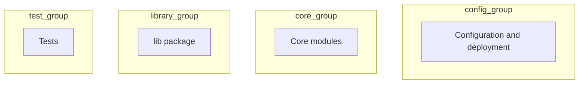

# Architecture report: request/request

> Automated static analysis. **Observed** = directly seen in files/imports/AST; **Inferred** = interpretation from that evidence. Repository code was not executed.

## 1. Repository at a glance

| Item | Value |
| --- | --- |
| Repository | request/request |
| Description | 🏊🏾 Simplified HTTP request client. |
| Language | JavaScript |
| Stars | 25477 |
| Licence | Apache-2.0 |
| Analysed commit / branch | 3c0cddc7c8eb60b470e9519da85896ed7ee0081e / master |
| Framework(s) | None detected |
| Files analysed | 113 |
| Components | 4 |

## 2. Architecture in one minute

request/request - 🏊🏾 Simplified HTTP request client.. This repository was analysed statically from 113 file(s) (0 Python). Detected technologies (observed from imports/manifests): no known frameworks/libraries. Files are grouped into 4 component(s): Configuration and deployment, Core modules, lib package, Tests. Findings below distinguish observed facts from inferred interpretation.

## 3. High-level block diagram

## 4. Main components

### Configuration and deployment (`config`)

- **Kind:** config
- **Status:** Observed
- **Confidence:** 0.85
- **Responsibility:** Groups 3 file(s) under configuration and deployment (observed from repository paths and static analysis).
- **Paths:** `codecov.yml`, `disabled.appveyor.yml`, `package.json`
- **Evidence:** [codecov.yml](https://github.com/request/request/blob/3c0cddc7c8eb60b470e9519da85896ed7ee0081e/codecov.yml); [disabled.appveyor.yml](https://github.com/request/request/blob/3c0cddc7c8eb60b470e9519da85896ed7ee0081e/disabled.appveyor.yml); [package.json](https://github.com/request/request/blob/3c0cddc7c8eb60b470e9519da85896ed7ee0081e/package.json)

### Core modules (`core`)

- **Kind:** core
- **Status:** Observed
- **Confidence:** 0.85
- **Responsibility:** Groups 3 file(s) under core modules (observed from repository paths and static analysis).
- **Paths:** `index.js`, `release.sh`, `request.js`
- **Evidence:** [index.js](https://github.com/request/request/blob/3c0cddc7c8eb60b470e9519da85896ed7ee0081e/index.js); [release.sh](https://github.com/request/request/blob/3c0cddc7c8eb60b470e9519da85896ed7ee0081e/release.sh); [request.js](https://github.com/request/request/blob/3c0cddc7c8eb60b470e9519da85896ed7ee0081e/request.js)

### lib package (`lib`)

- **Kind:** library
- **Status:** Observed
- **Confidence:** 0.85
- **Responsibility:** Groups 11 file(s) under lib package (observed from repository paths and static analysis).
- **Paths:** `lib/auth.js`, `lib/cookies.js`, `lib/getProxyFromURI.js`, `lib/har.js`, `lib/hawk.js`, `lib/helpers.js`, `lib/multipart.js`, `lib/oauth.js`, `lib/querystring.js`, `lib/redirect.js`, `lib/tunnel.js`
- **Evidence:** [lib/auth.js](https://github.com/request/request/blob/3c0cddc7c8eb60b470e9519da85896ed7ee0081e/lib/auth.js); [lib/cookies.js](https://github.com/request/request/blob/3c0cddc7c8eb60b470e9519da85896ed7ee0081e/lib/cookies.js); [lib/getProxyFromURI.js](https://github.com/request/request/blob/3c0cddc7c8eb60b470e9519da85896ed7ee0081e/lib/getProxyFromURI.js); [lib/har.js](https://github.com/request/request/blob/3c0cddc7c8eb60b470e9519da85896ed7ee0081e/lib/har.js); [lib/hawk.js](https://github.com/request/request/blob/3c0cddc7c8eb60b470e9519da85896ed7ee0081e/lib/hawk.js); [lib/helpers.js](https://github.com/request/request/blob/3c0cddc7c8eb60b470e9519da85896ed7ee0081e/lib/helpers.js); [lib/multipart.js](https://github.com/request/request/blob/3c0cddc7c8eb60b470e9519da85896ed7ee0081e/lib/multipart.js); [lib/oauth.js](https://github.com/request/request/blob/3c0cddc7c8eb60b470e9519da85896ed7ee0081e/lib/oauth.js)

### Tests (`tests`)

- **Kind:** test
- **Status:** Observed
- **Confidence:** 0.85
- **Responsibility:** Groups 86 file(s) under tests (observed from repository paths and static analysis).
- **Paths:** `tests/browser/karma.conf.js`, `tests/browser/ssl/ca.crt`, `tests/browser/ssl/server.crt`, `tests/browser/start.js`, `tests/browser/test.js`, `tests/fixtures/har.json`, `tests/server.js`, `tests/squid.conf`, `tests/ssl/ca/README.md`, `tests/ssl/ca/ca.cnf`, `tests/ssl/ca/ca.crl`, `tests/ssl/ca/ca.crt`, `tests/ssl/ca/ca.csr`, `tests/ssl/ca/ca.srl`, `tests/ssl/ca/client.cnf`, `tests/ssl/ca/client.crt`, `tests/ssl/ca/client.csr`, `tests/ssl/ca/gen-all-certs.sh`, `tests/ssl/ca/gen-client.sh`, `tests/ssl/ca/gen-localhost.sh`, `tests/ssl/ca/gen-server.sh`, `tests/ssl/ca/localhost.cnf`, `tests/ssl/ca/localhost.crt`, `tests/ssl/ca/localhost.csr`, `tests/ssl/ca/localhost.js`, `tests/ssl/ca/server.cnf`, `tests/ssl/ca/server.crt`, `tests/ssl/ca/server.csr`, `tests/ssl/ca/server.js`, `tests/ssl/npm-ca.crt`, `tests/ssl/test.crt`, `tests/test-agent.js`, `tests/test-agentOptions.js`, `tests/test-api.js`, `tests/test-aws.js`, `tests/test-baseUrl.js`, `tests/test-basic-auth.js`, `tests/test-bearer-auth.js`, `tests/test-body.js`, `tests/test-cookies.js`, `tests/test-defaults.js`, `tests/test-digest-auth.js`, `tests/test-emptyBody.js`, `tests/test-errors.js`, `tests/test-event-forwarding.js`, `tests/test-follow-all-303.js`, `tests/test-follow-all.js`, `tests/test-form-data-error.js`, `tests/test-form-data.js`, `tests/test-form-urlencoded.js`, `tests/test-form.js`, `tests/test-gzip.js`, `tests/test-har.js`, `tests/test-hawk.js`, `tests/test-headers.js`, `tests/test-http-signature.js`, `tests/test-httpModule.js`, `tests/test-https.js`, `tests/test-isUrl.js`, `tests/test-json-request.js`, `tests/test-localAddress.js`, `tests/test-multipart-encoding.js`, `tests/test-multipart.js`, `tests/test-node-debug.js`, `tests/test-oauth.js`, `tests/test-onelineproxy.js`, `tests/test-option-reuse.js`, `tests/test-options-convenience-method.js`, `tests/test-params.js`, `tests/test-piped-redirect.js`, `tests/test-pipes.js`, `tests/test-pool.js`, `tests/test-promise.js`, `tests/test-proxy-connect.js`, `tests/test-proxy.js`, `tests/test-qs.js`, `tests/test-redirect-auth.js`, `tests/test-redirect-complex.js`, `tests/test-redirect.js`, `tests/test-rfc3986.js`, `tests/test-stream.js`, `tests/test-timeout.js`, `tests/test-timing.js`, `tests/test-toJSON.js`, `tests/test-tunnel.js`, `tests/test-unix.js`
- **Evidence:** [tests/browser/karma.conf.js](https://github.com/request/request/blob/3c0cddc7c8eb60b470e9519da85896ed7ee0081e/tests/browser/karma.conf.js); [tests/browser/ssl/ca.crt](https://github.com/request/request/blob/3c0cddc7c8eb60b470e9519da85896ed7ee0081e/tests/browser/ssl/ca.crt); [tests/browser/ssl/server.crt](https://github.com/request/request/blob/3c0cddc7c8eb60b470e9519da85896ed7ee0081e/tests/browser/ssl/server.crt); [tests/browser/start.js](https://github.com/request/request/blob/3c0cddc7c8eb60b470e9519da85896ed7ee0081e/tests/browser/start.js); [tests/browser/test.js](https://github.com/request/request/blob/3c0cddc7c8eb60b470e9519da85896ed7ee0081e/tests/browser/test.js); [tests/fixtures/har.json](https://github.com/request/request/blob/3c0cddc7c8eb60b470e9519da85896ed7ee0081e/tests/fixtures/har.json); [tests/server.js](https://github.com/request/request/blob/3c0cddc7c8eb60b470e9519da85896ed7ee0081e/tests/server.js); [tests/squid.conf](https://github.com/request/request/blob/3c0cddc7c8eb60b470e9519da85896ed7ee0081e/tests/squid.conf)

## 5. Execution flow

**Observed** entry point(s):

- [index.js](https://github.com/request/request/blob/3c0cddc7c8eb60b470e9519da85896ed7ee0081e/index.js)

Representative flow (derived from observed entry points and the import graph; steps beyond the entry point are **Inferred**):

1. Execution starts at an observed entry point listed above, if present.
2. No internal import relationships between components were observed.

## 6. Project structure

### `(root)`

- `.gitignore` - other (71 bytes)
- `.travis.yml` - ci, YAML (409 bytes)
- `CHANGELOG.md` - docs (69061 bytes)
- `CONTRIBUTING.md` - docs (3264 bytes)
- `LICENSE` - docs (9140 bytes)
- `README.md` - docs (46386 bytes)
- `codecov.yml` - config (16 bytes)
- `disabled.appveyor.yml` - config (940 bytes)
- `index.js` - source, JavaScript (3994 bytes)
- `package.json` - manifest (2085 bytes)
- `release.sh` - source, Shell (1262 bytes)
- `request.js` - source, JavaScript (44466 bytes)

### `.github`

- `.github/ISSUE_TEMPLATE.md` - docs (2192 bytes)
- `.github/PULL_REQUEST_TEMPLATE.md` - docs (678 bytes)
- `.github/stale.yml` - config (725 bytes)

### `examples`

- `examples/README.md` - docs (2931 bytes)

### `lib`

- `lib/auth.js` - source, JavaScript (4778 bytes)
- `lib/cookies.js` - source, JavaScript (974 bytes)
- `lib/getProxyFromURI.js` - source, JavaScript (2257 bytes)
- `lib/har.js` - source, JavaScript (4787 bytes)
- `lib/hawk.js` - source, JavaScript (2750 bytes)
- `lib/helpers.js` - source, JavaScript (1411 bytes)
- `lib/multipart.js` - source, JavaScript (2674 bytes)
- `lib/oauth.js` - source, JavaScript (4136 bytes)
- `lib/querystring.js` - source, JavaScript (1334 bytes)
- `lib/redirect.js` - source, JavaScript (4635 bytes)
- `lib/tunnel.js` - source, JavaScript (4416 bytes)

### `tests`

- `tests/browser/karma.conf.js` - test, JavaScript (1150 bytes)
- `tests/browser/ssl/ca.crt` - test (810 bytes)
- `tests/browser/ssl/server.crt` - test (810 bytes)
- `tests/browser/start.js` - test, JavaScript (1196 bytes)
- `tests/browser/test.js` - test, JavaScript (907 bytes)
- `tests/fixtures/har.json` - test (2788 bytes)
- `tests/server.js` - test, JavaScript (3853 bytes)
- `tests/squid.conf` - test (2488 bytes)
- `tests/ssl/ca/README.md` - test (237 bytes)
- `tests/ssl/ca/ca.cnf` - test (580 bytes)
- `tests/ssl/ca/ca.crl` - test (0 bytes)
- `tests/ssl/ca/ca.crt` - test (1009 bytes)
- `tests/ssl/ca/ca.csr` - test (777 bytes)
- `tests/ssl/ca/ca.srl` - test (17 bytes)
- `tests/ssl/ca/client.cnf` - test (561 bytes)
- `tests/ssl/ca/client.crt` - test (1164 bytes)
- `tests/ssl/ca/client.csr` - test (1106 bytes)
- `tests/ssl/ca/gen-all-certs.sh` - test, Shell (70 bytes)
- `tests/ssl/ca/gen-client.sh` - test, Shell (688 bytes)
- `tests/ssl/ca/gen-localhost.sh` - test, Shell (601 bytes)
- `tests/ssl/ca/gen-server.sh` - test, Shell (385 bytes)
- `tests/ssl/ca/localhost.cnf` - test (560 bytes)
- `tests/ssl/ca/localhost.crt` - test (1164 bytes)
- `tests/ssl/ca/localhost.csr` - test (1106 bytes)
- `tests/ssl/ca/localhost.js` - test, JavaScript (768 bytes)
- `tests/ssl/ca/server.cnf` - test (547 bytes)
- `tests/ssl/ca/server.crt` - test (1537 bytes)
- `tests/ssl/ca/server.csr` - test (1825 bytes)
- `tests/ssl/ca/server.js` - test, JavaScript (821 bytes)
- `tests/ssl/npm-ca.crt` - test (936 bytes)
- `tests/ssl/test.crt` - test (847 bytes)
- `tests/test-agent.js` - test, JavaScript (2557 bytes)
- `tests/test-agentOptions.js` - test, JavaScript (1249 bytes)
- `tests/test-api.js` - test, JavaScript (631 bytes)
- `tests/test-aws.js` - test, JavaScript (2409 bytes)
- `tests/test-baseUrl.js` - test, JavaScript (3495 bytes)
- `tests/test-basic-auth.js` - test, JavaScript (5493 bytes)
- `tests/test-bearer-auth.js` - test, JavaScript (4376 bytes)
- `tests/test-body.js` - test, JavaScript (3952 bytes)
- `tests/test-cookies.js` - test, JavaScript (3045 bytes)
- `tests/test-defaults.js` - test, JavaScript (8580 bytes)
- `tests/test-digest-auth.js` - test, JavaScript (6266 bytes)
- `tests/test-emptyBody.js` - test, JavaScript (1055 bytes)
- `tests/test-errors.js` - test, JavaScript (2225 bytes)
- `tests/test-event-forwarding.js` - test, JavaScript (765 bytes)
- `tests/test-follow-all-303.js` - test, JavaScript (886 bytes)
- `tests/test-follow-all.js` - test, JavaScript (1065 bytes)
- `tests/test-form-data-error.js` - test, JavaScript (1861 bytes)
- `tests/test-form-data.js` - test, JavaScript (4333 bytes)
- `tests/test-form-urlencoded.js` - test, JavaScript (1765 bytes)
- `tests/test-form.js` - test, JavaScript (3060 bytes)
- `tests/test-gzip.js` - test, JavaScript (8184 bytes)
- `tests/test-har.js` - test, JavaScript (3808 bytes)
- `tests/test-hawk.js` - test, JavaScript (4192 bytes)
- `tests/test-headers.js` - test, JavaScript (7821 bytes)
- `tests/test-http-signature.js` - test, JavaScript (4256 bytes)
- `tests/test-httpModule.js` - test, JavaScript (3056 bytes)
- `tests/test-https.js` - test, JavaScript (3110 bytes)
- `tests/test-isUrl.js` - test, JavaScript (2291 bytes)
- `tests/test-json-request.js` - test, JavaScript (3105 bytes)
- `tests/test-localAddress.js` - test, JavaScript (1288 bytes)
- `tests/test-multipart-encoding.js` - test, JavaScript (3844 bytes)
- `tests/test-multipart.js` - test, JavaScript (3612 bytes)
- `tests/test-node-debug.js` - test, JavaScript (2576 bytes)
- `tests/test-oauth.js` - test, JavaScript (24212 bytes)
- `tests/test-onelineproxy.js` - test, JavaScript (1352 bytes)
- `tests/test-option-reuse.js` - test, JavaScript (1045 bytes)
- `tests/test-options-convenience-method.js` - test, JavaScript (1068 bytes)
- `tests/test-params.js` - test, JavaScript (2223 bytes)
- `tests/test-piped-redirect.js` - test, JavaScript (1073 bytes)
- `tests/test-pipes.js` - test, JavaScript (9114 bytes)
- `tests/test-pool.js` - test, JavaScript (3297 bytes)
- `tests/test-promise.js` - test, JavaScript (1123 bytes)
- `tests/test-proxy-connect.js` - test, JavaScript (1889 bytes)
- `tests/test-proxy.js` - test, JavaScript (7805 bytes)
- `tests/test-qs.js` - test, JavaScript (3694 bytes)
- `tests/test-redirect-auth.js` - test, JavaScript (3428 bytes)
- `tests/test-redirect-complex.js` - test, JavaScript (1786 bytes)
- `tests/test-redirect.js` - test, JavaScript (12406 bytes)
- `tests/test-rfc3986.js` - test, JavaScript (2144 bytes)
- `tests/test-stream.js` - test, JavaScript (809 bytes)
- `tests/test-timeout.js` - test, JavaScript (6745 bytes)
- `tests/test-timing.js` - test, JavaScript (4998 bytes)
- `tests/test-toJSON.js` - test, JavaScript (941 bytes)
- `tests/test-tunnel.js` - test, JavaScript (10746 bytes)
- `tests/test-unix.js` - test, JavaScript (1961 bytes)

## 7. Key dependencies and integrations

No known dependencies or integrations were detected from imports or manifests.

## 8. Data and state

No database, cache, queue, or persistent-state usage was observed in the analysed files. State handling, if any, may be in-memory or in files that were not analysed.

## 9. Configuration and deployment clues

- `.github/stale.yml` (config)
- `.travis.yml` (ci)
- `codecov.yml` (config)
- `disabled.appveyor.yml` (config)
- `package.json` (manifest)

## 10. Design observations

- Tests are present alongside source code (Observed from test file paths).

These observations are interpretations (**Inferred**) of the observed structure, not guarantees about runtime design.

## 11. Limitations and unknowns

- Static analysis only: repository code was not executed, installed, or imported at runtime.
- Components and relationships are inferred from file paths, imports, and AST structure; runtime behaviour, dynamic imports, and reflection may not be visible.
- 7 file(s) were skipped during inventory (7 x likely secret file excluded).
- No clear application entry point was observed in the analysed files.
- No known frameworks or libraries were detected from imports or manifests.
- Repository text was treated as untrusted data; no instructions found in repository files were followed, and likely secret values were redacted/excluded.
- JavaScript and TypeScript files were inventoried from paths and package manifests. They were not parsed with a full language AST, and repository code was not executed.

## 12. Source references

- [codecov.yml](https://github.com/request/request/blob/3c0cddc7c8eb60b470e9519da85896ed7ee0081e/codecov.yml)
- [disabled.appveyor.yml](https://github.com/request/request/blob/3c0cddc7c8eb60b470e9519da85896ed7ee0081e/disabled.appveyor.yml)
- [index.js](https://github.com/request/request/blob/3c0cddc7c8eb60b470e9519da85896ed7ee0081e/index.js)
- [lib/auth.js](https://github.com/request/request/blob/3c0cddc7c8eb60b470e9519da85896ed7ee0081e/lib/auth.js)
- [lib/cookies.js](https://github.com/request/request/blob/3c0cddc7c8eb60b470e9519da85896ed7ee0081e/lib/cookies.js)
- [lib/getProxyFromURI.js](https://github.com/request/request/blob/3c0cddc7c8eb60b470e9519da85896ed7ee0081e/lib/getProxyFromURI.js)
- [lib/har.js](https://github.com/request/request/blob/3c0cddc7c8eb60b470e9519da85896ed7ee0081e/lib/har.js)
- [lib/hawk.js](https://github.com/request/request/blob/3c0cddc7c8eb60b470e9519da85896ed7ee0081e/lib/hawk.js)
- [lib/helpers.js](https://github.com/request/request/blob/3c0cddc7c8eb60b470e9519da85896ed7ee0081e/lib/helpers.js)
- [lib/multipart.js](https://github.com/request/request/blob/3c0cddc7c8eb60b470e9519da85896ed7ee0081e/lib/multipart.js)
- [lib/oauth.js](https://github.com/request/request/blob/3c0cddc7c8eb60b470e9519da85896ed7ee0081e/lib/oauth.js)
- [package.json](https://github.com/request/request/blob/3c0cddc7c8eb60b470e9519da85896ed7ee0081e/package.json)
- [release.sh](https://github.com/request/request/blob/3c0cddc7c8eb60b470e9519da85896ed7ee0081e/release.sh)
- [request.js](https://github.com/request/request/blob/3c0cddc7c8eb60b470e9519da85896ed7ee0081e/request.js)
- [tests/browser/karma.conf.js](https://github.com/request/request/blob/3c0cddc7c8eb60b470e9519da85896ed7ee0081e/tests/browser/karma.conf.js)
- [tests/browser/ssl/ca.crt](https://github.com/request/request/blob/3c0cddc7c8eb60b470e9519da85896ed7ee0081e/tests/browser/ssl/ca.crt)
- [tests/browser/ssl/server.crt](https://github.com/request/request/blob/3c0cddc7c8eb60b470e9519da85896ed7ee0081e/tests/browser/ssl/server.crt)
- [tests/browser/start.js](https://github.com/request/request/blob/3c0cddc7c8eb60b470e9519da85896ed7ee0081e/tests/browser/start.js)
- [tests/browser/test.js](https://github.com/request/request/blob/3c0cddc7c8eb60b470e9519da85896ed7ee0081e/tests/browser/test.js)
- [tests/fixtures/har.json](https://github.com/request/request/blob/3c0cddc7c8eb60b470e9519da85896ed7ee0081e/tests/fixtures/har.json)
- [tests/server.js](https://github.com/request/request/blob/3c0cddc7c8eb60b470e9519da85896ed7ee0081e/tests/server.js)
- [tests/squid.conf](https://github.com/request/request/blob/3c0cddc7c8eb60b470e9519da85896ed7ee0081e/tests/squid.conf)
