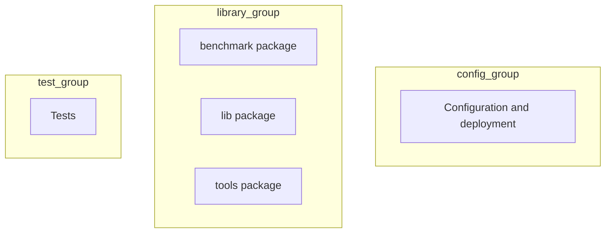

# Architecture report: restify/node-restify

> Automated static analysis. **Observed** = directly seen in files/imports/AST; **Inferred** = interpretation from that evidence. Repository code was not executed.

## 1. Repository at a glance

| Item | Value |
| --- | --- |
| Repository | restify/node-restify |
| Description | The future of Node.js REST development |
| Language | JavaScript |
| Stars | 10687 |
| Licence | MIT |
| Analysed commit / branch | 71e09da528112619ec42b600a2bbab240e3eff60 / master |
| Framework(s) | None detected |
| Files analysed | 188 |
| Components | 5 |

## 2. Architecture in one minute

restify/node-restify - The future of Node.js REST development. This repository was analysed statically from 188 file(s) (0 Python). Detected technologies (observed from imports/manifests): GitHub Actions. Files are grouped into 5 component(s): benchmark package, Configuration and deployment, lib package, Tests, tools package. Findings below distinguish observed facts from inferred interpretation.

## 3. High-level block diagram

## 4. Main components

### benchmark package (`benchmark`)

- **Kind:** library
- **Status:** Observed
- **Confidence:** 0.85
- **Responsibility:** Groups 7 file(s) under benchmark package (observed from repository paths and static analysis).
- **Paths:** `benchmark/benchmarks/middleware.js`, `benchmark/benchmarks/response-json.js`, `benchmark/benchmarks/response-text.js`, `benchmark/benchmarks/router-heavy.js`, `benchmark/index.js`, `benchmark/lib/autocannon.js`, `benchmark/lib/bench.js`
- **Evidence:** [benchmark/benchmarks/middleware.js](https://github.com/restify/node-restify/blob/71e09da528112619ec42b600a2bbab240e3eff60/benchmark/benchmarks/middleware.js); [benchmark/benchmarks/response-json.js](https://github.com/restify/node-restify/blob/71e09da528112619ec42b600a2bbab240e3eff60/benchmark/benchmarks/response-json.js); [benchmark/benchmarks/response-text.js](https://github.com/restify/node-restify/blob/71e09da528112619ec42b600a2bbab240e3eff60/benchmark/benchmarks/response-text.js); [benchmark/benchmarks/router-heavy.js](https://github.com/restify/node-restify/blob/71e09da528112619ec42b600a2bbab240e3eff60/benchmark/benchmarks/router-heavy.js); [benchmark/index.js](https://github.com/restify/node-restify/blob/71e09da528112619ec42b600a2bbab240e3eff60/benchmark/index.js); [benchmark/lib/autocannon.js](https://github.com/restify/node-restify/blob/71e09da528112619ec42b600a2bbab240e3eff60/benchmark/lib/autocannon.js); [benchmark/lib/bench.js](https://github.com/restify/node-restify/blob/71e09da528112619ec42b600a2bbab240e3eff60/benchmark/lib/bench.js)

### Configuration and deployment (`config`)

- **Kind:** config
- **Status:** Observed
- **Confidence:** 0.85
- **Responsibility:** Groups 2 file(s) under configuration and deployment (observed from repository paths and static analysis).
- **Paths:** `benchmark/package.json`, `package.json`
- **Evidence:** [benchmark/package.json](https://github.com/restify/node-restify/blob/71e09da528112619ec42b600a2bbab240e3eff60/benchmark/package.json); [package.json](https://github.com/restify/node-restify/blob/71e09da528112619ec42b600a2bbab240e3eff60/package.json)

### lib package (`lib`)

- **Kind:** library
- **Status:** Observed
- **Confidence:** 0.85
- **Responsibility:** Groups 56 file(s) under lib package (observed from repository paths and static analysis).
- **Paths:** `lib/chain.js`, `lib/deprecationWarnings.js`, `lib/dtrace.js`, `lib/errorTypes.js`, `lib/formatters/binary.js`, `lib/formatters/index.js`, `lib/formatters/json.js`, `lib/formatters/jsonp.js`, `lib/formatters/text.js`, `lib/helpers/chainComposer.js`, `lib/http_date.js`, `lib/index.js`, `lib/plugins/accept.js`, `lib/plugins/audit.js`, `lib/plugins/authorization.js`, `lib/plugins/bodyParser.js`, `lib/plugins/bodyReader.js`, `lib/plugins/conditionalHandler.js`, `lib/plugins/conditionalRequest.js`, `lib/plugins/cpuUsageThrottle.js`, `lib/plugins/date.js`, `lib/plugins/fieldedTextBodyParser.js`, `lib/plugins/formBodyParser.js`, `lib/plugins/fullResponse.js`, `lib/plugins/gzip.js`, `lib/plugins/index.js`, `lib/plugins/inflightRequestThrottle.js`, `lib/plugins/jsonBodyParser.js`, `lib/plugins/jsonp.js`, `lib/plugins/metrics.js`, `lib/plugins/multipartBodyParser.js`, `lib/plugins/oauth2TokenParser.js`, `lib/plugins/pre/context.js`, `lib/plugins/pre/dedupeSlashes.js`, `lib/plugins/pre/pause.js`, `lib/plugins/pre/prePath.js`, `lib/plugins/pre/reqIdHeaders.js`, `lib/plugins/pre/strictQueryParams.js`, `lib/plugins/pre/userAgent.js`, `lib/plugins/query.js`, `lib/plugins/requestExpiry.js`, `lib/plugins/requestLogger.js`, `lib/plugins/static.js`, `lib/plugins/staticFiles.js`, `lib/plugins/throttle.js`, `lib/plugins/utils/hrTimeDurationInMs.js`, `lib/plugins/utils/httpDate.js`, `lib/plugins/utils/regex.js`, `lib/plugins/utils/shallowCopy.js`, `lib/request.js`, `lib/response.js`, `lib/router.js`, `lib/routerRegistryRadix.js`, `lib/server.js`, `lib/upgrade.js`, `lib/utils.js`
- **Evidence:** [lib/chain.js](https://github.com/restify/node-restify/blob/71e09da528112619ec42b600a2bbab240e3eff60/lib/chain.js); [lib/deprecationWarnings.js](https://github.com/restify/node-restify/blob/71e09da528112619ec42b600a2bbab240e3eff60/lib/deprecationWarnings.js); [lib/dtrace.js](https://github.com/restify/node-restify/blob/71e09da528112619ec42b600a2bbab240e3eff60/lib/dtrace.js); [lib/errorTypes.js](https://github.com/restify/node-restify/blob/71e09da528112619ec42b600a2bbab240e3eff60/lib/errorTypes.js); [lib/formatters/binary.js](https://github.com/restify/node-restify/blob/71e09da528112619ec42b600a2bbab240e3eff60/lib/formatters/binary.js); [lib/formatters/index.js](https://github.com/restify/node-restify/blob/71e09da528112619ec42b600a2bbab240e3eff60/lib/formatters/index.js); [lib/formatters/json.js](https://github.com/restify/node-restify/blob/71e09da528112619ec42b600a2bbab240e3eff60/lib/formatters/json.js); [lib/formatters/jsonp.js](https://github.com/restify/node-restify/blob/71e09da528112619ec42b600a2bbab240e3eff60/lib/formatters/jsonp.js)

### Tests (`tests`)

- **Kind:** test
- **Status:** Observed
- **Confidence:** 0.85
- **Responsibility:** Groups 55 file(s) under tests (observed from repository paths and static analysis).
- **Paths:** `examples/todoapp/test/todo.test.js`, `test/.eslintrc`, `test/chain.test.js`, `test/chainComposer.test.js`, `test/formatter-optional.test.js`, `test/formatter.test.js`, `test/index.test.js`, `test/lib/helper.js`, `test/lib/server-withDisableUncaughtException.js`, `test/lib/streamRecorder.js`, `test/plugins/.eslintrc`, `test/plugins/accept.test.js`, `test/plugins/audit.test.js`, `test/plugins/authorization.test.js`, `test/plugins/bodyReader.test.js`, `test/plugins/conditionalHandler.test.js`, `test/plugins/conditionalRequest.test.js`, `test/plugins/context.test.js`, `test/plugins/cpuUsageThrottle.test.js`, `test/plugins/dedupeSlashes.test.js`, `test/plugins/fieldedTextParser.test.js`, `test/plugins/files/data-csv.txt`, `test/plugins/files/data-tsv.txt`, `test/plugins/files/object-csv.json`, `test/plugins/files/object-tsv.json`, `test/plugins/formBodyParser.test.js`, `test/plugins/gzip.test.js`, `test/plugins/inflightRequestThrottle.test.js`, `test/plugins/jsonBodyParser.test.js`, `test/plugins/metrics.test.js`, `test/plugins/multipart.test.js`, `test/plugins/oauth2.test.js`, `test/plugins/plugins.test.js`, `test/plugins/query.test.js`, `test/plugins/reqIdHeaders.test.js`, `test/plugins/requestExpiry.test.js`, `test/plugins/static.test.js`, `test/plugins/staticFiles.test.js`, `test/plugins/strictQueryParams.test.js`, `test/plugins/testStaticFiles/docs/doc.md`, `test/plugins/testStaticFiles/docs/index.html`, `test/plugins/testStaticFiles/file1.txt`, `test/plugins/testStaticFiles/index.html`, `test/plugins/testStaticFiles/special/$_$/bad (file).txt`, `test/plugins/throttle.test.js`, `test/plugins/userAgent.test.js`, `test/plugins/utilsHrTimeDurationInMs.test.js`, `test/request.test.js`, `test/response.test.js`, `test/router.test.js`, `test/routerRegistryRadix.test.js`, `test/server.test.js`, `test/serverHttp2.test.js`, `test/upgrade.test.js`, `test/utils.test.js`
- **Evidence:** [examples/todoapp/test/todo.test.js](https://github.com/restify/node-restify/blob/71e09da528112619ec42b600a2bbab240e3eff60/examples/todoapp/test/todo.test.js); [test/.eslintrc](https://github.com/restify/node-restify/blob/71e09da528112619ec42b600a2bbab240e3eff60/test/.eslintrc); [test/chain.test.js](https://github.com/restify/node-restify/blob/71e09da528112619ec42b600a2bbab240e3eff60/test/chain.test.js); [test/chainComposer.test.js](https://github.com/restify/node-restify/blob/71e09da528112619ec42b600a2bbab240e3eff60/test/chainComposer.test.js); [test/formatter-optional.test.js](https://github.com/restify/node-restify/blob/71e09da528112619ec42b600a2bbab240e3eff60/test/formatter-optional.test.js); [test/formatter.test.js](https://github.com/restify/node-restify/blob/71e09da528112619ec42b600a2bbab240e3eff60/test/formatter.test.js); [test/index.test.js](https://github.com/restify/node-restify/blob/71e09da528112619ec42b600a2bbab240e3eff60/test/index.test.js); [test/lib/helper.js](https://github.com/restify/node-restify/blob/71e09da528112619ec42b600a2bbab240e3eff60/test/lib/helper.js)

### tools package (`tools`)

- **Kind:** library
- **Status:** Observed
- **Confidence:** 0.85
- **Responsibility:** Groups 1 file(s) under tools package (observed from repository paths and static analysis).
- **Paths:** `tools/docsBuild.js`
- **Evidence:** [tools/docsBuild.js](https://github.com/restify/node-restify/blob/71e09da528112619ec42b600a2bbab240e3eff60/tools/docsBuild.js)

## 5. Execution flow

**Observed** entry point(s):

- [benchmark/index.js](https://github.com/restify/node-restify/blob/71e09da528112619ec42b600a2bbab240e3eff60/benchmark/index.js)
- [bin/report-latency](https://github.com/restify/node-restify/blob/71e09da528112619ec42b600a2bbab240e3eff60/bin/report-latency)
- [examples/sockio/sockio.js](https://github.com/restify/node-restify/blob/71e09da528112619ec42b600a2bbab240e3eff60/examples/sockio/sockio.js)
- [examples/todoapp/main.js](https://github.com/restify/node-restify/blob/71e09da528112619ec42b600a2bbab240e3eff60/examples/todoapp/main.js)
- [lib/formatters/index.js](https://github.com/restify/node-restify/blob/71e09da528112619ec42b600a2bbab240e3eff60/lib/formatters/index.js)
- [lib/index.js](https://github.com/restify/node-restify/blob/71e09da528112619ec42b600a2bbab240e3eff60/lib/index.js)
- [lib/plugins/index.js](https://github.com/restify/node-restify/blob/71e09da528112619ec42b600a2bbab240e3eff60/lib/plugins/index.js)
- [lib/server.js](https://github.com/restify/node-restify/blob/71e09da528112619ec42b600a2bbab240e3eff60/lib/server.js)

Representative flow (derived from observed entry points and the import graph; steps beyond the entry point are **Inferred**):

1. Execution starts at an observed entry point listed above, if present.
2. No internal import relationships between components were observed.

## 6. Project structure

### `(root)`

- `.dir-locals.el` - other (179 bytes)
- `.eslintignore` - other (117 bytes)
- `.eslintrc.js` - source, JavaScript (5267 bytes)
- `.gitignore` - other (208 bytes)
- `.npmignore` - other (313 bytes)
- `.prettierignore` - other (11 bytes)
- `.prettierrc` - other (43 bytes)
- `.tern-project` - other (156 bytes)
- `CHANGELOG.md` - docs (40214 bytes)
- `CHANGES.md` - docs (20108 bytes)
- `CONTRIBUTING.md` - docs (3551 bytes)
- `FEATURE_REQUESTS.md` - docs (5116 bytes)
- `LICENSE` - docs (1076 bytes)
- `Makefile` - other (1798 bytes)
- `README.md` - docs (3842 bytes)
- `SECURITY.md` - docs (231 bytes)
- `package.json` - manifest (3321 bytes)

### `.github`

- `.github/ISSUE_TEMPLATE/1-bug-report.md` - docs (2677 bytes)
- `.github/ISSUE_TEMPLATE/2-feature-request.md` - docs (1449 bytes)
- `.github/PULL_REQUEST_TEMPLATE.md` - docs (1561 bytes)
- `.github/prerelease-config.json` - config (279 bytes)
- `.github/prerelease-manifest.json` - config (20 bytes)
- `.github/release-config.json` - config (419 bytes)
- `.github/release-manifest.json` - config (20 bytes)
- `.github/stale.yml` - config (397 bytes)
- `.github/workflows/ci.yml` - ci, YAML (1029 bytes)
- `.github/workflows/npm-publish.yml` - ci, YAML (2604 bytes)
- `.github/workflows/release-please.yml` - ci, YAML (1973 bytes)

### `benchmark`

- `benchmark/benchmarks/middleware.js` - source, JavaScript (578 bytes)
- `benchmark/benchmarks/response-json.js` - source, JavaScript (421 bytes)
- `benchmark/benchmarks/response-text.js` - source, JavaScript (416 bytes)
- `benchmark/benchmarks/router-heavy.js` - source, JavaScript (3638 bytes)
- `benchmark/index.js` - source, JavaScript (3015 bytes)
- `benchmark/lib/autocannon.js` - source, JavaScript (1911 bytes)
- `benchmark/lib/bench.js` - source, JavaScript (3527 bytes)
- `benchmark/package.json` - manifest (354 bytes)

### `bin`

- `bin/report-latency` - other (5499 bytes)

### `docs`

- `docs/_api/formatters.md` - docs (3348 bytes)
- `docs/_api/plugins.md` - docs (50173 bytes)
- `docs/_api/request.md` - docs (15220 bytes)
- `docs/_api/response.md` - docs (9148 bytes)
- `docs/_api/server.md` - docs (31806 bytes)
- `docs/api/formatters-usage.md` - docs (518 bytes)
- `docs/api/plugins-usage.md` - docs (759 bytes)
- `docs/api/request-events.md` - docs (670 bytes)
- `docs/api/request-log.md` - docs (501 bytes)
- `docs/api/server-errors.md` - docs (4855 bytes)
- `docs/api/server-events.md` - docs (4341 bytes)
- `docs/config/formatters.yaml` - config (341 bytes)
- `docs/config/plugins.yaml` - config (944 bytes)
- `docs/config/request.yaml` - config (114 bytes)
- `docs/config/server.yaml` - config (191 bytes)
- `docs/guides/4TO5GUIDE.md` - docs (7514 bytes)
- `docs/guides/6to7guide.md` - docs (5599 bytes)
- `docs/guides/8to9guide.md` - docs (3566 bytes)
- `docs/guides/client.md` - docs (11349 bytes)
- `docs/guides/dtrace.md` - docs (6113 bytes)
- `docs/guides/server.md` - docs (16580 bytes)
- `docs/index.md` - docs (27566 bytes)

### `examples`

- `examples/dtrace/demo.js` - source, JavaScript (5814 bytes)
- `examples/dtrace/handler-timing.d` - other (540 bytes)
- `examples/dtrace/hello.js` - source, JavaScript (773 bytes)
- `examples/example.js` - source, JavaScript (623 bytes)
- `examples/http2/http2.js` - source, JavaScript (840 bytes)
- `examples/jsonp/jsonp.js` - source, JavaScript (311 bytes)
- `examples/sockio/package.json` - manifest (216 bytes)
- `examples/sockio/sockio.js` - source, JavaScript (1058 bytes)
- `examples/todoapp/README.md` - docs (4904 bytes)
- `examples/todoapp/lib/client.js` - source, JavaScript (2960 bytes)
- `examples/todoapp/lib/index.js` - source, JavaScript (182 bytes)
- `examples/todoapp/lib/server.js` - source, JavaScript (11288 bytes)
- `examples/todoapp/main.js` - source, JavaScript (2776 bytes)
- `examples/todoapp/package.json` - manifest (764 bytes)
- `examples/todoapp/test/todo.test.js` - test, JavaScript (3458 bytes)

### `lib`

- `lib/chain.js` - source, JavaScript (6432 bytes)
- `lib/deprecationWarnings.js` - source, JavaScript (738 bytes)
- `lib/dtrace.js` - source, JavaScript (2141 bytes)
- `lib/errorTypes.js` - source, JavaScript (322 bytes)
- `lib/formatters/binary.js` - source, JavaScript (552 bytes)
- `lib/formatters/index.js` - source, JavaScript (632 bytes)
- `lib/formatters/json.js` - source, JavaScript (1073 bytes)
- `lib/formatters/jsonp.js` - source, JavaScript (1135 bytes)
- `lib/formatters/text.js` - source, JavaScript (922 bytes)
- `lib/helpers/chainComposer.js` - source, JavaScript (989 bytes)
- `lib/http_date.js` - source, JavaScript (428 bytes)
- `lib/index.js` - source, JavaScript (4920 bytes)
- `lib/plugins/accept.js` - source, JavaScript (1740 bytes)
- `lib/plugins/audit.js` - source, JavaScript (10478 bytes)
- `lib/plugins/authorization.js` - source, JavaScript (3814 bytes)
- `lib/plugins/bodyParser.js` - source, JavaScript (8582 bytes)
- `lib/plugins/bodyReader.js` - source, JavaScript (6255 bytes)
- `lib/plugins/conditionalHandler.js` - source, JavaScript (5819 bytes)
- `lib/plugins/conditionalRequest.js` - source, JavaScript (5769 bytes)
- `lib/plugins/cpuUsageThrottle.js` - source, JavaScript (12537 bytes)
- `lib/plugins/date.js` - source, JavaScript (2428 bytes)
- `lib/plugins/fieldedTextBodyParser.js` - source, JavaScript (2013 bytes)
- `lib/plugins/formBodyParser.js` - source, JavaScript (2299 bytes)
- `lib/plugins/fullResponse.js` - source, JavaScript (2116 bytes)
- `lib/plugins/gzip.js` - source, JavaScript (2429 bytes)
- `lib/plugins/index.js` - source, JavaScript (1590 bytes)
- `lib/plugins/inflightRequestThrottle.js` - source, JavaScript (2864 bytes)
- `lib/plugins/jsonBodyParser.js` - source, JavaScript (3020 bytes)
- `lib/plugins/jsonp.js` - source, JavaScript (1147 bytes)
- `lib/plugins/metrics.js` - source, JavaScript (5315 bytes)
- `lib/plugins/multipartBodyParser.js` - source, JavaScript (5414 bytes)
- `lib/plugins/oauth2TokenParser.js` - source, JavaScript (2372 bytes)
- `lib/plugins/pre/context.js` - source, JavaScript (2265 bytes)
- `lib/plugins/pre/dedupeSlashes.js` - source, JavaScript (685 bytes)
- `lib/plugins/pre/pause.js` - source, JavaScript (1637 bytes)
- `lib/plugins/pre/prePath.js` - source, JavaScript (1054 bytes)
- `lib/plugins/pre/reqIdHeaders.js` - source, JavaScript (1151 bytes)
- `lib/plugins/pre/strictQueryParams.js` - source, JavaScript (1581 bytes)
- `lib/plugins/pre/userAgent.js` - source, JavaScript (1712 bytes)
- `lib/plugins/query.js` - source, JavaScript (3134 bytes)
- `lib/plugins/requestExpiry.js` - source, JavaScript (5062 bytes)
- `lib/plugins/requestLogger.js` - source, JavaScript (2817 bytes)
- `lib/plugins/static.js` - source, JavaScript (8342 bytes)
- `lib/plugins/staticFiles.js` - source, JavaScript (5303 bytes)
- `lib/plugins/throttle.js` - source, JavaScript (10419 bytes)
- `lib/plugins/utils/hrTimeDurationInMs.js` - source, JavaScript (700 bytes)
- `lib/plugins/utils/httpDate.js` - source, JavaScript (380 bytes)
- `lib/plugins/utils/regex.js` - source, JavaScript (103 bytes)
- `lib/plugins/utils/shallowCopy.js` - source, JavaScript (507 bytes)
- `lib/request.js` - source, JavaScript (25228 bytes)
- `lib/response.js` - source, JavaScript (30509 bytes)
- `lib/router.js` - source, JavaScript (10371 bytes)
- `lib/routerRegistryRadix.js` - source, JavaScript (3419 bytes)
- `lib/server.js` - source, JavaScript (55596 bytes)
- `lib/upgrade.js` - source, JavaScript (8059 bytes)
- `lib/utils.js` - source, JavaScript (1547 bytes)

### `test`

- `test/.eslintrc` - test (62 bytes)
- `test/chain.test.js` - test, JavaScript (10075 bytes)
- `test/chainComposer.test.js` - test, JavaScript (1718 bytes)
- `test/formatter-optional.test.js` - test, JavaScript (2043 bytes)
- `test/formatter.test.js` - test, JavaScript (8657 bytes)
- `test/index.test.js` - test, JavaScript (530 bytes)
- `test/lib/helper.js` - test, JavaScript (2483 bytes)
- `test/lib/server-withDisableUncaughtException.js` - test, JavaScript (973 bytes)
- `test/lib/streamRecorder.js` - test, JavaScript (462 bytes)
- `test/plugins/.eslintrc` - test (41 bytes)
- `test/plugins/accept.test.js` - test, JavaScript (2340 bytes)
- `test/plugins/audit.test.js` - test, JavaScript (19322 bytes)
- `test/plugins/authorization.test.js` - test, JavaScript (1954 bytes)
- `test/plugins/bodyReader.test.js` - test, JavaScript (13650 bytes)
- `test/plugins/conditionalHandler.test.js` - test, JavaScript (20554 bytes)
- `test/plugins/conditionalRequest.test.js` - test, JavaScript (6465 bytes)
- `test/plugins/context.test.js` - test, JavaScript (2622 bytes)
- `test/plugins/cpuUsageThrottle.test.js` - test, JavaScript (4624 bytes)
- `test/plugins/dedupeSlashes.test.js` - test, JavaScript (2059 bytes)
- `test/plugins/fieldedTextParser.test.js` - test, JavaScript (5996 bytes)
- `test/plugins/files/data-csv.txt` - test (58 bytes)
- `test/plugins/files/data-tsv.txt` - test (32 bytes)
- `test/plugins/files/object-csv.json` - test (256 bytes)
- `test/plugins/files/object-tsv.json` - test (128 bytes)
- `test/plugins/formBodyParser.test.js` - test, JavaScript (8026 bytes)
- `test/plugins/gzip.test.js` - test, JavaScript (4610 bytes)
- `test/plugins/inflightRequestThrottle.test.js` - test, JavaScript (4232 bytes)
- `test/plugins/jsonBodyParser.test.js` - test, JavaScript (17150 bytes)
- `test/plugins/metrics.test.js` - test, JavaScript (11056 bytes)
- `test/plugins/multipart.test.js` - test, JavaScript (13225 bytes)
- `test/plugins/oauth2.test.js` - test, JavaScript (5755 bytes)
- `test/plugins/plugins.test.js` - test, JavaScript (10818 bytes)
- `test/plugins/query.test.js` - test, JavaScript (7601 bytes)
- `test/plugins/reqIdHeaders.test.js` - test, JavaScript (4294 bytes)
- `test/plugins/requestExpiry.test.js` - test, JavaScript (12479 bytes)
- `test/plugins/static.test.js` - test, JavaScript (15844 bytes)
- `test/plugins/staticFiles.test.js` - test, JavaScript (12423 bytes)
- `test/plugins/strictQueryParams.test.js` - test, JavaScript (7202 bytes)
- `test/plugins/testStaticFiles/docs/doc.md` - test (15 bytes)
- `test/plugins/testStaticFiles/docs/index.html` - test (346 bytes)
- `test/plugins/testStaticFiles/file1.txt` - test (17 bytes)
- `test/plugins/testStaticFiles/index.html` - test (341 bytes)
- `test/plugins/testStaticFiles/special/$_$/bad (file).txt` - test (32 bytes)
- `test/plugins/throttle.test.js` - test, JavaScript (7425 bytes)
- `test/plugins/userAgent.test.js` - test, JavaScript (4284 bytes)
- `test/plugins/utilsHrTimeDurationInMs.test.js` - test, JavaScript (446 bytes)
- `test/request.test.js` - test, JavaScript (17966 bytes)
- `test/response.test.js` - test, JavaScript (22656 bytes)
- `test/router.test.js` - test, JavaScript (14469 bytes)
- `test/routerRegistryRadix.test.js` - test, JavaScript (3507 bytes)
- `test/server.test.js` - test, JavaScript (86207 bytes)
- `test/serverHttp2.test.js` - test, JavaScript (2689 bytes)
- `test/upgrade.test.js` - test, JavaScript (11446 bytes)
- `test/utils.test.js` - test, JavaScript (730 bytes)

### `tools`

- `tools/docsBuild.js` - source, JavaScript (4894 bytes)
- `tools/mk/Makefile.defs` - other (1465 bytes)
- `tools/mk/Makefile.deps` - other (749 bytes)
- `tools/mk/Makefile.targ` - other (7271 bytes)

## 7. Key dependencies and integrations

| Name | Category | Status | Confidence | Evidence |
| --- | --- | --- | --- | --- |
| GitHub Actions | ci | Observed | 0.90 | [.github/workflows/ci.yml](https://github.com/restify/node-restify/blob/71e09da528112619ec42b600a2bbab240e3eff60/.github/workflows/ci.yml); [.github/workflows/npm-publish.yml](https://github.com/restify/node-restify/blob/71e09da528112619ec42b600a2bbab240e3eff60/.github/workflows/npm-publish.yml); [.github/workflows/release-please.yml](https://github.com/restify/node-restify/blob/71e09da528112619ec42b600a2bbab240e3eff60/.github/workflows/release-please.yml) |

## 8. Data and state

No database, cache, queue, or persistent-state usage was observed in the analysed files. State handling, if any, may be in-memory or in files that were not analysed.

## 9. Configuration and deployment clues

- `.github/prerelease-config.json` (config)
- `.github/prerelease-manifest.json` (config)
- `.github/release-config.json` (config)
- `.github/release-manifest.json` (config)
- `.github/stale.yml` (config)
- `.github/workflows/ci.yml` (ci)
- `.github/workflows/npm-publish.yml` (ci)
- `.github/workflows/release-please.yml` (ci)
- `benchmark/package.json` (manifest)
- `docs/config/formatters.yaml` (config)
- `docs/config/plugins.yaml` (config)
- `docs/config/request.yaml` (config)
- `docs/config/server.yaml` (config)
- `examples/sockio/package.json` (manifest)
- `examples/todoapp/package.json` (manifest)
- `package.json` (manifest)

## 10. Design observations

- Tests are present alongside source code (Observed from test file paths).

These observations are interpretations (**Inferred**) of the observed structure, not guarantees about runtime design.

## 11. Limitations and unknowns

- Static analysis only: repository code was not executed, installed, or imported at runtime.
- Components and relationships are inferred from file paths, imports, and AST structure; runtime behaviour, dynamic imports, and reflection may not be visible.
- 6 file(s) were skipped during inventory (6 x likely secret file excluded).
- No clear application entry point was observed in the analysed files.
- Repository text was treated as untrusted data; no instructions found in repository files were followed, and likely secret values were redacted/excluded.
- JavaScript and TypeScript files were inventoried from paths and package manifests. They were not parsed with a full language AST, and repository code was not executed.

## 12. Source references

- [.github/workflows/ci.yml](https://github.com/restify/node-restify/blob/71e09da528112619ec42b600a2bbab240e3eff60/.github/workflows/ci.yml)
- [.github/workflows/npm-publish.yml](https://github.com/restify/node-restify/blob/71e09da528112619ec42b600a2bbab240e3eff60/.github/workflows/npm-publish.yml)
- [.github/workflows/release-please.yml](https://github.com/restify/node-restify/blob/71e09da528112619ec42b600a2bbab240e3eff60/.github/workflows/release-please.yml)
- [benchmark/benchmarks/middleware.js](https://github.com/restify/node-restify/blob/71e09da528112619ec42b600a2bbab240e3eff60/benchmark/benchmarks/middleware.js)
- [benchmark/benchmarks/response-json.js](https://github.com/restify/node-restify/blob/71e09da528112619ec42b600a2bbab240e3eff60/benchmark/benchmarks/response-json.js)
- [benchmark/benchmarks/response-text.js](https://github.com/restify/node-restify/blob/71e09da528112619ec42b600a2bbab240e3eff60/benchmark/benchmarks/response-text.js)
- [benchmark/benchmarks/router-heavy.js](https://github.com/restify/node-restify/blob/71e09da528112619ec42b600a2bbab240e3eff60/benchmark/benchmarks/router-heavy.js)
- [benchmark/index.js](https://github.com/restify/node-restify/blob/71e09da528112619ec42b600a2bbab240e3eff60/benchmark/index.js)
- [benchmark/lib/autocannon.js](https://github.com/restify/node-restify/blob/71e09da528112619ec42b600a2bbab240e3eff60/benchmark/lib/autocannon.js)
- [benchmark/lib/bench.js](https://github.com/restify/node-restify/blob/71e09da528112619ec42b600a2bbab240e3eff60/benchmark/lib/bench.js)
- [benchmark/package.json](https://github.com/restify/node-restify/blob/71e09da528112619ec42b600a2bbab240e3eff60/benchmark/package.json)
- [bin/report-latency](https://github.com/restify/node-restify/blob/71e09da528112619ec42b600a2bbab240e3eff60/bin/report-latency)
- [examples/sockio/sockio.js](https://github.com/restify/node-restify/blob/71e09da528112619ec42b600a2bbab240e3eff60/examples/sockio/sockio.js)
- [examples/todoapp/main.js](https://github.com/restify/node-restify/blob/71e09da528112619ec42b600a2bbab240e3eff60/examples/todoapp/main.js)
- [examples/todoapp/test/todo.test.js](https://github.com/restify/node-restify/blob/71e09da528112619ec42b600a2bbab240e3eff60/examples/todoapp/test/todo.test.js)
- [lib/chain.js](https://github.com/restify/node-restify/blob/71e09da528112619ec42b600a2bbab240e3eff60/lib/chain.js)
- [lib/deprecationWarnings.js](https://github.com/restify/node-restify/blob/71e09da528112619ec42b600a2bbab240e3eff60/lib/deprecationWarnings.js)
- [lib/dtrace.js](https://github.com/restify/node-restify/blob/71e09da528112619ec42b600a2bbab240e3eff60/lib/dtrace.js)
- [lib/errorTypes.js](https://github.com/restify/node-restify/blob/71e09da528112619ec42b600a2bbab240e3eff60/lib/errorTypes.js)
- [lib/formatters/binary.js](https://github.com/restify/node-restify/blob/71e09da528112619ec42b600a2bbab240e3eff60/lib/formatters/binary.js)
- [lib/formatters/index.js](https://github.com/restify/node-restify/blob/71e09da528112619ec42b600a2bbab240e3eff60/lib/formatters/index.js)
- [lib/formatters/json.js](https://github.com/restify/node-restify/blob/71e09da528112619ec42b600a2bbab240e3eff60/lib/formatters/json.js)
- [lib/formatters/jsonp.js](https://github.com/restify/node-restify/blob/71e09da528112619ec42b600a2bbab240e3eff60/lib/formatters/jsonp.js)
- [lib/index.js](https://github.com/restify/node-restify/blob/71e09da528112619ec42b600a2bbab240e3eff60/lib/index.js)
- [lib/plugins/index.js](https://github.com/restify/node-restify/blob/71e09da528112619ec42b600a2bbab240e3eff60/lib/plugins/index.js)
- [lib/server.js](https://github.com/restify/node-restify/blob/71e09da528112619ec42b600a2bbab240e3eff60/lib/server.js)
- [package.json](https://github.com/restify/node-restify/blob/71e09da528112619ec42b600a2bbab240e3eff60/package.json)
- [test/.eslintrc](https://github.com/restify/node-restify/blob/71e09da528112619ec42b600a2bbab240e3eff60/test/.eslintrc)
- [test/chain.test.js](https://github.com/restify/node-restify/blob/71e09da528112619ec42b600a2bbab240e3eff60/test/chain.test.js)
- [test/chainComposer.test.js](https://github.com/restify/node-restify/blob/71e09da528112619ec42b600a2bbab240e3eff60/test/chainComposer.test.js)
- [test/formatter-optional.test.js](https://github.com/restify/node-restify/blob/71e09da528112619ec42b600a2bbab240e3eff60/test/formatter-optional.test.js)
- [test/formatter.test.js](https://github.com/restify/node-restify/blob/71e09da528112619ec42b600a2bbab240e3eff60/test/formatter.test.js)
- [test/index.test.js](https://github.com/restify/node-restify/blob/71e09da528112619ec42b600a2bbab240e3eff60/test/index.test.js)
- [test/lib/helper.js](https://github.com/restify/node-restify/blob/71e09da528112619ec42b600a2bbab240e3eff60/test/lib/helper.js)
- [tools/docsBuild.js](https://github.com/restify/node-restify/blob/71e09da528112619ec42b600a2bbab240e3eff60/tools/docsBuild.js)
