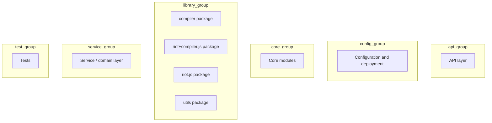

# Architecture report: riot/riot

> Automated static analysis. **Observed** = directly seen in files/imports/AST; **Inferred** = interpretation from that evidence. Repository code was not executed.

## 1. Repository at a glance

| Item | Value |
| --- | --- |
| Repository | riot/riot |
| Description | Simple and elegant component-based UI library |
| Language | JavaScript |
| Stars | 14925 |
| Licence | Other |
| Analysed commit / branch | e46e3bbf962b2bfad672de199c67bcc4147e430b / main |
| Framework(s) | None detected |
| Files analysed | 162 |
| Components | 9 |

## 2. Architecture in one minute

riot/riot - Simple and elegant component-based UI library. This repository was analysed statically from 162 file(s) (0 Python). Detected technologies (observed from imports/manifests): GitHub Actions, TypeScript. Files are grouped into 9 component(s): API layer, compiler package, Configuration and deployment, Core modules, riot+compiler.js package, riot.js package, Service / domain layer, Tests. Findings below distinguish observed facts from inferred interpretation.

## 3. High-level block diagram

## 4. Main components

### API layer (`api_layer`)

- **Kind:** api
- **Status:** Observed
- **Confidence:** 0.85
- **Responsibility:** Groups 12 file(s) under api layer (observed from repository paths and static analysis).
- **Paths:** `src/api/__.js`, `src/api/component.js`, `src/api/create-pure-component.js`, `src/api/install.js`, `src/api/mount.js`, `src/api/pure.js`, `src/api/register.js`, `src/api/uninstall.js`, `src/api/unmount.js`, `src/api/unregister.js`, `src/api/version.js`, `src/api/with-types.js`
- **Evidence:** [src/api/__.js](https://github.com/riot/riot/blob/e46e3bbf962b2bfad672de199c67bcc4147e430b/src/api/__.js); [src/api/component.js](https://github.com/riot/riot/blob/e46e3bbf962b2bfad672de199c67bcc4147e430b/src/api/component.js); [src/api/create-pure-component.js](https://github.com/riot/riot/blob/e46e3bbf962b2bfad672de199c67bcc4147e430b/src/api/create-pure-component.js); [src/api/install.js](https://github.com/riot/riot/blob/e46e3bbf962b2bfad672de199c67bcc4147e430b/src/api/install.js); [src/api/mount.js](https://github.com/riot/riot/blob/e46e3bbf962b2bfad672de199c67bcc4147e430b/src/api/mount.js); [src/api/pure.js](https://github.com/riot/riot/blob/e46e3bbf962b2bfad672de199c67bcc4147e430b/src/api/pure.js); [src/api/register.js](https://github.com/riot/riot/blob/e46e3bbf962b2bfad672de199c67bcc4147e430b/src/api/register.js); [src/api/uninstall.js](https://github.com/riot/riot/blob/e46e3bbf962b2bfad672de199c67bcc4147e430b/src/api/uninstall.js)

### compiler package (`compiler`)

- **Kind:** library
- **Status:** Observed
- **Confidence:** 0.85
- **Responsibility:** Groups 10 file(s) under compiler package (observed from repository paths and static analysis).
- **Paths:** `src/compiler/compile-from-string.js`, `src/compiler/compile-from-url.js`, `src/compiler/compile.js`, `src/compiler/component-with-slots.js`, `src/compiler/define-window-riot-global-registry.js`, `src/compiler/evaluate.js`, `src/compiler/global-registry.js`, `src/compiler/inject.js`, `src/compiler/mount-with-slots.js`, `src/compiler/transpile.js`
- **Evidence:** [src/compiler/compile-from-string.js](https://github.com/riot/riot/blob/e46e3bbf962b2bfad672de199c67bcc4147e430b/src/compiler/compile-from-string.js); [src/compiler/compile-from-url.js](https://github.com/riot/riot/blob/e46e3bbf962b2bfad672de199c67bcc4147e430b/src/compiler/compile-from-url.js); [src/compiler/compile.js](https://github.com/riot/riot/blob/e46e3bbf962b2bfad672de199c67bcc4147e430b/src/compiler/compile.js); [src/compiler/component-with-slots.js](https://github.com/riot/riot/blob/e46e3bbf962b2bfad672de199c67bcc4147e430b/src/compiler/component-with-slots.js); [src/compiler/define-window-riot-global-registry.js](https://github.com/riot/riot/blob/e46e3bbf962b2bfad672de199c67bcc4147e430b/src/compiler/define-window-riot-global-registry.js); [src/compiler/evaluate.js](https://github.com/riot/riot/blob/e46e3bbf962b2bfad672de199c67bcc4147e430b/src/compiler/evaluate.js); [src/compiler/global-registry.js](https://github.com/riot/riot/blob/e46e3bbf962b2bfad672de199c67bcc4147e430b/src/compiler/global-registry.js); [src/compiler/inject.js](https://github.com/riot/riot/blob/e46e3bbf962b2bfad672de199c67bcc4147e430b/src/compiler/inject.js)

### Configuration and deployment (`config`)

- **Kind:** config
- **Status:** Observed
- **Confidence:** 0.85
- **Responsibility:** Groups 1 file(s) under configuration and deployment (observed from repository paths and static analysis).
- **Paths:** `package.json`
- **Evidence:** [package.json](https://github.com/riot/riot/blob/e46e3bbf962b2bfad672de199c67bcc4147e430b/package.json)

### Core modules (`core`)

- **Kind:** core
- **Status:** Observed
- **Confidence:** 0.85
- **Responsibility:** Groups 5 file(s) under core modules (observed from repository paths and static analysis).
- **Paths:** `eslint.config.js`, `riot.d.ts`, `riot.js`, `rollup.config.js`, `wdio.conf.js`
- **Evidence:** [eslint.config.js](https://github.com/riot/riot/blob/e46e3bbf962b2bfad672de199c67bcc4147e430b/eslint.config.js); [riot.d.ts](https://github.com/riot/riot/blob/e46e3bbf962b2bfad672de199c67bcc4147e430b/riot.d.ts); [riot.js](https://github.com/riot/riot/blob/e46e3bbf962b2bfad672de199c67bcc4147e430b/riot.js); [rollup.config.js](https://github.com/riot/riot/blob/e46e3bbf962b2bfad672de199c67bcc4147e430b/rollup.config.js); [wdio.conf.js](https://github.com/riot/riot/blob/e46e3bbf962b2bfad672de199c67bcc4147e430b/wdio.conf.js)

### riot+compiler.js package (`riot_compiler_js`)

- **Kind:** library
- **Status:** Observed
- **Confidence:** 0.85
- **Responsibility:** Groups 1 file(s) under riot+compiler.js package (observed from repository paths and static analysis).
- **Paths:** `src/riot+compiler.js`
- **Evidence:** [src/riot+compiler.js](https://github.com/riot/riot/blob/e46e3bbf962b2bfad672de199c67bcc4147e430b/src/riot%2Bcompiler.js)

### riot.js package (`riot_js`)

- **Kind:** library
- **Status:** Observed
- **Confidence:** 0.85
- **Responsibility:** Groups 1 file(s) under riot.js package (observed from repository paths and static analysis).
- **Paths:** `src/riot.js`
- **Evidence:** [src/riot.js](https://github.com/riot/riot/blob/e46e3bbf962b2bfad672de199c67bcc4147e430b/src/riot.js)

### Service / domain layer (`service_layer`)

- **Kind:** service
- **Status:** Observed
- **Confidence:** 0.85
- **Responsibility:** Groups 18 file(s) under service / domain layer (observed from repository paths and static analysis).
- **Paths:** `src/core/add-css-hook.js`, `src/core/bind-dom-node-to-component-instance.js`, `src/core/component-dom-selectors.js`, `src/core/component-lifecycle-methods.js`, `src/core/component-template-factory.js`, `src/core/compute-component-state.js`, `src/core/compute-initial-props.js`, `src/core/create-attribute-bindings.js`, `src/core/create-component-from-wrapper.js`, `src/core/create-core-api-methods.js`, `src/core/create-pure-component.js`, `src/core/css-manager.js`, `src/core/instantiate-component.js`, `src/core/manage-component-lifecycle.js`, `src/core/mocked-template-interface.js`, `src/core/mount-component.js`, `src/core/pure-component-api.js`, `src/core/run-plugins.js`
- **Evidence:** [src/core/add-css-hook.js](https://github.com/riot/riot/blob/e46e3bbf962b2bfad672de199c67bcc4147e430b/src/core/add-css-hook.js); [src/core/bind-dom-node-to-component-instance.js](https://github.com/riot/riot/blob/e46e3bbf962b2bfad672de199c67bcc4147e430b/src/core/bind-dom-node-to-component-instance.js); [src/core/component-dom-selectors.js](https://github.com/riot/riot/blob/e46e3bbf962b2bfad672de199c67bcc4147e430b/src/core/component-dom-selectors.js); [src/core/component-lifecycle-methods.js](https://github.com/riot/riot/blob/e46e3bbf962b2bfad672de199c67bcc4147e430b/src/core/component-lifecycle-methods.js); [src/core/component-template-factory.js](https://github.com/riot/riot/blob/e46e3bbf962b2bfad672de199c67bcc4147e430b/src/core/component-template-factory.js); [src/core/compute-component-state.js](https://github.com/riot/riot/blob/e46e3bbf962b2bfad672de199c67bcc4147e430b/src/core/compute-component-state.js); [src/core/compute-initial-props.js](https://github.com/riot/riot/blob/e46e3bbf962b2bfad672de199c67bcc4147e430b/src/core/compute-initial-props.js); [src/core/create-attribute-bindings.js](https://github.com/riot/riot/blob/e46e3bbf962b2bfad672de199c67bcc4147e430b/src/core/create-attribute-bindings.js)

### Tests (`tests`)

- **Kind:** test
- **Status:** Observed
- **Confidence:** 0.85
- **Responsibility:** Groups 96 file(s) under tests (observed from repository paths and static analysis).
- **Paths:** `test/components/child.riot`, `test/components/comments-and-expressions.riot`, `test/components/component-with-getters.riot`, `test/components/conditional-select-option.riot`, `test/components/conditional-slot-parent.riot`, `test/components/conditional-slot.riot`, `test/components/custom-tag-ref-attribute.riot`, `test/components/dashed-attribute-child.riot`, `test/components/dashed-attribute-parent.riot`, `test/components/default-content-slot.riot`, `test/components/each-and-spread-attribute.riot`, `test/components/each-custom-children-components.riot`, `test/components/each-root-attributes.riot`, `test/components/expression-parts.riot`, `test/components/global-components.riot`, `test/components/hmr-child-parent.riot`, `test/components/hmr-child-v1.riot`, `test/components/hmr-child-v2.riot`, `test/components/invalid-pure-css-component.riot`, `test/components/invalid-pure-html-component.riot`, `test/components/issue-2895-child.riot`, `test/components/issue-2895-parent.riot`, `test/components/issue-2978-child.riot`, `test/components/issue-2978-parent.riot`, `test/components/issue-2994-class-duplication-nested-expression.riot`, `test/components/issue-2994-class-duplication.riot`, `test/components/issue-3003-parent.riot`, `test/components/issue-3011-missing-css-class.riot`, `test/components/issue-3021-boolean-attribute.riot`, `test/components/issue-3051-class-duplication.riot`, `test/components/issue-3055-child.riot`, `test/components/issue-3055-combined.riot`, `test/components/issue-3055-overwrite.riot`, `test/components/issue-3055-parent.riot`, `test/components/loop-with-slots.riot`, `test/components/merge-attributes.riot`, `test/components/message-consumer.riot`, `test/components/message-provider-hoc.riot`, `test/components/named-slots-parent.riot`, `test/components/named-slots.riot`, `test/components/native-attributes.riot`, `test/components/native-inline-events.riot`, `test/components/nested-aliased-imports.riot`, `test/components/nested-hoc.riot`, `test/components/nested-imports.riot`, `test/components/nested-raw-components.riot`, `test/components/nested-slot.riot`, `test/components/old-syntax.riot`, `test/components/parent-context-child.riot`, `test/components/parent-context.riot`, `test/components/parent-value-prop.riot`, `test/components/parent-with-slots.riot`, `test/components/pure-component.riot`, `test/components/pure-object.riot`, `test/components/raw-component.riot`, `test/components/recursive-tree.riot`, `test/components/runtime-is-directive.riot`, `test/components/runtime-slot-with-children.riot`, `test/components/runtime-slot.riot`, `test/components/shorthand-attribute.riot`, `test/components/simple-ref-attribute.riot`, `test/components/simple-slot.riot`, `test/components/simple.riot`, `test/components/spread-attribute.riot`, `test/components/static-attribute.riot`, `test/components/static-component.riot`, `test/components/sub-nested-slot.riot`, `test/components/template-slot.riot`, `test/components/title-prop.riot`, `test/components/view-one.riot`, `test/components/view-two.riot`, `test/components/virtual-each.riot`, `test/e2e/index.html`, `test/e2e/index.js`, `test/e2e/rollup.config.js`, `test/e2e/test.e2e.js`, `test/setup.js`, `test/specs/compiler.spec.js`, `test/specs/components-registration.spec.js`, `test/specs/components-rendering.spec.js`, `test/specs/hot-reload.spec.js`, `test/specs/lifecycle-events.spec.js`, `test/specs/plugins-api.spec.js`, `test/specs/public-api.spec.js`, `test/specs/slots.spec.js`, `test/specs/state-and-props.spec.js`, `test/tsconfig.json`, `test/typing/autobound-methods-type-inference.ts`, `test/typing/component-function-export.spec.ts`, `test/typing/component-object-export.spec.ts`, `test/typing/public-api.spec.ts`, `test/typing/pure-component.ts`, `test/typing/shims-riot.d.ts`, `test/typing/with-types-infer.ts`, `test/typing/wrapper-template-get-component-return-type.ts`, `test/utils.js`
- **Evidence:** [test/components/child.riot](https://github.com/riot/riot/blob/e46e3bbf962b2bfad672de199c67bcc4147e430b/test/components/child.riot); [test/components/comments-and-expressions.riot](https://github.com/riot/riot/blob/e46e3bbf962b2bfad672de199c67bcc4147e430b/test/components/comments-and-expressions.riot); [test/components/component-with-getters.riot](https://github.com/riot/riot/blob/e46e3bbf962b2bfad672de199c67bcc4147e430b/test/components/component-with-getters.riot); [test/components/conditional-select-option.riot](https://github.com/riot/riot/blob/e46e3bbf962b2bfad672de199c67bcc4147e430b/test/components/conditional-select-option.riot); [test/components/conditional-slot-parent.riot](https://github.com/riot/riot/blob/e46e3bbf962b2bfad672de199c67bcc4147e430b/test/components/conditional-slot-parent.riot); [test/components/conditional-slot.riot](https://github.com/riot/riot/blob/e46e3bbf962b2bfad672de199c67bcc4147e430b/test/components/conditional-slot.riot); [test/components/custom-tag-ref-attribute.riot](https://github.com/riot/riot/blob/e46e3bbf962b2bfad672de199c67bcc4147e430b/test/components/custom-tag-ref-attribute.riot); [test/components/dashed-attribute-child.riot](https://github.com/riot/riot/blob/e46e3bbf962b2bfad672de199c67bcc4147e430b/test/components/dashed-attribute-child.riot)

### utils package (`utils`)

- **Kind:** library
- **Status:** Observed
- **Confidence:** 0.85
- **Responsibility:** Groups 3 file(s) under utils package (observed from repository paths and static analysis).
- **Paths:** `src/utils/create-runtime-slots.js`, `src/utils/dom.js`, `src/utils/get-root-computed-attribute-names.js`
- **Evidence:** [src/utils/create-runtime-slots.js](https://github.com/riot/riot/blob/e46e3bbf962b2bfad672de199c67bcc4147e430b/src/utils/create-runtime-slots.js); [src/utils/dom.js](https://github.com/riot/riot/blob/e46e3bbf962b2bfad672de199c67bcc4147e430b/src/utils/dom.js); [src/utils/get-root-computed-attribute-names.js](https://github.com/riot/riot/blob/e46e3bbf962b2bfad672de199c67bcc4147e430b/src/utils/get-root-computed-attribute-names.js)

## 5. Execution flow

**Observed** entry point(s):

- [riot.js](https://github.com/riot/riot/blob/e46e3bbf962b2bfad672de199c67bcc4147e430b/riot.js)

Representative flow (derived from observed entry points and the import graph; steps beyond the entry point are **Inferred**):

1. Execution starts at an observed entry point listed above, if present.
2. No internal import relationships between components were observed.

## 6. Project structure

### `(root)`

- `.gitignore` - other (774 bytes)
- `.prettierignore` - other (110 bytes)
- `.prettierrc.js` - source, JavaScript (67 bytes)
- `AWESOME.md` - docs (8609 bytes)
- `CODE_OF_CONDUCT.md` - docs (5223 bytes)
- `LICENSE.txt` - docs (1186 bytes)
- `Makefile` - other (4105 bytes)
- `README.md` - docs (8740 bytes)
- `eslint.config.js` - source, JavaScript (472 bytes)
- `package.json` - manifest (2497 bytes)
- `riot.d.ts` - source, TypeScript (7577 bytes)
- `riot.js` - source, JavaScript (88807 bytes)
- `rollup.config.js` - source, JavaScript (840 bytes)
- `wdio.conf.js` - source, JavaScript (12461 bytes)

### `.github`

- `.github/CONTRIBUTING.md` - docs (2007 bytes)
- `.github/FUNDING.yml` - config (642 bytes)
- `.github/ISSUE_TEMPLATE/bug_report.md` - docs (609 bytes)
- `.github/ISSUE_TEMPLATE/feature_request.md` - docs (899 bytes)
- `.github/PULL_REQUEST_TEMPLATE.md` - docs (577 bytes)
- `.github/workflows/test.yml` - ci, YAML (1334 bytes)

### `.qlty`

- `.qlty/qlty.toml` - config (146 bytes)

### `src`

- `src/api/__.js` - source, JavaScript (824 bytes)
- `src/api/component.js` - source, JavaScript (618 bytes)
- `src/api/create-pure-component.js` - source, JavaScript (718 bytes)
- `src/api/install.js` - source, JavaScript (472 bytes)
- `src/api/mount.js` - source, JavaScript (585 bytes)
- `src/api/pure.js` - source, JavaScript (436 bytes)
- `src/api/register.js` - source, JavaScript (927 bytes)
- `src/api/uninstall.js` - source, JavaScript (372 bytes)
- `src/api/unmount.js` - source, JavaScript (636 bytes)
- `src/api/unregister.js` - source, JavaScript (526 bytes)
- `src/api/version.js` - source, JavaScript (72 bytes)
- `src/api/with-types.js` - source, JavaScript (303 bytes)
- `src/compiler/compile-from-string.js` - source, JavaScript (203 bytes)
- `src/compiler/compile-from-url.js` - source, JavaScript (294 bytes)
- `src/compiler/compile.js` - source, JavaScript (554 bytes)
- `src/compiler/component-with-slots.js` - source, JavaScript (514 bytes)
- `src/compiler/define-window-riot-global-registry.js` - source, JavaScript (194 bytes)
- `src/compiler/evaluate.js` - source, JavaScript (808 bytes)
- `src/compiler/global-registry.js` - source, JavaScript (51 bytes)
- `src/compiler/inject.js` - source, JavaScript (484 bytes)
- `src/compiler/mount-with-slots.js` - source, JavaScript (680 bytes)
- `src/compiler/transpile.js` - source, JavaScript (161 bytes)
- `src/core/add-css-hook.js` - source, JavaScript (489 bytes)
- `src/core/bind-dom-node-to-component-instance.js` - source, JavaScript (415 bytes)
- `src/core/component-dom-selectors.js` - source, JavaScript (225 bytes)
- `src/core/component-lifecycle-methods.js` - source, JavaScript (456 bytes)
- `src/core/component-template-factory.js` - source, JavaScript (682 bytes)
- `src/core/compute-component-state.js` - source, JavaScript (413 bytes)
- `src/core/compute-initial-props.js` - source, JavaScript (493 bytes)
- `src/core/create-attribute-bindings.js` - source, JavaScript (729 bytes)
- `src/core/create-component-from-wrapper.js` - source, JavaScript (5843 bytes)
- `src/core/create-core-api-methods.js` - source, JavaScript (527 bytes)
- `src/core/create-pure-component.js` - source, JavaScript (1672 bytes)
- `src/core/css-manager.js` - source, JavaScript (1678 bytes)
- `src/core/instantiate-component.js` - source, JavaScript (1554 bytes)
- `src/core/manage-component-lifecycle.js` - source, JavaScript (6520 bytes)
- `src/core/mocked-template-interface.js` - source, JavaScript (655 bytes)
- `src/core/mount-component.js` - source, JavaScript (841 bytes)
- `src/core/pure-component-api.js` - source, JavaScript (243 bytes)
- `src/core/run-plugins.js` - source, JavaScript (342 bytes)
- `src/riot+compiler.js` - source, JavaScript (841 bytes)
- `src/riot.js` - source, JavaScript (411 bytes)
- `src/utils/create-runtime-slots.js` - source, JavaScript (829 bytes)
- `src/utils/dom.js` - source, JavaScript (368 bytes)
- `src/utils/get-root-computed-attribute-names.js` - source, JavaScript (841 bytes)

### `test`

- `test/components/child.riot` - test (141 bytes)
- `test/components/comments-and-expressions.riot` - test (198 bytes)
- `test/components/component-with-getters.riot` - test (365 bytes)
- `test/components/conditional-select-option.riot` - test (148 bytes)
- `test/components/conditional-slot-parent.riot` - test (411 bytes)
- `test/components/conditional-slot.riot` - test (88 bytes)
- `test/components/custom-tag-ref-attribute.riot` - test (223 bytes)
- `test/components/dashed-attribute-child.riot` - test (79 bytes)
- `test/components/dashed-attribute-parent.riot` - test (282 bytes)
- `test/components/default-content-slot.riot` - test (270 bytes)
- `test/components/each-and-spread-attribute.riot` - test (360 bytes)
- `test/components/each-custom-children-components.riot` - test (375 bytes)
- `test/components/each-root-attributes.riot` - test (229 bytes)
- `test/components/expression-parts.riot` - test (88 bytes)
- `test/components/global-components.riot` - test (99 bytes)
- `test/components/hmr-child-parent.riot` - test (271 bytes)
- `test/components/hmr-child-v1.riot` - test (60 bytes)
- `test/components/hmr-child-v2.riot` - test (60 bytes)
- `test/components/invalid-pure-css-component.riot` - test (269 bytes)
- `test/components/invalid-pure-html-component.riot` - test (228 bytes)
- `test/components/issue-2895-child.riot` - test (204 bytes)
- `test/components/issue-2895-parent.riot` - test (456 bytes)
- `test/components/issue-2978-child.riot` - test (72 bytes)
- `test/components/issue-2978-parent.riot` - test (214 bytes)
- `test/components/issue-2994-class-duplication-nested-expression.riot` - test (129 bytes)
- `test/components/issue-2994-class-duplication.riot` - test (138 bytes)
- `test/components/issue-3003-parent.riot` - test (229 bytes)
- `test/components/issue-3011-missing-css-class.riot` - test (264 bytes)
- `test/components/issue-3021-boolean-attribute.riot` - test (199 bytes)
- `test/components/issue-3051-class-duplication.riot` - test (330 bytes)
- `test/components/issue-3055-child.riot` - test (108 bytes)
- `test/components/issue-3055-combined.riot` - test (421 bytes)
- `test/components/issue-3055-overwrite.riot` - test (325 bytes)
- `test/components/issue-3055-parent.riot` - test (302 bytes)
- `test/components/loop-with-slots.riot` - test (563 bytes)
- `test/components/merge-attributes.riot` - test (93 bytes)
- `test/components/message-consumer.riot` - test (330 bytes)
- `test/components/message-provider-hoc.riot` - test (315 bytes)
- `test/components/named-slots-parent.riot` - test (485 bytes)
- `test/components/named-slots.riot` - test (173 bytes)
- `test/components/native-attributes.riot` - test (112 bytes)
- `test/components/native-inline-events.riot` - test (101 bytes)
- `test/components/nested-aliased-imports.riot` - test (262 bytes)
- `test/components/nested-hoc.riot` - test (582 bytes)
- `test/components/nested-imports.riot` - test (229 bytes)
- `test/components/nested-raw-components.riot` - test (312 bytes)
- `test/components/nested-slot.riot` - test (331 bytes)
- `test/components/old-syntax.riot` - test (288 bytes)
- `test/components/parent-context-child.riot` - test (676 bytes)
- `test/components/parent-context.riot` - test (258 bytes)
- `test/components/parent-value-prop.riot` - test (202 bytes)
- `test/components/parent-with-slots.riot` - test (240 bytes)
- `test/components/pure-component.riot` - test (388 bytes)
- `test/components/pure-object.riot` - test (215 bytes)
- `test/components/raw-component.riot` - test (300 bytes)
- `test/components/recursive-tree.riot` - test (170 bytes)
- `test/components/runtime-is-directive.riot` - test (349 bytes)
- `test/components/runtime-slot-with-children.riot` - test (254 bytes)
- `test/components/runtime-slot.riot` - test (52 bytes)
- `test/components/shorthand-attribute.riot` - test (187 bytes)
- `test/components/simple-ref-attribute.riot` - test (257 bytes)
- `test/components/simple-slot.riot` - test (38 bytes)
- `test/components/simple.riot` - test (285 bytes)
- `test/components/spread-attribute.riot` - test (333 bytes)
- `test/components/static-attribute.riot` - test (212 bytes)
- `test/components/static-component.riot` - test (62 bytes)
- `test/components/sub-nested-slot.riot` - test (237 bytes)
- `test/components/template-slot.riot` - test (282 bytes)
- `test/components/title-prop.riot` - test (53 bytes)
- `test/components/view-one.riot` - test (47 bytes)
- `test/components/view-two.riot` - test (71 bytes)
- `test/components/virtual-each.riot` - test (314 bytes)
- `test/e2e/index.html` - test (1489 bytes)
- `test/e2e/index.js` - test, JavaScript (324 bytes)
- `test/e2e/rollup.config.js` - test, JavaScript (441 bytes)
- `test/e2e/test.e2e.js` - test, JavaScript (433 bytes)
- `test/setup.js` - test, JavaScript (263 bytes)
- `test/specs/compiler.spec.js` - test, JavaScript (4054 bytes)
- `test/specs/components-registration.spec.js` - test, JavaScript (8987 bytes)
- `test/specs/components-rendering.spec.js` - test, JavaScript (5878 bytes)
- `test/specs/hot-reload.spec.js` - test, JavaScript (5176 bytes)
- `test/specs/lifecycle-events.spec.js` - test, JavaScript (12230 bytes)
- `test/specs/plugins-api.spec.js` - test, JavaScript (1074 bytes)
- `test/specs/public-api.spec.js` - test, JavaScript (456 bytes)
- `test/specs/slots.spec.js` - test, JavaScript (7537 bytes)
- `test/specs/state-and-props.spec.js` - test, JavaScript (7638 bytes)
- `test/tsconfig.json` - test (985 bytes)
- `test/typing/autobound-methods-type-inference.ts` - test, TypeScript (710 bytes)
- `test/typing/component-function-export.spec.ts` - test, TypeScript (2005 bytes)
- `test/typing/component-object-export.spec.ts` - test, TypeScript (2926 bytes)
- `test/typing/public-api.spec.ts` - test, TypeScript (790 bytes)
- `test/typing/pure-component.ts` - test, TypeScript (655 bytes)
- `test/typing/shims-riot.d.ts` - test, TypeScript (207 bytes)
- `test/typing/with-types-infer.ts` - test, TypeScript (4176 bytes)
- `test/typing/wrapper-template-get-component-return-type.ts` - test, TypeScript (481 bytes)
- `test/utils.js` - test, JavaScript (289 bytes)

## 7. Key dependencies and integrations

| Name | Category | Status | Confidence | Evidence |
| --- | --- | --- | --- | --- |
| GitHub Actions | ci | Observed | 0.85 | [.github/workflows/test.yml](https://github.com/riot/riot/blob/e46e3bbf962b2bfad672de199c67bcc4147e430b/.github/workflows/test.yml) |
| TypeScript | tooling | Observed | 0.85 | [package.json:101](https://github.com/riot/riot/blob/e46e3bbf962b2bfad672de199c67bcc4147e430b/package.json#L101) |

## 8. Data and state

No database, cache, queue, or persistent-state usage was observed in the analysed files. State handling, if any, may be in-memory or in files that were not analysed.

## 9. Configuration and deployment clues

- `.github/FUNDING.yml` (config)
- `.github/workflows/test.yml` (ci)
- `.qlty/qlty.toml` (config)
- `package.json` (manifest)

## 10. Design observations

- An entry/API layer is separated from other code (Inferred from paths and decorators).
- Service/domain code is distinct from entry and data code, suggesting layered separation (Inferred).
- Tests are present alongside source code (Observed from test file paths).

These observations are interpretations (**Inferred**) of the observed structure, not guarantees about runtime design.

## 11. Limitations and unknowns

- Static analysis only: repository code was not executed, installed, or imported at runtime.
- Components and relationships are inferred from file paths, imports, and AST structure; runtime behaviour, dynamic imports, and reflection may not be visible.
- No clear application entry point was observed in the analysed files.
- Repository text was treated as untrusted data; no instructions found in repository files were followed, and likely secret values were redacted/excluded.
- JavaScript and TypeScript files were inventoried from paths and package manifests. They were not parsed with a full language AST, and repository code was not executed.

## 12. Source references

- [.github/workflows/test.yml](https://github.com/riot/riot/blob/e46e3bbf962b2bfad672de199c67bcc4147e430b/.github/workflows/test.yml)
- [eslint.config.js](https://github.com/riot/riot/blob/e46e3bbf962b2bfad672de199c67bcc4147e430b/eslint.config.js)
- [package.json](https://github.com/riot/riot/blob/e46e3bbf962b2bfad672de199c67bcc4147e430b/package.json)
- [package.json:101](https://github.com/riot/riot/blob/e46e3bbf962b2bfad672de199c67bcc4147e430b/package.json#L101)
- [riot.d.ts](https://github.com/riot/riot/blob/e46e3bbf962b2bfad672de199c67bcc4147e430b/riot.d.ts)
- [riot.js](https://github.com/riot/riot/blob/e46e3bbf962b2bfad672de199c67bcc4147e430b/riot.js)
- [rollup.config.js](https://github.com/riot/riot/blob/e46e3bbf962b2bfad672de199c67bcc4147e430b/rollup.config.js)
- [src/api/__.js](https://github.com/riot/riot/blob/e46e3bbf962b2bfad672de199c67bcc4147e430b/src/api/__.js)
- [src/api/component.js](https://github.com/riot/riot/blob/e46e3bbf962b2bfad672de199c67bcc4147e430b/src/api/component.js)
- [src/api/create-pure-component.js](https://github.com/riot/riot/blob/e46e3bbf962b2bfad672de199c67bcc4147e430b/src/api/create-pure-component.js)
- [src/api/install.js](https://github.com/riot/riot/blob/e46e3bbf962b2bfad672de199c67bcc4147e430b/src/api/install.js)
- [src/api/mount.js](https://github.com/riot/riot/blob/e46e3bbf962b2bfad672de199c67bcc4147e430b/src/api/mount.js)
- [src/api/pure.js](https://github.com/riot/riot/blob/e46e3bbf962b2bfad672de199c67bcc4147e430b/src/api/pure.js)
- [src/api/register.js](https://github.com/riot/riot/blob/e46e3bbf962b2bfad672de199c67bcc4147e430b/src/api/register.js)
- [src/api/uninstall.js](https://github.com/riot/riot/blob/e46e3bbf962b2bfad672de199c67bcc4147e430b/src/api/uninstall.js)
- [src/compiler/compile-from-string.js](https://github.com/riot/riot/blob/e46e3bbf962b2bfad672de199c67bcc4147e430b/src/compiler/compile-from-string.js)
- [src/compiler/compile-from-url.js](https://github.com/riot/riot/blob/e46e3bbf962b2bfad672de199c67bcc4147e430b/src/compiler/compile-from-url.js)
- [src/compiler/compile.js](https://github.com/riot/riot/blob/e46e3bbf962b2bfad672de199c67bcc4147e430b/src/compiler/compile.js)
- [src/compiler/component-with-slots.js](https://github.com/riot/riot/blob/e46e3bbf962b2bfad672de199c67bcc4147e430b/src/compiler/component-with-slots.js)
- [src/compiler/define-window-riot-global-registry.js](https://github.com/riot/riot/blob/e46e3bbf962b2bfad672de199c67bcc4147e430b/src/compiler/define-window-riot-global-registry.js)
- [src/compiler/evaluate.js](https://github.com/riot/riot/blob/e46e3bbf962b2bfad672de199c67bcc4147e430b/src/compiler/evaluate.js)
- [src/compiler/global-registry.js](https://github.com/riot/riot/blob/e46e3bbf962b2bfad672de199c67bcc4147e430b/src/compiler/global-registry.js)
- [src/compiler/inject.js](https://github.com/riot/riot/blob/e46e3bbf962b2bfad672de199c67bcc4147e430b/src/compiler/inject.js)
- [src/core/add-css-hook.js](https://github.com/riot/riot/blob/e46e3bbf962b2bfad672de199c67bcc4147e430b/src/core/add-css-hook.js)
- [src/core/bind-dom-node-to-component-instance.js](https://github.com/riot/riot/blob/e46e3bbf962b2bfad672de199c67bcc4147e430b/src/core/bind-dom-node-to-component-instance.js)
- [src/core/component-dom-selectors.js](https://github.com/riot/riot/blob/e46e3bbf962b2bfad672de199c67bcc4147e430b/src/core/component-dom-selectors.js)
- [src/core/component-lifecycle-methods.js](https://github.com/riot/riot/blob/e46e3bbf962b2bfad672de199c67bcc4147e430b/src/core/component-lifecycle-methods.js)
- [src/core/component-template-factory.js](https://github.com/riot/riot/blob/e46e3bbf962b2bfad672de199c67bcc4147e430b/src/core/component-template-factory.js)
- [src/core/compute-component-state.js](https://github.com/riot/riot/blob/e46e3bbf962b2bfad672de199c67bcc4147e430b/src/core/compute-component-state.js)
- [src/core/compute-initial-props.js](https://github.com/riot/riot/blob/e46e3bbf962b2bfad672de199c67bcc4147e430b/src/core/compute-initial-props.js)
- [src/core/create-attribute-bindings.js](https://github.com/riot/riot/blob/e46e3bbf962b2bfad672de199c67bcc4147e430b/src/core/create-attribute-bindings.js)
- [src/riot+compiler.js](https://github.com/riot/riot/blob/e46e3bbf962b2bfad672de199c67bcc4147e430b/src/riot%2Bcompiler.js)
- [src/riot.js](https://github.com/riot/riot/blob/e46e3bbf962b2bfad672de199c67bcc4147e430b/src/riot.js)
- [src/utils/create-runtime-slots.js](https://github.com/riot/riot/blob/e46e3bbf962b2bfad672de199c67bcc4147e430b/src/utils/create-runtime-slots.js)
- [src/utils/dom.js](https://github.com/riot/riot/blob/e46e3bbf962b2bfad672de199c67bcc4147e430b/src/utils/dom.js)
- [src/utils/get-root-computed-attribute-names.js](https://github.com/riot/riot/blob/e46e3bbf962b2bfad672de199c67bcc4147e430b/src/utils/get-root-computed-attribute-names.js)
- [test/components/child.riot](https://github.com/riot/riot/blob/e46e3bbf962b2bfad672de199c67bcc4147e430b/test/components/child.riot)
- [test/components/comments-and-expressions.riot](https://github.com/riot/riot/blob/e46e3bbf962b2bfad672de199c67bcc4147e430b/test/components/comments-and-expressions.riot)
- [test/components/component-with-getters.riot](https://github.com/riot/riot/blob/e46e3bbf962b2bfad672de199c67bcc4147e430b/test/components/component-with-getters.riot)
- [test/components/conditional-select-option.riot](https://github.com/riot/riot/blob/e46e3bbf962b2bfad672de199c67bcc4147e430b/test/components/conditional-select-option.riot)
- [test/components/conditional-slot-parent.riot](https://github.com/riot/riot/blob/e46e3bbf962b2bfad672de199c67bcc4147e430b/test/components/conditional-slot-parent.riot)
- [test/components/conditional-slot.riot](https://github.com/riot/riot/blob/e46e3bbf962b2bfad672de199c67bcc4147e430b/test/components/conditional-slot.riot)
- [test/components/custom-tag-ref-attribute.riot](https://github.com/riot/riot/blob/e46e3bbf962b2bfad672de199c67bcc4147e430b/test/components/custom-tag-ref-attribute.riot)
- [test/components/dashed-attribute-child.riot](https://github.com/riot/riot/blob/e46e3bbf962b2bfad672de199c67bcc4147e430b/test/components/dashed-attribute-child.riot)
- [wdio.conf.js](https://github.com/riot/riot/blob/e46e3bbf962b2bfad672de199c67bcc4147e430b/wdio.conf.js)
