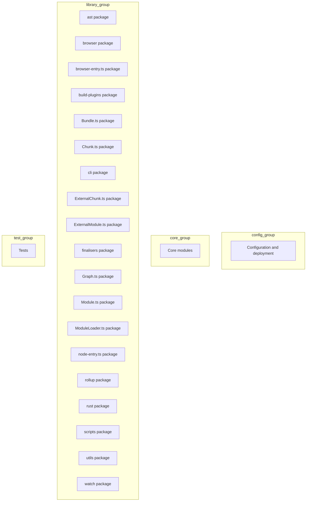

# Architecture report: rollup/rollup

> Automated static analysis. **Observed** = directly seen in files/imports/AST; **Inferred** = interpretation from that evidence. Repository code was not executed.

## 1. Repository at a glance

| Item | Value |
| --- | --- |
| Repository | rollup/rollup |
| Description | Next-generation ES module bundler |
| Language | JavaScript |
| Stars | 26305 |
| Licence | Other |
| Analysed commit / branch | 0c5497fb4d86cc769380d4945574488113e08ac2 / master |
| Framework(s) | Vue |
| Files analysed | 799 |
| Components | 22 |

## 2. Architecture in one minute

rollup/rollup - Next-generation ES module bundler. This repository was analysed statically from 799 file(s) (0 Python). Detected technologies (observed from imports/manifests): GitHub Actions, Vue, TypeScript, Vite. Files are grouped into 22 component(s): ast package, browser package, browser-entry.ts package, build-plugins package, Bundle.ts package, Chunk.ts package, cli package, Configuration and deployment. Findings below distinguish observed facts from inferred interpretation.

## 3. High-level block diagram

## 4. Main components

### ast package (`ast`)

- **Kind:** library
- **Status:** Observed
- **Confidence:** 0.85
- **Responsibility:** Groups 155 file(s) under ast package (observed from repository paths and static analysis).
- **Paths:** `src/ast/DeoptimizableEntity.ts`, `src/ast/Entity.ts`, `src/ast/ExecutionContext.ts`, `src/ast/NodeInteractions.ts`, `src/ast/bufferParsers.ts`, `src/ast/childNodeKeys.ts`, `src/ast/nodes/ArrayExpression.ts`, `src/ast/nodes/ArrayPattern.ts`, `src/ast/nodes/ArrowFunctionExpression.ts`, `src/ast/nodes/AssignmentExpression.ts`, `src/ast/nodes/AssignmentPattern.ts`, `src/ast/nodes/AwaitExpression.ts`, `src/ast/nodes/BinaryExpression.ts`, `src/ast/nodes/BlockStatement.ts`, `src/ast/nodes/BreakStatement.ts`, `src/ast/nodes/CallExpression.ts`, `src/ast/nodes/CatchClause.ts`, `src/ast/nodes/ChainExpression.ts`, `src/ast/nodes/ClassBody.ts`, `src/ast/nodes/ClassDeclaration.ts`, `src/ast/nodes/ClassExpression.ts`, `src/ast/nodes/ConditionalExpression.ts`, `src/ast/nodes/ContinueStatement.ts`, `src/ast/nodes/DebuggerStatement.ts`, `src/ast/nodes/Decorator.ts`, `src/ast/nodes/DoWhileStatement.ts`, `src/ast/nodes/EmptyStatement.ts`, `src/ast/nodes/ExportAllDeclaration.ts`, `src/ast/nodes/ExportDefaultDeclaration.ts`, `src/ast/nodes/ExportNamedDeclaration.ts`, `src/ast/nodes/ExportSpecifier.ts`, `src/ast/nodes/ExpressionStatement.ts`, `src/ast/nodes/ForInStatement.ts`, `src/ast/nodes/ForOfStatement.ts`, `src/ast/nodes/ForStatement.ts`, `src/ast/nodes/FunctionDeclaration.ts`, `src/ast/nodes/FunctionExpression.ts`, `src/ast/nodes/Identifier.ts`, `src/ast/nodes/IfStatement.ts`, `src/ast/nodes/ImportAttribute.ts`, `src/ast/nodes/ImportDeclaration.ts`, `src/ast/nodes/ImportDefaultSpecifier.ts`, `src/ast/nodes/ImportExpression.ts`, `src/ast/nodes/ImportNamespaceSpecifier.ts`, `src/ast/nodes/ImportSpecifier.ts`, `src/ast/nodes/JSXAttribute.ts`, `src/ast/nodes/JSXClosingElement.ts`, `src/ast/nodes/JSXClosingFragment.ts`, `src/ast/nodes/JSXElement.ts`, `src/ast/nodes/JSXEmptyExpression.ts`, `src/ast/nodes/JSXExpressionContainer.ts`, `src/ast/nodes/JSXFragment.ts`, `src/ast/nodes/JSXIdentifier.ts`, `src/ast/nodes/JSXMemberExpression.ts`, `src/ast/nodes/JSXNamespacedName.ts`, `src/ast/nodes/JSXOpeningElement.ts`, `src/ast/nodes/JSXOpeningFragment.ts`, `src/ast/nodes/JSXSpreadAttribute.ts`, `src/ast/nodes/JSXSpreadChild.ts`, `src/ast/nodes/JSXText.ts`, `src/ast/nodes/LabeledStatement.ts`, `src/ast/nodes/Literal.ts`, `src/ast/nodes/LogicalExpression.ts`, `src/ast/nodes/MemberExpression.ts`, `src/ast/nodes/MetaProperty.ts`, `src/ast/nodes/MethodDefinition.ts`, `src/ast/nodes/NewExpression.ts`, `src/ast/nodes/NodeType.ts`, `src/ast/nodes/ObjectExpression.ts`, `src/ast/nodes/ObjectPattern.ts`, `src/ast/nodes/PanicError.ts`, `src/ast/nodes/ParseError.ts`, `src/ast/nodes/PrivateIdentifier.ts`, `src/ast/nodes/Program.ts`, `src/ast/nodes/Property.ts`, `src/ast/nodes/PropertyDefinition.ts`, `src/ast/nodes/RestElement.ts`, `src/ast/nodes/ReturnStatement.ts`, `src/ast/nodes/SequenceExpression.ts`, `src/ast/nodes/SpreadElement.ts`, `src/ast/nodes/StaticBlock.ts`, `src/ast/nodes/Super.ts`, `src/ast/nodes/SwitchCase.ts`, `src/ast/nodes/SwitchStatement.ts`, `src/ast/nodes/TaggedTemplateExpression.ts`, `src/ast/nodes/TemplateElement.ts`, `src/ast/nodes/TemplateLiteral.ts`, `src/ast/nodes/ThisExpression.ts`, `src/ast/nodes/ThrowStatement.ts`, `src/ast/nodes/TryStatement.ts`, `src/ast/nodes/UnaryExpression.ts`, `src/ast/nodes/UnknownNode.ts`, `src/ast/nodes/UpdateExpression.ts`, `src/ast/nodes/VariableDeclaration.ts`, `src/ast/nodes/VariableDeclarator.ts`, `src/ast/nodes/WhileStatement.ts`, `src/ast/nodes/YieldExpression.ts`, `src/ast/nodes/index.ts`, `src/ast/nodes/shared/ArrayPrototype.ts`, `src/ast/nodes/shared/BitFlags.ts`, `src/ast/nodes/shared/CallExpressionBase.ts`, `src/ast/nodes/shared/ClassNode.ts`, `src/ast/nodes/shared/Expression.ts`, `src/ast/nodes/shared/FunctionBase.ts`, `src/ast/nodes/shared/FunctionNode.ts`, `src/ast/nodes/shared/IdentifierBase.ts`, `src/ast/nodes/shared/JSXClosingBase.ts`, `src/ast/nodes/shared/JSXElementBase.ts`, `src/ast/nodes/shared/MethodBase.ts`, `src/ast/nodes/shared/MethodTypes.ts`, `src/ast/nodes/shared/MultiExpression.ts`, `src/ast/nodes/shared/Node.ts`, `src/ast/nodes/shared/ObjectEntity.ts`, `src/ast/nodes/shared/ObjectMember.ts`, `src/ast/nodes/shared/ObjectPrototype.ts`, `src/ast/nodes/shared/Pattern.ts`, `src/ast/nodes/shared/ReturnedIdentifier.ts`, `src/ast/nodes/shared/VariableKinds.ts`, `src/ast/nodes/shared/chainElements.ts`, `src/ast/nodes/shared/jsxHelpers.ts`, `src/ast/nodes/shared/knownGlobals.ts`, `src/ast/nodes/shared/loops.ts`, `src/ast/scopes/BlockScope.ts`, `src/ast/scopes/CatchBodyScope.ts`, `src/ast/scopes/ChildScope.ts`, `src/ast/scopes/ClassBodyScope.ts`, `src/ast/scopes/FunctionBodyScope.ts`, `src/ast/scopes/FunctionScope.ts`, `src/ast/scopes/GlobalScope.ts`, `src/ast/scopes/ModuleScope.ts`, `src/ast/scopes/ParameterScope.ts`, `src/ast/scopes/ReturnValueScope.ts`, `src/ast/scopes/Scope.ts`, `src/ast/scopes/TrackingScope.ts`, `src/ast/utils/PathTracker.ts`, `src/ast/utils/checkEffectForNodes.ts`, `src/ast/utils/identifyNode.ts`, `src/ast/utils/limitPathLength.ts`, `src/ast/utils/markTopLevelAwait.ts`, `src/ast/utils/renderLiteralValue.ts`, `src/ast/utils/tryCastLiteralValueToBoolean.ts`, `src/ast/values.ts`, `src/ast/variables/ArgumentsVariable.ts`, `src/ast/variables/ExportDefaultVariable.ts`, `src/ast/variables/ExportShimVariable.ts`, `src/ast/variables/ExternalVariable.ts`, `src/ast/variables/GlobalVariable.ts`, `src/ast/variables/LocalVariable.ts`, `src/ast/variables/NamespaceVariable.ts`, `src/ast/variables/ParameterVariable.ts`, `src/ast/variables/PromiseHandler.ts`, `src/ast/variables/SyntheticNamedExportVariable.ts`, `src/ast/variables/ThisVariable.ts`, `src/ast/variables/UndefinedVariable.ts`, `src/ast/variables/Variable.ts`
- **Evidence:** [src/ast/DeoptimizableEntity.ts](https://github.com/rollup/rollup/blob/0c5497fb4d86cc769380d4945574488113e08ac2/src/ast/DeoptimizableEntity.ts); [src/ast/Entity.ts](https://github.com/rollup/rollup/blob/0c5497fb4d86cc769380d4945574488113e08ac2/src/ast/Entity.ts); [src/ast/ExecutionContext.ts](https://github.com/rollup/rollup/blob/0c5497fb4d86cc769380d4945574488113e08ac2/src/ast/ExecutionContext.ts); [src/ast/NodeInteractions.ts](https://github.com/rollup/rollup/blob/0c5497fb4d86cc769380d4945574488113e08ac2/src/ast/NodeInteractions.ts); [src/ast/bufferParsers.ts](https://github.com/rollup/rollup/blob/0c5497fb4d86cc769380d4945574488113e08ac2/src/ast/bufferParsers.ts); [src/ast/childNodeKeys.ts](https://github.com/rollup/rollup/blob/0c5497fb4d86cc769380d4945574488113e08ac2/src/ast/childNodeKeys.ts); [src/ast/nodes/ArrayExpression.ts](https://github.com/rollup/rollup/blob/0c5497fb4d86cc769380d4945574488113e08ac2/src/ast/nodes/ArrayExpression.ts); [src/ast/nodes/ArrayPattern.ts](https://github.com/rollup/rollup/blob/0c5497fb4d86cc769380d4945574488113e08ac2/src/ast/nodes/ArrayPattern.ts)

### browser package (`browser`)

- **Kind:** library
- **Status:** Observed
- **Confidence:** 0.85
- **Responsibility:** Groups 8 file(s) under browser package (observed from repository paths and static analysis).
- **Paths:** `browser/src/error.ts`, `browser/src/fs.ts`, `browser/src/hookActions.ts`, `browser/src/initWasm.ts`, `browser/src/path.ts`, `browser/src/performance.ts`, `browser/src/process.ts`, `browser/src/wasm.ts`
- **Evidence:** [browser/src/error.ts](https://github.com/rollup/rollup/blob/0c5497fb4d86cc769380d4945574488113e08ac2/browser/src/error.ts); [browser/src/fs.ts](https://github.com/rollup/rollup/blob/0c5497fb4d86cc769380d4945574488113e08ac2/browser/src/fs.ts); [browser/src/hookActions.ts](https://github.com/rollup/rollup/blob/0c5497fb4d86cc769380d4945574488113e08ac2/browser/src/hookActions.ts); [browser/src/initWasm.ts](https://github.com/rollup/rollup/blob/0c5497fb4d86cc769380d4945574488113e08ac2/browser/src/initWasm.ts); [browser/src/path.ts](https://github.com/rollup/rollup/blob/0c5497fb4d86cc769380d4945574488113e08ac2/browser/src/path.ts); [browser/src/performance.ts](https://github.com/rollup/rollup/blob/0c5497fb4d86cc769380d4945574488113e08ac2/browser/src/performance.ts); [browser/src/process.ts](https://github.com/rollup/rollup/blob/0c5497fb4d86cc769380d4945574488113e08ac2/browser/src/process.ts); [browser/src/wasm.ts](https://github.com/rollup/rollup/blob/0c5497fb4d86cc769380d4945574488113e08ac2/browser/src/wasm.ts)

### browser-entry.ts package (`browser_entry_ts`)

- **Kind:** library
- **Status:** Observed
- **Confidence:** 0.85
- **Responsibility:** Groups 1 file(s) under browser-entry.ts package (observed from repository paths and static analysis).
- **Paths:** `src/browser-entry.ts`
- **Evidence:** [src/browser-entry.ts](https://github.com/rollup/rollup/blob/0c5497fb4d86cc769380d4945574488113e08ac2/src/browser-entry.ts)

### build-plugins package (`build_plugins`)

- **Kind:** library
- **Status:** Observed
- **Confidence:** 0.85
- **Responsibility:** Groups 15 file(s) under build-plugins package (observed from repository paths and static analysis).
- **Paths:** `build-plugins/add-cli-entry.ts`, `build-plugins/aliases.ts`, `build-plugins/chokidar-readdir-throttle-replacement.ts`, `build-plugins/clean-before-write.ts`, `build-plugins/copy-types.ts`, `build-plugins/emit-module-package-file.ts`, `build-plugins/emit-native-entry.ts`, `build-plugins/emit-wasm-file.ts`, `build-plugins/esm-dynamic-import.ts`, `build-plugins/external-native-import.ts`, `build-plugins/fs-events-replacement.ts`, `build-plugins/generate-license-file.ts`, `build-plugins/get-banner.ts`, `build-plugins/load-cli-help.ts`, `build-plugins/replace-browser-modules.ts`
- **Evidence:** [build-plugins/add-cli-entry.ts](https://github.com/rollup/rollup/blob/0c5497fb4d86cc769380d4945574488113e08ac2/build-plugins/add-cli-entry.ts); [build-plugins/aliases.ts](https://github.com/rollup/rollup/blob/0c5497fb4d86cc769380d4945574488113e08ac2/build-plugins/aliases.ts); [build-plugins/chokidar-readdir-throttle-replacement.ts](https://github.com/rollup/rollup/blob/0c5497fb4d86cc769380d4945574488113e08ac2/build-plugins/chokidar-readdir-throttle-replacement.ts); [build-plugins/clean-before-write.ts](https://github.com/rollup/rollup/blob/0c5497fb4d86cc769380d4945574488113e08ac2/build-plugins/clean-before-write.ts); [build-plugins/copy-types.ts](https://github.com/rollup/rollup/blob/0c5497fb4d86cc769380d4945574488113e08ac2/build-plugins/copy-types.ts); [build-plugins/emit-module-package-file.ts](https://github.com/rollup/rollup/blob/0c5497fb4d86cc769380d4945574488113e08ac2/build-plugins/emit-module-package-file.ts); [build-plugins/emit-native-entry.ts](https://github.com/rollup/rollup/blob/0c5497fb4d86cc769380d4945574488113e08ac2/build-plugins/emit-native-entry.ts); [build-plugins/emit-wasm-file.ts](https://github.com/rollup/rollup/blob/0c5497fb4d86cc769380d4945574488113e08ac2/build-plugins/emit-wasm-file.ts)

### Bundle.ts package (`bundle_ts`)

- **Kind:** library
- **Status:** Observed
- **Confidence:** 0.85
- **Responsibility:** Groups 1 file(s) under bundle.ts package (observed from repository paths and static analysis).
- **Paths:** `src/Bundle.ts`
- **Evidence:** [src/Bundle.ts](https://github.com/rollup/rollup/blob/0c5497fb4d86cc769380d4945574488113e08ac2/src/Bundle.ts)

### Chunk.ts package (`chunk_ts`)

- **Kind:** library
- **Status:** Observed
- **Confidence:** 0.85
- **Responsibility:** Groups 1 file(s) under chunk.ts package (observed from repository paths and static analysis).
- **Paths:** `src/Chunk.ts`
- **Evidence:** [src/Chunk.ts](https://github.com/rollup/rollup/blob/0c5497fb4d86cc769380d4945574488113e08ac2/src/Chunk.ts)

### cli package (`cli`)

- **Kind:** library
- **Status:** Observed
- **Confidence:** 0.85
- **Responsibility:** Groups 16 file(s) under cli package (observed from repository paths and static analysis).
- **Paths:** `cli/cli.ts`, `cli/logging.ts`, `cli/run/batchWarnings.ts`, `cli/run/build.ts`, `cli/run/commandPlugins.ts`, `cli/run/getConfigPath.ts`, `cli/run/index.ts`, `cli/run/loadConfigFile.ts`, `cli/run/loadConfigFileType.d.ts`, `cli/run/loadConfigFromCommand.ts`, `cli/run/resetScreen.ts`, `cli/run/stdin.ts`, `cli/run/timings.ts`, `cli/run/waitForInput.ts`, `cli/run/watch-cli.ts`, `cli/run/watchHooks.ts`
- **Evidence:** [cli/cli.ts](https://github.com/rollup/rollup/blob/0c5497fb4d86cc769380d4945574488113e08ac2/cli/cli.ts); [cli/logging.ts](https://github.com/rollup/rollup/blob/0c5497fb4d86cc769380d4945574488113e08ac2/cli/logging.ts); [cli/run/batchWarnings.ts](https://github.com/rollup/rollup/blob/0c5497fb4d86cc769380d4945574488113e08ac2/cli/run/batchWarnings.ts); [cli/run/build.ts](https://github.com/rollup/rollup/blob/0c5497fb4d86cc769380d4945574488113e08ac2/cli/run/build.ts); [cli/run/commandPlugins.ts](https://github.com/rollup/rollup/blob/0c5497fb4d86cc769380d4945574488113e08ac2/cli/run/commandPlugins.ts); [cli/run/getConfigPath.ts](https://github.com/rollup/rollup/blob/0c5497fb4d86cc769380d4945574488113e08ac2/cli/run/getConfigPath.ts); [cli/run/index.ts](https://github.com/rollup/rollup/blob/0c5497fb4d86cc769380d4945574488113e08ac2/cli/run/index.ts); [cli/run/loadConfigFile.ts](https://github.com/rollup/rollup/blob/0c5497fb4d86cc769380d4945574488113e08ac2/cli/run/loadConfigFile.ts)

### Configuration and deployment (`config`)

- **Kind:** config
- **Status:** Observed
- **Confidence:** 0.85
- **Responsibility:** Groups 45 file(s) under configuration and deployment (observed from repository paths and static analysis).
- **Paths:** `FUNDING.json`, `audit-resolve.json`, `browser/package.json`, `codecov.yml`, `markdownlint.json`, `npm/android-arm-eabi/package.json`, `npm/android-arm64/package.json`, `npm/android-x64/package.json`, `npm/darwin-arm64/package.json`, `npm/darwin-x64/package.json`, `npm/freebsd-arm64/package.json`, `npm/freebsd-x64/package.json`, `npm/linux-arm-gnueabihf/package.json`, `npm/linux-arm-musleabihf/package.json`, `npm/linux-arm64-gnu/package.json`, `npm/linux-arm64-musl/package.json`, `npm/linux-loong64-gnu/package.json`, `npm/linux-loong64-musl/package.json`, `npm/linux-ppc64-gnu/package.json`, `npm/linux-ppc64-musl/package.json`, `npm/linux-riscv64-gnu/package.json`, `npm/linux-riscv64-musl/package.json`, `npm/linux-s390x-gnu/package.json`, `npm/linux-x64-gnu/package.json`, `npm/linux-x64-musl/package.json`, `npm/openbsd-x64/package.json`, `npm/openharmony-arm64/package.json`, `npm/win32-arm64-msvc/package.json`, `npm/win32-ia32-msvc/package.json`, `npm/win32-x64-gnu/package.json`, `npm/win32-x64-msvc/package.json`, `package.json`, `renovate.json`, `rust-toolchain.toml`, `rust/.cargo/config.toml`, `rust/Cargo.toml`, `rust/bindings_napi/.cargo/config.toml`, `rust/bindings_napi/Cargo.toml`, `rust/bindings_wasm/.cargo/config.toml`, `rust/bindings_wasm/Cargo.toml`, `rust/parse_ast/Cargo.toml`, `rust/rustfmt.toml`, `rust/xxhash/Cargo.toml`, `scripts/package.json`, `scripts/tsconfig.json`
- **Evidence:** [FUNDING.json](https://github.com/rollup/rollup/blob/0c5497fb4d86cc769380d4945574488113e08ac2/FUNDING.json); [audit-resolve.json](https://github.com/rollup/rollup/blob/0c5497fb4d86cc769380d4945574488113e08ac2/audit-resolve.json); [browser/package.json](https://github.com/rollup/rollup/blob/0c5497fb4d86cc769380d4945574488113e08ac2/browser/package.json); [codecov.yml](https://github.com/rollup/rollup/blob/0c5497fb4d86cc769380d4945574488113e08ac2/codecov.yml); [markdownlint.json](https://github.com/rollup/rollup/blob/0c5497fb4d86cc769380d4945574488113e08ac2/markdownlint.json); [npm/android-arm-eabi/package.json](https://github.com/rollup/rollup/blob/0c5497fb4d86cc769380d4945574488113e08ac2/npm/android-arm-eabi/package.json); [npm/android-arm64/package.json](https://github.com/rollup/rollup/blob/0c5497fb4d86cc769380d4945574488113e08ac2/npm/android-arm64/package.json); [npm/android-x64/package.json](https://github.com/rollup/rollup/blob/0c5497fb4d86cc769380d4945574488113e08ac2/npm/android-x64/package.json)

### Core modules (`core`)

- **Kind:** core
- **Status:** Observed
- **Confidence:** 0.85
- **Responsibility:** Groups 5 file(s) under core modules (observed from repository paths and static analysis).
- **Paths:** `eslint.config.mjs`, `native.d.ts`, `native.js`, `native.wasm.js`, `rollup.config.ts`
- **Evidence:** [eslint.config.mjs](https://github.com/rollup/rollup/blob/0c5497fb4d86cc769380d4945574488113e08ac2/eslint.config.mjs); [native.d.ts](https://github.com/rollup/rollup/blob/0c5497fb4d86cc769380d4945574488113e08ac2/native.d.ts); [native.js](https://github.com/rollup/rollup/blob/0c5497fb4d86cc769380d4945574488113e08ac2/native.js); [native.wasm.js](https://github.com/rollup/rollup/blob/0c5497fb4d86cc769380d4945574488113e08ac2/native.wasm.js); [rollup.config.ts](https://github.com/rollup/rollup/blob/0c5497fb4d86cc769380d4945574488113e08ac2/rollup.config.ts)

### ExternalChunk.ts package (`externalchunk_ts`)

- **Kind:** library
- **Status:** Observed
- **Confidence:** 0.85
- **Responsibility:** Groups 1 file(s) under externalchunk.ts package (observed from repository paths and static analysis).
- **Paths:** `src/ExternalChunk.ts`
- **Evidence:** [src/ExternalChunk.ts](https://github.com/rollup/rollup/blob/0c5497fb4d86cc769380d4945574488113e08ac2/src/ExternalChunk.ts)

### ExternalModule.ts package (`externalmodule_ts`)

- **Kind:** library
- **Status:** Observed
- **Confidence:** 0.85
- **Responsibility:** Groups 1 file(s) under externalmodule.ts package (observed from repository paths and static analysis).
- **Paths:** `src/ExternalModule.ts`
- **Evidence:** [src/ExternalModule.ts](https://github.com/rollup/rollup/blob/0c5497fb4d86cc769380d4945574488113e08ac2/src/ExternalModule.ts)

### finalisers package (`finalisers`)

- **Kind:** library
- **Status:** Observed
- **Confidence:** 0.85
- **Responsibility:** Groups 18 file(s) under finalisers package (observed from repository paths and static analysis).
- **Paths:** `src/finalisers/amd.ts`, `src/finalisers/cjs.ts`, `src/finalisers/es.ts`, `src/finalisers/iife.ts`, `src/finalisers/index.ts`, `src/finalisers/shared/addJsExtension.ts`, `src/finalisers/shared/getCompleteAmdId.ts`, `src/finalisers/shared/getExportBlock.ts`, `src/finalisers/shared/getInteropBlock.ts`, `src/finalisers/shared/removeJsExtension.ts`, `src/finalisers/shared/sanitize.ts`, `src/finalisers/shared/setupNamespace.ts`, `src/finalisers/shared/throwOnPhase.ts`, `src/finalisers/shared/trimEmptyImports.ts`, `src/finalisers/shared/updateExtensionForRelativeAmdId.ts`, `src/finalisers/shared/warnOnBuiltins.ts`, `src/finalisers/system.ts`, `src/finalisers/umd.ts`
- **Evidence:** [src/finalisers/amd.ts](https://github.com/rollup/rollup/blob/0c5497fb4d86cc769380d4945574488113e08ac2/src/finalisers/amd.ts); [src/finalisers/cjs.ts](https://github.com/rollup/rollup/blob/0c5497fb4d86cc769380d4945574488113e08ac2/src/finalisers/cjs.ts); [src/finalisers/es.ts](https://github.com/rollup/rollup/blob/0c5497fb4d86cc769380d4945574488113e08ac2/src/finalisers/es.ts); [src/finalisers/iife.ts](https://github.com/rollup/rollup/blob/0c5497fb4d86cc769380d4945574488113e08ac2/src/finalisers/iife.ts); [src/finalisers/index.ts](https://github.com/rollup/rollup/blob/0c5497fb4d86cc769380d4945574488113e08ac2/src/finalisers/index.ts); [src/finalisers/shared/addJsExtension.ts](https://github.com/rollup/rollup/blob/0c5497fb4d86cc769380d4945574488113e08ac2/src/finalisers/shared/addJsExtension.ts); [src/finalisers/shared/getCompleteAmdId.ts](https://github.com/rollup/rollup/blob/0c5497fb4d86cc769380d4945574488113e08ac2/src/finalisers/shared/getCompleteAmdId.ts); [src/finalisers/shared/getExportBlock.ts](https://github.com/rollup/rollup/blob/0c5497fb4d86cc769380d4945574488113e08ac2/src/finalisers/shared/getExportBlock.ts)

### Graph.ts package (`graph_ts`)

- **Kind:** library
- **Status:** Observed
- **Confidence:** 0.85
- **Responsibility:** Groups 1 file(s) under graph.ts package (observed from repository paths and static analysis).
- **Paths:** `src/Graph.ts`
- **Evidence:** [src/Graph.ts](https://github.com/rollup/rollup/blob/0c5497fb4d86cc769380d4945574488113e08ac2/src/Graph.ts)

### Module.ts package (`module_ts`)

- **Kind:** library
- **Status:** Observed
- **Confidence:** 0.85
- **Responsibility:** Groups 1 file(s) under module.ts package (observed from repository paths and static analysis).
- **Paths:** `src/Module.ts`
- **Evidence:** [src/Module.ts](https://github.com/rollup/rollup/blob/0c5497fb4d86cc769380d4945574488113e08ac2/src/Module.ts)

### ModuleLoader.ts package (`moduleloader_ts`)

- **Kind:** library
- **Status:** Observed
- **Confidence:** 0.85
- **Responsibility:** Groups 1 file(s) under moduleloader.ts package (observed from repository paths and static analysis).
- **Paths:** `src/ModuleLoader.ts`
- **Evidence:** [src/ModuleLoader.ts](https://github.com/rollup/rollup/blob/0c5497fb4d86cc769380d4945574488113e08ac2/src/ModuleLoader.ts)

### node-entry.ts package (`node_entry_ts`)

- **Kind:** library
- **Status:** Observed
- **Confidence:** 0.85
- **Responsibility:** Groups 1 file(s) under node-entry.ts package (observed from repository paths and static analysis).
- **Paths:** `src/node-entry.ts`
- **Evidence:** [src/node-entry.ts](https://github.com/rollup/rollup/blob/0c5497fb4d86cc769380d4945574488113e08ac2/src/node-entry.ts)

### rollup package (`rollup`)

- **Kind:** library
- **Status:** Observed
- **Confidence:** 0.85
- **Responsibility:** Groups 2 file(s) under rollup package (observed from repository paths and static analysis).
- **Paths:** `src/rollup/rollup.ts`, `src/rollup/types.d.ts`
- **Evidence:** [src/rollup/rollup.ts](https://github.com/rollup/rollup/blob/0c5497fb4d86cc769380d4945574488113e08ac2/src/rollup/rollup.ts); [src/rollup/types.d.ts](https://github.com/rollup/rollup/blob/0c5497fb4d86cc769380d4945574488113e08ac2/src/rollup/types.d.ts)

### rust package (`rust`)

- **Kind:** library
- **Status:** Observed
- **Confidence:** 0.85
- **Responsibility:** Groups 113 file(s) under rust package (observed from repository paths and static analysis).
- **Paths:** `rust/bindings_napi/build.rs`, `rust/bindings_napi/src/lib.rs`, `rust/bindings_wasm/src/lib.rs`, `rust/parse_ast/src/ast_nodes/array_expression.rs`, `rust/parse_ast/src/ast_nodes/array_pattern.rs`, `rust/parse_ast/src/ast_nodes/arrow_function_expression.rs`, `rust/parse_ast/src/ast_nodes/assignment_expression.rs`, `rust/parse_ast/src/ast_nodes/assignment_pattern.rs`, `rust/parse_ast/src/ast_nodes/await_expression.rs`, `rust/parse_ast/src/ast_nodes/binary_expression.rs`, `rust/parse_ast/src/ast_nodes/block_statement.rs`, `rust/parse_ast/src/ast_nodes/break_statement.rs`, `rust/parse_ast/src/ast_nodes/call_expression.rs`, `rust/parse_ast/src/ast_nodes/catch_clause.rs`, `rust/parse_ast/src/ast_nodes/chain_expression.rs`, `rust/parse_ast/src/ast_nodes/class_body.rs`, `rust/parse_ast/src/ast_nodes/class_declaration.rs`, `rust/parse_ast/src/ast_nodes/class_expression.rs`, `rust/parse_ast/src/ast_nodes/conditional_expression.rs`, `rust/parse_ast/src/ast_nodes/continue_statement.rs`, `rust/parse_ast/src/ast_nodes/debugger_statement.rs`, `rust/parse_ast/src/ast_nodes/decorator.rs`, `rust/parse_ast/src/ast_nodes/directive.rs`, `rust/parse_ast/src/ast_nodes/do_while_statement.rs`, `rust/parse_ast/src/ast_nodes/empty_statement.rs`, `rust/parse_ast/src/ast_nodes/export_all_declaration.rs`, `rust/parse_ast/src/ast_nodes/export_default_declaration.rs`, `rust/parse_ast/src/ast_nodes/export_named_declaration.rs`, `rust/parse_ast/src/ast_nodes/export_specifier.rs`, `rust/parse_ast/src/ast_nodes/expression_statement.rs`, `rust/parse_ast/src/ast_nodes/for_in_statement.rs`, `rust/parse_ast/src/ast_nodes/for_of_statement.rs`, `rust/parse_ast/src/ast_nodes/for_statement.rs`, `rust/parse_ast/src/ast_nodes/function_declaration.rs`, `rust/parse_ast/src/ast_nodes/function_expression.rs`, `rust/parse_ast/src/ast_nodes/identifier.rs`, `rust/parse_ast/src/ast_nodes/if_statement.rs`, `rust/parse_ast/src/ast_nodes/import_attribute.rs`, `rust/parse_ast/src/ast_nodes/import_declaration.rs`, `rust/parse_ast/src/ast_nodes/import_default_specifier.rs`, `rust/parse_ast/src/ast_nodes/import_expression.rs`, `rust/parse_ast/src/ast_nodes/import_namespace_specifier.rs`, `rust/parse_ast/src/ast_nodes/import_specifier.rs`, `rust/parse_ast/src/ast_nodes/jsx_attribute.rs`, `rust/parse_ast/src/ast_nodes/jsx_closing_element.rs`, `rust/parse_ast/src/ast_nodes/jsx_closing_fragment.rs`, `rust/parse_ast/src/ast_nodes/jsx_element.rs`, `rust/parse_ast/src/ast_nodes/jsx_empty_expression.rs`, `rust/parse_ast/src/ast_nodes/jsx_expression_container.rs`, `rust/parse_ast/src/ast_nodes/jsx_fragment.rs`, `rust/parse_ast/src/ast_nodes/jsx_identifier.rs`, `rust/parse_ast/src/ast_nodes/jsx_member_expression.rs`, `rust/parse_ast/src/ast_nodes/jsx_namespaced_name.rs`, `rust/parse_ast/src/ast_nodes/jsx_opening_element.rs`, `rust/parse_ast/src/ast_nodes/jsx_opening_fragment.rs`, `rust/parse_ast/src/ast_nodes/jsx_spread_attribute.rs`, `rust/parse_ast/src/ast_nodes/jsx_spread_child.rs`, `rust/parse_ast/src/ast_nodes/jsx_text.rs`, `rust/parse_ast/src/ast_nodes/labeled_statement.rs`, `rust/parse_ast/src/ast_nodes/literal_big_int.rs`, `rust/parse_ast/src/ast_nodes/literal_boolean.rs`, `rust/parse_ast/src/ast_nodes/literal_null.rs`, `rust/parse_ast/src/ast_nodes/literal_number.rs`, `rust/parse_ast/src/ast_nodes/literal_reg_exp.rs`, `rust/parse_ast/src/ast_nodes/literal_string.rs`, `rust/parse_ast/src/ast_nodes/logical_expression.rs`, `rust/parse_ast/src/ast_nodes/member_expression.rs`, `rust/parse_ast/src/ast_nodes/meta_property.rs`, `rust/parse_ast/src/ast_nodes/method_definition.rs`, `rust/parse_ast/src/ast_nodes/mod.rs`, `rust/parse_ast/src/ast_nodes/new_expression.rs`, `rust/parse_ast/src/ast_nodes/object_expression.rs`, `rust/parse_ast/src/ast_nodes/object_pattern.rs`, `rust/parse_ast/src/ast_nodes/panic_error.rs`, `rust/parse_ast/src/ast_nodes/parse_error.rs`, `rust/parse_ast/src/ast_nodes/private_identifier.rs`, `rust/parse_ast/src/ast_nodes/program.rs`, `rust/parse_ast/src/ast_nodes/property.rs`, `rust/parse_ast/src/ast_nodes/property_definition.rs`, `rust/parse_ast/src/ast_nodes/rest_element.rs`, `rust/parse_ast/src/ast_nodes/return_statement.rs`, `rust/parse_ast/src/ast_nodes/sequence_expression.rs`, `rust/parse_ast/src/ast_nodes/shared/class_node.rs`, `rust/parse_ast/src/ast_nodes/shared/function_node.rs`, `rust/parse_ast/src/ast_nodes/shared/mod.rs`, `rust/parse_ast/src/ast_nodes/spread_element.rs`, `rust/parse_ast/src/ast_nodes/static_block.rs`, `rust/parse_ast/src/ast_nodes/super_element.rs`, `rust/parse_ast/src/ast_nodes/switch_case.rs`, `rust/parse_ast/src/ast_nodes/switch_statement.rs`, `rust/parse_ast/src/ast_nodes/tagged_template_expression.rs`, `rust/parse_ast/src/ast_nodes/template_element.rs`, `rust/parse_ast/src/ast_nodes/template_literal.rs`, `rust/parse_ast/src/ast_nodes/this_expression.rs`, `rust/parse_ast/src/ast_nodes/throw_statement.rs`, `rust/parse_ast/src/ast_nodes/try_statement.rs`, `rust/parse_ast/src/ast_nodes/unary_expression.rs`, `rust/parse_ast/src/ast_nodes/update_expression.rs`, `rust/parse_ast/src/ast_nodes/variable_declaration.rs`, `rust/parse_ast/src/ast_nodes/variable_declarator.rs`, `rust/parse_ast/src/ast_nodes/while_statement.rs`, `rust/parse_ast/src/ast_nodes/yield_expression.rs`, `rust/parse_ast/src/convert_ast.rs`, `rust/parse_ast/src/convert_ast/annotations.rs`, `rust/parse_ast/src/convert_ast/converter.rs`, `rust/parse_ast/src/convert_ast/converter/analyze_code.rs`, `rust/parse_ast/src/convert_ast/converter/ast_constants.rs`, `rust/parse_ast/src/convert_ast/converter/ast_macros.rs`, `rust/parse_ast/src/convert_ast/converter/string_constants.rs`, `rust/parse_ast/src/convert_ast/converter/utf16_positions.rs`, `rust/parse_ast/src/error_emit.rs`, `rust/parse_ast/src/lib.rs`, `rust/xxhash/src/lib.rs`
- **Evidence:** [rust/bindings_napi/build.rs](https://github.com/rollup/rollup/blob/0c5497fb4d86cc769380d4945574488113e08ac2/rust/bindings_napi/build.rs); [rust/bindings_napi/src/lib.rs](https://github.com/rollup/rollup/blob/0c5497fb4d86cc769380d4945574488113e08ac2/rust/bindings_napi/src/lib.rs); [rust/bindings_wasm/src/lib.rs](https://github.com/rollup/rollup/blob/0c5497fb4d86cc769380d4945574488113e08ac2/rust/bindings_wasm/src/lib.rs); [rust/parse_ast/src/ast_nodes/array_expression.rs](https://github.com/rollup/rollup/blob/0c5497fb4d86cc769380d4945574488113e08ac2/rust/parse_ast/src/ast_nodes/array_expression.rs); [rust/parse_ast/src/ast_nodes/array_pattern.rs](https://github.com/rollup/rollup/blob/0c5497fb4d86cc769380d4945574488113e08ac2/rust/parse_ast/src/ast_nodes/array_pattern.rs); [rust/parse_ast/src/ast_nodes/arrow_function_expression.rs](https://github.com/rollup/rollup/blob/0c5497fb4d86cc769380d4945574488113e08ac2/rust/parse_ast/src/ast_nodes/arrow_function_expression.rs); [rust/parse_ast/src/ast_nodes/assignment_expression.rs](https://github.com/rollup/rollup/blob/0c5497fb4d86cc769380d4945574488113e08ac2/rust/parse_ast/src/ast_nodes/assignment_expression.rs); [rust/parse_ast/src/ast_nodes/assignment_pattern.rs](https://github.com/rollup/rollup/blob/0c5497fb4d86cc769380d4945574488113e08ac2/rust/parse_ast/src/ast_nodes/assignment_pattern.rs)

### scripts package (`scripts`)

- **Kind:** library
- **Status:** Observed
- **Confidence:** 0.85
- **Responsibility:** Groups 31 file(s) under scripts package (observed from repository paths and static analysis).
- **Paths:** `scripts/ast-types.js`, `scripts/check-release.js`, `scripts/colors.js`, `scripts/coverage-flush.cjs`, `scripts/coverage.sh`, `scripts/declarations.d.ts`, `scripts/generate-ast-converters.js`, `scripts/generate-ast-macros.js`, `scripts/generate-buffer-parsers.js`, `scripts/generate-buffer-to-ast.js`, `scripts/generate-child-node-keys.js`, `scripts/generate-node-index.js`, `scripts/generate-node-types.js`, `scripts/generate-rust-constants.js`, `scripts/generate-string-constants.js`, `scripts/helpers.js`, `scripts/lint-native-js.js`, `scripts/perf-report/index.js`, `scripts/perf-report/report-collector.js`, `scripts/perf-report/rollup-artefacts.js`, `scripts/postpublish.js`, `scripts/prepare-release.js`, `scripts/prepublish.js`, `scripts/publish-wasm-node-package.js`, `scripts/release-constants.js`, `scripts/release-helpers.js`, `scripts/resolve-audit.js`, `scripts/run-with-coverage-environment.js`, `scripts/test-options.js`, `scripts/test-package.js`, `scripts/update-snapshots.js`
- **Evidence:** [scripts/ast-types.js](https://github.com/rollup/rollup/blob/0c5497fb4d86cc769380d4945574488113e08ac2/scripts/ast-types.js); [scripts/check-release.js](https://github.com/rollup/rollup/blob/0c5497fb4d86cc769380d4945574488113e08ac2/scripts/check-release.js); [scripts/colors.js](https://github.com/rollup/rollup/blob/0c5497fb4d86cc769380d4945574488113e08ac2/scripts/colors.js); [scripts/coverage-flush.cjs](https://github.com/rollup/rollup/blob/0c5497fb4d86cc769380d4945574488113e08ac2/scripts/coverage-flush.cjs); [scripts/coverage.sh](https://github.com/rollup/rollup/blob/0c5497fb4d86cc769380d4945574488113e08ac2/scripts/coverage.sh); [scripts/declarations.d.ts](https://github.com/rollup/rollup/blob/0c5497fb4d86cc769380d4945574488113e08ac2/scripts/declarations.d.ts); [scripts/generate-ast-converters.js](https://github.com/rollup/rollup/blob/0c5497fb4d86cc769380d4945574488113e08ac2/scripts/generate-ast-converters.js); [scripts/generate-ast-macros.js](https://github.com/rollup/rollup/blob/0c5497fb4d86cc769380d4945574488113e08ac2/scripts/generate-ast-macros.js)

### Tests (`tests`)

- **Kind:** test
- **Status:** Observed
- **Confidence:** 0.85
- **Responsibility:** Groups 114 file(s) under tests (observed from repository paths and static analysis).
- **Paths:** `test/AGENTS.md`, `test/CLAUDE.md`, `test/browser/ast-buffer.js`, `test/browser/define.d.ts`, `test/browser/index.js`, `test/browser/samples/basic/_config.js`, `test/browser/samples/basic/_expected/main.js`, `test/browser/samples/error-file-name-absolute-path/_config.js`, `test/browser/samples/error-file-name-path-traversal/_config.js`, `test/browser/samples/error-file-name-windows-absolute-path/_config.js`, `test/browser/samples/external-drive-root-resolution/_config.js`, `test/browser/samples/external-drive-root-resolution/_expected/main.js`, `test/browser/samples/file-name-placeholders-node-path/_config.js`, `test/browser/samples/file-name-placeholders-node-path/_expected/assets/.htaccess--asset`, `test/browser/samples/file-name-placeholders-node-path/_expected/assets/file-.-asset`, `test/browser/samples/file-name-placeholders-node-path/_expected/assets/style-css.css-asset`, `test/browser/samples/file-name-placeholders-node-path/_expected/b.js`, `test/browser/samples/missing-default-fs/_config.js`, `test/browser/samples/missing-dependency-resolution/_config.js`, `test/browser/samples/missing-dependency-resolution/_expected/main.js`, `test/browser/samples/missing-entry-resolution/_config.js`, `test/browser/samples/missing-load/_config.js`, `test/browser/samples/preserve-modules-dot-segments/_config.js`, `test/browser/samples/preserve-modules-dot-segments/_expected/main.js`, `test/browser/samples/preserve-modules-dot-segments/_expected/util.js`, `test/browser/samples/provide-fs/_config.js`, `test/browser/samples/provide-fs/_expected/main.js`, `test/browser/samples/relative-external-paths-dot-segments/_config.js`, `test/browser/samples/relative-external-paths-dot-segments/_expected/sub/main.js`, `test/browser/samples/relative-external-paths-drive-root/_config.js`, `test/browser/samples/relative-external-paths-drive-root/_expected/main.js`, `test/browser/samples/renormalizes-external-paths-past-root/_config.js`, `test/browser/samples/renormalizes-external-paths-past-root/_expected/main.js`, `test/browser/samples/renormalizes-external-paths/_config.js`, `test/browser/samples/renormalizes-external-paths/_expected/entry.js`, `test/browser/samples/renormalizes-external-paths/_expected/main.js`, `test/browser/samples/supports-hashes/_config.js`, `test/browser/samples/supports-hashes/_expected/dep-Cd4Qi2HK.js`, `test/browser/samples/supports-hashes/_expected/main-DCJ0aYjk.js`, `test/browser/samples/trailing-slash-importer-resolution/_config.js`, `test/browser/samples/trailing-slash-importer-resolution/_expected/b.js`, `test/browser/tsconfig.json`, `test/chunking-form/define.d.ts`, `test/chunking-form/index.js`, `test/chunking-form/samples/aliasing-extensions/_config.js`, `test/chunking-form/samples/aliasing-extensions/_expected/amd/generated-main4.dynamic.js`, `test/chunking-form/samples/aliasing-extensions/_expected/amd/generated-main5.js`, `test/chunking-form/samples/aliasing-extensions/_expected/amd/main1.js`, `test/chunking-form/samples/aliasing-extensions/_expected/amd/main2.js`, `test/chunking-form/samples/aliasing-extensions/_expected/amd/main3.js`, `test/chunking-form/samples/aliasing-extensions/_expected/cjs/generated-main4.dynamic.js`, `test/chunking-form/samples/aliasing-extensions/_expected/cjs/generated-main5.js`, `test/chunking-form/samples/aliasing-extensions/_expected/cjs/main1.js`, `test/chunking-form/samples/aliasing-extensions/_expected/cjs/main2.js`, `test/chunking-form/samples/aliasing-extensions/_expected/cjs/main3.js`, `test/chunking-form/samples/aliasing-extensions/_expected/es/generated-main4.dynamic.js`, `test/chunking-form/samples/aliasing-extensions/_expected/es/generated-main5.js`, `test/chunking-form/samples/aliasing-extensions/_expected/es/main1.js`, `test/chunking-form/samples/aliasing-extensions/_expected/es/main2.js`, `test/chunking-form/samples/aliasing-extensions/_expected/es/main3.js`, `test/chunking-form/samples/aliasing-extensions/_expected/system/generated-main4.dynamic.js`, `test/chunking-form/samples/aliasing-extensions/_expected/system/generated-main5.js`, `test/chunking-form/samples/aliasing-extensions/_expected/system/main1.js`, `test/chunking-form/samples/aliasing-extensions/_expected/system/main2.js`, `test/chunking-form/samples/aliasing-extensions/_expected/system/main3.js`, `test/chunking-form/samples/aliasing-extensions/main1.js`, `test/chunking-form/samples/aliasing-extensions/main2`, `test/chunking-form/samples/aliasing-extensions/main3.ts`, `test/chunking-form/samples/aliasing-extensions/main4.dynamic.js`, `test/chunking-form/samples/aliasing-extensions/main5.ts`, `test/chunking-form/samples/allow-extension-exports-with-explicat-file-name/_config.js`, `test/chunking-form/samples/allow-extension-exports-with-explicat-file-name/_expected/amd/lib1.js`, `test/chunking-form/samples/allow-extension-exports-with-explicat-file-name/_expected/amd/lib2.js`, `test/chunking-form/samples/allow-extension-exports-with-explicat-file-name/_expected/amd/main.js`, `test/chunking-form/samples/allow-extension-exports-with-explicat-file-name/_expected/cjs/lib1.js`, `test/chunking-form/samples/allow-extension-exports-with-explicat-file-name/_expected/cjs/lib2.js`, `test/chunking-form/samples/allow-extension-exports-with-explicat-file-name/_expected/cjs/main.js`, `test/chunking-form/samples/allow-extension-exports-with-explicat-file-name/_expected/es/lib1.js`, `test/chunking-form/samples/allow-extension-exports-with-explicat-file-name/_expected/es/lib2.js`, `test/chunking-form/samples/allow-extension-exports-with-explicat-file-name/_expected/es/main.js`, `test/chunking-form/samples/allow-extension-exports-with-explicat-file-name/_expected/system/lib1.js`, `test/chunking-form/samples/allow-extension-exports-with-explicat-file-name/_expected/system/lib2.js`, `test/chunking-form/samples/allow-extension-exports-with-explicat-file-name/_expected/system/main.js`, `test/chunking-form/samples/allow-extension-exports-with-explicat-file-name/lib1.js`, `test/chunking-form/samples/allow-extension-exports-with-explicat-file-name/lib2.js`, `test/chunking-form/samples/allow-extension-exports-with-explicat-file-name/main.js`, `test/chunking-form/samples/allow-extension-exports-with-explicat-name-In-input-options/_config.js`, `test/chunking-form/samples/allow-extension-exports-with-explicat-name-In-input-options/_expected/amd/main.js`, `test/chunking-form/samples/allow-extension-exports-with-explicat-name-In-input-options/_expected/amd/otherEntry.js`, `test/chunking-form/samples/allow-extension-exports-with-explicat-name-In-input-options/_expected/cjs/main.js`, `test/chunking-form/samples/allow-extension-exports-with-explicat-name-In-input-options/_expected/cjs/otherEntry.js`, `test/chunking-form/samples/allow-extension-exports-with-explicat-name-In-input-options/_expected/es/main.js`, `test/chunking-form/samples/allow-extension-exports-with-explicat-name-In-input-options/_expected/es/otherEntry.js`, `test/chunking-form/samples/allow-extension-exports-with-explicat-name-In-input-options/_expected/system/main.js`, `test/chunking-form/samples/allow-extension-exports-with-explicat-name-In-input-options/_expected/system/otherEntry.js`, `test/chunking-form/samples/allow-extension-exports-with-explicat-name-In-input-options/main.js`, `test/chunking-form/samples/allow-extension-exports-with-explicat-name-In-input-options/otherEntry.js`, `test/chunking-form/samples/allow-extension-exports/_config.js`, `test/chunking-form/samples/allow-extension-exports/_expected/amd/generated-lib1.js`, `test/chunking-form/samples/allow-extension-exports/_expected/amd/generated-lib2.js`, `test/chunking-form/samples/allow-extension-exports/_expected/amd/main.js`, `test/chunking-form/samples/allow-extension-exports/_expected/cjs/generated-lib1.js`, `test/chunking-form/samples/allow-extension-exports/_expected/cjs/generated-lib2.js`, `test/chunking-form/samples/allow-extension-exports/_expected/cjs/main.js`, `test/chunking-form/samples/allow-extension-exports/_expected/es/generated-lib1.js`, `test/chunking-form/samples/allow-extension-exports/_expected/es/generated-lib2.js`, `test/chunking-form/samples/allow-extension-exports/_expected/es/main.js`, `test/chunking-form/samples/allow-extension-exports/_expected/system/generated-lib1.js`, `test/chunking-form/samples/allow-extension-exports/_expected/system/generated-lib2.js`, `test/chunking-form/samples/allow-extension-exports/_expected/system/main.js`, `test/chunking-form/samples/allow-extension-exports/lib1.js`, `test/chunking-form/samples/allow-extension-exports/lib2.js`, `test/chunking-form/samples/allow-extension-exports/lib3.js`, `test/chunking-form/samples/allow-extension-exports/main.js`
- **Evidence:** [test/AGENTS.md](https://github.com/rollup/rollup/blob/0c5497fb4d86cc769380d4945574488113e08ac2/test/AGENTS.md); [test/CLAUDE.md](https://github.com/rollup/rollup/blob/0c5497fb4d86cc769380d4945574488113e08ac2/test/CLAUDE.md); [test/browser/ast-buffer.js](https://github.com/rollup/rollup/blob/0c5497fb4d86cc769380d4945574488113e08ac2/test/browser/ast-buffer.js); [test/browser/define.d.ts](https://github.com/rollup/rollup/blob/0c5497fb4d86cc769380d4945574488113e08ac2/test/browser/define.d.ts); [test/browser/index.js](https://github.com/rollup/rollup/blob/0c5497fb4d86cc769380d4945574488113e08ac2/test/browser/index.js); [test/browser/samples/basic/_config.js](https://github.com/rollup/rollup/blob/0c5497fb4d86cc769380d4945574488113e08ac2/test/browser/samples/basic/_config.js); [test/browser/samples/basic/_expected/main.js](https://github.com/rollup/rollup/blob/0c5497fb4d86cc769380d4945574488113e08ac2/test/browser/samples/basic/_expected/main.js); [test/browser/samples/error-file-name-absolute-path/_config.js](https://github.com/rollup/rollup/blob/0c5497fb4d86cc769380d4945574488113e08ac2/test/browser/samples/error-file-name-absolute-path/_config.js)

### utils package (`utils`)

- **Kind:** library
- **Status:** Observed
- **Confidence:** 0.85
- **Responsibility:** Groups 85 file(s) under utils package (observed from repository paths and static analysis).
- **Paths:** `src/utils/FileEmitter.ts`, `src/utils/PluginCache.ts`, `src/utils/PluginContext.ts`, `src/utils/PluginDriver.ts`, `src/utils/Queue.ts`, `src/utils/RESERVED_NAMES.ts`, `src/utils/addons.ts`, `src/utils/astConverterHelpers.ts`, `src/utils/asyncFlatten.ts`, `src/utils/base64.ts`, `src/utils/blank.ts`, `src/utils/bufferToAst.ts`, `src/utils/buildPhase.ts`, `src/utils/chunkAssignment.ts`, `src/utils/collapseSourcemaps.ts`, `src/utils/colors.ts`, `src/utils/commondir.ts`, `src/utils/convert-ast-strings.ts`, `src/utils/crypto.ts`, `src/utils/decodedSourcemap.ts`, `src/utils/deconflictChunk.ts`, `src/utils/doNothing.ts`, `src/utils/ensureArray.ts`, `src/utils/escapeId.ts`, `src/utils/executionOrder.ts`, `src/utils/exportNames.ts`, `src/utils/fs.ts`, `src/utils/generateCodeSnippets.ts`, `src/utils/getAstBuffer.ts`, `src/utils/getCodeFrame.ts`, `src/utils/getExportMode.ts`, `src/utils/getId.ts`, `src/utils/getIndentString.ts`, `src/utils/getLogFilter.ts`, `src/utils/getLogFilterType.d.ts`, `src/utils/getOrCreate.ts`, `src/utils/getOriginalLocation.ts`, `src/utils/getStaticDependencies.ts`, `src/utils/getter.ts`, `src/utils/hashPlaceholders.ts`, `src/utils/hookActions.ts`, `src/utils/identifierHelpers.ts`, `src/utils/initWasm.ts`, `src/utils/interopHelpers.ts`, `src/utils/iterators.ts`, `src/utils/jsx.ts`, `src/utils/logHandler.ts`, `src/utils/logger.ts`, `src/utils/logging.ts`, `src/utils/logs.ts`, `src/utils/options/mergeOptions.ts`, `src/utils/options/normalizeInputOptions.ts`, `src/utils/options/normalizeOutputOptions.ts`, `src/utils/options/options.ts`, `src/utils/outputBundle.ts`, `src/utils/parseAst.ts`, `src/utils/parseAstType.d.ts`, `src/utils/parseImportAttributes.ts`, `src/utils/path.ts`, `src/utils/performance.ts`, `src/utils/pluginFilter.ts`, `src/utils/pluginNames.ts`, `src/utils/printStringList.ts`, `src/utils/process.ts`, `src/utils/pureFunctions.ts`, `src/utils/reassignedExportsMember.ts`, `src/utils/relativeId.ts`, `src/utils/renderCallArguments.ts`, `src/utils/renderChunks.ts`, `src/utils/renderHelpers.ts`, `src/utils/renderNamePattern.ts`, `src/utils/resolveId.ts`, `src/utils/resolveIdViaPlugins.ts`, `src/utils/safeName.ts`, `src/utils/sanitizeFileName.ts`, `src/utils/sourceMappingURL.ts`, `src/utils/stripBom.ts`, `src/utils/systemJsRendering.ts`, `src/utils/timers.ts`, `src/utils/transform.ts`, `src/utils/traverseStaticDependencies.ts`, `src/utils/treeshakeNode.ts`, `src/utils/url.ts`, `src/utils/urls.ts`, `src/utils/variableNames.ts`
- **Evidence:** [src/utils/FileEmitter.ts](https://github.com/rollup/rollup/blob/0c5497fb4d86cc769380d4945574488113e08ac2/src/utils/FileEmitter.ts); [src/utils/PluginCache.ts](https://github.com/rollup/rollup/blob/0c5497fb4d86cc769380d4945574488113e08ac2/src/utils/PluginCache.ts); [src/utils/PluginContext.ts](https://github.com/rollup/rollup/blob/0c5497fb4d86cc769380d4945574488113e08ac2/src/utils/PluginContext.ts); [src/utils/PluginDriver.ts](https://github.com/rollup/rollup/blob/0c5497fb4d86cc769380d4945574488113e08ac2/src/utils/PluginDriver.ts); [src/utils/Queue.ts](https://github.com/rollup/rollup/blob/0c5497fb4d86cc769380d4945574488113e08ac2/src/utils/Queue.ts); [src/utils/RESERVED_NAMES.ts](https://github.com/rollup/rollup/blob/0c5497fb4d86cc769380d4945574488113e08ac2/src/utils/RESERVED_NAMES.ts); [src/utils/addons.ts](https://github.com/rollup/rollup/blob/0c5497fb4d86cc769380d4945574488113e08ac2/src/utils/addons.ts); [src/utils/astConverterHelpers.ts](https://github.com/rollup/rollup/blob/0c5497fb4d86cc769380d4945574488113e08ac2/src/utils/astConverterHelpers.ts)

### watch package (`watch`)

- **Kind:** library
- **Status:** Observed
- **Confidence:** 0.85
- **Responsibility:** Groups 5 file(s) under watch package (observed from repository paths and static analysis).
- **Paths:** `src/watch/WatchEmitter.ts`, `src/watch/fileWatcher.ts`, `src/watch/fsevents-importer.ts`, `src/watch/watch-proxy.ts`, `src/watch/watch.ts`
- **Evidence:** [src/watch/WatchEmitter.ts](https://github.com/rollup/rollup/blob/0c5497fb4d86cc769380d4945574488113e08ac2/src/watch/WatchEmitter.ts); [src/watch/fileWatcher.ts](https://github.com/rollup/rollup/blob/0c5497fb4d86cc769380d4945574488113e08ac2/src/watch/fileWatcher.ts); [src/watch/fsevents-importer.ts](https://github.com/rollup/rollup/blob/0c5497fb4d86cc769380d4945574488113e08ac2/src/watch/fsevents-importer.ts); [src/watch/watch-proxy.ts](https://github.com/rollup/rollup/blob/0c5497fb4d86cc769380d4945574488113e08ac2/src/watch/watch-proxy.ts); [src/watch/watch.ts](https://github.com/rollup/rollup/blob/0c5497fb4d86cc769380d4945574488113e08ac2/src/watch/watch.ts)

## 5. Execution flow

**Observed** entry point(s):

- [cli/run/index.ts](https://github.com/rollup/rollup/blob/0c5497fb4d86cc769380d4945574488113e08ac2/cli/run/index.ts)
- [scripts/perf-report/index.js](https://github.com/rollup/rollup/blob/0c5497fb4d86cc769380d4945574488113e08ac2/scripts/perf-report/index.js)
- [src/ast/nodes/index.ts](https://github.com/rollup/rollup/blob/0c5497fb4d86cc769380d4945574488113e08ac2/src/ast/nodes/index.ts)
- [src/finalisers/index.ts](https://github.com/rollup/rollup/blob/0c5497fb4d86cc769380d4945574488113e08ac2/src/finalisers/index.ts)

Representative flow (derived from observed entry points and the import graph; steps beyond the entry point are **Inferred**):

1. Execution starts at an observed entry point listed above, if present.
2. No internal import relationships between components were observed.

## 6. Project structure

### `(root)`

- `.editorconfig` - config (208 bytes)
- `.gitattributes` - other (18 bytes)
- `.gitignore` - other (326 bytes)
- `.lintstagedrc.js` - source, JavaScript (92 bytes)
- `.nycrc` - other (67 bytes)
- `.prettierignore` - other (23 bytes)
- `.prettierrc.json` - config (302 bytes)
- `.tool-versions` - other (12 bytes)
- `AGENTS.md` - docs (10012 bytes)
- `ARCHITECTURE.md` - docs (14185 bytes)
- `CHANGELOG-0.md` - docs (87699 bytes)
- `CHANGELOG-1.md` - docs (60389 bytes)
- `CHANGELOG-2.md` - docs (102921 bytes)
- `CHANGELOG-3.md` - docs (53529 bytes)
- `CHANGELOG.md` - docs (149373 bytes)
- `CLAUDE.md` - docs (11 bytes)
- `CODE_OF_CONDUCT.md` - docs (3204 bytes)
- `CONTRIBUTING.md` - docs (13167 bytes)
- `FUNDING.json` - config (107 bytes)
- `LICENSE-CORE.md` - docs (1135 bytes)
- `LICENSE.md` - docs (35231 bytes)
- `README.md` - docs (9999 bytes)
- `SECURITY.md` - docs (342 bytes)
- `audit-resolve.json` - config (3360 bytes)
- `codecov.yml` - config (63 bytes)
- `eslint.config.mjs` - source, JavaScript (4411 bytes)
- `markdownlint.json` - config (55 bytes)
- `native.d.ts` - source, TypeScript (513 bytes)
- `native.js` - source, JavaScript (5650 bytes)
- `native.wasm.js` - source, JavaScript (933 bytes)
- `package.json` - manifest (11593 bytes)
- `renovate.json` - config (3692 bytes)
- `rollup.config.ts` - source, TypeScript (4919 bytes)
- `rust-toolchain.toml` - config (89 bytes)

### `.agents`

- `.agents/skills/generate-repl-links/SKILL.md` - docs (3229 bytes)

### `.github`

- `.github/FUNDING.yml` - config (24 bytes)
- `.github/ISSUE_TEMPLATE.md` - docs (699 bytes)
- `.github/ISSUE_TEMPLATE/SUPPORT.md` - docs (594 bytes)
- `.github/ISSUE_TEMPLATE/bug.yaml` - config (2367 bytes)
- `.github/ISSUE_TEMPLATE/docs.yaml` - config (1217 bytes)
- `.github/ISSUE_TEMPLATE/feature.yaml` - config (923 bytes)
- `.github/ISSUE_TEMPLATE/modification.yaml` - config (1167 bytes)
- `.github/PULL_REQUEST_TEMPLATE.md` - docs (1715 bytes)
- `.github/actions/install-and-cache-node-deps/action.yml` - config (3853 bytes)
- `.github/actions/prepare-build-artifacts/action.yml` - config (625 bytes)
- `.github/dependabot.yml` - config (118 bytes)
- `.github/labels.json` - config (2466 bytes)
- `.github/scripts/install-apt-packages.sh` - source, Shell (783 bytes)
- `.github/workflows/build-and-tests.yml` - ci, YAML (29436 bytes)
- `.github/workflows/clean-cache.yml` - ci, YAML (954 bytes)
- `.github/workflows/copilot-review.yml` - ci, YAML (1780 bytes)
- `.github/workflows/pr-artefacts-authorize.yml` - ci, YAML (1711 bytes)
- `.github/workflows/pr-artefacts-build.yml` - ci, YAML (6584 bytes)
- `.github/workflows/pr-artefacts-publish.yml` - ci, YAML (15907 bytes)
- `.github/workflows/pr-testing-instructions.yml` - ci, YAML (2908 bytes)

### `.husky`

- `.husky/pre-commit` - other (16 bytes)

### `.vscode`

- `.vscode/launch.json` - config (456 bytes)
- `.vscode/settings.json` - config (324 bytes)

### `browser`

- `browser/LICENSE.md` - docs (9188 bytes)
- `browser/package.json` - manifest (970 bytes)
- `browser/src/error.ts` - source, TypeScript (181 bytes)
- `browser/src/fs.ts` - source, TypeScript (1018 bytes)
- `browser/src/hookActions.ts` - source, TypeScript (210 bytes)
- `browser/src/initWasm.ts` - source, TypeScript (106 bytes)
- `browser/src/path.ts` - source, TypeScript (4049 bytes)
- `browser/src/performance.ts` - source, TypeScript (210 bytes)
- `browser/src/process.ts` - source, TypeScript (125 bytes)
- `browser/src/wasm.ts` - source, TypeScript (783 bytes)

### `build-plugins`

- `build-plugins/add-cli-entry.ts` - source, TypeScript (460 bytes)
- `build-plugins/aliases.ts` - source, TypeScript (276 bytes)
- `build-plugins/chokidar-readdir-throttle-replacement.ts` - source, TypeScript (1619 bytes)
- `build-plugins/clean-before-write.ts` - source, TypeScript (493 bytes)
- `build-plugins/copy-types.ts` - source, TypeScript (1056 bytes)
- `build-plugins/emit-module-package-file.ts` - source, TypeScript (266 bytes)
- `build-plugins/emit-native-entry.ts` - source, TypeScript (345 bytes)
- `build-plugins/emit-wasm-file.ts` - source, TypeScript (340 bytes)
- `build-plugins/esm-dynamic-import.ts` - source, TypeScript (664 bytes)
- `build-plugins/external-native-import.ts` - source, TypeScript (444 bytes)
- `build-plugins/fs-events-replacement.ts` - source, TypeScript (943 bytes)
- `build-plugins/generate-license-file.ts` - source, TypeScript (2871 bytes)
- `build-plugins/get-banner.ts` - source, TypeScript (1026 bytes)
- `build-plugins/load-cli-help.ts` - source, TypeScript (631 bytes)
- `build-plugins/replace-browser-modules.ts` - source, TypeScript (1407 bytes)

### `cli`

- `cli/cli.ts` - source, TypeScript (849 bytes)
- `cli/help.md` - docs (7545 bytes)
- `cli/logging.ts` - source, TypeScript (1740 bytes)
- `cli/run/batchWarnings.ts` - source, TypeScript (9370 bytes)
- `cli/run/build.ts` - source, TypeScript (2163 bytes)
- `cli/run/commandPlugins.ts` - source, TypeScript (4031 bytes)
- `cli/run/getConfigPath.ts` - source, TypeScript (1240 bytes)
- `cli/run/index.ts` - source, TypeScript (3084 bytes)
- `cli/run/loadConfigFile.ts` - source, TypeScript (6380 bytes)
- `cli/run/loadConfigFileType.d.ts` - source, TypeScript (485 bytes)
- `cli/run/loadConfigFromCommand.ts` - source, TypeScript (944 bytes)
- `cli/run/resetScreen.ts` - source, TypeScript (651 bytes)
- `cli/run/stdin.ts` - source, TypeScript (925 bytes)
- `cli/run/timings.ts` - source, TypeScript (547 bytes)
- `cli/run/waitForInput.ts` - source, TypeScript (921 bytes)
- `cli/run/watch-cli.ts` - source, TypeScript (5400 bytes)
- `cli/run/watchHooks.ts` - source, TypeScript (1138 bytes)

### `docs`

- `docs/.vitepress/config.ts` - docs (5167 bytes)
- `docs/.vitepress/create-examples.ts` - docs (1942 bytes)
- `docs/.vitepress/graphs/mermaid-66d62a8a.svg` - docs (41174 bytes)
- `docs/.vitepress/graphs/mermaid-7a3058ce.svg` - docs (28168 bytes)
- `docs/.vitepress/helpers.ts` - docs (194 bytes)
- `docs/.vitepress/legacy-slugs.json` - config (10204 bytes)
- `docs/.vitepress/mermaid.config.json` - config (80 bytes)
- `docs/.vitepress/mermaid.ts` - docs (3794 bytes)
- `docs/.vitepress/puppeteer-config.json` - config (30 bytes)
- `docs/.vitepress/replace-path-picomatch.ts` - docs (452 bytes)
- `docs/.vitepress/theme/custom.css` - docs (1678 bytes)
- `docs/.vitepress/theme/index.ts` - docs (432 bytes)
- `docs/.vitepress/transpose-tables.ts` - docs (1327 bytes)
- `docs/.vitepress/verify-anchors.ts` - docs (4359 bytes)
- `docs/AGENTS.md` - docs (2397 bytes)
- `docs/CLAUDE.md` - docs (11 bytes)
- `docs/browser/index.md` - docs (4009 bytes)
- `docs/command-line-interface/index.md` - docs (21226 bytes)
- `docs/configuration-options/index.md` - docs (127314 bytes)
- `docs/declarations.d.ts` - docs (140 bytes)
- `docs/es-module-syntax/index.md` - docs (4745 bytes)
- `docs/faqs/index.md` - docs (9746 bytes)
- `docs/guide/en.md` - docs (207 bytes)
- `docs/guide/en/index.md` - docs (446 bytes)
- `docs/guide/en/slugs-and-pages-by-legacy-slugs.json` - config (14086 bytes)
- `docs/index.md` - docs (2103 bytes)
- `docs/introduction/index.md` - docs (5100 bytes)
- `docs/javascript-api/index.md` - docs (15029 bytes)
- `docs/migration/index.md` - docs (11419 bytes)
- `docs/package.json` - manifest (23 bytes)
- `docs/plugin-development/index.md` - docs (127623 bytes)
- `docs/public/llms.txt` - docs (1888 bytes)
- `docs/public/manifest.json` - config (366 bytes)
- `docs/public/rollup-logo.svg` - docs (3800 bytes)
- `docs/public/vitejs-logo.svg` - docs (1522 bytes)
- `docs/repl/components/BundleOptions.vue` - docs (4438 bytes)
- `docs/repl/components/InputHeader.vue` - docs (2160 bytes)
- `docs/repl/components/OutputStatus.vue` - docs (2302 bytes)
- `docs/repl/components/ReplEditor.vue` - docs (2287 bytes)
- `docs/repl/components/ReplInput.vue` - docs (1713 bytes)
- `docs/repl/components/ReplMain.vue` - docs (3348 bytes)
- `docs/repl/components/ReplModule.vue` - docs (4109 bytes)
- `docs/repl/components/ReplOutput.vue` - docs (894 bytes)
- `docs/repl/components/RollupVersion.vue` - docs (1286 bytes)
- `docs/repl/components/SelectOption.vue` - docs (895 bytes)
- `docs/repl/components/StatusMessage.vue` - docs (1483 bytes)
- `docs/repl/examples/00/example.json` - config (121 bytes)
- `docs/repl/examples/00/modules/main.js` - docs (281 bytes)
- `docs/repl/examples/00/modules/qux.js` - docs (26 bytes)
- `docs/repl/examples/01/example.json` - config (67 bytes)
- `docs/repl/examples/01/modules/main.js` - docs (81 bytes)
- `docs/repl/examples/01/modules/maths.js` - docs (516 bytes)
- `docs/repl/examples/02/example.json` - config (123 bytes)
- `docs/repl/examples/02/modules/answer.js` - docs (76 bytes)
- `docs/repl/examples/02/modules/main.js` - docs (190 bytes)
- `docs/repl/examples/03/example.json` - config (34 bytes)
- `docs/repl/examples/03/modules/assert.js` - docs (392 bytes)
- `docs/repl/examples/03/modules/main.js` - docs (245 bytes)
- `docs/repl/examples/04/example.json` - config (91 bytes)
- `docs/repl/examples/04/modules/constants.js` - docs (111 bytes)
- `docs/repl/examples/04/modules/main.js` - docs (344 bytes)
- `docs/repl/examples/05/example.json` - config (152 bytes)
- `docs/repl/examples/05/modules/main.js` - docs (191 bytes)
- `docs/repl/examples/06/example.json` - config (101 bytes)
- `docs/repl/examples/06/modules/main.js` - docs (369 bytes)
- `docs/repl/examples/06/modules/maths.js` - docs (125 bytes)
- `docs/repl/examples/06/modules/square.js` - docs (127 bytes)
- `docs/repl/examples/07/example.json` - config (185 bytes)
- `docs/repl/examples/07/modules/cube.js` - docs (234 bytes)
- `docs/repl/examples/07/modules/hyperCube.js` - docs (177 bytes)
- `docs/repl/examples/07/modules/main.js` - docs (94 bytes)
- `docs/repl/examples/07/modules/otherEntry.js` - docs (99 bytes)
- `docs/repl/examples/07/modules/square.js` - docs (101 bytes)
- `docs/repl/examples/08/example.json` - config (88 bytes)
- `docs/repl/examples/08/modules/main.js` - docs (183 bytes)
- `docs/repl/examples/08/modules/other.js` - docs (74 bytes)
- `docs/repl/font/fontello.svg` - docs (2455 bytes)
- `docs/repl/helpers/editor.ts` - docs (4709 bytes)
- `docs/repl/helpers/importRollup.ts` - docs (556 bytes)
- `docs/repl/helpers/messages.ts` - docs (131 bytes)
- `docs/repl/helpers/path.ts` - docs (1264 bytes)
- `docs/repl/helpers/query.ts` - docs (3842 bytes)
- `docs/repl/helpers/rollupVersion.ts` - docs (275 bytes)
- `docs/repl/images/select-arrow-dark.svg` - docs (319 bytes)
- `docs/repl/images/select-arrow.svg` - docs (310 bytes)
- `docs/repl/index.md` - docs (132 bytes)
- `docs/repl/stores/currentSection.ts` - docs (261 bytes)
- `docs/repl/stores/drawerOpen.ts` - docs (306 bytes)
- `docs/repl/stores/modules.ts` - docs (1416 bytes)
- `docs/repl/stores/options.ts` - docs (20643 bytes)
- `docs/repl/stores/rollup.ts` - docs (3865 bytes)
- `docs/repl/stores/rollupOutput.ts` - docs (5343 bytes)
- `docs/tools/index.md` - docs (8380 bytes)
- `docs/troubleshooting/index.md` - docs (8325 bytes)
- `docs/tsconfig.json` - config (818 bytes)
- `docs/tutorial/index.md` - docs (12727 bytes)
- `docs/types.d.ts` - docs (240 bytes)

### `npm`

- `npm/android-arm-eabi/README.md` - docs (97 bytes)
- `npm/android-arm-eabi/package.json` - manifest (462 bytes)
- `npm/android-arm64/README.md` - docs (92 bytes)
- `npm/android-arm64/package.json` - manifest (455 bytes)
- `npm/android-x64/README.md` - docs (89 bytes)
- `npm/android-x64/package.json` - manifest (447 bytes)
- `npm/darwin-arm64/README.md` - docs (90 bytes)
- `npm/darwin-arm64/package.json` - manifest (451 bytes)
- `npm/darwin-x64/README.md` - docs (87 bytes)
- `npm/darwin-x64/package.json` - manifest (443 bytes)
- `npm/freebsd-arm64/README.md` - docs (94 bytes)
- `npm/freebsd-arm64/package.json` - manifest (455 bytes)
- `npm/freebsd-x64/README.md` - docs (91 bytes)
- `npm/freebsd-x64/package.json` - manifest (447 bytes)
- `npm/linux-arm-gnueabihf/README.md` - docs (106 bytes)
- `npm/linux-arm-gnueabihf/package.json` - manifest (498 bytes)
- `npm/linux-arm-musleabihf/README.md` - docs (108 bytes)
- `npm/linux-arm-musleabihf/package.json` - manifest (500 bytes)
- `npm/linux-arm64-gnu/README.md` - docs (98 bytes)
- `npm/linux-arm64-gnu/package.json` - manifest (488 bytes)
- `npm/linux-arm64-musl/README.md` - docs (100 bytes)
- `npm/linux-arm64-musl/package.json` - manifest (490 bytes)
- `npm/linux-loong64-gnu/README.md` - docs (104 bytes)
- `npm/linux-loong64-gnu/package.json` - manifest (496 bytes)
- `npm/linux-loong64-musl/README.md` - docs (106 bytes)
- `npm/linux-loong64-musl/package.json` - manifest (498 bytes)
- `npm/linux-ppc64-gnu/README.md` - docs (102 bytes)
- `npm/linux-ppc64-gnu/package.json` - manifest (488 bytes)
- `npm/linux-ppc64-musl/README.md` - docs (104 bytes)
- `npm/linux-ppc64-musl/package.json` - manifest (490 bytes)
- `npm/linux-riscv64-gnu/README.md` - docs (102 bytes)
- `npm/linux-riscv64-gnu/package.json` - manifest (496 bytes)
- `npm/linux-riscv64-musl/README.md` - docs (104 bytes)
- `npm/linux-riscv64-musl/package.json` - manifest (498 bytes)
- `npm/linux-s390x-gnu/README.md` - docs (96 bytes)
- `npm/linux-s390x-gnu/package.json` - manifest (488 bytes)
- `npm/linux-x64-gnu/README.md` - docs (95 bytes)
- `npm/linux-x64-gnu/package.json` - manifest (480 bytes)
- `npm/linux-x64-musl/README.md` - docs (97 bytes)
- `npm/linux-x64-musl/package.json` - manifest (482 bytes)
- `npm/openbsd-x64/README.md` - docs (91 bytes)
- `npm/openbsd-x64/package.json` - manifest (447 bytes)
- `npm/openharmony-arm64/README.md` - docs (101 bytes)
- `npm/openharmony-arm64/package.json` - manifest (471 bytes)
- `npm/win32-arm64-msvc/README.md` - docs (97 bytes)
- `npm/win32-arm64-msvc/package.json` - manifest (462 bytes)
- `npm/win32-ia32-msvc/README.md` - docs (93 bytes)
- `npm/win32-ia32-msvc/package.json` - manifest (458 bytes)
- `npm/win32-x64-gnu/README.md` - docs (92 bytes)
- `npm/win32-x64-gnu/package.json` - manifest (451 bytes)
- `npm/win32-x64-msvc/README.md` - docs (94 bytes)
- `npm/win32-x64-msvc/package.json` - manifest (454 bytes)

### `patches`

- `patches/@types+rimraf+3.0.2.patch` - other (539 bytes)
- `patches/@vueuse+core+12.8.2.patch` - other (1363 bytes)
- `patches/vitepress+1.6.4.patch` - other (1071 bytes)

### `rust`

- `rust/.cargo/config.toml` - config (290 bytes)
- `rust/AGENTS.md` - docs (4128 bytes)
- `rust/CLAUDE.md` - docs (11 bytes)
- `rust/Cargo.toml` - manifest (188 bytes)
- `rust/bindings_napi/.cargo/config.toml` - config (267 bytes)
- `rust/bindings_napi/Cargo.toml` - manifest (2085 bytes)
- `rust/bindings_napi/build.rs` - source, Rust (245 bytes)
- `rust/bindings_napi/src/lib.rs` - source, Rust (2716 bytes)
- `rust/bindings_wasm/.cargo/config.toml` - config (193 bytes)
- `rust/bindings_wasm/Cargo.toml` - manifest (769 bytes)
- `rust/bindings_wasm/src/lib.rs` - source, Rust (1055 bytes)
- `rust/parse_ast/Cargo.toml` - manifest (385 bytes)
- `rust/parse_ast/src/ast_nodes/array_expression.rs` - source, Rust (890 bytes)
- `rust/parse_ast/src/ast_nodes/array_pattern.rs` - source, Rust (856 bytes)
- `rust/parse_ast/src/ast_nodes/arrow_function_expression.rs` - source, Rust (2140 bytes)
- `rust/parse_ast/src/ast_nodes/assignment_expression.rs` - source, Rust (1780 bytes)
- `rust/parse_ast/src/ast_nodes/assignment_pattern.rs` - source, Rust (1582 bytes)
- `rust/parse_ast/src/ast_nodes/await_expression.rs` - source, Rust (373 bytes)
- `rust/parse_ast/src/ast_nodes/binary_expression.rs` - source, Rust (2903 bytes)
- `rust/parse_ast/src/ast_nodes/block_statement.rs` - source, Rust (2087 bytes)
- `rust/parse_ast/src/ast_nodes/break_statement.rs` - source, Rust (366 bytes)
- `rust/parse_ast/src/ast_nodes/call_expression.rs` - source, Rust (2773 bytes)
- `rust/parse_ast/src/ast_nodes/catch_clause.rs` - source, Rust (907 bytes)
- `rust/parse_ast/src/ast_nodes/chain_expression.rs` - source, Rust (1075 bytes)
- `rust/parse_ast/src/ast_nodes/class_body.rs` - source, Rust (924 bytes)
- `rust/parse_ast/src/ast_nodes/class_declaration.rs` - source, Rust (533 bytes)
- `rust/parse_ast/src/ast_nodes/class_expression.rs` - source, Rust (468 bytes)
- `rust/parse_ast/src/ast_nodes/conditional_expression.rs` - source, Rust (544 bytes)
- `rust/parse_ast/src/ast_nodes/continue_statement.rs` - source, Rust (390 bytes)
- `rust/parse_ast/src/ast_nodes/debugger_statement.rs` - source, Rust (309 bytes)
- `rust/parse_ast/src/ast_nodes/decorator.rs` - source, Rust (308 bytes)
- `rust/parse_ast/src/ast_nodes/directive.rs` - source, Rust (412 bytes)
- `rust/parse_ast/src/ast_nodes/do_while_statement.rs` - source, Rust (446 bytes)
- `rust/parse_ast/src/ast_nodes/empty_statement.rs` - source, Rust (288 bytes)
- `rust/parse_ast/src/ast_nodes/export_all_declaration.rs` - source, Rust (1471 bytes)
- `rust/parse_ast/src/ast_nodes/export_default_declaration.rs` - source, Rust (3887 bytes)
- `rust/parse_ast/src/ast_nodes/export_named_declaration.rs` - source, Rust (3299 bytes)
- `rust/parse_ast/src/ast_nodes/export_specifier.rs` - source, Rust (501 bytes)
- `rust/parse_ast/src/ast_nodes/expression_statement.rs` - source, Rust (399 bytes)
- `rust/parse_ast/src/ast_nodes/for_in_statement.rs` - source, Rust (488 bytes)
- `rust/parse_ast/src/ast_nodes/for_of_statement.rs` - source, Rust (562 bytes)
- `rust/parse_ast/src/ast_nodes/for_statement.rs` - source, Rust (544 bytes)
- `rust/parse_ast/src/ast_nodes/function_declaration.rs` - source, Rust (117 bytes)
- `rust/parse_ast/src/ast_nodes/function_expression.rs` - source, Rust (117 bytes)
- `rust/parse_ast/src/ast_nodes/identifier.rs` - source, Rust (1137 bytes)
- `rust/parse_ast/src/ast_nodes/if_statement.rs` - source, Rust (459 bytes)
- `rust/parse_ast/src/ast_nodes/import_attribute.rs` - source, Rust (1791 bytes)
- `rust/parse_ast/src/ast_nodes/import_declaration.rs` - source, Rust (1995 bytes)
- `rust/parse_ast/src/ast_nodes/import_default_specifier.rs` - source, Rust (460 bytes)
- `rust/parse_ast/src/ast_nodes/import_expression.rs` - source, Rust (1753 bytes)
- `rust/parse_ast/src/ast_nodes/import_namespace_specifier.rs` - source, Rust (470 bytes)
- `rust/parse_ast/src/ast_nodes/import_specifier.rs` - source, Rust (494 bytes)
- `rust/parse_ast/src/ast_nodes/jsx_attribute.rs` - source, Rust (423 bytes)
- `rust/parse_ast/src/ast_nodes/jsx_closing_element.rs` - source, Rust (410 bytes)
- `rust/parse_ast/src/ast_nodes/jsx_closing_fragment.rs` - source, Rust (349 bytes)
- `rust/parse_ast/src/ast_nodes/jsx_element.rs` - source, Rust (505 bytes)
- `rust/parse_ast/src/ast_nodes/jsx_empty_expression.rs` - source, Rust (490 bytes)
- `rust/parse_ast/src/ast_nodes/jsx_expression_container.rs` - source, Rust (1157 bytes)
- `rust/parse_ast/src/ast_nodes/jsx_fragment.rs` - source, Rust (519 bytes)
- `rust/parse_ast/src/ast_nodes/jsx_identifier.rs` - source, Rust (296 bytes)
- `rust/parse_ast/src/ast_nodes/jsx_member_expression.rs` - source, Rust (1047 bytes)
- `rust/parse_ast/src/ast_nodes/jsx_namespaced_name.rs` - source, Rust (1065 bytes)
- `rust/parse_ast/src/ast_nodes/jsx_opening_element.rs` - source, Rust (1507 bytes)
- `rust/parse_ast/src/ast_nodes/jsx_opening_fragment.rs` - source, Rust (349 bytes)
- `rust/parse_ast/src/ast_nodes/jsx_spread_attribute.rs` - source, Rust (1077 bytes)
- `rust/parse_ast/src/ast_nodes/jsx_spread_child.rs` - source, Rust (386 bytes)
- `rust/parse_ast/src/ast_nodes/jsx_text.rs` - source, Rust (369 bytes)
- `rust/parse_ast/src/ast_nodes/labeled_statement.rs` - source, Rust (442 bytes)
- `rust/parse_ast/src/ast_nodes/literal_big_int.rs` - source, Rust (373 bytes)
- `rust/parse_ast/src/ast_nodes/literal_boolean.rs` - source, Rust (342 bytes)
- `rust/parse_ast/src/ast_nodes/literal_null.rs` - source, Rust (272 bytes)
- `rust/parse_ast/src/ast_nodes/literal_number.rs` - source, Rust (338 bytes)
- `rust/parse_ast/src/ast_nodes/literal_reg_exp.rs` - source, Rust (335 bytes)
- `rust/parse_ast/src/ast_nodes/literal_string.rs` - source, Rust (376 bytes)
- `rust/parse_ast/src/ast_nodes/logical_expression.rs` - source, Rust (114 bytes)
- `rust/parse_ast/src/ast_nodes/member_expression.rs` - source, Rust (3598 bytes)
- `rust/parse_ast/src/ast_nodes/meta_property.rs` - source, Rust (1816 bytes)
- `rust/parse_ast/src/ast_nodes/method_definition.rs` - source, Rust (5194 bytes)
- `rust/parse_ast/src/ast_nodes/mod.rs` - source, Rust (3179 bytes)
- `rust/parse_ast/src/ast_nodes/new_expression.rs` - source, Rust (1671 bytes)
- `rust/parse_ast/src/ast_nodes/object_expression.rs` - source, Rust (383 bytes)
- `rust/parse_ast/src/ast_nodes/object_pattern.rs` - source, Rust (379 bytes)
- `rust/parse_ast/src/ast_nodes/panic_error.rs` - source, Rust (822 bytes)
- `rust/parse_ast/src/ast_nodes/parse_error.rs` - source, Rust (918 bytes)
- `rust/parse_ast/src/ast_nodes/private_identifier.rs` - source, Rust (348 bytes)
- `rust/parse_ast/src/ast_nodes/program.rs` - source, Rust (3332 bytes)
- `rust/parse_ast/src/ast_nodes/property.rs` - source, Rust (8211 bytes)
- `rust/parse_ast/src/ast_nodes/property_definition.rs` - source, Rust (2508 bytes)
- `rust/parse_ast/src/ast_nodes/rest_element.rs` - source, Rust (681 bytes)
- `rust/parse_ast/src/ast_nodes/return_statement.rs` - source, Rust (375 bytes)
- `rust/parse_ast/src/ast_nodes/sequence_expression.rs` - source, Rust (393 bytes)
- `rust/parse_ast/src/ast_nodes/shared/class_node.rs` - source, Rust (2439 bytes)
- `rust/parse_ast/src/ast_nodes/shared/function_node.rs` - source, Rust (2617 bytes)
- `rust/parse_ast/src/ast_nodes/shared/mod.rs` - source, Rust (35 bytes)
- `rust/parse_ast/src/ast_nodes/spread_element.rs` - source, Rust (898 bytes)
- `rust/parse_ast/src/ast_nodes/static_block.rs` - source, Rust (356 bytes)
- `rust/parse_ast/src/ast_nodes/super_element.rs` - source, Rust (285 bytes)
- `rust/parse_ast/src/ast_nodes/switch_case.rs` - source, Rust (402 bytes)
- `rust/parse_ast/src/ast_nodes/switch_statement.rs` - source, Rust (449 bytes)
- `rust/parse_ast/src/ast_nodes/tagged_template_expression.rs` - source, Rust (458 bytes)
- `rust/parse_ast/src/ast_nodes/template_element.rs` - source, Rust (495 bytes)
- `rust/parse_ast/src/ast_nodes/template_literal.rs` - source, Rust (2566 bytes)
- `rust/parse_ast/src/ast_nodes/this_expression.rs` - source, Rust (286 bytes)
- `rust/parse_ast/src/ast_nodes/throw_statement.rs` - source, Rust (368 bytes)
- `rust/parse_ast/src/ast_nodes/try_statement.rs` - source, Rust (1206 bytes)
- `rust/parse_ast/src/ast_nodes/unary_expression.rs` - source, Rust (882 bytes)
- `rust/parse_ast/src/ast_nodes/update_expression.rs` - source, Rust (716 bytes)
- `rust/parse_ast/src/ast_nodes/variable_declaration.rs` - source, Rust (1918 bytes)
- `rust/parse_ast/src/ast_nodes/variable_declarator.rs` - source, Rust (1555 bytes)
- `rust/parse_ast/src/ast_nodes/while_statement.rs` - source, Rust (422 bytes)
- `rust/parse_ast/src/ast_nodes/yield_expression.rs` - source, Rust (450 bytes)
- `rust/parse_ast/src/convert_ast.rs` - source, Rust (54 bytes)
- `rust/parse_ast/src/convert_ast/annotations.rs` - source, Rust (4111 bytes)
- `rust/parse_ast/src/convert_ast/converter.rs` - source, Rust (33626 bytes)
- `rust/parse_ast/src/convert_ast/converter/analyze_code.rs` - source, Rust (1168 bytes)
- `rust/parse_ast/src/convert_ast/converter/ast_constants.rs` - source, Rust (9750 bytes)
- `rust/parse_ast/src/convert_ast/converter/ast_macros.rs` - source, Rust (35938 bytes)
- `rust/parse_ast/src/convert_ast/converter/string_constants.rs` - source, Rust (4263 bytes)
- `rust/parse_ast/src/convert_ast/converter/utf16_positions.rs` - source, Rust (5621 bytes)
- `rust/parse_ast/src/error_emit.rs` - source, Rust (2200 bytes)
- `rust/parse_ast/src/lib.rs` - source, Rust (2507 bytes)
- `rust/rustfmt.toml` - config (32 bytes)
- `rust/xxhash/Cargo.toml` - manifest (255 bytes)
- `rust/xxhash/src/lib.rs` - source, Rust (763 bytes)

### `scripts`

- `scripts/ast-types.js` - source, JavaScript (18542 bytes)
- `scripts/check-release.js` - source, JavaScript (168 bytes)
- `scripts/colors.js` - source, JavaScript (266 bytes)
- `scripts/coverage-flush.cjs` - source, JavaScript (671 bytes)
- `scripts/coverage.sh` - source, Shell (1220 bytes)
- `scripts/declarations.d.ts` - source, TypeScript (805 bytes)
- `scripts/generate-ast-converters.js` - source, JavaScript (323 bytes)
- `scripts/generate-ast-macros.js` - source, JavaScript (4990 bytes)
- `scripts/generate-buffer-parsers.js` - source, JavaScript (9138 bytes)
- `scripts/generate-buffer-to-ast.js` - source, JavaScript (9118 bytes)
- `scripts/generate-child-node-keys.js` - source, JavaScript (1212 bytes)
- `scripts/generate-node-index.js` - source, JavaScript (820 bytes)
- `scripts/generate-node-types.js` - source, JavaScript (752 bytes)
- `scripts/generate-rust-constants.js` - source, JavaScript (1844 bytes)
- `scripts/generate-string-constants.js` - source, JavaScript (2827 bytes)
- `scripts/helpers.js` - source, JavaScript (6202 bytes)
- `scripts/lint-native-js.js` - source, JavaScript (922 bytes)
- `scripts/package.json` - manifest (23 bytes)
- `scripts/perf-report/index.js` - source, JavaScript (9502 bytes)
- `scripts/perf-report/report-collector.js` - source, JavaScript (1373 bytes)
- `scripts/perf-report/rollup-artefacts.js` - source, JavaScript (139 bytes)
- `scripts/postpublish.js` - source, JavaScript (3693 bytes)
- `scripts/prepare-release.js` - source, JavaScript (8384 bytes)
- `scripts/prepublish.js` - source, JavaScript (2563 bytes)
- `scripts/publish-wasm-node-package.js` - source, JavaScript (1603 bytes)
- `scripts/release-constants.js` - source, JavaScript (290 bytes)
- `scripts/release-helpers.js` - source, JavaScript (3755 bytes)
- `scripts/resolve-audit.js` - source, JavaScript (3097 bytes)
- `scripts/run-with-coverage-environment.js` - source, JavaScript (685 bytes)
- `scripts/test-options.js` - source, JavaScript (1963 bytes)
- `scripts/test-package.js` - source, JavaScript (659 bytes)
- `scripts/tsconfig.json` - config (298 bytes)
- `scripts/update-snapshots.js` - source, JavaScript (1740 bytes)

### `src`

- `src/AGENTS.md` - docs (5669 bytes)
- `src/Bundle.ts` - source, TypeScript (12439 bytes)
- `src/CLAUDE.md` - docs (11 bytes)
- `src/Chunk.ts` - source, TypeScript (56413 bytes)
- `src/ExternalChunk.ts` - source, TypeScript (2316 bytes)
- `src/ExternalModule.ts` - source, TypeScript (3755 bytes)
- `src/Graph.ts` - source, TypeScript (8446 bytes)
- `src/Module.ts` - source, TypeScript (50274 bytes)
- `src/ModuleLoader.ts` - source, TypeScript (25847 bytes)
- `src/ast/DeoptimizableEntity.ts` - source, TypeScript (67 bytes)
- `src/ast/Entity.ts` - source, TypeScript (749 bytes)
- `src/ast/ExecutionContext.ts` - source, TypeScript (1627 bytes)
- `src/ast/NodeInteractions.ts` - source, TypeScript (1720 bytes)
- `src/ast/bufferParsers.ts` - source, TypeScript (38061 bytes)
- `src/ast/childNodeKeys.ts` - source, TypeScript (3454 bytes)
- `src/ast/nodes/ArrayExpression.ts` - source, TypeScript (3855 bytes)
- `src/ast/nodes/ArrayPattern.ts` - source, TypeScript (4527 bytes)
- `src/ast/nodes/ArrowFunctionExpression.ts` - source, TypeScript (3283 bytes)
- `src/ast/nodes/AssignmentExpression.ts` - source, TypeScript (6236 bytes)
- `src/ast/nodes/AssignmentPattern.ts` - source, TypeScript (3689 bytes)
- `src/ast/nodes/AwaitExpression.ts` - source, TypeScript (1356 bytes)
- `src/ast/nodes/BinaryExpression.ts` - source, TypeScript (6346 bytes)
- `src/ast/nodes/BlockStatement.ts` - source, TypeScript (2982 bytes)
- `src/ast/nodes/BreakStatement.ts` - source, TypeScript (1203 bytes)
- `src/ast/nodes/CallExpression.ts` - source, TypeScript (6440 bytes)
- `src/ast/nodes/CatchClause.ts` - source, TypeScript (1413 bytes)
- `src/ast/nodes/ChainExpression.ts` - source, TypeScript (1783 bytes)
- `src/ast/nodes/ClassBody.ts` - source, TypeScript (1789 bytes)
- `src/ast/nodes/ClassDeclaration.ts` - source, TypeScript (2210 bytes)
- `src/ast/nodes/ClassExpression.ts` - source, TypeScript (666 bytes)
- `src/ast/nodes/ConditionalExpression.ts` - source, TypeScript (9364 bytes)
- `src/ast/nodes/ContinueStatement.ts` - source, TypeScript (1224 bytes)
- `src/ast/nodes/DebuggerStatement.ts` - source, TypeScript (323 bytes)
- `src/ast/nodes/Decorator.ts` - source, TypeScript (715 bytes)
- `src/ast/nodes/DoWhileStatement.ts` - source, TypeScript (1060 bytes)
- `src/ast/nodes/EmptyStatement.ts` - source, TypeScript (315 bytes)
- `src/ast/nodes/ExportAllDeclaration.ts` - source, TypeScript (1172 bytes)
- `src/ast/nodes/ExportDefaultDeclaration.ts` - source, TypeScript (6911 bytes)
- `src/ast/nodes/ExportNamedDeclaration.ts` - source, TypeScript (2386 bytes)
- `src/ast/nodes/ExportSpecifier.ts` - source, TypeScript (547 bytes)
- `src/ast/nodes/ExpressionStatement.ts` - source, TypeScript (1583 bytes)
- `src/ast/nodes/ForInStatement.ts` - source, TypeScript (2783 bytes)
- `src/ast/nodes/ForOfStatement.ts` - source, TypeScript (2969 bytes)
- `src/ast/nodes/ForStatement.ts` - source, TypeScript (2027 bytes)
- `src/ast/nodes/FunctionDeclaration.ts` - source, TypeScript (965 bytes)
- `src/ast/nodes/FunctionExpression.ts` - source, TypeScript (1623 bytes)
- `src/ast/nodes/Identifier.ts` - source, TypeScript (6233 bytes)
- `src/ast/nodes/IfStatement.ts` - source, TypeScript (7618 bytes)
- `src/ast/nodes/ImportAttribute.ts` - source, TypeScript (347 bytes)
- `src/ast/nodes/ImportDeclaration.ts` - source, TypeScript (1452 bytes)
- `src/ast/nodes/ImportDefaultSpecifier.ts` - source, TypeScript (470 bytes)
- `src/ast/nodes/ImportExpression.ts` - source, TypeScript (14081 bytes)
- `src/ast/nodes/ImportNamespaceSpecifier.ts` - source, TypeScript (478 bytes)
- `src/ast/nodes/ImportSpecifier.ts` - source, TypeScript (529 bytes)
- `src/ast/nodes/JSXAttribute.ts` - source, TypeScript (1902 bytes)
- `src/ast/nodes/JSXClosingElement.ts` - source, TypeScript (452 bytes)
- `src/ast/nodes/JSXClosingFragment.ts` - source, TypeScript (212 bytes)
- `src/ast/nodes/JSXElement.ts` - source, TypeScript (7529 bytes)
- `src/ast/nodes/JSXEmptyExpression.ts` - source, TypeScript (272 bytes)
- `src/ast/nodes/JSXExpressionContainer.ts` - source, TypeScript (1148 bytes)
- `src/ast/nodes/JSXFragment.ts` - source, TypeScript (2817 bytes)
- `src/ast/nodes/JSXIdentifier.ts` - source, TypeScript (2893 bytes)
- `src/ast/nodes/JSXMemberExpression.ts` - source, TypeScript (813 bytes)
- `src/ast/nodes/JSXNamespacedName.ts` - source, TypeScript (384 bytes)
- `src/ast/nodes/JSXOpeningElement.ts` - source, TypeScript (1213 bytes)
- `src/ast/nodes/JSXOpeningFragment.ts` - source, TypeScript (1864 bytes)
- `src/ast/nodes/JSXSpreadAttribute.ts` - source, TypeScript (819 bytes)
- `src/ast/nodes/JSXSpreadChild.ts` - source, TypeScript (812 bytes)
- `src/ast/nodes/JSXText.ts` - source, TypeScript (1090 bytes)
- `src/ast/nodes/LabeledStatement.ts` - source, TypeScript (2457 bytes)
- `src/ast/nodes/Literal.ts` - source, TypeScript (2982 bytes)
- `src/ast/nodes/LogicalExpression.ts` - source, TypeScript (8959 bytes)
- `src/ast/nodes/MemberExpression.ts` - source, TypeScript (21459 bytes)
- `src/ast/nodes/MetaProperty.ts` - source, TypeScript (8757 bytes)
- `src/ast/nodes/MethodDefinition.ts` - source, TypeScript (882 bytes)
- `src/ast/nodes/NewExpression.ts` - source, TypeScript (2870 bytes)
- `src/ast/nodes/NodeType.ts` - source, TypeScript (10640 bytes)
- `src/ast/nodes/ObjectExpression.ts` - source, TypeScript (6129 bytes)
- `src/ast/nodes/ObjectPattern.ts` - source, TypeScript (4934 bytes)
- `src/ast/nodes/PanicError.ts` - source, TypeScript (636 bytes)
- `src/ast/nodes/ParseError.ts` - source, TypeScript (677 bytes)
- `src/ast/nodes/PrivateIdentifier.ts` - source, TypeScript (292 bytes)
- `src/ast/nodes/Program.ts` - source, TypeScript (3382 bytes)
- `src/ast/nodes/Property.ts` - source, TypeScript (4651 bytes)
- `src/ast/nodes/PropertyDefinition.ts` - source, TypeScript (2944 bytes)
- `src/ast/nodes/RestElement.ts` - source, TypeScript (3582 bytes)
- `src/ast/nodes/ReturnStatement.ts` - source, TypeScript (1609 bytes)
- `src/ast/nodes/SequenceExpression.ts` - source, TypeScript (4124 bytes)
- `src/ast/nodes/SpreadElement.ts` - source, TypeScript (2061 bytes)
- `src/ast/nodes/StaticBlock.ts` - source, TypeScript (1804 bytes)
- `src/ast/nodes/Super.ts` - source, TypeScript (1186 bytes)
- `src/ast/nodes/SwitchCase.ts` - source, TypeScript (2064 bytes)
- `src/ast/nodes/SwitchStatement.ts` - source, TypeScript (3741 bytes)
- `src/ast/nodes/TaggedTemplateExpression.ts` - source, TypeScript (3835 bytes)
- `src/ast/nodes/TemplateElement.ts` - source, TypeScript (803 bytes)
- `src/ast/nodes/TemplateLiteral.ts` - source, TypeScript (2327 bytes)
- `src/ast/nodes/ThisExpression.ts` - source, TypeScript (3378 bytes)
- `src/ast/nodes/ThrowStatement.ts` - source, TypeScript (1165 bytes)
- `src/ast/nodes/TryStatement.ts` - source, TypeScript (2140 bytes)
- `src/ast/nodes/UnaryExpression.ts` - source, TypeScript (5007 bytes)
- `src/ast/nodes/UnknownNode.ts` - source, TypeScript (281 bytes)
- `src/ast/nodes/UpdateExpression.ts` - source, TypeScript (2991 bytes)
- `src/ast/nodes/VariableDeclaration.ts` - source, TypeScript (15005 bytes)
- `src/ast/nodes/VariableDeclarator.ts` - source, TypeScript (6946 bytes)
- `src/ast/nodes/WhileStatement.ts` - source, TypeScript (1052 bytes)
- `src/ast/nodes/YieldExpression.ts` - source, TypeScript (1260 bytes)
- `src/ast/nodes/index.ts` - source, TypeScript (6256 bytes)
- `src/ast/nodes/shared/ArrayPrototype.ts` - source, TypeScript (5213 bytes)
- `src/ast/nodes/shared/BitFlags.ts` - source, TypeScript (1050 bytes)
- `src/ast/nodes/shared/CallExpressionBase.ts` - source, TypeScript (5889 bytes)
- `src/ast/nodes/shared/ClassNode.ts` - source, TypeScript (8092 bytes)
- `src/ast/nodes/shared/Expression.ts` - source, TypeScript (4515 bytes)
- `src/ast/nodes/shared/FunctionBase.ts` - source, TypeScript (9158 bytes)
- `src/ast/nodes/shared/FunctionNode.ts` - source, TypeScript (4752 bytes)
- `src/ast/nodes/shared/IdentifierBase.ts` - source, TypeScript (8639 bytes)
- `src/ast/nodes/shared/JSXClosingBase.ts` - source, TypeScript (628 bytes)
- `src/ast/nodes/shared/JSXElementBase.ts` - source, TypeScript (2892 bytes)
- `src/ast/nodes/shared/MethodBase.ts` - source, TypeScript (5235 bytes)
- `src/ast/nodes/shared/MethodTypes.ts` - source, TypeScript (3404 bytes)
- `src/ast/nodes/shared/MultiExpression.ts` - source, TypeScript (1373 bytes)
- `src/ast/nodes/shared/Node.ts` - source, TypeScript (13410 bytes)
- `src/ast/nodes/shared/ObjectEntity.ts` - source, TypeScript (19670 bytes)
- `src/ast/nodes/shared/ObjectMember.ts` - source, TypeScript (1747 bytes)
- `src/ast/nodes/shared/ObjectPrototype.ts` - source, TypeScript (2662 bytes)
- `src/ast/nodes/shared/Pattern.ts` - source, TypeScript (1168 bytes)
- `src/ast/nodes/shared/ReturnedIdentifier.ts` - source, TypeScript (1577 bytes)
- `src/ast/nodes/shared/VariableKinds.ts` - source, TypeScript (188 bytes)
- `src/ast/nodes/shared/chainElements.ts` - source, TypeScript (1310 bytes)
- `src/ast/nodes/shared/jsxHelpers.ts` - source, TypeScript (2085 bytes)
- `src/ast/nodes/shared/knownGlobals.ts` - source, TypeScript (22992 bytes)
- `src/ast/nodes/shared/loops.ts` - source, TypeScript (1085 bytes)
- `src/ast/scopes/BlockScope.ts` - source, TypeScript (1893 bytes)
- `src/ast/scopes/CatchBodyScope.ts` - source, TypeScript (3905 bytes)
- `src/ast/scopes/ChildScope.ts` - source, TypeScript (4774 bytes)
- `src/ast/scopes/ClassBodyScope.ts` - source, TypeScript (929 bytes)
- `src/ast/scopes/FunctionBodyScope.ts` - source, TypeScript (1673 bytes)
- `src/ast/scopes/FunctionScope.ts` - source, TypeScript (1712 bytes)
- `src/ast/scopes/GlobalScope.ts` - source, TypeScript (570 bytes)
- `src/ast/scopes/ModuleScope.ts` - source, TypeScript (2866 bytes)
- `src/ast/scopes/ParameterScope.ts` - source, TypeScript (4333 bytes)
- `src/ast/scopes/ReturnValueScope.ts` - source, TypeScript (3741 bytes)
- `src/ast/scopes/Scope.ts` - source, TypeScript (2458 bytes)
- `src/ast/scopes/TrackingScope.ts` - source, TypeScript (803 bytes)
- `src/ast/utils/PathTracker.ts` - source, TypeScript (9442 bytes)
- `src/ast/utils/checkEffectForNodes.ts` - source, TypeScript (314 bytes)
- `src/ast/utils/identifyNode.ts` - source, TypeScript (2398 bytes)
- `src/ast/utils/limitPathLength.ts` - source, TypeScript (949 bytes)
- `src/ast/utils/markTopLevelAwait.ts` - source, TypeScript (395 bytes)
- `src/ast/utils/renderLiteralValue.ts` - source, TypeScript (858 bytes)
- `src/ast/utils/tryCastLiteralValueToBoolean.ts` - source, TypeScript (513 bytes)
- `src/ast/values.ts` - source, TypeScript (8354 bytes)
- `src/ast/variables/ArgumentsVariable.ts` - source, TypeScript (1669 bytes)
- `src/ast/variables/ExportDefaultVariable.ts` - source, TypeScript (4154 bytes)
- `src/ast/variables/ExportShimVariable.ts` - source, TypeScript (596 bytes)
- `src/ast/variables/ExternalVariable.ts` - source, TypeScript (1382 bytes)
- `src/ast/variables/GlobalVariable.ts` - source, TypeScript (2642 bytes)
- `src/ast/variables/LocalVariable.ts` - source, TypeScript (10895 bytes)
- `src/ast/variables/NamespaceVariable.ts` - source, TypeScript (7494 bytes)
- `src/ast/variables/ParameterVariable.ts` - source, TypeScript (9351 bytes)
- `src/ast/variables/PromiseHandler.ts` - source, TypeScript (2373 bytes)
- `src/ast/variables/SyntheticNamedExportVariable.ts` - source, TypeScript (1911 bytes)
- `src/ast/variables/ThisVariable.ts` - source, TypeScript (1008 bytes)
- `src/ast/variables/UndefinedVariable.ts` - source, TypeScript (285 bytes)
- `src/ast/variables/Variable.ts` - source, TypeScript (4857 bytes)
- `src/browser-entry.ts` - source, TypeScript (161 bytes)
- `src/finalisers/amd.ts` - source, TypeScript (2955 bytes)
- `src/finalisers/cjs.ts` - source, TypeScript (2640 bytes)
- `src/finalisers/es.ts` - source, TypeScript (5453 bytes)
- `src/finalisers/iife.ts` - source, TypeScript (3673 bytes)
- `src/finalisers/index.ts` - source, TypeScript (1058 bytes)
- `src/finalisers/shared/addJsExtension.ts` - source, TypeScript (117 bytes)
- `src/finalisers/shared/getCompleteAmdId.ts` - source, TypeScript (380 bytes)
- `src/finalisers/shared/getExportBlock.ts` - source, TypeScript (7863 bytes)
- `src/finalisers/shared/getInteropBlock.ts` - source, TypeScript (2725 bytes)
- `src/finalisers/shared/removeJsExtension.ts` - source, TypeScript (125 bytes)
- `src/finalisers/shared/sanitize.ts` - source, TypeScript (150 bytes)
- `src/finalisers/shared/setupNamespace.ts` - source, TypeScript (2108 bytes)
- `src/finalisers/shared/throwOnPhase.ts` - source, TypeScript (487 bytes)
- `src/finalisers/shared/trimEmptyImports.ts` - source, TypeScript (364 bytes)
- `src/finalisers/shared/updateExtensionForRelativeAmdId.ts` - source, TypeScript (539 bytes)
- `src/finalisers/shared/warnOnBuiltins.ts` - source, TypeScript (721 bytes)
- `src/finalisers/system.ts` - source, TypeScript (7615 bytes)
- `src/finalisers/umd.ts` - source, TypeScript (6988 bytes)
- `src/node-entry.ts` - source, TypeScript (217 bytes)
- `src/rollup/rollup.ts` - source, TypeScript (10379 bytes)
- `src/rollup/types.d.ts` - source, TypeScript (36358 bytes)
- `src/utils/FileEmitter.ts` - source, TypeScript (20061 bytes)
- `src/utils/PluginCache.ts` - source, TypeScript (1873 bytes)
- `src/utils/PluginContext.ts` - source, TypeScript (2995 bytes)
- `src/utils/PluginDriver.ts` - source, TypeScript (16486 bytes)
- `src/utils/Queue.ts` - source, TypeScript (825 bytes)
- `src/utils/RESERVED_NAMES.ts` - source, TypeScript (598 bytes)
- `src/utils/addons.ts` - source, TypeScript (1403 bytes)
- `src/utils/astConverterHelpers.ts` - source, TypeScript (964 bytes)
- `src/utils/asyncFlatten.ts` - source, TypeScript (193 bytes)
- `src/utils/base64.ts` - source, TypeScript (336 bytes)
- `src/utils/blank.ts` - source, TypeScript (318 bytes)
- `src/utils/bufferToAst.ts` - source, TypeScript (40295 bytes)
- `src/utils/buildPhase.ts` - source, TypeScript (68 bytes)
- `src/utils/chunkAssignment.ts` - source, TypeScript (42135 bytes)
- `src/utils/collapseSourcemaps.ts` - source, TypeScript (7793 bytes)
- `src/utils/colors.ts` - source, TypeScript (273 bytes)
- `src/utils/commondir.ts` - source, TypeScript (757 bytes)
- `src/utils/convert-ast-strings.ts` - source, TypeScript (652 bytes)
- `src/utils/crypto.ts` - source, TypeScript (852 bytes)
- `src/utils/decodedSourcemap.ts` - source, TypeScript (6219 bytes)
- `src/utils/deconflictChunk.ts` - source, TypeScript (8968 bytes)
- `src/utils/doNothing.ts` - source, TypeScript (35 bytes)
- `src/utils/ensureArray.ts` - source, TypeScript (233 bytes)
- `src/utils/escapeId.ts` - source, TypeScript (422 bytes)
- `src/utils/executionOrder.ts` - source, TypeScript (3032 bytes)
- `src/utils/exportNames.ts` - source, TypeScript (2190 bytes)
- `src/utils/fs.ts` - source, TypeScript (34 bytes)
- `src/utils/generateCodeSnippets.ts` - source, TypeScript (4295 bytes)
- `src/utils/getAstBuffer.ts` - source, TypeScript (844 bytes)
- `src/utils/getCodeFrame.ts` - source, TypeScript (1680 bytes)
- `src/utils/getExportMode.ts` - source, TypeScript (1221 bytes)
- `src/utils/getId.ts` - source, TypeScript (75 bytes)
- `src/utils/getIndentString.ts` - source, TypeScript (1052 bytes)
- `src/utils/getLogFilter.ts` - source, TypeScript (1857 bytes)
- `src/utils/getLogFilterType.d.ts` - source, TypeScript (178 bytes)
- `src/utils/getOrCreate.ts` - source, TypeScript (564 bytes)
- `src/utils/getOriginalLocation.ts` - source, TypeScript (1267 bytes)
- `src/utils/getStaticDependencies.ts` - source, TypeScript (2044 bytes)
- `src/utils/getter.ts` - source, TypeScript (501 bytes)
- `src/utils/hashPlaceholders.ts` - source, TypeScript (2537 bytes)
- `src/utils/hookActions.ts` - source, TypeScript (1955 bytes)
- `src/utils/identifierHelpers.ts` - source, TypeScript (1243 bytes)
- `src/utils/initWasm.ts` - source, TypeScript (44 bytes)
- `src/utils/interopHelpers.ts` - source, TypeScript (11109 bytes)
- `src/utils/iterators.ts` - source, TypeScript (369 bytes)
- `src/utils/jsx.ts` - source, TypeScript (792 bytes)
- `src/utils/logHandler.ts` - source, TypeScript (842 bytes)
- `src/utils/logger.ts` - source, TypeScript (1819 bytes)
- `src/utils/logging.ts` - source, TypeScript (461 bytes)
- `src/utils/logs.ts` - source, TypeScript (39591 bytes)
- `src/utils/options/mergeOptions.ts` - source, TypeScript (9617 bytes)
- `src/utils/options/normalizeInputOptions.ts` - source, TypeScript (7974 bytes)
- `src/utils/options/normalizeOutputOptions.ts` - source, TypeScript (14340 bytes)
- `src/utils/options/options.ts` - source, TypeScript (6677 bytes)
- `src/utils/outputBundle.ts` - source, TypeScript (1759 bytes)
- `src/utils/parseAst.ts` - source, TypeScript (622 bytes)
- `src/utils/parseAstType.d.ts` - source, TypeScript (141 bytes)
- `src/utils/parseImportAttributes.ts` - source, TypeScript (2889 bytes)
- `src/utils/path.ts` - source, TypeScript (505 bytes)
- `src/utils/performance.ts` - source, TypeScript (58 bytes)
- `src/utils/pluginFilter.ts` - source, TypeScript (3616 bytes)
- `src/utils/pluginNames.ts` - source, TypeScript (124 bytes)
- `src/utils/printStringList.ts` - source, TypeScript (413 bytes)
- `src/utils/process.ts` - source, TypeScript (40 bytes)
- `src/utils/pureFunctions.ts` - source, TypeScript (703 bytes)
- `src/utils/reassignedExportsMember.ts` - source, TypeScript (673 bytes)
- `src/utils/relativeId.ts` - source, TypeScript (1770 bytes)
- `src/utils/renderCallArguments.ts` - source, TypeScript (1247 bytes)
- `src/utils/renderChunks.ts` - source, TypeScript (15794 bytes)
- `src/utils/renderHelpers.ts` - source, TypeScript (6968 bytes)
- `src/utils/renderNamePattern.ts` - source, TypeScript (2179 bytes)
- `src/utils/resolveId.ts` - source, TypeScript (2859 bytes)
- `src/utils/resolveIdViaPlugins.ts` - source, TypeScript (2133 bytes)
- `src/utils/safeName.ts` - source, TypeScript (446 bytes)
- `src/utils/sanitizeFileName.ts` - source, TypeScript (600 bytes)
- `src/utils/sourceMappingURL.ts` - source, TypeScript (411 bytes)
- `src/utils/stripBom.ts` - source, TypeScript (161 bytes)
- `src/utils/systemJsRendering.ts` - source, TypeScript (4862 bytes)
- `src/utils/timers.ts` - source, TypeScript (3429 bytes)
- `src/utils/transform.ts` - source, TypeScript (5326 bytes)
- `src/utils/traverseStaticDependencies.ts` - source, TypeScript (739 bytes)
- `src/utils/treeshakeNode.ts` - source, TypeScript (256 bytes)
- `src/utils/url.ts` - source, TypeScript (336 bytes)
- `src/utils/urls.ts` - source, TypeScript (3386 bytes)
- `src/utils/variableNames.ts` - source, TypeScript (66 bytes)
- `src/watch/WatchEmitter.ts` - source, TypeScript (2790 bytes)
- `src/watch/fileWatcher.ts` - source, TypeScript (2176 bytes)
- `src/watch/fsevents-importer.ts` - source, TypeScript (513 bytes)
- `src/watch/watch-proxy.ts` - source, TypeScript (2761 bytes)
- `src/watch/watch.ts` - source, TypeScript (9403 bytes)

### `test`

- `test/AGENTS.md` - test (4467 bytes)
- `test/CLAUDE.md` - test (11 bytes)
- `test/browser/ast-buffer.js` - test, JavaScript (2718 bytes)
- `test/browser/define.d.ts` - test, TypeScript (139 bytes)
- `test/browser/index.js` - test, JavaScript (2985 bytes)
- `test/browser/samples/basic/_config.js` - test, JavaScript (265 bytes)
- `test/browser/samples/basic/_expected/main.js` - test, JavaScript (35 bytes)
- `test/browser/samples/error-file-name-absolute-path/_config.js` - test, JavaScript (770 bytes)
- `test/browser/samples/error-file-name-path-traversal/_config.js` - test, JavaScript (796 bytes)
- `test/browser/samples/error-file-name-windows-absolute-path/_config.js` - test, JavaScript (795 bytes)
- `test/browser/samples/external-drive-root-resolution/_config.js` - test, JavaScript (433 bytes)
- `test/browser/samples/external-drive-root-resolution/_expected/main.js` - test, JavaScript (48 bytes)
- `test/browser/samples/file-name-placeholders-node-path/_config.js` - test, JavaScript (702 bytes)
- `test/browser/samples/file-name-placeholders-node-path/_expected/assets/.htaccess--asset` - test (7 bytes)
- `test/browser/samples/file-name-placeholders-node-path/_expected/assets/file-.-asset` - test (12 bytes)
- `test/browser/samples/file-name-placeholders-node-path/_expected/assets/style-css.css-asset` - test (12 bytes)
- `test/browser/samples/file-name-placeholders-node-path/_expected/b.js` - test, JavaScript (22 bytes)
- `test/browser/samples/missing-default-fs/_config.js` - test, JavaScript (672 bytes)
- `test/browser/samples/missing-dependency-resolution/_config.js` - test, JavaScript (815 bytes)
- `test/browser/samples/missing-dependency-resolution/_expected/main.js` - test, JavaScript (46 bytes)
- `test/browser/samples/missing-entry-resolution/_config.js` - test, JavaScript (181 bytes)
- `test/browser/samples/missing-load/_config.js` - test, JavaScript (519 bytes)
- `test/browser/samples/preserve-modules-dot-segments/_config.js` - test, JavaScript (634 bytes)
- `test/browser/samples/preserve-modules-dot-segments/_expected/main.js` - test, JavaScript (54 bytes)
- `test/browser/samples/preserve-modules-dot-segments/_expected/util.js` - test, JavaScript (39 bytes)
- `test/browser/samples/provide-fs/_config.js` - test, JavaScript (243 bytes)
- `test/browser/samples/provide-fs/_expected/main.js` - test, JavaScript (31 bytes)
- `test/browser/samples/relative-external-paths-dot-segments/_config.js` - test, JavaScript (694 bytes)
- `test/browser/samples/relative-external-paths-dot-segments/_expected/sub/main.js` - test, JavaScript (51 bytes)
- `test/browser/samples/relative-external-paths-drive-root/_config.js` - test, JavaScript (691 bytes)
- `test/browser/samples/relative-external-paths-drive-root/_expected/main.js` - test, JavaScript (86 bytes)
- `test/browser/samples/renormalizes-external-paths-past-root/_config.js` - test, JavaScript (945 bytes)
- `test/browser/samples/renormalizes-external-paths-past-root/_expected/main.js` - test, JavaScript (27 bytes)
- `test/browser/samples/renormalizes-external-paths/_config.js` - test, JavaScript (1044 bytes)
- `test/browser/samples/renormalizes-external-paths/_expected/entry.js` - test, JavaScript (52 bytes)
- `test/browser/samples/renormalizes-external-paths/_expected/main.js` - test, JavaScript (52 bytes)
- `test/browser/samples/supports-hashes/_config.js` - test, JavaScript (353 bytes)
- `test/browser/samples/supports-hashes/_expected/dep-Cd4Qi2HK.js` - test, JavaScript (33 bytes)
- `test/browser/samples/supports-hashes/_expected/main-DCJ0aYjk.js` - test, JavaScript (60 bytes)
- `test/browser/samples/trailing-slash-importer-resolution/_config.js` - test, JavaScript (542 bytes)
- `test/browser/samples/trailing-slash-importer-resolution/_expected/b.js` - test, JavaScript (54 bytes)
- `test/browser/tsconfig.json` - test (120 bytes)
- `test/chunking-form/define.d.ts` - test, TypeScript (154 bytes)
- `test/chunking-form/index.js` - test, JavaScript (3066 bytes)
- `test/chunking-form/samples/aliasing-extensions/_config.js` - test, JavaScript (137 bytes)
- `test/chunking-form/samples/aliasing-extensions/_expected/amd/generated-main4.dynamic.js` - test, JavaScript (66 bytes)
- `test/chunking-form/samples/aliasing-extensions/_expected/amd/generated-main5.js` - test, JavaScript (66 bytes)
- `test/chunking-form/samples/aliasing-extensions/_expected/amd/main1.js` - test, JavaScript (284 bytes)
- `test/chunking-form/samples/aliasing-extensions/_expected/amd/main2.js` - test, JavaScript (66 bytes)
- `test/chunking-form/samples/aliasing-extensions/_expected/amd/main3.js` - test, JavaScript (66 bytes)
- `test/chunking-form/samples/aliasing-extensions/_expected/cjs/generated-main4.dynamic.js` - test, JavaScript (37 bytes)
- `test/chunking-form/samples/aliasing-extensions/_expected/cjs/generated-main5.js` - test, JavaScript (37 bytes)
- `test/chunking-form/samples/aliasing-extensions/_expected/cjs/main1.js` - test, JavaScript (207 bytes)
- `test/chunking-form/samples/aliasing-extensions/_expected/cjs/main2.js` - test, JavaScript (37 bytes)
- `test/chunking-form/samples/aliasing-extensions/_expected/cjs/main3.js` - test, JavaScript (37 bytes)
- `test/chunking-form/samples/aliasing-extensions/_expected/es/generated-main4.dynamic.js` - test, JavaScript (22 bytes)
- `test/chunking-form/samples/aliasing-extensions/_expected/es/generated-main5.js` - test, JavaScript (22 bytes)
- `test/chunking-form/samples/aliasing-extensions/_expected/es/main1.js` - test, JavaScript (94 bytes)
- `test/chunking-form/samples/aliasing-extensions/_expected/es/main2.js` - test, JavaScript (22 bytes)
- `test/chunking-form/samples/aliasing-extensions/_expected/es/main3.js` - test, JavaScript (22 bytes)
- `test/chunking-form/samples/aliasing-extensions/_expected/system/generated-main4.dynamic.js` - test, JavaScript (127 bytes)
- `test/chunking-form/samples/aliasing-extensions/_expected/system/generated-main5.js` - test, JavaScript (127 bytes)
- `test/chunking-form/samples/aliasing-extensions/_expected/system/main1.js` - test, JavaScript (234 bytes)
- `test/chunking-form/samples/aliasing-extensions/_expected/system/main2.js` - test, JavaScript (127 bytes)
- `test/chunking-form/samples/aliasing-extensions/_expected/system/main3.js` - test, JavaScript (127 bytes)
- `test/chunking-form/samples/aliasing-extensions/main1.js` - test, JavaScript (70 bytes)
- `test/chunking-form/samples/aliasing-extensions/main2` - test (21 bytes)
- `test/chunking-form/samples/aliasing-extensions/main3.ts` - test, TypeScript (22 bytes)
- `test/chunking-form/samples/aliasing-extensions/main4.dynamic.js` - test, JavaScript (21 bytes)
- `test/chunking-form/samples/aliasing-extensions/main5.ts` - test, TypeScript (22 bytes)
- `test/chunking-form/samples/allow-extension-exports-with-explicat-file-name/_config.js` - test, JavaScript (541 bytes)
- `test/chunking-form/samples/allow-extension-exports-with-explicat-file-name/_expected/amd/lib1.js` - test, JavaScript (205 bytes)
- `test/chunking-form/samples/allow-extension-exports-with-explicat-file-name/_expected/amd/lib2.js` - test, JavaScript (114 bytes)
- `test/chunking-form/samples/allow-extension-exports-with-explicat-file-name/_expected/amd/main.js` - test, JavaScript (101 bytes)
- `test/chunking-form/samples/allow-extension-exports-with-explicat-file-name/_expected/cjs/lib1.js` - test, JavaScript (152 bytes)
- `test/chunking-form/samples/allow-extension-exports-with-explicat-file-name/_expected/cjs/lib2.js` - test, JavaScript (83 bytes)
- `test/chunking-form/samples/allow-extension-exports-with-explicat-file-name/_expected/cjs/main.js` - test, JavaScript (90 bytes)
- `test/chunking-form/samples/allow-extension-exports-with-explicat-file-name/_expected/es/lib1.js` - test, JavaScript (100 bytes)
- `test/chunking-form/samples/allow-extension-exports-with-explicat-file-name/_expected/es/lib2.js` - test, JavaScript (41 bytes)
- `test/chunking-form/samples/allow-extension-exports-with-explicat-file-name/_expected/es/main.js` - test, JavaScript (79 bytes)
- `test/chunking-form/samples/allow-extension-exports-with-explicat-file-name/_expected/system/lib1.js` - test, JavaScript (207 bytes)
- `test/chunking-form/samples/allow-extension-exports-with-explicat-file-name/_expected/system/lib2.js` - test, JavaScript (191 bytes)
- `test/chunking-form/samples/allow-extension-exports-with-explicat-file-name/_expected/system/main.js` - test, JavaScript (253 bytes)
- `test/chunking-form/samples/allow-extension-exports-with-explicat-file-name/lib1.js` - test, JavaScript (35 bytes)
- `test/chunking-form/samples/allow-extension-exports-with-explicat-file-name/lib2.js` - test, JavaScript (36 bytes)
- `test/chunking-form/samples/allow-extension-exports-with-explicat-file-name/main.js` - test, JavaScript (102 bytes)
- `test/chunking-form/samples/allow-extension-exports-with-explicat-name-In-input-options/_config.js` - test, JavaScript (265 bytes)
- `test/chunking-form/samples/allow-extension-exports-with-explicat-name-In-input-options/_expected/amd/main.js` - test, JavaScript (148 bytes)
- `test/chunking-form/samples/allow-extension-exports-with-explicat-name-In-input-options/_expected/amd/otherEntry.js` - test, JavaScript (171 bytes)
- `test/chunking-form/samples/allow-extension-exports-with-explicat-name-In-input-options/_expected/cjs/main.js` - test, JavaScript (117 bytes)
- `test/chunking-form/samples/allow-extension-exports-with-explicat-name-In-input-options/_expected/cjs/otherEntry.js` - test, JavaScript (119 bytes)
- `test/chunking-form/samples/allow-extension-exports-with-explicat-name-In-input-options/_expected/es/main.js` - test, JavaScript (51 bytes)
- `test/chunking-form/samples/allow-extension-exports-with-explicat-name-In-input-options/_expected/es/otherEntry.js` - test, JavaScript (89 bytes)
- `test/chunking-form/samples/allow-extension-exports-with-explicat-name-In-input-options/_expected/system/main.js` - test, JavaScript (220 bytes)
- `test/chunking-form/samples/allow-extension-exports-with-explicat-name-In-input-options/_expected/system/otherEntry.js` - test, JavaScript (227 bytes)
- `test/chunking-form/samples/allow-extension-exports-with-explicat-name-In-input-options/main.js` - test, JavaScript (48 bytes)
- `test/chunking-form/samples/allow-extension-exports-with-explicat-name-In-input-options/otherEntry.js` - test, JavaScript (67 bytes)
- `test/chunking-form/samples/allow-extension-exports/_config.js` - test, JavaScript (563 bytes)
- `test/chunking-form/samples/allow-extension-exports/_expected/amd/generated-lib1.js` - test, JavaScript (628 bytes)
- `test/chunking-form/samples/allow-extension-exports/_expected/amd/generated-lib2.js` - test, JavaScript (155 bytes)
- `test/chunking-form/samples/allow-extension-exports/_expected/amd/main.js` - test, JavaScript (337 bytes)
- `test/chunking-form/samples/allow-extension-exports/_expected/cjs/generated-lib1.js` - test, JavaScript (564 bytes)
- `test/chunking-form/samples/allow-extension-exports/_expected/cjs/generated-lib2.js` - test, JavaScript (123 bytes)
- `test/chunking-form/samples/allow-extension-exports/_expected/cjs/main.js` - test, JavaScript (290 bytes)
- `test/chunking-form/samples/allow-extension-exports/_expected/es/generated-lib1.js` - test, JavaScript (500 bytes)
- `test/chunking-form/samples/allow-extension-exports/_expected/es/generated-lib2.js` - test, JavaScript (64 bytes)
- `test/chunking-form/samples/allow-extension-exports/_expected/es/main.js` - test, JavaScript (239 bytes)
- `test/chunking-form/samples/allow-extension-exports/_expected/system/generated-lib1.js` - test, JavaScript (654 bytes)
- `test/chunking-form/samples/allow-extension-exports/_expected/system/generated-lib2.js` - test, JavaScript (221 bytes)
- `test/chunking-form/samples/allow-extension-exports/_expected/system/main.js` - test, JavaScript (463 bytes)
- `test/chunking-form/samples/allow-extension-exports/lib1.js` - test, JavaScript (108 bytes)
- `test/chunking-form/samples/allow-extension-exports/lib2.js` - test, JavaScript (152 bytes)
- `test/chunking-form/samples/allow-extension-exports/lib3.js` - test, JavaScript (108 bytes)
- `test/chunking-form/samples/allow-extension-exports/main.js` - test, JavaScript (200 bytes)

## 7. Key dependencies and integrations

| Name | Category | Status | Confidence | Evidence |
| --- | --- | --- | --- | --- |
| GitHub Actions | ci | Observed | 0.90 | [.github/workflows/build-and-tests.yml](https://github.com/rollup/rollup/blob/0c5497fb4d86cc769380d4945574488113e08ac2/.github/workflows/build-and-tests.yml); [.github/workflows/clean-cache.yml](https://github.com/rollup/rollup/blob/0c5497fb4d86cc769380d4945574488113e08ac2/.github/workflows/clean-cache.yml); [.github/workflows/copilot-review.yml](https://github.com/rollup/rollup/blob/0c5497fb4d86cc769380d4945574488113e08ac2/.github/workflows/copilot-review.yml); [.github/workflows/pr-artefacts-authorize.yml](https://github.com/rollup/rollup/blob/0c5497fb4d86cc769380d4945574488113e08ac2/.github/workflows/pr-artefacts-authorize.yml) |
| Vue | framework | Observed | 0.85 | [package.json:96](https://github.com/rollup/rollup/blob/0c5497fb4d86cc769380d4945574488113e08ac2/package.json#L96) |
| TypeScript | tooling | Observed | 0.85 | [package.json:50](https://github.com/rollup/rollup/blob/0c5497fb4d86cc769380d4945574488113e08ac2/package.json#L50) |
| Vite | tooling | Observed | 0.85 | [package.json:55](https://github.com/rollup/rollup/blob/0c5497fb4d86cc769380d4945574488113e08ac2/package.json#L55) |

## 8. Data and state

No database, cache, queue, or persistent-state usage was observed in the analysed files. State handling, if any, may be in-memory or in files that were not analysed.

## 9. Configuration and deployment clues

- `.editorconfig` (config)
- `.github/FUNDING.yml` (config)
- `.github/ISSUE_TEMPLATE/bug.yaml` (config)
- `.github/ISSUE_TEMPLATE/docs.yaml` (config)
- `.github/ISSUE_TEMPLATE/feature.yaml` (config)
- `.github/ISSUE_TEMPLATE/modification.yaml` (config)
- `.github/actions/install-and-cache-node-deps/action.yml` (config)
- `.github/actions/prepare-build-artifacts/action.yml` (config)
- `.github/dependabot.yml` (config)
- `.github/labels.json` (config)
- `.github/workflows/build-and-tests.yml` (ci)
- `.github/workflows/clean-cache.yml` (ci)
- `.github/workflows/copilot-review.yml` (ci)
- `.github/workflows/pr-artefacts-authorize.yml` (ci)
- `.github/workflows/pr-artefacts-build.yml` (ci)
- `.github/workflows/pr-artefacts-publish.yml` (ci)
- `.github/workflows/pr-testing-instructions.yml` (ci)
- `.prettierrc.json` (config)
- `.vscode/launch.json` (config)
- `.vscode/settings.json` (config)
- `FUNDING.json` (config)
- `audit-resolve.json` (config)
- `browser/package.json` (manifest)
- `codecov.yml` (config)
- `docs/.vitepress/legacy-slugs.json` (config)
- `docs/.vitepress/mermaid.config.json` (config)
- `docs/.vitepress/puppeteer-config.json` (config)
- `docs/guide/en/slugs-and-pages-by-legacy-slugs.json` (config)
- `docs/package.json` (manifest)
- `docs/public/manifest.json` (config)
- `docs/repl/examples/00/example.json` (config)
- `docs/repl/examples/01/example.json` (config)
- `docs/repl/examples/02/example.json` (config)
- `docs/repl/examples/03/example.json` (config)
- `docs/repl/examples/04/example.json` (config)
- `docs/repl/examples/05/example.json` (config)
- `docs/repl/examples/06/example.json` (config)
- `docs/repl/examples/07/example.json` (config)
- `docs/repl/examples/08/example.json` (config)
- `docs/tsconfig.json` (config)
- `markdownlint.json` (config)
- `npm/android-arm-eabi/package.json` (manifest)
- `npm/android-arm64/package.json` (manifest)
- `npm/android-x64/package.json` (manifest)
- `npm/darwin-arm64/package.json` (manifest)
- `npm/darwin-x64/package.json` (manifest)
- `npm/freebsd-arm64/package.json` (manifest)
- `npm/freebsd-x64/package.json` (manifest)
- `npm/linux-arm-gnueabihf/package.json` (manifest)
- `npm/linux-arm-musleabihf/package.json` (manifest)
- `npm/linux-arm64-gnu/package.json` (manifest)
- `npm/linux-arm64-musl/package.json` (manifest)
- `npm/linux-loong64-gnu/package.json` (manifest)
- `npm/linux-loong64-musl/package.json` (manifest)
- `npm/linux-ppc64-gnu/package.json` (manifest)
- `npm/linux-ppc64-musl/package.json` (manifest)
- `npm/linux-riscv64-gnu/package.json` (manifest)
- `npm/linux-riscv64-musl/package.json` (manifest)
- `npm/linux-s390x-gnu/package.json` (manifest)
- `npm/linux-x64-gnu/package.json` (manifest)
- `npm/linux-x64-musl/package.json` (manifest)
- `npm/openbsd-x64/package.json` (manifest)
- `npm/openharmony-arm64/package.json` (manifest)
- `npm/win32-arm64-msvc/package.json` (manifest)
- `npm/win32-ia32-msvc/package.json` (manifest)
- `npm/win32-x64-gnu/package.json` (manifest)
- `npm/win32-x64-msvc/package.json` (manifest)
- `package.json` (manifest)
- `renovate.json` (config)
- `rust-toolchain.toml` (config)
- `rust/.cargo/config.toml` (config)
- `rust/Cargo.toml` (manifest)
- `rust/bindings_napi/.cargo/config.toml` (config)
- `rust/bindings_napi/Cargo.toml` (manifest)
- `rust/bindings_wasm/.cargo/config.toml` (config)
- `rust/bindings_wasm/Cargo.toml` (manifest)
- `rust/parse_ast/Cargo.toml` (manifest)
- `rust/rustfmt.toml` (config)
- `rust/xxhash/Cargo.toml` (manifest)
- `scripts/package.json` (manifest)
- `scripts/tsconfig.json` (config)

## 10. Design observations

- Tests are present alongside source code (Observed from test file paths).

These observations are interpretations (**Inferred**) of the observed structure, not guarantees about runtime design.

## 11. Limitations and unknowns

- Static analysis only: repository code was not executed, installed, or imported at runtime.
- Components and relationships are inferred from file paths, imports, and AST structure; runtime behaviour, dynamic imports, and reflection may not be visible.
- 1 file(s) were skipped during inventory (1 x lockfile excluded).
- No clear application entry point was observed in the analysed files.
- Repository text was treated as untrusted data; no instructions found in repository files were followed, and likely secret values were redacted/excluded.
- JavaScript and TypeScript files were inventoried from paths and package manifests. They were not parsed with a full language AST, and repository code was not executed.

## 12. Source references

- [.github/workflows/build-and-tests.yml](https://github.com/rollup/rollup/blob/0c5497fb4d86cc769380d4945574488113e08ac2/.github/workflows/build-and-tests.yml)
- [.github/workflows/clean-cache.yml](https://github.com/rollup/rollup/blob/0c5497fb4d86cc769380d4945574488113e08ac2/.github/workflows/clean-cache.yml)
- [.github/workflows/copilot-review.yml](https://github.com/rollup/rollup/blob/0c5497fb4d86cc769380d4945574488113e08ac2/.github/workflows/copilot-review.yml)
- [.github/workflows/pr-artefacts-authorize.yml](https://github.com/rollup/rollup/blob/0c5497fb4d86cc769380d4945574488113e08ac2/.github/workflows/pr-artefacts-authorize.yml)
- [.github/workflows/pr-artefacts-build.yml](https://github.com/rollup/rollup/blob/0c5497fb4d86cc769380d4945574488113e08ac2/.github/workflows/pr-artefacts-build.yml)
- [.github/workflows/pr-artefacts-publish.yml](https://github.com/rollup/rollup/blob/0c5497fb4d86cc769380d4945574488113e08ac2/.github/workflows/pr-artefacts-publish.yml)
- [.github/workflows/pr-testing-instructions.yml](https://github.com/rollup/rollup/blob/0c5497fb4d86cc769380d4945574488113e08ac2/.github/workflows/pr-testing-instructions.yml)
- [FUNDING.json](https://github.com/rollup/rollup/blob/0c5497fb4d86cc769380d4945574488113e08ac2/FUNDING.json)
- [audit-resolve.json](https://github.com/rollup/rollup/blob/0c5497fb4d86cc769380d4945574488113e08ac2/audit-resolve.json)
- [browser/package.json](https://github.com/rollup/rollup/blob/0c5497fb4d86cc769380d4945574488113e08ac2/browser/package.json)
- [browser/src/error.ts](https://github.com/rollup/rollup/blob/0c5497fb4d86cc769380d4945574488113e08ac2/browser/src/error.ts)
- [browser/src/fs.ts](https://github.com/rollup/rollup/blob/0c5497fb4d86cc769380d4945574488113e08ac2/browser/src/fs.ts)
- [browser/src/hookActions.ts](https://github.com/rollup/rollup/blob/0c5497fb4d86cc769380d4945574488113e08ac2/browser/src/hookActions.ts)
- [browser/src/initWasm.ts](https://github.com/rollup/rollup/blob/0c5497fb4d86cc769380d4945574488113e08ac2/browser/src/initWasm.ts)
- [browser/src/path.ts](https://github.com/rollup/rollup/blob/0c5497fb4d86cc769380d4945574488113e08ac2/browser/src/path.ts)
- [browser/src/performance.ts](https://github.com/rollup/rollup/blob/0c5497fb4d86cc769380d4945574488113e08ac2/browser/src/performance.ts)
- [browser/src/process.ts](https://github.com/rollup/rollup/blob/0c5497fb4d86cc769380d4945574488113e08ac2/browser/src/process.ts)
- [browser/src/wasm.ts](https://github.com/rollup/rollup/blob/0c5497fb4d86cc769380d4945574488113e08ac2/browser/src/wasm.ts)
- [build-plugins/add-cli-entry.ts](https://github.com/rollup/rollup/blob/0c5497fb4d86cc769380d4945574488113e08ac2/build-plugins/add-cli-entry.ts)
- [build-plugins/aliases.ts](https://github.com/rollup/rollup/blob/0c5497fb4d86cc769380d4945574488113e08ac2/build-plugins/aliases.ts)
- [build-plugins/chokidar-readdir-throttle-replacement.ts](https://github.com/rollup/rollup/blob/0c5497fb4d86cc769380d4945574488113e08ac2/build-plugins/chokidar-readdir-throttle-replacement.ts)
- [build-plugins/clean-before-write.ts](https://github.com/rollup/rollup/blob/0c5497fb4d86cc769380d4945574488113e08ac2/build-plugins/clean-before-write.ts)
- [build-plugins/copy-types.ts](https://github.com/rollup/rollup/blob/0c5497fb4d86cc769380d4945574488113e08ac2/build-plugins/copy-types.ts)
- [build-plugins/emit-module-package-file.ts](https://github.com/rollup/rollup/blob/0c5497fb4d86cc769380d4945574488113e08ac2/build-plugins/emit-module-package-file.ts)
- [build-plugins/emit-native-entry.ts](https://github.com/rollup/rollup/blob/0c5497fb4d86cc769380d4945574488113e08ac2/build-plugins/emit-native-entry.ts)
- [build-plugins/emit-wasm-file.ts](https://github.com/rollup/rollup/blob/0c5497fb4d86cc769380d4945574488113e08ac2/build-plugins/emit-wasm-file.ts)
- [cli/cli.ts](https://github.com/rollup/rollup/blob/0c5497fb4d86cc769380d4945574488113e08ac2/cli/cli.ts)
- [cli/logging.ts](https://github.com/rollup/rollup/blob/0c5497fb4d86cc769380d4945574488113e08ac2/cli/logging.ts)
- [cli/run/batchWarnings.ts](https://github.com/rollup/rollup/blob/0c5497fb4d86cc769380d4945574488113e08ac2/cli/run/batchWarnings.ts)
- [cli/run/build.ts](https://github.com/rollup/rollup/blob/0c5497fb4d86cc769380d4945574488113e08ac2/cli/run/build.ts)
- [cli/run/commandPlugins.ts](https://github.com/rollup/rollup/blob/0c5497fb4d86cc769380d4945574488113e08ac2/cli/run/commandPlugins.ts)
- [cli/run/getConfigPath.ts](https://github.com/rollup/rollup/blob/0c5497fb4d86cc769380d4945574488113e08ac2/cli/run/getConfigPath.ts)
- [cli/run/index.ts](https://github.com/rollup/rollup/blob/0c5497fb4d86cc769380d4945574488113e08ac2/cli/run/index.ts)
- [cli/run/loadConfigFile.ts](https://github.com/rollup/rollup/blob/0c5497fb4d86cc769380d4945574488113e08ac2/cli/run/loadConfigFile.ts)
- [codecov.yml](https://github.com/rollup/rollup/blob/0c5497fb4d86cc769380d4945574488113e08ac2/codecov.yml)
- [eslint.config.mjs](https://github.com/rollup/rollup/blob/0c5497fb4d86cc769380d4945574488113e08ac2/eslint.config.mjs)
- [markdownlint.json](https://github.com/rollup/rollup/blob/0c5497fb4d86cc769380d4945574488113e08ac2/markdownlint.json)
- [native.d.ts](https://github.com/rollup/rollup/blob/0c5497fb4d86cc769380d4945574488113e08ac2/native.d.ts)
- [native.js](https://github.com/rollup/rollup/blob/0c5497fb4d86cc769380d4945574488113e08ac2/native.js)
- [native.wasm.js](https://github.com/rollup/rollup/blob/0c5497fb4d86cc769380d4945574488113e08ac2/native.wasm.js)
- [npm/android-arm-eabi/package.json](https://github.com/rollup/rollup/blob/0c5497fb4d86cc769380d4945574488113e08ac2/npm/android-arm-eabi/package.json)
- [npm/android-arm64/package.json](https://github.com/rollup/rollup/blob/0c5497fb4d86cc769380d4945574488113e08ac2/npm/android-arm64/package.json)
- [npm/android-x64/package.json](https://github.com/rollup/rollup/blob/0c5497fb4d86cc769380d4945574488113e08ac2/npm/android-x64/package.json)
- [package.json:50](https://github.com/rollup/rollup/blob/0c5497fb4d86cc769380d4945574488113e08ac2/package.json#L50)
- [package.json:55](https://github.com/rollup/rollup/blob/0c5497fb4d86cc769380d4945574488113e08ac2/package.json#L55)
- [package.json:96](https://github.com/rollup/rollup/blob/0c5497fb4d86cc769380d4945574488113e08ac2/package.json#L96)
- [rollup.config.ts](https://github.com/rollup/rollup/blob/0c5497fb4d86cc769380d4945574488113e08ac2/rollup.config.ts)
- [rust/bindings_napi/build.rs](https://github.com/rollup/rollup/blob/0c5497fb4d86cc769380d4945574488113e08ac2/rust/bindings_napi/build.rs)
- [rust/bindings_napi/src/lib.rs](https://github.com/rollup/rollup/blob/0c5497fb4d86cc769380d4945574488113e08ac2/rust/bindings_napi/src/lib.rs)
- [rust/bindings_wasm/src/lib.rs](https://github.com/rollup/rollup/blob/0c5497fb4d86cc769380d4945574488113e08ac2/rust/bindings_wasm/src/lib.rs)
- [rust/parse_ast/src/ast_nodes/array_expression.rs](https://github.com/rollup/rollup/blob/0c5497fb4d86cc769380d4945574488113e08ac2/rust/parse_ast/src/ast_nodes/array_expression.rs)
- [rust/parse_ast/src/ast_nodes/array_pattern.rs](https://github.com/rollup/rollup/blob/0c5497fb4d86cc769380d4945574488113e08ac2/rust/parse_ast/src/ast_nodes/array_pattern.rs)
- [rust/parse_ast/src/ast_nodes/arrow_function_expression.rs](https://github.com/rollup/rollup/blob/0c5497fb4d86cc769380d4945574488113e08ac2/rust/parse_ast/src/ast_nodes/arrow_function_expression.rs)
- [rust/parse_ast/src/ast_nodes/assignment_expression.rs](https://github.com/rollup/rollup/blob/0c5497fb4d86cc769380d4945574488113e08ac2/rust/parse_ast/src/ast_nodes/assignment_expression.rs)
- [rust/parse_ast/src/ast_nodes/assignment_pattern.rs](https://github.com/rollup/rollup/blob/0c5497fb4d86cc769380d4945574488113e08ac2/rust/parse_ast/src/ast_nodes/assignment_pattern.rs)
- [scripts/ast-types.js](https://github.com/rollup/rollup/blob/0c5497fb4d86cc769380d4945574488113e08ac2/scripts/ast-types.js)
- [scripts/check-release.js](https://github.com/rollup/rollup/blob/0c5497fb4d86cc769380d4945574488113e08ac2/scripts/check-release.js)
- [scripts/colors.js](https://github.com/rollup/rollup/blob/0c5497fb4d86cc769380d4945574488113e08ac2/scripts/colors.js)
- [scripts/coverage-flush.cjs](https://github.com/rollup/rollup/blob/0c5497fb4d86cc769380d4945574488113e08ac2/scripts/coverage-flush.cjs)
- [scripts/coverage.sh](https://github.com/rollup/rollup/blob/0c5497fb4d86cc769380d4945574488113e08ac2/scripts/coverage.sh)
- [scripts/declarations.d.ts](https://github.com/rollup/rollup/blob/0c5497fb4d86cc769380d4945574488113e08ac2/scripts/declarations.d.ts)
- [scripts/generate-ast-converters.js](https://github.com/rollup/rollup/blob/0c5497fb4d86cc769380d4945574488113e08ac2/scripts/generate-ast-converters.js)
- [scripts/generate-ast-macros.js](https://github.com/rollup/rollup/blob/0c5497fb4d86cc769380d4945574488113e08ac2/scripts/generate-ast-macros.js)
- [scripts/perf-report/index.js](https://github.com/rollup/rollup/blob/0c5497fb4d86cc769380d4945574488113e08ac2/scripts/perf-report/index.js)
- [src/Bundle.ts](https://github.com/rollup/rollup/blob/0c5497fb4d86cc769380d4945574488113e08ac2/src/Bundle.ts)
- [src/Chunk.ts](https://github.com/rollup/rollup/blob/0c5497fb4d86cc769380d4945574488113e08ac2/src/Chunk.ts)
- [src/ExternalChunk.ts](https://github.com/rollup/rollup/blob/0c5497fb4d86cc769380d4945574488113e08ac2/src/ExternalChunk.ts)
- [src/ExternalModule.ts](https://github.com/rollup/rollup/blob/0c5497fb4d86cc769380d4945574488113e08ac2/src/ExternalModule.ts)
- [src/Graph.ts](https://github.com/rollup/rollup/blob/0c5497fb4d86cc769380d4945574488113e08ac2/src/Graph.ts)
- [src/Module.ts](https://github.com/rollup/rollup/blob/0c5497fb4d86cc769380d4945574488113e08ac2/src/Module.ts)
- [src/ModuleLoader.ts](https://github.com/rollup/rollup/blob/0c5497fb4d86cc769380d4945574488113e08ac2/src/ModuleLoader.ts)
- [src/ast/DeoptimizableEntity.ts](https://github.com/rollup/rollup/blob/0c5497fb4d86cc769380d4945574488113e08ac2/src/ast/DeoptimizableEntity.ts)
- [src/ast/Entity.ts](https://github.com/rollup/rollup/blob/0c5497fb4d86cc769380d4945574488113e08ac2/src/ast/Entity.ts)
- [src/ast/ExecutionContext.ts](https://github.com/rollup/rollup/blob/0c5497fb4d86cc769380d4945574488113e08ac2/src/ast/ExecutionContext.ts)
- [src/ast/NodeInteractions.ts](https://github.com/rollup/rollup/blob/0c5497fb4d86cc769380d4945574488113e08ac2/src/ast/NodeInteractions.ts)
- [src/ast/bufferParsers.ts](https://github.com/rollup/rollup/blob/0c5497fb4d86cc769380d4945574488113e08ac2/src/ast/bufferParsers.ts)
- [src/ast/childNodeKeys.ts](https://github.com/rollup/rollup/blob/0c5497fb4d86cc769380d4945574488113e08ac2/src/ast/childNodeKeys.ts)
- [src/ast/nodes/ArrayExpression.ts](https://github.com/rollup/rollup/blob/0c5497fb4d86cc769380d4945574488113e08ac2/src/ast/nodes/ArrayExpression.ts)
- [src/ast/nodes/ArrayPattern.ts](https://github.com/rollup/rollup/blob/0c5497fb4d86cc769380d4945574488113e08ac2/src/ast/nodes/ArrayPattern.ts)
- [src/ast/nodes/index.ts](https://github.com/rollup/rollup/blob/0c5497fb4d86cc769380d4945574488113e08ac2/src/ast/nodes/index.ts)
- [src/browser-entry.ts](https://github.com/rollup/rollup/blob/0c5497fb4d86cc769380d4945574488113e08ac2/src/browser-entry.ts)
- [src/finalisers/amd.ts](https://github.com/rollup/rollup/blob/0c5497fb4d86cc769380d4945574488113e08ac2/src/finalisers/amd.ts)
- [src/finalisers/cjs.ts](https://github.com/rollup/rollup/blob/0c5497fb4d86cc769380d4945574488113e08ac2/src/finalisers/cjs.ts)
- [src/finalisers/es.ts](https://github.com/rollup/rollup/blob/0c5497fb4d86cc769380d4945574488113e08ac2/src/finalisers/es.ts)
- [src/finalisers/iife.ts](https://github.com/rollup/rollup/blob/0c5497fb4d86cc769380d4945574488113e08ac2/src/finalisers/iife.ts)
- [src/finalisers/index.ts](https://github.com/rollup/rollup/blob/0c5497fb4d86cc769380d4945574488113e08ac2/src/finalisers/index.ts)
- [src/finalisers/shared/addJsExtension.ts](https://github.com/rollup/rollup/blob/0c5497fb4d86cc769380d4945574488113e08ac2/src/finalisers/shared/addJsExtension.ts)
- [src/finalisers/shared/getCompleteAmdId.ts](https://github.com/rollup/rollup/blob/0c5497fb4d86cc769380d4945574488113e08ac2/src/finalisers/shared/getCompleteAmdId.ts)
- [src/finalisers/shared/getExportBlock.ts](https://github.com/rollup/rollup/blob/0c5497fb4d86cc769380d4945574488113e08ac2/src/finalisers/shared/getExportBlock.ts)
- [src/node-entry.ts](https://github.com/rollup/rollup/blob/0c5497fb4d86cc769380d4945574488113e08ac2/src/node-entry.ts)
- [src/rollup/rollup.ts](https://github.com/rollup/rollup/blob/0c5497fb4d86cc769380d4945574488113e08ac2/src/rollup/rollup.ts)
- [src/rollup/types.d.ts](https://github.com/rollup/rollup/blob/0c5497fb4d86cc769380d4945574488113e08ac2/src/rollup/types.d.ts)
- [src/utils/FileEmitter.ts](https://github.com/rollup/rollup/blob/0c5497fb4d86cc769380d4945574488113e08ac2/src/utils/FileEmitter.ts)
- [src/utils/PluginCache.ts](https://github.com/rollup/rollup/blob/0c5497fb4d86cc769380d4945574488113e08ac2/src/utils/PluginCache.ts)
- [src/utils/PluginContext.ts](https://github.com/rollup/rollup/blob/0c5497fb4d86cc769380d4945574488113e08ac2/src/utils/PluginContext.ts)
- [src/utils/PluginDriver.ts](https://github.com/rollup/rollup/blob/0c5497fb4d86cc769380d4945574488113e08ac2/src/utils/PluginDriver.ts)
- [src/utils/Queue.ts](https://github.com/rollup/rollup/blob/0c5497fb4d86cc769380d4945574488113e08ac2/src/utils/Queue.ts)
- [src/utils/RESERVED_NAMES.ts](https://github.com/rollup/rollup/blob/0c5497fb4d86cc769380d4945574488113e08ac2/src/utils/RESERVED_NAMES.ts)
- [src/utils/addons.ts](https://github.com/rollup/rollup/blob/0c5497fb4d86cc769380d4945574488113e08ac2/src/utils/addons.ts)
- [src/utils/astConverterHelpers.ts](https://github.com/rollup/rollup/blob/0c5497fb4d86cc769380d4945574488113e08ac2/src/utils/astConverterHelpers.ts)
- [src/watch/WatchEmitter.ts](https://github.com/rollup/rollup/blob/0c5497fb4d86cc769380d4945574488113e08ac2/src/watch/WatchEmitter.ts)
- [src/watch/fileWatcher.ts](https://github.com/rollup/rollup/blob/0c5497fb4d86cc769380d4945574488113e08ac2/src/watch/fileWatcher.ts)
- [src/watch/fsevents-importer.ts](https://github.com/rollup/rollup/blob/0c5497fb4d86cc769380d4945574488113e08ac2/src/watch/fsevents-importer.ts)
- [src/watch/watch-proxy.ts](https://github.com/rollup/rollup/blob/0c5497fb4d86cc769380d4945574488113e08ac2/src/watch/watch-proxy.ts)
- [src/watch/watch.ts](https://github.com/rollup/rollup/blob/0c5497fb4d86cc769380d4945574488113e08ac2/src/watch/watch.ts)
- [test/AGENTS.md](https://github.com/rollup/rollup/blob/0c5497fb4d86cc769380d4945574488113e08ac2/test/AGENTS.md)
- [test/CLAUDE.md](https://github.com/rollup/rollup/blob/0c5497fb4d86cc769380d4945574488113e08ac2/test/CLAUDE.md)
- [test/browser/ast-buffer.js](https://github.com/rollup/rollup/blob/0c5497fb4d86cc769380d4945574488113e08ac2/test/browser/ast-buffer.js)
- [test/browser/define.d.ts](https://github.com/rollup/rollup/blob/0c5497fb4d86cc769380d4945574488113e08ac2/test/browser/define.d.ts)
- [test/browser/index.js](https://github.com/rollup/rollup/blob/0c5497fb4d86cc769380d4945574488113e08ac2/test/browser/index.js)
- [test/browser/samples/basic/_config.js](https://github.com/rollup/rollup/blob/0c5497fb4d86cc769380d4945574488113e08ac2/test/browser/samples/basic/_config.js)
- [test/browser/samples/basic/_expected/main.js](https://github.com/rollup/rollup/blob/0c5497fb4d86cc769380d4945574488113e08ac2/test/browser/samples/basic/_expected/main.js)
- [test/browser/samples/error-file-name-absolute-path/_config.js](https://github.com/rollup/rollup/blob/0c5497fb4d86cc769380d4945574488113e08ac2/test/browser/samples/error-file-name-absolute-path/_config.js)
