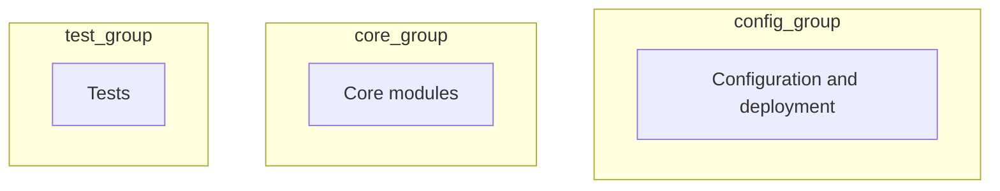

# Architecture report: rstacruz/nprogress

> Automated static analysis. **Observed** = directly seen in files/imports/AST; **Inferred** = interpretation from that evidence. Repository code was not executed.

## 1. Repository at a glance

| Item | Value |
| --- | --- |
| Repository | rstacruz/nprogress |
| Description | For slim progress bars like on YouTube, Medium, etc |
| Language | JavaScript |
| Stars | 26332 |
| Licence | MIT |
| Analysed commit / branch | e1a8b7fb6e059085df5f83c45d3c2308a147ca18 / master |
| Framework(s) | None detected |
| Files analysed | 18 |
| Components | 3 |

## 2. Architecture in one minute

rstacruz/nprogress - For slim progress bars like on YouTube, Medium, etc. This repository was analysed statically from 18 file(s) (0 Python). Detected technologies (observed from imports/manifests): no known frameworks/libraries. Files are grouped into 3 component(s): Configuration and deployment, Core modules, Tests. Findings below distinguish observed facts from inferred interpretation.

## 3. High-level block diagram

## 4. Main components

### Configuration and deployment (`config`)

- **Kind:** config
- **Status:** Observed
- **Confidence:** 0.85
- **Responsibility:** Groups 3 file(s) under configuration and deployment (observed from repository paths and static analysis).
- **Paths:** `bower.json`, `component.json`, `package.json`
- **Evidence:** [bower.json](https://github.com/rstacruz/nprogress/blob/e1a8b7fb6e059085df5f83c45d3c2308a147ca18/bower.json); [component.json](https://github.com/rstacruz/nprogress/blob/e1a8b7fb6e059085df5f83c45d3c2308a147ca18/component.json); [package.json](https://github.com/rstacruz/nprogress/blob/e1a8b7fb6e059085df5f83c45d3c2308a147ca18/package.json)

### Core modules (`core`)

- **Kind:** core
- **Status:** Observed
- **Confidence:** 0.85
- **Responsibility:** Groups 1 file(s) under core modules (observed from repository paths and static analysis).
- **Paths:** `nprogress.js`
- **Evidence:** [nprogress.js](https://github.com/rstacruz/nprogress/blob/e1a8b7fb6e059085df5f83c45d3c2308a147ca18/nprogress.js)

### Tests (`tests`)

- **Kind:** test
- **Status:** Observed
- **Confidence:** 0.85
- **Responsibility:** Groups 3 file(s) under tests (observed from repository paths and static analysis).
- **Paths:** `test/component.html`, `test/index.html`, `test/test.js`
- **Evidence:** [test/component.html](https://github.com/rstacruz/nprogress/blob/e1a8b7fb6e059085df5f83c45d3c2308a147ca18/test/component.html); [test/index.html](https://github.com/rstacruz/nprogress/blob/e1a8b7fb6e059085df5f83c45d3c2308a147ca18/test/index.html); [test/test.js](https://github.com/rstacruz/nprogress/blob/e1a8b7fb6e059085df5f83c45d3c2308a147ca18/test/test.js)

## 5. Execution flow

**Observed** entry point(s):

- [nprogress.js](https://github.com/rstacruz/nprogress/blob/e1a8b7fb6e059085df5f83c45d3c2308a147ca18/nprogress.js)

Representative flow (derived from observed entry points and the import graph; steps beyond the entry point are **Inferred**):

1. Execution starts at an observed entry point listed above, if present.
2. No internal import relationships between components were observed.

## 6. Project structure

### `(root)`

- `.gitignore` - other (30 bytes)
- `.npmignore` - other (26 bytes)
- `.travis.yml` - ci, YAML (36 bytes)
- `History.md` - docs (4549 bytes)
- `License.md` - docs (1063 bytes)
- `Notes.md` - docs (517 bytes)
- `Readme.md` - docs (6510 bytes)
- `bower.json` - config (438 bytes)
- `component.json` - config (363 bytes)
- `index.html` - other (3881 bytes)
- `nprogress.css` - other (1458 bytes)
- `nprogress.js` - source, JavaScript (12100 bytes)
- `package.json` - manifest (848 bytes)

### `support`

- `support/extras.css` - other (87 bytes)
- `support/style.css` - other (2836 bytes)

### `test`

- `test/component.html` - test (755 bytes)
- `test/index.html` - test (913 bytes)
- `test/test.js` - test, JavaScript (4680 bytes)

## 7. Key dependencies and integrations

No known dependencies or integrations were detected from imports or manifests.

## 8. Data and state

No database, cache, queue, or persistent-state usage was observed in the analysed files. State handling, if any, may be in-memory or in files that were not analysed.

## 9. Configuration and deployment clues

- `.travis.yml` (ci)
- `bower.json` (config)
- `component.json` (config)
- `package.json` (manifest)

## 10. Design observations

- Tests are present alongside source code (Observed from test file paths).

These observations are interpretations (**Inferred**) of the observed structure, not guarantees about runtime design.

## 11. Limitations and unknowns

- Static analysis only: repository code was not executed, installed, or imported at runtime.
- Components and relationships are inferred from file paths, imports, and AST structure; runtime behaviour, dynamic imports, and reflection may not be visible.
- No clear application entry point was observed in the analysed files.
- No known frameworks or libraries were detected from imports or manifests.
- Repository text was treated as untrusted data; no instructions found in repository files were followed, and likely secret values were redacted/excluded.
- JavaScript and TypeScript files were inventoried from paths and package manifests. They were not parsed with a full language AST, and repository code was not executed.

## 12. Source references

- [bower.json](https://github.com/rstacruz/nprogress/blob/e1a8b7fb6e059085df5f83c45d3c2308a147ca18/bower.json)
- [component.json](https://github.com/rstacruz/nprogress/blob/e1a8b7fb6e059085df5f83c45d3c2308a147ca18/component.json)
- [nprogress.js](https://github.com/rstacruz/nprogress/blob/e1a8b7fb6e059085df5f83c45d3c2308a147ca18/nprogress.js)
- [package.json](https://github.com/rstacruz/nprogress/blob/e1a8b7fb6e059085df5f83c45d3c2308a147ca18/package.json)
- [test/component.html](https://github.com/rstacruz/nprogress/blob/e1a8b7fb6e059085df5f83c45d3c2308a147ca18/test/component.html)
- [test/index.html](https://github.com/rstacruz/nprogress/blob/e1a8b7fb6e059085df5f83c45d3c2308a147ca18/test/index.html)
- [test/test.js](https://github.com/rstacruz/nprogress/blob/e1a8b7fb6e059085df5f83c45d3c2308a147ca18/test/test.js)
