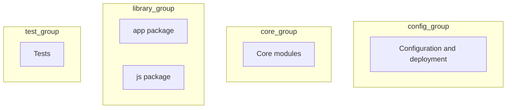

# Architecture report: ruanyf/es6tutorial

> Automated static analysis. **Observed** = directly seen in files/imports/AST; **Inferred** = interpretation from that evidence. Repository code was not executed.

## 1. Repository at a glance

| Item | Value |
| --- | --- |
| Repository | ruanyf/es6tutorial |
| Description | 《ECMAScript 6入门》是一本开源的 JavaScript 语言教程，全面介绍 ECMAScript 6 新增的语法特性。 |
| Language | JavaScript |
| Stars | 21409 |
| Licence | Other |
| Analysed commit / branch | d27a751258f25cb4d27de70161d3bcd7fe19251e / gh-pages |
| Framework(s) | None detected |
| Files analysed | 274 |
| Components | 5 |

## 2. Architecture in one minute

ruanyf/es6tutorial - 《ECMAScript 6入门》是一本开源的 JavaScript 语言教程，全面介绍 ECMAScript 6 新增的语法特性。. This repository was analysed statically from 274 file(s) (0 Python). Detected technologies (observed from imports/manifests): no known frameworks/libraries. Files are grouped into 5 component(s): app package, Configuration and deployment, Core modules, js package, Tests. Findings below distinguish observed facts from inferred interpretation.

## 3. High-level block diagram

## 4. Main components

### app package (`app`)

- **Kind:** library
- **Status:** Observed
- **Confidence:** 0.85
- **Responsibility:** Groups 2 file(s) under app package (observed from repository paths and static analysis).
- **Paths:** `app/bower_components/marked/index.js`, `app/bower_components/marked/lib/marked.js`
- **Evidence:** [app/bower_components/marked/index.js](https://github.com/ruanyf/es6tutorial/blob/d27a751258f25cb4d27de70161d3bcd7fe19251e/app/bower_components/marked/index.js); [app/bower_components/marked/lib/marked.js](https://github.com/ruanyf/es6tutorial/blob/d27a751258f25cb4d27de70161d3bcd7fe19251e/app/bower_components/marked/lib/marked.js)

### Configuration and deployment (`config`)

- **Kind:** config
- **Status:** Observed
- **Confidence:** 0.85
- **Responsibility:** Groups 7 file(s) under configuration and deployment (observed from repository paths and static analysis).
- **Paths:** `app/bower_components/marked/.bower.json`, `app/bower_components/marked/.travis.yml`, `app/bower_components/marked/component.json`, `app/bower_components/marked/package.json`, `app/bower_components/normalize-css/.bower.json`, `app/bower_components/normalize-css/bower.json`, `book.json`
- **Evidence:** [app/bower_components/marked/.bower.json](https://github.com/ruanyf/es6tutorial/blob/d27a751258f25cb4d27de70161d3bcd7fe19251e/app/bower_components/marked/.bower.json); [app/bower_components/marked/.travis.yml](https://github.com/ruanyf/es6tutorial/blob/d27a751258f25cb4d27de70161d3bcd7fe19251e/app/bower_components/marked/.travis.yml); [app/bower_components/marked/component.json](https://github.com/ruanyf/es6tutorial/blob/d27a751258f25cb4d27de70161d3bcd7fe19251e/app/bower_components/marked/component.json); [app/bower_components/marked/package.json](https://github.com/ruanyf/es6tutorial/blob/d27a751258f25cb4d27de70161d3bcd7fe19251e/app/bower_components/marked/package.json); [app/bower_components/normalize-css/.bower.json](https://github.com/ruanyf/es6tutorial/blob/d27a751258f25cb4d27de70161d3bcd7fe19251e/app/bower_components/normalize-css/.bower.json); [app/bower_components/normalize-css/bower.json](https://github.com/ruanyf/es6tutorial/blob/d27a751258f25cb4d27de70161d3bcd7fe19251e/app/bower_components/normalize-css/bower.json); [book.json](https://github.com/ruanyf/es6tutorial/blob/d27a751258f25cb4d27de70161d3bcd7fe19251e/book.json)

### Core modules (`core`)

- **Kind:** core
- **Status:** Observed
- **Confidence:** 0.85
- **Responsibility:** Groups 1 file(s) under core modules (observed from repository paths and static analysis).
- **Paths:** `config.js`
- **Evidence:** [config.js](https://github.com/ruanyf/es6tutorial/blob/d27a751258f25cb4d27de70161d3bcd7fe19251e/config.js)

### js package (`js`)

- **Kind:** library
- **Status:** Observed
- **Confidence:** 0.85
- **Responsibility:** Groups 4 file(s) under js package (observed from repository paths and static analysis).
- **Paths:** `js/ditto.js`, `js/marked.js`, `js/prism.js`, `js/store.js`
- **Evidence:** [js/ditto.js](https://github.com/ruanyf/es6tutorial/blob/d27a751258f25cb4d27de70161d3bcd7fe19251e/js/ditto.js); [js/marked.js](https://github.com/ruanyf/es6tutorial/blob/d27a751258f25cb4d27de70161d3bcd7fe19251e/js/marked.js); [js/prism.js](https://github.com/ruanyf/es6tutorial/blob/d27a751258f25cb4d27de70161d3bcd7fe19251e/js/prism.js); [js/store.js](https://github.com/ruanyf/es6tutorial/blob/d27a751258f25cb4d27de70161d3bcd7fe19251e/js/store.js)

### Tests (`tests`)

- **Kind:** test
- **Status:** Observed
- **Confidence:** 0.85
- **Responsibility:** Groups 201 file(s) under tests (observed from repository paths and static analysis).
- **Paths:** `app/bower_components/marked/test/README`, `app/bower_components/marked/test/browser/index.html`, `app/bower_components/marked/test/browser/index.js`, `app/bower_components/marked/test/browser/test.js`, `app/bower_components/marked/test/index.js`, `app/bower_components/marked/test/new/autolink_lines.html`, `app/bower_components/marked/test/new/autolink_lines.text`, `app/bower_components/marked/test/new/blockquote_list_item.html`, `app/bower_components/marked/test/new/blockquote_list_item.text`, `app/bower_components/marked/test/new/case_insensitive_refs.html`, `app/bower_components/marked/test/new/case_insensitive_refs.text`, `app/bower_components/marked/test/new/def_blocks.html`, `app/bower_components/marked/test/new/def_blocks.text`, `app/bower_components/marked/test/new/double_link.html`, `app/bower_components/marked/test/new/double_link.text`, `app/bower_components/marked/test/new/escaped_angles.html`, `app/bower_components/marked/test/new/escaped_angles.text`, `app/bower_components/marked/test/new/gfm_break.breaks.html`, `app/bower_components/marked/test/new/gfm_break.breaks.text`, `app/bower_components/marked/test/new/gfm_code.html`, `app/bower_components/marked/test/new/gfm_code.text`, `app/bower_components/marked/test/new/gfm_code_hr_list.html`, `app/bower_components/marked/test/new/gfm_code_hr_list.text`, `app/bower_components/marked/test/new/gfm_del.html`, `app/bower_components/marked/test/new/gfm_del.text`, `app/bower_components/marked/test/new/gfm_em.html`, `app/bower_components/marked/test/new/gfm_em.text`, `app/bower_components/marked/test/new/gfm_links.html`, `app/bower_components/marked/test/new/gfm_links.text`, `app/bower_components/marked/test/new/gfm_tables.html`, `app/bower_components/marked/test/new/gfm_tables.text`, `app/bower_components/marked/test/new/hr_list_break.html`, `app/bower_components/marked/test/new/hr_list_break.text`, `app/bower_components/marked/test/new/lazy_blockquotes.html`, `app/bower_components/marked/test/new/lazy_blockquotes.text`, `app/bower_components/marked/test/new/list_item_text.html`, `app/bower_components/marked/test/new/list_item_text.text`, `app/bower_components/marked/test/new/loose_lists.html`, `app/bower_components/marked/test/new/loose_lists.text`, `app/bower_components/marked/test/new/main.html`, `app/bower_components/marked/test/new/main.text`, `app/bower_components/marked/test/new/nested_code.html`, `app/bower_components/marked/test/new/nested_code.text`, `app/bower_components/marked/test/new/nested_em.html`, `app/bower_components/marked/test/new/nested_em.text`, `app/bower_components/marked/test/new/nested_square_link.html`, `app/bower_components/marked/test/new/nested_square_link.text`, `app/bower_components/marked/test/new/not_a_link.html`, `app/bower_components/marked/test/new/not_a_link.text`, `app/bower_components/marked/test/new/ref_paren.html`, `app/bower_components/marked/test/new/ref_paren.text`, `app/bower_components/marked/test/new/same_bullet.html`, `app/bower_components/marked/test/new/same_bullet.text`, `app/bower_components/marked/test/new/text.smartypants.html`, `app/bower_components/marked/test/new/text.smartypants.text`, `app/bower_components/marked/test/new/toplevel_paragraphs.gfm.html`, `app/bower_components/marked/test/new/toplevel_paragraphs.gfm.text`, `app/bower_components/marked/test/new/tricky_list.html`, `app/bower_components/marked/test/new/tricky_list.text`, `app/bower_components/marked/test/original/amps_and_angles_encoding.html`, `app/bower_components/marked/test/original/amps_and_angles_encoding.text`, `app/bower_components/marked/test/original/auto_links.html`, `app/bower_components/marked/test/original/auto_links.text`, `app/bower_components/marked/test/original/backslash_escapes.html`, `app/bower_components/marked/test/original/backslash_escapes.text`, `app/bower_components/marked/test/original/blockquotes_with_code_blocks.html`, `app/bower_components/marked/test/original/blockquotes_with_code_blocks.text`, `app/bower_components/marked/test/original/code_blocks.html`, `app/bower_components/marked/test/original/code_blocks.text`, `app/bower_components/marked/test/original/code_spans.html`, `app/bower_components/marked/test/original/code_spans.text`, `app/bower_components/marked/test/original/hard_wrapped_paragraphs_with_list_like_lines.html`, `app/bower_components/marked/test/original/hard_wrapped_paragraphs_with_list_like_lines.text`, `app/bower_components/marked/test/original/horizontal_rules.html`, `app/bower_components/marked/test/original/horizontal_rules.text`, `app/bower_components/marked/test/original/inline_html_advanced.html`, `app/bower_components/marked/test/original/inline_html_advanced.text`, `app/bower_components/marked/test/original/inline_html_comments.html`, `app/bower_components/marked/test/original/inline_html_comments.text`, `app/bower_components/marked/test/original/inline_html_simple.html`, `app/bower_components/marked/test/original/inline_html_simple.text`, `app/bower_components/marked/test/original/links_inline_style.html`, `app/bower_components/marked/test/original/links_inline_style.text`, `app/bower_components/marked/test/original/links_reference_style.html`, `app/bower_components/marked/test/original/links_reference_style.text`, `app/bower_components/marked/test/original/links_shortcut_references.html`, `app/bower_components/marked/test/original/links_shortcut_references.text`, `app/bower_components/marked/test/original/literal_quotes_in_titles.html`, `app/bower_components/marked/test/original/literal_quotes_in_titles.text`, `app/bower_components/marked/test/original/markdown_documentation_basics.html`, `app/bower_components/marked/test/original/markdown_documentation_basics.text`, `app/bower_components/marked/test/original/markdown_documentation_syntax.html`, `app/bower_components/marked/test/original/markdown_documentation_syntax.text`, `app/bower_components/marked/test/original/nested_blockquotes.html`, `app/bower_components/marked/test/original/nested_blockquotes.text`, `app/bower_components/marked/test/original/ordered_and_unordered_lists.html`, `app/bower_components/marked/test/original/ordered_and_unordered_lists.text`, `app/bower_components/marked/test/original/strong_and_em_together.html`, `app/bower_components/marked/test/original/strong_and_em_together.text`, `app/bower_components/marked/test/original/tabs.html`, `app/bower_components/marked/test/original/tabs.text`, `app/bower_components/marked/test/original/tidyness.html`, `app/bower_components/marked/test/original/tidyness.text`, `app/bower_components/marked/test/tests/amps_and_angles_encoding.html`, `app/bower_components/marked/test/tests/amps_and_angles_encoding.text`, `app/bower_components/marked/test/tests/auto_links.html`, `app/bower_components/marked/test/tests/auto_links.text`, `app/bower_components/marked/test/tests/autolink_lines.html`, `app/bower_components/marked/test/tests/autolink_lines.text`, `app/bower_components/marked/test/tests/backslash_escapes.html`, `app/bower_components/marked/test/tests/backslash_escapes.text`, `app/bower_components/marked/test/tests/blockquote_list_item.html`, `app/bower_components/marked/test/tests/blockquote_list_item.text`, `app/bower_components/marked/test/tests/blockquotes_with_code_blocks.html`, `app/bower_components/marked/test/tests/blockquotes_with_code_blocks.text`, `app/bower_components/marked/test/tests/case_insensitive_refs.html`, `app/bower_components/marked/test/tests/case_insensitive_refs.text`, `app/bower_components/marked/test/tests/code_blocks.html`, `app/bower_components/marked/test/tests/code_blocks.text`, `app/bower_components/marked/test/tests/code_spans.html`, `app/bower_components/marked/test/tests/code_spans.text`, `app/bower_components/marked/test/tests/def_blocks.html`, `app/bower_components/marked/test/tests/def_blocks.text`, `app/bower_components/marked/test/tests/double_link.html`, `app/bower_components/marked/test/tests/double_link.text`, `app/bower_components/marked/test/tests/escaped_angles.html`, `app/bower_components/marked/test/tests/escaped_angles.text`, `app/bower_components/marked/test/tests/gfm_break.breaks.html`, `app/bower_components/marked/test/tests/gfm_break.breaks.text`, `app/bower_components/marked/test/tests/gfm_code.html`, `app/bower_components/marked/test/tests/gfm_code.text`, `app/bower_components/marked/test/tests/gfm_code_hr_list.html`, `app/bower_components/marked/test/tests/gfm_code_hr_list.text`, `app/bower_components/marked/test/tests/gfm_del.html`, `app/bower_components/marked/test/tests/gfm_del.text`, `app/bower_components/marked/test/tests/gfm_em.html`, `app/bower_components/marked/test/tests/gfm_em.text`, `app/bower_components/marked/test/tests/gfm_links.html`, `app/bower_components/marked/test/tests/gfm_links.text`, `app/bower_components/marked/test/tests/gfm_tables.html`, `app/bower_components/marked/test/tests/gfm_tables.text`, `app/bower_components/marked/test/tests/hard_wrapped_paragraphs_with_list_like_lines.nogfm.html`, `app/bower_components/marked/test/tests/hard_wrapped_paragraphs_with_list_like_lines.nogfm.text`, `app/bower_components/marked/test/tests/horizontal_rules.html`, `app/bower_components/marked/test/tests/horizontal_rules.text`, `app/bower_components/marked/test/tests/hr_list_break.html`, `app/bower_components/marked/test/tests/hr_list_break.text`, `app/bower_components/marked/test/tests/inline_html_advanced.html`, `app/bower_components/marked/test/tests/inline_html_advanced.text`, `app/bower_components/marked/test/tests/inline_html_comments.html`, `app/bower_components/marked/test/tests/inline_html_comments.text`, `app/bower_components/marked/test/tests/inline_html_simple.html`, `app/bower_components/marked/test/tests/inline_html_simple.text`, `app/bower_components/marked/test/tests/lazy_blockquotes.html`, `app/bower_components/marked/test/tests/lazy_blockquotes.text`, `app/bower_components/marked/test/tests/links_inline_style.html`, `app/bower_components/marked/test/tests/links_inline_style.text`, `app/bower_components/marked/test/tests/links_reference_style.html`, `app/bower_components/marked/test/tests/links_reference_style.text`, `app/bower_components/marked/test/tests/links_shortcut_references.html`, `app/bower_components/marked/test/tests/links_shortcut_references.text`, `app/bower_components/marked/test/tests/list_item_text.html`, `app/bower_components/marked/test/tests/list_item_text.text`, `app/bower_components/marked/test/tests/literal_quotes_in_titles.html`, `app/bower_components/marked/test/tests/literal_quotes_in_titles.text`, `app/bower_components/marked/test/tests/loose_lists.html`, `app/bower_components/marked/test/tests/loose_lists.text`, `app/bower_components/marked/test/tests/main.html`, `app/bower_components/marked/test/tests/main.text`, `app/bower_components/marked/test/tests/markdown_documentation_basics.html`, `app/bower_components/marked/test/tests/markdown_documentation_basics.text`, `app/bower_components/marked/test/tests/markdown_documentation_syntax.html`, `app/bower_components/marked/test/tests/markdown_documentation_syntax.text`, `app/bower_components/marked/test/tests/nested_blockquotes.html`, `app/bower_components/marked/test/tests/nested_blockquotes.text`, `app/bower_components/marked/test/tests/nested_code.html`, `app/bower_components/marked/test/tests/nested_code.text`, `app/bower_components/marked/test/tests/nested_em.html`, `app/bower_components/marked/test/tests/nested_em.text`, `app/bower_components/marked/test/tests/nested_square_link.html`, `app/bower_components/marked/test/tests/nested_square_link.text`, `app/bower_components/marked/test/tests/not_a_link.html`, `app/bower_components/marked/test/tests/not_a_link.text`, `app/bower_components/marked/test/tests/ordered_and_unordered_lists.html`, `app/bower_components/marked/test/tests/ordered_and_unordered_lists.text`, `app/bower_components/marked/test/tests/ref_paren.html`, `app/bower_components/marked/test/tests/ref_paren.text`, `app/bower_components/marked/test/tests/same_bullet.html`, `app/bower_components/marked/test/tests/same_bullet.text`, `app/bower_components/marked/test/tests/strong_and_em_together.html`, `app/bower_components/marked/test/tests/strong_and_em_together.text`, `app/bower_components/marked/test/tests/tabs.html`, `app/bower_components/marked/test/tests/tabs.text`, `app/bower_components/marked/test/tests/text.smartypants.html`, `app/bower_components/marked/test/tests/text.smartypants.text`, `app/bower_components/marked/test/tests/tidyness.html`, `app/bower_components/marked/test/tests/tidyness.text`, `app/bower_components/marked/test/tests/toplevel_paragraphs.gfm.html`, `app/bower_components/marked/test/tests/toplevel_paragraphs.gfm.text`, `app/bower_components/marked/test/tests/tricky_list.html`, `app/bower_components/marked/test/tests/tricky_list.text`
- **Evidence:** [app/bower_components/marked/test/README](https://github.com/ruanyf/es6tutorial/blob/d27a751258f25cb4d27de70161d3bcd7fe19251e/app/bower_components/marked/test/README); [app/bower_components/marked/test/browser/index.html](https://github.com/ruanyf/es6tutorial/blob/d27a751258f25cb4d27de70161d3bcd7fe19251e/app/bower_components/marked/test/browser/index.html); [app/bower_components/marked/test/browser/index.js](https://github.com/ruanyf/es6tutorial/blob/d27a751258f25cb4d27de70161d3bcd7fe19251e/app/bower_components/marked/test/browser/index.js); [app/bower_components/marked/test/browser/test.js](https://github.com/ruanyf/es6tutorial/blob/d27a751258f25cb4d27de70161d3bcd7fe19251e/app/bower_components/marked/test/browser/test.js); [app/bower_components/marked/test/index.js](https://github.com/ruanyf/es6tutorial/blob/d27a751258f25cb4d27de70161d3bcd7fe19251e/app/bower_components/marked/test/index.js); [app/bower_components/marked/test/new/autolink_lines.html](https://github.com/ruanyf/es6tutorial/blob/d27a751258f25cb4d27de70161d3bcd7fe19251e/app/bower_components/marked/test/new/autolink_lines.html); [app/bower_components/marked/test/new/autolink_lines.text](https://github.com/ruanyf/es6tutorial/blob/d27a751258f25cb4d27de70161d3bcd7fe19251e/app/bower_components/marked/test/new/autolink_lines.text); [app/bower_components/marked/test/new/blockquote_list_item.html](https://github.com/ruanyf/es6tutorial/blob/d27a751258f25cb4d27de70161d3bcd7fe19251e/app/bower_components/marked/test/new/blockquote_list_item.html)

## 5. Execution flow

**Observed** entry point(s):

- [app/bower_components/marked/bin/marked](https://github.com/ruanyf/es6tutorial/blob/d27a751258f25cb4d27de70161d3bcd7fe19251e/app/bower_components/marked/bin/marked)
- [app/bower_components/marked/index.js](https://github.com/ruanyf/es6tutorial/blob/d27a751258f25cb4d27de70161d3bcd7fe19251e/app/bower_components/marked/index.js)
- [app/bower_components/marked/lib/marked.js](https://github.com/ruanyf/es6tutorial/blob/d27a751258f25cb4d27de70161d3bcd7fe19251e/app/bower_components/marked/lib/marked.js)

Representative flow (derived from observed entry points and the import graph; steps beyond the entry point are **Inferred**):

1. Execution starts at an observed entry point listed above, if present.
2. No internal import relationships between components were observed.

## 6. Project structure

### `(root)`

- `.gitignore` - other (140 bytes)
- `.nojekyll` - other (0 bytes)
- `404.html` - other (459 bytes)
- `CNAME` - other (19 bytes)
- `LICENSE` - docs (1337 bytes)
- `README.md` - docs (1631 bytes)
- `SUMMARY.md` - docs (1214 bytes)
- `book.json` - config (745 bytes)
- `config.js` - source, JavaScript (552 bytes)
- `index.html` - other (1749 bytes)
- `sidebar.md` - docs (1650 bytes)

### `app`

- `app/bower_components/marked/.bower.json` - config (362 bytes)
- `app/bower_components/marked/.gitignore` - other (14 bytes)
- `app/bower_components/marked/.npmignore` - other (12 bytes)
- `app/bower_components/marked/.travis.yml` - ci, YAML (58 bytes)
- `app/bower_components/marked/LICENSE` - docs (1096 bytes)
- `app/bower_components/marked/Makefile` - other (161 bytes)
- `app/bower_components/marked/README.md` - docs (9415 bytes)
- `app/bower_components/marked/bin/marked` - other (3528 bytes)
- `app/bower_components/marked/component.json` - config (249 bytes)
- `app/bower_components/marked/doc/broken.md` - docs (4981 bytes)
- `app/bower_components/marked/doc/todo.md` - docs (8 bytes)
- `app/bower_components/marked/index.js` - source, JavaScript (42 bytes)
- `app/bower_components/marked/lib/marked.js` - source, JavaScript (27968 bytes)
- `app/bower_components/marked/man/marked.1` - other (2029 bytes)
- `app/bower_components/marked/package.json` - manifest (668 bytes)
- `app/bower_components/marked/test/README` - test (214 bytes)
- `app/bower_components/marked/test/browser/index.html` - test (128 bytes)
- `app/bower_components/marked/test/browser/index.js` - test, JavaScript (889 bytes)
- `app/bower_components/marked/test/browser/test.js` - test, JavaScript (1184 bytes)
- `app/bower_components/marked/test/index.js` - test, JavaScript (11821 bytes)
- `app/bower_components/marked/test/new/autolink_lines.html` - test (72 bytes)
- `app/bower_components/marked/test/new/autolink_lines.text` - test (33 bytes)
- `app/bower_components/marked/test/new/blockquote_list_item.html` - test (108 bytes)
- `app/bower_components/marked/test/new/blockquote_list_item.text` - test (58 bytes)
- `app/bower_components/marked/test/new/case_insensitive_refs.html` - test (29 bytes)
- `app/bower_components/marked/test/new/case_insensitive_refs.text` - test (17 bytes)
- `app/bower_components/marked/test/new/def_blocks.html` - test (228 bytes)
- `app/bower_components/marked/test/new/def_blocks.text` - test (121 bytes)
- `app/bower_components/marked/test/new/double_link.html` - test (253 bytes)
- `app/bower_components/marked/test/new/double_link.text` - test (215 bytes)
- `app/bower_components/marked/test/new/escaped_angles.html` - test (9 bytes)
- `app/bower_components/marked/test/new/escaped_angles.text` - test (3 bytes)
- `app/bower_components/marked/test/new/gfm_break.breaks.html` - test (45 bytes)
- `app/bower_components/marked/test/new/gfm_break.breaks.text` - test (32 bytes)
- `app/bower_components/marked/test/new/gfm_code.html` - test (341 bytes)
- `app/bower_components/marked/test/new/gfm_code.text` - test (223 bytes)
- `app/bower_components/marked/test/new/gfm_code_hr_list.html` - test (707 bytes)
- `app/bower_components/marked/test/new/gfm_code_hr_list.text` - test (554 bytes)
- `app/bower_components/marked/test/new/gfm_del.html` - test (33 bytes)
- `app/bower_components/marked/test/new/gfm_del.text` - test (19 bytes)
- `app/bower_components/marked/test/new/gfm_em.html` - test (45 bytes)
- `app/bower_components/marked/test/new/gfm_em.text` - test (38 bytes)
- `app/bower_components/marked/test/new/gfm_links.html` - test (107 bytes)
- `app/bower_components/marked/test/new/gfm_links.text` - test (55 bytes)
- `app/bower_components/marked/test/new/gfm_tables.html` - test (1423 bytes)
- `app/bower_components/marked/test/new/gfm_tables.text` - test (508 bytes)
- `app/bower_components/marked/test/new/hr_list_break.html` - test (74 bytes)
- `app/bower_components/marked/test/new/hr_list_break.text` - test (41 bytes)
- `app/bower_components/marked/test/new/lazy_blockquotes.html` - test (49 bytes)
- `app/bower_components/marked/test/new/lazy_blockquotes.text` - test (15 bytes)
- `app/bower_components/marked/test/new/list_item_text.html` - test (70 bytes)
- `app/bower_components/marked/test/new/list_item_text.text` - test (31 bytes)
- `app/bower_components/marked/test/new/loose_lists.html` - test (586 bytes)
- `app/bower_components/marked/test/new/loose_lists.text` - test (261 bytes)
- `app/bower_components/marked/test/new/main.html` - test (1312 bytes)
- `app/bower_components/marked/test/new/main.text` - test (1037 bytes)
- `app/bower_components/marked/test/new/nested_code.html` - test (38 bytes)
- `app/bower_components/marked/test/new/nested_code.text` - test (30 bytes)
- `app/bower_components/marked/test/new/nested_em.html` - test (97 bytes)
- `app/bower_components/marked/test/new/nested_em.text` - test (43 bytes)
- `app/bower_components/marked/test/new/nested_square_link.html` - test (55 bytes)
- `app/bower_components/marked/test/new/nested_square_link.text` - test (26 bytes)
- `app/bower_components/marked/test/new/not_a_link.html` - test (26 bytes)
- `app/bower_components/marked/test/new/not_a_link.text` - test (20 bytes)
- `app/bower_components/marked/test/new/ref_paren.html` - test (43 bytes)
- `app/bower_components/marked/test/new/ref_paren.text` - test (25 bytes)
- `app/bower_components/marked/test/new/same_bullet.html` - test (53 bytes)
- `app/bower_components/marked/test/new/same_bullet.text` - test (21 bytes)
- `app/bower_components/marked/test/new/text.smartypants.html` - test (182 bytes)
- `app/bower_components/marked/test/new/text.smartypants.text` - test (133 bytes)
- `app/bower_components/marked/test/new/toplevel_paragraphs.gfm.html` - test (539 bytes)
- `app/bower_components/marked/test/new/toplevel_paragraphs.gfm.text` - test (362 bytes)
- `app/bower_components/marked/test/new/tricky_list.html` - test (315 bytes)
- `app/bower_components/marked/test/new/tricky_list.text` - test (135 bytes)
- `app/bower_components/marked/test/original/amps_and_angles_encoding.html` - test (505 bytes)
- `app/bower_components/marked/test/original/amps_and_angles_encoding.text` - test (382 bytes)
- `app/bower_components/marked/test/original/auto_links.html` - test (546 bytes)
- `app/bower_components/marked/test/original/auto_links.text` - test (264 bytes)
- `app/bower_components/marked/test/original/backslash_escapes.html` - test (1713 bytes)
- `app/bower_components/marked/test/original/backslash_escapes.text` - test (1250 bytes)
- `app/bower_components/marked/test/original/blockquotes_with_code_blocks.html` - test (186 bytes)
- `app/bower_components/marked/test/original/blockquotes_with_code_blocks.text` - test (135 bytes)
- `app/bower_components/marked/test/original/code_blocks.html` - test (312 bytes)
- `app/bower_components/marked/test/original/code_blocks.text` - test (200 bytes)
- `app/bower_components/marked/test/original/code_spans.html` - test (223 bytes)
- `app/bower_components/marked/test/original/code_spans.text` - test (167 bytes)
- `app/bower_components/marked/test/original/hard_wrapped_paragraphs_with_list_like_lines.html` - test (211 bytes)
- `app/bower_components/marked/test/original/hard_wrapped_paragraphs_with_list_like_lines.text` - test (197 bytes)
- `app/bower_components/marked/test/original/horizontal_rules.html` - test (433 bytes)
- `app/bower_components/marked/test/original/horizontal_rules.text` - test (270 bytes)
- `app/bower_components/marked/test/original/inline_html_advanced.html` - test (165 bytes)
- `app/bower_components/marked/test/original/inline_html_advanced.text` - test (151 bytes)
- `app/bower_components/marked/test/original/inline_html_comments.html` - test (188 bytes)
- `app/bower_components/marked/test/original/inline_html_comments.text` - test (164 bytes)
- `app/bower_components/marked/test/original/inline_html_simple.html` - test (784 bytes)
- `app/bower_components/marked/test/original/inline_html_simple.text` - test (553 bytes)
- `app/bower_components/marked/test/original/links_inline_style.html` - test (496 bytes)
- `app/bower_components/marked/test/original/links_inline_style.text` - test (328 bytes)
- `app/bower_components/marked/test/original/links_reference_style.html` - test (1125 bytes)
- `app/bower_components/marked/test/original/links_reference_style.text` - test (791 bytes)
- `app/bower_components/marked/test/original/links_shortcut_references.html` - test (256 bytes)
- `app/bower_components/marked/test/original/links_shortcut_references.text` - test (236 bytes)
- `app/bower_components/marked/test/original/literal_quotes_in_titles.html` - test (163 bytes)
- `app/bower_components/marked/test/original/literal_quotes_in_titles.text` - test (108 bytes)
- `app/bower_components/marked/test/original/markdown_documentation_basics.html` - test (9384 bytes)
- `app/bower_components/marked/test/original/markdown_documentation_basics.text` - test (8064 bytes)
- `app/bower_components/marked/test/original/markdown_documentation_syntax.html` - test (31785 bytes)
- `app/bower_components/marked/test/original/markdown_documentation_syntax.text` - test (27428 bytes)
- `app/bower_components/marked/test/original/nested_blockquotes.html` - test (105 bytes)
- `app/bower_components/marked/test/original/nested_blockquotes.text` - test (24 bytes)
- `app/bower_components/marked/test/original/ordered_and_unordered_lists.html` - test (1701 bytes)
- `app/bower_components/marked/test/original/ordered_and_unordered_lists.text` - test (903 bytes)
- `app/bower_components/marked/test/original/strong_and_em_together.html` - test (215 bytes)
- `app/bower_components/marked/test/original/strong_and_em_together.text` - test (107 bytes)
- `app/bower_components/marked/test/original/tabs.html` - test (439 bytes)
- `app/bower_components/marked/test/original/tabs.text` - test (311 bytes)
- `app/bower_components/marked/test/original/tidyness.html` - test (133 bytes)
- `app/bower_components/marked/test/original/tidyness.text` - test (78 bytes)
- `app/bower_components/marked/test/tests/amps_and_angles_encoding.html` - test (524 bytes)
- `app/bower_components/marked/test/tests/amps_and_angles_encoding.text` - test (382 bytes)
- `app/bower_components/marked/test/tests/auto_links.html` - test (546 bytes)
- `app/bower_components/marked/test/tests/auto_links.text` - test (264 bytes)
- `app/bower_components/marked/test/tests/autolink_lines.html` - test (72 bytes)
- `app/bower_components/marked/test/tests/autolink_lines.text` - test (33 bytes)
- `app/bower_components/marked/test/tests/backslash_escapes.html` - test (1717 bytes)
- `app/bower_components/marked/test/tests/backslash_escapes.text` - test (1250 bytes)
- `app/bower_components/marked/test/tests/blockquote_list_item.html` - test (108 bytes)
- `app/bower_components/marked/test/tests/blockquote_list_item.text` - test (58 bytes)
- `app/bower_components/marked/test/tests/blockquotes_with_code_blocks.html` - test (206 bytes)
- `app/bower_components/marked/test/tests/blockquotes_with_code_blocks.text` - test (135 bytes)
- `app/bower_components/marked/test/tests/case_insensitive_refs.html` - test (29 bytes)
- `app/bower_components/marked/test/tests/case_insensitive_refs.text` - test (17 bytes)
- `app/bower_components/marked/test/tests/code_blocks.html` - test (312 bytes)
- `app/bower_components/marked/test/tests/code_blocks.text` - test (200 bytes)
- `app/bower_components/marked/test/tests/code_spans.html` - test (237 bytes)
- `app/bower_components/marked/test/tests/code_spans.text` - test (167 bytes)
- `app/bower_components/marked/test/tests/def_blocks.html` - test (228 bytes)
- `app/bower_components/marked/test/tests/def_blocks.text` - test (121 bytes)
- `app/bower_components/marked/test/tests/double_link.html` - test (253 bytes)
- `app/bower_components/marked/test/tests/double_link.text` - test (215 bytes)
- `app/bower_components/marked/test/tests/escaped_angles.html` - test (9 bytes)
- `app/bower_components/marked/test/tests/escaped_angles.text` - test (3 bytes)
- `app/bower_components/marked/test/tests/gfm_break.breaks.html` - test (45 bytes)
- `app/bower_components/marked/test/tests/gfm_break.breaks.text` - test (32 bytes)
- `app/bower_components/marked/test/tests/gfm_code.html` - test (341 bytes)
- `app/bower_components/marked/test/tests/gfm_code.text` - test (223 bytes)
- `app/bower_components/marked/test/tests/gfm_code_hr_list.html` - test (707 bytes)
- `app/bower_components/marked/test/tests/gfm_code_hr_list.text` - test (554 bytes)
- `app/bower_components/marked/test/tests/gfm_del.html` - test (33 bytes)
- `app/bower_components/marked/test/tests/gfm_del.text` - test (19 bytes)
- `app/bower_components/marked/test/tests/gfm_em.html` - test (45 bytes)
- `app/bower_components/marked/test/tests/gfm_em.text` - test (38 bytes)
- `app/bower_components/marked/test/tests/gfm_links.html` - test (107 bytes)
- `app/bower_components/marked/test/tests/gfm_links.text` - test (55 bytes)
- `app/bower_components/marked/test/tests/gfm_tables.html` - test (1423 bytes)
- `app/bower_components/marked/test/tests/gfm_tables.text` - test (508 bytes)
- `app/bower_components/marked/test/tests/hard_wrapped_paragraphs_with_list_like_lines.nogfm.html` - test (215 bytes)
- `app/bower_components/marked/test/tests/hard_wrapped_paragraphs_with_list_like_lines.nogfm.text` - test (197 bytes)
- `app/bower_components/marked/test/tests/horizontal_rules.html` - test (385 bytes)
- `app/bower_components/marked/test/tests/horizontal_rules.text` - test (270 bytes)
- `app/bower_components/marked/test/tests/hr_list_break.html` - test (74 bytes)
- `app/bower_components/marked/test/tests/hr_list_break.text` - test (41 bytes)
- `app/bower_components/marked/test/tests/inline_html_advanced.html` - test (165 bytes)
- `app/bower_components/marked/test/tests/inline_html_advanced.text` - test (151 bytes)
- `app/bower_components/marked/test/tests/inline_html_comments.html` - test (188 bytes)
- `app/bower_components/marked/test/tests/inline_html_comments.text` - test (164 bytes)
- `app/bower_components/marked/test/tests/inline_html_simple.html` - test (784 bytes)
- `app/bower_components/marked/test/tests/inline_html_simple.text` - test (545 bytes)
- `app/bower_components/marked/test/tests/lazy_blockquotes.html` - test (49 bytes)
- `app/bower_components/marked/test/tests/lazy_blockquotes.text` - test (15 bytes)
- `app/bower_components/marked/test/tests/links_inline_style.html` - test (496 bytes)
- `app/bower_components/marked/test/tests/links_inline_style.text` - test (328 bytes)
- `app/bower_components/marked/test/tests/links_reference_style.html` - test (1129 bytes)
- `app/bower_components/marked/test/tests/links_reference_style.text` - test (791 bytes)
- `app/bower_components/marked/test/tests/links_shortcut_references.html` - test (256 bytes)
- `app/bower_components/marked/test/tests/links_shortcut_references.text` - test (236 bytes)
- `app/bower_components/marked/test/tests/list_item_text.html` - test (70 bytes)
- `app/bower_components/marked/test/tests/list_item_text.text` - test (31 bytes)
- `app/bower_components/marked/test/tests/literal_quotes_in_titles.html` - test (163 bytes)
- `app/bower_components/marked/test/tests/literal_quotes_in_titles.text` - test (108 bytes)
- `app/bower_components/marked/test/tests/loose_lists.html` - test (586 bytes)
- `app/bower_components/marked/test/tests/loose_lists.text` - test (261 bytes)
- `app/bower_components/marked/test/tests/main.html` - test (1312 bytes)
- `app/bower_components/marked/test/tests/main.text` - test (1037 bytes)
- `app/bower_components/marked/test/tests/markdown_documentation_basics.html` - test (9808 bytes)
- `app/bower_components/marked/test/tests/markdown_documentation_basics.text` - test (8064 bytes)
- `app/bower_components/marked/test/tests/markdown_documentation_syntax.html` - test (32440 bytes)
- `app/bower_components/marked/test/tests/markdown_documentation_syntax.text` - test (27426 bytes)
- `app/bower_components/marked/test/tests/nested_blockquotes.html` - test (105 bytes)
- `app/bower_components/marked/test/tests/nested_blockquotes.text` - test (24 bytes)
- `app/bower_components/marked/test/tests/nested_code.html` - test (38 bytes)
- `app/bower_components/marked/test/tests/nested_code.text` - test (30 bytes)
- `app/bower_components/marked/test/tests/nested_em.html` - test (97 bytes)
- `app/bower_components/marked/test/tests/nested_em.text` - test (43 bytes)
- `app/bower_components/marked/test/tests/nested_square_link.html` - test (55 bytes)
- `app/bower_components/marked/test/tests/nested_square_link.text` - test (26 bytes)
- `app/bower_components/marked/test/tests/not_a_link.html` - test (26 bytes)
- `app/bower_components/marked/test/tests/not_a_link.text` - test (20 bytes)
- `app/bower_components/marked/test/tests/ordered_and_unordered_lists.html` - test (1745 bytes)
- `app/bower_components/marked/test/tests/ordered_and_unordered_lists.text` - test (903 bytes)
- `app/bower_components/marked/test/tests/ref_paren.html` - test (43 bytes)
- `app/bower_components/marked/test/tests/ref_paren.text` - test (25 bytes)
- `app/bower_components/marked/test/tests/same_bullet.html` - test (53 bytes)
- `app/bower_components/marked/test/tests/same_bullet.text` - test (21 bytes)
- `app/bower_components/marked/test/tests/strong_and_em_together.html` - test (215 bytes)
- `app/bower_components/marked/test/tests/strong_and_em_together.text` - test (107 bytes)
- `app/bower_components/marked/test/tests/tabs.html` - test (439 bytes)
- `app/bower_components/marked/test/tests/tabs.text` - test (311 bytes)
- `app/bower_components/marked/test/tests/text.smartypants.html` - test (182 bytes)
- `app/bower_components/marked/test/tests/text.smartypants.text` - test (133 bytes)
- `app/bower_components/marked/test/tests/tidyness.html` - test (133 bytes)
- `app/bower_components/marked/test/tests/tidyness.text` - test (78 bytes)
- `app/bower_components/marked/test/tests/toplevel_paragraphs.gfm.html` - test (539 bytes)
- `app/bower_components/marked/test/tests/toplevel_paragraphs.gfm.text` - test (362 bytes)
- `app/bower_components/marked/test/tests/tricky_list.html` - test (315 bytes)
- `app/bower_components/marked/test/tests/tricky_list.text` - test (135 bytes)
- `app/bower_components/normalize-css/.bower.json` - config (575 bytes)
- `app/bower_components/normalize-css/LICENSE.md` - docs (1074 bytes)
- `app/bower_components/normalize-css/README.md` - docs (1713 bytes)
- `app/bower_components/normalize-css/bower.json` - config (232 bytes)
- `app/bower_components/normalize-css/normalize.css` - other (7783 bytes)

### `css`

- `css/app.css` - other (8346 bytes)

### `docs`

- `docs/acknowledgment.md` - docs (260 bytes)
- `docs/array.md` - docs (35488 bytes)
- `docs/arraybuffer.md` - docs (55023 bytes)
- `docs/async-iterator.md` - docs (16350 bytes)
- `docs/async.md` - docs (26147 bytes)
- `docs/class-extends.md` - docs (24077 bytes)
- `docs/class.md` - docs (31047 bytes)
- `docs/decorator.md` - docs (32350 bytes)
- `docs/destructuring.md` - docs (17329 bytes)
- `docs/fp.md` - docs (5566 bytes)
- `docs/function.md` - docs (41955 bytes)
- `docs/generator-async.md` - docs (26647 bytes)
- `docs/generator.md` - docs (49575 bytes)
- `docs/intro.md` - docs (13186 bytes)
- `docs/iterator.md` - docs (31769 bytes)
- `docs/let.md` - docs (21626 bytes)
- `docs/mixin.md` - docs (4044 bytes)
- `docs/module-loader.md` - docs (28465 bytes)
- `docs/module.md` - docs (30061 bytes)
- `docs/number.md` - docs (29474 bytes)
- `docs/object-methods.md` - docs (24999 bytes)
- `docs/object.md` - docs (22243 bytes)
- `docs/operator.md` - docs (10243 bytes)
- `docs/promise.md` - docs (40763 bytes)
- `docs/proposals.md` - docs (14710 bytes)
- `docs/proxy.md` - docs (34969 bytes)
- `docs/reference.md` - docs (27582 bytes)
- `docs/reflect.md` - docs (15958 bytes)
- `docs/regex.md` - docs (29803 bytes)
- `docs/set-map.md` - docs (42763 bytes)
- `docs/simd.md` - docs (24983 bytes)
- `docs/spec.md` - docs (16162 bytes)
- `docs/string-methods.md` - docs (18288 bytes)
- `docs/string.md` - docs (19310 bytes)
- `docs/style.md` - docs (12090 bytes)
- `docs/symbol.md` - docs (27295 bytes)
- `docs/temporal.md` - docs (11321 bytes)

### `js`

- `js/ditto.js` - source, JavaScript (14876 bytes)
- `js/marked.js` - source, JavaScript (19024 bytes)
- `js/prism.js` - source, JavaScript (14153 bytes)
- `js/store.js` - source, JavaScript (5387 bytes)

## 7. Key dependencies and integrations

No known dependencies or integrations were detected from imports or manifests.

## 8. Data and state

No database, cache, queue, or persistent-state usage was observed in the analysed files. State handling, if any, may be in-memory or in files that were not analysed.

## 9. Configuration and deployment clues

- `app/bower_components/marked/.bower.json` (config)
- `app/bower_components/marked/.travis.yml` (ci)
- `app/bower_components/marked/component.json` (config)
- `app/bower_components/marked/package.json` (manifest)
- `app/bower_components/normalize-css/.bower.json` (config)
- `app/bower_components/normalize-css/bower.json` (config)
- `book.json` (config)

## 10. Design observations

- Tests are present alongside source code (Observed from test file paths).

These observations are interpretations (**Inferred**) of the observed structure, not guarantees about runtime design.

## 11. Limitations and unknowns

- Static analysis only: repository code was not executed, installed, or imported at runtime.
- Components and relationships are inferred from file paths, imports, and AST structure; runtime behaviour, dynamic imports, and reflection may not be visible.
- No clear application entry point was observed in the analysed files.
- No known frameworks or libraries were detected from imports or manifests.
- Repository text was treated as untrusted data; no instructions found in repository files were followed, and likely secret values were redacted/excluded.
- JavaScript and TypeScript files were inventoried from paths and package manifests. They were not parsed with a full language AST, and repository code was not executed.

## 12. Source references

- [app/bower_components/marked/.bower.json](https://github.com/ruanyf/es6tutorial/blob/d27a751258f25cb4d27de70161d3bcd7fe19251e/app/bower_components/marked/.bower.json)
- [app/bower_components/marked/.travis.yml](https://github.com/ruanyf/es6tutorial/blob/d27a751258f25cb4d27de70161d3bcd7fe19251e/app/bower_components/marked/.travis.yml)
- [app/bower_components/marked/bin/marked](https://github.com/ruanyf/es6tutorial/blob/d27a751258f25cb4d27de70161d3bcd7fe19251e/app/bower_components/marked/bin/marked)
- [app/bower_components/marked/component.json](https://github.com/ruanyf/es6tutorial/blob/d27a751258f25cb4d27de70161d3bcd7fe19251e/app/bower_components/marked/component.json)
- [app/bower_components/marked/index.js](https://github.com/ruanyf/es6tutorial/blob/d27a751258f25cb4d27de70161d3bcd7fe19251e/app/bower_components/marked/index.js)
- [app/bower_components/marked/lib/marked.js](https://github.com/ruanyf/es6tutorial/blob/d27a751258f25cb4d27de70161d3bcd7fe19251e/app/bower_components/marked/lib/marked.js)
- [app/bower_components/marked/package.json](https://github.com/ruanyf/es6tutorial/blob/d27a751258f25cb4d27de70161d3bcd7fe19251e/app/bower_components/marked/package.json)
- [app/bower_components/marked/test/README](https://github.com/ruanyf/es6tutorial/blob/d27a751258f25cb4d27de70161d3bcd7fe19251e/app/bower_components/marked/test/README)
- [app/bower_components/marked/test/browser/index.html](https://github.com/ruanyf/es6tutorial/blob/d27a751258f25cb4d27de70161d3bcd7fe19251e/app/bower_components/marked/test/browser/index.html)
- [app/bower_components/marked/test/browser/index.js](https://github.com/ruanyf/es6tutorial/blob/d27a751258f25cb4d27de70161d3bcd7fe19251e/app/bower_components/marked/test/browser/index.js)
- [app/bower_components/marked/test/browser/test.js](https://github.com/ruanyf/es6tutorial/blob/d27a751258f25cb4d27de70161d3bcd7fe19251e/app/bower_components/marked/test/browser/test.js)
- [app/bower_components/marked/test/index.js](https://github.com/ruanyf/es6tutorial/blob/d27a751258f25cb4d27de70161d3bcd7fe19251e/app/bower_components/marked/test/index.js)
- [app/bower_components/marked/test/new/autolink_lines.html](https://github.com/ruanyf/es6tutorial/blob/d27a751258f25cb4d27de70161d3bcd7fe19251e/app/bower_components/marked/test/new/autolink_lines.html)
- [app/bower_components/marked/test/new/autolink_lines.text](https://github.com/ruanyf/es6tutorial/blob/d27a751258f25cb4d27de70161d3bcd7fe19251e/app/bower_components/marked/test/new/autolink_lines.text)
- [app/bower_components/marked/test/new/blockquote_list_item.html](https://github.com/ruanyf/es6tutorial/blob/d27a751258f25cb4d27de70161d3bcd7fe19251e/app/bower_components/marked/test/new/blockquote_list_item.html)
- [app/bower_components/normalize-css/.bower.json](https://github.com/ruanyf/es6tutorial/blob/d27a751258f25cb4d27de70161d3bcd7fe19251e/app/bower_components/normalize-css/.bower.json)
- [app/bower_components/normalize-css/bower.json](https://github.com/ruanyf/es6tutorial/blob/d27a751258f25cb4d27de70161d3bcd7fe19251e/app/bower_components/normalize-css/bower.json)
- [book.json](https://github.com/ruanyf/es6tutorial/blob/d27a751258f25cb4d27de70161d3bcd7fe19251e/book.json)
- [config.js](https://github.com/ruanyf/es6tutorial/blob/d27a751258f25cb4d27de70161d3bcd7fe19251e/config.js)
- [js/ditto.js](https://github.com/ruanyf/es6tutorial/blob/d27a751258f25cb4d27de70161d3bcd7fe19251e/js/ditto.js)
- [js/marked.js](https://github.com/ruanyf/es6tutorial/blob/d27a751258f25cb4d27de70161d3bcd7fe19251e/js/marked.js)
- [js/prism.js](https://github.com/ruanyf/es6tutorial/blob/d27a751258f25cb4d27de70161d3bcd7fe19251e/js/prism.js)
- [js/store.js](https://github.com/ruanyf/es6tutorial/blob/d27a751258f25cb4d27de70161d3bcd7fe19251e/js/store.js)
