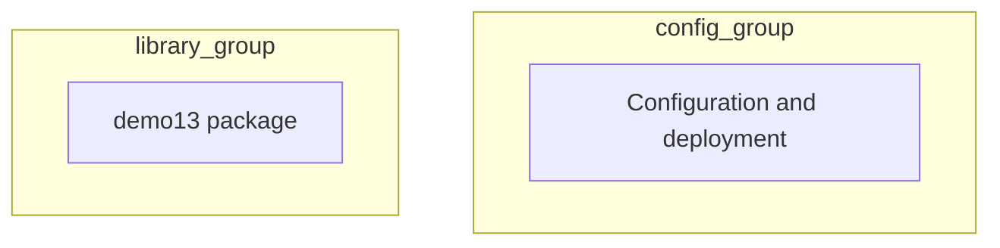

# Architecture report: ruanyf/react-demos

> Automated static analysis. **Observed** = directly seen in files/imports/AST; **Inferred** = interpretation from that evidence. Repository code was not executed.

## 1. Repository at a glance

| Item | Value |
| --- | --- |
| Repository | ruanyf/react-demos |
| Description | a collection of simple demos of React.js |
| Language | JavaScript |
| Stars | 16413 |
| Licence | Not detected |
| Analysed commit / branch | 86ae6304ff36af9315dfa0994ef6d675d8e72779 / master |
| Framework(s) | React |
| Files analysed | 23 |
| Components | 2 |

## 2. Architecture in one minute

ruanyf/react-demos - a collection of simple demos of React.js. This repository was analysed statically from 23 file(s) (0 Python). Detected technologies (observed from imports/manifests): React. Files are grouped into 2 component(s): Configuration and deployment, demo13 package. Findings below distinguish observed facts from inferred interpretation.

## 3. High-level block diagram

## 4. Main components

### Configuration and deployment (`config`)

- **Kind:** config
- **Status:** Observed
- **Confidence:** 0.85
- **Responsibility:** Groups 1 file(s) under configuration and deployment (observed from repository paths and static analysis).
- **Paths:** `demo13/package.json`
- **Evidence:** [demo13/package.json](https://github.com/ruanyf/react-demos/blob/86ae6304ff36af9315dfa0994ef6d675d8e72779/demo13/package.json)

### demo13 package (`demo13`)

- **Kind:** library
- **Status:** Observed
- **Confidence:** 0.85
- **Responsibility:** Groups 6 file(s) under demo13 package (observed from repository paths and static analysis).
- **Paths:** `demo13/app.js`, `demo13/browser.js`, `demo13/server.js`, `demo13/src/app.js`, `demo13/src/browser.js`, `demo13/src/server.js`
- **Evidence:** [demo13/app.js](https://github.com/ruanyf/react-demos/blob/86ae6304ff36af9315dfa0994ef6d675d8e72779/demo13/app.js); [demo13/browser.js](https://github.com/ruanyf/react-demos/blob/86ae6304ff36af9315dfa0994ef6d675d8e72779/demo13/browser.js); [demo13/server.js](https://github.com/ruanyf/react-demos/blob/86ae6304ff36af9315dfa0994ef6d675d8e72779/demo13/server.js); [demo13/src/app.js](https://github.com/ruanyf/react-demos/blob/86ae6304ff36af9315dfa0994ef6d675d8e72779/demo13/src/app.js); [demo13/src/browser.js](https://github.com/ruanyf/react-demos/blob/86ae6304ff36af9315dfa0994ef6d675d8e72779/demo13/src/browser.js); [demo13/src/server.js](https://github.com/ruanyf/react-demos/blob/86ae6304ff36af9315dfa0994ef6d675d8e72779/demo13/src/server.js)

## 5. Execution flow

**Observed** entry point(s):

- [demo13/app.js](https://github.com/ruanyf/react-demos/blob/86ae6304ff36af9315dfa0994ef6d675d8e72779/demo13/app.js)
- [demo13/server.js](https://github.com/ruanyf/react-demos/blob/86ae6304ff36af9315dfa0994ef6d675d8e72779/demo13/server.js)
- [demo13/src/app.js](https://github.com/ruanyf/react-demos/blob/86ae6304ff36af9315dfa0994ef6d675d8e72779/demo13/src/app.js)
- [demo13/src/server.js](https://github.com/ruanyf/react-demos/blob/86ae6304ff36af9315dfa0994ef6d675d8e72779/demo13/src/server.js)

Representative flow (derived from observed entry points and the import graph; steps beyond the entry point are **Inferred**):

1. Execution starts at an observed entry point listed above, if present.
2. No internal import relationships between components were observed.

## 6. Project structure

### `(root)`

- `.gitignore` - other (22 bytes)
- `README.md` - docs (19683 bytes)

### `demo01`

- `demo01/index.html` - other (449 bytes)

### `demo02`

- `demo02/index.html` - other (629 bytes)

### `demo03`

- `demo03/index.html` - other (552 bytes)

### `demo04`

- `demo04/index.html` - other (595 bytes)

### `demo05`

- `demo05/index.html` - other (840 bytes)

### `demo06`

- `demo06/index.html` - other (745 bytes)

### `demo07`

- `demo07/index.html` - other (1072 bytes)

### `demo08`

- `demo08/index.html` - other (1011 bytes)

### `demo09`

- `demo09/index.html` - other (1000 bytes)

### `demo10`

- `demo10/index.html` - other (1154 bytes)

### `demo11`

- `demo11/index.html` - other (1237 bytes)

### `demo12`

- `demo12/index.html` - other (1783 bytes)

### `demo13`

- `demo13/.babelrc` - other (48 bytes)
- `demo13/README.md` - docs (333 bytes)
- `demo13/app.js` - source, JavaScript (3130 bytes)
- `demo13/browser.js` - source, JavaScript (499 bytes)
- `demo13/package.json` - manifest (542 bytes)
- `demo13/server.js` - source, JavaScript (1733 bytes)
- `demo13/src/app.js` - source, JavaScript (774 bytes)
- `demo13/src/browser.js` - source, JavaScript (180 bytes)
- `demo13/src/server.js` - source, JavaScript (1475 bytes)

## 7. Key dependencies and integrations

| Name | Category | Status | Confidence | Evidence |
| --- | --- | --- | --- | --- |
| React | framework | Observed | 0.90 | [demo13/package.json:2](https://github.com/ruanyf/react-demos/blob/86ae6304ff36af9315dfa0994ef6d675d8e72779/demo13/package.json#L2); [demo13/package.json:16](https://github.com/ruanyf/react-demos/blob/86ae6304ff36af9315dfa0994ef6d675d8e72779/demo13/package.json#L16) |

## 8. Data and state

No database, cache, queue, or persistent-state usage was observed in the analysed files. State handling, if any, may be in-memory or in files that were not analysed.

## 9. Configuration and deployment clues

- `demo13/package.json` (manifest)

## 10. Design observations

- No strong design patterns could be established from the available evidence.

These observations are interpretations (**Inferred**) of the observed structure, not guarantees about runtime design.

## 11. Limitations and unknowns

- Static analysis only: repository code was not executed, installed, or imported at runtime.
- Components and relationships are inferred from file paths, imports, and AST structure; runtime behaviour, dynamic imports, and reflection may not be visible.
- 3 file(s) were skipped during inventory (1 x lockfile excluded; 2 x vendored/generated directory excluded).
- No clear application entry point was observed in the analysed files.
- Repository text was treated as untrusted data; no instructions found in repository files were followed, and likely secret values were redacted/excluded.
- JavaScript and TypeScript files were inventoried from paths and package manifests. They were not parsed with a full language AST, and repository code was not executed.

## 12. Source references

- [demo13/app.js](https://github.com/ruanyf/react-demos/blob/86ae6304ff36af9315dfa0994ef6d675d8e72779/demo13/app.js)
- [demo13/browser.js](https://github.com/ruanyf/react-demos/blob/86ae6304ff36af9315dfa0994ef6d675d8e72779/demo13/browser.js)
- [demo13/package.json](https://github.com/ruanyf/react-demos/blob/86ae6304ff36af9315dfa0994ef6d675d8e72779/demo13/package.json)
- [demo13/package.json:2](https://github.com/ruanyf/react-demos/blob/86ae6304ff36af9315dfa0994ef6d675d8e72779/demo13/package.json#L2)
- [demo13/package.json:16](https://github.com/ruanyf/react-demos/blob/86ae6304ff36af9315dfa0994ef6d675d8e72779/demo13/package.json#L16)
- [demo13/server.js](https://github.com/ruanyf/react-demos/blob/86ae6304ff36af9315dfa0994ef6d675d8e72779/demo13/server.js)
- [demo13/src/app.js](https://github.com/ruanyf/react-demos/blob/86ae6304ff36af9315dfa0994ef6d675d8e72779/demo13/src/app.js)
- [demo13/src/browser.js](https://github.com/ruanyf/react-demos/blob/86ae6304ff36af9315dfa0994ef6d675d8e72779/demo13/src/browser.js)
- [demo13/src/server.js](https://github.com/ruanyf/react-demos/blob/86ae6304ff36af9315dfa0994ef6d675d8e72779/demo13/src/server.js)
