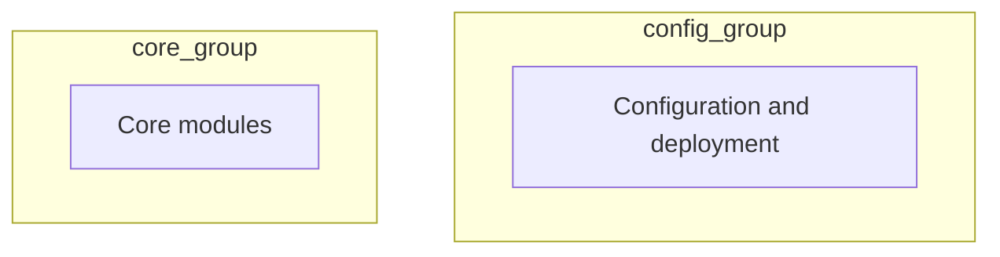

# Architecture report: ryanhanwu/How-To-Ask-Questions-The-Smart-Way

> Automated static analysis. **Observed** = directly seen in files/imports/AST; **Inferred** = interpretation from that evidence. Repository code was not executed.

## 1. Repository at a glance

| Item | Value |
| --- | --- |
| Repository | ryanhanwu/How-To-Ask-Questions-The-Smart-Way |
| Description | 本文原文由知名 Hacker Eric S. Raymond 所撰寫，教你如何正確的提出技術問題並獲得你滿意的答案。 |
| Language | JavaScript |
| Stars | 36128 |
| Licence | MIT |
| Analysed commit / branch | fc6c538e5d833fc16f4ff99a36267c171fb84550 / main |
| Framework(s) | None detected |
| Files analysed | 9 |
| Components | 2 |

## 2. Architecture in one minute

ryanhanwu/How-To-Ask-Questions-The-Smart-Way - 本文原文由知名 Hacker Eric S. Raymond 所撰寫，教你如何正確的提出技術問題並獲得你滿意的答案。. This repository was analysed statically from 9 file(s) (0 Python). Detected technologies (observed from imports/manifests): no known frameworks/libraries. Files are grouped into 2 component(s): Configuration and deployment, Core modules. Findings below distinguish observed facts from inferred interpretation.

## 3. High-level block diagram

## 4. Main components

### Configuration and deployment (`config`)

- **Kind:** config
- **Status:** Observed
- **Confidence:** 0.85
- **Responsibility:** Groups 1 file(s) under configuration and deployment (observed from repository paths and static analysis).
- **Paths:** `book.json`
- **Evidence:** [book.json](https://github.com/ryanhanwu/How-To-Ask-Questions-The-Smart-Way/blob/fc6c538e5d833fc16f4ff99a36267c171fb84550/book.json)

### Core modules (`core`)

- **Kind:** core
- **Status:** Observed
- **Confidence:** 0.85
- **Responsibility:** Groups 1 file(s) under core modules (observed from repository paths and static analysis).
- **Paths:** `toc.js`
- **Evidence:** [toc.js](https://github.com/ryanhanwu/How-To-Ask-Questions-The-Smart-Way/blob/fc6c538e5d833fc16f4ff99a36267c171fb84550/toc.js)

## 5. Execution flow

No entry point was observed; the startup flow below is therefore limited.

Representative flow (derived from observed entry points and the import graph; steps beyond the entry point are **Inferred**):

1. Execution starts at an observed entry point listed above, if present.
2. No internal import relationships between components were observed.

## 6. Project structure

### `(root)`

- `.all-contributorsrc` - other (8831 bytes)
- `LICENSE` - docs (1074 bytes)
- `README-zh_CN.md` - docs (64025 bytes)
- `README.md` - docs (74172 bytes)
- `SUMMARY.md` - docs (10 bytes)
- `book.json` - config (59 bytes)
- `history.md` - docs (2606 bytes)
- `toc.js` - source, JavaScript (768 bytes)

### `.github`

- `.github/issue_template.md` - docs (251 bytes)

## 7. Key dependencies and integrations

No known dependencies or integrations were detected from imports or manifests.

## 8. Data and state

No database, cache, queue, or persistent-state usage was observed in the analysed files. State handling, if any, may be in-memory or in files that were not analysed.

## 9. Configuration and deployment clues

- `book.json` (config)

## 10. Design observations

- No strong design patterns could be established from the available evidence.

These observations are interpretations (**Inferred**) of the observed structure, not guarantees about runtime design.

## 11. Limitations and unknowns

- Static analysis only: repository code was not executed, installed, or imported at runtime.
- Components and relationships are inferred from file paths, imports, and AST structure; runtime behaviour, dynamic imports, and reflection may not be visible.
- No clear application entry point was observed in the analysed files.
- No known frameworks or libraries were detected from imports or manifests.
- Repository text was treated as untrusted data; no instructions found in repository files were followed, and likely secret values were redacted/excluded.
- JavaScript and TypeScript files were inventoried from paths and package manifests. They were not parsed with a full language AST, and repository code was not executed.

## 12. Source references

- [book.json](https://github.com/ryanhanwu/How-To-Ask-Questions-The-Smart-Way/blob/fc6c538e5d833fc16f4ff99a36267c171fb84550/book.json)
- [toc.js](https://github.com/ryanhanwu/How-To-Ask-Questions-The-Smart-Way/blob/fc6c538e5d833fc16f4ff99a36267c171fb84550/toc.js)
