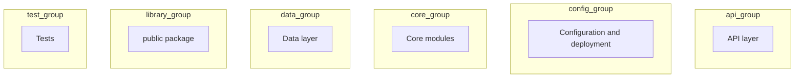

# Architecture report: sahat/hackathon-starter

> Automated static analysis. **Observed** = directly seen in files/imports/AST; **Inferred** = interpretation from that evidence. Repository code was not executed.

## 1. Repository at a glance

| Item | Value |
| --- | --- |
| Repository | sahat/hackathon-starter |
| Description | A boilerplate for Node.js web applications |
| Language | JavaScript |
| Stars | 35260 |
| Licence | MIT |
| Analysed commit / branch | e735ca8f29d18158b7553244d4e6625ef7eaa383 / master |
| Framework(s) | Express |
| Files analysed | 155 |
| Components | 6 |

## 2. Architecture in one minute

sahat/hackathon-starter - A boilerplate for Node.js web applications. This repository was analysed statically from 155 file(s) (0 Python). Detected technologies (observed from imports/manifests): GitHub Actions, MongoDB, Express. Files are grouped into 6 component(s): API layer, Configuration and deployment, Core modules, Data layer, public package, Tests. Findings below distinguish observed facts from inferred interpretation.

## 3. High-level block diagram

## 4. Main components

### API layer (`api_layer`)

- **Kind:** api
- **Status:** Observed
- **Confidence:** 0.85
- **Responsibility:** Groups 7 file(s) under api layer (observed from repository paths and static analysis).
- **Paths:** `controllers/ai-agent.js`, `controllers/ai.js`, `controllers/api.js`, `controllers/contact.js`, `controllers/home.js`, `controllers/user.js`, `controllers/webauthn.js`
- **Evidence:** [controllers/ai-agent.js](https://github.com/sahat/hackathon-starter/blob/e735ca8f29d18158b7553244d4e6625ef7eaa383/controllers/ai-agent.js); [controllers/ai.js](https://github.com/sahat/hackathon-starter/blob/e735ca8f29d18158b7553244d4e6625ef7eaa383/controllers/ai.js); [controllers/api.js](https://github.com/sahat/hackathon-starter/blob/e735ca8f29d18158b7553244d4e6625ef7eaa383/controllers/api.js); [controllers/contact.js](https://github.com/sahat/hackathon-starter/blob/e735ca8f29d18158b7553244d4e6625ef7eaa383/controllers/contact.js); [controllers/home.js](https://github.com/sahat/hackathon-starter/blob/e735ca8f29d18158b7553244d4e6625ef7eaa383/controllers/home.js); [controllers/user.js](https://github.com/sahat/hackathon-starter/blob/e735ca8f29d18158b7553244d4e6625ef7eaa383/controllers/user.js); [controllers/webauthn.js](https://github.com/sahat/hackathon-starter/blob/e735ca8f29d18158b7553244d4e6625ef7eaa383/controllers/webauthn.js)

### Configuration and deployment (`config`)

- **Kind:** config
- **Status:** Observed
- **Confidence:** 0.85
- **Responsibility:** Groups 7 file(s) under configuration and deployment (observed from repository paths and static analysis).
- **Paths:** `config/cacheBust.js`, `config/flash.js`, `config/morgan.js`, `config/nodemailer.js`, `config/passport.js`, `config/token-revocation.js`, `package.json`
- **Evidence:** [config/cacheBust.js](https://github.com/sahat/hackathon-starter/blob/e735ca8f29d18158b7553244d4e6625ef7eaa383/config/cacheBust.js); [config/flash.js](https://github.com/sahat/hackathon-starter/blob/e735ca8f29d18158b7553244d4e6625ef7eaa383/config/flash.js); [config/morgan.js](https://github.com/sahat/hackathon-starter/blob/e735ca8f29d18158b7553244d4e6625ef7eaa383/config/morgan.js); [config/nodemailer.js](https://github.com/sahat/hackathon-starter/blob/e735ca8f29d18158b7553244d4e6625ef7eaa383/config/nodemailer.js); [config/passport.js](https://github.com/sahat/hackathon-starter/blob/e735ca8f29d18158b7553244d4e6625ef7eaa383/config/passport.js); [config/token-revocation.js](https://github.com/sahat/hackathon-starter/blob/e735ca8f29d18158b7553244d4e6625ef7eaa383/config/token-revocation.js); [package.json](https://github.com/sahat/hackathon-starter/blob/e735ca8f29d18158b7553244d4e6625ef7eaa383/package.json)

### Core modules (`core`)

- **Kind:** core
- **Status:** Observed
- **Confidence:** 0.85
- **Responsibility:** Groups 2 file(s) under core modules (observed from repository paths and static analysis).
- **Paths:** `app.js`, `eslint.config.mjs`
- **Evidence:** [app.js](https://github.com/sahat/hackathon-starter/blob/e735ca8f29d18158b7553244d4e6625ef7eaa383/app.js); [eslint.config.mjs](https://github.com/sahat/hackathon-starter/blob/e735ca8f29d18158b7553244d4e6625ef7eaa383/eslint.config.mjs)

### Data layer (`data_layer`)

- **Kind:** data
- **Status:** Observed
- **Confidence:** 0.85
- **Responsibility:** Groups 2 file(s) under data layer (observed from repository paths and static analysis).
- **Paths:** `models/Session.js`, `models/User.js`
- **Evidence:** [models/Session.js](https://github.com/sahat/hackathon-starter/blob/e735ca8f29d18158b7553244d4e6625ef7eaa383/models/Session.js); [models/User.js](https://github.com/sahat/hackathon-starter/blob/e735ca8f29d18158b7553244d4e6625ef7eaa383/models/User.js)

### public package (`public`)

- **Kind:** library
- **Status:** Observed
- **Confidence:** 0.85
- **Responsibility:** Groups 3 file(s) under public package (observed from repository paths and static analysis).
- **Paths:** `public/js/cookieconsent-bundle.js`, `public/js/main.js`, `public/js/theme.js`
- **Evidence:** [public/js/cookieconsent-bundle.js](https://github.com/sahat/hackathon-starter/blob/e735ca8f29d18158b7553244d4e6625ef7eaa383/public/js/cookieconsent-bundle.js); [public/js/main.js](https://github.com/sahat/hackathon-starter/blob/e735ca8f29d18158b7553244d4e6625ef7eaa383/public/js/main.js); [public/js/theme.js](https://github.com/sahat/hackathon-starter/blob/e735ca8f29d18158b7553244d4e6625ef7eaa383/public/js/theme.js)

### Tests (`tests`)

- **Kind:** test
- **Status:** Observed
- **Confidence:** 0.85
- **Responsibility:** Groups 65 file(s) under tests (observed from repository paths and static analysis).
- **Paths:** `test/TESTING.md`, `test/app-links.test.js`, `test/app.test.js`, `test/cacheBust.test.js`, `test/contact.test.js`, `test/docs-links.test.js`, `test/e2e-nokey/github-api.e2e.test.js`, `test/e2e-nokey/lastfm.e2e.test.js`, `test/e2e-nokey/pubchem.e2e.test.js`, `test/e2e-nokey/scraping.e2e.test.js`, `test/e2e-nokey/theme.e2e.test.js`, `test/e2e-nokey/upload.e2e.test.js`, `test/e2e-nokey/wikipedia.e2e.test.js`, `test/e2e/chart.e2e.test.js`, `test/e2e/foursquare.e2e.test.js`, `test/e2e/giphy.e2e.test.js`, `test/e2e/google-maps.e2e.test.js`, `test/e2e/here-maps.e2e.test.js`, `test/e2e/llm-classifier.e2e.test.js`, `test/e2e/lob.e2e.test.js`, `test/e2e/nyt.e2e.test.js`, `test/e2e/rag.e2e.test.js`, `test/e2e/twilio.e2e.test.js`, `test/fixtures/GET_http%3A%2F%2Fws.audioscrobbler.com%2F6f1cdb8d5707.json`, `test/fixtures/GET_http%3A%2F%2Fws.audioscrobbler.com%2F7953f90072b4.json`, `test/fixtures/GET_http%3A%2F%2Fws.audioscrobbler.com%2Ff72869b8a412.json`, `test/fixtures/GET_https%3A%2F%2Fapi.giphy.com%2F4189fbfa3255.json`, `test/fixtures/GET_https%3A%2F%2Fapi.giphy.com%2Fec0c29439d0f.json`, `test/fixtures/GET_https%3A%2F%2Fapi.github.com%2Fdb109715600b.json`, `test/fixtures/GET_https%3A%2F%2Fapi.nytimes.com%2F9148841df88c.json`, `test/fixtures/GET_https%3A%2F%2Fen.wikipedia.org%2F34742f7aced6.json`, `test/fixtures/GET_https%3A%2F%2Fen.wikipedia.org%2F6cdd4d058049.json`, `test/fixtures/GET_https%3A%2F%2Fen.wikipedia.org%2F86d779039568.json`, `test/fixtures/GET_https%3A%2F%2Fen.wikipedia.org%2F89d31365348d.json`, `test/fixtures/GET_https%3A%2F%2Fnews.ycombinator.com%2F8a5edab28263.json`, `test/fixtures/GET_https%3A%2F%2Fplaces-api.foursquare.com%2F478c17e7311f.json`, `test/fixtures/GET_https%3A%2F%2Fplaces-api.foursquare.com%2F582378fe2f4b.json`, `test/fixtures/GET_https%3A%2F%2Fpubchem.ncbi.nlm.nih.gov%2F70ef24fb1b8c.json`, `test/fixtures/GET_https%3A%2F%2Fpubchem.ncbi.nlm.nih.gov%2F7463b67dbfdc.json`, `test/fixtures/GET_https%3A%2F%2Fpubchem.ncbi.nlm.nih.gov%2F8f7968925bbc.json`, `test/fixtures/GET_https%3A%2F%2Fpubchem.ncbi.nlm.nih.gov%2F99f2b46bd3d0.json`, `test/fixtures/GET_https%3A%2F%2Fpubchem.ncbi.nlm.nih.gov%2Ff1e57595e1d5.json`, `test/fixtures/GET_https%3A%2F%2Fwww.alphavantage.co%2F567c59988309.json`, `test/fixtures/POST_https%3A%2F%2Fapi.groq.com%2F85cb85fde355_e594495b41b8.json`, `test/fixtures/POST_https%3A%2F%2Fapi.twilio.com%2F736bd01d4665_25ca7364ce02.json`, `test/fixtures/POST_https%3A%2F%2Fapi.twilio.com%2F736bd01d4665_9cf625bb20f5.json`, `test/fixtures/POST_https%3A%2F%2Fapi.twilio.com%2F736bd01d4665_cec34eae746f.json`, `test/fixtures/POST_https%3A%2F%2Fapi.twilio.com%2F736bd01d4665_e76680b11997.json`, `test/fixtures/POST_https%3A%2F%2Fapi.twilio.com%2F736bd01d4665_f6c5949e0bbe.json`, `test/fixtures/POST_https%3A%2F%2Fapi.twilio.com%2F736bd01d4665_fb6a310ba25d.json`, `test/fixtures/POST_https%3A%2F%2Fapi.twilio.com%2F736bd01d4665_ff1ca9bdf42c.json`, `test/flash.test.js`, `test/models.test.js`, `test/morgan.test.js`, `test/nodemailer.test.js`, `test/passport.test.js`, `test/playwright.config.js`, `test/session.test.js`, `test/token-revocation.test.js`, `test/tools/nock-server-fixtures.js`, `test/tools/playwright-start-and-log.js`, `test/tools/simple-link-image-check.js`, `test/tools/start-with-memory-db.js`, `test/user.test.js`, `test/webauthn.test.js`
- **Evidence:** [test/TESTING.md](https://github.com/sahat/hackathon-starter/blob/e735ca8f29d18158b7553244d4e6625ef7eaa383/test/TESTING.md); [test/app-links.test.js](https://github.com/sahat/hackathon-starter/blob/e735ca8f29d18158b7553244d4e6625ef7eaa383/test/app-links.test.js); [test/app.test.js](https://github.com/sahat/hackathon-starter/blob/e735ca8f29d18158b7553244d4e6625ef7eaa383/test/app.test.js); [test/cacheBust.test.js](https://github.com/sahat/hackathon-starter/blob/e735ca8f29d18158b7553244d4e6625ef7eaa383/test/cacheBust.test.js); [test/contact.test.js](https://github.com/sahat/hackathon-starter/blob/e735ca8f29d18158b7553244d4e6625ef7eaa383/test/contact.test.js); [test/docs-links.test.js](https://github.com/sahat/hackathon-starter/blob/e735ca8f29d18158b7553244d4e6625ef7eaa383/test/docs-links.test.js); [test/e2e-nokey/github-api.e2e.test.js](https://github.com/sahat/hackathon-starter/blob/e735ca8f29d18158b7553244d4e6625ef7eaa383/test/e2e-nokey/github-api.e2e.test.js); [test/e2e-nokey/lastfm.e2e.test.js](https://github.com/sahat/hackathon-starter/blob/e735ca8f29d18158b7553244d4e6625ef7eaa383/test/e2e-nokey/lastfm.e2e.test.js)

## 5. Execution flow

**Observed** entry point(s):

- [app.js](https://github.com/sahat/hackathon-starter/blob/e735ca8f29d18158b7553244d4e6625ef7eaa383/app.js)
- [public/js/main.js](https://github.com/sahat/hackathon-starter/blob/e735ca8f29d18158b7553244d4e6625ef7eaa383/public/js/main.js)

Representative flow (derived from observed entry points and the import graph; steps beyond the entry point are **Inferred**):

1. Execution starts at an observed entry point listed above, if present.
2. No internal import relationships between components were observed.

## 6. Project structure

### `(root)`

- `.env.example` - config (3344 bytes)
- `.gitattributes` - other (19 bytes)
- `.gitignore` - other (615 bytes)
- `.prettierignore` - other (35 bytes)
- `.prettierrc` - other (86 bytes)
- `AGENTS.md` - docs (29994 bytes)
- `CHANGELOG.md` - docs (34154 bytes)
- `CLAUDE.md` - docs (171 bytes)
- `LICENSE` - docs (1086 bytes)
- `PROD_CHECKLIST.md` - docs (4435 bytes)
- `README.md` - docs (86377 bytes)
- `SECURITY.md` - docs (1255 bytes)
- `app.js` - source, JavaScript (21033 bytes)
- `eslint.config.mjs` - source, JavaScript (3205 bytes)
- `package.json` - manifest (4929 bytes)

### `.github`

- `.github/PULL_REQUEST_TEMPLATE.md` - docs (1236 bytes)
- `.github/dependabot.yml` - config (660 bytes)
- `.github/workflows/build.yml` - ci, YAML (1711 bytes)
- `.github/workflows/dependabot-automerge.yml` - ci, YAML (3918 bytes)

### `.husky`

- `.husky/pre-commit` - other (102 bytes)

### `config`

- `config/cacheBust.js` - source, JavaScript (1103 bytes)
- `config/flash.js` - source, JavaScript (1485 bytes)
- `config/morgan.js` - source, JavaScript (4165 bytes)
- `config/nodemailer.js` - source, JavaScript (1554 bytes)
- `config/passport.js` - source, JavaScript (33756 bytes)
- `config/token-revocation.js` - source, JavaScript (5503 bytes)

### `controllers`

- `controllers/ai-agent.js` - source, JavaScript (25858 bytes)
- `controllers/ai.js` - source, JavaScript (32606 bytes)
- `controllers/api.js` - source, JavaScript (48511 bytes)
- `controllers/contact.js` - source, JavaScript (3766 bytes)
- `controllers/home.js` - source, JavaScript (149 bytes)
- `controllers/user.js` - source, JavaScript (38893 bytes)
- `controllers/webauthn.js` - source, JavaScript (9324 bytes)

### `models`

- `models/Session.js` - source, JavaScript (1137 bytes)
- `models/User.js` - source, JavaScript (9731 bytes)

### `patches`

- `patches/passport+0.7.0.patch` - other (1811 bytes)
- `patches/passport-oauth1+1.3.0.patch` - other (3089 bytes)
- `patches/passport-oauth2+1.8.0.patch` - other (4074 bytes)

### `public`

- `public/bootstrap-logo.svg` - other (2047 bytes)
- `public/css/main.scss` - other (5024 bytes)
- `public/js/cookieconsent-bundle.js` - source, JavaScript (5140 bytes)
- `public/js/lib/.gitkeep` - other (73 bytes)
- `public/js/main.js` - source, JavaScript (65 bytes)
- `public/js/theme.js` - source, JavaScript (3562 bytes)
- `public/privacy-policy.html` - other (4169 bytes)
- `public/terms-of-use.html` - other (25430 bytes)

### `test`

- `test/TESTING.md` - test (13826 bytes)
- `test/app-links.test.js` - test, JavaScript (695 bytes)
- `test/app.test.js` - test, JavaScript (2138 bytes)
- `test/cacheBust.test.js` - test, JavaScript (2559 bytes)
- `test/contact.test.js` - test, JavaScript (5199 bytes)
- `test/docs-links.test.js` - test, JavaScript (705 bytes)
- `test/e2e-nokey/github-api.e2e.test.js` - test, JavaScript (4725 bytes)
- `test/e2e-nokey/lastfm.e2e.test.js` - test, JavaScript (9981 bytes)
- `test/e2e-nokey/pubchem.e2e.test.js` - test, JavaScript (8460 bytes)
- `test/e2e-nokey/scraping.e2e.test.js` - test, JavaScript (1011 bytes)
- `test/e2e-nokey/theme.e2e.test.js` - test, JavaScript (4489 bytes)
- `test/e2e-nokey/upload.e2e.test.js` - test, JavaScript (13658 bytes)
- `test/e2e-nokey/wikipedia.e2e.test.js` - test, JavaScript (3446 bytes)
- `test/e2e/chart.e2e.test.js` - test, JavaScript (3685 bytes)
- `test/e2e/foursquare.e2e.test.js` - test, JavaScript (4846 bytes)
- `test/e2e/giphy.e2e.test.js` - test, JavaScript (1462 bytes)
- `test/e2e/google-maps.e2e.test.js` - test, JavaScript (6909 bytes)
- `test/e2e/here-maps.e2e.test.js` - test, JavaScript (3020 bytes)
- `test/e2e/llm-classifier.e2e.test.js` - test, JavaScript (3675 bytes)
- `test/e2e/lob.e2e.test.js` - test, JavaScript (4795 bytes)
- `test/e2e/nyt.e2e.test.js` - test, JavaScript (2225 bytes)
- `test/e2e/rag.e2e.test.js` - test, JavaScript (11106 bytes)
- `test/e2e/twilio.e2e.test.js` - test, JavaScript (4114 bytes)
- `test/fixtures/GET_http%3A%2F%2Fws.audioscrobbler.com%2F6f1cdb8d5707.json` - test (10795 bytes)
- `test/fixtures/GET_http%3A%2F%2Fws.audioscrobbler.com%2F7953f90072b4.json` - test (63224 bytes)
- `test/fixtures/GET_http%3A%2F%2Fws.audioscrobbler.com%2Ff72869b8a412.json` - test (57439 bytes)
- `test/fixtures/GET_https%3A%2F%2Fapi.giphy.com%2F4189fbfa3255.json` - test (26162 bytes)
- `test/fixtures/GET_https%3A%2F%2Fapi.giphy.com%2Fec0c29439d0f.json` - test (24709 bytes)
- `test/fixtures/GET_https%3A%2F%2Fapi.github.com%2Fdb109715600b.json` - test (4669 bytes)
- `test/fixtures/GET_https%3A%2F%2Fapi.nytimes.com%2F9148841df88c.json` - test (8339 bytes)
- `test/fixtures/GET_https%3A%2F%2Fen.wikipedia.org%2F34742f7aced6.json` - test (2504 bytes)
- `test/fixtures/GET_https%3A%2F%2Fen.wikipedia.org%2F6cdd4d058049.json` - test (3749 bytes)
- `test/fixtures/GET_https%3A%2F%2Fen.wikipedia.org%2F86d779039568.json` - test (3470 bytes)
- `test/fixtures/GET_https%3A%2F%2Fen.wikipedia.org%2F89d31365348d.json` - test (4859 bytes)
- `test/fixtures/GET_https%3A%2F%2Fnews.ycombinator.com%2F8a5edab28263.json` - test (12538 bytes)
- `test/fixtures/GET_https%3A%2F%2Fplaces-api.foursquare.com%2F478c17e7311f.json` - test (17806 bytes)
- `test/fixtures/GET_https%3A%2F%2Fplaces-api.foursquare.com%2F582378fe2f4b.json` - test (21674 bytes)
- `test/fixtures/GET_https%3A%2F%2Fpubchem.ncbi.nlm.nih.gov%2F70ef24fb1b8c.json` - test (23246 bytes)
- `test/fixtures/GET_https%3A%2F%2Fpubchem.ncbi.nlm.nih.gov%2F7463b67dbfdc.json` - test (4520 bytes)
- `test/fixtures/GET_https%3A%2F%2Fpubchem.ncbi.nlm.nih.gov%2F8f7968925bbc.json` - test (1672 bytes)
- `test/fixtures/GET_https%3A%2F%2Fpubchem.ncbi.nlm.nih.gov%2F99f2b46bd3d0.json` - test (12426 bytes)
- `test/fixtures/GET_https%3A%2F%2Fpubchem.ncbi.nlm.nih.gov%2Ff1e57595e1d5.json` - test (43042 bytes)
- `test/fixtures/GET_https%3A%2F%2Fwww.alphavantage.co%2F567c59988309.json` - test (5281 bytes)
- `test/fixtures/POST_https%3A%2F%2Fapi.groq.com%2F85cb85fde355_e594495b41b8.json` - test (3167 bytes)
- `test/fixtures/POST_https%3A%2F%2Fapi.twilio.com%2F736bd01d4665_25ca7364ce02.json` - test (1910 bytes)
- `test/fixtures/POST_https%3A%2F%2Fapi.twilio.com%2F736bd01d4665_9cf625bb20f5.json` - test (1247 bytes)
- `test/fixtures/POST_https%3A%2F%2Fapi.twilio.com%2F736bd01d4665_cec34eae746f.json` - test (1322 bytes)
- `test/fixtures/POST_https%3A%2F%2Fapi.twilio.com%2F736bd01d4665_e76680b11997.json` - test (1263 bytes)
- `test/fixtures/POST_https%3A%2F%2Fapi.twilio.com%2F736bd01d4665_f6c5949e0bbe.json` - test (1312 bytes)
- `test/fixtures/POST_https%3A%2F%2Fapi.twilio.com%2F736bd01d4665_fb6a310ba25d.json` - test (1910 bytes)
- `test/fixtures/POST_https%3A%2F%2Fapi.twilio.com%2F736bd01d4665_ff1ca9bdf42c.json` - test (1249 bytes)
- `test/flash.test.js` - test, JavaScript (4018 bytes)
- `test/models.test.js` - test, JavaScript (40525 bytes)
- `test/morgan.test.js` - test, JavaScript (4549 bytes)
- `test/nodemailer.test.js` - test, JavaScript (4687 bytes)
- `test/passport.test.js` - test, JavaScript (46725 bytes)
- `test/playwright.config.js` - test, JavaScript (3262 bytes)
- `test/session.test.js` - test, JavaScript (1551 bytes)
- `test/token-revocation.test.js` - test, JavaScript (10617 bytes)
- `test/tools/nock-server-fixtures.js` - test, JavaScript (11303 bytes)
- `test/tools/playwright-start-and-log.js` - test, JavaScript (1017 bytes)
- `test/tools/simple-link-image-check.js` - test, JavaScript (9588 bytes)
- `test/tools/start-with-memory-db.js` - test, JavaScript (3778 bytes)
- `test/user.test.js` - test, JavaScript (69876 bytes)
- `test/webauthn.test.js` - test, JavaScript (22412 bytes)

### `views`

- `views/account/forgot.pug` - other (667 bytes)
- `views/account/login.pug` - other (5162 bytes)
- `views/account/profile.pug` - other (12801 bytes)
- `views/account/reset.pug` - other (929 bytes)
- `views/account/signup.pug` - other (2052 bytes)
- `views/account/totp-setup.pug` - other (1069 bytes)
- `views/account/two-factor.pug` - other (1668 bytes)
- `views/account/webauthn-login.pug` - other (1918 bytes)
- `views/account/webauthn-register.pug` - other (1976 bytes)
- `views/ai/ai-agent.pug` - other (12280 bytes)
- `views/ai/index.pug` - other (3561 bytes)
- `views/ai/llm-camera.pug` - other (6977 bytes)
- `views/ai/llm-classifier.pug` - other (2311 bytes)
- `views/ai/rag.pug` - other (6688 bytes)
- `views/api/chart.pug` - other (1853 bytes)
- `views/api/facebook.pug` - other (1156 bytes)
- `views/api/foursquare.pug` - other (2282 bytes)
- `views/api/giphy.pug` - other (1531 bytes)
- `views/api/github.pug` - other (6771 bytes)
- `views/api/google-drive.pug` - other (766 bytes)
- `views/api/google-maps.pug` - other (7078 bytes)
- `views/api/google-sheets.pug` - other (1317 bytes)
- `views/api/here-maps.pug` - other (4132 bytes)
- `views/api/index.pug` - other (6086 bytes)
- `views/api/lastfm.pug` - other (1292 bytes)
- `views/api/lob.pug` - other (2124 bytes)
- `views/api/nyt.pug` - other (882 bytes)
- `views/api/paypal.pug` - other (1207 bytes)
- `views/api/pubchem.pug` - other (6197 bytes)
- `views/api/quickbooks.pug` - other (792 bytes)
- `views/api/scraping.pug` - other (679 bytes)
- `views/api/steam.pug` - other (1567 bytes)
- `views/api/stripe.pug` - other (3433 bytes)
- `views/api/tumblr.pug` - other (1712 bytes)
- `views/api/twilio.pug` - other (3604 bytes)
- `views/api/twitch.pug` - other (2530 bytes)
- `views/api/upload.pug` - other (939 bytes)
- `views/api/wikipedia.pug` - other (2956 bytes)
- `views/contact.pug` - other (1804 bytes)
- `views/home.pug` - other (2166 bytes)
- `views/layout.pug` - other (4302 bytes)
- `views/partials/flash.pug` - other (631 bytes)
- `views/partials/footer.pug` - other (507 bytes)
- `views/partials/header.pug` - other (1600 bytes)

## 7. Key dependencies and integrations

| Name | Category | Status | Confidence | Evidence |
| --- | --- | --- | --- | --- |
| GitHub Actions | ci | Observed | 0.90 | [.github/workflows/build.yml](https://github.com/sahat/hackathon-starter/blob/e735ca8f29d18158b7553244d4e6625ef7eaa383/.github/workflows/build.yml); [.github/workflows/dependabot-automerge.yml](https://github.com/sahat/hackathon-starter/blob/e735ca8f29d18158b7553244d4e6625ef7eaa383/.github/workflows/dependabot-automerge.yml) |
| MongoDB | database | Observed | 0.85 | [.env.example:10](https://github.com/sahat/hackathon-starter/blob/e735ca8f29d18158b7553244d4e6625ef7eaa383/.env.example#L10); [package.json:69](https://github.com/sahat/hackathon-starter/blob/e735ca8f29d18158b7553244d4e6625ef7eaa383/package.json#L69) |
| Express | framework | Observed | 0.85 | [package.json:59](https://github.com/sahat/hackathon-starter/blob/e735ca8f29d18158b7553244d4e6625ef7eaa383/package.json#L59) |

## 8. Data and state

- **MongoDB** (Observed, confidence 0.85) - evidence: [.env.example:10](https://github.com/sahat/hackathon-starter/blob/e735ca8f29d18158b7553244d4e6625ef7eaa383/.env.example#L10); [package.json:69](https://github.com/sahat/hackathon-starter/blob/e735ca8f29d18158b7553244d4e6625ef7eaa383/package.json#L69)
- Data component `data_layer` (Observed): Groups 2 file(s) under data layer (observed from repository paths and static analysis).

## 9. Configuration and deployment clues

- `.env.example` (config)
- `.github/dependabot.yml` (config)
- `.github/workflows/build.yml` (ci)
- `.github/workflows/dependabot-automerge.yml` (ci)
- `package.json` (manifest)

Environment variable *names* seen in example env files (values never recorded):

- `.env.example`: `ALPHA_VANTAGE_KEY`, `BASE_URL`, `DISCORD_CLIENT_ID`, `DISCORD_CLIENT_SECRET`, `FACEBOOK_ID`, `FACEBOOK_PIXEL_ID`, `FACEBOOK_SECRET`, `FOURSQUARE_APIKEY`, `GIPHY_API_KEY`, `GITHUB_ID`, `GITHUB_SECRET`, `GOOGLE_ANALYTICS_ID`, `GOOGLE_API_KEY`, `GOOGLE_CLIENT_ID`, `GOOGLE_CLIENT_SECRET`, `GOOGLE_MAP_API_KEY`, `GOOGLE_PROJECT_ID`, `GOOGLE_RECAPTCHA_SITE_KEY`, `GROQ_API_KEY`, `GROQ_MODEL`, `GROQ_MODEL_PROMPT_GUARD`, `GROQ_VISION`, `HERE_API_KEY`, `HUGGINGFACE_EMBEDDING_MODEL`, `HUGGINGFACE_KEY`, `HUGGINGFACE_PROVIDER`, `LASTFM_KEY`, `LASTFM_SECRET`, `LINKEDIN_ID`, `LINKEDIN_SECRET`, `LOB_KEY`, `MICROSOFT_CLIENT_ID`, `MICROSOFT_CLIENT_SECRET`, `MONGODB_URI`, `NYT_KEY`, `OPENAI_API_KEY`, `PAYPAL_ID`, `PAYPAL_SECRET`, `QUICKBOOKS_CLIENT_ID`, `QUICKBOOKS_CLIENT_SECRET`, `SESSION_SECRET`, `SITE_CONTACT_EMAIL`, `SMTP_HOST`, `SMTP_PASSWORD`, `SMTP_USER`, `STEAM_KEY`, `STRIPE_PKEY`, `STRIPE_SKEY`, `TRANSACTION_EMAIL`, `TUMBLR_KEY`, `TUMBLR_SECRET`, `TWILIO_FROM_NUMBER`, `TWILIO_SID`, `TWILIO_TOKEN`, `TWITCH_CLIENT_ID`, `TWITCH_CLIENT_SECRET`, `X_KEY`, `X_SECRET`

## 10. Design observations

- An entry/API layer is separated from other code (Inferred from paths and decorators).
- Data-related code is grouped separately, suggesting a data-layer boundary (Inferred).
- Tests are present alongside source code (Observed from test file paths).

These observations are interpretations (**Inferred**) of the observed structure, not guarantees about runtime design.

## 11. Limitations and unknowns

- Static analysis only: repository code was not executed, installed, or imported at runtime.
- Components and relationships are inferred from file paths, imports, and AST structure; runtime behaviour, dynamic imports, and reflection may not be visible.
- 1 file(s) were skipped during inventory (1 x likely secret file excluded).
- No clear application entry point was observed in the analysed files.
- Repository text was treated as untrusted data; no instructions found in repository files were followed, and likely secret values were redacted/excluded.
- JavaScript and TypeScript files were inventoried from paths and package manifests. They were not parsed with a full language AST, and repository code was not executed.

## 12. Source references

- [.env.example:10](https://github.com/sahat/hackathon-starter/blob/e735ca8f29d18158b7553244d4e6625ef7eaa383/.env.example#L10)
- [.github/workflows/build.yml](https://github.com/sahat/hackathon-starter/blob/e735ca8f29d18158b7553244d4e6625ef7eaa383/.github/workflows/build.yml)
- [.github/workflows/dependabot-automerge.yml](https://github.com/sahat/hackathon-starter/blob/e735ca8f29d18158b7553244d4e6625ef7eaa383/.github/workflows/dependabot-automerge.yml)
- [app.js](https://github.com/sahat/hackathon-starter/blob/e735ca8f29d18158b7553244d4e6625ef7eaa383/app.js)
- [config/cacheBust.js](https://github.com/sahat/hackathon-starter/blob/e735ca8f29d18158b7553244d4e6625ef7eaa383/config/cacheBust.js)
- [config/flash.js](https://github.com/sahat/hackathon-starter/blob/e735ca8f29d18158b7553244d4e6625ef7eaa383/config/flash.js)
- [config/morgan.js](https://github.com/sahat/hackathon-starter/blob/e735ca8f29d18158b7553244d4e6625ef7eaa383/config/morgan.js)
- [config/nodemailer.js](https://github.com/sahat/hackathon-starter/blob/e735ca8f29d18158b7553244d4e6625ef7eaa383/config/nodemailer.js)
- [config/passport.js](https://github.com/sahat/hackathon-starter/blob/e735ca8f29d18158b7553244d4e6625ef7eaa383/config/passport.js)
- [config/token-revocation.js](https://github.com/sahat/hackathon-starter/blob/e735ca8f29d18158b7553244d4e6625ef7eaa383/config/token-revocation.js)
- [controllers/ai-agent.js](https://github.com/sahat/hackathon-starter/blob/e735ca8f29d18158b7553244d4e6625ef7eaa383/controllers/ai-agent.js)
- [controllers/ai.js](https://github.com/sahat/hackathon-starter/blob/e735ca8f29d18158b7553244d4e6625ef7eaa383/controllers/ai.js)
- [controllers/api.js](https://github.com/sahat/hackathon-starter/blob/e735ca8f29d18158b7553244d4e6625ef7eaa383/controllers/api.js)
- [controllers/contact.js](https://github.com/sahat/hackathon-starter/blob/e735ca8f29d18158b7553244d4e6625ef7eaa383/controllers/contact.js)
- [controllers/home.js](https://github.com/sahat/hackathon-starter/blob/e735ca8f29d18158b7553244d4e6625ef7eaa383/controllers/home.js)
- [controllers/user.js](https://github.com/sahat/hackathon-starter/blob/e735ca8f29d18158b7553244d4e6625ef7eaa383/controllers/user.js)
- [controllers/webauthn.js](https://github.com/sahat/hackathon-starter/blob/e735ca8f29d18158b7553244d4e6625ef7eaa383/controllers/webauthn.js)
- [eslint.config.mjs](https://github.com/sahat/hackathon-starter/blob/e735ca8f29d18158b7553244d4e6625ef7eaa383/eslint.config.mjs)
- [models/Session.js](https://github.com/sahat/hackathon-starter/blob/e735ca8f29d18158b7553244d4e6625ef7eaa383/models/Session.js)
- [models/User.js](https://github.com/sahat/hackathon-starter/blob/e735ca8f29d18158b7553244d4e6625ef7eaa383/models/User.js)
- [package.json](https://github.com/sahat/hackathon-starter/blob/e735ca8f29d18158b7553244d4e6625ef7eaa383/package.json)
- [package.json:59](https://github.com/sahat/hackathon-starter/blob/e735ca8f29d18158b7553244d4e6625ef7eaa383/package.json#L59)
- [package.json:69](https://github.com/sahat/hackathon-starter/blob/e735ca8f29d18158b7553244d4e6625ef7eaa383/package.json#L69)
- [public/js/cookieconsent-bundle.js](https://github.com/sahat/hackathon-starter/blob/e735ca8f29d18158b7553244d4e6625ef7eaa383/public/js/cookieconsent-bundle.js)
- [public/js/main.js](https://github.com/sahat/hackathon-starter/blob/e735ca8f29d18158b7553244d4e6625ef7eaa383/public/js/main.js)
- [public/js/theme.js](https://github.com/sahat/hackathon-starter/blob/e735ca8f29d18158b7553244d4e6625ef7eaa383/public/js/theme.js)
- [test/TESTING.md](https://github.com/sahat/hackathon-starter/blob/e735ca8f29d18158b7553244d4e6625ef7eaa383/test/TESTING.md)
- [test/app-links.test.js](https://github.com/sahat/hackathon-starter/blob/e735ca8f29d18158b7553244d4e6625ef7eaa383/test/app-links.test.js)
- [test/app.test.js](https://github.com/sahat/hackathon-starter/blob/e735ca8f29d18158b7553244d4e6625ef7eaa383/test/app.test.js)
- [test/cacheBust.test.js](https://github.com/sahat/hackathon-starter/blob/e735ca8f29d18158b7553244d4e6625ef7eaa383/test/cacheBust.test.js)
- [test/contact.test.js](https://github.com/sahat/hackathon-starter/blob/e735ca8f29d18158b7553244d4e6625ef7eaa383/test/contact.test.js)
- [test/docs-links.test.js](https://github.com/sahat/hackathon-starter/blob/e735ca8f29d18158b7553244d4e6625ef7eaa383/test/docs-links.test.js)
- [test/e2e-nokey/github-api.e2e.test.js](https://github.com/sahat/hackathon-starter/blob/e735ca8f29d18158b7553244d4e6625ef7eaa383/test/e2e-nokey/github-api.e2e.test.js)
- [test/e2e-nokey/lastfm.e2e.test.js](https://github.com/sahat/hackathon-starter/blob/e735ca8f29d18158b7553244d4e6625ef7eaa383/test/e2e-nokey/lastfm.e2e.test.js)
