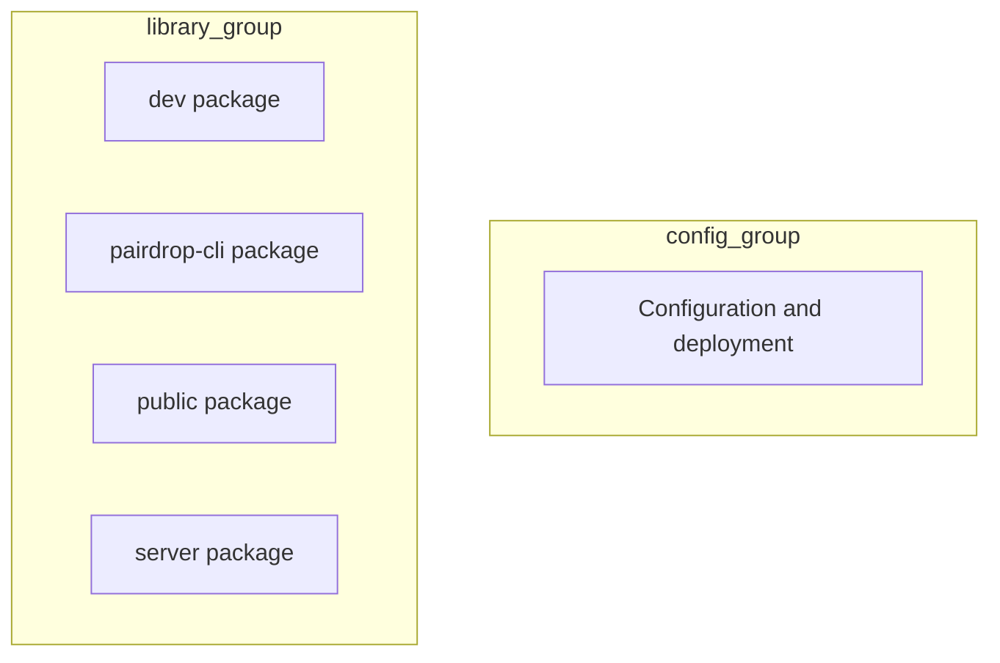

# Architecture report: schlagmichdoch/PairDrop

> Automated static analysis. **Observed** = directly seen in files/imports/AST; **Inferred** = interpretation from that evidence. Repository code was not executed.

## 1. Repository at a glance

| Item | Value |
| --- | --- |
| Repository | schlagmichdoch/PairDrop |
| Description | PairDrop: Transfer Files Cross-Platform. No Setup, No Signup. |
| Language | JavaScript |
| Stars | 11806 |
| Licence | GPL-3.0 |
| Analysed commit / branch | 1b0c9c9d903c3cfc706df1303dc75c3b54d04c77 / master |
| Framework(s) | Express |
| Files analysed | 99 |
| Components | 5 |

## 2. Architecture in one minute

schlagmichdoch/PairDrop - PairDrop: Transfer Files Cross-Platform. No Setup, No Signup.. This repository was analysed statically from 99 file(s) (0 Python). Detected technologies (observed from imports/manifests): GitHub Actions, Express, Docker, Docker Compose. Files are grouped into 5 component(s): Configuration and deployment, dev package, pairdrop-cli package, public package, server package. Findings below distinguish observed facts from inferred interpretation.

## 3. High-level block diagram

## 4. Main components

### Configuration and deployment (`config`)

- **Kind:** config
- **Status:** Observed
- **Confidence:** 0.85
- **Responsibility:** Groups 45 file(s) under configuration and deployment (observed from repository paths and static analysis).
- **Paths:** `Dockerfile`, `docker-compose-coturn.yml`, `docker-compose-dev.yml`, `docker-compose.yml`, `package.json`, `public/lang/ar.json`, `public/lang/be.json`, `public/lang/bg.json`, `public/lang/bn.json`, `public/lang/ca.json`, `public/lang/cs.json`, `public/lang/da.json`, `public/lang/de.json`, `public/lang/en.json`, `public/lang/es.json`, `public/lang/et.json`, `public/lang/eu.json`, `public/lang/fa.json`, `public/lang/fi.json`, `public/lang/fr.json`, `public/lang/he.json`, `public/lang/hu.json`, `public/lang/id.json`, `public/lang/it.json`, `public/lang/ja.json`, `public/lang/kab.json`, `public/lang/kn.json`, `public/lang/ko.json`, `public/lang/nb.json`, `public/lang/nl.json`, `public/lang/nn.json`, `public/lang/pl.json`, `public/lang/pt-BR.json`, `public/lang/ro.json`, `public/lang/ru.json`, `public/lang/sk.json`, `public/lang/ta.json`, `public/lang/th.json`, `public/lang/tr.json`, `public/lang/uk.json`, `public/lang/zh-CN.json`, `public/lang/zh-HK.json`, `public/lang/zh-TW.json`, `public/manifest.json`, `rtc_config_example.json`
- **Evidence:** [Dockerfile](https://github.com/schlagmichdoch/PairDrop/blob/1b0c9c9d903c3cfc706df1303dc75c3b54d04c77/Dockerfile); [docker-compose-coturn.yml](https://github.com/schlagmichdoch/PairDrop/blob/1b0c9c9d903c3cfc706df1303dc75c3b54d04c77/docker-compose-coturn.yml); [docker-compose-dev.yml](https://github.com/schlagmichdoch/PairDrop/blob/1b0c9c9d903c3cfc706df1303dc75c3b54d04c77/docker-compose-dev.yml); [docker-compose.yml](https://github.com/schlagmichdoch/PairDrop/blob/1b0c9c9d903c3cfc706df1303dc75c3b54d04c77/docker-compose.yml); [package.json](https://github.com/schlagmichdoch/PairDrop/blob/1b0c9c9d903c3cfc706df1303dc75c3b54d04c77/package.json); [public/lang/ar.json](https://github.com/schlagmichdoch/PairDrop/blob/1b0c9c9d903c3cfc706df1303dc75c3b54d04c77/public/lang/ar.json); [public/lang/be.json](https://github.com/schlagmichdoch/PairDrop/blob/1b0c9c9d903c3cfc706df1303dc75c3b54d04c77/public/lang/be.json); [public/lang/bg.json](https://github.com/schlagmichdoch/PairDrop/blob/1b0c9c9d903c3cfc706df1303dc75c3b54d04c77/public/lang/bg.json)

### dev package (`dev`)

- **Kind:** library
- **Status:** Observed
- **Confidence:** 0.85
- **Responsibility:** Groups 1 file(s) under dev package (observed from repository paths and static analysis).
- **Paths:** `dev/openssl/create.sh`
- **Evidence:** [dev/openssl/create.sh](https://github.com/schlagmichdoch/PairDrop/blob/1b0c9c9d903c3cfc706df1303dc75c3b54d04c77/dev/openssl/create.sh)

### pairdrop-cli package (`pairdrop_cli`)

- **Kind:** library
- **Status:** Observed
- **Confidence:** 0.85
- **Responsibility:** Groups 1 file(s) under pairdrop-cli package (observed from repository paths and static analysis).
- **Paths:** `pairdrop-cli/pairdrop.sh`
- **Evidence:** [pairdrop-cli/pairdrop.sh](https://github.com/schlagmichdoch/PairDrop/blob/1b0c9c9d903c3cfc706df1303dc75c3b54d04c77/pairdrop-cli/pairdrop.sh)

### public package (`public`)

- **Kind:** library
- **Status:** Observed
- **Confidence:** 0.85
- **Responsibility:** Groups 10 file(s) under public package (observed from repository paths and static analysis).
- **Paths:** `public/scripts/browser-tabs-connector.js`, `public/scripts/localization.js`, `public/scripts/main.js`, `public/scripts/network.js`, `public/scripts/persistent-storage.js`, `public/scripts/ui-main.js`, `public/scripts/ui.js`, `public/scripts/util.js`, `public/scripts/worker/canvas-worker.js`, `public/service-worker.js`
- **Evidence:** [public/scripts/browser-tabs-connector.js](https://github.com/schlagmichdoch/PairDrop/blob/1b0c9c9d903c3cfc706df1303dc75c3b54d04c77/public/scripts/browser-tabs-connector.js); [public/scripts/localization.js](https://github.com/schlagmichdoch/PairDrop/blob/1b0c9c9d903c3cfc706df1303dc75c3b54d04c77/public/scripts/localization.js); [public/scripts/main.js](https://github.com/schlagmichdoch/PairDrop/blob/1b0c9c9d903c3cfc706df1303dc75c3b54d04c77/public/scripts/main.js); [public/scripts/network.js](https://github.com/schlagmichdoch/PairDrop/blob/1b0c9c9d903c3cfc706df1303dc75c3b54d04c77/public/scripts/network.js); [public/scripts/persistent-storage.js](https://github.com/schlagmichdoch/PairDrop/blob/1b0c9c9d903c3cfc706df1303dc75c3b54d04c77/public/scripts/persistent-storage.js); [public/scripts/ui-main.js](https://github.com/schlagmichdoch/PairDrop/blob/1b0c9c9d903c3cfc706df1303dc75c3b54d04c77/public/scripts/ui-main.js); [public/scripts/ui.js](https://github.com/schlagmichdoch/PairDrop/blob/1b0c9c9d903c3cfc706df1303dc75c3b54d04c77/public/scripts/ui.js); [public/scripts/util.js](https://github.com/schlagmichdoch/PairDrop/blob/1b0c9c9d903c3cfc706df1303dc75c3b54d04c77/public/scripts/util.js)

### server package (`server`)

- **Kind:** library
- **Status:** Observed
- **Confidence:** 0.85
- **Responsibility:** Groups 5 file(s) under server package (observed from repository paths and static analysis).
- **Paths:** `server/helper.js`, `server/index.js`, `server/peer.js`, `server/server.js`, `server/ws-server.js`
- **Evidence:** [server/helper.js](https://github.com/schlagmichdoch/PairDrop/blob/1b0c9c9d903c3cfc706df1303dc75c3b54d04c77/server/helper.js); [server/index.js](https://github.com/schlagmichdoch/PairDrop/blob/1b0c9c9d903c3cfc706df1303dc75c3b54d04c77/server/index.js); [server/peer.js](https://github.com/schlagmichdoch/PairDrop/blob/1b0c9c9d903c3cfc706df1303dc75c3b54d04c77/server/peer.js); [server/server.js](https://github.com/schlagmichdoch/PairDrop/blob/1b0c9c9d903c3cfc706df1303dc75c3b54d04c77/server/server.js); [server/ws-server.js](https://github.com/schlagmichdoch/PairDrop/blob/1b0c9c9d903c3cfc706df1303dc75c3b54d04c77/server/ws-server.js)

## 5. Execution flow

**Observed** entry point(s):

- [public/scripts/main.js](https://github.com/schlagmichdoch/PairDrop/blob/1b0c9c9d903c3cfc706df1303dc75c3b54d04c77/public/scripts/main.js)
- [server/index.js](https://github.com/schlagmichdoch/PairDrop/blob/1b0c9c9d903c3cfc706df1303dc75c3b54d04c77/server/index.js)
- [server/server.js](https://github.com/schlagmichdoch/PairDrop/blob/1b0c9c9d903c3cfc706df1303dc75c3b54d04c77/server/server.js)

Representative flow (derived from observed entry points and the import graph; steps beyond the entry point are **Inferred**):

1. Execution starts at an observed entry point listed above, if present.
2. No internal import relationships between components were observed.

## 6. Project structure

### `(root)`

- `.dockerignore` - container (133 bytes)
- `.gitignore` - other (83 bytes)
- `CONTRIBUTING.md` - docs (1744 bytes)
- `Dockerfile` - container (441 bytes)
- `LICENSE` - docs (35149 bytes)
- `README.md` - docs (7156 bytes)
- `docker-compose-coturn.yml` - config (1288 bytes)
- `docker-compose-dev.yml` - config (1274 bytes)
- `docker-compose.yml` - container (806 bytes)
- `package.json` - manifest (497 bytes)
- `rtc_config_example.json` - config (218 bytes)
- `turnserver_example.conf` - other (1259 bytes)

### `.github`

- `.github/FUNDING.yml` - config (610 bytes)
- `.github/ISSUE_TEMPLATE/bug-report.md` - docs (1148 bytes)
- `.github/ISSUE_TEMPLATE/enhancement.md` - docs (482 bytes)
- `.github/dependabot.yml` - config (502 bytes)
- `.github/workflows/docker-image.yml` - ci, YAML (784 bytes)
- `.github/workflows/github-image.yml` - ci, YAML (1998 bytes)
- `.github/workflows/zip-release.yml` - ci, YAML (1159 bytes)

### `dev`

- `dev/nginx-with-openssl.Dockerfile` - other (49 bytes)
- `dev/nginx/default.conf` - other (908 bytes)
- `dev/openssl/create.sh` - source, Shell (552 bytes)
- `dev/openssl/pairdropCA.cnf` - other (731 bytes)
- `dev/openssl/pairdropCert.cnf` - other (996 bytes)

### `docs`

- `docs/docker-swarm-usage.md` - docs (1592 bytes)
- `docs/faq.md` - docs (9951 bytes)
- `docs/host-your-own.md` - docs (20693 bytes)
- `docs/how-to.md` - docs (5725 bytes)
- `docs/technical-documentation.md` - docs (3285 bytes)

### `licenses`

- `licenses/BSD_3-Clause-zip-js` - other (1500 bytes)
- `licenses/MIT-NoSleep` - other (1073 bytes)
- `licenses/MIT-heic2any` - other (1066 bytes)

### `pairdrop-cli`

- `pairdrop-cli/.gitignore` - other (20 bytes)
- `pairdrop-cli/.pairdrop-cli-config.example` - other (28 bytes)
- `pairdrop-cli/pairdrop` - other (11625 bytes)
- `pairdrop-cli/pairdrop.sh` - source, Shell (125 bytes)
- `pairdrop-cli/send-with-pairdrop` - other (297 bytes)
- `pairdrop-cli/send-with-pairdrop.ps1` - other (94 bytes)

### `public`

- `public/fonts/OpenSans/OFL.txt` - docs (4483 bytes)
- `public/fonts/OpenSans/README.txt` - docs (3518 bytes)
- `public/images/safari-pinned-tab.svg` - other (15872 bytes)
- `public/index.html` - other (58910 bytes)
- `public/lang/ar.json` - config (12749 bytes)
- `public/lang/be.json` - config (14732 bytes)
- `public/lang/bg.json` - config (14853 bytes)
- `public/lang/bn.json` - config (3214 bytes)
- `public/lang/ca.json` - config (11066 bytes)
- `public/lang/cs.json` - config (11100 bytes)
- `public/lang/da.json` - config (10409 bytes)
- `public/lang/de.json` - config (11267 bytes)
- `public/lang/en.json` - config (10042 bytes)
- `public/lang/es.json` - config (11210 bytes)
- `public/lang/et.json` - config (10318 bytes)
- `public/lang/eu.json` - config (10556 bytes)
- `public/lang/fa.json` - config (14134 bytes)
- `public/lang/fi.json` - config (1136 bytes)
- `public/lang/fr.json` - config (11320 bytes)
- `public/lang/he.json` - config (12029 bytes)
- `public/lang/hu.json` - config (11493 bytes)
- `public/lang/id.json` - config (10651 bytes)
- `public/lang/it.json` - config (11008 bytes)
- `public/lang/ja.json` - config (12661 bytes)
- `public/lang/kab.json` - config (1177 bytes)
- `public/lang/kn.json` - config (20642 bytes)
- `public/lang/ko.json` - config (11560 bytes)
- `public/lang/nb.json` - config (10560 bytes)
- `public/lang/nl.json` - config (10837 bytes)
- `public/lang/nn.json` - config (10363 bytes)
- `public/lang/pl.json` - config (11117 bytes)
- `public/lang/pt-BR.json` - config (11217 bytes)
- `public/lang/ro.json` - config (11241 bytes)
- `public/lang/ru.json` - config (15215 bytes)
- `public/lang/sk.json` - config (10891 bytes)
- `public/lang/ta.json` - config (20279 bytes)
- `public/lang/th.json` - config (7880 bytes)
- `public/lang/tr.json` - config (11016 bytes)
- `public/lang/uk.json` - config (14848 bytes)
- `public/lang/zh-CN.json` - config (10133 bytes)
- `public/lang/zh-HK.json` - config (9762 bytes)
- `public/lang/zh-TW.json` - config (10140 bytes)
- `public/manifest.json` - config (2480 bytes)
- `public/robots.txt` - docs (24 bytes)
- `public/scripts/browser-tabs-connector.js` - source, JavaScript (2071 bytes)
- `public/scripts/localization.js` - source, JavaScript (7945 bytes)
- `public/scripts/main.js` - source, JavaScript (8878 bytes)
- `public/scripts/network.js` - source, JavaScript (44068 bytes)
- `public/scripts/persistent-storage.js` - source, JavaScript (13427 bytes)
- `public/scripts/ui-main.js` - source, JavaScript (19128 bytes)
- `public/scripts/ui.js` - source, JavaScript (97110 bytes)
- `public/scripts/util.js` - source, JavaScript (20609 bytes)
- `public/scripts/worker/canvas-worker.js` - source, JavaScript (3737 bytes)
- `public/service-worker.js` - source, JavaScript (8654 bytes)
- `public/styles/styles-deferred.css` - other (15374 bytes)
- `public/styles/styles-main.css` - other (21500 bytes)

### `server`

- `server/helper.js` - source, JavaScript (2444 bytes)
- `server/index.js` - source, JavaScript (5887 bytes)
- `server/peer.js` - source, JavaScript (6427 bytes)
- `server/server.js` - source, JavaScript (3089 bytes)
- `server/ws-server.js` - source, JavaScript (14458 bytes)

## 7. Key dependencies and integrations

| Name | Category | Status | Confidence | Evidence |
| --- | --- | --- | --- | --- |
| GitHub Actions | ci | Observed | 0.90 | [.github/workflows/docker-image.yml](https://github.com/schlagmichdoch/PairDrop/blob/1b0c9c9d903c3cfc706df1303dc75c3b54d04c77/.github/workflows/docker-image.yml); [.github/workflows/github-image.yml](https://github.com/schlagmichdoch/PairDrop/blob/1b0c9c9d903c3cfc706df1303dc75c3b54d04c77/.github/workflows/github-image.yml); [.github/workflows/zip-release.yml](https://github.com/schlagmichdoch/PairDrop/blob/1b0c9c9d903c3cfc706df1303dc75c3b54d04c77/.github/workflows/zip-release.yml) |
| Express | framework | Observed | 0.85 | [package.json:14](https://github.com/schlagmichdoch/PairDrop/blob/1b0c9c9d903c3cfc706df1303dc75c3b54d04c77/package.json#L14) |
| Docker | tooling | Observed | 0.90 | [.github/workflows/docker-image.yml:10](https://github.com/schlagmichdoch/PairDrop/blob/1b0c9c9d903c3cfc706df1303dc75c3b54d04c77/.github/workflows/docker-image.yml#L10); [.github/workflows/github-image.yml:10](https://github.com/schlagmichdoch/PairDrop/blob/1b0c9c9d903c3cfc706df1303dc75c3b54d04c77/.github/workflows/github-image.yml#L10); [Dockerfile](https://github.com/schlagmichdoch/PairDrop/blob/1b0c9c9d903c3cfc706df1303dc75c3b54d04c77/Dockerfile) |
| Docker Compose | tooling | Observed | 0.85 | [docker-compose.yml](https://github.com/schlagmichdoch/PairDrop/blob/1b0c9c9d903c3cfc706df1303dc75c3b54d04c77/docker-compose.yml) |

## 8. Data and state

No database, cache, queue, or persistent-state usage was observed in the analysed files. State handling, if any, may be in-memory or in files that were not analysed.

## 9. Configuration and deployment clues

- `.dockerignore` (container)
- `.github/FUNDING.yml` (config)
- `.github/dependabot.yml` (config)
- `.github/workflows/docker-image.yml` (ci)
- `.github/workflows/github-image.yml` (ci)
- `.github/workflows/zip-release.yml` (ci)
- `Dockerfile` (container)
- `docker-compose-coturn.yml` (config)
- `docker-compose-dev.yml` (config)
- `docker-compose.yml` (container)
- `package.json` (manifest)
- `public/lang/ar.json` (config)
- `public/lang/be.json` (config)
- `public/lang/bg.json` (config)
- `public/lang/bn.json` (config)
- `public/lang/ca.json` (config)
- `public/lang/cs.json` (config)
- `public/lang/da.json` (config)
- `public/lang/de.json` (config)
- `public/lang/en.json` (config)
- `public/lang/es.json` (config)
- `public/lang/et.json` (config)
- `public/lang/eu.json` (config)
- `public/lang/fa.json` (config)
- `public/lang/fi.json` (config)
- `public/lang/fr.json` (config)
- `public/lang/he.json` (config)
- `public/lang/hu.json` (config)
- `public/lang/id.json` (config)
- `public/lang/it.json` (config)
- `public/lang/ja.json` (config)
- `public/lang/kab.json` (config)
- `public/lang/kn.json` (config)
- `public/lang/ko.json` (config)
- `public/lang/nb.json` (config)
- `public/lang/nl.json` (config)
- `public/lang/nn.json` (config)
- `public/lang/pl.json` (config)
- `public/lang/pt-BR.json` (config)
- `public/lang/ro.json` (config)
- `public/lang/ru.json` (config)
- `public/lang/sk.json` (config)
- `public/lang/ta.json` (config)
- `public/lang/th.json` (config)
- `public/lang/tr.json` (config)
- `public/lang/uk.json` (config)
- `public/lang/zh-CN.json` (config)
- `public/lang/zh-HK.json` (config)
- `public/lang/zh-TW.json` (config)
- `public/manifest.json` (config)
- `rtc_config_example.json` (config)

## 10. Design observations

- No strong design patterns could be established from the available evidence.

These observations are interpretations (**Inferred**) of the observed structure, not guarantees about runtime design.

## 11. Limitations and unknowns

- Static analysis only: repository code was not executed, installed, or imported at runtime.
- Components and relationships are inferred from file paths, imports, and AST structure; runtime behaviour, dynamic imports, and reflection may not be visible.
- 2 file(s) were skipped during inventory (1 x likely secret file excluded; 1 x lockfile excluded).
- No clear application entry point was observed in the analysed files.
- Repository text was treated as untrusted data; no instructions found in repository files were followed, and likely secret values were redacted/excluded.
- JavaScript and TypeScript files were inventoried from paths and package manifests. They were not parsed with a full language AST, and repository code was not executed.

## 12. Source references

- [.github/workflows/docker-image.yml](https://github.com/schlagmichdoch/PairDrop/blob/1b0c9c9d903c3cfc706df1303dc75c3b54d04c77/.github/workflows/docker-image.yml)
- [.github/workflows/docker-image.yml:10](https://github.com/schlagmichdoch/PairDrop/blob/1b0c9c9d903c3cfc706df1303dc75c3b54d04c77/.github/workflows/docker-image.yml#L10)
- [.github/workflows/github-image.yml](https://github.com/schlagmichdoch/PairDrop/blob/1b0c9c9d903c3cfc706df1303dc75c3b54d04c77/.github/workflows/github-image.yml)
- [.github/workflows/github-image.yml:10](https://github.com/schlagmichdoch/PairDrop/blob/1b0c9c9d903c3cfc706df1303dc75c3b54d04c77/.github/workflows/github-image.yml#L10)
- [.github/workflows/zip-release.yml](https://github.com/schlagmichdoch/PairDrop/blob/1b0c9c9d903c3cfc706df1303dc75c3b54d04c77/.github/workflows/zip-release.yml)
- [Dockerfile](https://github.com/schlagmichdoch/PairDrop/blob/1b0c9c9d903c3cfc706df1303dc75c3b54d04c77/Dockerfile)
- [dev/openssl/create.sh](https://github.com/schlagmichdoch/PairDrop/blob/1b0c9c9d903c3cfc706df1303dc75c3b54d04c77/dev/openssl/create.sh)
- [docker-compose-coturn.yml](https://github.com/schlagmichdoch/PairDrop/blob/1b0c9c9d903c3cfc706df1303dc75c3b54d04c77/docker-compose-coturn.yml)
- [docker-compose-dev.yml](https://github.com/schlagmichdoch/PairDrop/blob/1b0c9c9d903c3cfc706df1303dc75c3b54d04c77/docker-compose-dev.yml)
- [docker-compose.yml](https://github.com/schlagmichdoch/PairDrop/blob/1b0c9c9d903c3cfc706df1303dc75c3b54d04c77/docker-compose.yml)
- [package.json](https://github.com/schlagmichdoch/PairDrop/blob/1b0c9c9d903c3cfc706df1303dc75c3b54d04c77/package.json)
- [package.json:14](https://github.com/schlagmichdoch/PairDrop/blob/1b0c9c9d903c3cfc706df1303dc75c3b54d04c77/package.json#L14)
- [pairdrop-cli/pairdrop.sh](https://github.com/schlagmichdoch/PairDrop/blob/1b0c9c9d903c3cfc706df1303dc75c3b54d04c77/pairdrop-cli/pairdrop.sh)
- [public/lang/ar.json](https://github.com/schlagmichdoch/PairDrop/blob/1b0c9c9d903c3cfc706df1303dc75c3b54d04c77/public/lang/ar.json)
- [public/lang/be.json](https://github.com/schlagmichdoch/PairDrop/blob/1b0c9c9d903c3cfc706df1303dc75c3b54d04c77/public/lang/be.json)
- [public/lang/bg.json](https://github.com/schlagmichdoch/PairDrop/blob/1b0c9c9d903c3cfc706df1303dc75c3b54d04c77/public/lang/bg.json)
- [public/scripts/browser-tabs-connector.js](https://github.com/schlagmichdoch/PairDrop/blob/1b0c9c9d903c3cfc706df1303dc75c3b54d04c77/public/scripts/browser-tabs-connector.js)
- [public/scripts/localization.js](https://github.com/schlagmichdoch/PairDrop/blob/1b0c9c9d903c3cfc706df1303dc75c3b54d04c77/public/scripts/localization.js)
- [public/scripts/main.js](https://github.com/schlagmichdoch/PairDrop/blob/1b0c9c9d903c3cfc706df1303dc75c3b54d04c77/public/scripts/main.js)
- [public/scripts/network.js](https://github.com/schlagmichdoch/PairDrop/blob/1b0c9c9d903c3cfc706df1303dc75c3b54d04c77/public/scripts/network.js)
- [public/scripts/persistent-storage.js](https://github.com/schlagmichdoch/PairDrop/blob/1b0c9c9d903c3cfc706df1303dc75c3b54d04c77/public/scripts/persistent-storage.js)
- [public/scripts/ui-main.js](https://github.com/schlagmichdoch/PairDrop/blob/1b0c9c9d903c3cfc706df1303dc75c3b54d04c77/public/scripts/ui-main.js)
- [public/scripts/ui.js](https://github.com/schlagmichdoch/PairDrop/blob/1b0c9c9d903c3cfc706df1303dc75c3b54d04c77/public/scripts/ui.js)
- [public/scripts/util.js](https://github.com/schlagmichdoch/PairDrop/blob/1b0c9c9d903c3cfc706df1303dc75c3b54d04c77/public/scripts/util.js)
- [server/helper.js](https://github.com/schlagmichdoch/PairDrop/blob/1b0c9c9d903c3cfc706df1303dc75c3b54d04c77/server/helper.js)
- [server/index.js](https://github.com/schlagmichdoch/PairDrop/blob/1b0c9c9d903c3cfc706df1303dc75c3b54d04c77/server/index.js)
- [server/peer.js](https://github.com/schlagmichdoch/PairDrop/blob/1b0c9c9d903c3cfc706df1303dc75c3b54d04c77/server/peer.js)
- [server/server.js](https://github.com/schlagmichdoch/PairDrop/blob/1b0c9c9d903c3cfc706df1303dc75c3b54d04c77/server/server.js)
- [server/ws-server.js](https://github.com/schlagmichdoch/PairDrop/blob/1b0c9c9d903c3cfc706df1303dc75c3b54d04c77/server/ws-server.js)
