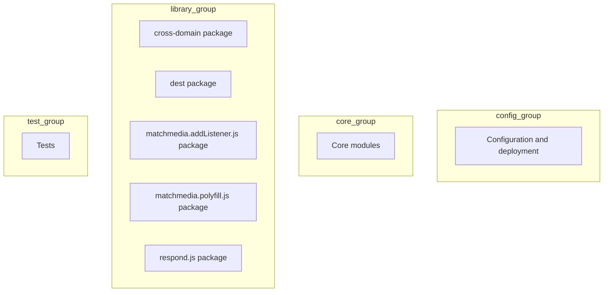

# Architecture report: scottjehl/Respond

> Automated static analysis. **Observed** = directly seen in files/imports/AST; **Inferred** = interpretation from that evidence. Repository code was not executed.

## 1. Repository at a glance

| Item | Value |
| --- | --- |
| Repository | scottjehl/Respond |
| Description | A fast & lightweight polyfill for min/max-width CSS3 Media Queries (for IE 6-8, and more) |
| Language | JavaScript |
| Stars | 11180 |
| Licence | MIT |
| Analysed commit / branch | 9d91fd47eb59c11a80d570d4ea0beaa59cfc71bf / master |
| Framework(s) | None detected |
| Files analysed | 28 |
| Components | 8 |

## 2. Architecture in one minute

scottjehl/Respond - A fast & lightweight polyfill for min/max-width CSS3 Media Queries (for IE 6-8, and more). This repository was analysed statically from 28 file(s) (0 Python). Detected technologies (observed from imports/manifests): no known frameworks/libraries. Files are grouped into 8 component(s): Configuration and deployment, Core modules, cross-domain package, dest package, matchmedia.addListener.js package, matchmedia.polyfill.js package, respond.js package, Tests. Findings below distinguish observed facts from inferred interpretation.

## 3. High-level block diagram

## 4. Main components

### Configuration and deployment (`config`)

- **Kind:** config
- **Status:** Observed
- **Confidence:** 0.85
- **Responsibility:** Groups 2 file(s) under configuration and deployment (observed from repository paths and static analysis).
- **Paths:** `bower.json`, `package.json`
- **Evidence:** [bower.json](https://github.com/scottjehl/Respond/blob/9d91fd47eb59c11a80d570d4ea0beaa59cfc71bf/bower.json); [package.json](https://github.com/scottjehl/Respond/blob/9d91fd47eb59c11a80d570d4ea0beaa59cfc71bf/package.json)

### Core modules (`core`)

- **Kind:** core
- **Status:** Observed
- **Confidence:** 0.85
- **Responsibility:** Groups 1 file(s) under core modules (observed from repository paths and static analysis).
- **Paths:** `Gruntfile.js`
- **Evidence:** [Gruntfile.js](https://github.com/scottjehl/Respond/blob/9d91fd47eb59c11a80d570d4ea0beaa59cfc71bf/Gruntfile.js)

### cross-domain package (`cross_domain`)

- **Kind:** library
- **Status:** Observed
- **Confidence:** 0.85
- **Responsibility:** Groups 1 file(s) under cross-domain package (observed from repository paths and static analysis).
- **Paths:** `cross-domain/respond.proxy.js`
- **Evidence:** [cross-domain/respond.proxy.js](https://github.com/scottjehl/Respond/blob/9d91fd47eb59c11a80d570d4ea0beaa59cfc71bf/cross-domain/respond.proxy.js)

### dest package (`dest`)

- **Kind:** library
- **Status:** Observed
- **Confidence:** 0.85
- **Responsibility:** Groups 2 file(s) under dest package (observed from repository paths and static analysis).
- **Paths:** `dest/respond.matchmedia.addListener.src.js`, `dest/respond.src.js`
- **Evidence:** [dest/respond.matchmedia.addListener.src.js](https://github.com/scottjehl/Respond/blob/9d91fd47eb59c11a80d570d4ea0beaa59cfc71bf/dest/respond.matchmedia.addListener.src.js); [dest/respond.src.js](https://github.com/scottjehl/Respond/blob/9d91fd47eb59c11a80d570d4ea0beaa59cfc71bf/dest/respond.src.js)

### matchmedia.addListener.js package (`matchmedia_addlistener_js`)

- **Kind:** library
- **Status:** Observed
- **Confidence:** 0.85
- **Responsibility:** Groups 1 file(s) under matchmedia.addlistener.js package (observed from repository paths and static analysis).
- **Paths:** `src/matchmedia.addListener.js`
- **Evidence:** [src/matchmedia.addListener.js](https://github.com/scottjehl/Respond/blob/9d91fd47eb59c11a80d570d4ea0beaa59cfc71bf/src/matchmedia.addListener.js)

### matchmedia.polyfill.js package (`matchmedia_polyfill_js`)

- **Kind:** library
- **Status:** Observed
- **Confidence:** 0.85
- **Responsibility:** Groups 1 file(s) under matchmedia.polyfill.js package (observed from repository paths and static analysis).
- **Paths:** `src/matchmedia.polyfill.js`
- **Evidence:** [src/matchmedia.polyfill.js](https://github.com/scottjehl/Respond/blob/9d91fd47eb59c11a80d570d4ea0beaa59cfc71bf/src/matchmedia.polyfill.js)

### respond.js package (`respond_js`)

- **Kind:** library
- **Status:** Observed
- **Confidence:** 0.85
- **Responsibility:** Groups 1 file(s) under respond.js package (observed from repository paths and static analysis).
- **Paths:** `src/respond.js`
- **Evidence:** [src/respond.js](https://github.com/scottjehl/Respond/blob/9d91fd47eb59c11a80d570d4ea0beaa59cfc71bf/src/respond.js)

### Tests (`tests`)

- **Kind:** test
- **Status:** Observed
- **Confidence:** 0.85
- **Responsibility:** Groups 13 file(s) under tests (observed from repository paths and static analysis).
- **Paths:** `test/test.css`, `test/test.html`, `test/test2.css`, `test/unit/index.html`, `test/unit/qunit/qunit.css`, `test/unit/qunit/qunit.js`, `test/unit/test-with-comment.css`, `test/unit/test-with-dpr.css`, `test/unit/test-with-keyframe.css`, `test/unit/test.css`, `test/unit/test2.css`, `test/unit/test3.css`, `test/unit/tests.js`
- **Evidence:** [test/test.css](https://github.com/scottjehl/Respond/blob/9d91fd47eb59c11a80d570d4ea0beaa59cfc71bf/test/test.css); [test/test.html](https://github.com/scottjehl/Respond/blob/9d91fd47eb59c11a80d570d4ea0beaa59cfc71bf/test/test.html); [test/test2.css](https://github.com/scottjehl/Respond/blob/9d91fd47eb59c11a80d570d4ea0beaa59cfc71bf/test/test2.css); [test/unit/index.html](https://github.com/scottjehl/Respond/blob/9d91fd47eb59c11a80d570d4ea0beaa59cfc71bf/test/unit/index.html); [test/unit/qunit/qunit.css](https://github.com/scottjehl/Respond/blob/9d91fd47eb59c11a80d570d4ea0beaa59cfc71bf/test/unit/qunit/qunit.css); [test/unit/qunit/qunit.js](https://github.com/scottjehl/Respond/blob/9d91fd47eb59c11a80d570d4ea0beaa59cfc71bf/test/unit/qunit/qunit.js); [test/unit/test-with-comment.css](https://github.com/scottjehl/Respond/blob/9d91fd47eb59c11a80d570d4ea0beaa59cfc71bf/test/unit/test-with-comment.css); [test/unit/test-with-dpr.css](https://github.com/scottjehl/Respond/blob/9d91fd47eb59c11a80d570d4ea0beaa59cfc71bf/test/unit/test-with-dpr.css)

## 5. Execution flow

No entry point was observed; the startup flow below is therefore limited.

Representative flow (derived from observed entry points and the import graph; steps beyond the entry point are **Inferred**):

1. Execution starts at an observed entry point listed above, if present.
2. No internal import relationships between components were observed.

## 6. Project structure

### `(root)`

- `.gitignore` - other (31 bytes)
- `Gruntfile.js` - source, JavaScript (2140 bytes)
- `LICENSE-MIT` - other (1054 bytes)
- `README.md` - docs (7384 bytes)
- `bower.json` - config (232 bytes)
- `package.json` - manifest (771 bytes)

### `cross-domain`

- `cross-domain/example-base.html` - other (1551 bytes)
- `cross-domain/example.html` - other (1147 bytes)
- `cross-domain/respond-proxy.html` - other (2170 bytes)
- `cross-domain/respond.proxy.js` - source, JavaScript (3449 bytes)

### `dest`

- `dest/respond.matchmedia.addListener.src.js` - source, JavaScript (10613 bytes)
- `dest/respond.src.js` - source, JavaScript (9006 bytes)

### `src`

- `src/matchmedia.addListener.js` - source, JavaScript (2208 bytes)
- `src/matchmedia.polyfill.js` - source, JavaScript (1085 bytes)
- `src/respond.js` - source, JavaScript (10164 bytes)

### `test`

- `test/test.css` - test (2381 bytes)
- `test/test.html` - test (1008 bytes)
- `test/test2.css` - test (208 bytes)
- `test/unit/index.html` - test (863 bytes)
- `test/unit/qunit/qunit.css` - test (4519 bytes)
- `test/unit/qunit/qunit.js` - test, JavaScript (41079 bytes)
- `test/unit/test-with-comment.css` - test (383 bytes)
- `test/unit/test-with-dpr.css` - test (457 bytes)
- `test/unit/test-with-keyframe.css` - test (228 bytes)
- `test/unit/test.css` - test (1302 bytes)
- `test/unit/test2.css` - test (144 bytes)
- `test/unit/test3.css` - test (154 bytes)
- `test/unit/tests.js` - test, JavaScript (9500 bytes)

## 7. Key dependencies and integrations

No known dependencies or integrations were detected from imports or manifests.

## 8. Data and state

No database, cache, queue, or persistent-state usage was observed in the analysed files. State handling, if any, may be in-memory or in files that were not analysed.

## 9. Configuration and deployment clues

- `bower.json` (config)
- `package.json` (manifest)

## 10. Design observations

- Tests are present alongside source code (Observed from test file paths).

These observations are interpretations (**Inferred**) of the observed structure, not guarantees about runtime design.

## 11. Limitations and unknowns

- Static analysis only: repository code was not executed, installed, or imported at runtime.
- Components and relationships are inferred from file paths, imports, and AST structure; runtime behaviour, dynamic imports, and reflection may not be visible.
- No clear application entry point was observed in the analysed files.
- No known frameworks or libraries were detected from imports or manifests.
- Repository text was treated as untrusted data; no instructions found in repository files were followed, and likely secret values were redacted/excluded.
- JavaScript and TypeScript files were inventoried from paths and package manifests. They were not parsed with a full language AST, and repository code was not executed.
- The GitHub repository was marked archived at selection time.

## 12. Source references

- [Gruntfile.js](https://github.com/scottjehl/Respond/blob/9d91fd47eb59c11a80d570d4ea0beaa59cfc71bf/Gruntfile.js)
- [bower.json](https://github.com/scottjehl/Respond/blob/9d91fd47eb59c11a80d570d4ea0beaa59cfc71bf/bower.json)
- [cross-domain/respond.proxy.js](https://github.com/scottjehl/Respond/blob/9d91fd47eb59c11a80d570d4ea0beaa59cfc71bf/cross-domain/respond.proxy.js)
- [dest/respond.matchmedia.addListener.src.js](https://github.com/scottjehl/Respond/blob/9d91fd47eb59c11a80d570d4ea0beaa59cfc71bf/dest/respond.matchmedia.addListener.src.js)
- [dest/respond.src.js](https://github.com/scottjehl/Respond/blob/9d91fd47eb59c11a80d570d4ea0beaa59cfc71bf/dest/respond.src.js)
- [package.json](https://github.com/scottjehl/Respond/blob/9d91fd47eb59c11a80d570d4ea0beaa59cfc71bf/package.json)
- [src/matchmedia.addListener.js](https://github.com/scottjehl/Respond/blob/9d91fd47eb59c11a80d570d4ea0beaa59cfc71bf/src/matchmedia.addListener.js)
- [src/matchmedia.polyfill.js](https://github.com/scottjehl/Respond/blob/9d91fd47eb59c11a80d570d4ea0beaa59cfc71bf/src/matchmedia.polyfill.js)
- [src/respond.js](https://github.com/scottjehl/Respond/blob/9d91fd47eb59c11a80d570d4ea0beaa59cfc71bf/src/respond.js)
- [test/test.css](https://github.com/scottjehl/Respond/blob/9d91fd47eb59c11a80d570d4ea0beaa59cfc71bf/test/test.css)
- [test/test.html](https://github.com/scottjehl/Respond/blob/9d91fd47eb59c11a80d570d4ea0beaa59cfc71bf/test/test.html)
- [test/test2.css](https://github.com/scottjehl/Respond/blob/9d91fd47eb59c11a80d570d4ea0beaa59cfc71bf/test/test2.css)
- [test/unit/index.html](https://github.com/scottjehl/Respond/blob/9d91fd47eb59c11a80d570d4ea0beaa59cfc71bf/test/unit/index.html)
- [test/unit/qunit/qunit.css](https://github.com/scottjehl/Respond/blob/9d91fd47eb59c11a80d570d4ea0beaa59cfc71bf/test/unit/qunit/qunit.css)
- [test/unit/qunit/qunit.js](https://github.com/scottjehl/Respond/blob/9d91fd47eb59c11a80d570d4ea0beaa59cfc71bf/test/unit/qunit/qunit.js)
- [test/unit/test-with-comment.css](https://github.com/scottjehl/Respond/blob/9d91fd47eb59c11a80d570d4ea0beaa59cfc71bf/test/unit/test-with-comment.css)
- [test/unit/test-with-dpr.css](https://github.com/scottjehl/Respond/blob/9d91fd47eb59c11a80d570d4ea0beaa59cfc71bf/test/unit/test-with-dpr.css)
