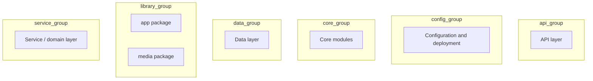

# Architecture report: sdelements/lets-chat

> Automated static analysis. **Observed** = directly seen in files/imports/AST; **Inferred** = interpretation from that evidence. Repository code was not executed.

## 1. Repository at a glance

| Item | Value |
| --- | --- |
| Repository | sdelements/lets-chat |
| Description | Self-hosted chat app for small teams |
| Language | JavaScript |
| Stars | 9787 |
| Licence | MIT |
| Analysed commit / branch | 617207ff3c0c0bf8e3c7a915bd9ec03f1dd8390c / master |
| Framework(s) | None detected |
| Files analysed | 170 |
| Components | 7 |

## 2. Architecture in one minute

sdelements/lets-chat - Self-hosted chat app for small teams. This repository was analysed statically from 170 file(s) (0 Python). Detected technologies (observed from imports/manifests): MongoDB, Docker, Docker Compose. Files are grouped into 7 component(s): API layer, app package, Configuration and deployment, Core modules, Data layer, media package, Service / domain layer. Findings below distinguish observed facts from inferred interpretation.

## 3. High-level block diagram

## 4. Main components

### API layer (`api_layer`)

- **Kind:** api
- **Status:** Observed
- **Confidence:** 0.85
- **Responsibility:** Groups 21 file(s) under api layer (observed from repository paths and static analysis).
- **Paths:** `app/controllers/account.js`, `app/controllers/connections.js`, `app/controllers/extras.js`, `app/controllers/files.js`, `app/controllers/index.js`, `app/controllers/messages.js`, `app/controllers/misc.js`, `app/controllers/presence.js`, `app/controllers/rooms.js`, `app/controllers/transcript.js`, `app/controllers/usermessages.js`, `app/controllers/users.js`, `media/js/views/browser.js`, `media/js/views/client.js`, `media/js/views/modals.js`, `media/js/views/panes.js`, `media/js/views/room.js`, `media/js/views/status.js`, `media/js/views/transcript.js`, `media/js/views/upload.js`, `media/js/views/window.js`
- **Evidence:** [app/controllers/account.js](https://github.com/sdelements/lets-chat/blob/617207ff3c0c0bf8e3c7a915bd9ec03f1dd8390c/app/controllers/account.js); [app/controllers/connections.js](https://github.com/sdelements/lets-chat/blob/617207ff3c0c0bf8e3c7a915bd9ec03f1dd8390c/app/controllers/connections.js); [app/controllers/extras.js](https://github.com/sdelements/lets-chat/blob/617207ff3c0c0bf8e3c7a915bd9ec03f1dd8390c/app/controllers/extras.js); [app/controllers/files.js](https://github.com/sdelements/lets-chat/blob/617207ff3c0c0bf8e3c7a915bd9ec03f1dd8390c/app/controllers/files.js); [app/controllers/index.js](https://github.com/sdelements/lets-chat/blob/617207ff3c0c0bf8e3c7a915bd9ec03f1dd8390c/app/controllers/index.js); [app/controllers/messages.js](https://github.com/sdelements/lets-chat/blob/617207ff3c0c0bf8e3c7a915bd9ec03f1dd8390c/app/controllers/messages.js); [app/controllers/misc.js](https://github.com/sdelements/lets-chat/blob/617207ff3c0c0bf8e3c7a915bd9ec03f1dd8390c/app/controllers/misc.js); [app/controllers/presence.js](https://github.com/sdelements/lets-chat/blob/617207ff3c0c0bf8e3c7a915bd9ec03f1dd8390c/app/controllers/presence.js)

### app package (`app`)

- **Kind:** library
- **Status:** Observed
- **Confidence:** 0.85
- **Responsibility:** Groups 37 file(s) under app package (observed from repository paths and static analysis).
- **Paths:** `app/auth/index.js`, `app/auth/local.js`, `app/config.js`, `app/middlewares/cleanupFiles.js`, `app/middlewares/index.js`, `app/middlewares/requireLogin.js`, `app/middlewares/roomRoute.js`, `app/plugins.js`, `app/xmpp/event-listener.js`, `app/xmpp/events/message-created.js`, `app/xmpp/events/room-archived.js`, `app/xmpp/events/room-updated.js`, `app/xmpp/events/user-avatar-ready.js`, `app/xmpp/events/user-connect.js`, `app/xmpp/events/user-disconnect.js`, `app/xmpp/events/user-join.js`, `app/xmpp/events/user-leave.js`, `app/xmpp/events/usermessage-created.js`, `app/xmpp/index.js`, `app/xmpp/msg-processor.js`, `app/xmpp/msg-processors/conf-info.js`, `app/xmpp/msg-processors/conf-items.js`, `app/xmpp/msg-processors/last-activity.js`, `app/xmpp/msg-processors/ping.js`, `app/xmpp/msg-processors/room-info.js`, `app/xmpp/msg-processors/room-items.js`, `app/xmpp/msg-processors/room-join.js`, `app/xmpp/msg-processors/room-leave.js`, `app/xmpp/msg-processors/room-message.js`, `app/xmpp/msg-processors/root-info.js`, `app/xmpp/msg-processors/root-items.js`, `app/xmpp/msg-processors/root-join.js`, `app/xmpp/msg-processors/roster-get.js`, `app/xmpp/msg-processors/user-message.js`, `app/xmpp/msg-processors/vcard-get.js`, `app/xmpp/msg-processors/vcard-set.js`, `app/xmpp/xmpp-connection.js`
- **Evidence:** [app/auth/index.js](https://github.com/sdelements/lets-chat/blob/617207ff3c0c0bf8e3c7a915bd9ec03f1dd8390c/app/auth/index.js); [app/auth/local.js](https://github.com/sdelements/lets-chat/blob/617207ff3c0c0bf8e3c7a915bd9ec03f1dd8390c/app/auth/local.js); [app/config.js](https://github.com/sdelements/lets-chat/blob/617207ff3c0c0bf8e3c7a915bd9ec03f1dd8390c/app/config.js); [app/middlewares/cleanupFiles.js](https://github.com/sdelements/lets-chat/blob/617207ff3c0c0bf8e3c7a915bd9ec03f1dd8390c/app/middlewares/cleanupFiles.js); [app/middlewares/index.js](https://github.com/sdelements/lets-chat/blob/617207ff3c0c0bf8e3c7a915bd9ec03f1dd8390c/app/middlewares/index.js); [app/middlewares/requireLogin.js](https://github.com/sdelements/lets-chat/blob/617207ff3c0c0bf8e3c7a915bd9ec03f1dd8390c/app/middlewares/requireLogin.js); [app/middlewares/roomRoute.js](https://github.com/sdelements/lets-chat/blob/617207ff3c0c0bf8e3c7a915bd9ec03f1dd8390c/app/middlewares/roomRoute.js); [app/plugins.js](https://github.com/sdelements/lets-chat/blob/617207ff3c0c0bf8e3c7a915bd9ec03f1dd8390c/app/plugins.js)

### Configuration and deployment (`config`)

- **Kind:** config
- **Status:** Observed
- **Confidence:** 0.85
- **Responsibility:** Groups 26 file(s) under configuration and deployment (observed from repository paths and static analysis).
- **Paths:** `app.json`, `bower.json`, `defaults.yml`, `docker/.dockerignore`, `docker/Dockerfile`, `docker/docker-compose.yml`, `extras/emotes/default.yml`, `extras/emotes/lets-chat.yml`, `locales/az.json`, `locales/de.json`, `locales/en.json`, `locales/es.json`, `locales/fi.json`, `locales/fr.json`, `locales/is.json`, `locales/it.json`, `locales/ja.json`, `locales/ko.json`, `locales/nl.json`, `locales/pl.json`, `locales/pt.json`, `locales/ru.json`, `locales/tr.json`, `locales/zh-TW.json`, `locales/zh.json`, `package.json`
- **Evidence:** [app.json](https://github.com/sdelements/lets-chat/blob/617207ff3c0c0bf8e3c7a915bd9ec03f1dd8390c/app.json); [bower.json](https://github.com/sdelements/lets-chat/blob/617207ff3c0c0bf8e3c7a915bd9ec03f1dd8390c/bower.json); [defaults.yml](https://github.com/sdelements/lets-chat/blob/617207ff3c0c0bf8e3c7a915bd9ec03f1dd8390c/defaults.yml); [docker/.dockerignore](https://github.com/sdelements/lets-chat/blob/617207ff3c0c0bf8e3c7a915bd9ec03f1dd8390c/docker/.dockerignore); [docker/Dockerfile](https://github.com/sdelements/lets-chat/blob/617207ff3c0c0bf8e3c7a915bd9ec03f1dd8390c/docker/Dockerfile); [docker/docker-compose.yml](https://github.com/sdelements/lets-chat/blob/617207ff3c0c0bf8e3c7a915bd9ec03f1dd8390c/docker/docker-compose.yml); [extras/emotes/default.yml](https://github.com/sdelements/lets-chat/blob/617207ff3c0c0bf8e3c7a915bd9ec03f1dd8390c/extras/emotes/default.yml); [extras/emotes/lets-chat.yml](https://github.com/sdelements/lets-chat/blob/617207ff3c0c0bf8e3c7a915bd9ec03f1dd8390c/extras/emotes/lets-chat.yml)

### Core modules (`core`)

- **Kind:** core
- **Status:** Observed
- **Confidence:** 0.85
- **Responsibility:** Groups 2 file(s) under core modules (observed from repository paths and static analysis).
- **Paths:** `Gruntfile.js`, `app.js`
- **Evidence:** [Gruntfile.js](https://github.com/sdelements/lets-chat/blob/617207ff3c0c0bf8e3c7a915bd9ec03f1dd8390c/Gruntfile.js); [app.js](https://github.com/sdelements/lets-chat/blob/617207ff3c0c0bf8e3c7a915bd9ec03f1dd8390c/app.js)

### Data layer (`data_layer`)

- **Kind:** data
- **Status:** Observed
- **Confidence:** 0.85
- **Responsibility:** Groups 6 file(s) under data layer (observed from repository paths and static analysis).
- **Paths:** `app/models/file.js`, `app/models/index.js`, `app/models/message.js`, `app/models/room.js`, `app/models/user.js`, `app/models/usermessage.js`
- **Evidence:** [app/models/file.js](https://github.com/sdelements/lets-chat/blob/617207ff3c0c0bf8e3c7a915bd9ec03f1dd8390c/app/models/file.js); [app/models/index.js](https://github.com/sdelements/lets-chat/blob/617207ff3c0c0bf8e3c7a915bd9ec03f1dd8390c/app/models/index.js); [app/models/message.js](https://github.com/sdelements/lets-chat/blob/617207ff3c0c0bf8e3c7a915bd9ec03f1dd8390c/app/models/message.js); [app/models/room.js](https://github.com/sdelements/lets-chat/blob/617207ff3c0c0bf8e3c7a915bd9ec03f1dd8390c/app/models/room.js); [app/models/user.js](https://github.com/sdelements/lets-chat/blob/617207ff3c0c0bf8e3c7a915bd9ec03f1dd8390c/app/models/user.js); [app/models/usermessage.js](https://github.com/sdelements/lets-chat/blob/617207ff3c0c0bf8e3c7a915bd9ec03f1dd8390c/app/models/usermessage.js)

### media package (`media`)

- **Kind:** library
- **Status:** Observed
- **Confidence:** 0.85
- **Responsibility:** Groups 8 file(s) under media package (observed from repository paths and static analysis).
- **Paths:** `media/js/chat.js`, `media/js/client.js`, `media/js/common.js`, `media/js/login.js`, `media/js/models.js`, `media/js/transcript.js`, `media/js/util/message.js`, `media/js/vendor.js`
- **Evidence:** [media/js/chat.js](https://github.com/sdelements/lets-chat/blob/617207ff3c0c0bf8e3c7a915bd9ec03f1dd8390c/media/js/chat.js); [media/js/client.js](https://github.com/sdelements/lets-chat/blob/617207ff3c0c0bf8e3c7a915bd9ec03f1dd8390c/media/js/client.js); [media/js/common.js](https://github.com/sdelements/lets-chat/blob/617207ff3c0c0bf8e3c7a915bd9ec03f1dd8390c/media/js/common.js); [media/js/login.js](https://github.com/sdelements/lets-chat/blob/617207ff3c0c0bf8e3c7a915bd9ec03f1dd8390c/media/js/login.js); [media/js/models.js](https://github.com/sdelements/lets-chat/blob/617207ff3c0c0bf8e3c7a915bd9ec03f1dd8390c/media/js/models.js); [media/js/transcript.js](https://github.com/sdelements/lets-chat/blob/617207ff3c0c0bf8e3c7a915bd9ec03f1dd8390c/media/js/transcript.js); [media/js/util/message.js](https://github.com/sdelements/lets-chat/blob/617207ff3c0c0bf8e3c7a915bd9ec03f1dd8390c/media/js/util/message.js); [media/js/vendor.js](https://github.com/sdelements/lets-chat/blob/617207ff3c0c0bf8e3c7a915bd9ec03f1dd8390c/media/js/vendor.js)

### Service / domain layer (`service_layer`)

- **Kind:** service
- **Status:** Observed
- **Confidence:** 0.85
- **Responsibility:** Groups 16 file(s) under service / domain layer (observed from repository paths and static analysis).
- **Paths:** `app/core/account.js`, `app/core/avatar-cache.js`, `app/core/files.js`, `app/core/files/local.js`, `app/core/helpers.js`, `app/core/index.js`, `app/core/messages.js`, `app/core/presence.js`, `app/core/presence/connection-collection.js`, `app/core/presence/connection.js`, `app/core/presence/room-collection.js`, `app/core/presence/room.js`, `app/core/presence/user-collection.js`, `app/core/rooms.js`, `app/core/usermessages.js`, `app/core/users.js`
- **Evidence:** [app/core/account.js](https://github.com/sdelements/lets-chat/blob/617207ff3c0c0bf8e3c7a915bd9ec03f1dd8390c/app/core/account.js); [app/core/avatar-cache.js](https://github.com/sdelements/lets-chat/blob/617207ff3c0c0bf8e3c7a915bd9ec03f1dd8390c/app/core/avatar-cache.js); [app/core/files.js](https://github.com/sdelements/lets-chat/blob/617207ff3c0c0bf8e3c7a915bd9ec03f1dd8390c/app/core/files.js); [app/core/files/local.js](https://github.com/sdelements/lets-chat/blob/617207ff3c0c0bf8e3c7a915bd9ec03f1dd8390c/app/core/files/local.js); [app/core/helpers.js](https://github.com/sdelements/lets-chat/blob/617207ff3c0c0bf8e3c7a915bd9ec03f1dd8390c/app/core/helpers.js); [app/core/index.js](https://github.com/sdelements/lets-chat/blob/617207ff3c0c0bf8e3c7a915bd9ec03f1dd8390c/app/core/index.js); [app/core/messages.js](https://github.com/sdelements/lets-chat/blob/617207ff3c0c0bf8e3c7a915bd9ec03f1dd8390c/app/core/messages.js); [app/core/presence.js](https://github.com/sdelements/lets-chat/blob/617207ff3c0c0bf8e3c7a915bd9ec03f1dd8390c/app/core/presence.js)

## 5. Execution flow

**Observed** entry point(s):

- [app.js](https://github.com/sdelements/lets-chat/blob/617207ff3c0c0bf8e3c7a915bd9ec03f1dd8390c/app.js)
- [app/auth/index.js](https://github.com/sdelements/lets-chat/blob/617207ff3c0c0bf8e3c7a915bd9ec03f1dd8390c/app/auth/index.js)
- [app/controllers/index.js](https://github.com/sdelements/lets-chat/blob/617207ff3c0c0bf8e3c7a915bd9ec03f1dd8390c/app/controllers/index.js)
- [app/core/index.js](https://github.com/sdelements/lets-chat/blob/617207ff3c0c0bf8e3c7a915bd9ec03f1dd8390c/app/core/index.js)
- [app/middlewares/index.js](https://github.com/sdelements/lets-chat/blob/617207ff3c0c0bf8e3c7a915bd9ec03f1dd8390c/app/middlewares/index.js)
- [app/models/index.js](https://github.com/sdelements/lets-chat/blob/617207ff3c0c0bf8e3c7a915bd9ec03f1dd8390c/app/models/index.js)
- [app/xmpp/index.js](https://github.com/sdelements/lets-chat/blob/617207ff3c0c0bf8e3c7a915bd9ec03f1dd8390c/app/xmpp/index.js)

Representative flow (derived from observed entry points and the import graph; steps beyond the entry point are **Inferred**):

1. Execution starts at an observed entry point listed above, if present.
2. No internal import relationships between components were observed.

## 6. Project structure

### `(root)`

- `.editorconfig` - config (270 bytes)
- `.eslintignore` - other (18 bytes)
- `.eslintrc` - other (403 bytes)
- `.gitignore` - other (148 bytes)
- `.travis.yml` - ci, YAML (175 bytes)
- `CHANGELOG.md` - docs (4884 bytes)
- `CONTRIBUTING.md` - docs (3750 bytes)
- `Gruntfile.js` - source, JavaScript (511 bytes)
- `LICENSE` - docs (1086 bytes)
- `Procfile` - other (15 bytes)
- `README.md` - docs (3606 bytes)
- `TROUBLESHOOTING.md` - docs (345 bytes)
- `Vagrantfile` - other (1264 bytes)
- `app.js` - source, JavaScript (6444 bytes)
- `app.json` - config (631 bytes)
- `bower.json` - config (322 bytes)
- `defaults.yml` - config (1169 bytes)
- `package.json` - manifest (2400 bytes)
- `settings.yml.sample` - other (518 bytes)

### `app`

- `app/auth/index.js` - source, JavaScript (6075 bytes)
- `app/auth/local.js` - source, JavaScript (1081 bytes)
- `app/config.js` - source, JavaScript (5491 bytes)
- `app/controllers/account.js` - source, JavaScript (11099 bytes)
- `app/controllers/connections.js` - source, JavaScript (1090 bytes)
- `app/controllers/extras.js` - source, JavaScript (2503 bytes)
- `app/controllers/files.js` - source, JavaScript (3949 bytes)
- `app/controllers/index.js` - source, JavaScript (142 bytes)
- `app/controllers/messages.js` - source, JavaScript (2530 bytes)
- `app/controllers/misc.js` - source, JavaScript (408 bytes)
- `app/controllers/presence.js` - source, JavaScript (1013 bytes)
- `app/controllers/rooms.js` - source, JavaScript (9112 bytes)
- `app/controllers/transcript.js` - source, JavaScript (793 bytes)
- `app/controllers/usermessages.js` - source, JavaScript (2343 bytes)
- `app/controllers/users.js` - source, JavaScript (1475 bytes)
- `app/core/account.js` - source, JavaScript (2851 bytes)
- `app/core/avatar-cache.js` - source, JavaScript (1156 bytes)
- `app/core/files.js` - source, JavaScript (4912 bytes)
- `app/core/files/local.js` - source, JavaScript (1154 bytes)
- `app/core/helpers.js` - source, JavaScript (563 bytes)
- `app/core/index.js` - source, JavaScript (1787 bytes)
- `app/core/messages.js` - source, JavaScript (3709 bytes)
- `app/core/presence.js` - source, JavaScript (2261 bytes)
- `app/core/presence/connection-collection.js` - source, JavaScript (2910 bytes)
- `app/core/presence/connection.js` - source, JavaScript (467 bytes)
- `app/core/presence/room-collection.js` - source, JavaScript (1640 bytes)
- `app/core/presence/room.js` - source, JavaScript (3850 bytes)
- `app/core/presence/user-collection.js` - source, JavaScript (1270 bytes)
- `app/core/rooms.js` - source, JavaScript (6653 bytes)
- `app/core/usermessages.js` - source, JavaScript (3083 bytes)
- `app/core/users.js` - source, JavaScript (910 bytes)
- `app/middlewares/cleanupFiles.js` - source, JavaScript (940 bytes)
- `app/middlewares/index.js` - source, JavaScript (134 bytes)
- `app/middlewares/requireLogin.js` - source, JavaScript (1065 bytes)
- `app/middlewares/roomRoute.js` - source, JavaScript (617 bytes)
- `app/misc/art.txt` - docs (1018 bytes)
- `app/misc/robots.txt` - docs (25 bytes)
- `app/models/file.js` - source, JavaScript (1192 bytes)
- `app/models/index.js` - source, JavaScript (129 bytes)
- `app/models/message.js` - source, JavaScript (1271 bytes)
- `app/models/room.js` - source, JavaScript (4634 bytes)
- `app/models/user.js` - source, JavaScript (6305 bytes)
- `app/models/usermessage.js` - source, JavaScript (1101 bytes)
- `app/plugins.js` - source, JavaScript (479 bytes)
- `app/xmpp/event-listener.js` - source, JavaScript (1213 bytes)
- `app/xmpp/events/message-created.js` - source, JavaScript (1265 bytes)
- `app/xmpp/events/room-archived.js` - source, JavaScript (976 bytes)
- `app/xmpp/events/room-updated.js` - source, JavaScript (665 bytes)
- `app/xmpp/events/user-avatar-ready.js` - source, JavaScript (1176 bytes)
- `app/xmpp/events/user-connect.js` - source, JavaScript (1772 bytes)
- `app/xmpp/events/user-disconnect.js` - source, JavaScript (1192 bytes)
- `app/xmpp/events/user-join.js` - source, JavaScript (1008 bytes)
- `app/xmpp/events/user-leave.js` - source, JavaScript (990 bytes)
- `app/xmpp/events/usermessage-created.js` - source, JavaScript (1158 bytes)
- `app/xmpp/index.js` - source, JavaScript (3034 bytes)
- `app/xmpp/msg-processor.js` - source, JavaScript (3111 bytes)
- `app/xmpp/msg-processors/conf-info.js` - source, JavaScript (697 bytes)
- `app/xmpp/msg-processors/conf-items.js` - source, JavaScript (843 bytes)
- `app/xmpp/msg-processors/last-activity.js` - source, JavaScript (511 bytes)
- `app/xmpp/msg-processors/ping.js` - source, JavaScript (249 bytes)
- `app/xmpp/msg-processors/room-info.js` - source, JavaScript (1798 bytes)
- `app/xmpp/msg-processors/room-items.js` - source, JavaScript (436 bytes)
- `app/xmpp/msg-processors/room-join.js` - source, JavaScript (7937 bytes)
- `app/xmpp/msg-processors/room-leave.js` - source, JavaScript (1180 bytes)
- `app/xmpp/msg-processors/room-message.js` - source, JavaScript (1689 bytes)
- `app/xmpp/msg-processors/root-info.js` - source, JavaScript (775 bytes)
- `app/xmpp/msg-processors/root-items.js` - source, JavaScript (714 bytes)
- `app/xmpp/msg-processors/root-join.js` - source, JavaScript (1070 bytes)
- `app/xmpp/msg-processors/roster-get.js` - source, JavaScript (1702 bytes)
- `app/xmpp/msg-processors/user-message.js` - source, JavaScript (1279 bytes)
- `app/xmpp/msg-processors/vcard-get.js` - source, JavaScript (1647 bytes)
- `app/xmpp/msg-processors/vcard-set.js` - source, JavaScript (320 bytes)
- `app/xmpp/xmpp-connection.js` - source, JavaScript (2111 bytes)

### `docker`

- `docker/.dockerignore` - container (44 bytes)
- `docker/Dockerfile` - container (1314 bytes)
- `docker/README.md` - docs (1324 bytes)
- `docker/docker-compose.yml` - container (226 bytes)

### `extras`

- `extras/emotes/default.yml` - config (38794 bytes)
- `extras/emotes/lets-chat.yml` - config (144 bytes)
- `extras/emotes/local.yml.sample` - other (51 bytes)
- `extras/emotes/public/.gitkeep` - other (0 bytes)
- `extras/replacements/local.yml.sample` - other (111 bytes)

### `locales`

- `locales/az.json` - config (3321 bytes)
- `locales/de.json` - config (3109 bytes)
- `locales/en.json` - config (3030 bytes)
- `locales/es.json` - config (3316 bytes)
- `locales/fi.json` - config (3073 bytes)
- `locales/fr.json` - config (3509 bytes)
- `locales/is.json` - config (3099 bytes)
- `locales/it.json` - config (3211 bytes)
- `locales/ja.json` - config (3708 bytes)
- `locales/ko.json` - config (3463 bytes)
- `locales/nl.json` - config (3205 bytes)
- `locales/pl.json` - config (3164 bytes)
- `locales/pt.json` - config (3037 bytes)
- `locales/ru.json` - config (4075 bytes)
- `locales/tr.json` - config (3255 bytes)
- `locales/zh-TW.json` - config (2948 bytes)
- `locales/zh.json` - config (2605 bytes)

### `media`

- `media/img/loading.svg` - other (950 bytes)
- `media/js/chat.js` - source, JavaScript (493 bytes)
- `media/js/client.js` - source, JavaScript (16472 bytes)
- `media/js/common.js` - source, JavaScript (1539 bytes)
- `media/js/login.js` - source, JavaScript (3343 bytes)
- `media/js/models.js` - source, JavaScript (1162 bytes)
- `media/js/transcript.js` - source, JavaScript (355 bytes)
- `media/js/util/message.js` - source, JavaScript (4795 bytes)
- `media/js/vendor.js` - source, JavaScript (777 bytes)
- `media/js/views/browser.js` - source, JavaScript (7371 bytes)
- `media/js/views/client.js` - source, JavaScript (3714 bytes)
- `media/js/views/modals.js` - source, JavaScript (8782 bytes)
- `media/js/views/panes.js` - source, JavaScript (5835 bytes)
- `media/js/views/room.js` - source, JavaScript (18511 bytes)
- `media/js/views/status.js` - source, JavaScript (599 bytes)
- `media/js/views/transcript.js` - source, JavaScript (4346 bytes)
- `media/js/views/upload.js` - source, JavaScript (3731 bytes)
- `media/js/views/window.js` - source, JavaScript (8198 bytes)
- `media/less/style.less` - other (573 bytes)
- `media/less/style/base.less` - other (727 bytes)
- `media/less/style/chat/browser.less` - other (2543 bytes)
- `media/less/style/chat/client.less` - other (3826 bytes)
- `media/less/style/chat/loading.less` - other (350 bytes)
- `media/less/style/chat/messages.less` - other (2306 bytes)
- `media/less/style/chat/rooms.less` - other (5754 bytes)
- `media/less/style/chat/tabs.less` - other (2131 bytes)
- `media/less/style/chat/uploads.less` - other (950 bytes)
- `media/less/style/login.less` - other (3030 bytes)
- `media/less/style/transcript.less` - other (918 bytes)
- `media/less/vendor.less` - other (678 bytes)

### `templates`

- `templates/base.html` - other (733 bytes)
- `templates/chat.html` - other (6409 bytes)
- `templates/includes/js/browser-item-user.html` - other (305 bytes)
- `templates/includes/js/browser-item.html` - other (1156 bytes)
- `templates/includes/js/file.html` - other (553 bytes)
- `templates/includes/js/message.html` - other (1323 bytes)
- `templates/includes/js/room.html` - other (8086 bytes)
- `templates/includes/js/tab.html` - other (482 bytes)
- `templates/includes/js/upload.html` - other (827 bytes)
- `templates/includes/js/user.html` - other (584 bytes)
- `templates/includes/modals/account.html` - other (3802 bytes)
- `templates/includes/modals/add-room.html` - other (3043 bytes)
- `templates/includes/modals/giphy.html` - other (1481 bytes)
- `templates/includes/modals/notifications.html` - other (1382 bytes)
- `templates/includes/modals/password.html` - other (1360 bytes)
- `templates/includes/modals/profile.html` - other (2111 bytes)
- `templates/includes/modals/tokens.html` - other (1315 bytes)
- `templates/includes/modals/upload.html` - other (2402 bytes)
- `templates/includes/modals/xmpp.html` - other (2493 bytes)
- `templates/login.html` - other (5464 bytes)
- `templates/transcript.html` - other (1291 bytes)

### `uploads`

- `uploads/.gitignore` - other (14 bytes)

## 7. Key dependencies and integrations

| Name | Category | Status | Confidence | Evidence |
| --- | --- | --- | --- | --- |
| MongoDB | database | Observed | 0.85 | [docker/docker-compose.yml:9](https://github.com/sdelements/lets-chat/blob/617207ff3c0c0bf8e3c7a915bd9ec03f1dd8390c/docker/docker-compose.yml#L9); [package.json:80](https://github.com/sdelements/lets-chat/blob/617207ff3c0c0bf8e3c7a915bd9ec03f1dd8390c/package.json#L80) |
| Docker | tooling | Observed | 0.85 | [docker/Dockerfile](https://github.com/sdelements/lets-chat/blob/617207ff3c0c0bf8e3c7a915bd9ec03f1dd8390c/docker/Dockerfile) |
| Docker Compose | tooling | Observed | 0.85 | [docker/docker-compose.yml](https://github.com/sdelements/lets-chat/blob/617207ff3c0c0bf8e3c7a915bd9ec03f1dd8390c/docker/docker-compose.yml) |

## 8. Data and state

- **MongoDB** (Observed, confidence 0.85) - evidence: [docker/docker-compose.yml:9](https://github.com/sdelements/lets-chat/blob/617207ff3c0c0bf8e3c7a915bd9ec03f1dd8390c/docker/docker-compose.yml#L9); [package.json:80](https://github.com/sdelements/lets-chat/blob/617207ff3c0c0bf8e3c7a915bd9ec03f1dd8390c/package.json#L80)
- Data component `data_layer` (Observed): Groups 6 file(s) under data layer (observed from repository paths and static analysis).

## 9. Configuration and deployment clues

- `.editorconfig` (config)
- `.travis.yml` (ci)
- `app.json` (config)
- `bower.json` (config)
- `defaults.yml` (config)
- `docker/.dockerignore` (container)
- `docker/Dockerfile` (container)
- `docker/docker-compose.yml` (container)
- `extras/emotes/default.yml` (config)
- `extras/emotes/lets-chat.yml` (config)
- `locales/az.json` (config)
- `locales/de.json` (config)
- `locales/en.json` (config)
- `locales/es.json` (config)
- `locales/fi.json` (config)
- `locales/fr.json` (config)
- `locales/is.json` (config)
- `locales/it.json` (config)
- `locales/ja.json` (config)
- `locales/ko.json` (config)
- `locales/nl.json` (config)
- `locales/pl.json` (config)
- `locales/pt.json` (config)
- `locales/ru.json` (config)
- `locales/tr.json` (config)
- `locales/zh-TW.json` (config)
- `locales/zh.json` (config)
- `package.json` (manifest)

## 10. Design observations

- An entry/API layer is separated from other code (Inferred from paths and decorators).
- Data-related code is grouped separately, suggesting a data-layer boundary (Inferred).
- Service/domain code is distinct from entry and data code, suggesting layered separation (Inferred).

These observations are interpretations (**Inferred**) of the observed structure, not guarantees about runtime design.

## 11. Limitations and unknowns

- Static analysis only: repository code was not executed, installed, or imported at runtime.
- Components and relationships are inferred from file paths, imports, and AST structure; runtime behaviour, dynamic imports, and reflection may not be visible.
- 181 file(s) were skipped during inventory (181 x vendored/generated directory excluded).
- No clear application entry point was observed in the analysed files.
- Repository text was treated as untrusted data; no instructions found in repository files were followed, and likely secret values were redacted/excluded.
- JavaScript and TypeScript files were inventoried from paths and package manifests. They were not parsed with a full language AST, and repository code was not executed.
- The GitHub repository was marked archived at selection time.

## 12. Source references

- [Gruntfile.js](https://github.com/sdelements/lets-chat/blob/617207ff3c0c0bf8e3c7a915bd9ec03f1dd8390c/Gruntfile.js)
- [app.js](https://github.com/sdelements/lets-chat/blob/617207ff3c0c0bf8e3c7a915bd9ec03f1dd8390c/app.js)
- [app.json](https://github.com/sdelements/lets-chat/blob/617207ff3c0c0bf8e3c7a915bd9ec03f1dd8390c/app.json)
- [app/auth/index.js](https://github.com/sdelements/lets-chat/blob/617207ff3c0c0bf8e3c7a915bd9ec03f1dd8390c/app/auth/index.js)
- [app/auth/local.js](https://github.com/sdelements/lets-chat/blob/617207ff3c0c0bf8e3c7a915bd9ec03f1dd8390c/app/auth/local.js)
- [app/config.js](https://github.com/sdelements/lets-chat/blob/617207ff3c0c0bf8e3c7a915bd9ec03f1dd8390c/app/config.js)
- [app/controllers/account.js](https://github.com/sdelements/lets-chat/blob/617207ff3c0c0bf8e3c7a915bd9ec03f1dd8390c/app/controllers/account.js)
- [app/controllers/connections.js](https://github.com/sdelements/lets-chat/blob/617207ff3c0c0bf8e3c7a915bd9ec03f1dd8390c/app/controllers/connections.js)
- [app/controllers/extras.js](https://github.com/sdelements/lets-chat/blob/617207ff3c0c0bf8e3c7a915bd9ec03f1dd8390c/app/controllers/extras.js)
- [app/controllers/files.js](https://github.com/sdelements/lets-chat/blob/617207ff3c0c0bf8e3c7a915bd9ec03f1dd8390c/app/controllers/files.js)
- [app/controllers/index.js](https://github.com/sdelements/lets-chat/blob/617207ff3c0c0bf8e3c7a915bd9ec03f1dd8390c/app/controllers/index.js)
- [app/controllers/messages.js](https://github.com/sdelements/lets-chat/blob/617207ff3c0c0bf8e3c7a915bd9ec03f1dd8390c/app/controllers/messages.js)
- [app/controllers/misc.js](https://github.com/sdelements/lets-chat/blob/617207ff3c0c0bf8e3c7a915bd9ec03f1dd8390c/app/controllers/misc.js)
- [app/controllers/presence.js](https://github.com/sdelements/lets-chat/blob/617207ff3c0c0bf8e3c7a915bd9ec03f1dd8390c/app/controllers/presence.js)
- [app/core/account.js](https://github.com/sdelements/lets-chat/blob/617207ff3c0c0bf8e3c7a915bd9ec03f1dd8390c/app/core/account.js)
- [app/core/avatar-cache.js](https://github.com/sdelements/lets-chat/blob/617207ff3c0c0bf8e3c7a915bd9ec03f1dd8390c/app/core/avatar-cache.js)
- [app/core/files.js](https://github.com/sdelements/lets-chat/blob/617207ff3c0c0bf8e3c7a915bd9ec03f1dd8390c/app/core/files.js)
- [app/core/files/local.js](https://github.com/sdelements/lets-chat/blob/617207ff3c0c0bf8e3c7a915bd9ec03f1dd8390c/app/core/files/local.js)
- [app/core/helpers.js](https://github.com/sdelements/lets-chat/blob/617207ff3c0c0bf8e3c7a915bd9ec03f1dd8390c/app/core/helpers.js)
- [app/core/index.js](https://github.com/sdelements/lets-chat/blob/617207ff3c0c0bf8e3c7a915bd9ec03f1dd8390c/app/core/index.js)
- [app/core/messages.js](https://github.com/sdelements/lets-chat/blob/617207ff3c0c0bf8e3c7a915bd9ec03f1dd8390c/app/core/messages.js)
- [app/core/presence.js](https://github.com/sdelements/lets-chat/blob/617207ff3c0c0bf8e3c7a915bd9ec03f1dd8390c/app/core/presence.js)
- [app/middlewares/cleanupFiles.js](https://github.com/sdelements/lets-chat/blob/617207ff3c0c0bf8e3c7a915bd9ec03f1dd8390c/app/middlewares/cleanupFiles.js)
- [app/middlewares/index.js](https://github.com/sdelements/lets-chat/blob/617207ff3c0c0bf8e3c7a915bd9ec03f1dd8390c/app/middlewares/index.js)
- [app/middlewares/requireLogin.js](https://github.com/sdelements/lets-chat/blob/617207ff3c0c0bf8e3c7a915bd9ec03f1dd8390c/app/middlewares/requireLogin.js)
- [app/middlewares/roomRoute.js](https://github.com/sdelements/lets-chat/blob/617207ff3c0c0bf8e3c7a915bd9ec03f1dd8390c/app/middlewares/roomRoute.js)
- [app/models/file.js](https://github.com/sdelements/lets-chat/blob/617207ff3c0c0bf8e3c7a915bd9ec03f1dd8390c/app/models/file.js)
- [app/models/index.js](https://github.com/sdelements/lets-chat/blob/617207ff3c0c0bf8e3c7a915bd9ec03f1dd8390c/app/models/index.js)
- [app/models/message.js](https://github.com/sdelements/lets-chat/blob/617207ff3c0c0bf8e3c7a915bd9ec03f1dd8390c/app/models/message.js)
- [app/models/room.js](https://github.com/sdelements/lets-chat/blob/617207ff3c0c0bf8e3c7a915bd9ec03f1dd8390c/app/models/room.js)
- [app/models/user.js](https://github.com/sdelements/lets-chat/blob/617207ff3c0c0bf8e3c7a915bd9ec03f1dd8390c/app/models/user.js)
- [app/models/usermessage.js](https://github.com/sdelements/lets-chat/blob/617207ff3c0c0bf8e3c7a915bd9ec03f1dd8390c/app/models/usermessage.js)
- [app/plugins.js](https://github.com/sdelements/lets-chat/blob/617207ff3c0c0bf8e3c7a915bd9ec03f1dd8390c/app/plugins.js)
- [app/xmpp/index.js](https://github.com/sdelements/lets-chat/blob/617207ff3c0c0bf8e3c7a915bd9ec03f1dd8390c/app/xmpp/index.js)
- [bower.json](https://github.com/sdelements/lets-chat/blob/617207ff3c0c0bf8e3c7a915bd9ec03f1dd8390c/bower.json)
- [defaults.yml](https://github.com/sdelements/lets-chat/blob/617207ff3c0c0bf8e3c7a915bd9ec03f1dd8390c/defaults.yml)
- [docker/.dockerignore](https://github.com/sdelements/lets-chat/blob/617207ff3c0c0bf8e3c7a915bd9ec03f1dd8390c/docker/.dockerignore)
- [docker/Dockerfile](https://github.com/sdelements/lets-chat/blob/617207ff3c0c0bf8e3c7a915bd9ec03f1dd8390c/docker/Dockerfile)
- [docker/docker-compose.yml](https://github.com/sdelements/lets-chat/blob/617207ff3c0c0bf8e3c7a915bd9ec03f1dd8390c/docker/docker-compose.yml)
- [docker/docker-compose.yml:9](https://github.com/sdelements/lets-chat/blob/617207ff3c0c0bf8e3c7a915bd9ec03f1dd8390c/docker/docker-compose.yml#L9)
- [extras/emotes/default.yml](https://github.com/sdelements/lets-chat/blob/617207ff3c0c0bf8e3c7a915bd9ec03f1dd8390c/extras/emotes/default.yml)
- [extras/emotes/lets-chat.yml](https://github.com/sdelements/lets-chat/blob/617207ff3c0c0bf8e3c7a915bd9ec03f1dd8390c/extras/emotes/lets-chat.yml)
- [media/js/chat.js](https://github.com/sdelements/lets-chat/blob/617207ff3c0c0bf8e3c7a915bd9ec03f1dd8390c/media/js/chat.js)
- [media/js/client.js](https://github.com/sdelements/lets-chat/blob/617207ff3c0c0bf8e3c7a915bd9ec03f1dd8390c/media/js/client.js)
- [media/js/common.js](https://github.com/sdelements/lets-chat/blob/617207ff3c0c0bf8e3c7a915bd9ec03f1dd8390c/media/js/common.js)
- [media/js/login.js](https://github.com/sdelements/lets-chat/blob/617207ff3c0c0bf8e3c7a915bd9ec03f1dd8390c/media/js/login.js)
- [media/js/models.js](https://github.com/sdelements/lets-chat/blob/617207ff3c0c0bf8e3c7a915bd9ec03f1dd8390c/media/js/models.js)
- [media/js/transcript.js](https://github.com/sdelements/lets-chat/blob/617207ff3c0c0bf8e3c7a915bd9ec03f1dd8390c/media/js/transcript.js)
- [media/js/util/message.js](https://github.com/sdelements/lets-chat/blob/617207ff3c0c0bf8e3c7a915bd9ec03f1dd8390c/media/js/util/message.js)
- [media/js/vendor.js](https://github.com/sdelements/lets-chat/blob/617207ff3c0c0bf8e3c7a915bd9ec03f1dd8390c/media/js/vendor.js)
- [package.json:80](https://github.com/sdelements/lets-chat/blob/617207ff3c0c0bf8e3c7a915bd9ec03f1dd8390c/package.json#L80)
