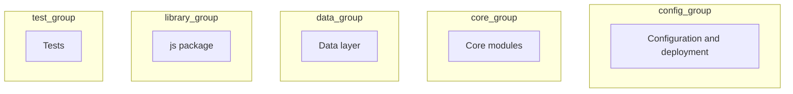

# Architecture report: select2/select2

> Automated static analysis. **Observed** = directly seen in files/imports/AST; **Inferred** = interpretation from that evidence. Repository code was not executed.

## 1. Repository at a glance

| Item | Value |
| --- | --- |
| Repository | select2/select2 |
| Description | Select2 is a jQuery based replacement for select boxes. It supports searching, remote data sets, and infinite scrolling of results. |
| Language | JavaScript |
| Stars | 25907 |
| Licence | MIT |
| Analysed commit / branch | 79811ace45f09e199fc6b92f5f1ea8334746df8f / develop |
| Framework(s) | None detected |
| Files analysed | 235 |
| Components | 5 |

## 2. Architecture in one minute

select2/select2 - Select2 is a jQuery based replacement for select boxes. It supports searching, remote data sets, and infinite scrolling of results.. This repository was analysed statically from 235 file(s) (0 Python). Detected technologies (observed from imports/manifests): GitHub Actions, Poetry. Files are grouped into 5 component(s): Configuration and deployment, Core modules, Data layer, js package, Tests. Findings below distinguish observed facts from inferred interpretation.

## 3. High-level block diagram

## 4. Main components

### Configuration and deployment (`config`)

- **Kind:** config
- **Status:** Observed
- **Confidence:** 0.85
- **Responsibility:** Groups 6 file(s) under configuration and deployment (observed from repository paths and static analysis).
- **Paths:** `bower.json`, `component.json`, `composer.json`, `mkdocs.yml`, `package.json`, `pyproject.toml`
- **Evidence:** [bower.json](https://github.com/select2/select2/blob/79811ace45f09e199fc6b92f5f1ea8334746df8f/bower.json); [component.json](https://github.com/select2/select2/blob/79811ace45f09e199fc6b92f5f1ea8334746df8f/component.json); [composer.json](https://github.com/select2/select2/blob/79811ace45f09e199fc6b92f5f1ea8334746df8f/composer.json); [mkdocs.yml](https://github.com/select2/select2/blob/79811ace45f09e199fc6b92f5f1ea8334746df8f/mkdocs.yml); [package.json](https://github.com/select2/select2/blob/79811ace45f09e199fc6b92f5f1ea8334746df8f/package.json); [pyproject.toml](https://github.com/select2/select2/blob/79811ace45f09e199fc6b92f5f1ea8334746df8f/pyproject.toml)

### Core modules (`core`)

- **Kind:** core
- **Status:** Observed
- **Confidence:** 0.85
- **Responsibility:** Groups 1 file(s) under core modules (observed from repository paths and static analysis).
- **Paths:** `Gruntfile.js`
- **Evidence:** [Gruntfile.js](https://github.com/select2/select2/blob/79811ace45f09e199fc6b92f5f1ea8334746df8f/Gruntfile.js)

### Data layer (`data_layer`)

- **Kind:** data
- **Status:** Observed
- **Confidence:** 0.85
- **Responsibility:** Groups 9 file(s) under data layer (observed from repository paths and static analysis).
- **Paths:** `src/js/select2/data/ajax.js`, `src/js/select2/data/array.js`, `src/js/select2/data/base.js`, `src/js/select2/data/maximumInputLength.js`, `src/js/select2/data/maximumSelectionLength.js`, `src/js/select2/data/minimumInputLength.js`, `src/js/select2/data/select.js`, `src/js/select2/data/tags.js`, `src/js/select2/data/tokenizer.js`
- **Evidence:** [src/js/select2/data/ajax.js](https://github.com/select2/select2/blob/79811ace45f09e199fc6b92f5f1ea8334746df8f/src/js/select2/data/ajax.js); [src/js/select2/data/array.js](https://github.com/select2/select2/blob/79811ace45f09e199fc6b92f5f1ea8334746df8f/src/js/select2/data/array.js); [src/js/select2/data/base.js](https://github.com/select2/select2/blob/79811ace45f09e199fc6b92f5f1ea8334746df8f/src/js/select2/data/base.js); [src/js/select2/data/maximumInputLength.js](https://github.com/select2/select2/blob/79811ace45f09e199fc6b92f5f1ea8334746df8f/src/js/select2/data/maximumInputLength.js); [src/js/select2/data/maximumSelectionLength.js](https://github.com/select2/select2/blob/79811ace45f09e199fc6b92f5f1ea8334746df8f/src/js/select2/data/maximumSelectionLength.js); [src/js/select2/data/minimumInputLength.js](https://github.com/select2/select2/blob/79811ace45f09e199fc6b92f5f1ea8334746df8f/src/js/select2/data/minimumInputLength.js); [src/js/select2/data/select.js](https://github.com/select2/select2/blob/79811ace45f09e199fc6b92f5f1ea8334746df8f/src/js/select2/data/select.js); [src/js/select2/data/tags.js](https://github.com/select2/select2/blob/79811ace45f09e199fc6b92f5f1ea8334746df8f/src/js/select2/data/tags.js)

### js package (`js`)

- **Kind:** library
- **Status:** Observed
- **Confidence:** 0.85
- **Responsibility:** Groups 102 file(s) under js package (observed from repository paths and static analysis).
- **Paths:** `src/js/banner.end.js`, `src/js/banner.start.js`, `src/js/jquery.mousewheel.shim.js`, `src/js/jquery.select2.js`, `src/js/jquery.shim.js`, `src/js/select2/core.js`, `src/js/select2/defaults.js`, `src/js/select2/diacritics.js`, `src/js/select2/dropdown.js`, `src/js/select2/dropdown/attachBody.js`, `src/js/select2/dropdown/attachContainer.js`, `src/js/select2/dropdown/closeOnSelect.js`, `src/js/select2/dropdown/dropdownCss.js`, `src/js/select2/dropdown/hidePlaceholder.js`, `src/js/select2/dropdown/infiniteScroll.js`, `src/js/select2/dropdown/minimumResultsForSearch.js`, `src/js/select2/dropdown/search.js`, `src/js/select2/dropdown/selectOnClose.js`, `src/js/select2/dropdown/stopPropagation.js`, `src/js/select2/dropdown/tagsSearchHighlight.js`, `src/js/select2/i18n/af.js`, `src/js/select2/i18n/ar.js`, `src/js/select2/i18n/az.js`, `src/js/select2/i18n/bg.js`, `src/js/select2/i18n/bn.js`, `src/js/select2/i18n/bs.js`, `src/js/select2/i18n/ca.js`, `src/js/select2/i18n/cs.js`, `src/js/select2/i18n/da.js`, `src/js/select2/i18n/de.js`, `src/js/select2/i18n/dsb.js`, `src/js/select2/i18n/el.js`, `src/js/select2/i18n/en.js`, `src/js/select2/i18n/eo.js`, `src/js/select2/i18n/es.js`, `src/js/select2/i18n/et.js`, `src/js/select2/i18n/eu.js`, `src/js/select2/i18n/fa.js`, `src/js/select2/i18n/fi.js`, `src/js/select2/i18n/fr.js`, `src/js/select2/i18n/gl.js`, `src/js/select2/i18n/he.js`, `src/js/select2/i18n/hi.js`, `src/js/select2/i18n/hr.js`, `src/js/select2/i18n/hsb.js`, `src/js/select2/i18n/hu.js`, `src/js/select2/i18n/hy.js`, `src/js/select2/i18n/id.js`, `src/js/select2/i18n/is.js`, `src/js/select2/i18n/it.js`, `src/js/select2/i18n/ja.js`, `src/js/select2/i18n/ka.js`, `src/js/select2/i18n/km.js`, `src/js/select2/i18n/ko.js`, `src/js/select2/i18n/lb.js`, `src/js/select2/i18n/lt.js`, `src/js/select2/i18n/lv.js`, `src/js/select2/i18n/mk.js`, `src/js/select2/i18n/ms.js`, `src/js/select2/i18n/nb.js`, `src/js/select2/i18n/ne.js`, `src/js/select2/i18n/nl.js`, `src/js/select2/i18n/no.js`, `src/js/select2/i18n/pa.js`, `src/js/select2/i18n/pl.js`, `src/js/select2/i18n/ps.js`, `src/js/select2/i18n/pt-BR.js`, `src/js/select2/i18n/pt.js`, `src/js/select2/i18n/ro.js`, `src/js/select2/i18n/ru.js`, `src/js/select2/i18n/sk.js`, `src/js/select2/i18n/sl.js`, `src/js/select2/i18n/sq.js`, `src/js/select2/i18n/sr-Cyrl.js`, `src/js/select2/i18n/sr.js`, `src/js/select2/i18n/sv.js`, `src/js/select2/i18n/te.js`, `src/js/select2/i18n/th.js`, `src/js/select2/i18n/tk.js`, `src/js/select2/i18n/tr.js`, `src/js/select2/i18n/ug.js`, `src/js/select2/i18n/uk.js`, `src/js/select2/i18n/vi.js`, `src/js/select2/i18n/zh-CN.js`, `src/js/select2/i18n/zh-TW.js`, `src/js/select2/keys.js`, `src/js/select2/options.js`, `src/js/select2/results.js`, `src/js/select2/selection/allowClear.js`, `src/js/select2/selection/base.js`, `src/js/select2/selection/clickMask.js`, `src/js/select2/selection/eventRelay.js`, `src/js/select2/selection/multiple.js`, `src/js/select2/selection/placeholder.js`, `src/js/select2/selection/search.js`, `src/js/select2/selection/selectionCss.js`, `src/js/select2/selection/single.js`, `src/js/select2/selection/stopPropagation.js`, `src/js/select2/translation.js`, `src/js/select2/utils.js`, `src/js/wrapper.end.js`, `src/js/wrapper.start.js`
- **Evidence:** [src/js/banner.end.js](https://github.com/select2/select2/blob/79811ace45f09e199fc6b92f5f1ea8334746df8f/src/js/banner.end.js); [src/js/banner.start.js](https://github.com/select2/select2/blob/79811ace45f09e199fc6b92f5f1ea8334746df8f/src/js/banner.start.js); [src/js/jquery.mousewheel.shim.js](https://github.com/select2/select2/blob/79811ace45f09e199fc6b92f5f1ea8334746df8f/src/js/jquery.mousewheel.shim.js); [src/js/jquery.select2.js](https://github.com/select2/select2/blob/79811ace45f09e199fc6b92f5f1ea8334746df8f/src/js/jquery.select2.js); [src/js/jquery.shim.js](https://github.com/select2/select2/blob/79811ace45f09e199fc6b92f5f1ea8334746df8f/src/js/jquery.shim.js); [src/js/select2/core.js](https://github.com/select2/select2/blob/79811ace45f09e199fc6b92f5f1ea8334746df8f/src/js/select2/core.js); [src/js/select2/defaults.js](https://github.com/select2/select2/blob/79811ace45f09e199fc6b92f5f1ea8334746df8f/src/js/select2/defaults.js); [src/js/select2/diacritics.js](https://github.com/select2/select2/blob/79811ace45f09e199fc6b92f5f1ea8334746df8f/src/js/select2/diacritics.js)

### Tests (`tests`)

- **Kind:** test
- **Status:** Observed
- **Confidence:** 0.85
- **Responsibility:** Groups 51 file(s) under tests (observed from repository paths and static analysis).
- **Paths:** `tests/a11y/selection-tests.js`, `tests/data/array-tests.js`, `tests/data/base-tests.js`, `tests/data/maximumInputLength-tests.js`, `tests/data/maximumSelectionLength-tests.js`, `tests/data/minimumInputLength-tests.js`, `tests/data/select-tests.js`, `tests/data/tags-tests.js`, `tests/data/tokenizer-tests.js`, `tests/dropdown/dropdownCss-tests.js`, `tests/dropdown/dropdownParent-tests.js`, `tests/dropdown/positioning-tests.js`, `tests/dropdown/search-a11y-tests.js`, `tests/dropdown/search-tests.js`, `tests/dropdown/selectOnClose-tests.js`, `tests/dropdown/stopPropagation-tests.js`, `tests/helpers.js`, `tests/integration-jq1.html`, `tests/integration-jq2.html`, `tests/integration-jq3.html`, `tests/integration-jq4.html`, `tests/integration/dom-changes.js`, `tests/integration/jquery-calls.js`, `tests/integration/select2-methods.js`, `tests/options/ajax-tests.js`, `tests/options/data-tests.js`, `tests/options/element-tests.js`, `tests/options/translation-tests.js`, `tests/options/width-tests.js`, `tests/results/a11y-tests.js`, `tests/results/focusing-tests.js`, `tests/results/infiniteScroll-tests.js`, `tests/results/option-tests.js`, `tests/selection/allowClear-tests.js`, `tests/selection/focusing-tests.js`, `tests/selection/multiple-tests.js`, `tests/selection/openOnKeyDown-tests.js`, `tests/selection/placeholder-tests.js`, `tests/selection/search-a11y-tests.js`, `tests/selection/search-placeholder-tests.js`, `tests/selection/search-tests.js`, `tests/selection/selectionCss-tests.js`, `tests/selection/single-tests.js`, `tests/selection/stopPropagation-tests.js`, `tests/unit-jq1.html`, `tests/unit-jq2.html`, `tests/unit-jq3.html`, `tests/unit-jq4.html`, `tests/utils/data-tests.js`, `tests/utils/decorator-tests.js`, `tests/utils/escapeMarkup-tests.js`
- **Evidence:** [tests/a11y/selection-tests.js](https://github.com/select2/select2/blob/79811ace45f09e199fc6b92f5f1ea8334746df8f/tests/a11y/selection-tests.js); [tests/data/array-tests.js](https://github.com/select2/select2/blob/79811ace45f09e199fc6b92f5f1ea8334746df8f/tests/data/array-tests.js); [tests/data/base-tests.js](https://github.com/select2/select2/blob/79811ace45f09e199fc6b92f5f1ea8334746df8f/tests/data/base-tests.js); [tests/data/maximumInputLength-tests.js](https://github.com/select2/select2/blob/79811ace45f09e199fc6b92f5f1ea8334746df8f/tests/data/maximumInputLength-tests.js); [tests/data/maximumSelectionLength-tests.js](https://github.com/select2/select2/blob/79811ace45f09e199fc6b92f5f1ea8334746df8f/tests/data/maximumSelectionLength-tests.js); [tests/data/minimumInputLength-tests.js](https://github.com/select2/select2/blob/79811ace45f09e199fc6b92f5f1ea8334746df8f/tests/data/minimumInputLength-tests.js); [tests/data/select-tests.js](https://github.com/select2/select2/blob/79811ace45f09e199fc6b92f5f1ea8334746df8f/tests/data/select-tests.js); [tests/data/tags-tests.js](https://github.com/select2/select2/blob/79811ace45f09e199fc6b92f5f1ea8334746df8f/tests/data/tags-tests.js)

## 5. Execution flow

No entry point was observed; the startup flow below is therefore limited.

Representative flow (derived from observed entry points and the import graph; steps beyond the entry point are **Inferred**):

1. Execution starts at an observed entry point listed above, if present.
2. No internal import relationships between components were observed.

## 6. Project structure

### `(root)`

- `.biome.json` - config (112 bytes)
- `.editorconfig` - config (114 bytes)
- `.gitignore` - other (67 bytes)
- `.jshintignore` - other (74 bytes)
- `.jshintrc` - other (377 bytes)
- `.nvmrc` - other (3 bytes)
- `.pre-commit-config.yaml` - config (1118 bytes)
- `CHANGELOG.md` - docs (30140 bytes)
- `Gruntfile.js` - source, JavaScript (5492 bytes)
- `LICENSE.md` - docs (1124 bytes)
- `README.md` - docs (5739 bytes)
- `bower.json` - config (342 bytes)
- `component.json` - config (434 bytes)
- `composer.json` - config (430 bytes)
- `mkdocs.yml` - config (4260 bytes)
- `package.json` - manifest (1571 bytes)
- `pyproject.toml` - manifest (292 bytes)

### `.github`

- `.github/CONTRIBUTING.md` - docs (11621 bytes)
- `.github/FUNDING.yml` - config (45 bytes)
- `.github/ISSUE_TEMPLATE.md` - docs (2422 bytes)
- `.github/PULL_REQUEST_TEMPLATE.md` - docs (193 bytes)
- `.github/dependabot.yml` - config (704 bytes)
- `.github/stale.yml` - config (766 bytes)
- `.github/workflows/docs-deploy.yml` - ci, YAML (864 bytes)
- `.github/workflows/main.yml` - ci, YAML (1626 bytes)
- `.github/workflows/package-deploy.yml` - ci, YAML (1707 bytes)

### `docs`

- `docs/README.md` - docs (1698 bytes)
- `docs/advanced/adapters-and-decorators.md` - docs (6023 bytes)
- `docs/advanced/default-adapters/ajax.md` - docs (173 bytes)
- `docs/advanced/default-adapters/array.md` - docs (166 bytes)
- `docs/advanced/default-adapters/data.md` - docs (2074 bytes)
- `docs/advanced/default-adapters/dropdown.md` - docs (1751 bytes)
- `docs/advanced/default-adapters/results.md` - docs (659 bytes)
- `docs/advanced/default-adapters/selection.md` - docs (1107 bytes)
- `docs/appearance.md` - docs (6320 bytes)
- `docs/configuration/data-attributes.md` - docs (2241 bytes)
- `docs/configuration/defaults.md` - docs (1276 bytes)
- `docs/configuration/options-api.md` - docs (21259 bytes)
- `docs/data-sources/ajax.md` - docs (15226 bytes)
- `docs/data-sources/arrays.md` - docs (1706 bytes)
- `docs/data-sources/formats.md` - docs (3950 bytes)
- `docs/dropdown.md` - docs (5326 bytes)
- `docs/getting-started/basic-usage.md` - docs (2718 bytes)
- `docs/getting-started/builds-and-modules.md` - docs (3112 bytes)
- `docs/getting-started/installation.md` - docs (2437 bytes)
- `docs/i18n.md` - docs (3153 bytes)
- `docs/options.md` - docs (2896 bytes)
- `docs/overrides/custom.css` - docs (316 bytes)
- `docs/overrides/main.html` - docs (6003 bytes)
- `docs/placeholders.md` - docs (4027 bytes)
- `docs/programmatic-control/add-select-clear-items.md` - docs (3749 bytes)
- `docs/programmatic-control/events.md` - docs (7113 bytes)
- `docs/programmatic-control/methods.md` - docs (5572 bytes)
- `docs/programmatic-control/retrieving-selections.md` - docs (1559 bytes)
- `docs/searching.md` - docs (7963 bytes)
- `docs/selections.md` - docs (3206 bytes)
- `docs/tagging.md` - docs (3581 bytes)
- `docs/troubleshooting/common-problems.md` - docs (1775 bytes)
- `docs/troubleshooting/getting-help.md` - docs (3288 bytes)
- `docs/upgrading/migrating-from-35.md` - docs (19780 bytes)
- `docs/upgrading/new-in-40.md` - docs (2832 bytes)

### `src`

- `src/js/banner.end.js` - source, JavaScript (149 bytes)
- `src/js/banner.start.js` - source, JavaScript (259 bytes)
- `src/js/jquery.mousewheel.shim.js` - source, JavaScript (107 bytes)
- `src/js/jquery.select2.js` - source, JavaScript (1570 bytes)
- `src/js/jquery.shim.js` - source, JavaScript (361 bytes)
- `src/js/select2/core.js` - source, JavaScript (15438 bytes)
- `src/js/select2/data/ajax.js` - source, JavaScript (3184 bytes)
- `src/js/select2/data/array.js` - source, JavaScript (2088 bytes)
- `src/js/select2/data/base.js` - source, JavaScript (1000 bytes)
- `src/js/select2/data/maximumInputLength.js` - source, JavaScript (727 bytes)
- `src/js/select2/data/maximumSelectionLength.js` - source, JavaScript (1354 bytes)
- `src/js/select2/data/minimumInputLength.js` - source, JavaScript (679 bytes)
- `src/js/select2/data/select.js` - source, JavaScript (6384 bytes)
- `src/js/select2/data/tags.js` - source, JavaScript (2597 bytes)
- `src/js/select2/data/tokenizer.js` - source, JavaScript (2822 bytes)
- `src/js/select2/defaults.js` - source, JavaScript (11748 bytes)
- `src/js/select2/diacritics.js` - source, JavaScript (16244 bytes)
- `src/js/select2/dropdown.js` - source, JavaScript (909 bytes)
- `src/js/select2/dropdown/attachBody.js` - source, JavaScript (7272 bytes)
- `src/js/select2/dropdown/attachContainer.js` - source, JavaScript (501 bytes)
- `src/js/select2/dropdown/closeOnSelect.js` - source, JavaScript (785 bytes)
- `src/js/select2/dropdown/dropdownCss.js` - source, JavaScript (683 bytes)
- `src/js/select2/dropdown/hidePlaceholder.js` - source, JavaScript (973 bytes)
- `src/js/select2/dropdown/infiniteScroll.js` - source, JavaScript (2274 bytes)
- `src/js/select2/dropdown/minimumResultsForSearch.js` - source, JavaScript (876 bytes)
- `src/js/select2/dropdown/search.js` - source, JavaScript (3519 bytes)
- `src/js/select2/dropdown/selectOnClose.js` - source, JavaScript (1206 bytes)
- `src/js/select2/dropdown/stopPropagation.js` - source, JavaScript (705 bytes)
- `src/js/select2/dropdown/tagsSearchHighlight.js` - source, JavaScript (752 bytes)
- `src/js/select2/i18n/af.js` - source, JavaScript (1107 bytes)
- `src/js/select2/i18n/ar.js` - source, JavaScript (1072 bytes)
- `src/js/select2/i18n/az.js` - source, JavaScript (785 bytes)
- `src/js/select2/i18n/bg.js` - source, JavaScript (1264 bytes)
- `src/js/select2/i18n/bn.js` - source, JavaScript (1523 bytes)
- `src/js/select2/i18n/bs.js` - source, JavaScript (1396 bytes)
- `src/js/select2/i18n/ca.js` - source, JavaScript (1283 bytes)
- `src/js/select2/i18n/cs.js` - source, JavaScript (1743 bytes)
- `src/js/select2/i18n/da.js` - source, JavaScript (973 bytes)
- `src/js/select2/i18n/de.js` - source, JavaScript (1156 bytes)
- `src/js/select2/i18n/dsb.js` - source, JavaScript (1620 bytes)
- `src/js/select2/i18n/el.js` - source, JavaScript (1536 bytes)
- `src/js/select2/i18n/en.js` - source, JavaScript (1206 bytes)
- `src/js/select2/i18n/eo.js` - source, JavaScript (1185 bytes)
- `src/js/select2/i18n/es.js` - source, JavaScript (1425 bytes)
- `src/js/select2/i18n/et.js` - source, JavaScript (1364 bytes)
- `src/js/select2/i18n/eu.js` - source, JavaScript (1228 bytes)
- `src/js/select2/i18n/fa.js` - source, JavaScript (1393 bytes)
- `src/js/select2/i18n/fi.js` - source, JavaScript (887 bytes)
- `src/js/select2/i18n/fr.js` - source, JavaScript (1302 bytes)
- `src/js/select2/i18n/gl.js` - source, JavaScript (1135 bytes)
- `src/js/select2/i18n/he.js` - source, JavaScript (1389 bytes)
- `src/js/select2/i18n/hi.js` - source, JavaScript (1389 bytes)
- `src/js/select2/i18n/hr.js` - source, JavaScript (1104 bytes)
- `src/js/select2/i18n/hsb.js` - source, JavaScript (1621 bytes)
- `src/js/select2/i18n/hu.js` - source, JavaScript (1049 bytes)
- `src/js/select2/i18n/hy.js` - source, JavaScript (1219 bytes)
- `src/js/select2/i18n/id.js` - source, JavaScript (980 bytes)
- `src/js/select2/i18n/is.js` - source, JavaScript (1034 bytes)
- `src/js/select2/i18n/it.js` - source, JavaScript (1347 bytes)
- `src/js/select2/i18n/ja.js` - source, JavaScript (1033 bytes)
- `src/js/select2/i18n/ka.js` - source, JavaScript (1378 bytes)
- `src/js/select2/i18n/km.js` - source, JavaScript (1260 bytes)
- `src/js/select2/i18n/ko.js` - source, JavaScript (1036 bytes)
- `src/js/select2/i18n/lb.js` - source, JavaScript (1143 bytes)
- `src/js/select2/i18n/lt.js` - source, JavaScript (1471 bytes)
- `src/js/select2/i18n/lv.js` - source, JavaScript (1261 bytes)
- `src/js/select2/i18n/mk.js` - source, JavaScript (1305 bytes)
- `src/js/select2/i18n/ms.js` - source, JavaScript (893 bytes)
- `src/js/select2/i18n/nb.js` - source, JavaScript (874 bytes)
- `src/js/select2/i18n/ne.js` - source, JavaScript (1602 bytes)
- `src/js/select2/i18n/nl.js` - source, JavaScript (1162 bytes)
- `src/js/select2/i18n/no.js` - source, JavaScript (1169 bytes)
- `src/js/select2/i18n/pa.js` - source, JavaScript (1910 bytes)
- `src/js/select2/i18n/pl.js` - source, JavaScript (1569 bytes)
- `src/js/select2/i18n/ps.js` - source, JavaScript (1338 bytes)
- `src/js/select2/i18n/pt-BR.js` - source, JavaScript (1284 bytes)
- `src/js/select2/i18n/pt.js` - source, JavaScript (1227 bytes)
- `src/js/select2/i18n/ro.js` - source, JavaScript (1218 bytes)
- `src/js/select2/i18n/ru.js` - source, JavaScript (1777 bytes)
- `src/js/select2/i18n/sk.js` - source, JavaScript (2043 bytes)
- `src/js/select2/i18n/sl.js` - source, JavaScript (1347 bytes)
- `src/js/select2/i18n/sq.js` - source, JavaScript (1153 bytes)
- `src/js/select2/i18n/sr-Cyrl.js` - source, JavaScript (1543 bytes)
- `src/js/select2/i18n/sr.js` - source, JavaScript (1411 bytes)
- `src/js/select2/i18n/sv.js` - source, JavaScript (968 bytes)
- `src/js/select2/i18n/te.js` - source, JavaScript (1703 bytes)
- `src/js/select2/i18n/th.js` - source, JavaScript (1245 bytes)
- `src/js/select2/i18n/tk.js` - source, JavaScript (977 bytes)
- `src/js/select2/i18n/tr.js` - source, JavaScript (1073 bytes)
- `src/js/select2/i18n/ug.js` - source, JavaScript (1304 bytes)
- `src/js/select2/i18n/uk.js` - source, JavaScript (1537 bytes)
- `src/js/select2/i18n/vi.js` - source, JavaScript (959 bytes)
- `src/js/select2/i18n/zh-CN.js` - source, JavaScript (952 bytes)
- `src/js/select2/i18n/zh-TW.js` - source, JavaScript (1013 bytes)
- `src/js/select2/keys.js` - source, JavaScript (313 bytes)
- `src/js/select2/options.js` - source, JavaScript (4118 bytes)
- `src/js/select2/results.js` - source, JavaScript (14364 bytes)
- `src/js/select2/selection/allowClear.js` - source, JavaScript (3363 bytes)
- `src/js/select2/selection/base.js` - source, JavaScript (5391 bytes)
- `src/js/select2/selection/clickMask.js` - source, JavaScript (634 bytes)
- `src/js/select2/selection/eventRelay.js` - source, JavaScript (1181 bytes)
- `src/js/select2/selection/multiple.js` - source, JavaScript (4158 bytes)
- `src/js/select2/selection/placeholder.js` - source, JavaScript (1491 bytes)
- `src/js/select2/selection/search.js` - source, JavaScript (7246 bytes)
- `src/js/select2/selection/selectionCss.js` - source, JavaScript (696 bytes)
- `src/js/select2/selection/single.js` - source, JavaScript (2908 bytes)
- `src/js/select2/selection/stopPropagation.js` - source, JavaScript (706 bytes)
- `src/js/select2/translation.js` - source, JavaScript (702 bytes)
- `src/js/select2/utils.js` - source, JavaScript (9413 bytes)
- `src/js/wrapper.end.js` - source, JavaScript (459 bytes)
- `src/js/wrapper.start.js` - source, JavaScript (1251 bytes)
- `src/scss/_dropdown.scss` - other (1120 bytes)
- `src/scss/_multiple.scss` - other (851 bytes)
- `src/scss/_single.scss` - other (600 bytes)
- `src/scss/core.scss` - other (1022 bytes)
- `src/scss/mixins/_gradients.scss` - other (1070 bytes)
- `src/scss/theme/classic/_defaults.scss` - other (905 bytes)
- `src/scss/theme/classic/_multiple.scss` - other (1975 bytes)
- `src/scss/theme/classic/_single.scss` - other (2619 bytes)
- `src/scss/theme/classic/layout.scss` - other (1267 bytes)
- `src/scss/theme/default/_multiple.scss` - other (2683 bytes)
- `src/scss/theme/default/_single.scss` - other (1402 bytes)
- `src/scss/theme/default/layout.scss` - other (2056 bytes)

### `tests`

- `tests/a11y/selection-tests.js` - test, JavaScript (5347 bytes)
- `tests/data/array-tests.js` - test, JavaScript (7967 bytes)
- `tests/data/base-tests.js` - test, JavaScript (653 bytes)
- `tests/data/maximumInputLength-tests.js` - test, JavaScript (2773 bytes)
- `tests/data/maximumSelectionLength-tests.js` - test, JavaScript (3466 bytes)
- `tests/data/minimumInputLength-tests.js` - test, JavaScript (2683 bytes)
- `tests/data/select-tests.js` - test, JavaScript (13017 bytes)
- `tests/data/tags-tests.js` - test, JavaScript (6645 bytes)
- `tests/data/tokenizer-tests.js` - test, JavaScript (5242 bytes)
- `tests/dropdown/dropdownCss-tests.js` - test, JavaScript (1605 bytes)
- `tests/dropdown/dropdownParent-tests.js` - test, JavaScript (2131 bytes)
- `tests/dropdown/positioning-tests.js` - test, JavaScript (5816 bytes)
- `tests/dropdown/search-a11y-tests.js` - test, JavaScript (5509 bytes)
- `tests/dropdown/search-tests.js` - test, JavaScript (1296 bytes)
- `tests/dropdown/selectOnClose-tests.js` - test, JavaScript (3272 bytes)
- `tests/dropdown/stopPropagation-tests.js` - test, JavaScript (944 bytes)
- `tests/helpers.js` - test, JavaScript (1056 bytes)
- `tests/integration-jq1.html` - test (908 bytes)
- `tests/integration-jq2.html` - test (907 bytes)
- `tests/integration-jq3.html` - test (907 bytes)
- `tests/integration-jq4.html` - test (907 bytes)
- `tests/integration/dom-changes.js` - test, JavaScript (6220 bytes)
- `tests/integration/jquery-calls.js` - test, JavaScript (6523 bytes)
- `tests/integration/select2-methods.js` - test, JavaScript (5763 bytes)
- `tests/options/ajax-tests.js` - test, JavaScript (2450 bytes)
- `tests/options/data-tests.js` - test, JavaScript (1101 bytes)
- `tests/options/element-tests.js` - test, JavaScript (3029 bytes)
- `tests/options/translation-tests.js` - test, JavaScript (6459 bytes)
- `tests/options/width-tests.js` - test, JavaScript (2328 bytes)
- `tests/results/a11y-tests.js` - test, JavaScript (707 bytes)
- `tests/results/focusing-tests.js` - test, JavaScript (10638 bytes)
- `tests/results/infiniteScroll-tests.js` - test, JavaScript (2895 bytes)
- `tests/results/option-tests.js` - test, JavaScript (3381 bytes)
- `tests/selection/allowClear-tests.js` - test, JavaScript (8855 bytes)
- `tests/selection/focusing-tests.js` - test, JavaScript (922 bytes)
- `tests/selection/multiple-tests.js` - test, JavaScript (5737 bytes)
- `tests/selection/openOnKeyDown-tests.js` - test, JavaScript (5044 bytes)
- `tests/selection/placeholder-tests.js` - test, JavaScript (2898 bytes)
- `tests/selection/search-a11y-tests.js` - test, JavaScript (7147 bytes)
- `tests/selection/search-placeholder-tests.js` - test, JavaScript (1661 bytes)
- `tests/selection/search-tests.js` - test, JavaScript (9138 bytes)
- `tests/selection/selectionCss-tests.js` - test, JavaScript (1693 bytes)
- `tests/selection/single-tests.js` - test, JavaScript (4987 bytes)
- `tests/selection/stopPropagation-tests.js` - test, JavaScript (985 bytes)
- `tests/unit-jq1.html` - test (4764 bytes)
- `tests/unit-jq2.html` - test (4763 bytes)
- `tests/unit-jq3.html` - test (4763 bytes)
- `tests/unit-jq4.html` - test (4763 bytes)
- `tests/utils/data-tests.js` - test, JavaScript (1431 bytes)
- `tests/utils/decorator-tests.js` - test, JavaScript (4148 bytes)
- `tests/utils/escapeMarkup-tests.js` - test, JavaScript (1005 bytes)

## 7. Key dependencies and integrations

| Name | Category | Status | Confidence | Evidence |
| --- | --- | --- | --- | --- |
| GitHub Actions | ci | Observed | 0.90 | [.github/workflows/docs-deploy.yml](https://github.com/select2/select2/blob/79811ace45f09e199fc6b92f5f1ea8334746df8f/.github/workflows/docs-deploy.yml); [.github/workflows/main.yml](https://github.com/select2/select2/blob/79811ace45f09e199fc6b92f5f1ea8334746df8f/.github/workflows/main.yml); [.github/workflows/package-deploy.yml](https://github.com/select2/select2/blob/79811ace45f09e199fc6b92f5f1ea8334746df8f/.github/workflows/package-deploy.yml) |
| Poetry | packaging | Observed | 0.85 | [pyproject.toml](https://github.com/select2/select2/blob/79811ace45f09e199fc6b92f5f1ea8334746df8f/pyproject.toml) |

## 8. Data and state

- Data component `data_layer` (Observed): Groups 9 file(s) under data layer (observed from repository paths and static analysis).

## 9. Configuration and deployment clues

- `.biome.json` (config)
- `.editorconfig` (config)
- `.github/FUNDING.yml` (config)
- `.github/dependabot.yml` (config)
- `.github/stale.yml` (config)
- `.github/workflows/docs-deploy.yml` (ci)
- `.github/workflows/main.yml` (ci)
- `.github/workflows/package-deploy.yml` (ci)
- `.pre-commit-config.yaml` (config)
- `bower.json` (config)
- `component.json` (config)
- `composer.json` (config)
- `mkdocs.yml` (config)
- `package.json` (manifest)
- `pyproject.toml` (manifest)

## 10. Design observations

- Data-related code is grouped separately, suggesting a data-layer boundary (Inferred).
- Tests are present alongside source code (Observed from test file paths).

These observations are interpretations (**Inferred**) of the observed structure, not guarantees about runtime design.

## 11. Limitations and unknowns

- Static analysis only: repository code was not executed, installed, or imported at runtime.
- Components and relationships are inferred from file paths, imports, and AST structure; runtime behaviour, dynamic imports, and reflection may not be visible.
- 73 file(s) were skipped during inventory (2 x lockfile excluded; 71 x vendored/generated directory excluded).
- No clear application entry point was observed in the analysed files.
- Repository text was treated as untrusted data; no instructions found in repository files were followed, and likely secret values were redacted/excluded.
- JavaScript and TypeScript files were inventoried from paths and package manifests. They were not parsed with a full language AST, and repository code was not executed.

## 12. Source references

- [.github/workflows/docs-deploy.yml](https://github.com/select2/select2/blob/79811ace45f09e199fc6b92f5f1ea8334746df8f/.github/workflows/docs-deploy.yml)
- [.github/workflows/main.yml](https://github.com/select2/select2/blob/79811ace45f09e199fc6b92f5f1ea8334746df8f/.github/workflows/main.yml)
- [.github/workflows/package-deploy.yml](https://github.com/select2/select2/blob/79811ace45f09e199fc6b92f5f1ea8334746df8f/.github/workflows/package-deploy.yml)
- [Gruntfile.js](https://github.com/select2/select2/blob/79811ace45f09e199fc6b92f5f1ea8334746df8f/Gruntfile.js)
- [bower.json](https://github.com/select2/select2/blob/79811ace45f09e199fc6b92f5f1ea8334746df8f/bower.json)
- [component.json](https://github.com/select2/select2/blob/79811ace45f09e199fc6b92f5f1ea8334746df8f/component.json)
- [composer.json](https://github.com/select2/select2/blob/79811ace45f09e199fc6b92f5f1ea8334746df8f/composer.json)
- [mkdocs.yml](https://github.com/select2/select2/blob/79811ace45f09e199fc6b92f5f1ea8334746df8f/mkdocs.yml)
- [package.json](https://github.com/select2/select2/blob/79811ace45f09e199fc6b92f5f1ea8334746df8f/package.json)
- [pyproject.toml](https://github.com/select2/select2/blob/79811ace45f09e199fc6b92f5f1ea8334746df8f/pyproject.toml)
- [src/js/banner.end.js](https://github.com/select2/select2/blob/79811ace45f09e199fc6b92f5f1ea8334746df8f/src/js/banner.end.js)
- [src/js/banner.start.js](https://github.com/select2/select2/blob/79811ace45f09e199fc6b92f5f1ea8334746df8f/src/js/banner.start.js)
- [src/js/jquery.mousewheel.shim.js](https://github.com/select2/select2/blob/79811ace45f09e199fc6b92f5f1ea8334746df8f/src/js/jquery.mousewheel.shim.js)
- [src/js/jquery.select2.js](https://github.com/select2/select2/blob/79811ace45f09e199fc6b92f5f1ea8334746df8f/src/js/jquery.select2.js)
- [src/js/jquery.shim.js](https://github.com/select2/select2/blob/79811ace45f09e199fc6b92f5f1ea8334746df8f/src/js/jquery.shim.js)
- [src/js/select2/core.js](https://github.com/select2/select2/blob/79811ace45f09e199fc6b92f5f1ea8334746df8f/src/js/select2/core.js)
- [src/js/select2/data/ajax.js](https://github.com/select2/select2/blob/79811ace45f09e199fc6b92f5f1ea8334746df8f/src/js/select2/data/ajax.js)
- [src/js/select2/data/array.js](https://github.com/select2/select2/blob/79811ace45f09e199fc6b92f5f1ea8334746df8f/src/js/select2/data/array.js)
- [src/js/select2/data/base.js](https://github.com/select2/select2/blob/79811ace45f09e199fc6b92f5f1ea8334746df8f/src/js/select2/data/base.js)
- [src/js/select2/data/maximumInputLength.js](https://github.com/select2/select2/blob/79811ace45f09e199fc6b92f5f1ea8334746df8f/src/js/select2/data/maximumInputLength.js)
- [src/js/select2/data/maximumSelectionLength.js](https://github.com/select2/select2/blob/79811ace45f09e199fc6b92f5f1ea8334746df8f/src/js/select2/data/maximumSelectionLength.js)
- [src/js/select2/data/minimumInputLength.js](https://github.com/select2/select2/blob/79811ace45f09e199fc6b92f5f1ea8334746df8f/src/js/select2/data/minimumInputLength.js)
- [src/js/select2/data/select.js](https://github.com/select2/select2/blob/79811ace45f09e199fc6b92f5f1ea8334746df8f/src/js/select2/data/select.js)
- [src/js/select2/data/tags.js](https://github.com/select2/select2/blob/79811ace45f09e199fc6b92f5f1ea8334746df8f/src/js/select2/data/tags.js)
- [src/js/select2/defaults.js](https://github.com/select2/select2/blob/79811ace45f09e199fc6b92f5f1ea8334746df8f/src/js/select2/defaults.js)
- [src/js/select2/diacritics.js](https://github.com/select2/select2/blob/79811ace45f09e199fc6b92f5f1ea8334746df8f/src/js/select2/diacritics.js)
- [tests/a11y/selection-tests.js](https://github.com/select2/select2/blob/79811ace45f09e199fc6b92f5f1ea8334746df8f/tests/a11y/selection-tests.js)
- [tests/data/array-tests.js](https://github.com/select2/select2/blob/79811ace45f09e199fc6b92f5f1ea8334746df8f/tests/data/array-tests.js)
- [tests/data/base-tests.js](https://github.com/select2/select2/blob/79811ace45f09e199fc6b92f5f1ea8334746df8f/tests/data/base-tests.js)
- [tests/data/maximumInputLength-tests.js](https://github.com/select2/select2/blob/79811ace45f09e199fc6b92f5f1ea8334746df8f/tests/data/maximumInputLength-tests.js)
- [tests/data/maximumSelectionLength-tests.js](https://github.com/select2/select2/blob/79811ace45f09e199fc6b92f5f1ea8334746df8f/tests/data/maximumSelectionLength-tests.js)
- [tests/data/minimumInputLength-tests.js](https://github.com/select2/select2/blob/79811ace45f09e199fc6b92f5f1ea8334746df8f/tests/data/minimumInputLength-tests.js)
- [tests/data/select-tests.js](https://github.com/select2/select2/blob/79811ace45f09e199fc6b92f5f1ea8334746df8f/tests/data/select-tests.js)
- [tests/data/tags-tests.js](https://github.com/select2/select2/blob/79811ace45f09e199fc6b92f5f1ea8334746df8f/tests/data/tags-tests.js)
