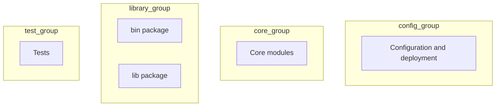

# Architecture report: semantic-release/semantic-release

> Automated static analysis. **Observed** = directly seen in files/imports/AST; **Inferred** = interpretation from that evidence. Repository code was not executed.

## 1. Repository at a glance

| Item | Value |
| --- | --- |
| Repository | semantic-release/semantic-release |
| Description | 📦🚀 Fully automated version management and package publishing |
| Language | JavaScript |
| Stars | 24169 |
| Licence | MIT |
| Analysed commit / branch | 04c1923646eb801cf6f0f90455cf00b78b94fdb7 / master |
| Framework(s) | None detected |
| Files analysed | 85 |
| Components | 5 |

## 2. Architecture in one minute

semantic-release/semantic-release - 📦🚀 Fully automated version management and package publishing. This repository was analysed statically from 85 file(s) (0 Python). Detected technologies (observed from imports/manifests): GitHub Actions. Files are grouped into 5 component(s): bin package, Configuration and deployment, Core modules, lib package, Tests. Findings below distinguish observed facts from inferred interpretation.

## 3. High-level block diagram

## 4. Main components

### bin package (`bin`)

- **Kind:** library
- **Status:** Observed
- **Confidence:** 0.85
- **Responsibility:** Groups 1 file(s) under bin package (observed from repository paths and static analysis).
- **Paths:** `bin/semantic-release.js`
- **Evidence:** [bin/semantic-release.js](https://github.com/semantic-release/semantic-release/blob/04c1923646eb801cf6f0f90455cf00b78b94fdb7/bin/semantic-release.js)

### Configuration and deployment (`config`)

- **Kind:** config
- **Status:** Observed
- **Confidence:** 0.85
- **Responsibility:** Groups 2 file(s) under configuration and deployment (observed from repository paths and static analysis).
- **Paths:** `e2e.compose.yml`, `package.json`
- **Evidence:** [e2e.compose.yml](https://github.com/semantic-release/semantic-release/blob/04c1923646eb801cf6f0f90455cf00b78b94fdb7/e2e.compose.yml); [package.json](https://github.com/semantic-release/semantic-release/blob/04c1923646eb801cf6f0f90455cf00b78b94fdb7/package.json)

### Core modules (`core`)

- **Kind:** core
- **Status:** Observed
- **Confidence:** 0.85
- **Responsibility:** Groups 3 file(s) under core modules (observed from repository paths and static analysis).
- **Paths:** `cli.js`, `index.d.ts`, `index.js`
- **Evidence:** [cli.js](https://github.com/semantic-release/semantic-release/blob/04c1923646eb801cf6f0f90455cf00b78b94fdb7/cli.js); [index.d.ts](https://github.com/semantic-release/semantic-release/blob/04c1923646eb801cf6f0f90455cf00b78b94fdb7/index.d.ts); [index.js](https://github.com/semantic-release/semantic-release/blob/04c1923646eb801cf6f0f90455cf00b78b94fdb7/index.js)

### lib package (`lib`)

- **Kind:** library
- **Status:** Observed
- **Confidence:** 0.85
- **Responsibility:** Groups 24 file(s) under lib package (observed from repository paths and static analysis).
- **Paths:** `lib/branches/expand.js`, `lib/branches/get-tags.js`, `lib/branches/index.js`, `lib/branches/normalize.js`, `lib/definitions/branches.js`, `lib/definitions/constants.js`, `lib/definitions/errors.js`, `lib/definitions/plugins.js`, `lib/get-commits.js`, `lib/get-config.js`, `lib/get-error.js`, `lib/get-git-auth-url.js`, `lib/get-last-release.js`, `lib/get-logger.js`, `lib/get-next-version.js`, `lib/get-release-to-add.js`, `lib/git.js`, `lib/hide-sensitive.js`, `lib/plugins/index.js`, `lib/plugins/normalize.js`, `lib/plugins/pipeline.js`, `lib/plugins/utils.js`, `lib/utils.js`, `lib/verify.js`
- **Evidence:** [lib/branches/expand.js](https://github.com/semantic-release/semantic-release/blob/04c1923646eb801cf6f0f90455cf00b78b94fdb7/lib/branches/expand.js); [lib/branches/get-tags.js](https://github.com/semantic-release/semantic-release/blob/04c1923646eb801cf6f0f90455cf00b78b94fdb7/lib/branches/get-tags.js); [lib/branches/index.js](https://github.com/semantic-release/semantic-release/blob/04c1923646eb801cf6f0f90455cf00b78b94fdb7/lib/branches/index.js); [lib/branches/normalize.js](https://github.com/semantic-release/semantic-release/blob/04c1923646eb801cf6f0f90455cf00b78b94fdb7/lib/branches/normalize.js); [lib/definitions/branches.js](https://github.com/semantic-release/semantic-release/blob/04c1923646eb801cf6f0f90455cf00b78b94fdb7/lib/definitions/branches.js); [lib/definitions/constants.js](https://github.com/semantic-release/semantic-release/blob/04c1923646eb801cf6f0f90455cf00b78b94fdb7/lib/definitions/constants.js); [lib/definitions/errors.js](https://github.com/semantic-release/semantic-release/blob/04c1923646eb801cf6f0f90455cf00b78b94fdb7/lib/definitions/errors.js); [lib/definitions/plugins.js](https://github.com/semantic-release/semantic-release/blob/04c1923646eb801cf6f0f90455cf00b78b94fdb7/lib/definitions/plugins.js)

### Tests (`tests`)

- **Kind:** test
- **Status:** Observed
- **Confidence:** 0.85
- **Responsibility:** Groups 39 file(s) under tests (observed from repository paths and static analysis).
- **Paths:** `test/branches/branches.test.js`, `test/branches/expand.test.js`, `test/branches/get-tags.test.js`, `test/branches/normalize.test.js`, `test/cli.test.js`, `test/definitions/branches.test.js`, `test/definitions/errors.test.js`, `test/definitions/plugins.test.js`, `test/e2e.test.js`, `test/fixtures/index.js`, `test/fixtures/multi-plugin.cjs`, `test/fixtures/plugin-error-inherited.js`, `test/fixtures/plugin-error.js`, `test/fixtures/plugin-errors.js`, `test/fixtures/plugin-esm-named-exports.js`, `test/fixtures/plugin-identity.js`, `test/fixtures/plugin-log-env.js`, `test/fixtures/plugin-noop.cjs`, `test/fixtures/plugin-result-config.js`, `test/get-commits.test.js`, `test/get-config.test.js`, `test/get-git-auth-url.test.js`, `test/get-last-release.test.js`, `test/get-logger.test.js`, `test/get-next-version.test.js`, `test/get-release-to-add.test.js`, `test/git.test.js`, `test/helpers/config.yaml`, `test/helpers/e2e-environment.js`, `test/helpers/git-utils.js`, `test/helpers/npm-utils.js`, `test/hide-sensitive.test.js`, `test/integration.test.js`, `test/plugins/normalize.test.js`, `test/plugins/pipeline.test.js`, `test/plugins/plugins.test.js`, `test/plugins/utils.test.js`, `test/utils.test.js`, `test/verify.test.js`
- **Evidence:** [test/branches/branches.test.js](https://github.com/semantic-release/semantic-release/blob/04c1923646eb801cf6f0f90455cf00b78b94fdb7/test/branches/branches.test.js); [test/branches/expand.test.js](https://github.com/semantic-release/semantic-release/blob/04c1923646eb801cf6f0f90455cf00b78b94fdb7/test/branches/expand.test.js); [test/branches/get-tags.test.js](https://github.com/semantic-release/semantic-release/blob/04c1923646eb801cf6f0f90455cf00b78b94fdb7/test/branches/get-tags.test.js); [test/branches/normalize.test.js](https://github.com/semantic-release/semantic-release/blob/04c1923646eb801cf6f0f90455cf00b78b94fdb7/test/branches/normalize.test.js); [test/cli.test.js](https://github.com/semantic-release/semantic-release/blob/04c1923646eb801cf6f0f90455cf00b78b94fdb7/test/cli.test.js); [test/definitions/branches.test.js](https://github.com/semantic-release/semantic-release/blob/04c1923646eb801cf6f0f90455cf00b78b94fdb7/test/definitions/branches.test.js); [test/definitions/errors.test.js](https://github.com/semantic-release/semantic-release/blob/04c1923646eb801cf6f0f90455cf00b78b94fdb7/test/definitions/errors.test.js); [test/definitions/plugins.test.js](https://github.com/semantic-release/semantic-release/blob/04c1923646eb801cf6f0f90455cf00b78b94fdb7/test/definitions/plugins.test.js)

## 5. Execution flow

**Observed** entry point(s):

- [bin/semantic-release.js](https://github.com/semantic-release/semantic-release/blob/04c1923646eb801cf6f0f90455cf00b78b94fdb7/bin/semantic-release.js)
- [index.js](https://github.com/semantic-release/semantic-release/blob/04c1923646eb801cf6f0f90455cf00b78b94fdb7/index.js)
- [lib/branches/index.js](https://github.com/semantic-release/semantic-release/blob/04c1923646eb801cf6f0f90455cf00b78b94fdb7/lib/branches/index.js)
- [lib/plugins/index.js](https://github.com/semantic-release/semantic-release/blob/04c1923646eb801cf6f0f90455cf00b78b94fdb7/lib/plugins/index.js)

Representative flow (derived from observed entry points and the import graph; steps beyond the entry point are **Inferred**):

1. Execution starts at an observed entry point listed above, if present.
2. No internal import relationships between components were observed.

## 6. Project structure

### `(root)`

- `.git-blame-ignore-revs` - other (149 bytes)
- `.gitattributes` - other (19 bytes)
- `.gitignore` - other (2020 bytes)
- `.nvmrc` - other (3 bytes)
- `CODE_OF_CONDUCT.md` - docs (3230 bytes)
- `CONTRIBUTING.md` - docs (15742 bytes)
- `LICENSE` - docs (1069 bytes)
- `README.md` - docs (14773 bytes)
- `cli.js` - source, JavaScript (2690 bytes)
- `e2e.compose.yml` - config (569 bytes)
- `index.d.ts` - source, TypeScript (20974 bytes)
- `index.js` - source, JavaScript (10334 bytes)
- `package.json` - manifest (4504 bytes)

### `.github`

- `.github/ISSUE_TEMPLATE/01_bug_report.yml` - config (1865 bytes)
- `.github/ISSUE_TEMPLATE/02_feature_request.yml` - config (771 bytes)
- `.github/ISSUE_TEMPLATE/03_plugin_suggestion.yml` - config (535 bytes)
- `.github/ISSUE_TEMPLATE/config.yml` - config (281 bytes)
- `.github/workflows/release.yml` - ci, YAML (1209 bytes)
- `.github/workflows/scorecard.yml` - ci, YAML (1070 bytes)
- `.github/workflows/test.yml` - ci, YAML (2340 bytes)

### `bin`

- `bin/semantic-release.js` - source, JavaScript (1303 bytes)

### `lib`

- `lib/branches/expand.js` - source, JavaScript (671 bytes)
- `lib/branches/get-tags.js` - source, JavaScript (1570 bytes)
- `lib/branches/index.js` - source, JavaScript (2379 bytes)
- `lib/branches/normalize.js` - source, JavaScript (3870 bytes)
- `lib/definitions/branches.js` - source, JavaScript (1061 bytes)
- `lib/definitions/constants.js` - source, JavaScript (430 bytes)
- `lib/definitions/errors.js` - source, JavaScript (14273 bytes)
- `lib/definitions/plugins.js` - source, JavaScript (3543 bytes)
- `lib/get-commits.js` - source, JavaScript (951 bytes)
- `lib/get-config.js` - source, JavaScript (3622 bytes)
- `lib/get-error.js` - source, JavaScript (283 bytes)
- `lib/get-git-auth-url.js` - source, JavaScript (4974 bytes)
- `lib/get-last-release.js` - source, JavaScript (1783 bytes)
- `lib/get-logger.js` - source, JavaScript (694 bytes)
- `lib/get-next-version.js` - source, JavaScript (1387 bytes)
- `lib/get-release-to-add.js` - source, JavaScript (1950 bytes)
- `lib/git.js` - source, JavaScript (12377 bytes)
- `lib/hide-sensitive.js` - source, JavaScript (1245 bytes)
- `lib/plugins/index.js` - source, JavaScript (3449 bytes)
- `lib/plugins/normalize.js` - source, JavaScript (2553 bytes)
- `lib/plugins/pipeline.js` - source, JavaScript (2720 bytes)
- `lib/plugins/utils.js` - source, JavaScript (2144 bytes)
- `lib/utils.js` - source, JavaScript (2972 bytes)
- `lib/verify.js` - source, JavaScript (1811 bytes)

### `media`

- `media/semantic-release-logo.svg` - other (715 bytes)

### `test`

- `test/branches/branches.test.js` - test, JavaScript (12738 bytes)
- `test/branches/expand.test.js` - test, JavaScript (2983 bytes)
- `test/branches/get-tags.test.js` - test, JavaScript (6787 bytes)
- `test/branches/normalize.test.js` - test, JavaScript (11419 bytes)
- `test/cli.test.js` - test, JavaScript (7959 bytes)
- `test/definitions/branches.test.js` - test, JavaScript (5131 bytes)
- `test/definitions/errors.test.js` - test, JavaScript (873 bytes)
- `test/definitions/plugins.test.js` - test, JavaScript (3443 bytes)
- `test/e2e.test.js` - test, JavaScript (29511 bytes)
- `test/fixtures/index.js` - test, JavaScript (25 bytes)
- `test/fixtures/multi-plugin.cjs` - test, JavaScript (183 bytes)
- `test/fixtures/plugin-error-inherited.js` - test, JavaScript (372 bytes)
- `test/fixtures/plugin-error.js` - test, JavaScript (114 bytes)
- `test/fixtures/plugin-errors.js` - test, JavaScript (135 bytes)
- `test/fixtures/plugin-esm-named-exports.js` - test, JavaScript (115 bytes)
- `test/fixtures/plugin-identity.js` - test, JavaScript (51 bytes)
- `test/fixtures/plugin-log-env.js` - test, JavaScript (282 bytes)
- `test/fixtures/plugin-noop.cjs` - test, JavaScript (39 bytes)
- `test/fixtures/plugin-result-config.js` - test, JavaScript (71 bytes)
- `test/get-commits.test.js` - test, JavaScript (4377 bytes)
- `test/get-config.test.js` - test, JavaScript (29831 bytes)
- `test/get-git-auth-url.test.js` - test, JavaScript (12001 bytes)
- `test/get-last-release.test.js` - test, JavaScript (3846 bytes)
- `test/get-logger.test.js` - test, JavaScript (610 bytes)
- `test/get-next-version.test.js` - test, JavaScript (8660 bytes)
- `test/get-release-to-add.test.js` - test, JavaScript (8307 bytes)
- `test/git.test.js` - test, JavaScript (17109 bytes)
- `test/helpers/config.yaml` - test (446 bytes)
- `test/helpers/e2e-environment.js` - test, JavaScript (6053 bytes)
- `test/helpers/git-utils.js` - test, JavaScript (11814 bytes)
- `test/helpers/npm-utils.js` - test, JavaScript (176 bytes)
- `test/hide-sensitive.test.js` - test, JavaScript (8127 bytes)
- `test/integration.test.js` - test, JavaScript (76559 bytes)
- `test/plugins/normalize.test.js` - test, JavaScript (9568 bytes)
- `test/plugins/pipeline.test.js` - test, JavaScript (6006 bytes)
- `test/plugins/plugins.test.js` - test, JavaScript (11346 bytes)
- `test/plugins/utils.test.js` - test, JavaScript (7909 bytes)
- `test/utils.test.js` - test, JavaScript (6774 bytes)
- `test/verify.test.js` - test, JavaScript (5292 bytes)

## 7. Key dependencies and integrations

| Name | Category | Status | Confidence | Evidence |
| --- | --- | --- | --- | --- |
| GitHub Actions | ci | Observed | 0.90 | [.github/workflows/release.yml](https://github.com/semantic-release/semantic-release/blob/04c1923646eb801cf6f0f90455cf00b78b94fdb7/.github/workflows/release.yml); [.github/workflows/scorecard.yml](https://github.com/semantic-release/semantic-release/blob/04c1923646eb801cf6f0f90455cf00b78b94fdb7/.github/workflows/scorecard.yml); [.github/workflows/test.yml](https://github.com/semantic-release/semantic-release/blob/04c1923646eb801cf6f0f90455cf00b78b94fdb7/.github/workflows/test.yml) |

## 8. Data and state

No database, cache, queue, or persistent-state usage was observed in the analysed files. State handling, if any, may be in-memory or in files that were not analysed.

## 9. Configuration and deployment clues

- `.github/ISSUE_TEMPLATE/01_bug_report.yml` (config)
- `.github/ISSUE_TEMPLATE/02_feature_request.yml` (config)
- `.github/ISSUE_TEMPLATE/03_plugin_suggestion.yml` (config)
- `.github/ISSUE_TEMPLATE/config.yml` (config)
- `.github/workflows/release.yml` (ci)
- `.github/workflows/scorecard.yml` (ci)
- `.github/workflows/test.yml` (ci)
- `e2e.compose.yml` (config)
- `package.json` (manifest)

## 10. Design observations

- Tests are present alongside source code (Observed from test file paths).

These observations are interpretations (**Inferred**) of the observed structure, not guarantees about runtime design.

## 11. Limitations and unknowns

- Static analysis only: repository code was not executed, installed, or imported at runtime.
- Components and relationships are inferred from file paths, imports, and AST structure; runtime behaviour, dynamic imports, and reflection may not be visible.
- No clear application entry point was observed in the analysed files.
- Repository text was treated as untrusted data; no instructions found in repository files were followed, and likely secret values were redacted/excluded.
- JavaScript and TypeScript files were inventoried from paths and package manifests. They were not parsed with a full language AST, and repository code was not executed.

## 12. Source references

- [.github/workflows/release.yml](https://github.com/semantic-release/semantic-release/blob/04c1923646eb801cf6f0f90455cf00b78b94fdb7/.github/workflows/release.yml)
- [.github/workflows/scorecard.yml](https://github.com/semantic-release/semantic-release/blob/04c1923646eb801cf6f0f90455cf00b78b94fdb7/.github/workflows/scorecard.yml)
- [.github/workflows/test.yml](https://github.com/semantic-release/semantic-release/blob/04c1923646eb801cf6f0f90455cf00b78b94fdb7/.github/workflows/test.yml)
- [bin/semantic-release.js](https://github.com/semantic-release/semantic-release/blob/04c1923646eb801cf6f0f90455cf00b78b94fdb7/bin/semantic-release.js)
- [cli.js](https://github.com/semantic-release/semantic-release/blob/04c1923646eb801cf6f0f90455cf00b78b94fdb7/cli.js)
- [e2e.compose.yml](https://github.com/semantic-release/semantic-release/blob/04c1923646eb801cf6f0f90455cf00b78b94fdb7/e2e.compose.yml)
- [index.d.ts](https://github.com/semantic-release/semantic-release/blob/04c1923646eb801cf6f0f90455cf00b78b94fdb7/index.d.ts)
- [index.js](https://github.com/semantic-release/semantic-release/blob/04c1923646eb801cf6f0f90455cf00b78b94fdb7/index.js)
- [lib/branches/expand.js](https://github.com/semantic-release/semantic-release/blob/04c1923646eb801cf6f0f90455cf00b78b94fdb7/lib/branches/expand.js)
- [lib/branches/get-tags.js](https://github.com/semantic-release/semantic-release/blob/04c1923646eb801cf6f0f90455cf00b78b94fdb7/lib/branches/get-tags.js)
- [lib/branches/index.js](https://github.com/semantic-release/semantic-release/blob/04c1923646eb801cf6f0f90455cf00b78b94fdb7/lib/branches/index.js)
- [lib/branches/normalize.js](https://github.com/semantic-release/semantic-release/blob/04c1923646eb801cf6f0f90455cf00b78b94fdb7/lib/branches/normalize.js)
- [lib/definitions/branches.js](https://github.com/semantic-release/semantic-release/blob/04c1923646eb801cf6f0f90455cf00b78b94fdb7/lib/definitions/branches.js)
- [lib/definitions/constants.js](https://github.com/semantic-release/semantic-release/blob/04c1923646eb801cf6f0f90455cf00b78b94fdb7/lib/definitions/constants.js)
- [lib/definitions/errors.js](https://github.com/semantic-release/semantic-release/blob/04c1923646eb801cf6f0f90455cf00b78b94fdb7/lib/definitions/errors.js)
- [lib/definitions/plugins.js](https://github.com/semantic-release/semantic-release/blob/04c1923646eb801cf6f0f90455cf00b78b94fdb7/lib/definitions/plugins.js)
- [lib/plugins/index.js](https://github.com/semantic-release/semantic-release/blob/04c1923646eb801cf6f0f90455cf00b78b94fdb7/lib/plugins/index.js)
- [package.json](https://github.com/semantic-release/semantic-release/blob/04c1923646eb801cf6f0f90455cf00b78b94fdb7/package.json)
- [test/branches/branches.test.js](https://github.com/semantic-release/semantic-release/blob/04c1923646eb801cf6f0f90455cf00b78b94fdb7/test/branches/branches.test.js)
- [test/branches/expand.test.js](https://github.com/semantic-release/semantic-release/blob/04c1923646eb801cf6f0f90455cf00b78b94fdb7/test/branches/expand.test.js)
- [test/branches/get-tags.test.js](https://github.com/semantic-release/semantic-release/blob/04c1923646eb801cf6f0f90455cf00b78b94fdb7/test/branches/get-tags.test.js)
- [test/branches/normalize.test.js](https://github.com/semantic-release/semantic-release/blob/04c1923646eb801cf6f0f90455cf00b78b94fdb7/test/branches/normalize.test.js)
- [test/cli.test.js](https://github.com/semantic-release/semantic-release/blob/04c1923646eb801cf6f0f90455cf00b78b94fdb7/test/cli.test.js)
- [test/definitions/branches.test.js](https://github.com/semantic-release/semantic-release/blob/04c1923646eb801cf6f0f90455cf00b78b94fdb7/test/definitions/branches.test.js)
- [test/definitions/errors.test.js](https://github.com/semantic-release/semantic-release/blob/04c1923646eb801cf6f0f90455cf00b78b94fdb7/test/definitions/errors.test.js)
- [test/definitions/plugins.test.js](https://github.com/semantic-release/semantic-release/blob/04c1923646eb801cf6f0f90455cf00b78b94fdb7/test/definitions/plugins.test.js)
