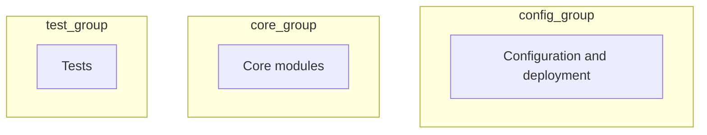

# Architecture report: senchalabs/connect

> Automated static analysis. **Observed** = directly seen in files/imports/AST; **Inferred** = interpretation from that evidence. Repository code was not executed.

## 1. Repository at a glance

| Item | Value |
| --- | --- |
| Repository | senchalabs/connect |
| Description | Connect is an extensible HTTP server framework for node using "plugins" known as middleware. |
| Language | JavaScript |
| Stars | 9866 |
| Licence | MIT |
| Analysed commit / branch | 98ab0c435852b311ed57fe48a1846c2dae84e266 / master |
| Framework(s) | None detected |
| Files analysed | 17 |
| Components | 3 |

## 2. Architecture in one minute

senchalabs/connect - Connect is an extensible HTTP server framework for node using "plugins" known as middleware.. This repository was analysed statically from 17 file(s) (0 Python). Detected technologies (observed from imports/manifests): GitHub Actions. Files are grouped into 3 component(s): Configuration and deployment, Core modules, Tests. Findings below distinguish observed facts from inferred interpretation.

## 3. High-level block diagram

## 4. Main components

### Configuration and deployment (`config`)

- **Kind:** config
- **Status:** Observed
- **Confidence:** 0.85
- **Responsibility:** Groups 1 file(s) under configuration and deployment (observed from repository paths and static analysis).
- **Paths:** `package.json`
- **Evidence:** [package.json](https://github.com/senchalabs/connect/blob/98ab0c435852b311ed57fe48a1846c2dae84e266/package.json)

### Core modules (`core`)

- **Kind:** core
- **Status:** Observed
- **Confidence:** 0.85
- **Responsibility:** Groups 1 file(s) under core modules (observed from repository paths and static analysis).
- **Paths:** `index.js`
- **Evidence:** [index.js](https://github.com/senchalabs/connect/blob/98ab0c435852b311ed57fe48a1846c2dae84e266/index.js)

### Tests (`tests`)

- **Kind:** test
- **Status:** Observed
- **Confidence:** 0.85
- **Responsibility:** Groups 6 file(s) under tests (observed from repository paths and static analysis).
- **Paths:** `test/app.listen.js`, `test/fqdn.js`, `test/mounting.js`, `test/server.js`, `test/support/env.js`, `test/support/rawagent.js`
- **Evidence:** [test/app.listen.js](https://github.com/senchalabs/connect/blob/98ab0c435852b311ed57fe48a1846c2dae84e266/test/app.listen.js); [test/fqdn.js](https://github.com/senchalabs/connect/blob/98ab0c435852b311ed57fe48a1846c2dae84e266/test/fqdn.js); [test/mounting.js](https://github.com/senchalabs/connect/blob/98ab0c435852b311ed57fe48a1846c2dae84e266/test/mounting.js); [test/server.js](https://github.com/senchalabs/connect/blob/98ab0c435852b311ed57fe48a1846c2dae84e266/test/server.js); [test/support/env.js](https://github.com/senchalabs/connect/blob/98ab0c435852b311ed57fe48a1846c2dae84e266/test/support/env.js); [test/support/rawagent.js](https://github.com/senchalabs/connect/blob/98ab0c435852b311ed57fe48a1846c2dae84e266/test/support/rawagent.js)

## 5. Execution flow

**Observed** entry point(s):

- [index.js](https://github.com/senchalabs/connect/blob/98ab0c435852b311ed57fe48a1846c2dae84e266/index.js)

Representative flow (derived from observed entry points and the import graph; steps beyond the entry point are **Inferred**):

1. Execution starts at an observed entry point listed above, if present.
2. No internal import relationships between components were observed.

## 6. Project structure

### `(root)`

- `.editorconfig` - config (179 bytes)
- `.eslintignore` - other (34 bytes)
- `.eslintrc.yml` - config (156 bytes)
- `.gitignore` - other (69 bytes)
- `HISTORY.md` - docs (74939 bytes)
- `LICENSE` - docs (1189 bytes)
- `README.md` - docs (9933 bytes)
- `SECURITY.md` - docs (1738 bytes)
- `index.js` - source, JavaScript (6071 bytes)
- `package.json` - manifest (1154 bytes)

### `.github`

- `.github/workflows/ci.yml` - ci, YAML (5129 bytes)

### `test`

- `test/app.listen.js` - test, JavaScript (521 bytes)
- `test/fqdn.js` - test, JavaScript (2037 bytes)
- `test/mounting.js` - test, JavaScript (6993 bytes)
- `test/server.js` - test, JavaScript (5178 bytes)
- `test/support/env.js` - test, JavaScript (32 bytes)
- `test/support/rawagent.js` - test, JavaScript (1985 bytes)

## 7. Key dependencies and integrations

| Name | Category | Status | Confidence | Evidence |
| --- | --- | --- | --- | --- |
| GitHub Actions | ci | Observed | 0.85 | [.github/workflows/ci.yml](https://github.com/senchalabs/connect/blob/98ab0c435852b311ed57fe48a1846c2dae84e266/.github/workflows/ci.yml) |

## 8. Data and state

No database, cache, queue, or persistent-state usage was observed in the analysed files. State handling, if any, may be in-memory or in files that were not analysed.

## 9. Configuration and deployment clues

- `.editorconfig` (config)
- `.eslintrc.yml` (config)
- `.github/workflows/ci.yml` (ci)
- `package.json` (manifest)

## 10. Design observations

- Tests are present alongside source code (Observed from test file paths).

These observations are interpretations (**Inferred**) of the observed structure, not guarantees about runtime design.

## 11. Limitations and unknowns

- Static analysis only: repository code was not executed, installed, or imported at runtime.
- Components and relationships are inferred from file paths, imports, and AST structure; runtime behaviour, dynamic imports, and reflection may not be visible.
- No clear application entry point was observed in the analysed files.
- Repository text was treated as untrusted data; no instructions found in repository files were followed, and likely secret values were redacted/excluded.
- JavaScript and TypeScript files were inventoried from paths and package manifests. They were not parsed with a full language AST, and repository code was not executed.

## 12. Source references

- [.github/workflows/ci.yml](https://github.com/senchalabs/connect/blob/98ab0c435852b311ed57fe48a1846c2dae84e266/.github/workflows/ci.yml)
- [index.js](https://github.com/senchalabs/connect/blob/98ab0c435852b311ed57fe48a1846c2dae84e266/index.js)
- [package.json](https://github.com/senchalabs/connect/blob/98ab0c435852b311ed57fe48a1846c2dae84e266/package.json)
- [test/app.listen.js](https://github.com/senchalabs/connect/blob/98ab0c435852b311ed57fe48a1846c2dae84e266/test/app.listen.js)
- [test/fqdn.js](https://github.com/senchalabs/connect/blob/98ab0c435852b311ed57fe48a1846c2dae84e266/test/fqdn.js)
- [test/mounting.js](https://github.com/senchalabs/connect/blob/98ab0c435852b311ed57fe48a1846c2dae84e266/test/mounting.js)
- [test/server.js](https://github.com/senchalabs/connect/blob/98ab0c435852b311ed57fe48a1846c2dae84e266/test/server.js)
- [test/support/env.js](https://github.com/senchalabs/connect/blob/98ab0c435852b311ed57fe48a1846c2dae84e266/test/support/env.js)
- [test/support/rawagent.js](https://github.com/senchalabs/connect/blob/98ab0c435852b311ed57fe48a1846c2dae84e266/test/support/rawagent.js)
