# Architecture report: serverless/examples

> Automated static analysis. **Observed** = directly seen in files/imports/AST; **Inferred** = interpretation from that evidence. Repository code was not executed.

## 1. Repository at a glance

| Item | Value |
| --- | --- |
| Repository | serverless/examples |
| Description | Serverless Examples – A collection of boilerplates and examples of serverless architectures built with the Serverless Framework on AWS Lambda, Microsoft Azure, Google Cloud Functions, and more. |
| Language | JavaScript |
| Stars | 11517 |
| Licence | Other |
| Analysed commit / branch | 424fe6f7737bd45aeea4e5b40d7beda3422ffa54 / v4 |
| Framework(s) | Express, Flask, NestJS, Next.js, React |
| Files analysed | 760 |
| Components | 83 |

## 2. Architecture in one minute

serverless/examples - Serverless Examples – A collection of boilerplates and examples of serverless architectures built with the Serverless Framework on AWS Lambda, Microsoft Azure, Google Cloud Functions, and more.. This repository was analysed statically from 760 file(s) (37 Python). Detected technologies (observed from imports/manifests): MongoDB, Express, Flask, NestJS, Next.js, React. Files are grouped into 83 component(s): API layer, aws-bedrock-agentcore package, aws-dev-mode package, aws-dotnet-rest-api-with-dynamodb package, aws-ffmpeg-layer package, aws-golang-auth-examples package, aws-golang-googlemap package, aws-golang-http-get-post package. Observed entry point(s): aws-bedrock-agentcore/python/langgraph-basic-code/agent.py, aws-bedrock-agentcore/python/langgraph-basic-code/test-invoke.py, aws-bedrock-agentcore/python/langgraph-basic-docker/agent.py. Findings below disting…

## 3. High-level block diagram

```mermaid
flowchart TD
    subgraph api_group
        api_layer["API layer"]
    end
    subgraph config_group
        config["Configuration and deployment"]
    end
    subgraph entrypoint_group
        entrypoint["Application entry point"]
    end
    subgraph library_group
        aws_bedrock_agentcore["aws-bedrock-agentcore package"]
        aws_dotnet_rest_api_with_dynamodb["aws-dotnet-rest-api-with-dynamodb package"]
        aws_golang_auth_examples["aws-golang-auth-examples package"]
        aws_golang_googlemap["aws-golang-googlemap package"]
        aws_golang_http_get_post["aws-golang-http-get-post package"]
        aws_golang_rest_api_with_dynamodb["aws-golang-rest-api-with-dynamodb package"]
        aws_java_simple_http_endpoint["aws-java-simple-http-endpoint package"]
        aws_node_env_variables_encrypted_in_a_file["aws-node-env-variables-encrypted-in-a-f… package"]
        aws_node_http_api_dynamodb["aws-node-http-api-dynamodb package"]
        aws_node_http_api_dynamodb_local["aws-node-http-api-dynamodb-local package"]
        aws_node_http_api_typescript_dynamodb["aws-node-http-api-typescript-dynamodb package"]
        aws_node_rest_api_typescript["aws-node-rest-api-typescript package"]
        aws_node_rest_api_with_dynamodb["aws-node-rest-api-with-dynamodb package"]
        aws_node_rest_api_with_dynamodb_and_offline["aws-node-rest-api-with-dynamodb-and-off… package"]
        aws_node_shared_gateway["aws-node-shared-gateway package"]
        aws_node_typescript_apollo_lambda["aws-node-typescript-apollo-lambda package"]
        aws_node_typescript_nest["aws-node-typescript-nest package"]
        aws_node_typescript_rest_api_with_dynamodb["aws-node-typescript-rest-api-with-dynam… package"]
        aws_node_web_app_custom_domain["aws-node-web-app-custom-domain package"]
        aws_python_http_api_with_dynamodb["aws-python-http-api-with-dynamodb package"]
    end
    subgraph test_group
        tests["Tests"]
    end
    other["Other components (59 merged)"]
    %% Note: 59 smaller component(s) merged into 'other' to keep the diagram readable.
    aws_python_http_api_with_dynamodb -->|imports| other
    entrypoint -->|imports| other
```

## 4. Main components

### API layer (`api_layer`)

- **Kind:** api
- **Status:** Observed
- **Confidence:** 0.85
- **Responsibility:** Groups 17 file(s) under api layer (observed from repository paths and static analysis). Observed top-level functions: _evaluate_node, handler, safe_calculate.
- **Paths:** `aws-bedrock-agentcore/javascript/langgraph-comprehensive/handlers/calculator.js`, `aws-bedrock-agentcore/javascript/langgraph-gateway/handlers/calculator.js`, `aws-bedrock-agentcore/javascript/langgraph-multi-gateway/handlers/calculator.js`, `aws-bedrock-agentcore/javascript/langgraph-multi-gateway/handlers/internal-lookup.js`, `aws-bedrock-agentcore/javascript/mcp-server-lambda-tools/handlers/calculator.mjs`, `aws-bedrock-agentcore/python/langgraph-gateway/handlers/calculator.py`, `aws-bedrock-agentcore/python/langgraph-multi-gateway/handlers/calculator.py`, `aws-bedrock-agentcore/python/langgraph-multi-gateway/handlers/internal_lookup.py`, `aws-dotnet-rest-api-with-dynamodb/src/DotNetServerless.Application/Handlers/CreateItemHandler.cs`, `aws-dotnet-rest-api-with-dynamodb/src/DotNetServerless.Application/Handlers/GetItemHandler.cs`, `aws-dotnet-rest-api-with-dynamodb/src/DotNetServerless.Application/Handlers/UpdateItemHandler.cs`, `aws-multiple-runtime/api/handler.js`, `aws-node-dynamic-image-resizer/src/handlers/resizer/index.js`, `aws-node-dynamic-image-resizer/src/handlers/resizer/resizeHandler.js`, `aws-node-dynamic-image-resizer/src/handlers/resizer/s3Handler.js`, `aws-node-nextjs-web-app/app/api/hello/route.js`, `aws-node-web-app-custom-domain/api/server.js`
- **Evidence:** [aws-bedrock-agentcore/javascript/langgraph-comprehensive/handlers/calculator.js](https://github.com/serverless/examples/blob/424fe6f7737bd45aeea4e5b40d7beda3422ffa54/aws-bedrock-agentcore/javascript/langgraph-comprehensive/handlers/calculator.js); [aws-bedrock-agentcore/javascript/langgraph-gateway/handlers/calculator.js](https://github.com/serverless/examples/blob/424fe6f7737bd45aeea4e5b40d7beda3422ffa54/aws-bedrock-agentcore/javascript/langgraph-gateway/handlers/calculator.js); [aws-bedrock-agentcore/javascript/langgraph-multi-gateway/handlers/calculator.js](https://github.com/serverless/examples/blob/424fe6f7737bd45aeea4e5b40d7beda3422ffa54/aws-bedrock-agentcore/javascript/langgraph-multi-gateway/handlers/calculator.js); [aws-bedrock-agentcore/javascript/langgraph-multi-gateway/handlers/internal-lookup.js](https://github.com/serverless/examples/blob/424fe6f7737bd45aeea4e5b40d7beda3422ffa54/aws-bedrock-agentcore/javascript/langgraph-multi-gateway/handlers/internal-lookup.js); [aws-bedrock-agentcore/javascript/mcp-server-lambda-tools/handlers/calculator.mjs](https://github.com/serverless/examples/blob/424fe6f7737bd45aeea4e5b40d7beda3422ffa54/aws-bedrock-agentcore/javascript/mcp-server-lambda-tools/handlers/calculator.mjs); [aws-bedrock-agentcore/python/langgraph-gateway/handlers/calculator.py:47](https://github.com/serverless/examples/blob/424fe6f7737bd45aeea4e5b40d7beda3422ffa54/aws-bedrock-agentcore/python/langgraph-gateway/handlers/calculator.py#L47); [aws-bedrock-agentcore/python/langgraph-multi-gateway/handlers/calculator.py:44](https://github.com/serverless/examples/blob/424fe6f7737bd45aeea4e5b40d7beda3422ffa54/aws-bedrock-agentcore/python/langgraph-multi-gateway/handlers/calculator.py#L44); [aws-bedrock-agentcore/python/langgraph-multi-gateway/handlers/internal_lookup.py:49](https://github.com/serverless/examples/blob/424fe6f7737bd45aeea4e5b40d7beda3422ffa54/aws-bedrock-agentcore/python/langgraph-multi-gateway/handlers/internal_lookup.py#L49)

### aws-bedrock-agentcore package (`aws_bedrock_agentcore`)

- **Kind:** library
- **Status:** Observed
- **Confidence:** 0.85
- **Responsibility:** Groups 29 file(s) under aws-bedrock-agentcore package (observed from repository paths and static analysis).
- **Paths:** `aws-bedrock-agentcore/javascript/langgraph-basic-dockerfile/agent.js`, `aws-bedrock-agentcore/javascript/langgraph-basic-dockerfile/test-invoke.js`, `aws-bedrock-agentcore/javascript/langgraph-basic/index.js`, `aws-bedrock-agentcore/javascript/langgraph-basic/test-invoke.js`, `aws-bedrock-agentcore/javascript/langgraph-browser-custom/index.js`, `aws-bedrock-agentcore/javascript/langgraph-browser-custom/test-invoke.js`, `aws-bedrock-agentcore/javascript/langgraph-browser/index.js`, `aws-bedrock-agentcore/javascript/langgraph-browser/test-invoke.js`, `aws-bedrock-agentcore/javascript/langgraph-code-interpreter-custom/index.js`, `aws-bedrock-agentcore/javascript/langgraph-code-interpreter-custom/test-invoke.js`, `aws-bedrock-agentcore/javascript/langgraph-code-interpreter/index.js`, `aws-bedrock-agentcore/javascript/langgraph-code-interpreter/test-invoke.js`, `aws-bedrock-agentcore/javascript/langgraph-comprehensive/agents/index.js`, `aws-bedrock-agentcore/javascript/langgraph-comprehensive/test-invoke.js`, `aws-bedrock-agentcore/javascript/langgraph-gateway/index.js`, `aws-bedrock-agentcore/javascript/langgraph-gateway/test-invoke.js`, `aws-bedrock-agentcore/javascript/langgraph-memory/index.js`, `aws-bedrock-agentcore/javascript/langgraph-memory/test-invoke.js`, `aws-bedrock-agentcore/javascript/langgraph-multi-gateway/private-agent.js`, `aws-bedrock-agentcore/javascript/langgraph-multi-gateway/public-agent.js`, `aws-bedrock-agentcore/javascript/langgraph-multi-gateway/test-invoke.js`, `aws-bedrock-agentcore/javascript/langgraph-streaming/index.js`, `aws-bedrock-agentcore/javascript/langgraph-streaming/test-invoke.js`, `aws-bedrock-agentcore/javascript/mcp-server-lambda-tools/test-client.mjs`, `aws-bedrock-agentcore/javascript/mcp-server/client.mjs`, `aws-bedrock-agentcore/javascript/mcp-server/index.js`, `aws-bedrock-agentcore/javascript/mcp-server/src/server.mjs`, `aws-bedrock-agentcore/javascript/strands-browser/index.js`, `aws-bedrock-agentcore/javascript/strands-browser/test-invoke.js`
- **Evidence:** [aws-bedrock-agentcore/javascript/langgraph-basic-dockerfile/agent.js](https://github.com/serverless/examples/blob/424fe6f7737bd45aeea4e5b40d7beda3422ffa54/aws-bedrock-agentcore/javascript/langgraph-basic-dockerfile/agent.js); [aws-bedrock-agentcore/javascript/langgraph-basic-dockerfile/test-invoke.js](https://github.com/serverless/examples/blob/424fe6f7737bd45aeea4e5b40d7beda3422ffa54/aws-bedrock-agentcore/javascript/langgraph-basic-dockerfile/test-invoke.js); [aws-bedrock-agentcore/javascript/langgraph-basic/index.js](https://github.com/serverless/examples/blob/424fe6f7737bd45aeea4e5b40d7beda3422ffa54/aws-bedrock-agentcore/javascript/langgraph-basic/index.js); [aws-bedrock-agentcore/javascript/langgraph-basic/test-invoke.js](https://github.com/serverless/examples/blob/424fe6f7737bd45aeea4e5b40d7beda3422ffa54/aws-bedrock-agentcore/javascript/langgraph-basic/test-invoke.js); [aws-bedrock-agentcore/javascript/langgraph-browser-custom/index.js](https://github.com/serverless/examples/blob/424fe6f7737bd45aeea4e5b40d7beda3422ffa54/aws-bedrock-agentcore/javascript/langgraph-browser-custom/index.js); [aws-bedrock-agentcore/javascript/langgraph-browser-custom/test-invoke.js](https://github.com/serverless/examples/blob/424fe6f7737bd45aeea4e5b40d7beda3422ffa54/aws-bedrock-agentcore/javascript/langgraph-browser-custom/test-invoke.js); [aws-bedrock-agentcore/javascript/langgraph-browser/index.js](https://github.com/serverless/examples/blob/424fe6f7737bd45aeea4e5b40d7beda3422ffa54/aws-bedrock-agentcore/javascript/langgraph-browser/index.js); [aws-bedrock-agentcore/javascript/langgraph-browser/test-invoke.js](https://github.com/serverless/examples/blob/424fe6f7737bd45aeea4e5b40d7beda3422ffa54/aws-bedrock-agentcore/javascript/langgraph-browser/test-invoke.js)

### aws-dev-mode package (`aws_dev_mode`)

- **Kind:** library
- **Status:** Observed
- **Confidence:** 0.85
- **Responsibility:** Groups 2 file(s) under aws-dev-mode package (observed from repository paths and static analysis). Observed top-level functions: process.
- **Paths:** `aws-dev-mode/src/api.ts`, `aws-dev-mode/worker/handler.py`
- **Evidence:** [aws-dev-mode/src/api.ts](https://github.com/serverless/examples/blob/424fe6f7737bd45aeea4e5b40d7beda3422ffa54/aws-dev-mode/src/api.ts); [aws-dev-mode/worker/handler.py:5](https://github.com/serverless/examples/blob/424fe6f7737bd45aeea4e5b40d7beda3422ffa54/aws-dev-mode/worker/handler.py#L5)

### aws-dotnet-rest-api-with-dynamodb package (`aws_dotnet_rest_api_with_dynamodb`)

- **Kind:** library
- **Status:** Observed
- **Confidence:** 0.85
- **Responsibility:** Groups 12 file(s) under aws-dotnet-rest-api-with-dynamodb package (observed from repository paths and static analysis).
- **Paths:** `aws-dotnet-rest-api-with-dynamodb/src/DotNetServerless.Application/Entities/Item.cs`, `aws-dotnet-rest-api-with-dynamodb/src/DotNetServerless.Application/Infrastructure/AWSClientFactory.cs`, `aws-dotnet-rest-api-with-dynamodb/src/DotNetServerless.Application/Requests/CreateItemRequest.cs`, `aws-dotnet-rest-api-with-dynamodb/src/DotNetServerless.Application/Requests/GetItemRequest.cs`, `aws-dotnet-rest-api-with-dynamodb/src/DotNetServerless.Application/Requests/UpdateItemRequest.cs`, `aws-dotnet-rest-api-with-dynamodb/src/DotNetServerless.Application/Responses/ItemResponse.cs`, `aws-dotnet-rest-api-with-dynamodb/src/DotNetServerless.Lambda/Extensions/ServicesExtensions.cs`, `aws-dotnet-rest-api-with-dynamodb/src/DotNetServerless.Lambda/Functions/CreateItemFunction.cs`, `aws-dotnet-rest-api-with-dynamodb/src/DotNetServerless.Lambda/Functions/GetItemFunction.cs`, `aws-dotnet-rest-api-with-dynamodb/src/DotNetServerless.Lambda/Functions/UpdateItemFunction.cs`, `aws-dotnet-rest-api-with-dynamodb/src/DotNetServerless.Lambda/Program.cs`, `aws-dotnet-rest-api-with-dynamodb/src/DotNetServerless.Lambda/Startup.cs`
- **Evidence:** [aws-dotnet-rest-api-with-dynamodb/src/DotNetServerless.Application/Entities/Item.cs](https://github.com/serverless/examples/blob/424fe6f7737bd45aeea4e5b40d7beda3422ffa54/aws-dotnet-rest-api-with-dynamodb/src/DotNetServerless.Application/Entities/Item.cs); [aws-dotnet-rest-api-with-dynamodb/src/DotNetServerless.Application/Infrastructure/AWSClientFactory.cs](https://github.com/serverless/examples/blob/424fe6f7737bd45aeea4e5b40d7beda3422ffa54/aws-dotnet-rest-api-with-dynamodb/src/DotNetServerless.Application/Infrastructure/AWSClientFactory.cs); [aws-dotnet-rest-api-with-dynamodb/src/DotNetServerless.Application/Requests/CreateItemRequest.cs](https://github.com/serverless/examples/blob/424fe6f7737bd45aeea4e5b40d7beda3422ffa54/aws-dotnet-rest-api-with-dynamodb/src/DotNetServerless.Application/Requests/CreateItemRequest.cs); [aws-dotnet-rest-api-with-dynamodb/src/DotNetServerless.Application/Requests/GetItemRequest.cs](https://github.com/serverless/examples/blob/424fe6f7737bd45aeea4e5b40d7beda3422ffa54/aws-dotnet-rest-api-with-dynamodb/src/DotNetServerless.Application/Requests/GetItemRequest.cs); [aws-dotnet-rest-api-with-dynamodb/src/DotNetServerless.Application/Requests/UpdateItemRequest.cs](https://github.com/serverless/examples/blob/424fe6f7737bd45aeea4e5b40d7beda3422ffa54/aws-dotnet-rest-api-with-dynamodb/src/DotNetServerless.Application/Requests/UpdateItemRequest.cs); [aws-dotnet-rest-api-with-dynamodb/src/DotNetServerless.Application/Responses/ItemResponse.cs](https://github.com/serverless/examples/blob/424fe6f7737bd45aeea4e5b40d7beda3422ffa54/aws-dotnet-rest-api-with-dynamodb/src/DotNetServerless.Application/Responses/ItemResponse.cs); [aws-dotnet-rest-api-with-dynamodb/src/DotNetServerless.Lambda/Extensions/ServicesExtensions.cs](https://github.com/serverless/examples/blob/424fe6f7737bd45aeea4e5b40d7beda3422ffa54/aws-dotnet-rest-api-with-dynamodb/src/DotNetServerless.Lambda/Extensions/ServicesExtensions.cs); [aws-dotnet-rest-api-with-dynamodb/src/DotNetServerless.Lambda/Functions/CreateItemFunction.cs](https://github.com/serverless/examples/blob/424fe6f7737bd45aeea4e5b40d7beda3422ffa54/aws-dotnet-rest-api-with-dynamodb/src/DotNetServerless.Lambda/Functions/CreateItemFunction.cs)

### aws-ffmpeg-layer package (`aws_ffmpeg_layer`)

- **Kind:** library
- **Status:** Observed
- **Confidence:** 0.85
- **Responsibility:** Groups 2 file(s) under aws-ffmpeg-layer package (observed from repository paths and static analysis).
- **Paths:** `aws-ffmpeg-layer/build.sh`, `aws-ffmpeg-layer/handler.js`
- **Evidence:** [aws-ffmpeg-layer/build.sh](https://github.com/serverless/examples/blob/424fe6f7737bd45aeea4e5b40d7beda3422ffa54/aws-ffmpeg-layer/build.sh); [aws-ffmpeg-layer/handler.js](https://github.com/serverless/examples/blob/424fe6f7737bd45aeea4e5b40d7beda3422ffa54/aws-ffmpeg-layer/handler.js)

### aws-golang-auth-examples package (`aws_golang_auth_examples`)

- **Kind:** library
- **Status:** Observed
- **Confidence:** 0.85
- **Responsibility:** Groups 12 file(s) under aws-golang-auth-examples package (observed from repository paths and static analysis).
- **Paths:** `aws-golang-auth-examples/functions/auth/auth_suite_test.go`, `aws-golang-auth-examples/functions/auth/main.go`, `aws-golang-auth-examples/functions/auth/main_test.go`, `aws-golang-auth-examples/functions/auth2/auth_suite_test.go`, `aws-golang-auth-examples/functions/auth2/main.go`, `aws-golang-auth-examples/functions/auth2/main_test.go`, `aws-golang-auth-examples/functions/hello-world/hello_world_suite_test.go`, `aws-golang-auth-examples/functions/hello-world/main.go`, `aws-golang-auth-examples/functions/hello-world/main_test.go`, `aws-golang-auth-examples/functions/hello-world2/hello_world_suite_test.go`, `aws-golang-auth-examples/functions/hello-world2/main.go`, `aws-golang-auth-examples/functions/hello-world2/main_test.go`
- **Evidence:** [aws-golang-auth-examples/functions/auth/auth_suite_test.go](https://github.com/serverless/examples/blob/424fe6f7737bd45aeea4e5b40d7beda3422ffa54/aws-golang-auth-examples/functions/auth/auth_suite_test.go); [aws-golang-auth-examples/functions/auth/main.go](https://github.com/serverless/examples/blob/424fe6f7737bd45aeea4e5b40d7beda3422ffa54/aws-golang-auth-examples/functions/auth/main.go); [aws-golang-auth-examples/functions/auth/main_test.go](https://github.com/serverless/examples/blob/424fe6f7737bd45aeea4e5b40d7beda3422ffa54/aws-golang-auth-examples/functions/auth/main_test.go); [aws-golang-auth-examples/functions/auth2/auth_suite_test.go](https://github.com/serverless/examples/blob/424fe6f7737bd45aeea4e5b40d7beda3422ffa54/aws-golang-auth-examples/functions/auth2/auth_suite_test.go); [aws-golang-auth-examples/functions/auth2/main.go](https://github.com/serverless/examples/blob/424fe6f7737bd45aeea4e5b40d7beda3422ffa54/aws-golang-auth-examples/functions/auth2/main.go); [aws-golang-auth-examples/functions/auth2/main_test.go](https://github.com/serverless/examples/blob/424fe6f7737bd45aeea4e5b40d7beda3422ffa54/aws-golang-auth-examples/functions/auth2/main_test.go); [aws-golang-auth-examples/functions/hello-world/hello_world_suite_test.go](https://github.com/serverless/examples/blob/424fe6f7737bd45aeea4e5b40d7beda3422ffa54/aws-golang-auth-examples/functions/hello-world/hello_world_suite_test.go); [aws-golang-auth-examples/functions/hello-world/main.go](https://github.com/serverless/examples/blob/424fe6f7737bd45aeea4e5b40d7beda3422ffa54/aws-golang-auth-examples/functions/hello-world/main.go)

### aws-golang-googlemap package (`aws_golang_googlemap`)

- **Kind:** library
- **Status:** Observed
- **Confidence:** 0.85
- **Responsibility:** Groups 5 file(s) under aws-golang-googlemap package (observed from repository paths and static analysis).
- **Paths:** `aws-golang-googlemap/geomap/geomap.go`, `aws-golang-googlemap/getgeodetail/main.go`, `aws-golang-googlemap/getgeolocation/main.go`, `aws-golang-googlemap/getnearbylocation/main.go`, `aws-golang-googlemap/getsearchlocation/main.go`
- **Evidence:** [aws-golang-googlemap/geomap/geomap.go](https://github.com/serverless/examples/blob/424fe6f7737bd45aeea4e5b40d7beda3422ffa54/aws-golang-googlemap/geomap/geomap.go); [aws-golang-googlemap/getgeodetail/main.go](https://github.com/serverless/examples/blob/424fe6f7737bd45aeea4e5b40d7beda3422ffa54/aws-golang-googlemap/getgeodetail/main.go); [aws-golang-googlemap/getgeolocation/main.go](https://github.com/serverless/examples/blob/424fe6f7737bd45aeea4e5b40d7beda3422ffa54/aws-golang-googlemap/getgeolocation/main.go); [aws-golang-googlemap/getnearbylocation/main.go](https://github.com/serverless/examples/blob/424fe6f7737bd45aeea4e5b40d7beda3422ffa54/aws-golang-googlemap/getnearbylocation/main.go); [aws-golang-googlemap/getsearchlocation/main.go](https://github.com/serverless/examples/blob/424fe6f7737bd45aeea4e5b40d7beda3422ffa54/aws-golang-googlemap/getsearchlocation/main.go)

### aws-golang-http-get-post package (`aws_golang_http_get_post`)

- **Kind:** library
- **Status:** Observed
- **Confidence:** 0.85
- **Responsibility:** Groups 3 file(s) under aws-golang-http-get-post package (observed from repository paths and static analysis).
- **Paths:** `aws-golang-http-get-post/get/main.go`, `aws-golang-http-get-post/getquery/main.go`, `aws-golang-http-get-post/post/main.go`
- **Evidence:** [aws-golang-http-get-post/get/main.go](https://github.com/serverless/examples/blob/424fe6f7737bd45aeea4e5b40d7beda3422ffa54/aws-golang-http-get-post/get/main.go); [aws-golang-http-get-post/getquery/main.go](https://github.com/serverless/examples/blob/424fe6f7737bd45aeea4e5b40d7beda3422ffa54/aws-golang-http-get-post/getquery/main.go); [aws-golang-http-get-post/post/main.go](https://github.com/serverless/examples/blob/424fe6f7737bd45aeea4e5b40d7beda3422ffa54/aws-golang-http-get-post/post/main.go)

### aws-golang-rest-api-with-dynamodb package (`aws_golang_rest_api_with_dynamodb`)

- **Kind:** library
- **Status:** Observed
- **Confidence:** 0.85
- **Responsibility:** Groups 5 file(s) under aws-golang-rest-api-with-dynamodb package (observed from repository paths and static analysis).
- **Paths:** `aws-golang-rest-api-with-dynamodb/todos/create/main.go`, `aws-golang-rest-api-with-dynamodb/todos/delete/main.go`, `aws-golang-rest-api-with-dynamodb/todos/get/main.go`, `aws-golang-rest-api-with-dynamodb/todos/list/main.go`, `aws-golang-rest-api-with-dynamodb/todos/update/main.go`
- **Evidence:** [aws-golang-rest-api-with-dynamodb/todos/create/main.go](https://github.com/serverless/examples/blob/424fe6f7737bd45aeea4e5b40d7beda3422ffa54/aws-golang-rest-api-with-dynamodb/todos/create/main.go); [aws-golang-rest-api-with-dynamodb/todos/delete/main.go](https://github.com/serverless/examples/blob/424fe6f7737bd45aeea4e5b40d7beda3422ffa54/aws-golang-rest-api-with-dynamodb/todos/delete/main.go); [aws-golang-rest-api-with-dynamodb/todos/get/main.go](https://github.com/serverless/examples/blob/424fe6f7737bd45aeea4e5b40d7beda3422ffa54/aws-golang-rest-api-with-dynamodb/todos/get/main.go); [aws-golang-rest-api-with-dynamodb/todos/list/main.go](https://github.com/serverless/examples/blob/424fe6f7737bd45aeea4e5b40d7beda3422ffa54/aws-golang-rest-api-with-dynamodb/todos/list/main.go); [aws-golang-rest-api-with-dynamodb/todos/update/main.go](https://github.com/serverless/examples/blob/424fe6f7737bd45aeea4e5b40d7beda3422ffa54/aws-golang-rest-api-with-dynamodb/todos/update/main.go)

### aws-golang-s3-file-replicator package (`aws_golang_s3_file_replicator`)

- **Kind:** library
- **Status:** Observed
- **Confidence:** 0.85
- **Responsibility:** Groups 1 file(s) under aws-golang-s3-file-replicator package (observed from repository paths and static analysis).
- **Paths:** `aws-golang-s3-file-replicator/src/main.go`
- **Evidence:** [aws-golang-s3-file-replicator/src/main.go](https://github.com/serverless/examples/blob/424fe6f7737bd45aeea4e5b40d7beda3422ffa54/aws-golang-s3-file-replicator/src/main.go)

### aws-golang-simple-http-endpoint package (`aws_golang_simple_http_endpoint`)

- **Kind:** library
- **Status:** Observed
- **Confidence:** 0.85
- **Responsibility:** Groups 2 file(s) under aws-golang-simple-http-endpoint package (observed from repository paths and static analysis).
- **Paths:** `aws-golang-simple-http-endpoint/hello/main.go`, `aws-golang-simple-http-endpoint/world/main.go`
- **Evidence:** [aws-golang-simple-http-endpoint/hello/main.go](https://github.com/serverless/examples/blob/424fe6f7737bd45aeea4e5b40d7beda3422ffa54/aws-golang-simple-http-endpoint/hello/main.go); [aws-golang-simple-http-endpoint/world/main.go](https://github.com/serverless/examples/blob/424fe6f7737bd45aeea4e5b40d7beda3422ffa54/aws-golang-simple-http-endpoint/world/main.go)

### aws-java-simple-http-endpoint package (`aws_java_simple_http_endpoint`)

- **Kind:** library
- **Status:** Observed
- **Confidence:** 0.85
- **Responsibility:** Groups 3 file(s) under aws-java-simple-http-endpoint package (observed from repository paths and static analysis).
- **Paths:** `aws-java-simple-http-endpoint/src/main/java/com/serverless/ApiGatewayResponse.java`, `aws-java-simple-http-endpoint/src/main/java/com/serverless/Handler.java`, `aws-java-simple-http-endpoint/src/main/java/com/serverless/Response.java`
- **Evidence:** [aws-java-simple-http-endpoint/src/main/java/com/serverless/ApiGatewayResponse.java](https://github.com/serverless/examples/blob/424fe6f7737bd45aeea4e5b40d7beda3422ffa54/aws-java-simple-http-endpoint/src/main/java/com/serverless/ApiGatewayResponse.java); [aws-java-simple-http-endpoint/src/main/java/com/serverless/Handler.java](https://github.com/serverless/examples/blob/424fe6f7737bd45aeea4e5b40d7beda3422ffa54/aws-java-simple-http-endpoint/src/main/java/com/serverless/Handler.java); [aws-java-simple-http-endpoint/src/main/java/com/serverless/Response.java](https://github.com/serverless/examples/blob/424fe6f7737bd45aeea4e5b40d7beda3422ffa54/aws-java-simple-http-endpoint/src/main/java/com/serverless/Response.java)

### aws-multiple-runtime package (`aws_multiple_runtime`)

- **Kind:** library
- **Status:** Observed
- **Confidence:** 0.85
- **Responsibility:** Groups 1 file(s) under aws-multiple-runtime package (observed from repository paths and static analysis). Observed top-level functions: hello.
- **Paths:** `aws-multiple-runtime/web/handler.py`
- **Evidence:** [aws-multiple-runtime/web/handler.py:5](https://github.com/serverless/examples/blob/424fe6f7737bd45aeea4e5b40d7beda3422ffa54/aws-multiple-runtime/web/handler.py#L5)

### aws-node package (`aws_node`)

- **Kind:** library
- **Status:** Observed
- **Confidence:** 0.85
- **Responsibility:** Groups 1 file(s) under aws-node package (observed from repository paths and static analysis).
- **Paths:** `aws-node/handler.js`
- **Evidence:** [aws-node/handler.js](https://github.com/serverless/examples/blob/424fe6f7737bd45aeea4e5b40d7beda3422ffa54/aws-node/handler.js)

### aws-node-alexa-skill package (`aws_node_alexa_skill`)

- **Kind:** library
- **Status:** Observed
- **Confidence:** 0.85
- **Responsibility:** Groups 1 file(s) under aws-node-alexa-skill package (observed from repository paths and static analysis).
- **Paths:** `aws-node-alexa-skill/handler.js`
- **Evidence:** [aws-node-alexa-skill/handler.js](https://github.com/serverless/examples/blob/424fe6f7737bd45aeea4e5b40d7beda3422ffa54/aws-node-alexa-skill/handler.js)

### aws-node-auth0-cognito-custom-authorize… package (`aws_node_auth0_cognito_custom_authorizers_api`)

- **Kind:** library
- **Status:** Observed
- **Confidence:** 0.85
- **Responsibility:** Groups 2 file(s) under aws-node-auth0-cognito-custom-authorize… package (observed from repository paths and static analysis).
- **Paths:** `aws-node-auth0-cognito-custom-authorizers-api/auth.js`, `aws-node-auth0-cognito-custom-authorizers-api/handler.js`
- **Evidence:** [aws-node-auth0-cognito-custom-authorizers-api/auth.js](https://github.com/serverless/examples/blob/424fe6f7737bd45aeea4e5b40d7beda3422ffa54/aws-node-auth0-cognito-custom-authorizers-api/auth.js); [aws-node-auth0-cognito-custom-authorizers-api/handler.js](https://github.com/serverless/examples/blob/424fe6f7737bd45aeea4e5b40d7beda3422ffa54/aws-node-auth0-cognito-custom-authorizers-api/handler.js)

### aws-node-auth0-custom-authorizers-api package (`aws_node_auth0_custom_authorizers_api`)

- **Kind:** library
- **Status:** Observed
- **Confidence:** 0.85
- **Responsibility:** Groups 2 file(s) under aws-node-auth0-custom-authorizers-api package (observed from repository paths and static analysis).
- **Paths:** `aws-node-auth0-custom-authorizers-api/frontend/app.js`, `aws-node-auth0-custom-authorizers-api/handler.js`
- **Evidence:** [aws-node-auth0-custom-authorizers-api/frontend/app.js](https://github.com/serverless/examples/blob/424fe6f7737bd45aeea4e5b40d7beda3422ffa54/aws-node-auth0-custom-authorizers-api/frontend/app.js); [aws-node-auth0-custom-authorizers-api/handler.js](https://github.com/serverless/examples/blob/424fe6f7737bd45aeea4e5b40d7beda3422ffa54/aws-node-auth0-custom-authorizers-api/handler.js)

### aws-node-container-snapstart package (`aws_node_container_snapstart`)

- **Kind:** library
- **Status:** Observed
- **Confidence:** 0.85
- **Responsibility:** Groups 1 file(s) under aws-node-container-snapstart package (observed from repository paths and static analysis).
- **Paths:** `aws-node-container-snapstart/handler.mjs`
- **Evidence:** [aws-node-container-snapstart/handler.mjs](https://github.com/serverless/examples/blob/424fe6f7737bd45aeea4e5b40d7beda3422ffa54/aws-node-container-snapstart/handler.mjs)

### aws-node-durable-function package (`aws_node_durable_function`)

- **Kind:** library
- **Status:** Observed
- **Confidence:** 0.85
- **Responsibility:** Groups 1 file(s) under aws-node-durable-function package (observed from repository paths and static analysis).
- **Paths:** `aws-node-durable-function/handler.mjs`
- **Evidence:** [aws-node-durable-function/handler.mjs](https://github.com/serverless/examples/blob/424fe6f7737bd45aeea4e5b40d7beda3422ffa54/aws-node-durable-function/handler.mjs)

### aws-node-dynamic-image-resizer package (`aws_node_dynamic_image_resizer`)

- **Kind:** library
- **Status:** Observed
- **Confidence:** 0.85
- **Responsibility:** Groups 1 file(s) under aws-node-dynamic-image-resizer package (observed from repository paths and static analysis).
- **Paths:** `aws-node-dynamic-image-resizer/src/lib/BaseHandler.js`
- **Evidence:** [aws-node-dynamic-image-resizer/src/lib/BaseHandler.js](https://github.com/serverless/examples/blob/424fe6f7737bd45aeea4e5b40d7beda3422ffa54/aws-node-dynamic-image-resizer/src/lib/BaseHandler.js)

### aws-node-dynamodb-stream-processing package (`aws_node_dynamodb_stream_processing`)

- **Kind:** library
- **Status:** Observed
- **Confidence:** 0.85
- **Responsibility:** Groups 1 file(s) under aws-node-dynamodb-stream-processing package (observed from repository paths and static analysis).
- **Paths:** `aws-node-dynamodb-stream-processing/handler.js`
- **Evidence:** [aws-node-dynamodb-stream-processing/handler.js](https://github.com/serverless/examples/blob/424fe6f7737bd45aeea4e5b40d7beda3422ffa54/aws-node-dynamodb-stream-processing/handler.js)

### aws-node-env-variables package (`aws_node_env_variables`)

- **Kind:** library
- **Status:** Observed
- **Confidence:** 0.85
- **Responsibility:** Groups 1 file(s) under aws-node-env-variables package (observed from repository paths and static analysis).
- **Paths:** `aws-node-env-variables/handler.js`
- **Evidence:** [aws-node-env-variables/handler.js](https://github.com/serverless/examples/blob/424fe6f7737bd45aeea4e5b40d7beda3422ffa54/aws-node-env-variables/handler.js)

### aws-node-env-variables-encrypted-in-a-f… package (`aws_node_env_variables_encrypted_in_a_file`)

- **Kind:** library
- **Status:** Observed
- **Confidence:** 0.85
- **Responsibility:** Groups 3 file(s) under aws-node-env-variables-encrypted-in-a-f… package (observed from repository paths and static analysis).
- **Paths:** `aws-node-env-variables-encrypted-in-a-file/handler.js`, `aws-node-env-variables-encrypted-in-a-file/scripts/decrypt.mjs`, `aws-node-env-variables-encrypted-in-a-file/scripts/encrypt.mjs`
- **Evidence:** [aws-node-env-variables-encrypted-in-a-file/handler.js](https://github.com/serverless/examples/blob/424fe6f7737bd45aeea4e5b40d7beda3422ffa54/aws-node-env-variables-encrypted-in-a-file/handler.js); [aws-node-env-variables-encrypted-in-a-file/scripts/decrypt.mjs](https://github.com/serverless/examples/blob/424fe6f7737bd45aeea4e5b40d7beda3422ffa54/aws-node-env-variables-encrypted-in-a-file/scripts/decrypt.mjs); [aws-node-env-variables-encrypted-in-a-file/scripts/encrypt.mjs](https://github.com/serverless/examples/blob/424fe6f7737bd45aeea4e5b40d7beda3422ffa54/aws-node-env-variables-encrypted-in-a-file/scripts/encrypt.mjs)

### aws-node-esm-esbuild package (`aws_node_esm_esbuild`)

- **Kind:** library
- **Status:** Observed
- **Confidence:** 0.85
- **Responsibility:** Groups 1 file(s) under aws-node-esm-esbuild package (observed from repository paths and static analysis).
- **Paths:** `aws-node-esm-esbuild/src/handler.ts`
- **Evidence:** [aws-node-esm-esbuild/src/handler.ts](https://github.com/serverless/examples/blob/424fe6f7737bd45aeea4e5b40d7beda3422ffa54/aws-node-esm-esbuild/src/handler.ts)

### aws-node-express-api package (`aws_node_express_api`)

- **Kind:** library
- **Status:** Observed
- **Confidence:** 0.85
- **Responsibility:** Groups 1 file(s) under aws-node-express-api package (observed from repository paths and static analysis).
- **Paths:** `aws-node-express-api/handler.js`
- **Evidence:** [aws-node-express-api/handler.js](https://github.com/serverless/examples/blob/424fe6f7737bd45aeea4e5b40d7beda3422ffa54/aws-node-express-api/handler.js)

### aws-node-express-dynamodb-api package (`aws_node_express_dynamodb_api`)

- **Kind:** library
- **Status:** Observed
- **Confidence:** 0.85
- **Responsibility:** Groups 1 file(s) under aws-node-express-dynamodb-api package (observed from repository paths and static analysis).
- **Paths:** `aws-node-express-dynamodb-api/handler.js`
- **Evidence:** [aws-node-express-dynamodb-api/handler.js](https://github.com/serverless/examples/blob/424fe6f7737bd45aeea4e5b40d7beda3422ffa54/aws-node-express-dynamodb-api/handler.js)

### aws-node-express-web-app package (`aws_node_express_web_app`)

- **Kind:** library
- **Status:** Observed
- **Confidence:** 0.85
- **Responsibility:** Groups 1 file(s) under aws-node-express-web-app package (observed from repository paths and static analysis).
- **Paths:** `aws-node-express-web-app/src/server.js`
- **Evidence:** [aws-node-express-web-app/src/server.js](https://github.com/serverless/examples/blob/424fe6f7737bd45aeea4e5b40d7beda3422ffa54/aws-node-express-web-app/src/server.js)

### aws-node-fetch-file-and-store-in-s3 package (`aws_node_fetch_file_and_store_in_s3`)

- **Kind:** library
- **Status:** Observed
- **Confidence:** 0.85
- **Responsibility:** Groups 1 file(s) under aws-node-fetch-file-and-store-in-s3 package (observed from repository paths and static analysis).
- **Paths:** `aws-node-fetch-file-and-store-in-s3/handler.js`
- **Evidence:** [aws-node-fetch-file-and-store-in-s3/handler.js](https://github.com/serverless/examples/blob/424fe6f7737bd45aeea4e5b40d7beda3422ffa54/aws-node-fetch-file-and-store-in-s3/handler.js)

### aws-node-github-check package (`aws_node_github_check`)

- **Kind:** library
- **Status:** Observed
- **Confidence:** 0.85
- **Responsibility:** Groups 3 file(s) under aws-node-github-check package (observed from repository paths and static analysis).
- **Paths:** `aws-node-github-check/handler.js`, `aws-node-github-check/libs/github-service.js`, `aws-node-github-check/libs/response-lib.js`
- **Evidence:** [aws-node-github-check/handler.js](https://github.com/serverless/examples/blob/424fe6f7737bd45aeea4e5b40d7beda3422ffa54/aws-node-github-check/handler.js); [aws-node-github-check/libs/github-service.js](https://github.com/serverless/examples/blob/424fe6f7737bd45aeea4e5b40d7beda3422ffa54/aws-node-github-check/libs/github-service.js); [aws-node-github-check/libs/response-lib.js](https://github.com/serverless/examples/blob/424fe6f7737bd45aeea4e5b40d7beda3422ffa54/aws-node-github-check/libs/response-lib.js)

### aws-node-github-webhook-listener package (`aws_node_github_webhook_listener`)

- **Kind:** library
- **Status:** Observed
- **Confidence:** 0.85
- **Responsibility:** Groups 1 file(s) under aws-node-github-webhook-listener package (observed from repository paths and static analysis).
- **Paths:** `aws-node-github-webhook-listener/handler.js`
- **Evidence:** [aws-node-github-webhook-listener/handler.js](https://github.com/serverless/examples/blob/424fe6f7737bd45aeea4e5b40d7beda3422ffa54/aws-node-github-webhook-listener/handler.js)

### aws-node-graphql-api-with-dynamodb package (`aws_node_graphql_api_with_dynamodb`)

- **Kind:** library
- **Status:** Observed
- **Confidence:** 0.85
- **Responsibility:** Groups 1 file(s) under aws-node-graphql-api-with-dynamodb package (observed from repository paths and static analysis).
- **Paths:** `aws-node-graphql-api-with-dynamodb/handler.js`
- **Evidence:** [aws-node-graphql-api-with-dynamodb/handler.js](https://github.com/serverless/examples/blob/424fe6f7737bd45aeea4e5b40d7beda3422ffa54/aws-node-graphql-api-with-dynamodb/handler.js)

### aws-node-http-api package (`aws_node_http_api`)

- **Kind:** library
- **Status:** Observed
- **Confidence:** 0.85
- **Responsibility:** Groups 1 file(s) under aws-node-http-api package (observed from repository paths and static analysis).
- **Paths:** `aws-node-http-api/handler.js`
- **Evidence:** [aws-node-http-api/handler.js](https://github.com/serverless/examples/blob/424fe6f7737bd45aeea4e5b40d7beda3422ffa54/aws-node-http-api/handler.js)

### aws-node-http-api-dynamodb package (`aws_node_http_api_dynamodb`)

- **Kind:** library
- **Status:** Observed
- **Confidence:** 0.85
- **Responsibility:** Groups 5 file(s) under aws-node-http-api-dynamodb package (observed from repository paths and static analysis).
- **Paths:** `aws-node-http-api-dynamodb/todos/create.js`, `aws-node-http-api-dynamodb/todos/delete.js`, `aws-node-http-api-dynamodb/todos/get.js`, `aws-node-http-api-dynamodb/todos/list.js`, `aws-node-http-api-dynamodb/todos/update.js`
- **Evidence:** [aws-node-http-api-dynamodb/todos/create.js](https://github.com/serverless/examples/blob/424fe6f7737bd45aeea4e5b40d7beda3422ffa54/aws-node-http-api-dynamodb/todos/create.js); [aws-node-http-api-dynamodb/todos/delete.js](https://github.com/serverless/examples/blob/424fe6f7737bd45aeea4e5b40d7beda3422ffa54/aws-node-http-api-dynamodb/todos/delete.js); [aws-node-http-api-dynamodb/todos/get.js](https://github.com/serverless/examples/blob/424fe6f7737bd45aeea4e5b40d7beda3422ffa54/aws-node-http-api-dynamodb/todos/get.js); [aws-node-http-api-dynamodb/todos/list.js](https://github.com/serverless/examples/blob/424fe6f7737bd45aeea4e5b40d7beda3422ffa54/aws-node-http-api-dynamodb/todos/list.js); [aws-node-http-api-dynamodb/todos/update.js](https://github.com/serverless/examples/blob/424fe6f7737bd45aeea4e5b40d7beda3422ffa54/aws-node-http-api-dynamodb/todos/update.js)

### aws-node-http-api-dynamodb-local package (`aws_node_http_api_dynamodb_local`)

- **Kind:** library
- **Status:** Observed
- **Confidence:** 0.85
- **Responsibility:** Groups 6 file(s) under aws-node-http-api-dynamodb-local package (observed from repository paths and static analysis).
- **Paths:** `aws-node-http-api-dynamodb-local/todos/create.js`, `aws-node-http-api-dynamodb-local/todos/delete.js`, `aws-node-http-api-dynamodb-local/todos/dynamodb.js`, `aws-node-http-api-dynamodb-local/todos/get.js`, `aws-node-http-api-dynamodb-local/todos/list.js`, `aws-node-http-api-dynamodb-local/todos/update.js`
- **Evidence:** [aws-node-http-api-dynamodb-local/todos/create.js](https://github.com/serverless/examples/blob/424fe6f7737bd45aeea4e5b40d7beda3422ffa54/aws-node-http-api-dynamodb-local/todos/create.js); [aws-node-http-api-dynamodb-local/todos/delete.js](https://github.com/serverless/examples/blob/424fe6f7737bd45aeea4e5b40d7beda3422ffa54/aws-node-http-api-dynamodb-local/todos/delete.js); [aws-node-http-api-dynamodb-local/todos/dynamodb.js](https://github.com/serverless/examples/blob/424fe6f7737bd45aeea4e5b40d7beda3422ffa54/aws-node-http-api-dynamodb-local/todos/dynamodb.js); [aws-node-http-api-dynamodb-local/todos/get.js](https://github.com/serverless/examples/blob/424fe6f7737bd45aeea4e5b40d7beda3422ffa54/aws-node-http-api-dynamodb-local/todos/get.js); [aws-node-http-api-dynamodb-local/todos/list.js](https://github.com/serverless/examples/blob/424fe6f7737bd45aeea4e5b40d7beda3422ffa54/aws-node-http-api-dynamodb-local/todos/list.js); [aws-node-http-api-dynamodb-local/todos/update.js](https://github.com/serverless/examples/blob/424fe6f7737bd45aeea4e5b40d7beda3422ffa54/aws-node-http-api-dynamodb-local/todos/update.js)

### aws-node-http-api-mongodb package (`aws_node_http_api_mongodb`)

- **Kind:** library
- **Status:** Observed
- **Confidence:** 0.85
- **Responsibility:** Groups 2 file(s) under aws-node-http-api-mongodb package (observed from repository paths and static analysis).
- **Paths:** `aws-node-http-api-mongodb/handler.js`, `aws-node-http-api-mongodb/model/User.js`
- **Evidence:** [aws-node-http-api-mongodb/handler.js](https://github.com/serverless/examples/blob/424fe6f7737bd45aeea4e5b40d7beda3422ffa54/aws-node-http-api-mongodb/handler.js); [aws-node-http-api-mongodb/model/User.js](https://github.com/serverless/examples/blob/424fe6f7737bd45aeea4e5b40d7beda3422ffa54/aws-node-http-api-mongodb/model/User.js)

### aws-node-http-api-typescript package (`aws_node_http_api_typescript`)

- **Kind:** library
- **Status:** Observed
- **Confidence:** 0.85
- **Responsibility:** Groups 1 file(s) under aws-node-http-api-typescript package (observed from repository paths and static analysis).
- **Paths:** `aws-node-http-api-typescript/handler.ts`
- **Evidence:** [aws-node-http-api-typescript/handler.ts](https://github.com/serverless/examples/blob/424fe6f7737bd45aeea4e5b40d7beda3422ffa54/aws-node-http-api-typescript/handler.ts)

### aws-node-http-api-typescript-dynamodb package (`aws_node_http_api_typescript_dynamodb`)

- **Kind:** library
- **Status:** Observed
- **Confidence:** 0.85
- **Responsibility:** Groups 4 file(s) under aws-node-http-api-typescript-dynamodb package (observed from repository paths and static analysis).
- **Paths:** `aws-node-http-api-typescript-dynamodb/todos/create.ts`, `aws-node-http-api-typescript-dynamodb/todos/get.ts`, `aws-node-http-api-typescript-dynamodb/todos/list.ts`, `aws-node-http-api-typescript-dynamodb/todos/update.ts`
- **Evidence:** [aws-node-http-api-typescript-dynamodb/todos/create.ts](https://github.com/serverless/examples/blob/424fe6f7737bd45aeea4e5b40d7beda3422ffa54/aws-node-http-api-typescript-dynamodb/todos/create.ts); [aws-node-http-api-typescript-dynamodb/todos/get.ts](https://github.com/serverless/examples/blob/424fe6f7737bd45aeea4e5b40d7beda3422ffa54/aws-node-http-api-typescript-dynamodb/todos/get.ts); [aws-node-http-api-typescript-dynamodb/todos/list.ts](https://github.com/serverless/examples/blob/424fe6f7737bd45aeea4e5b40d7beda3422ffa54/aws-node-http-api-typescript-dynamodb/todos/list.ts); [aws-node-http-api-typescript-dynamodb/todos/update.ts](https://github.com/serverless/examples/blob/424fe6f7737bd45aeea4e5b40d7beda3422ffa54/aws-node-http-api-typescript-dynamodb/todos/update.ts)

### aws-node-iot-event package (`aws_node_iot_event`)

- **Kind:** library
- **Status:** Observed
- **Confidence:** 0.85
- **Responsibility:** Groups 1 file(s) under aws-node-iot-event package (observed from repository paths and static analysis).
- **Paths:** `aws-node-iot-event/handler.js`
- **Evidence:** [aws-node-iot-event/handler.js](https://github.com/serverless/examples/blob/424fe6f7737bd45aeea4e5b40d7beda3422ffa54/aws-node-iot-event/handler.js)

### aws-node-mongodb-atlas package (`aws_node_mongodb_atlas`)

- **Kind:** library
- **Status:** Observed
- **Confidence:** 0.85
- **Responsibility:** Groups 2 file(s) under aws-node-mongodb-atlas package (observed from repository paths and static analysis).
- **Paths:** `aws-node-mongodb-atlas/handler.js`, `aws-node-mongodb-atlas/index.js`
- **Evidence:** [aws-node-mongodb-atlas/handler.js](https://github.com/serverless/examples/blob/424fe6f7737bd45aeea4e5b40d7beda3422ffa54/aws-node-mongodb-atlas/handler.js); [aws-node-mongodb-atlas/index.js](https://github.com/serverless/examples/blob/424fe6f7737bd45aeea4e5b40d7beda3422ffa54/aws-node-mongodb-atlas/index.js)

### aws-node-nextjs-web-app package (`aws_node_nextjs_web_app`)

- **Kind:** library
- **Status:** Observed
- **Confidence:** 0.85
- **Responsibility:** Groups 3 file(s) under aws-node-nextjs-web-app package (observed from repository paths and static analysis).
- **Paths:** `aws-node-nextjs-web-app/app/layout.js`, `aws-node-nextjs-web-app/app/page.js`, `aws-node-nextjs-web-app/next.config.mjs`
- **Evidence:** [aws-node-nextjs-web-app/app/layout.js](https://github.com/serverless/examples/blob/424fe6f7737bd45aeea4e5b40d7beda3422ffa54/aws-node-nextjs-web-app/app/layout.js); [aws-node-nextjs-web-app/app/page.js](https://github.com/serverless/examples/blob/424fe6f7737bd45aeea4e5b40d7beda3422ffa54/aws-node-nextjs-web-app/app/page.js); [aws-node-nextjs-web-app/next.config.mjs](https://github.com/serverless/examples/blob/424fe6f7737bd45aeea4e5b40d7beda3422ffa54/aws-node-nextjs-web-app/next.config.mjs)

### aws-node-puppeteer package (`aws_node_puppeteer`)

- **Kind:** library
- **Status:** Observed
- **Confidence:** 0.85
- **Responsibility:** Groups 1 file(s) under aws-node-puppeteer package (observed from repository paths and static analysis).
- **Paths:** `aws-node-puppeteer/handler.js`
- **Evidence:** [aws-node-puppeteer/handler.js](https://github.com/serverless/examples/blob/424fe6f7737bd45aeea4e5b40d7beda3422ffa54/aws-node-puppeteer/handler.js)

### aws-node-recursive-function package (`aws_node_recursive_function`)

- **Kind:** library
- **Status:** Observed
- **Confidence:** 0.85
- **Responsibility:** Groups 1 file(s) under aws-node-recursive-function package (observed from repository paths and static analysis).
- **Paths:** `aws-node-recursive-function/handler.js`
- **Evidence:** [aws-node-recursive-function/handler.js](https://github.com/serverless/examples/blob/424fe6f7737bd45aeea4e5b40d7beda3422ffa54/aws-node-recursive-function/handler.js)

### aws-node-rekognition-analysis-s3-image package (`aws_node_rekognition_analysis_s3_image`)

- **Kind:** library
- **Status:** Observed
- **Confidence:** 0.85
- **Responsibility:** Groups 2 file(s) under aws-node-rekognition-analysis-s3-image package (observed from repository paths and static analysis).
- **Paths:** `aws-node-rekognition-analysis-s3-image/handler.js`, `aws-node-rekognition-analysis-s3-image/lib/imageAnalyser.js`
- **Evidence:** [aws-node-rekognition-analysis-s3-image/handler.js](https://github.com/serverless/examples/blob/424fe6f7737bd45aeea4e5b40d7beda3422ffa54/aws-node-rekognition-analysis-s3-image/handler.js); [aws-node-rekognition-analysis-s3-image/lib/imageAnalyser.js](https://github.com/serverless/examples/blob/424fe6f7737bd45aeea4e5b40d7beda3422ffa54/aws-node-rekognition-analysis-s3-image/lib/imageAnalyser.js)

### aws-node-rest-api package (`aws_node_rest_api`)

- **Kind:** library
- **Status:** Observed
- **Confidence:** 0.85
- **Responsibility:** Groups 1 file(s) under aws-node-rest-api package (observed from repository paths and static analysis).
- **Paths:** `aws-node-rest-api/handler.js`
- **Evidence:** [aws-node-rest-api/handler.js](https://github.com/serverless/examples/blob/424fe6f7737bd45aeea4e5b40d7beda3422ffa54/aws-node-rest-api/handler.js)

### aws-node-rest-api-mongodb package (`aws_node_rest_api_mongodb`)

- **Kind:** library
- **Status:** Observed
- **Confidence:** 0.85
- **Responsibility:** Groups 2 file(s) under aws-node-rest-api-mongodb package (observed from repository paths and static analysis).
- **Paths:** `aws-node-rest-api-mongodb/handler.js`, `aws-node-rest-api-mongodb/model/User.js`
- **Evidence:** [aws-node-rest-api-mongodb/handler.js](https://github.com/serverless/examples/blob/424fe6f7737bd45aeea4e5b40d7beda3422ffa54/aws-node-rest-api-mongodb/handler.js); [aws-node-rest-api-mongodb/model/User.js](https://github.com/serverless/examples/blob/424fe6f7737bd45aeea4e5b40d7beda3422ffa54/aws-node-rest-api-mongodb/model/User.js)

### aws-node-rest-api-typescript package (`aws_node_rest_api_typescript`)

- **Kind:** library
- **Status:** Observed
- **Confidence:** 0.85
- **Responsibility:** Groups 8 file(s) under aws-node-rest-api-typescript package (observed from repository paths and static analysis).
- **Paths:** `aws-node-rest-api-typescript/app/controller/books.ts`, `aws-node-rest-api-typescript/app/handler.ts`, `aws-node-rest-api-typescript/app/model/books.ts`, `aws-node-rest-api-typescript/app/model/dto/createBookDTO.ts`, `aws-node-rest-api-typescript/app/model/index.ts`, `aws-node-rest-api-typescript/app/model/mongoose-db.ts`, `aws-node-rest-api-typescript/app/model/vo/responseVo.ts`, `aws-node-rest-api-typescript/app/utils/message.ts`
- **Evidence:** [aws-node-rest-api-typescript/app/controller/books.ts](https://github.com/serverless/examples/blob/424fe6f7737bd45aeea4e5b40d7beda3422ffa54/aws-node-rest-api-typescript/app/controller/books.ts); [aws-node-rest-api-typescript/app/handler.ts](https://github.com/serverless/examples/blob/424fe6f7737bd45aeea4e5b40d7beda3422ffa54/aws-node-rest-api-typescript/app/handler.ts); [aws-node-rest-api-typescript/app/model/books.ts](https://github.com/serverless/examples/blob/424fe6f7737bd45aeea4e5b40d7beda3422ffa54/aws-node-rest-api-typescript/app/model/books.ts); [aws-node-rest-api-typescript/app/model/dto/createBookDTO.ts](https://github.com/serverless/examples/blob/424fe6f7737bd45aeea4e5b40d7beda3422ffa54/aws-node-rest-api-typescript/app/model/dto/createBookDTO.ts); [aws-node-rest-api-typescript/app/model/index.ts](https://github.com/serverless/examples/blob/424fe6f7737bd45aeea4e5b40d7beda3422ffa54/aws-node-rest-api-typescript/app/model/index.ts); [aws-node-rest-api-typescript/app/model/mongoose-db.ts](https://github.com/serverless/examples/blob/424fe6f7737bd45aeea4e5b40d7beda3422ffa54/aws-node-rest-api-typescript/app/model/mongoose-db.ts); [aws-node-rest-api-typescript/app/model/vo/responseVo.ts](https://github.com/serverless/examples/blob/424fe6f7737bd45aeea4e5b40d7beda3422ffa54/aws-node-rest-api-typescript/app/model/vo/responseVo.ts); [aws-node-rest-api-typescript/app/utils/message.ts](https://github.com/serverless/examples/blob/424fe6f7737bd45aeea4e5b40d7beda3422ffa54/aws-node-rest-api-typescript/app/utils/message.ts)

### aws-node-rest-api-typescript-simple package (`aws_node_rest_api_typescript_simple`)

- **Kind:** library
- **Status:** Observed
- **Confidence:** 0.85
- **Responsibility:** Groups 1 file(s) under aws-node-rest-api-typescript-simple package (observed from repository paths and static analysis).
- **Paths:** `aws-node-rest-api-typescript-simple/handler.ts`
- **Evidence:** [aws-node-rest-api-typescript-simple/handler.ts](https://github.com/serverless/examples/blob/424fe6f7737bd45aeea4e5b40d7beda3422ffa54/aws-node-rest-api-typescript-simple/handler.ts)

### aws-node-rest-api-with-dynamodb package (`aws_node_rest_api_with_dynamodb`)

- **Kind:** library
- **Status:** Observed
- **Confidence:** 0.85
- **Responsibility:** Groups 5 file(s) under aws-node-rest-api-with-dynamodb package (observed from repository paths and static analysis).
- **Paths:** `aws-node-rest-api-with-dynamodb/todos/create.js`, `aws-node-rest-api-with-dynamodb/todos/delete.js`, `aws-node-rest-api-with-dynamodb/todos/get.js`, `aws-node-rest-api-with-dynamodb/todos/list.js`, `aws-node-rest-api-with-dynamodb/todos/update.js`
- **Evidence:** [aws-node-rest-api-with-dynamodb/todos/create.js](https://github.com/serverless/examples/blob/424fe6f7737bd45aeea4e5b40d7beda3422ffa54/aws-node-rest-api-with-dynamodb/todos/create.js); [aws-node-rest-api-with-dynamodb/todos/delete.js](https://github.com/serverless/examples/blob/424fe6f7737bd45aeea4e5b40d7beda3422ffa54/aws-node-rest-api-with-dynamodb/todos/delete.js); [aws-node-rest-api-with-dynamodb/todos/get.js](https://github.com/serverless/examples/blob/424fe6f7737bd45aeea4e5b40d7beda3422ffa54/aws-node-rest-api-with-dynamodb/todos/get.js); [aws-node-rest-api-with-dynamodb/todos/list.js](https://github.com/serverless/examples/blob/424fe6f7737bd45aeea4e5b40d7beda3422ffa54/aws-node-rest-api-with-dynamodb/todos/list.js); [aws-node-rest-api-with-dynamodb/todos/update.js](https://github.com/serverless/examples/blob/424fe6f7737bd45aeea4e5b40d7beda3422ffa54/aws-node-rest-api-with-dynamodb/todos/update.js)

### aws-node-rest-api-with-dynamodb-and-off… package (`aws_node_rest_api_with_dynamodb_and_offline`)

- **Kind:** library
- **Status:** Observed
- **Confidence:** 0.85
- **Responsibility:** Groups 6 file(s) under aws-node-rest-api-with-dynamodb-and-off… package (observed from repository paths and static analysis).
- **Paths:** `aws-node-rest-api-with-dynamodb-and-offline/todos/create.js`, `aws-node-rest-api-with-dynamodb-and-offline/todos/delete.js`, `aws-node-rest-api-with-dynamodb-and-offline/todos/dynamodb.js`, `aws-node-rest-api-with-dynamodb-and-offline/todos/get.js`, `aws-node-rest-api-with-dynamodb-and-offline/todos/list.js`, `aws-node-rest-api-with-dynamodb-and-offline/todos/update.js`
- **Evidence:** [aws-node-rest-api-with-dynamodb-and-offline/todos/create.js](https://github.com/serverless/examples/blob/424fe6f7737bd45aeea4e5b40d7beda3422ffa54/aws-node-rest-api-with-dynamodb-and-offline/todos/create.js); [aws-node-rest-api-with-dynamodb-and-offline/todos/delete.js](https://github.com/serverless/examples/blob/424fe6f7737bd45aeea4e5b40d7beda3422ffa54/aws-node-rest-api-with-dynamodb-and-offline/todos/delete.js); [aws-node-rest-api-with-dynamodb-and-offline/todos/dynamodb.js](https://github.com/serverless/examples/blob/424fe6f7737bd45aeea4e5b40d7beda3422ffa54/aws-node-rest-api-with-dynamodb-and-offline/todos/dynamodb.js); [aws-node-rest-api-with-dynamodb-and-offline/todos/get.js](https://github.com/serverless/examples/blob/424fe6f7737bd45aeea4e5b40d7beda3422ffa54/aws-node-rest-api-with-dynamodb-and-offline/todos/get.js); [aws-node-rest-api-with-dynamodb-and-offline/todos/list.js](https://github.com/serverless/examples/blob/424fe6f7737bd45aeea4e5b40d7beda3422ffa54/aws-node-rest-api-with-dynamodb-and-offline/todos/list.js); [aws-node-rest-api-with-dynamodb-and-offline/todos/update.js](https://github.com/serverless/examples/blob/424fe6f7737bd45aeea4e5b40d7beda3422ffa54/aws-node-rest-api-with-dynamodb-and-offline/todos/update.js)

### aws-node-s3-file-replicator package (`aws_node_s3_file_replicator`)

- **Kind:** library
- **Status:** Observed
- **Confidence:** 0.85
- **Responsibility:** Groups 1 file(s) under aws-node-s3-file-replicator package (observed from repository paths and static analysis).
- **Paths:** `aws-node-s3-file-replicator/handler.js`
- **Evidence:** [aws-node-s3-file-replicator/handler.js](https://github.com/serverless/examples/blob/424fe6f7737bd45aeea4e5b40d7beda3422ffa54/aws-node-s3-file-replicator/handler.js)

### aws-node-scheduled-cron package (`aws_node_scheduled_cron`)

- **Kind:** library
- **Status:** Observed
- **Confidence:** 0.85
- **Responsibility:** Groups 1 file(s) under aws-node-scheduled-cron package (observed from repository paths and static analysis).
- **Paths:** `aws-node-scheduled-cron/handler.js`
- **Evidence:** [aws-node-scheduled-cron/handler.js](https://github.com/serverless/examples/blob/424fe6f7737bd45aeea4e5b40d7beda3422ffa54/aws-node-scheduled-cron/handler.js)

### aws-node-self-managed-code-storage package (`aws_node_self_managed_code_storage`)

- **Kind:** library
- **Status:** Observed
- **Confidence:** 0.85
- **Responsibility:** Groups 2 file(s) under aws-node-self-managed-code-storage package (observed from repository paths and static analysis).
- **Paths:** `aws-node-self-managed-code-storage/handler.mjs`, `aws-node-self-managed-code-storage/layer/nodejs/util.mjs`
- **Evidence:** [aws-node-self-managed-code-storage/handler.mjs](https://github.com/serverless/examples/blob/424fe6f7737bd45aeea4e5b40d7beda3422ffa54/aws-node-self-managed-code-storage/handler.mjs); [aws-node-self-managed-code-storage/layer/nodejs/util.mjs](https://github.com/serverless/examples/blob/424fe6f7737bd45aeea4e5b40d7beda3422ffa54/aws-node-self-managed-code-storage/layer/nodejs/util.mjs)

### aws-node-serve-dynamic-html-via-http-en… package (`aws_node_serve_dynamic_html_via_http_endpoint`)

- **Kind:** library
- **Status:** Observed
- **Confidence:** 0.85
- **Responsibility:** Groups 1 file(s) under aws-node-serve-dynamic-html-via-http-en… package (observed from repository paths and static analysis).
- **Paths:** `aws-node-serve-dynamic-html-via-http-endpoint/handler.js`
- **Evidence:** [aws-node-serve-dynamic-html-via-http-endpoint/handler.js](https://github.com/serverless/examples/blob/424fe6f7737bd45aeea4e5b40d7beda3422ffa54/aws-node-serve-dynamic-html-via-http-endpoint/handler.js)

### aws-node-serverless-gong package (`aws_node_serverless_gong`)

- **Kind:** library
- **Status:** Observed
- **Confidence:** 0.85
- **Responsibility:** Groups 1 file(s) under aws-node-serverless-gong package (observed from repository paths and static analysis).
- **Paths:** `aws-node-serverless-gong/handler.js`
- **Evidence:** [aws-node-serverless-gong/handler.js](https://github.com/serverless/examples/blob/424fe6f7737bd45aeea4e5b40d7beda3422ffa54/aws-node-serverless-gong/handler.js)

### aws-node-ses-receive-email-body package (`aws_node_ses_receive_email_body`)

- **Kind:** library
- **Status:** Observed
- **Confidence:** 0.85
- **Responsibility:** Groups 1 file(s) under aws-node-ses-receive-email-body package (observed from repository paths and static analysis).
- **Paths:** `aws-node-ses-receive-email-body/handler.js`
- **Evidence:** [aws-node-ses-receive-email-body/handler.js](https://github.com/serverless/examples/blob/424fe6f7737bd45aeea4e5b40d7beda3422ffa54/aws-node-ses-receive-email-body/handler.js)

### aws-node-ses-receive-email-header package (`aws_node_ses_receive_email_header`)

- **Kind:** library
- **Status:** Observed
- **Confidence:** 0.85
- **Responsibility:** Groups 1 file(s) under aws-node-ses-receive-email-header package (observed from repository paths and static analysis).
- **Paths:** `aws-node-ses-receive-email-header/handler.js`
- **Evidence:** [aws-node-ses-receive-email-header/handler.js](https://github.com/serverless/examples/blob/424fe6f7737bd45aeea4e5b40d7beda3422ffa54/aws-node-ses-receive-email-header/handler.js)

### aws-node-shared-gateway package (`aws_node_shared_gateway`)

- **Kind:** library
- **Status:** Observed
- **Confidence:** 0.85
- **Responsibility:** Groups 5 file(s) under aws-node-shared-gateway package (observed from repository paths and static analysis).
- **Paths:** `aws-node-shared-gateway/ci-decomission.sh`, `aws-node-shared-gateway/ci-deploy.sh`, `aws-node-shared-gateway/products/handler.js`, `aws-node-shared-gateway/transactions/handler.js`, `aws-node-shared-gateway/users/handler.js`
- **Evidence:** [aws-node-shared-gateway/ci-decomission.sh](https://github.com/serverless/examples/blob/424fe6f7737bd45aeea4e5b40d7beda3422ffa54/aws-node-shared-gateway/ci-decomission.sh); [aws-node-shared-gateway/ci-deploy.sh](https://github.com/serverless/examples/blob/424fe6f7737bd45aeea4e5b40d7beda3422ffa54/aws-node-shared-gateway/ci-deploy.sh); [aws-node-shared-gateway/products/handler.js](https://github.com/serverless/examples/blob/424fe6f7737bd45aeea4e5b40d7beda3422ffa54/aws-node-shared-gateway/products/handler.js); [aws-node-shared-gateway/transactions/handler.js](https://github.com/serverless/examples/blob/424fe6f7737bd45aeea4e5b40d7beda3422ffa54/aws-node-shared-gateway/transactions/handler.js); [aws-node-shared-gateway/users/handler.js](https://github.com/serverless/examples/blob/424fe6f7737bd45aeea4e5b40d7beda3422ffa54/aws-node-shared-gateway/users/handler.js)

### aws-node-signed-uploads package (`aws_node_signed_uploads`)

- **Kind:** library
- **Status:** Observed
- **Confidence:** 0.85
- **Responsibility:** Groups 1 file(s) under aws-node-signed-uploads package (observed from repository paths and static analysis).
- **Paths:** `aws-node-signed-uploads/src/upload.js`
- **Evidence:** [aws-node-signed-uploads/src/upload.js](https://github.com/serverless/examples/blob/424fe6f7737bd45aeea4e5b40d7beda3422ffa54/aws-node-signed-uploads/src/upload.js)

### aws-node-simple-http-endpoint package (`aws_node_simple_http_endpoint`)

- **Kind:** library
- **Status:** Observed
- **Confidence:** 0.85
- **Responsibility:** Groups 1 file(s) under aws-node-simple-http-endpoint package (observed from repository paths and static analysis).
- **Paths:** `aws-node-simple-http-endpoint/handler.js`
- **Evidence:** [aws-node-simple-http-endpoint/handler.js](https://github.com/serverless/examples/blob/424fe6f7737bd45aeea4e5b40d7beda3422ffa54/aws-node-simple-http-endpoint/handler.js)

### aws-node-simple-transcribe-s3 package (`aws_node_simple_transcribe_s3`)

- **Kind:** library
- **Status:** Observed
- **Confidence:** 0.85
- **Responsibility:** Groups 1 file(s) under aws-node-simple-transcribe-s3 package (observed from repository paths and static analysis).
- **Paths:** `aws-node-simple-transcribe-s3/handler.js`
- **Evidence:** [aws-node-simple-transcribe-s3/handler.js](https://github.com/serverless/examples/blob/424fe6f7737bd45aeea4e5b40d7beda3422ffa54/aws-node-simple-transcribe-s3/handler.js)

### aws-node-single-page-app-via-cloudfront package (`aws_node_single_page_app_via_cloudfront`)

- **Kind:** library
- **Status:** Observed
- **Confidence:** 0.85
- **Responsibility:** Groups 2 file(s) under aws-node-single-page-app-via-cloudfront package (observed from repository paths and static analysis).
- **Paths:** `aws-node-single-page-app-via-cloudfront/app/app.js`, `aws-node-single-page-app-via-cloudfront/serverless-single-page-app-plugin/index.js`
- **Evidence:** [aws-node-single-page-app-via-cloudfront/app/app.js](https://github.com/serverless/examples/blob/424fe6f7737bd45aeea4e5b40d7beda3422ffa54/aws-node-single-page-app-via-cloudfront/app/app.js); [aws-node-single-page-app-via-cloudfront/serverless-single-page-app-plugin/index.js](https://github.com/serverless/examples/blob/424fe6f7737bd45aeea4e5b40d7beda3422ffa54/aws-node-single-page-app-via-cloudfront/serverless-single-page-app-plugin/index.js)

### aws-node-sqs-worker package (`aws_node_sqs_worker`)

- **Kind:** library
- **Status:** Observed
- **Confidence:** 0.85
- **Responsibility:** Groups 1 file(s) under aws-node-sqs-worker package (observed from repository paths and static analysis).
- **Paths:** `aws-node-sqs-worker/handler.js`
- **Evidence:** [aws-node-sqs-worker/handler.js](https://github.com/serverless/examples/blob/424fe6f7737bd45aeea4e5b40d7beda3422ffa54/aws-node-sqs-worker/handler.js)

### aws-node-stripe-integration package (`aws_node_stripe_integration`)

- **Kind:** library
- **Status:** Observed
- **Confidence:** 0.85
- **Responsibility:** Groups 1 file(s) under aws-node-stripe-integration package (observed from repository paths and static analysis).
- **Paths:** `aws-node-stripe-integration/handler.js`
- **Evidence:** [aws-node-stripe-integration/handler.js](https://github.com/serverless/examples/blob/424fe6f7737bd45aeea4e5b40d7beda3422ffa54/aws-node-stripe-integration/handler.js)

### aws-node-telegram-echo-bot package (`aws_node_telegram_echo_bot`)

- **Kind:** library
- **Status:** Observed
- **Confidence:** 0.85
- **Responsibility:** Groups 1 file(s) under aws-node-telegram-echo-bot package (observed from repository paths and static analysis).
- **Paths:** `aws-node-telegram-echo-bot/handler.js`
- **Evidence:** [aws-node-telegram-echo-bot/handler.js](https://github.com/serverless/examples/blob/424fe6f7737bd45aeea4e5b40d7beda3422ffa54/aws-node-telegram-echo-bot/handler.js)

### aws-node-text-analysis-via-sns-post-pro… package (`aws_node_text_analysis_via_sns_post_processing`)

- **Kind:** library
- **Status:** Observed
- **Confidence:** 0.85
- **Responsibility:** Groups 2 file(s) under aws-node-text-analysis-via-sns-post-pro… package (observed from repository paths and static analysis).
- **Paths:** `aws-node-text-analysis-via-sns-post-processing/addNote.js`, `aws-node-text-analysis-via-sns-post-processing/analyzeNote.js`
- **Evidence:** [aws-node-text-analysis-via-sns-post-processing/addNote.js](https://github.com/serverless/examples/blob/424fe6f7737bd45aeea4e5b40d7beda3422ffa54/aws-node-text-analysis-via-sns-post-processing/addNote.js); [aws-node-text-analysis-via-sns-post-processing/analyzeNote.js](https://github.com/serverless/examples/blob/424fe6f7737bd45aeea4e5b40d7beda3422ffa54/aws-node-text-analysis-via-sns-post-processing/analyzeNote.js)

### aws-node-twilio-send-text-message package (`aws_node_twilio_send_text_message`)

- **Kind:** library
- **Status:** Observed
- **Confidence:** 0.85
- **Responsibility:** Groups 3 file(s) under aws-node-twilio-send-text-message package (observed from repository paths and static analysis).
- **Paths:** `aws-node-twilio-send-text-message/handler.js`, `aws-node-twilio-send-text-message/messenger.js`, `aws-node-twilio-send-text-message/messenger.test.js`
- **Evidence:** [aws-node-twilio-send-text-message/handler.js](https://github.com/serverless/examples/blob/424fe6f7737bd45aeea4e5b40d7beda3422ffa54/aws-node-twilio-send-text-message/handler.js); [aws-node-twilio-send-text-message/messenger.js](https://github.com/serverless/examples/blob/424fe6f7737bd45aeea4e5b40d7beda3422ffa54/aws-node-twilio-send-text-message/messenger.js); [aws-node-twilio-send-text-message/messenger.test.js](https://github.com/serverless/examples/blob/424fe6f7737bd45aeea4e5b40d7beda3422ffa54/aws-node-twilio-send-text-message/messenger.test.js)

### aws-node-typescript-apollo-lambda package (`aws_node_typescript_apollo_lambda`)

- **Kind:** library
- **Status:** Observed
- **Confidence:** 0.85
- **Responsibility:** Groups 13 file(s) under aws-node-typescript-apollo-lambda package (observed from repository paths and static analysis).
- **Paths:** `aws-node-typescript-apollo-lambda/esbuild.config.js`, `aws-node-typescript-apollo-lambda/src/graphql/apolloServer.ts`, `aws-node-typescript-apollo-lambda/src/graphql/resolvers/mutations/dummyMutation.ts`, `aws-node-typescript-apollo-lambda/src/graphql/resolvers/mutations/index.ts`, `aws-node-typescript-apollo-lambda/src/graphql/resolvers/queries/dummyQuery.ts`, `aws-node-typescript-apollo-lambda/src/graphql/resolvers/queries/index.ts`, `aws-node-typescript-apollo-lambda/src/graphql/resolvers/typings.ts`, `aws-node-typescript-apollo-lambda/src/graphql/type-defs/index.ts`, `aws-node-typescript-apollo-lambda/src/graphql/type-defs/inputs/DummyInput.ts`, `aws-node-typescript-apollo-lambda/src/graphql/type-defs/objects/DummyObject.ts`, `aws-node-typescript-apollo-lambda/src/graphql/type-defs/root/Mutation.ts`, `aws-node-typescript-apollo-lambda/src/graphql/type-defs/root/Query.ts`, `aws-node-typescript-apollo-lambda/src/handler.ts`
- **Evidence:** [aws-node-typescript-apollo-lambda/esbuild.config.js](https://github.com/serverless/examples/blob/424fe6f7737bd45aeea4e5b40d7beda3422ffa54/aws-node-typescript-apollo-lambda/esbuild.config.js); [aws-node-typescript-apollo-lambda/src/graphql/apolloServer.ts](https://github.com/serverless/examples/blob/424fe6f7737bd45aeea4e5b40d7beda3422ffa54/aws-node-typescript-apollo-lambda/src/graphql/apolloServer.ts); [aws-node-typescript-apollo-lambda/src/graphql/resolvers/mutations/dummyMutation.ts](https://github.com/serverless/examples/blob/424fe6f7737bd45aeea4e5b40d7beda3422ffa54/aws-node-typescript-apollo-lambda/src/graphql/resolvers/mutations/dummyMutation.ts); [aws-node-typescript-apollo-lambda/src/graphql/resolvers/mutations/index.ts](https://github.com/serverless/examples/blob/424fe6f7737bd45aeea4e5b40d7beda3422ffa54/aws-node-typescript-apollo-lambda/src/graphql/resolvers/mutations/index.ts); [aws-node-typescript-apollo-lambda/src/graphql/resolvers/queries/dummyQuery.ts](https://github.com/serverless/examples/blob/424fe6f7737bd45aeea4e5b40d7beda3422ffa54/aws-node-typescript-apollo-lambda/src/graphql/resolvers/queries/dummyQuery.ts); [aws-node-typescript-apollo-lambda/src/graphql/resolvers/queries/index.ts](https://github.com/serverless/examples/blob/424fe6f7737bd45aeea4e5b40d7beda3422ffa54/aws-node-typescript-apollo-lambda/src/graphql/resolvers/queries/index.ts); [aws-node-typescript-apollo-lambda/src/graphql/resolvers/typings.ts](https://github.com/serverless/examples/blob/424fe6f7737bd45aeea4e5b40d7beda3422ffa54/aws-node-typescript-apollo-lambda/src/graphql/resolvers/typings.ts); [aws-node-typescript-apollo-lambda/src/graphql/type-defs/index.ts](https://github.com/serverless/examples/blob/424fe6f7737bd45aeea4e5b40d7beda3422ffa54/aws-node-typescript-apollo-lambda/src/graphql/type-defs/index.ts)

### aws-node-typescript-kinesis package (`aws_node_typescript_kinesis`)

- **Kind:** library
- **Status:** Observed
- **Confidence:** 0.85
- **Responsibility:** Groups 3 file(s) under aws-node-typescript-kinesis package (observed from repository paths and static analysis).
- **Paths:** `aws-node-typescript-kinesis/handler.ts`, `aws-node-typescript-kinesis/kinesis/consumer.ts`, `aws-node-typescript-kinesis/kinesis/producer.ts`
- **Evidence:** [aws-node-typescript-kinesis/handler.ts](https://github.com/serverless/examples/blob/424fe6f7737bd45aeea4e5b40d7beda3422ffa54/aws-node-typescript-kinesis/handler.ts); [aws-node-typescript-kinesis/kinesis/consumer.ts](https://github.com/serverless/examples/blob/424fe6f7737bd45aeea4e5b40d7beda3422ffa54/aws-node-typescript-kinesis/kinesis/consumer.ts); [aws-node-typescript-kinesis/kinesis/producer.ts](https://github.com/serverless/examples/blob/424fe6f7737bd45aeea4e5b40d7beda3422ffa54/aws-node-typescript-kinesis/kinesis/producer.ts)

### aws-node-typescript-nest package (`aws_node_typescript_nest`)

- **Kind:** library
- **Status:** Observed
- **Confidence:** 0.85
- **Responsibility:** Groups 7 file(s) under aws-node-typescript-nest package (observed from repository paths and static analysis).
- **Paths:** `aws-node-typescript-nest/bench.js`, `aws-node-typescript-nest/esbuild.config.js`, `aws-node-typescript-nest/src/app.controller.spec.ts`, `aws-node-typescript-nest/src/app.controller.ts`, `aws-node-typescript-nest/src/app.module.ts`, `aws-node-typescript-nest/src/app.service.ts`, `aws-node-typescript-nest/src/main.ts`
- **Evidence:** [aws-node-typescript-nest/bench.js](https://github.com/serverless/examples/blob/424fe6f7737bd45aeea4e5b40d7beda3422ffa54/aws-node-typescript-nest/bench.js); [aws-node-typescript-nest/esbuild.config.js](https://github.com/serverless/examples/blob/424fe6f7737bd45aeea4e5b40d7beda3422ffa54/aws-node-typescript-nest/esbuild.config.js); [aws-node-typescript-nest/src/app.controller.spec.ts](https://github.com/serverless/examples/blob/424fe6f7737bd45aeea4e5b40d7beda3422ffa54/aws-node-typescript-nest/src/app.controller.spec.ts); [aws-node-typescript-nest/src/app.controller.ts](https://github.com/serverless/examples/blob/424fe6f7737bd45aeea4e5b40d7beda3422ffa54/aws-node-typescript-nest/src/app.controller.ts); [aws-node-typescript-nest/src/app.module.ts](https://github.com/serverless/examples/blob/424fe6f7737bd45aeea4e5b40d7beda3422ffa54/aws-node-typescript-nest/src/app.module.ts); [aws-node-typescript-nest/src/app.service.ts](https://github.com/serverless/examples/blob/424fe6f7737bd45aeea4e5b40d7beda3422ffa54/aws-node-typescript-nest/src/app.service.ts); [aws-node-typescript-nest/src/main.ts](https://github.com/serverless/examples/blob/424fe6f7737bd45aeea4e5b40d7beda3422ffa54/aws-node-typescript-nest/src/main.ts)

### aws-node-typescript-rest-api-with-dynam… package (`aws_node_typescript_rest_api_with_dynamodb`)

- **Kind:** library
- **Status:** Observed
- **Confidence:** 0.85
- **Responsibility:** Groups 4 file(s) under aws-node-typescript-rest-api-with-dynam… package (observed from repository paths and static analysis).
- **Paths:** `aws-node-typescript-rest-api-with-dynamodb/todos/create.ts`, `aws-node-typescript-rest-api-with-dynamodb/todos/get.ts`, `aws-node-typescript-rest-api-with-dynamodb/todos/list.ts`, `aws-node-typescript-rest-api-with-dynamodb/todos/update.ts`
- **Evidence:** [aws-node-typescript-rest-api-with-dynamodb/todos/create.ts](https://github.com/serverless/examples/blob/424fe6f7737bd45aeea4e5b40d7beda3422ffa54/aws-node-typescript-rest-api-with-dynamodb/todos/create.ts); [aws-node-typescript-rest-api-with-dynamodb/todos/get.ts](https://github.com/serverless/examples/blob/424fe6f7737bd45aeea4e5b40d7beda3422ffa54/aws-node-typescript-rest-api-with-dynamodb/todos/get.ts); [aws-node-typescript-rest-api-with-dynamodb/todos/list.ts](https://github.com/serverless/examples/blob/424fe6f7737bd45aeea4e5b40d7beda3422ffa54/aws-node-typescript-rest-api-with-dynamodb/todos/list.ts); [aws-node-typescript-rest-api-with-dynamodb/todos/update.ts](https://github.com/serverless/examples/blob/424fe6f7737bd45aeea4e5b40d7beda3422ffa54/aws-node-typescript-rest-api-with-dynamodb/todos/update.ts)

### aws-node-typescript-sqs-standard package (`aws_node_typescript_sqs_standard`)

- **Kind:** library
- **Status:** Observed
- **Confidence:** 0.85
- **Responsibility:** Groups 3 file(s) under aws-node-typescript-sqs-standard package (observed from repository paths and static analysis).
- **Paths:** `aws-node-typescript-sqs-standard/handler.ts`, `aws-node-typescript-sqs-standard/sqs/receiver.ts`, `aws-node-typescript-sqs-standard/sqs/sender.ts`
- **Evidence:** [aws-node-typescript-sqs-standard/handler.ts](https://github.com/serverless/examples/blob/424fe6f7737bd45aeea4e5b40d7beda3422ffa54/aws-node-typescript-sqs-standard/handler.ts); [aws-node-typescript-sqs-standard/sqs/receiver.ts](https://github.com/serverless/examples/blob/424fe6f7737bd45aeea4e5b40d7beda3422ffa54/aws-node-typescript-sqs-standard/sqs/receiver.ts); [aws-node-typescript-sqs-standard/sqs/sender.ts](https://github.com/serverless/examples/blob/424fe6f7737bd45aeea4e5b40d7beda3422ffa54/aws-node-typescript-sqs-standard/sqs/sender.ts)

### aws-node-upload-to-s3-and-postprocess package (`aws_node_upload_to_s3_and_postprocess`)

- **Kind:** library
- **Status:** Observed
- **Confidence:** 0.85
- **Responsibility:** Groups 2 file(s) under aws-node-upload-to-s3-and-postprocess package (observed from repository paths and static analysis).
- **Paths:** `aws-node-upload-to-s3-and-postprocess/generate-form.js`, `aws-node-upload-to-s3-and-postprocess/handler.js`
- **Evidence:** [aws-node-upload-to-s3-and-postprocess/generate-form.js](https://github.com/serverless/examples/blob/424fe6f7737bd45aeea4e5b40d7beda3422ffa54/aws-node-upload-to-s3-and-postprocess/generate-form.js); [aws-node-upload-to-s3-and-postprocess/handler.js](https://github.com/serverless/examples/blob/424fe6f7737bd45aeea4e5b40d7beda3422ffa54/aws-node-upload-to-s3-and-postprocess/handler.js)

### aws-node-web-app-custom-domain package (`aws_node_web_app_custom_domain`)

- **Kind:** library
- **Status:** Observed
- **Confidence:** 0.85
- **Responsibility:** Groups 4 file(s) under aws-node-web-app-custom-domain package (observed from repository paths and static analysis).
- **Paths:** `aws-node-web-app-custom-domain/web/app/api-message.js`, `aws-node-web-app-custom-domain/web/app/layout.js`, `aws-node-web-app-custom-domain/web/app/page.js`, `aws-node-web-app-custom-domain/web/next.config.mjs`
- **Evidence:** [aws-node-web-app-custom-domain/web/app/api-message.js](https://github.com/serverless/examples/blob/424fe6f7737bd45aeea4e5b40d7beda3422ffa54/aws-node-web-app-custom-domain/web/app/api-message.js); [aws-node-web-app-custom-domain/web/app/layout.js](https://github.com/serverless/examples/blob/424fe6f7737bd45aeea4e5b40d7beda3422ffa54/aws-node-web-app-custom-domain/web/app/layout.js); [aws-node-web-app-custom-domain/web/app/page.js](https://github.com/serverless/examples/blob/424fe6f7737bd45aeea4e5b40d7beda3422ffa54/aws-node-web-app-custom-domain/web/app/page.js); [aws-node-web-app-custom-domain/web/next.config.mjs](https://github.com/serverless/examples/blob/424fe6f7737bd45aeea4e5b40d7beda3422ffa54/aws-node-web-app-custom-domain/web/next.config.mjs)

### aws-node-websockets-authorizers package (`aws_node_websockets_authorizers`)

- **Kind:** library
- **Status:** Observed
- **Confidence:** 0.85
- **Responsibility:** Groups 1 file(s) under aws-node-websockets-authorizers package (observed from repository paths and static analysis).
- **Paths:** `aws-node-websockets-authorizers/handler.js`
- **Evidence:** [aws-node-websockets-authorizers/handler.js](https://github.com/serverless/examples/blob/424fe6f7737bd45aeea4e5b40d7beda3422ffa54/aws-node-websockets-authorizers/handler.js)

### aws-python-alexa-skill package (`aws_python_alexa_skill`)

- **Kind:** library
- **Status:** Observed
- **Confidence:** 0.85
- **Responsibility:** Groups 1 file(s) under aws-python-alexa-skill package (observed from repository paths and static analysis). Observed top-level functions: lucky_number, parseInt.
- **Paths:** `aws-python-alexa-skill/handler.py`
- **Evidence:** [aws-python-alexa-skill/handler.py:4](https://github.com/serverless/examples/blob/424fe6f7737bd45aeea4e5b40d7beda3422ffa54/aws-python-alexa-skill/handler.py#L4)

### aws-python-auth0-custom-authorizers-api package (`aws_python_auth0_custom_authorizers_api`)

- **Kind:** library
- **Status:** Observed
- **Confidence:** 0.85
- **Responsibility:** Groups 2 file(s) under aws-python-auth0-custom-authorizers-api package (observed from repository paths and static analysis). Observed top-level functions: auth, convert_certificate_to_pem, create_200_response, create_aws_lambda_response, format_public_key, generate_policy.
- **Paths:** `aws-python-auth0-custom-authorizers-api/frontend/app.js`, `aws-python-auth0-custom-authorizers-api/lambda_handlers.py`
- **Evidence:** [aws-python-auth0-custom-authorizers-api/frontend/app.js](https://github.com/serverless/examples/blob/424fe6f7737bd45aeea4e5b40d7beda3422ffa54/aws-python-auth0-custom-authorizers-api/frontend/app.js); [aws-python-auth0-custom-authorizers-api/lambda_handlers.py:14](https://github.com/serverless/examples/blob/424fe6f7737bd45aeea4e5b40d7beda3422ffa54/aws-python-auth0-custom-authorizers-api/lambda_handlers.py#L14)

### aws-python-http-api-with-dynamodb package (`aws_python_http_api_with_dynamodb`)

- **Kind:** library
- **Status:** Observed
- **Confidence:** 0.85
- **Responsibility:** Groups 7 file(s) under aws-python-http-api-with-dynamodb package (observed from repository paths and static analysis). Observed top-level classes: DecimalEncoder. Observed top-level functions: create, delete, get, list, update.
- **Paths:** `aws-python-http-api-with-dynamodb/todos/__init__.py`, `aws-python-http-api-with-dynamodb/todos/create.py`, `aws-python-http-api-with-dynamodb/todos/decimalencoder.py`, `aws-python-http-api-with-dynamodb/todos/delete.py`, `aws-python-http-api-with-dynamodb/todos/get.py`, `aws-python-http-api-with-dynamodb/todos/list.py`, `aws-python-http-api-with-dynamodb/todos/update.py`
- **Evidence:** [aws-python-http-api-with-dynamodb/todos/__init__.py](https://github.com/serverless/examples/blob/424fe6f7737bd45aeea4e5b40d7beda3422ffa54/aws-python-http-api-with-dynamodb/todos/__init__.py); [aws-python-http-api-with-dynamodb/todos/create.py:11](https://github.com/serverless/examples/blob/424fe6f7737bd45aeea4e5b40d7beda3422ffa54/aws-python-http-api-with-dynamodb/todos/create.py#L11); [aws-python-http-api-with-dynamodb/todos/decimalencoder.py:6](https://github.com/serverless/examples/blob/424fe6f7737bd45aeea4e5b40d7beda3422ffa54/aws-python-http-api-with-dynamodb/todos/decimalencoder.py#L6); [aws-python-http-api-with-dynamodb/todos/delete.py:7](https://github.com/serverless/examples/blob/424fe6f7737bd45aeea4e5b40d7beda3422ffa54/aws-python-http-api-with-dynamodb/todos/delete.py#L7); [aws-python-http-api-with-dynamodb/todos/get.py:9](https://github.com/serverless/examples/blob/424fe6f7737bd45aeea4e5b40d7beda3422ffa54/aws-python-http-api-with-dynamodb/todos/get.py#L9); [aws-python-http-api-with-dynamodb/todos/list.py:9](https://github.com/serverless/examples/blob/424fe6f7737bd45aeea4e5b40d7beda3422ffa54/aws-python-http-api-with-dynamodb/todos/list.py#L9); [aws-python-http-api-with-dynamodb/todos/update.py:11](https://github.com/serverless/examples/blob/424fe6f7737bd45aeea4e5b40d7beda3422ffa54/aws-python-http-api-with-dynamodb/todos/update.py#L11)

### Configuration and deployment (`config`)

- **Kind:** config
- **Status:** Observed
- **Confidence:** 0.85
- **Responsibility:** Groups 253 file(s) under configuration and deployment (observed from repository paths and static analysis).
- **Paths:** `aws-bedrock-agentcore/javascript/langgraph-basic-dockerfile/Dockerfile`, `aws-bedrock-agentcore/javascript/langgraph-basic-dockerfile/package.json`, `aws-bedrock-agentcore/javascript/langgraph-basic-dockerfile/serverless.yml`, `aws-bedrock-agentcore/javascript/langgraph-basic/package.json`, `aws-bedrock-agentcore/javascript/langgraph-basic/serverless.yml`, `aws-bedrock-agentcore/javascript/langgraph-browser-custom/package.json`, `aws-bedrock-agentcore/javascript/langgraph-browser-custom/serverless.yml`, `aws-bedrock-agentcore/javascript/langgraph-browser/package.json`, `aws-bedrock-agentcore/javascript/langgraph-browser/serverless.yml`, `aws-bedrock-agentcore/javascript/langgraph-code-interpreter-custom/package.json`, `aws-bedrock-agentcore/javascript/langgraph-code-interpreter-custom/serverless.yml`, `aws-bedrock-agentcore/javascript/langgraph-code-interpreter/package.json`, `aws-bedrock-agentcore/javascript/langgraph-code-interpreter/serverless.yml`, `aws-bedrock-agentcore/javascript/langgraph-comprehensive/package.json`, `aws-bedrock-agentcore/javascript/langgraph-comprehensive/serverless.yml`, `aws-bedrock-agentcore/javascript/langgraph-gateway/package.json`, `aws-bedrock-agentcore/javascript/langgraph-gateway/serverless.yml`, `aws-bedrock-agentcore/javascript/langgraph-memory/package.json`, `aws-bedrock-agentcore/javascript/langgraph-memory/serverless.yml`, `aws-bedrock-agentcore/javascript/langgraph-multi-gateway/Dockerfile.private`, `aws-bedrock-agentcore/javascript/langgraph-multi-gateway/Dockerfile.public`, `aws-bedrock-agentcore/javascript/langgraph-multi-gateway/package.json`, `aws-bedrock-agentcore/javascript/langgraph-multi-gateway/serverless.yml`, `aws-bedrock-agentcore/javascript/langgraph-streaming/package.json`, `aws-bedrock-agentcore/javascript/langgraph-streaming/serverless.yml`, `aws-bedrock-agentcore/javascript/mcp-server-lambda-tools/package.json`, `aws-bedrock-agentcore/javascript/mcp-server-lambda-tools/serverless.yml`, `aws-bedrock-agentcore/javascript/mcp-server/package.json`, `aws-bedrock-agentcore/javascript/mcp-server/serverless.yml`, `aws-bedrock-agentcore/javascript/strands-browser/package.json`, `aws-bedrock-agentcore/javascript/strands-browser/serverless.yml`, `aws-bedrock-agentcore/python/langgraph-basic-code/requirements.txt`, `aws-bedrock-agentcore/python/langgraph-basic-code/serverless.yml`, `aws-bedrock-agentcore/python/langgraph-basic-docker/Dockerfile`, `aws-bedrock-agentcore/python/langgraph-basic-docker/pyproject.toml`, `aws-bedrock-agentcore/python/langgraph-basic-docker/serverless.yml`, `aws-bedrock-agentcore/python/langgraph-browser-custom/Dockerfile`, `aws-bedrock-agentcore/python/langgraph-browser-custom/pyproject.toml`, `aws-bedrock-agentcore/python/langgraph-browser-custom/serverless.yml`, `aws-bedrock-agentcore/python/langgraph-browser/Dockerfile`, `aws-bedrock-agentcore/python/langgraph-browser/pyproject.toml`, `aws-bedrock-agentcore/python/langgraph-browser/serverless.yml`, `aws-bedrock-agentcore/python/langgraph-code-interpreter-custom/Dockerfile`, `aws-bedrock-agentcore/python/langgraph-code-interpreter-custom/pyproject.toml`, `aws-bedrock-agentcore/python/langgraph-code-interpreter-custom/serverless.yml`, `aws-bedrock-agentcore/python/langgraph-code-interpreter/Dockerfile`, `aws-bedrock-agentcore/python/langgraph-code-interpreter/pyproject.toml`, `aws-bedrock-agentcore/python/langgraph-code-interpreter/serverless.yml`, `aws-bedrock-agentcore/python/langgraph-gateway/Dockerfile`, `aws-bedrock-agentcore/python/langgraph-gateway/pyproject.toml`, `aws-bedrock-agentcore/python/langgraph-gateway/serverless.yml`, `aws-bedrock-agentcore/python/langgraph-memory/Dockerfile`, `aws-bedrock-agentcore/python/langgraph-memory/pyproject.toml`, `aws-bedrock-agentcore/python/langgraph-memory/serverless.yml`, `aws-bedrock-agentcore/python/langgraph-multi-gateway/Dockerfile.private`, `aws-bedrock-agentcore/python/langgraph-multi-gateway/Dockerfile.public`, `aws-bedrock-agentcore/python/langgraph-multi-gateway/pyproject.toml`, `aws-bedrock-agentcore/python/langgraph-multi-gateway/serverless.yml`, `aws-bedrock-agentcore/python/strands-browser/Dockerfile`, `aws-bedrock-agentcore/python/strands-browser/pyproject.toml`, `aws-bedrock-agentcore/python/strands-browser/serverless.yml`, `aws-dev-mode/package.json`, `aws-dev-mode/serverless.yml`, `aws-dotnet-rest-api-with-dynamodb/src/DotNetServerless.Application/Infrastructure/Configs/AwsBasicConfiguration.cs`, `aws-dotnet-rest-api-with-dynamodb/src/DotNetServerless.Application/Infrastructure/Configs/DynamoDbConfiguration.cs`, `aws-dotnet-rest-api-with-dynamodb/src/DotNetServerless.Lambda/.config/dotnet-tools.json`, `aws-dotnet-rest-api-with-dynamodb/src/DotNetServerless.Lambda/env.configs.example.yml`, `aws-dotnet-rest-api-with-dynamodb/src/DotNetServerless.Lambda/package.json`, `aws-dotnet-rest-api-with-dynamodb/src/DotNetServerless.Lambda/serverless.yml`, `aws-ffmpeg-layer/package.json`, `aws-ffmpeg-layer/serverless.yml`, `aws-golang-auth-examples/go.mod`, `aws-golang-auth-examples/package.json`, `aws-golang-auth-examples/serverless.yml`, `aws-golang-googlemap/go.mod`, `aws-golang-googlemap/serverless.yml`, `aws-golang-http-get-post/go.mod`, `aws-golang-http-get-post/package.json`, `aws-golang-http-get-post/serverless.yml`, `aws-golang-rest-api-with-dynamodb/go.mod`, `aws-golang-rest-api-with-dynamodb/package.json`, `aws-golang-rest-api-with-dynamodb/serverless.yml`, `aws-golang-s3-file-replicator/go.mod`, `aws-golang-s3-file-replicator/serverless.yml`, `aws-golang-simple-http-endpoint/go.mod`, `aws-golang-simple-http-endpoint/package.json`, `aws-golang-simple-http-endpoint/serverless.yml`, `aws-java-simple-http-endpoint/build.gradle`, `aws-java-simple-http-endpoint/pom.xml`, `aws-java-simple-http-endpoint/serverless.yml`, `aws-multiple-runtime/package.json`, `aws-multiple-runtime/serverless.yml`, `aws-node-alexa-skill/package.json`, `aws-node-alexa-skill/serverless.yml`, `aws-node-auth0-cognito-custom-authorizers-api/package.json`, `aws-node-auth0-cognito-custom-authorizers-api/serverless.yml`, `aws-node-auth0-custom-authorizers-api/package.json`, `aws-node-auth0-custom-authorizers-api/serverless.yml`, `aws-node-container-snapstart/Dockerfile`, `aws-node-container-snapstart/serverless.yml`, `aws-node-durable-function/package.json`, `aws-node-durable-function/serverless.yml`, `aws-node-dynamic-image-resizer/package.json`, `aws-node-dynamic-image-resizer/serverless.yml`, `aws-node-dynamodb-stream-processing/package.json`, `aws-node-dynamodb-stream-processing/serverless.yml`, `aws-node-env-variables-encrypted-in-a-file/package.json`, `aws-node-env-variables-encrypted-in-a-file/serverless.yml`, `aws-node-env-variables/package.json`, `aws-node-env-variables/serverless.yml`, `aws-node-esm-esbuild/serverless.yml`, `aws-node-express-api/package.json`, `aws-node-express-api/serverless.yml`, `aws-node-express-dynamodb-api/package.json`, `aws-node-express-dynamodb-api/serverless.yml`, `aws-node-express-web-app/package.json`, `aws-node-express-web-app/serverless.yml`, `aws-node-fetch-file-and-store-in-s3/package.json`, `aws-node-fetch-file-and-store-in-s3/serverless.yml`, `aws-node-github-check/package.json`, `aws-node-github-check/serverless.yaml`, `aws-node-github-webhook-listener/package.json`, `aws-node-github-webhook-listener/serverless.yml`, `aws-node-graphql-api-with-dynamodb/package.json`, `aws-node-graphql-api-with-dynamodb/serverless.yml`, `aws-node-http-api-dynamodb-local/dynamodb/Dockerfile`, `aws-node-http-api-dynamodb-local/dynamodb/docker-compose.yml`, `aws-node-http-api-dynamodb-local/offline/migrations/todos.json`, `aws-node-http-api-dynamodb-local/package.json`, `aws-node-http-api-dynamodb-local/serverless.yml`, `aws-node-http-api-dynamodb/package.json`, `aws-node-http-api-dynamodb/serverless.yml`, `aws-node-http-api-mongodb/package.json`, `aws-node-http-api-mongodb/serverless.yml`, `aws-node-http-api-typescript-dynamodb/package.json`, `aws-node-http-api-typescript-dynamodb/serverless.yml`, `aws-node-http-api-typescript-dynamodb/tsconfig.json`, `aws-node-http-api-typescript/package.json`, `aws-node-http-api-typescript/serverless.yml`, `aws-node-http-api-typescript/tsconfig.json`, `aws-node-http-api/serverless.yml`, `aws-node-iot-event/package.json`, `aws-node-iot-event/serverless.yml`, `aws-node-mongodb-atlas/package.json`, `aws-node-mongodb-atlas/serverless.yml`, `aws-node-nextjs-web-app/package.json`, `aws-node-nextjs-web-app/serverless.yml`, `aws-node-puppeteer/package.json`, `aws-node-puppeteer/serverless.yml`, `aws-node-recursive-function/event.json`, `aws-node-recursive-function/package.json`, `aws-node-recursive-function/serverless.yml`, `aws-node-rekognition-analysis-s3-image/package.json`, `aws-node-rekognition-analysis-s3-image/post.json`, `aws-node-rekognition-analysis-s3-image/serverless.yml`, `aws-node-rest-api-mongodb/package.json`, `aws-node-rest-api-mongodb/serverless.yml`, `aws-node-rest-api-typescript-simple/package.json`, `aws-node-rest-api-typescript-simple/serverless.yml`, `aws-node-rest-api-typescript-simple/tsconfig.json`, `aws-node-rest-api-typescript/.editorconfig`, `aws-node-rest-api-typescript/.nycrc.json`, `aws-node-rest-api-typescript/package.json`, `aws-node-rest-api-typescript/serverless.yml`, `aws-node-rest-api-typescript/tsconfig.json`, `aws-node-rest-api-with-dynamodb-and-offline/dynamodb/Dockerfile`, `aws-node-rest-api-with-dynamodb-and-offline/dynamodb/docker-compose.yml`, `aws-node-rest-api-with-dynamodb-and-offline/offline/migrations/todos.json`, `aws-node-rest-api-with-dynamodb-and-offline/package.json`, `aws-node-rest-api-with-dynamodb-and-offline/serverless.yml`, `aws-node-rest-api-with-dynamodb/package.json`, `aws-node-rest-api-with-dynamodb/serverless.yml`, `aws-node-rest-api/package.json`, `aws-node-rest-api/serverless.yml`, `aws-node-s3-file-replicator/package.json`, `aws-node-s3-file-replicator/serverless.yml`, `aws-node-scheduled-cron/serverless.yml`, `aws-node-self-managed-code-storage/serverless.yml`, `aws-node-serve-dynamic-html-via-http-endpoint/package.json`, `aws-node-serve-dynamic-html-via-http-endpoint/serverless.yml`, `aws-node-serverless-gong/package.json`, `aws-node-serverless-gong/serverless.yml`, `aws-node-ses-receive-email-body/package.json`, `aws-node-ses-receive-email-body/serverless.yml`, `aws-node-ses-receive-email-header/package.json`, `aws-node-ses-receive-email-header/serverless.yml`, `aws-node-shared-gateway/gateway/serverless.yml`, `aws-node-shared-gateway/package.json`, `aws-node-shared-gateway/products/package.json`, `aws-node-shared-gateway/products/serverless.yml`, `aws-node-shared-gateway/transactions/package.json`, `aws-node-shared-gateway/transactions/serverless.yml`, `aws-node-shared-gateway/users/package.json`, `aws-node-shared-gateway/users/serverless.yml`, `aws-node-signed-uploads/package.json`, `aws-node-signed-uploads/serverless.yml`, `aws-node-simple-http-endpoint/package.json`, `aws-node-simple-http-endpoint/serverless.yml`, `aws-node-simple-transcribe-s3/package.json`, `aws-node-simple-transcribe-s3/serverless.yml`, `aws-node-single-page-app-via-cloudfront/package.json`, `aws-node-single-page-app-via-cloudfront/serverless-single-page-app-plugin/package.json`, `aws-node-single-page-app-via-cloudfront/serverless.yml`, `aws-node-sqs-worker/package.json`, `aws-node-sqs-worker/serverless.yml`, `aws-node-stripe-integration/package.json`, `aws-node-stripe-integration/serverless.yml`, `aws-node-telegram-echo-bot/package.json`, `aws-node-telegram-echo-bot/serverless.yml`, `aws-node-text-analysis-via-sns-post-processing/package.json`, `aws-node-text-analysis-via-sns-post-processing/serverless.yml`, `aws-node-twilio-send-text-message/event.json`, `aws-node-twilio-send-text-message/package.json`, `aws-node-twilio-send-text-message/serverless.yml`, `aws-node-typescript-apollo-lambda/package.json`, `aws-node-typescript-apollo-lambda/serverless.yml`, `aws-node-typescript-apollo-lambda/tsconfig.json`, `aws-node-typescript-kinesis/package.json`, `aws-node-typescript-kinesis/serverless.yml`, `aws-node-typescript-kinesis/tsconfig.json`, `aws-node-typescript-nest/nest-cli.json`, `aws-node-typescript-nest/package.json`, `aws-node-typescript-nest/serverless.yml`, `aws-node-typescript-nest/tsconfig.build.json`, `aws-node-typescript-nest/tsconfig.json`, `aws-node-typescript-nest/tsconfig.spec.json`, `aws-node-typescript-rest-api-with-dynamodb/package.json`, `aws-node-typescript-rest-api-with-dynamodb/serverless.yml`, `aws-node-typescript-rest-api-with-dynamodb/tsconfig.json`, `aws-node-typescript-sqs-standard/package.json`, `aws-node-typescript-sqs-standard/serverless.yml`, `aws-node-typescript-sqs-standard/tsconfig.json`, `aws-node-upload-to-s3-and-postprocess/package.json`, `aws-node-upload-to-s3-and-postprocess/serverless.yml`, `aws-node-web-app-custom-domain/api/package.json`, `aws-node-web-app-custom-domain/serverless.yml`, `aws-node-web-app-custom-domain/web/package.json`, `aws-node-websockets-authorizers/package.json`, `aws-node-websockets-authorizers/serverless.yml`, `aws-node/serverless.yml`, `aws-python-alexa-skill/package.json`, `aws-python-alexa-skill/serverless.yml`, `aws-python-auth0-custom-authorizers-api/package.json`, `aws-python-auth0-custom-authorizers-api/requirements.txt`, `aws-python-auth0-custom-authorizers-api/serverless.yml`, `aws-python-flask-api/package.json`, `aws-python-flask-api/requirements.txt`, `aws-python-flask-api/serverless.yml`, `aws-python-flask-dynamodb-api/package.json`, `aws-python-flask-dynamodb-api/requirements.txt`, `aws-python-flask-dynamodb-api/serverless.yml`, `aws-python-http-api-with-dynamodb/package.json`, `aws-python-http-api-with-dynamodb/serverless.yml`
- **Evidence:** [aws-bedrock-agentcore/javascript/langgraph-basic-dockerfile/Dockerfile](https://github.com/serverless/examples/blob/424fe6f7737bd45aeea4e5b40d7beda3422ffa54/aws-bedrock-agentcore/javascript/langgraph-basic-dockerfile/Dockerfile); [aws-bedrock-agentcore/javascript/langgraph-basic-dockerfile/package.json](https://github.com/serverless/examples/blob/424fe6f7737bd45aeea4e5b40d7beda3422ffa54/aws-bedrock-agentcore/javascript/langgraph-basic-dockerfile/package.json); [aws-bedrock-agentcore/javascript/langgraph-basic-dockerfile/serverless.yml](https://github.com/serverless/examples/blob/424fe6f7737bd45aeea4e5b40d7beda3422ffa54/aws-bedrock-agentcore/javascript/langgraph-basic-dockerfile/serverless.yml); [aws-bedrock-agentcore/javascript/langgraph-basic/package.json](https://github.com/serverless/examples/blob/424fe6f7737bd45aeea4e5b40d7beda3422ffa54/aws-bedrock-agentcore/javascript/langgraph-basic/package.json); [aws-bedrock-agentcore/javascript/langgraph-basic/serverless.yml](https://github.com/serverless/examples/blob/424fe6f7737bd45aeea4e5b40d7beda3422ffa54/aws-bedrock-agentcore/javascript/langgraph-basic/serverless.yml); [aws-bedrock-agentcore/javascript/langgraph-browser-custom/package.json](https://github.com/serverless/examples/blob/424fe6f7737bd45aeea4e5b40d7beda3422ffa54/aws-bedrock-agentcore/javascript/langgraph-browser-custom/package.json); [aws-bedrock-agentcore/javascript/langgraph-browser-custom/serverless.yml](https://github.com/serverless/examples/blob/424fe6f7737bd45aeea4e5b40d7beda3422ffa54/aws-bedrock-agentcore/javascript/langgraph-browser-custom/serverless.yml); [aws-bedrock-agentcore/javascript/langgraph-browser/package.json](https://github.com/serverless/examples/blob/424fe6f7737bd45aeea4e5b40d7beda3422ffa54/aws-bedrock-agentcore/javascript/langgraph-browser/package.json)

### Data layer (`data_layer`)

- **Kind:** data
- **Status:** Observed
- **Confidence:** 0.85
- **Responsibility:** Groups 2 file(s) under data layer (observed from repository paths and static analysis).
- **Paths:** `aws-dotnet-rest-api-with-dynamodb/src/DotNetServerless.Application/Infrastructure/Repositories/IItemRepository.cs`, `aws-dotnet-rest-api-with-dynamodb/src/DotNetServerless.Application/Infrastructure/Repositories/ItemDynamoRepository.cs`
- **Evidence:** [aws-dotnet-rest-api-with-dynamodb/src/DotNetServerless.Application/Infrastructure/Repositories/IItemRepository.cs](https://github.com/serverless/examples/blob/424fe6f7737bd45aeea4e5b40d7beda3422ffa54/aws-dotnet-rest-api-with-dynamodb/src/DotNetServerless.Application/Infrastructure/Repositories/IItemRepository.cs); [aws-dotnet-rest-api-with-dynamodb/src/DotNetServerless.Application/Infrastructure/Repositories/ItemDynamoRepository.cs](https://github.com/serverless/examples/blob/424fe6f7737bd45aeea4e5b40d7beda3422ffa54/aws-dotnet-rest-api-with-dynamodb/src/DotNetServerless.Application/Infrastructure/Repositories/ItemDynamoRepository.cs)

### Application entry point (`entrypoint`)

- **Kind:** entrypoint
- **Status:** Observed
- **Confidence:** 0.85
- **Responsibility:** Groups 23 file(s) under application entry point (observed from repository paths and static analysis). Observed application object created via Flask. Observed routes: ROUTE /, ROUTE /hello, ROUTE /users/<string:user_id>, ROUTE /users. Observed top-level classes: State. Observed top-level functions: add, agent_invocation, browse_webpage, chatbot, chatbot_node, count_recordings_in_s3.
- **Paths:** `aws-bedrock-agentcore/python/langgraph-basic-code/agent.py`, `aws-bedrock-agentcore/python/langgraph-basic-code/test-invoke.py`, `aws-bedrock-agentcore/python/langgraph-basic-docker/agent.py`, `aws-bedrock-agentcore/python/langgraph-basic-docker/test-invoke.py`, `aws-bedrock-agentcore/python/langgraph-browser-custom/agent.py`, `aws-bedrock-agentcore/python/langgraph-browser-custom/test-invoke.py`, `aws-bedrock-agentcore/python/langgraph-browser/agent.py`, `aws-bedrock-agentcore/python/langgraph-browser/test-invoke.py`, `aws-bedrock-agentcore/python/langgraph-code-interpreter-custom/agent.py`, `aws-bedrock-agentcore/python/langgraph-code-interpreter-custom/test-invoke.py`, `aws-bedrock-agentcore/python/langgraph-code-interpreter/agent.py`, `aws-bedrock-agentcore/python/langgraph-code-interpreter/test-invoke.py`, `aws-bedrock-agentcore/python/langgraph-gateway/agent.py`, `aws-bedrock-agentcore/python/langgraph-gateway/test-invoke.py`, `aws-bedrock-agentcore/python/langgraph-memory/agent.py`, `aws-bedrock-agentcore/python/langgraph-memory/test-invoke.py`, `aws-bedrock-agentcore/python/langgraph-multi-gateway/private_agent.py`, `aws-bedrock-agentcore/python/langgraph-multi-gateway/public_agent.py`, `aws-bedrock-agentcore/python/langgraph-multi-gateway/test-invoke.py`, `aws-bedrock-agentcore/python/strands-browser/agent.py`, `aws-bedrock-agentcore/python/strands-browser/test-invoke.py`, `aws-python-flask-api/app.py`, `aws-python-flask-dynamodb-api/app.py`
- **Evidence:** [aws-bedrock-agentcore/python/langgraph-basic-code/agent.py:39](https://github.com/serverless/examples/blob/424fe6f7737bd45aeea4e5b40d7beda3422ffa54/aws-bedrock-agentcore/python/langgraph-basic-code/agent.py#L39); [aws-bedrock-agentcore/python/langgraph-basic-code/test-invoke.py:27](https://github.com/serverless/examples/blob/424fe6f7737bd45aeea4e5b40d7beda3422ffa54/aws-bedrock-agentcore/python/langgraph-basic-code/test-invoke.py#L27); [aws-bedrock-agentcore/python/langgraph-basic-docker/agent.py:39](https://github.com/serverless/examples/blob/424fe6f7737bd45aeea4e5b40d7beda3422ffa54/aws-bedrock-agentcore/python/langgraph-basic-docker/agent.py#L39); [aws-bedrock-agentcore/python/langgraph-basic-docker/test-invoke.py:27](https://github.com/serverless/examples/blob/424fe6f7737bd45aeea4e5b40d7beda3422ffa54/aws-bedrock-agentcore/python/langgraph-basic-docker/test-invoke.py#L27); [aws-bedrock-agentcore/python/langgraph-browser-custom/agent.py:59](https://github.com/serverless/examples/blob/424fe6f7737bd45aeea4e5b40d7beda3422ffa54/aws-bedrock-agentcore/python/langgraph-browser-custom/agent.py#L59); [aws-bedrock-agentcore/python/langgraph-browser-custom/test-invoke.py:49](https://github.com/serverless/examples/blob/424fe6f7737bd45aeea4e5b40d7beda3422ffa54/aws-bedrock-agentcore/python/langgraph-browser-custom/test-invoke.py#L49); [aws-bedrock-agentcore/python/langgraph-browser/agent.py:55](https://github.com/serverless/examples/blob/424fe6f7737bd45aeea4e5b40d7beda3422ffa54/aws-bedrock-agentcore/python/langgraph-browser/agent.py#L55); [aws-bedrock-agentcore/python/langgraph-browser/test-invoke.py:36](https://github.com/serverless/examples/blob/424fe6f7737bd45aeea4e5b40d7beda3422ffa54/aws-bedrock-agentcore/python/langgraph-browser/test-invoke.py#L36)

### External integrations (`external_integrations`)

- **Kind:** external
- **Status:** Inferred
- **Confidence:** 0.70
- **Responsibility:** Groups 0 file(s) under external integrations (observed from repository paths and static analysis).
- **Evidence:** [aws-bedrock-agentcore/python/langgraph-basic-code/test-invoke.py:10](https://github.com/serverless/examples/blob/424fe6f7737bd45aeea4e5b40d7beda3422ffa54/aws-bedrock-agentcore/python/langgraph-basic-code/test-invoke.py#L10); [aws-bedrock-agentcore/python/langgraph-basic-docker/test-invoke.py:10](https://github.com/serverless/examples/blob/424fe6f7737bd45aeea4e5b40d7beda3422ffa54/aws-bedrock-agentcore/python/langgraph-basic-docker/test-invoke.py#L10); [aws-bedrock-agentcore/python/langgraph-browser-custom/test-invoke.py:22](https://github.com/serverless/examples/blob/424fe6f7737bd45aeea4e5b40d7beda3422ffa54/aws-bedrock-agentcore/python/langgraph-browser-custom/test-invoke.py#L22); [aws-bedrock-agentcore/python/langgraph-browser/test-invoke.py:13](https://github.com/serverless/examples/blob/424fe6f7737bd45aeea4e5b40d7beda3422ffa54/aws-bedrock-agentcore/python/langgraph-browser/test-invoke.py#L13); [aws-bedrock-agentcore/python/langgraph-code-interpreter-custom/test-invoke.py:19](https://github.com/serverless/examples/blob/424fe6f7737bd45aeea4e5b40d7beda3422ffa54/aws-bedrock-agentcore/python/langgraph-code-interpreter-custom/test-invoke.py#L19); [aws-bedrock-agentcore/python/langgraph-code-interpreter/test-invoke.py:17](https://github.com/serverless/examples/blob/424fe6f7737bd45aeea4e5b40d7beda3422ffa54/aws-bedrock-agentcore/python/langgraph-code-interpreter/test-invoke.py#L17)

### Service / domain layer (`service_layer`)

- **Kind:** service
- **Status:** Observed
- **Confidence:** 0.85
- **Responsibility:** Groups 1 file(s) under service / domain layer (observed from repository paths and static analysis).
- **Paths:** `aws-node-rest-api-typescript/app/service/books.ts`
- **Evidence:** [aws-node-rest-api-typescript/app/service/books.ts](https://github.com/serverless/examples/blob/424fe6f7737bd45aeea4e5b40d7beda3422ffa54/aws-node-rest-api-typescript/app/service/books.ts)

### Tests (`tests`)

- **Kind:** test
- **Status:** Observed
- **Confidence:** 0.85
- **Responsibility:** Groups 8 file(s) under tests (observed from repository paths and static analysis).
- **Paths:** `aws-dotnet-rest-api-with-dynamodb/tests/DotNetServerless.Tests/DotNetServerless.Tests.csproj`, `aws-dotnet-rest-api-with-dynamodb/tests/DotNetServerless.Tests/Functions/CreateItemFunctionTests.cs`, `aws-dotnet-rest-api-with-dynamodb/tests/DotNetServerless.Tests/Functions/GetItemFunctionTests.cs`, `aws-dotnet-rest-api-with-dynamodb/tests/DotNetServerless.Tests/Functions/UpdateItemFunctionTests.cs`, `aws-node-rest-api-typescript/tests/books.mock.ts`, `aws-node-rest-api-typescript/tests/books.test.ts`, `aws-node-typescript-nest/test/app.e2e-spec.ts`, `aws-node-typescript-nest/test/jest-e2e.json`
- **Evidence:** [aws-dotnet-rest-api-with-dynamodb/tests/DotNetServerless.Tests/DotNetServerless.Tests.csproj](https://github.com/serverless/examples/blob/424fe6f7737bd45aeea4e5b40d7beda3422ffa54/aws-dotnet-rest-api-with-dynamodb/tests/DotNetServerless.Tests/DotNetServerless.Tests.csproj); [aws-dotnet-rest-api-with-dynamodb/tests/DotNetServerless.Tests/Functions/CreateItemFunctionTests.cs](https://github.com/serverless/examples/blob/424fe6f7737bd45aeea4e5b40d7beda3422ffa54/aws-dotnet-rest-api-with-dynamodb/tests/DotNetServerless.Tests/Functions/CreateItemFunctionTests.cs); [aws-dotnet-rest-api-with-dynamodb/tests/DotNetServerless.Tests/Functions/GetItemFunctionTests.cs](https://github.com/serverless/examples/blob/424fe6f7737bd45aeea4e5b40d7beda3422ffa54/aws-dotnet-rest-api-with-dynamodb/tests/DotNetServerless.Tests/Functions/GetItemFunctionTests.cs); [aws-dotnet-rest-api-with-dynamodb/tests/DotNetServerless.Tests/Functions/UpdateItemFunctionTests.cs](https://github.com/serverless/examples/blob/424fe6f7737bd45aeea4e5b40d7beda3422ffa54/aws-dotnet-rest-api-with-dynamodb/tests/DotNetServerless.Tests/Functions/UpdateItemFunctionTests.cs); [aws-node-rest-api-typescript/tests/books.mock.ts](https://github.com/serverless/examples/blob/424fe6f7737bd45aeea4e5b40d7beda3422ffa54/aws-node-rest-api-typescript/tests/books.mock.ts); [aws-node-rest-api-typescript/tests/books.test.ts](https://github.com/serverless/examples/blob/424fe6f7737bd45aeea4e5b40d7beda3422ffa54/aws-node-rest-api-typescript/tests/books.test.ts); [aws-node-typescript-nest/test/app.e2e-spec.ts](https://github.com/serverless/examples/blob/424fe6f7737bd45aeea4e5b40d7beda3422ffa54/aws-node-typescript-nest/test/app.e2e-spec.ts); [aws-node-typescript-nest/test/jest-e2e.json](https://github.com/serverless/examples/blob/424fe6f7737bd45aeea4e5b40d7beda3422ffa54/aws-node-typescript-nest/test/jest-e2e.json)

## 5. Execution flow

**Observed** entry point(s):

- [aws-bedrock-agentcore/python/langgraph-basic-code/agent.py:122](https://github.com/serverless/examples/blob/424fe6f7737bd45aeea4e5b40d7beda3422ffa54/aws-bedrock-agentcore/python/langgraph-basic-code/agent.py#L122)
- [aws-bedrock-agentcore/python/langgraph-basic-code/test-invoke.py:78](https://github.com/serverless/examples/blob/424fe6f7737bd45aeea4e5b40d7beda3422ffa54/aws-bedrock-agentcore/python/langgraph-basic-code/test-invoke.py#L78)
- [aws-bedrock-agentcore/python/langgraph-basic-docker/agent.py:122](https://github.com/serverless/examples/blob/424fe6f7737bd45aeea4e5b40d7beda3422ffa54/aws-bedrock-agentcore/python/langgraph-basic-docker/agent.py#L122)
- [aws-bedrock-agentcore/python/langgraph-basic-docker/test-invoke.py:75](https://github.com/serverless/examples/blob/424fe6f7737bd45aeea4e5b40d7beda3422ffa54/aws-bedrock-agentcore/python/langgraph-basic-docker/test-invoke.py#L75)
- [aws-bedrock-agentcore/python/langgraph-browser-custom/agent.py:178](https://github.com/serverless/examples/blob/424fe6f7737bd45aeea4e5b40d7beda3422ffa54/aws-bedrock-agentcore/python/langgraph-browser-custom/agent.py#L178)
- [aws-bedrock-agentcore/python/langgraph-browser-custom/test-invoke.py:218](https://github.com/serverless/examples/blob/424fe6f7737bd45aeea4e5b40d7beda3422ffa54/aws-bedrock-agentcore/python/langgraph-browser-custom/test-invoke.py#L218)
- [aws-bedrock-agentcore/python/langgraph-browser/agent.py:94](https://github.com/serverless/examples/blob/424fe6f7737bd45aeea4e5b40d7beda3422ffa54/aws-bedrock-agentcore/python/langgraph-browser/agent.py#L94)
- [aws-bedrock-agentcore/python/langgraph-browser/test-invoke.py:107](https://github.com/serverless/examples/blob/424fe6f7737bd45aeea4e5b40d7beda3422ffa54/aws-bedrock-agentcore/python/langgraph-browser/test-invoke.py#L107)
- [aws-bedrock-agentcore/python/langgraph-code-interpreter-custom/agent.py:168](https://github.com/serverless/examples/blob/424fe6f7737bd45aeea4e5b40d7beda3422ffa54/aws-bedrock-agentcore/python/langgraph-code-interpreter-custom/agent.py#L168)
- [aws-bedrock-agentcore/python/langgraph-code-interpreter-custom/test-invoke.py:162](https://github.com/serverless/examples/blob/424fe6f7737bd45aeea4e5b40d7beda3422ffa54/aws-bedrock-agentcore/python/langgraph-code-interpreter-custom/test-invoke.py#L162)
- [aws-bedrock-agentcore/python/langgraph-code-interpreter/agent.py:107](https://github.com/serverless/examples/blob/424fe6f7737bd45aeea4e5b40d7beda3422ffa54/aws-bedrock-agentcore/python/langgraph-code-interpreter/agent.py#L107)
- [aws-bedrock-agentcore/python/langgraph-code-interpreter/test-invoke.py:146](https://github.com/serverless/examples/blob/424fe6f7737bd45aeea4e5b40d7beda3422ffa54/aws-bedrock-agentcore/python/langgraph-code-interpreter/test-invoke.py#L146)

**Observed** routes (from decorators):

- `ROUTE /` -> `hello_from_root` in `aws-python-flask-api/app.py:7`
- `ROUTE /hello` -> `hello` in `aws-python-flask-api/app.py:12`
- `ROUTE /users/<string:user_id>` -> `get_user` in `aws-python-flask-dynamodb-api/app.py:21`
- `ROUTE /users` -> `create_user` in `aws-python-flask-dynamodb-api/app.py:35`

Representative flow (derived from observed entry points and the import graph; steps beyond the entry point are **Inferred**):

1. Execution starts at an observed entry point listed above, if present.
2. `aws_python_http_api_with_dynamodb` imports `external_integrations` (aws-python-http-api-with-dynamodb package -> External integrations).
3. `entrypoint` imports `external_integrations` (Application entry point -> External integrations).

## 6. Project structure

### `(root)`

- `.editorconfig` - config (330 bytes)
- `.eslintignore` - other (13 bytes)
- `.eslintrc.json` - config (178 bytes)
- `.gitignore` - other (300 bytes)
- `LICENSE.txt` - docs (1439 bytes)
- `README.md` - docs (58847 bytes)

### `.github`

- `.github/pull_request_template.md` - docs (233 bytes)

### `aws-bedrock-agentcore`

- `aws-bedrock-agentcore/README.md` - docs (4197 bytes)
- `aws-bedrock-agentcore/javascript/langgraph-basic-dockerfile/Dockerfile` - container (1256 bytes)
- `aws-bedrock-agentcore/javascript/langgraph-basic-dockerfile/README.md` - docs (5089 bytes)
- `aws-bedrock-agentcore/javascript/langgraph-basic-dockerfile/agent.js` - source, JavaScript (3899 bytes)
- `aws-bedrock-agentcore/javascript/langgraph-basic-dockerfile/package.json` - manifest (788 bytes)
- `aws-bedrock-agentcore/javascript/langgraph-basic-dockerfile/serverless.yml` - config (360 bytes)
- `aws-bedrock-agentcore/javascript/langgraph-basic-dockerfile/test-invoke.js` - source, JavaScript (3249 bytes)
- `aws-bedrock-agentcore/javascript/langgraph-basic/README.md` - docs (2640 bytes)
- `aws-bedrock-agentcore/javascript/langgraph-basic/index.js` - source, JavaScript (3947 bytes)
- `aws-bedrock-agentcore/javascript/langgraph-basic/package.json` - manifest (565 bytes)
- `aws-bedrock-agentcore/javascript/langgraph-basic/serverless.yml` - config (361 bytes)
- `aws-bedrock-agentcore/javascript/langgraph-basic/test-invoke.js` - source, JavaScript (3249 bytes)
- `aws-bedrock-agentcore/javascript/langgraph-browser-custom/README.md` - docs (1823 bytes)
- `aws-bedrock-agentcore/javascript/langgraph-browser-custom/index.js` - source, JavaScript (4517 bytes)
- `aws-bedrock-agentcore/javascript/langgraph-browser-custom/package.json` - manifest (540 bytes)
- `aws-bedrock-agentcore/javascript/langgraph-browser-custom/serverless.yml` - config (2244 bytes)
- `aws-bedrock-agentcore/javascript/langgraph-browser-custom/test-invoke.js` - source, JavaScript (2357 bytes)
- `aws-bedrock-agentcore/javascript/langgraph-browser/README.md` - docs (2120 bytes)
- `aws-bedrock-agentcore/javascript/langgraph-browser/index.js` - source, JavaScript (6692 bytes)
- `aws-bedrock-agentcore/javascript/langgraph-browser/package.json` - manifest (523 bytes)
- `aws-bedrock-agentcore/javascript/langgraph-browser/serverless.yml` - config (232 bytes)
- `aws-bedrock-agentcore/javascript/langgraph-browser/test-invoke.js` - source, JavaScript (2320 bytes)
- `aws-bedrock-agentcore/javascript/langgraph-code-interpreter-custom/README.md` - docs (1609 bytes)
- `aws-bedrock-agentcore/javascript/langgraph-code-interpreter-custom/index.js` - source, JavaScript (3857 bytes)
- `aws-bedrock-agentcore/javascript/langgraph-code-interpreter-custom/package.json` - manifest (524 bytes)
- `aws-bedrock-agentcore/javascript/langgraph-code-interpreter-custom/serverless.yml` - config (1220 bytes)
- `aws-bedrock-agentcore/javascript/langgraph-code-interpreter-custom/test-invoke.js` - source, JavaScript (2349 bytes)
- `aws-bedrock-agentcore/javascript/langgraph-code-interpreter/README.md` - docs (1666 bytes)
- `aws-bedrock-agentcore/javascript/langgraph-code-interpreter/index.js` - source, JavaScript (5978 bytes)
- `aws-bedrock-agentcore/javascript/langgraph-code-interpreter/package.json` - manifest (517 bytes)
- `aws-bedrock-agentcore/javascript/langgraph-code-interpreter/serverless.yml` - config (460 bytes)
- `aws-bedrock-agentcore/javascript/langgraph-code-interpreter/test-invoke.js` - source, JavaScript (2580 bytes)
- `aws-bedrock-agentcore/javascript/langgraph-comprehensive/README.md` - docs (5737 bytes)
- `aws-bedrock-agentcore/javascript/langgraph-comprehensive/agents/index.js` - source, JavaScript (17295 bytes)
- `aws-bedrock-agentcore/javascript/langgraph-comprehensive/handlers/calculator.js` - source, JavaScript (1962 bytes)
- `aws-bedrock-agentcore/javascript/langgraph-comprehensive/package.json` - manifest (727 bytes)
- `aws-bedrock-agentcore/javascript/langgraph-comprehensive/serverless.yml` - config (1390 bytes)
- `aws-bedrock-agentcore/javascript/langgraph-comprehensive/test-invoke.js` - source, JavaScript (7305 bytes)
- `aws-bedrock-agentcore/javascript/langgraph-gateway/README.md` - docs (1641 bytes)
- `aws-bedrock-agentcore/javascript/langgraph-gateway/handlers/calculator.js` - source, JavaScript (2024 bytes)
- `aws-bedrock-agentcore/javascript/langgraph-gateway/index.js` - source, JavaScript (5593 bytes)
- `aws-bedrock-agentcore/javascript/langgraph-gateway/package.json` - manifest (664 bytes)
- `aws-bedrock-agentcore/javascript/langgraph-gateway/serverless.yml` - config (925 bytes)
- `aws-bedrock-agentcore/javascript/langgraph-gateway/test-invoke.js` - source, JavaScript (2400 bytes)
- `aws-bedrock-agentcore/javascript/langgraph-memory/README.md` - docs (1432 bytes)
- `aws-bedrock-agentcore/javascript/langgraph-memory/index.js` - source, JavaScript (7805 bytes)
- `aws-bedrock-agentcore/javascript/langgraph-memory/package.json` - manifest (512 bytes)
- `aws-bedrock-agentcore/javascript/langgraph-memory/serverless.yml` - config (262 bytes)
- `aws-bedrock-agentcore/javascript/langgraph-memory/test-invoke.js` - source, JavaScript (2951 bytes)
- `aws-bedrock-agentcore/javascript/langgraph-multi-gateway/Dockerfile.private` - container (166 bytes)
- `aws-bedrock-agentcore/javascript/langgraph-multi-gateway/Dockerfile.public` - container (164 bytes)
- `aws-bedrock-agentcore/javascript/langgraph-multi-gateway/README.md` - docs (2854 bytes)
- `aws-bedrock-agentcore/javascript/langgraph-multi-gateway/handlers/calculator.js` - source, JavaScript (1981 bytes)
- `aws-bedrock-agentcore/javascript/langgraph-multi-gateway/handlers/internal-lookup.js` - source, JavaScript (1936 bytes)
- `aws-bedrock-agentcore/javascript/langgraph-multi-gateway/package.json` - manifest (714 bytes)
- `aws-bedrock-agentcore/javascript/langgraph-multi-gateway/private-agent.js` - source, JavaScript (5008 bytes)
- `aws-bedrock-agentcore/javascript/langgraph-multi-gateway/public-agent.js` - source, JavaScript (3440 bytes)
- `aws-bedrock-agentcore/javascript/langgraph-multi-gateway/serverless.yml` - config (2057 bytes)
- `aws-bedrock-agentcore/javascript/langgraph-multi-gateway/test-invoke.js` - source, JavaScript (3032 bytes)
- `aws-bedrock-agentcore/javascript/langgraph-streaming/README.md` - docs (4294 bytes)
- `aws-bedrock-agentcore/javascript/langgraph-streaming/index.js` - source, JavaScript (4735 bytes)
- `aws-bedrock-agentcore/javascript/langgraph-streaming/package.json` - manifest (624 bytes)
- `aws-bedrock-agentcore/javascript/langgraph-streaming/serverless.yml` - config (376 bytes)
- `aws-bedrock-agentcore/javascript/langgraph-streaming/test-invoke.js` - source, JavaScript (4919 bytes)
- `aws-bedrock-agentcore/javascript/mcp-server-lambda-tools/README.md` - docs (3507 bytes)
- `aws-bedrock-agentcore/javascript/mcp-server-lambda-tools/handlers/calculator.mjs` - source, JavaScript (867 bytes)
- `aws-bedrock-agentcore/javascript/mcp-server-lambda-tools/package.json` - manifest (386 bytes)
- `aws-bedrock-agentcore/javascript/mcp-server-lambda-tools/serverless.yml` - config (2537 bytes)
- `aws-bedrock-agentcore/javascript/mcp-server-lambda-tools/test-client.mjs` - source, JavaScript (2153 bytes)
- `aws-bedrock-agentcore/javascript/mcp-server/README.md` - docs (4491 bytes)
- `aws-bedrock-agentcore/javascript/mcp-server/client.mjs` - source, JavaScript (15020 bytes)
- `aws-bedrock-agentcore/javascript/mcp-server/index.js` - source, JavaScript (1090 bytes)
- `aws-bedrock-agentcore/javascript/mcp-server/package.json` - manifest (582 bytes)
- `aws-bedrock-agentcore/javascript/mcp-server/serverless.yml` - config (1166 bytes)
- `aws-bedrock-agentcore/javascript/mcp-server/src/server.mjs` - source, JavaScript (7841 bytes)
- `aws-bedrock-agentcore/javascript/strands-browser/README.md` - docs (1859 bytes)
- `aws-bedrock-agentcore/javascript/strands-browser/index.js` - source, JavaScript (3490 bytes)
- `aws-bedrock-agentcore/javascript/strands-browser/package.json` - manifest (464 bytes)
- `aws-bedrock-agentcore/javascript/strands-browser/serverless.yml` - config (228 bytes)
- `aws-bedrock-agentcore/javascript/strands-browser/test-invoke.js` - source, JavaScript (2642 bytes)
- `aws-bedrock-agentcore/python/langgraph-basic-code/.gitignore` - other (187 bytes)
- `aws-bedrock-agentcore/python/langgraph-basic-code/README.md` - docs (6314 bytes)
- `aws-bedrock-agentcore/python/langgraph-basic-code/agent.py` - source, Python (3378 bytes)
- `aws-bedrock-agentcore/python/langgraph-basic-code/requirements.txt` - manifest (104 bytes)
- `aws-bedrock-agentcore/python/langgraph-basic-code/serverless.yml` - config (264 bytes)
- `aws-bedrock-agentcore/python/langgraph-basic-code/test-invoke.py` - source, Python (2763 bytes)
- `aws-bedrock-agentcore/python/langgraph-basic-docker/.gitignore` - other (187 bytes)
- `aws-bedrock-agentcore/python/langgraph-basic-docker/Dockerfile` - container (248 bytes)
- `aws-bedrock-agentcore/python/langgraph-basic-docker/README.md` - docs (5737 bytes)
- `aws-bedrock-agentcore/python/langgraph-basic-docker/agent.py` - source, Python (3365 bytes)
- `aws-bedrock-agentcore/python/langgraph-basic-docker/pyproject.toml` - manifest (365 bytes)
- `aws-bedrock-agentcore/python/langgraph-basic-docker/serverless.yml` - config (243 bytes)
- `aws-bedrock-agentcore/python/langgraph-basic-docker/test-invoke.py` - source, Python (2668 bytes)
- `aws-bedrock-agentcore/python/langgraph-browser-custom/.gitignore` - other (340 bytes)
- `aws-bedrock-agentcore/python/langgraph-browser-custom/Dockerfile` - container (649 bytes)
- `aws-bedrock-agentcore/python/langgraph-browser-custom/README.md` - docs (5880 bytes)
- `aws-bedrock-agentcore/python/langgraph-browser-custom/agent.py` - source, Python (5456 bytes)
- `aws-bedrock-agentcore/python/langgraph-browser-custom/pyproject.toml` - manifest (438 bytes)
- `aws-bedrock-agentcore/python/langgraph-browser-custom/serverless.yml` - config (2537 bytes)
- `aws-bedrock-agentcore/python/langgraph-browser-custom/test-invoke.py` - source, Python (6841 bytes)
- `aws-bedrock-agentcore/python/langgraph-browser/.gitignore` - other (306 bytes)
- `aws-bedrock-agentcore/python/langgraph-browser/Dockerfile` - container (649 bytes)
- `aws-bedrock-agentcore/python/langgraph-browser/README.md` - docs (5043 bytes)
- `aws-bedrock-agentcore/python/langgraph-browser/agent.py` - source, Python (2732 bytes)
- `aws-bedrock-agentcore/python/langgraph-browser/pyproject.toml` - manifest (435 bytes)
- `aws-bedrock-agentcore/python/langgraph-browser/serverless.yml` - config (216 bytes)
- `aws-bedrock-agentcore/python/langgraph-browser/test-invoke.py` - source, Python (3358 bytes)
- `aws-bedrock-agentcore/python/langgraph-code-interpreter-custom/.gitignore` - other (380 bytes)
- `aws-bedrock-agentcore/python/langgraph-code-interpreter-custom/Dockerfile` - container (505 bytes)
- `aws-bedrock-agentcore/python/langgraph-code-interpreter-custom/README.md` - docs (4311 bytes)
- `aws-bedrock-agentcore/python/langgraph-code-interpreter-custom/agent.py` - source, Python (5305 bytes)
- `aws-bedrock-agentcore/python/langgraph-code-interpreter-custom/pyproject.toml` - manifest (320 bytes)
- `aws-bedrock-agentcore/python/langgraph-code-interpreter-custom/serverless.yml` - config (1503 bytes)
- `aws-bedrock-agentcore/python/langgraph-code-interpreter-custom/test-invoke.py` - source, Python (5457 bytes)
- `aws-bedrock-agentcore/python/langgraph-code-interpreter/.gitignore` - other (380 bytes)
- `aws-bedrock-agentcore/python/langgraph-code-interpreter/Dockerfile` - container (472 bytes)
- `aws-bedrock-agentcore/python/langgraph-code-interpreter/README.md` - docs (3826 bytes)
- `aws-bedrock-agentcore/python/langgraph-code-interpreter/agent.py` - source, Python (3221 bytes)
- `aws-bedrock-agentcore/python/langgraph-code-interpreter/pyproject.toml` - manifest (313 bytes)
- `aws-bedrock-agentcore/python/langgraph-code-interpreter/serverless.yml` - config (451 bytes)
- `aws-bedrock-agentcore/python/langgraph-code-interpreter/test-invoke.py` - source, Python (4794 bytes)
- `aws-bedrock-agentcore/python/langgraph-gateway/.gitignore` - other (328 bytes)
- `aws-bedrock-agentcore/python/langgraph-gateway/Dockerfile` - container (248 bytes)
- `aws-bedrock-agentcore/python/langgraph-gateway/README.md` - docs (5394 bytes)
- `aws-bedrock-agentcore/python/langgraph-gateway/agent.py` - source, Python (4828 bytes)
- `aws-bedrock-agentcore/python/langgraph-gateway/handlers/calculator.py` - source, Python (4990 bytes)
- `aws-bedrock-agentcore/python/langgraph-gateway/pyproject.toml` - manifest (445 bytes)
- `aws-bedrock-agentcore/python/langgraph-gateway/serverless.yml` - config (909 bytes)
- `aws-bedrock-agentcore/python/langgraph-gateway/test-invoke.py` - source, Python (3111 bytes)
- `aws-bedrock-agentcore/python/langgraph-memory/.gitignore` - other (248 bytes)
- `aws-bedrock-agentcore/python/langgraph-memory/Dockerfile` - container (248 bytes)
- `aws-bedrock-agentcore/python/langgraph-memory/README.md` - docs (5716 bytes)
- `aws-bedrock-agentcore/python/langgraph-memory/agent.py` - source, Python (7294 bytes)
- `aws-bedrock-agentcore/python/langgraph-memory/pyproject.toml` - manifest (364 bytes)
- `aws-bedrock-agentcore/python/langgraph-memory/serverless.yml` - config (326 bytes)
- `aws-bedrock-agentcore/python/langgraph-memory/test-invoke.py` - source, Python (6124 bytes)
- `aws-bedrock-agentcore/python/langgraph-multi-gateway/.gitignore` - other (328 bytes)
- `aws-bedrock-agentcore/python/langgraph-multi-gateway/Dockerfile.private` - container (183 bytes)
- `aws-bedrock-agentcore/python/langgraph-multi-gateway/Dockerfile.public` - container (181 bytes)
- `aws-bedrock-agentcore/python/langgraph-multi-gateway/README.md` - docs (7925 bytes)
- `aws-bedrock-agentcore/python/langgraph-multi-gateway/handlers/calculator.py` - source, Python (3977 bytes)
- `aws-bedrock-agentcore/python/langgraph-multi-gateway/handlers/internal_lookup.py` - source, Python (2707 bytes)
- `aws-bedrock-agentcore/python/langgraph-multi-gateway/private_agent.py` - source, Python (4250 bytes)
- `aws-bedrock-agentcore/python/langgraph-multi-gateway/public_agent.py` - source, Python (4047 bytes)
- `aws-bedrock-agentcore/python/langgraph-multi-gateway/pyproject.toml` - manifest (484 bytes)
- `aws-bedrock-agentcore/python/langgraph-multi-gateway/serverless.yml` - config (2235 bytes)
- `aws-bedrock-agentcore/python/langgraph-multi-gateway/test-invoke.py` - source, Python (5444 bytes)
- `aws-bedrock-agentcore/python/strands-browser/.gitignore` - other (306 bytes)
- `aws-bedrock-agentcore/python/strands-browser/Dockerfile` - container (200 bytes)
- `aws-bedrock-agentcore/python/strands-browser/README.md` - docs (3755 bytes)
- `aws-bedrock-agentcore/python/strands-browser/agent.py` - source, Python (3405 bytes)
- `aws-bedrock-agentcore/python/strands-browser/pyproject.toml` - manifest (415 bytes)
- `aws-bedrock-agentcore/python/strands-browser/serverless.yml` - config (212 bytes)
- `aws-bedrock-agentcore/python/strands-browser/test-invoke.py` - source, Python (5414 bytes)

### `aws-dev-mode`

- `aws-dev-mode/.gitignore` - other (43 bytes)
- `aws-dev-mode/README.md` - docs (11685 bytes)
- `aws-dev-mode/package.json` - manifest (292 bytes)
- `aws-dev-mode/serverless.yml` - config (919 bytes)
- `aws-dev-mode/src/api.ts` - source, TypeScript (1604 bytes)
- `aws-dev-mode/worker/handler.py` - source, Python (908 bytes)

### `aws-dotnet-rest-api-with-dynamodb`

- `aws-dotnet-rest-api-with-dynamodb/.gitignore` - other (367 bytes)
- `aws-dotnet-rest-api-with-dynamodb/DotNetServerless.sln` - other (4599 bytes)
- `aws-dotnet-rest-api-with-dynamodb/README.md` - docs (2860 bytes)
- `aws-dotnet-rest-api-with-dynamodb/src/DotNetServerless.Application/DotNetServerless.Application.csproj` - other (537 bytes)
- `aws-dotnet-rest-api-with-dynamodb/src/DotNetServerless.Application/Entities/Item.cs` - source, C# (363 bytes)
- `aws-dotnet-rest-api-with-dynamodb/src/DotNetServerless.Application/Handlers/CreateItemHandler.cs` - source, C# (809 bytes)
- `aws-dotnet-rest-api-with-dynamodb/src/DotNetServerless.Application/Handlers/GetItemHandler.cs` - source, C# (784 bytes)
- `aws-dotnet-rest-api-with-dynamodb/src/DotNetServerless.Application/Handlers/UpdateItemHandler.cs` - source, C# (750 bytes)
- `aws-dotnet-rest-api-with-dynamodb/src/DotNetServerless.Application/Infrastructure/AWSClientFactory.cs` - source, C# (914 bytes)
- `aws-dotnet-rest-api-with-dynamodb/src/DotNetServerless.Application/Infrastructure/Configs/AwsBasicConfiguration.cs` - source, C# (1033 bytes)
- `aws-dotnet-rest-api-with-dynamodb/src/DotNetServerless.Application/Infrastructure/Configs/DynamoDbConfiguration.cs` - source, C# (154 bytes)
- `aws-dotnet-rest-api-with-dynamodb/src/DotNetServerless.Application/Infrastructure/Repositories/IItemRepository.cs` - source, C# (397 bytes)
- `aws-dotnet-rest-api-with-dynamodb/src/DotNetServerless.Application/Infrastructure/Repositories/ItemDynamoRepository.cs` - source, C# (1701 bytes)
- `aws-dotnet-rest-api-with-dynamodb/src/DotNetServerless.Application/Requests/CreateItemRequest.cs` - source, C# (452 bytes)
- `aws-dotnet-rest-api-with-dynamodb/src/DotNetServerless.Application/Requests/GetItemRequest.cs` - source, C# (215 bytes)
- `aws-dotnet-rest-api-with-dynamodb/src/DotNetServerless.Application/Requests/UpdateItemRequest.cs` - source, C# (504 bytes)
- `aws-dotnet-rest-api-with-dynamodb/src/DotNetServerless.Application/Responses/ItemResponse.cs` - source, C# (258 bytes)
- `aws-dotnet-rest-api-with-dynamodb/src/DotNetServerless.Lambda/.config/dotnet-tools.json` - config (168 bytes)
- `aws-dotnet-rest-api-with-dynamodb/src/DotNetServerless.Lambda/DotNetServerless.Lambda.csproj` - other (1754 bytes)
- `aws-dotnet-rest-api-with-dynamodb/src/DotNetServerless.Lambda/Extensions/ServicesExtensions.cs` - source, C# (484 bytes)
- `aws-dotnet-rest-api-with-dynamodb/src/DotNetServerless.Lambda/Functions/CreateItemFunction.cs` - source, C# (1141 bytes)
- `aws-dotnet-rest-api-with-dynamodb/src/DotNetServerless.Lambda/Functions/GetItemFunction.cs` - source, C# (1217 bytes)
- `aws-dotnet-rest-api-with-dynamodb/src/DotNetServerless.Lambda/Functions/UpdateItemFunction.cs` - source, C# (1132 bytes)
- `aws-dotnet-rest-api-with-dynamodb/src/DotNetServerless.Lambda/Program.cs` - source, C# (127 bytes)
- `aws-dotnet-rest-api-with-dynamodb/src/DotNetServerless.Lambda/README.md` - docs (1915 bytes)
- `aws-dotnet-rest-api-with-dynamodb/src/DotNetServerless.Lambda/Startup.cs` - source, C# (1379 bytes)
- `aws-dotnet-rest-api-with-dynamodb/src/DotNetServerless.Lambda/env.configs.example.yml` - config (114 bytes)
- `aws-dotnet-rest-api-with-dynamodb/src/DotNetServerless.Lambda/package.json` - manifest (602 bytes)
- `aws-dotnet-rest-api-with-dynamodb/src/DotNetServerless.Lambda/serverless.yml` - config (1847 bytes)
- `aws-dotnet-rest-api-with-dynamodb/tests/DotNetServerless.Tests/DotNetServerless.Tests.csproj` - test (631 bytes)
- `aws-dotnet-rest-api-with-dynamodb/tests/DotNetServerless.Tests/Functions/CreateItemFunctionTests.cs` - test, C# (1789 bytes)
- `aws-dotnet-rest-api-with-dynamodb/tests/DotNetServerless.Tests/Functions/GetItemFunctionTests.cs` - test, C# (2460 bytes)
- `aws-dotnet-rest-api-with-dynamodb/tests/DotNetServerless.Tests/Functions/UpdateItemFunctionTests.cs` - test, C# (1780 bytes)

### `aws-ffmpeg-layer`

- `aws-ffmpeg-layer/.gitignore` - other (34 bytes)
- `aws-ffmpeg-layer/README.md` - docs (1558 bytes)
- `aws-ffmpeg-layer/build.sh` - source, Shell (469 bytes)
- `aws-ffmpeg-layer/handler.js` - source, JavaScript (1494 bytes)
- `aws-ffmpeg-layer/package.json` - manifest (210 bytes)
- `aws-ffmpeg-layer/serverless.yml` - config (673 bytes)

### `aws-golang-auth-examples`

- `aws-golang-auth-examples/.gitignore` - other (41 bytes)
- `aws-golang-auth-examples/Makefile` - other (962 bytes)
- `aws-golang-auth-examples/README.md` - docs (1335 bytes)
- `aws-golang-auth-examples/functions/auth/auth_suite_test.go` - source, Go (188 bytes)
- `aws-golang-auth-examples/functions/auth/main.go` - source, Go (1161 bytes)
- `aws-golang-auth-examples/functions/auth/main_test.go` - source, Go (1707 bytes)
- `aws-golang-auth-examples/functions/auth2/auth_suite_test.go` - source, Go (188 bytes)
- `aws-golang-auth-examples/functions/auth2/main.go` - source, Go (1265 bytes)
- `aws-golang-auth-examples/functions/auth2/main_test.go` - source, Go (1389 bytes)
- `aws-golang-auth-examples/functions/hello-world/hello_world_suite_test.go` - source, Go (200 bytes)
- `aws-golang-auth-examples/functions/hello-world/main.go` - source, Go (338 bytes)
- `aws-golang-auth-examples/functions/hello-world/main_test.go` - source, Go (551 bytes)
- `aws-golang-auth-examples/functions/hello-world2/hello_world_suite_test.go` - source, Go (200 bytes)
- `aws-golang-auth-examples/functions/hello-world2/main.go` - source, Go (697 bytes)
- `aws-golang-auth-examples/functions/hello-world2/main_test.go` - source, Go (1094 bytes)
- `aws-golang-auth-examples/go.mod` - manifest (724 bytes)
- `aws-golang-auth-examples/go.sum` - other (5957 bytes)
- `aws-golang-auth-examples/package.json` - manifest (411 bytes)
- `aws-golang-auth-examples/serverless.yml` - config (872 bytes)

### `aws-golang-googlemap`

- `aws-golang-googlemap/.gitignore` - other (33 bytes)
- `aws-golang-googlemap/Makefile` - other (761 bytes)
- `aws-golang-googlemap/README.md` - docs (804 bytes)
- `aws-golang-googlemap/geomap/geomap.go` - source, Go (10323 bytes)
- `aws-golang-googlemap/getgeodetail/main.go` - source, Go (1336 bytes)
- `aws-golang-googlemap/getgeolocation/main.go` - source, Go (1330 bytes)
- `aws-golang-googlemap/getnearbylocation/main.go` - source, Go (1645 bytes)
- `aws-golang-googlemap/getsearchlocation/main.go` - source, Go (1332 bytes)
- `aws-golang-googlemap/go.mod` - manifest (75 bytes)
- `aws-golang-googlemap/go.sum` - other (849 bytes)
- `aws-golang-googlemap/serverless.yml` - config (1192 bytes)

### `aws-golang-http-get-post`

- `aws-golang-http-get-post/.gitignore` - other (33 bytes)
- `aws-golang-http-get-post/Makefile` - other (649 bytes)
- `aws-golang-http-get-post/README.md` - docs (984 bytes)
- `aws-golang-http-get-post/get/main.go` - source, Go (627 bytes)
- `aws-golang-http-get-post/getquery/main.go` - source, Go (634 bytes)
- `aws-golang-http-get-post/go.mod` - manifest (118 bytes)
- `aws-golang-http-get-post/go.sum` - other (849 bytes)
- `aws-golang-http-get-post/package.json` - manifest (227 bytes)
- `aws-golang-http-get-post/post/main.go` - source, Go (1422 bytes)
- `aws-golang-http-get-post/serverless.yml` - config (828 bytes)

### `aws-golang-rest-api-with-dynamodb`

- `aws-golang-rest-api-with-dynamodb/.gitignore` - other (298 bytes)
- `aws-golang-rest-api-with-dynamodb/Makefile` - other (1205 bytes)
- `aws-golang-rest-api-with-dynamodb/README.md` - docs (1709 bytes)
- `aws-golang-rest-api-with-dynamodb/go.mod` - manifest (1359 bytes)
- `aws-golang-rest-api-with-dynamodb/go.sum` - other (4844 bytes)
- `aws-golang-rest-api-with-dynamodb/package.json` - manifest (195 bytes)
- `aws-golang-rest-api-with-dynamodb/serverless.yml` - config (2015 bytes)
- `aws-golang-rest-api-with-dynamodb/todos/create/main.go` - source, Go (2379 bytes)
- `aws-golang-rest-api-with-dynamodb/todos/delete/main.go` - source, Go (1475 bytes)
- `aws-golang-rest-api-with-dynamodb/todos/get/main.go` - source, Go (2184 bytes)
- `aws-golang-rest-api-with-dynamodb/todos/list/main.go` - source, Go (2098 bytes)
- `aws-golang-rest-api-with-dynamodb/todos/update/main.go` - source, Go (2070 bytes)

### `aws-golang-s3-file-replicator`

- `aws-golang-s3-file-replicator/.gitignore` - other (317 bytes)
- `aws-golang-s3-file-replicator/Makefile` - other (299 bytes)
- `aws-golang-s3-file-replicator/README.md` - docs (1542 bytes)
- `aws-golang-s3-file-replicator/go.mod` - manifest (1293 bytes)
- `aws-golang-s3-file-replicator/go.sum` - other (4641 bytes)
- `aws-golang-s3-file-replicator/serverless.yml` - config (1071 bytes)
- `aws-golang-s3-file-replicator/src/main.go` - source, Go (1441 bytes)

### `aws-golang-simple-http-endpoint`

- `aws-golang-simple-http-endpoint/.gitignore` - other (33 bytes)
- `aws-golang-simple-http-endpoint/Makefile` - other (469 bytes)
- `aws-golang-simple-http-endpoint/README.md` - docs (671 bytes)
- `aws-golang-simple-http-endpoint/go.mod` - manifest (125 bytes)
- `aws-golang-simple-http-endpoint/go.sum` - other (849 bytes)
- `aws-golang-simple-http-endpoint/hello/main.go` - source, Go (1093 bytes)
- `aws-golang-simple-http-endpoint/package.json` - manifest (235 bytes)
- `aws-golang-simple-http-endpoint/serverless.yml` - config (476 bytes)
- `aws-golang-simple-http-endpoint/world/main.go` - source, Go (1092 bytes)

### `aws-java-simple-http-endpoint`

- `aws-java-simple-http-endpoint/.gitignore` - other (177 bytes)
- `aws-java-simple-http-endpoint/README.md` - docs (4572 bytes)
- `aws-java-simple-http-endpoint/build.gradle` - manifest (725 bytes)
- `aws-java-simple-http-endpoint/gradle/wrapper/gradle-wrapper.properties` - other (252 bytes)
- `aws-java-simple-http-endpoint/gradlew` - other (8618 bytes)
- `aws-java-simple-http-endpoint/gradlew.bat` - other (2896 bytes)
- `aws-java-simple-http-endpoint/pom.xml` - manifest (2152 bytes)
- `aws-java-simple-http-endpoint/serverless.yml` - config (327 bytes)
- `aws-java-simple-http-endpoint/src/main/java/com/serverless/ApiGatewayResponse.java` - source, Java (3400 bytes)
- `aws-java-simple-http-endpoint/src/main/java/com/serverless/Handler.java` - source, Java (935 bytes)
- `aws-java-simple-http-endpoint/src/main/java/com/serverless/Response.java` - source, Java (205 bytes)

### `aws-multiple-runtime`

- `aws-multiple-runtime/README.md` - docs (1689 bytes)
- `aws-multiple-runtime/api/.gitignore` - other (86 bytes)
- `aws-multiple-runtime/api/handler.js` - source, JavaScript (161 bytes)
- `aws-multiple-runtime/package.json` - manifest (210 bytes)
- `aws-multiple-runtime/serverless.yml` - config (381 bytes)
- `aws-multiple-runtime/web/handler.py` - source, Python (932 bytes)

### `aws-node`

- `aws-node/.gitignore` - other (24 bytes)
- `aws-node/README.md` - docs (2384 bytes)
- `aws-node/handler.js` - source, JavaScript (183 bytes)
- `aws-node/serverless.yml` - config (199 bytes)

### `aws-node-alexa-skill`

- `aws-node-alexa-skill/.gitignore` - other (25 bytes)
- `aws-node-alexa-skill/README.md` - docs (3349 bytes)
- `aws-node-alexa-skill/handler.js` - source, JavaScript (525 bytes)
- `aws-node-alexa-skill/package.json` - manifest (211 bytes)
- `aws-node-alexa-skill/serverless.yml` - config (343 bytes)

### `aws-node-auth0-cognito-custom-authorizers-api`

- `aws-node-auth0-cognito-custom-authorizers-api/.gitignore` - other (25 bytes)
- `aws-node-auth0-cognito-custom-authorizers-api/README.md` - docs (2118 bytes)
- `aws-node-auth0-cognito-custom-authorizers-api/auth.js` - source, JavaScript (2193 bytes)
- `aws-node-auth0-cognito-custom-authorizers-api/handler.js` - source, JavaScript (212 bytes)
- `aws-node-auth0-cognito-custom-authorizers-api/package.json` - manifest (379 bytes)
- `aws-node-auth0-cognito-custom-authorizers-api/serverless.yml` - config (740 bytes)

### `aws-node-auth0-custom-authorizers-api`

- `aws-node-auth0-custom-authorizers-api/.gitignore` - other (67 bytes)
- `aws-node-auth0-custom-authorizers-api/README.md` - docs (3413 bytes)
- `aws-node-auth0-custom-authorizers-api/frontend/app.css` - other (1158 bytes)
- `aws-node-auth0-custom-authorizers-api/frontend/app.js` - source, JavaScript (3217 bytes)
- `aws-node-auth0-custom-authorizers-api/frontend/index.html` - other (1148 bytes)
- `aws-node-auth0-custom-authorizers-api/handler.js` - source, JavaScript (2619 bytes)
- `aws-node-auth0-custom-authorizers-api/package.json` - manifest (299 bytes)
- `aws-node-auth0-custom-authorizers-api/public_key-example` - other (311 bytes)
- `aws-node-auth0-custom-authorizers-api/serverless.yml` - config (1638 bytes)

### `aws-node-container-snapstart`

- `aws-node-container-snapstart/Dockerfile` - container (458 bytes)
- `aws-node-container-snapstart/README.md` - docs (3795 bytes)
- `aws-node-container-snapstart/handler.mjs` - source, JavaScript (691 bytes)
- `aws-node-container-snapstart/serverless.yml` - config (618 bytes)

### `aws-node-durable-function`

- `aws-node-durable-function/README.md` - docs (3516 bytes)
- `aws-node-durable-function/handler.mjs` - source, JavaScript (717 bytes)
- `aws-node-durable-function/package.json` - manifest (273 bytes)
- `aws-node-durable-function/serverless.yml` - config (410 bytes)

### `aws-node-dynamic-image-resizer`

- `aws-node-dynamic-image-resizer/README.md` - docs (3957 bytes)
- `aws-node-dynamic-image-resizer/package.json` - manifest (427 bytes)
- `aws-node-dynamic-image-resizer/serverless.yml` - config (1108 bytes)
- `aws-node-dynamic-image-resizer/src/handlers/resizer/index.js` - source, JavaScript (552 bytes)
- `aws-node-dynamic-image-resizer/src/handlers/resizer/resizeHandler.js` - source, JavaScript (1316 bytes)
- `aws-node-dynamic-image-resizer/src/handlers/resizer/s3Handler.js` - source, JavaScript (841 bytes)
- `aws-node-dynamic-image-resizer/src/lib/BaseHandler.js` - source, JavaScript (428 bytes)

### `aws-node-dynamodb-stream-processing`

- `aws-node-dynamodb-stream-processing/README.md` - docs (1520 bytes)
- `aws-node-dynamodb-stream-processing/handler.js` - source, JavaScript (1116 bytes)
- `aws-node-dynamodb-stream-processing/package.json` - manifest (397 bytes)
- `aws-node-dynamodb-stream-processing/serverless.yml` - config (997 bytes)

### `aws-node-env-variables`

- `aws-node-env-variables/.gitignore` - other (25 bytes)
- `aws-node-env-variables/README.md` - docs (3546 bytes)
- `aws-node-env-variables/handler.js` - source, JavaScript (1107 bytes)
- `aws-node-env-variables/package.json` - manifest (208 bytes)
- `aws-node-env-variables/serverless.yml` - config (391 bytes)

### `aws-node-env-variables-encrypted-in-a-file`

- `aws-node-env-variables-encrypted-in-a-file/.gitignore` - other (139 bytes)
- `aws-node-env-variables-encrypted-in-a-file/README.md` - docs (4197 bytes)
- `aws-node-env-variables-encrypted-in-a-file/handler.js` - source, JavaScript (1363 bytes)
- `aws-node-env-variables-encrypted-in-a-file/package.json` - manifest (399 bytes)
- `aws-node-env-variables-encrypted-in-a-file/scripts/decrypt.mjs` - source, JavaScript (828 bytes)
- `aws-node-env-variables-encrypted-in-a-file/scripts/encrypt.mjs` - source, JavaScript (1149 bytes)
- `aws-node-env-variables-encrypted-in-a-file/secrets.dev.yml.encrypted` - other (85 bytes)
- `aws-node-env-variables-encrypted-in-a-file/secrets.prod.yml.encrypted` - other (85 bytes)
- `aws-node-env-variables-encrypted-in-a-file/serverless.yml` - config (1093 bytes)

### `aws-node-esm-esbuild`

- `aws-node-esm-esbuild/README.md` - docs (2257 bytes)
- `aws-node-esm-esbuild/serverless.yml` - config (550 bytes)
- `aws-node-esm-esbuild/src/handler.ts` - source, TypeScript (476 bytes)

### `aws-node-express-api`

- `aws-node-express-api/.gitignore` - other (25 bytes)
- `aws-node-express-api/README.md` - docs (2996 bytes)
- `aws-node-express-api/handler.js` - source, JavaScript (466 bytes)
- `aws-node-express-api/package.json` - manifest (162 bytes)
- `aws-node-express-api/serverless.yml` - config (383 bytes)

### `aws-node-express-dynamodb-api`

- `aws-node-express-dynamodb-api/.gitignore` - other (25 bytes)
- `aws-node-express-dynamodb-api/README.md` - docs (4017 bytes)
- `aws-node-express-dynamodb-api/handler.js` - source, JavaScript (1759 bytes)
- `aws-node-express-dynamodb-api/package.json` - manifest (256 bytes)
- `aws-node-express-dynamodb-api/serverless.yml` - config (1186 bytes)

### `aws-node-express-web-app`

- `aws-node-express-web-app/README.md` - docs (4485 bytes)
- `aws-node-express-web-app/package.json` - manifest (312 bytes)
- `aws-node-express-web-app/serverless.yml` - config (119 bytes)
- `aws-node-express-web-app/src/server.js` - source, JavaScript (438 bytes)

### `aws-node-fetch-file-and-store-in-s3`

- `aws-node-fetch-file-and-store-in-s3/.gitignore` - other (25 bytes)
- `aws-node-fetch-file-and-store-in-s3/README.md` - docs (2797 bytes)
- `aws-node-fetch-file-and-store-in-s3/handler.js` - source, JavaScript (505 bytes)
- `aws-node-fetch-file-and-store-in-s3/package.json` - manifest (298 bytes)
- `aws-node-fetch-file-and-store-in-s3/serverless.yml` - config (508 bytes)

### `aws-node-github-check`

- `aws-node-github-check/.babelrc` - other (128 bytes)
- `aws-node-github-check/.gitignore` - other (26 bytes)
- `aws-node-github-check/README.md` - docs (2002 bytes)
- `aws-node-github-check/handler.js` - source, JavaScript (702 bytes)
- `aws-node-github-check/libs/github-service.js` - source, JavaScript (783 bytes)
- `aws-node-github-check/libs/response-lib.js` - source, JavaScript (641 bytes)
- `aws-node-github-check/package.json` - manifest (279 bytes)
- `aws-node-github-check/serverless.yaml` - config (383 bytes)

### `aws-node-github-webhook-listener`

- `aws-node-github-webhook-listener/.gitignore` - other (25 bytes)
- `aws-node-github-webhook-listener/README.md` - docs (4354 bytes)
- `aws-node-github-webhook-listener/handler.js` - source, JavaScript (2105 bytes)
- `aws-node-github-webhook-listener/package.json` - manifest (356 bytes)
- `aws-node-github-webhook-listener/serverless.yml` - config (369 bytes)

### `aws-node-graphql-api-with-dynamodb`

- `aws-node-graphql-api-with-dynamodb/.gitignore` - other (86 bytes)
- `aws-node-graphql-api-with-dynamodb/README.md` - docs (8220 bytes)
- `aws-node-graphql-api-with-dynamodb/handler.js` - source, JavaScript (2237 bytes)
- `aws-node-graphql-api-with-dynamodb/package.json` - manifest (459 bytes)
- `aws-node-graphql-api-with-dynamodb/serverless.yml` - config (858 bytes)

### `aws-node-http-api`

- `aws-node-http-api/.gitignore` - other (25 bytes)
- `aws-node-http-api/README.md` - docs (2550 bytes)
- `aws-node-http-api/handler.js` - source, JavaScript (183 bytes)
- `aws-node-http-api/serverless.yml` - config (417 bytes)

### `aws-node-http-api-dynamodb`

- `aws-node-http-api-dynamodb/.gitignore` - other (25 bytes)
- `aws-node-http-api-dynamodb/README.md` - docs (4802 bytes)
- `aws-node-http-api-dynamodb/package.json` - manifest (307 bytes)
- `aws-node-http-api-dynamodb/serverless.yml` - config (1530 bytes)
- `aws-node-http-api-dynamodb/todos/create.js` - source, JavaScript (792 bytes)
- `aws-node-http-api-dynamodb/todos/delete.js` - source, JavaScript (633 bytes)
- `aws-node-http-api-dynamodb/todos/get.js` - source, JavaScript (578 bytes)
- `aws-node-http-api-dynamodb/todos/list.js` - source, JavaScript (405 bytes)
- `aws-node-http-api-dynamodb/todos/update.js` - source, JavaScript (1041 bytes)

### `aws-node-http-api-dynamodb-local`

- `aws-node-http-api-dynamodb-local/.gitignore` - other (25 bytes)
- `aws-node-http-api-dynamodb-local/README.md` - docs (3143 bytes)
- `aws-node-http-api-dynamodb-local/dynamodb/Dockerfile` - container (177 bytes)
- `aws-node-http-api-dynamodb-local/dynamodb/docker-compose.yml` - container (241 bytes)
- `aws-node-http-api-dynamodb-local/offline/migrations/todos.json` - config (489 bytes)
- `aws-node-http-api-dynamodb-local/package.json` - manifest (477 bytes)
- `aws-node-http-api-dynamodb-local/serverless.yml` - config (1831 bytes)
- `aws-node-http-api-dynamodb-local/todos/create.js` - source, JavaScript (728 bytes)
- `aws-node-http-api-dynamodb-local/todos/delete.js` - source, JavaScript (521 bytes)
- `aws-node-http-api-dynamodb-local/todos/dynamodb.js` - source, JavaScript (524 bytes)
- `aws-node-http-api-dynamodb-local/todos/get.js` - source, JavaScript (357 bytes)
- `aws-node-http-api-dynamodb-local/todos/list.js` - source, JavaScript (293 bytes)
- `aws-node-http-api-dynamodb-local/todos/update.js` - source, JavaScript (962 bytes)

### `aws-node-http-api-mongodb`

- `aws-node-http-api-mongodb/.gitignore` - other (25 bytes)
- `aws-node-http-api-mongodb/README.md` - docs (1842 bytes)
- `aws-node-http-api-mongodb/handler.js` - source, JavaScript (2850 bytes)
- `aws-node-http-api-mongodb/model/User.js` - source, JavaScript (810 bytes)
- `aws-node-http-api-mongodb/package.json` - manifest (339 bytes)
- `aws-node-http-api-mongodb/serverless.yml` - config (650 bytes)

### `aws-node-http-api-typescript`

- `aws-node-http-api-typescript/.gitignore` - other (86 bytes)
- `aws-node-http-api-typescript/README.md` - docs (1427 bytes)
- `aws-node-http-api-typescript/handler.ts` - source, TypeScript (334 bytes)
- `aws-node-http-api-typescript/package.json` - manifest (203 bytes)
- `aws-node-http-api-typescript/serverless.yml` - config (246 bytes)
- `aws-node-http-api-typescript/tsconfig.json` - config (239 bytes)

### `aws-node-http-api-typescript-dynamodb`

- `aws-node-http-api-typescript-dynamodb/.gitignore` - other (5 bytes)
- `aws-node-http-api-typescript-dynamodb/README.md` - docs (2598 bytes)
- `aws-node-http-api-typescript-dynamodb/package.json` - manifest (483 bytes)
- `aws-node-http-api-typescript-dynamodb/serverless.yml` - config (1476 bytes)
- `aws-node-http-api-typescript-dynamodb/todos/create.ts` - source, TypeScript (1254 bytes)
- `aws-node-http-api-typescript-dynamodb/todos/get.ts` - source, TypeScript (859 bytes)
- `aws-node-http-api-typescript-dynamodb/todos/list.ts` - source, TypeScript (935 bytes)
- `aws-node-http-api-typescript-dynamodb/todos/update.ts` - source, TypeScript (1568 bytes)
- `aws-node-http-api-typescript-dynamodb/tsconfig.json` - config (208 bytes)

### `aws-node-iot-event`

- `aws-node-iot-event/.gitignore` - other (25 bytes)
- `aws-node-iot-event/README.md` - docs (1881 bytes)
- `aws-node-iot-event/handler.js` - source, JavaScript (76 bytes)
- `aws-node-iot-event/package.json` - manifest (203 bytes)
- `aws-node-iot-event/serverless.yml` - config (229 bytes)

### `aws-node-mongodb-atlas`

- `aws-node-mongodb-atlas/.gitignore` - other (0 bytes)
- `aws-node-mongodb-atlas/README.md` - docs (1462 bytes)
- `aws-node-mongodb-atlas/handler.js` - source, JavaScript (1425 bytes)
- `aws-node-mongodb-atlas/index.js` - source, JavaScript (121 bytes)
- `aws-node-mongodb-atlas/package.json` - manifest (454 bytes)
- `aws-node-mongodb-atlas/serverless.yml` - config (379 bytes)

### `aws-node-nextjs-web-app`

- `aws-node-nextjs-web-app/.gitignore` - other (31 bytes)
- `aws-node-nextjs-web-app/README.md` - docs (6362 bytes)
- `aws-node-nextjs-web-app/app/api/hello/route.js` - source, JavaScript (184 bytes)
- `aws-node-nextjs-web-app/app/layout.js` - source, JavaScript (279 bytes)
- `aws-node-nextjs-web-app/app/page.js` - source, JavaScript (481 bytes)
- `aws-node-nextjs-web-app/app/page.module.css` - other (128 bytes)
- `aws-node-nextjs-web-app/next.config.mjs` - source, JavaScript (493 bytes)
- `aws-node-nextjs-web-app/package.json` - manifest (480 bytes)
- `aws-node-nextjs-web-app/public/lambda.svg` - other (245 bytes)
- `aws-node-nextjs-web-app/serverless.yml` - config (718 bytes)

### `aws-node-puppeteer`

- `aws-node-puppeteer/.gitignore` - other (86 bytes)
- `aws-node-puppeteer/README.md` - docs (3042 bytes)
- `aws-node-puppeteer/handler.js` - source, JavaScript (659 bytes)
- `aws-node-puppeteer/package.json` - manifest (491 bytes)
- `aws-node-puppeteer/serverless.yml` - config (456 bytes)

### `aws-node-recursive-function`

- `aws-node-recursive-function/.gitignore` - other (25 bytes)
- `aws-node-recursive-function/README.md` - docs (5917 bytes)
- `aws-node-recursive-function/event.json` - config (24 bytes)
- `aws-node-recursive-function/handler.js` - source, JavaScript (762 bytes)
- `aws-node-recursive-function/package.json` - manifest (276 bytes)
- `aws-node-recursive-function/serverless.yml` - config (408 bytes)

### `aws-node-rekognition-analysis-s3-image`

- `aws-node-rekognition-analysis-s3-image/.gitignore` - other (25 bytes)
- `aws-node-rekognition-analysis-s3-image/README.md` - docs (2503 bytes)
- `aws-node-rekognition-analysis-s3-image/handler.js` - source, JavaScript (642 bytes)
- `aws-node-rekognition-analysis-s3-image/lib/imageAnalyser.js` - source, JavaScript (672 bytes)
- `aws-node-rekognition-analysis-s3-image/package.json` - manifest (291 bytes)
- `aws-node-rekognition-analysis-s3-image/post.json` - config (75 bytes)
- `aws-node-rekognition-analysis-s3-image/serverless.yml` - config (557 bytes)

### `aws-node-rest-api`

- `aws-node-rest-api/.gitignore` - other (86 bytes)
- `aws-node-rest-api/README.md` - docs (3468 bytes)
- `aws-node-rest-api/handler.js` - source, JavaScript (247 bytes)
- `aws-node-rest-api/package.json` - manifest (158 bytes)
- `aws-node-rest-api/serverless.yml` - config (231 bytes)

### `aws-node-rest-api-mongodb`

- `aws-node-rest-api-mongodb/.gitignore` - other (25 bytes)
- `aws-node-rest-api-mongodb/README.md` - docs (1871 bytes)
- `aws-node-rest-api-mongodb/handler.js` - source, JavaScript (2772 bytes)
- `aws-node-rest-api-mongodb/model/User.js` - source, JavaScript (810 bytes)
- `aws-node-rest-api-mongodb/package.json` - manifest (336 bytes)
- `aws-node-rest-api-mongodb/serverless.yml` - config (691 bytes)

### `aws-node-rest-api-typescript`

- `aws-node-rest-api-typescript/.editorconfig` - config (52 bytes)
- `aws-node-rest-api-typescript/.gitignore` - other (164 bytes)
- `aws-node-rest-api-typescript/.nycrc.json` - config (160 bytes)
- `aws-node-rest-api-typescript/README.md` - docs (3766 bytes)
- `aws-node-rest-api-typescript/app/controller/books.ts` - source, TypeScript (2513 bytes)
- `aws-node-rest-api-typescript/app/handler.ts` - source, TypeScript (682 bytes)
- `aws-node-rest-api-typescript/app/model/books.ts` - source, TypeScript (561 bytes)
- `aws-node-rest-api-typescript/app/model/dto/createBookDTO.ts` - source, TypeScript (87 bytes)
- `aws-node-rest-api-typescript/app/model/index.ts` - source, TypeScript (56 bytes)
- `aws-node-rest-api-typescript/app/model/mongoose-db.ts` - source, TypeScript (593 bytes)
- `aws-node-rest-api-typescript/app/model/vo/responseVo.ts` - source, TypeScript (155 bytes)
- `aws-node-rest-api-typescript/app/service/books.ts` - source, TypeScript (1149 bytes)
- `aws-node-rest-api-typescript/app/utils/message.ts` - source, TypeScript (1090 bytes)
- `aws-node-rest-api-typescript/package.json` - manifest (1392 bytes)
- `aws-node-rest-api-typescript/serverless.yml` - config (1083 bytes)
- `aws-node-rest-api-typescript/tests/books.mock.ts` - test, TypeScript (2165 bytes)
- `aws-node-rest-api-typescript/tests/books.test.ts` - test, TypeScript (5929 bytes)
- `aws-node-rest-api-typescript/tsconfig.json` - config (208 bytes)

### `aws-node-rest-api-typescript-simple`

- `aws-node-rest-api-typescript-simple/.gitignore` - other (86 bytes)
- `aws-node-rest-api-typescript-simple/README.md` - docs (1488 bytes)
- `aws-node-rest-api-typescript-simple/handler.ts` - source, TypeScript (332 bytes)
- `aws-node-rest-api-typescript-simple/package.json` - manifest (223 bytes)
- `aws-node-rest-api-typescript-simple/serverless.yml` - config (241 bytes)
- `aws-node-rest-api-typescript-simple/tsconfig.json` - config (208 bytes)

### `aws-node-rest-api-with-dynamodb`

- `aws-node-rest-api-with-dynamodb/.gitignore` - other (25 bytes)
- `aws-node-rest-api-with-dynamodb/README.md` - docs (4860 bytes)
- `aws-node-rest-api-with-dynamodb/package.json` - manifest (301 bytes)
- `aws-node-rest-api-with-dynamodb/serverless.yml` - config (1505 bytes)
- `aws-node-rest-api-with-dynamodb/todos/create.js` - source, JavaScript (792 bytes)
- `aws-node-rest-api-with-dynamodb/todos/delete.js` - source, JavaScript (633 bytes)
- `aws-node-rest-api-with-dynamodb/todos/get.js` - source, JavaScript (578 bytes)
- `aws-node-rest-api-with-dynamodb/todos/list.js` - source, JavaScript (405 bytes)
- `aws-node-rest-api-with-dynamodb/todos/update.js` - source, JavaScript (1041 bytes)

### `aws-node-rest-api-with-dynamodb-and-offline`

- `aws-node-rest-api-with-dynamodb-and-offline/.gitignore` - other (25 bytes)
- `aws-node-rest-api-with-dynamodb-and-offline/README.md` - docs (3164 bytes)
- `aws-node-rest-api-with-dynamodb-and-offline/dynamodb/Dockerfile` - container (177 bytes)
- `aws-node-rest-api-with-dynamodb-and-offline/dynamodb/docker-compose.yml` - container (241 bytes)
- `aws-node-rest-api-with-dynamodb-and-offline/offline/migrations/todos.json` - config (488 bytes)
- `aws-node-rest-api-with-dynamodb-and-offline/package.json` - manifest (463 bytes)
- `aws-node-rest-api-with-dynamodb-and-offline/serverless.yml` - config (1890 bytes)
- `aws-node-rest-api-with-dynamodb-and-offline/todos/create.js` - source, JavaScript (728 bytes)
- `aws-node-rest-api-with-dynamodb-and-offline/todos/delete.js` - source, JavaScript (521 bytes)
- `aws-node-rest-api-with-dynamodb-and-offline/todos/dynamodb.js` - source, JavaScript (524 bytes)
- `aws-node-rest-api-with-dynamodb-and-offline/todos/get.js` - source, JavaScript (357 bytes)
- `aws-node-rest-api-with-dynamodb-and-offline/todos/list.js` - source, JavaScript (293 bytes)
- `aws-node-rest-api-with-dynamodb-and-offline/todos/update.js` - source, JavaScript (962 bytes)

### `aws-node-s3-file-replicator`

- `aws-node-s3-file-replicator/.gitignore` - other (25 bytes)
- `aws-node-s3-file-replicator/README.md` - docs (1141 bytes)
- `aws-node-s3-file-replicator/handler.js` - source, JavaScript (1283 bytes)
- `aws-node-s3-file-replicator/package.json` - manifest (309 bytes)
- `aws-node-s3-file-replicator/serverless.yml` - config (487 bytes)

### `aws-node-scheduled-cron`

- `aws-node-scheduled-cron/.gitignore` - other (25 bytes)
- `aws-node-scheduled-cron/README.md` - docs (2074 bytes)
- `aws-node-scheduled-cron/handler.js` - source, JavaScript (110 bytes)
- `aws-node-scheduled-cron/serverless.yml` - config (220 bytes)

### `aws-node-self-managed-code-storage`

- `aws-node-self-managed-code-storage/README.md` - docs (3858 bytes)
- `aws-node-self-managed-code-storage/handler.mjs` - source, JavaScript (170 bytes)
- `aws-node-self-managed-code-storage/layer/nodejs/util.mjs` - source, JavaScript (116 bytes)
- `aws-node-self-managed-code-storage/serverless.yml` - config (651 bytes)

### `aws-node-serve-dynamic-html-via-http-endpoint`

- `aws-node-serve-dynamic-html-via-http-endpoint/.gitignore` - other (25 bytes)
- `aws-node-serve-dynamic-html-via-http-endpoint/README.md` - docs (2773 bytes)
- `aws-node-serve-dynamic-html-via-http-endpoint/handler.js` - source, JavaScript (561 bytes)
- `aws-node-serve-dynamic-html-via-http-endpoint/package.json` - manifest (245 bytes)
- `aws-node-serve-dynamic-html-via-http-endpoint/serverless.yml` - config (308 bytes)

### `aws-node-serverless-gong`

- `aws-node-serverless-gong/README.md` - docs (1594 bytes)
- `aws-node-serverless-gong/handler.js` - source, JavaScript (2970 bytes)
- `aws-node-serverless-gong/package.json` - manifest (212 bytes)
- `aws-node-serverless-gong/serverless.yml` - config (383 bytes)

### `aws-node-ses-receive-email-body`

- `aws-node-ses-receive-email-body/.gitignore` - other (24 bytes)
- `aws-node-ses-receive-email-body/README.md` - docs (3607 bytes)
- `aws-node-ses-receive-email-body/handler.js` - source, JavaScript (962 bytes)
- `aws-node-ses-receive-email-body/package.json` - manifest (349 bytes)
- `aws-node-ses-receive-email-body/serverless.yml` - config (1277 bytes)

### `aws-node-ses-receive-email-header`

- `aws-node-ses-receive-email-header/.gitignore` - other (24 bytes)
- `aws-node-ses-receive-email-header/README.md` - docs (3540 bytes)
- `aws-node-ses-receive-email-header/handler.js` - source, JavaScript (1122 bytes)
- `aws-node-ses-receive-email-header/package.json` - manifest (259 bytes)
- `aws-node-ses-receive-email-header/serverless.yml` - config (952 bytes)

### `aws-node-shared-gateway`

- `aws-node-shared-gateway/README.md` - docs (1141 bytes)
- `aws-node-shared-gateway/ci-decomission.sh` - source, Shell (232 bytes)
- `aws-node-shared-gateway/ci-deploy.sh` - source, Shell (228 bytes)
- `aws-node-shared-gateway/gateway/.gitignore` - other (86 bytes)
- `aws-node-shared-gateway/gateway/README.md` - docs (880 bytes)
- `aws-node-shared-gateway/gateway/serverless.yml` - config (544 bytes)
- `aws-node-shared-gateway/package.json` - manifest (337 bytes)
- `aws-node-shared-gateway/products/.gitignore` - other (86 bytes)
- `aws-node-shared-gateway/products/README.md` - docs (799 bytes)
- `aws-node-shared-gateway/products/handler.js` - source, JavaScript (394 bytes)
- `aws-node-shared-gateway/products/package.json` - manifest (226 bytes)
- `aws-node-shared-gateway/products/serverless.yml` - config (427 bytes)
- `aws-node-shared-gateway/transactions/.gitignore` - other (86 bytes)
- `aws-node-shared-gateway/transactions/README.md` - docs (819 bytes)
- `aws-node-shared-gateway/transactions/handler.js` - source, JavaScript (497 bytes)
- `aws-node-shared-gateway/transactions/package.json` - manifest (230 bytes)
- `aws-node-shared-gateway/transactions/serverless.yml` - config (443 bytes)
- `aws-node-shared-gateway/users/.gitignore` - other (86 bytes)
- `aws-node-shared-gateway/users/README.md` - docs (784 bytes)
- `aws-node-shared-gateway/users/handler.js` - source, JavaScript (340 bytes)
- `aws-node-shared-gateway/users/package.json` - manifest (223 bytes)
- `aws-node-shared-gateway/users/serverless.yml` - config (415 bytes)

### `aws-node-signed-uploads`

- `aws-node-signed-uploads/.gitignore` - other (61 bytes)
- `aws-node-signed-uploads/README.md` - docs (3475 bytes)
- `aws-node-signed-uploads/package.json` - manifest (510 bytes)
- `aws-node-signed-uploads/serverless.yml` - config (1324 bytes)
- `aws-node-signed-uploads/src/upload.js` - source, JavaScript (1286 bytes)

### `aws-node-simple-http-endpoint`

- `aws-node-simple-http-endpoint/.gitignore` - other (25 bytes)
- `aws-node-simple-http-endpoint/README.md` - docs (2219 bytes)
- `aws-node-simple-http-endpoint/handler.js` - source, JavaScript (188 bytes)
- `aws-node-simple-http-endpoint/package.json` - manifest (206 bytes)
- `aws-node-simple-http-endpoint/serverless.yml` - config (260 bytes)

### `aws-node-simple-transcribe-s3`

- `aws-node-simple-transcribe-s3/.gitignore` - other (12 bytes)
- `aws-node-simple-transcribe-s3/README.md` - docs (1787 bytes)
- `aws-node-simple-transcribe-s3/handler.js` - source, JavaScript (978 bytes)
- `aws-node-simple-transcribe-s3/package.json` - manifest (291 bytes)
- `aws-node-simple-transcribe-s3/serverless.yml` - config (1078 bytes)

### `aws-node-single-page-app-via-cloudfront`

- `aws-node-single-page-app-via-cloudfront/.gitignore` - other (25 bytes)
- `aws-node-single-page-app-via-cloudfront/README.md` - docs (4037 bytes)
- `aws-node-single-page-app-via-cloudfront/app/app.js` - source, JavaScript (903 bytes)
- `aws-node-single-page-app-via-cloudfront/app/index.html` - other (258 bytes)
- `aws-node-single-page-app-via-cloudfront/package.json` - manifest (340 bytes)
- `aws-node-single-page-app-via-cloudfront/serverless-single-page-app-plugin/index.js` - source, JavaScript (4705 bytes)
- `aws-node-single-page-app-via-cloudfront/serverless-single-page-app-plugin/package.json` - manifest (207 bytes)
- `aws-node-single-page-app-via-cloudfront/serverless.yml` - config (4431 bytes)

### `aws-node-sqs-worker`

- `aws-node-sqs-worker/.gitignore` - other (25 bytes)
- `aws-node-sqs-worker/README.md` - docs (3684 bytes)
- `aws-node-sqs-worker/handler.js` - source, JavaScript (609 bytes)
- `aws-node-sqs-worker/package.json` - manifest (227 bytes)
- `aws-node-sqs-worker/serverless.yml` - config (691 bytes)

### `aws-node-stripe-integration`

- `aws-node-stripe-integration/.gitignore` - other (87 bytes)
- `aws-node-stripe-integration/README.md` - docs (1291 bytes)
- `aws-node-stripe-integration/handler.js` - source, JavaScript (1240 bytes)
- `aws-node-stripe-integration/package.json` - manifest (363 bytes)
- `aws-node-stripe-integration/serverless.yml` - config (433 bytes)

### `aws-node-telegram-echo-bot`

- `aws-node-telegram-echo-bot/README.md` - docs (1085 bytes)
- `aws-node-telegram-echo-bot/handler.js` - source, JavaScript (507 bytes)
- `aws-node-telegram-echo-bot/package.json` - manifest (281 bytes)
- `aws-node-telegram-echo-bot/serverless.yml` - config (310 bytes)

### `aws-node-text-analysis-via-sns-post-processing`

- `aws-node-text-analysis-via-sns-post-processing/.gitignore` - other (25 bytes)
- `aws-node-text-analysis-via-sns-post-processing/README.md` - docs (2686 bytes)
- `aws-node-text-analysis-via-sns-post-processing/addNote.js` - source, JavaScript (875 bytes)
- `aws-node-text-analysis-via-sns-post-processing/analyzeNote.js` - source, JavaScript (370 bytes)
- `aws-node-text-analysis-via-sns-post-processing/package.json` - manifest (314 bytes)
- `aws-node-text-analysis-via-sns-post-processing/serverless.yml` - config (639 bytes)

### `aws-node-twilio-send-text-message`

- `aws-node-twilio-send-text-message/.gitignore` - other (25 bytes)
- `aws-node-twilio-send-text-message/.npmignore` - other (87 bytes)
- `aws-node-twilio-send-text-message/README.md` - docs (2523 bytes)
- `aws-node-twilio-send-text-message/event.json` - config (185 bytes)
- `aws-node-twilio-send-text-message/frontend/app.css` - other (1264 bytes)
- `aws-node-twilio-send-text-message/frontend/index.html` - other (2388 bytes)
- `aws-node-twilio-send-text-message/handler.js` - source, JavaScript (936 bytes)
- `aws-node-twilio-send-text-message/messenger.js` - source, JavaScript (421 bytes)
- `aws-node-twilio-send-text-message/messenger.test.js` - source, JavaScript (596 bytes)
- `aws-node-twilio-send-text-message/package.json` - manifest (485 bytes)
- `aws-node-twilio-send-text-message/serverless.yml` - config (600 bytes)

### `aws-node-typescript-apollo-lambda`

- `aws-node-typescript-apollo-lambda/.gitignore` - other (165 bytes)
- `aws-node-typescript-apollo-lambda/README.md` - docs (1605 bytes)
- `aws-node-typescript-apollo-lambda/esbuild.config.js` - source, JavaScript (614 bytes)
- `aws-node-typescript-apollo-lambda/package.json` - manifest (747 bytes)
- `aws-node-typescript-apollo-lambda/serverless.yml` - config (625 bytes)
- `aws-node-typescript-apollo-lambda/src/graphql/apolloServer.ts` - source, TypeScript (664 bytes)
- `aws-node-typescript-apollo-lambda/src/graphql/resolvers/mutations/dummyMutation.ts` - source, TypeScript (340 bytes)
- `aws-node-typescript-apollo-lambda/src/graphql/resolvers/mutations/index.ts` - source, TypeScript (60 bytes)
- `aws-node-typescript-apollo-lambda/src/graphql/resolvers/queries/dummyQuery.ts` - source, TypeScript (324 bytes)
- `aws-node-typescript-apollo-lambda/src/graphql/resolvers/queries/index.ts` - source, TypeScript (54 bytes)
- `aws-node-typescript-apollo-lambda/src/graphql/resolvers/typings.ts` - source, TypeScript (239 bytes)
- `aws-node-typescript-apollo-lambda/src/graphql/type-defs/index.ts` - source, TypeScript (344 bytes)
- `aws-node-typescript-apollo-lambda/src/graphql/type-defs/inputs/DummyInput.ts` - source, TypeScript (94 bytes)
- `aws-node-typescript-apollo-lambda/src/graphql/type-defs/objects/DummyObject.ts` - source, TypeScript (92 bytes)
- `aws-node-typescript-apollo-lambda/src/graphql/type-defs/root/Mutation.ts` - source, TypeScript (90 bytes)
- `aws-node-typescript-apollo-lambda/src/graphql/type-defs/root/Query.ts` - source, TypeScript (81 bytes)
- `aws-node-typescript-apollo-lambda/src/handler.ts` - source, TypeScript (68 bytes)
- `aws-node-typescript-apollo-lambda/tsconfig.json` - config (291 bytes)

### `aws-node-typescript-kinesis`

- `aws-node-typescript-kinesis/.gitignore` - other (119 bytes)
- `aws-node-typescript-kinesis/README.md` - docs (2312 bytes)
- `aws-node-typescript-kinesis/handler.ts` - source, TypeScript (116 bytes)
- `aws-node-typescript-kinesis/kinesis/consumer.ts` - source, TypeScript (696 bytes)
- `aws-node-typescript-kinesis/kinesis/producer.ts` - source, TypeScript (1005 bytes)
- `aws-node-typescript-kinesis/package.json` - manifest (558 bytes)
- `aws-node-typescript-kinesis/serverless.yml` - config (825 bytes)
- `aws-node-typescript-kinesis/tsconfig.json` - config (208 bytes)

### `aws-node-typescript-nest`

- `aws-node-typescript-nest/.gitignore` - other (65 bytes)
- `aws-node-typescript-nest/.prettierrc` - other (51 bytes)
- `aws-node-typescript-nest/README.md` - docs (4778 bytes)
- `aws-node-typescript-nest/bench.js` - source, JavaScript (1086 bytes)
- `aws-node-typescript-nest/esbuild.config.js` - source, JavaScript (681 bytes)
- `aws-node-typescript-nest/nest-cli.json` - config (84 bytes)
- `aws-node-typescript-nest/package.json` - manifest (1478 bytes)
- `aws-node-typescript-nest/serverless.yml` - config (886 bytes)
- `aws-node-typescript-nest/src/app.controller.spec.ts` - source, TypeScript (592 bytes)
- `aws-node-typescript-nest/src/app.controller.ts` - source, TypeScript (736 bytes)
- `aws-node-typescript-nest/src/app.module.ts` - source, TypeScript (249 bytes)
- `aws-node-typescript-nest/src/app.service.ts` - source, TypeScript (142 bytes)
- `aws-node-typescript-nest/src/main.ts` - source, TypeScript (1327 bytes)
- `aws-node-typescript-nest/test/app.e2e-spec.ts` - test, TypeScript (604 bytes)
- `aws-node-typescript-nest/test/jest-e2e.json` - test (236 bytes)
- `aws-node-typescript-nest/tsconfig.build.json` - config (285 bytes)
- `aws-node-typescript-nest/tsconfig.json` - config (400 bytes)
- `aws-node-typescript-nest/tsconfig.spec.json` - config (229 bytes)

### `aws-node-typescript-rest-api-with-dynamodb`

- `aws-node-typescript-rest-api-with-dynamodb/.gitignore` - other (5 bytes)
- `aws-node-typescript-rest-api-with-dynamodb/README.md` - docs (2583 bytes)
- `aws-node-typescript-rest-api-with-dynamodb/package.json` - manifest (508 bytes)
- `aws-node-typescript-rest-api-with-dynamodb/serverless.yml` - config (1563 bytes)
- `aws-node-typescript-rest-api-with-dynamodb/todos/create.ts` - source, TypeScript (1265 bytes)
- `aws-node-typescript-rest-api-with-dynamodb/todos/get.ts` - source, TypeScript (875 bytes)
- `aws-node-typescript-rest-api-with-dynamodb/todos/list.ts` - source, TypeScript (957 bytes)
- `aws-node-typescript-rest-api-with-dynamodb/todos/update.ts` - source, TypeScript (1584 bytes)
- `aws-node-typescript-rest-api-with-dynamodb/tsconfig.json` - config (208 bytes)

### `aws-node-typescript-sqs-standard`

- `aws-node-typescript-sqs-standard/.gitignore` - other (119 bytes)
- `aws-node-typescript-sqs-standard/README.md` - docs (995 bytes)
- `aws-node-typescript-sqs-standard/handler.ts` - source, TypeScript (104 bytes)
- `aws-node-typescript-sqs-standard/package.json` - manifest (560 bytes)
- `aws-node-typescript-sqs-standard/serverless.yml` - config (715 bytes)
- `aws-node-typescript-sqs-standard/sqs/receiver.ts` - source, TypeScript (498 bytes)
- `aws-node-typescript-sqs-standard/sqs/sender.ts` - source, TypeScript (1283 bytes)
- `aws-node-typescript-sqs-standard/tsconfig.json` - config (208 bytes)

### `aws-node-upload-to-s3-and-postprocess`

- `aws-node-upload-to-s3-and-postprocess/.gitignore` - other (36 bytes)
- `aws-node-upload-to-s3-and-postprocess/README.md` - docs (2518 bytes)
- `aws-node-upload-to-s3-and-postprocess/frontend/index.template.html` - other (1018 bytes)
- `aws-node-upload-to-s3-and-postprocess/generate-form.js` - source, JavaScript (2276 bytes)
- `aws-node-upload-to-s3-and-postprocess/handler.js` - source, JavaScript (266 bytes)
- `aws-node-upload-to-s3-and-postprocess/package.json` - manifest (288 bytes)
- `aws-node-upload-to-s3-and-postprocess/serverless.yml` - config (578 bytes)

### `aws-node-web-app-custom-domain`

- `aws-node-web-app-custom-domain/.gitignore` - other (31 bytes)
- `aws-node-web-app-custom-domain/README.md` - docs (7158 bytes)
- `aws-node-web-app-custom-domain/api/package.json` - manifest (282 bytes)
- `aws-node-web-app-custom-domain/api/server.js` - source, JavaScript (693 bytes)
- `aws-node-web-app-custom-domain/serverless.yml` - config (928 bytes)
- `aws-node-web-app-custom-domain/web/app/api-message.js` - source, JavaScript (504 bytes)
- `aws-node-web-app-custom-domain/web/app/layout.js` - source, JavaScript (301 bytes)
- `aws-node-web-app-custom-domain/web/app/page.js` - source, JavaScript (519 bytes)
- `aws-node-web-app-custom-domain/web/app/page.module.css` - other (128 bytes)
- `aws-node-web-app-custom-domain/web/next.config.mjs` - source, JavaScript (946 bytes)
- `aws-node-web-app-custom-domain/web/package.json` - manifest (464 bytes)
- `aws-node-web-app-custom-domain/web/public/lambda.svg` - other (245 bytes)

### `aws-node-websockets-authorizers`

- `aws-node-websockets-authorizers/README.md` - docs (676 bytes)
- `aws-node-websockets-authorizers/handler.js` - source, JavaScript (1364 bytes)
- `aws-node-websockets-authorizers/package.json` - manifest (318 bytes)
- `aws-node-websockets-authorizers/serverless.yml` - config (541 bytes)

### `aws-python-alexa-skill`

- `aws-python-alexa-skill/.gitignore` - other (24 bytes)
- `aws-python-alexa-skill/README.md` - docs (3779 bytes)
- `aws-python-alexa-skill/handler.py` - source, Python (674 bytes)
- `aws-python-alexa-skill/package.json` - manifest (191 bytes)
- `aws-python-alexa-skill/serverless.yml` - config (320 bytes)

### `aws-python-auth0-custom-authorizers-api`

- `aws-python-auth0-custom-authorizers-api/.gitignore` - other (76 bytes)
- `aws-python-auth0-custom-authorizers-api/Makefile` - other (2382 bytes)
- `aws-python-auth0-custom-authorizers-api/README.md` - docs (3907 bytes)
- `aws-python-auth0-custom-authorizers-api/frontend/app.css` - other (1158 bytes)
- `aws-python-auth0-custom-authorizers-api/frontend/app.js` - source, JavaScript (3485 bytes)
- `aws-python-auth0-custom-authorizers-api/frontend/index.html` - other (1148 bytes)
- `aws-python-auth0-custom-authorizers-api/lambda_handlers.py` - source, Python (3066 bytes)
- `aws-python-auth0-custom-authorizers-api/package.json` - manifest (225 bytes)
- `aws-python-auth0-custom-authorizers-api/public_key-example` - other (190 bytes)
- `aws-python-auth0-custom-authorizers-api/requirements.txt` - manifest (27 bytes)
- `aws-python-auth0-custom-authorizers-api/serverless.yml` - config (2122 bytes)

### `aws-python-flask-api`

- `aws-python-flask-api/README.md` - docs (3862 bytes)
- `aws-python-flask-api/app.py` - source, Python (353 bytes)
- `aws-python-flask-api/package.json` - manifest (231 bytes)
- `aws-python-flask-api/requirements.txt` - manifest (12 bytes)
- `aws-python-flask-api/serverless.yml` - config (987 bytes)

### `aws-python-flask-dynamodb-api`

- `aws-python-flask-dynamodb-api/README.md` - docs (6154 bytes)
- `aws-python-flask-dynamodb-api/app.py` - source, Python (1299 bytes)
- `aws-python-flask-dynamodb-api/package.json` - manifest (259 bytes)
- `aws-python-flask-dynamodb-api/requirements.txt` - manifest (12 bytes)
- `aws-python-flask-dynamodb-api/serverless.yml` - config (1847 bytes)

### `aws-python-http-api-with-dynamodb`

- `aws-python-http-api-with-dynamodb/.gitignore` - other (24 bytes)
- `aws-python-http-api-with-dynamodb/README.md` - docs (5368 bytes)
- `aws-python-http-api-with-dynamodb/package.json` - manifest (137 bytes)
- `aws-python-http-api-with-dynamodb/serverless.yml` - config (1610 bytes)
- `aws-python-http-api-with-dynamodb/todos/__init__.py` - source, Python (0 bytes)
- `aws-python-http-api-with-dynamodb/todos/create.py` - source, Python (774 bytes)
- `aws-python-http-api-with-dynamodb/todos/decimalencoder.py` - source, Python (288 bytes)
- `aws-python-http-api-with-dynamodb/todos/delete.py` - source, Python (386 bytes)
- `aws-python-http-api-with-dynamodb/todos/get.py` - source, Python (535 bytes)
- `aws-python-http-api-with-dynamodb/todos/list.py` - source, Python (434 bytes)
- `aws-python-http-api-with-dynamodb/todos/update.py` - source, Python (1240 bytes)

## 7. Key dependencies and integrations

| Name | Category | Status | Confidence | Evidence |
| --- | --- | --- | --- | --- |
| MongoDB | database | Observed | 0.90 | [aws-node-http-api-mongodb/package.json:5](https://github.com/serverless/examples/blob/424fe6f7737bd45aeea4e5b40d7beda3422ffa54/aws-node-http-api-mongodb/package.json#L5); [aws-node-rest-api-mongodb/package.json:5](https://github.com/serverless/examples/blob/424fe6f7737bd45aeea4e5b40d7beda3422ffa54/aws-node-rest-api-mongodb/package.json#L5); [aws-node-rest-api-typescript/package.json:13](https://github.com/serverless/examples/blob/424fe6f7737bd45aeea4e5b40d7beda3422ffa54/aws-node-rest-api-typescript/package.json#L13) |
| Express | framework | Observed | 0.90 | [aws-node-express-api/package.json:2](https://github.com/serverless/examples/blob/424fe6f7737bd45aeea4e5b40d7beda3422ffa54/aws-node-express-api/package.json#L2); [aws-node-express-dynamodb-api/package.json:2](https://github.com/serverless/examples/blob/424fe6f7737bd45aeea4e5b40d7beda3422ffa54/aws-node-express-dynamodb-api/package.json#L2); [aws-node-express-web-app/package.json:2](https://github.com/serverless/examples/blob/424fe6f7737bd45aeea4e5b40d7beda3422ffa54/aws-node-express-web-app/package.json#L2); [aws-node-mongodb-atlas/package.json:15](https://github.com/serverless/examples/blob/424fe6f7737bd45aeea4e5b40d7beda3422ffa54/aws-node-mongodb-atlas/package.json#L15) |
| Flask | framework | Observed | 0.95 | [aws-python-flask-api/app.py:1](https://github.com/serverless/examples/blob/424fe6f7737bd45aeea4e5b40d7beda3422ffa54/aws-python-flask-api/app.py#L1); [aws-python-flask-api/requirements.txt:1](https://github.com/serverless/examples/blob/424fe6f7737bd45aeea4e5b40d7beda3422ffa54/aws-python-flask-api/requirements.txt#L1); [aws-python-flask-dynamodb-api/app.py:4](https://github.com/serverless/examples/blob/424fe6f7737bd45aeea4e5b40d7beda3422ffa54/aws-python-flask-dynamodb-api/app.py#L4); [aws-python-flask-dynamodb-api/requirements.txt:1](https://github.com/serverless/examples/blob/424fe6f7737bd45aeea4e5b40d7beda3422ffa54/aws-python-flask-dynamodb-api/requirements.txt#L1) |
| NestJS | framework | Observed | 0.85 | [aws-node-typescript-nest/package.json:21](https://github.com/serverless/examples/blob/424fe6f7737bd45aeea4e5b40d7beda3422ffa54/aws-node-typescript-nest/package.json#L21) |
| Next.js | framework | Observed | 0.90 | [aws-node-nextjs-web-app/package.json:2](https://github.com/serverless/examples/blob/424fe6f7737bd45aeea4e5b40d7beda3422ffa54/aws-node-nextjs-web-app/package.json#L2); [aws-node-web-app-custom-domain/web/package.json:5](https://github.com/serverless/examples/blob/424fe6f7737bd45aeea4e5b40d7beda3422ffa54/aws-node-web-app-custom-domain/web/package.json#L5) |
| React | framework | Observed | 0.90 | [aws-node-nextjs-web-app/package.json:13](https://github.com/serverless/examples/blob/424fe6f7737bd45aeea4e5b40d7beda3422ffa54/aws-node-nextjs-web-app/package.json#L13); [aws-node-nextjs-web-app/package.json:14](https://github.com/serverless/examples/blob/424fe6f7737bd45aeea4e5b40d7beda3422ffa54/aws-node-nextjs-web-app/package.json#L14); [aws-node-web-app-custom-domain/web/package.json:13](https://github.com/serverless/examples/blob/424fe6f7737bd45aeea4e5b40d7beda3422ffa54/aws-node-web-app-custom-domain/web/package.json#L13); [aws-node-web-app-custom-domain/web/package.json:14](https://github.com/serverless/examples/blob/424fe6f7737bd45aeea4e5b40d7beda3422ffa54/aws-node-web-app-custom-domain/web/package.json#L14) |
| AWS (boto3) | library | Observed | 0.95 | [aws-bedrock-agentcore/python/langgraph-basic-code/test-invoke.py:10](https://github.com/serverless/examples/blob/424fe6f7737bd45aeea4e5b40d7beda3422ffa54/aws-bedrock-agentcore/python/langgraph-basic-code/test-invoke.py#L10); [aws-bedrock-agentcore/python/langgraph-basic-docker/test-invoke.py:10](https://github.com/serverless/examples/blob/424fe6f7737bd45aeea4e5b40d7beda3422ffa54/aws-bedrock-agentcore/python/langgraph-basic-docker/test-invoke.py#L10); [aws-bedrock-agentcore/python/langgraph-browser-custom/test-invoke.py:22](https://github.com/serverless/examples/blob/424fe6f7737bd45aeea4e5b40d7beda3422ffa54/aws-bedrock-agentcore/python/langgraph-browser-custom/test-invoke.py#L22); [aws-bedrock-agentcore/python/langgraph-browser/test-invoke.py:13](https://github.com/serverless/examples/blob/424fe6f7737bd45aeea4e5b40d7beda3422ffa54/aws-bedrock-agentcore/python/langgraph-browser/test-invoke.py#L13) |
| Poetry | packaging | Observed | 0.90 | [aws-bedrock-agentcore/python/langgraph-basic-docker/pyproject.toml](https://github.com/serverless/examples/blob/424fe6f7737bd45aeea4e5b40d7beda3422ffa54/aws-bedrock-agentcore/python/langgraph-basic-docker/pyproject.toml); [aws-bedrock-agentcore/python/langgraph-browser-custom/pyproject.toml](https://github.com/serverless/examples/blob/424fe6f7737bd45aeea4e5b40d7beda3422ffa54/aws-bedrock-agentcore/python/langgraph-browser-custom/pyproject.toml); [aws-bedrock-agentcore/python/langgraph-browser/pyproject.toml](https://github.com/serverless/examples/blob/424fe6f7737bd45aeea4e5b40d7beda3422ffa54/aws-bedrock-agentcore/python/langgraph-browser/pyproject.toml); [aws-bedrock-agentcore/python/langgraph-code-interpreter-custom/pyproject.toml](https://github.com/serverless/examples/blob/424fe6f7737bd45aeea4e5b40d7beda3422ffa54/aws-bedrock-agentcore/python/langgraph-code-interpreter-custom/pyproject.toml) |
| setuptools | packaging | Observed | 0.90 | [aws-bedrock-agentcore/python/langgraph-basic-docker/pyproject.toml:14](https://github.com/serverless/examples/blob/424fe6f7737bd45aeea4e5b40d7beda3422ffa54/aws-bedrock-agentcore/python/langgraph-basic-docker/pyproject.toml#L14); [aws-bedrock-agentcore/python/langgraph-browser-custom/pyproject.toml:2](https://github.com/serverless/examples/blob/424fe6f7737bd45aeea4e5b40d7beda3422ffa54/aws-bedrock-agentcore/python/langgraph-browser-custom/pyproject.toml#L2); [aws-bedrock-agentcore/python/langgraph-browser/pyproject.toml:17](https://github.com/serverless/examples/blob/424fe6f7737bd45aeea4e5b40d7beda3422ffa54/aws-bedrock-agentcore/python/langgraph-browser/pyproject.toml#L17); [aws-bedrock-agentcore/python/langgraph-code-interpreter-custom/pyproject.toml:2](https://github.com/serverless/examples/blob/424fe6f7737bd45aeea4e5b40d7beda3422ffa54/aws-bedrock-agentcore/python/langgraph-code-interpreter-custom/pyproject.toml#L2) |
| Docker | tooling | Observed | 0.90 | [aws-bedrock-agentcore/javascript/langgraph-basic-dockerfile/Dockerfile](https://github.com/serverless/examples/blob/424fe6f7737bd45aeea4e5b40d7beda3422ffa54/aws-bedrock-agentcore/javascript/langgraph-basic-dockerfile/Dockerfile); [aws-bedrock-agentcore/javascript/langgraph-multi-gateway/Dockerfile.private](https://github.com/serverless/examples/blob/424fe6f7737bd45aeea4e5b40d7beda3422ffa54/aws-bedrock-agentcore/javascript/langgraph-multi-gateway/Dockerfile.private); [aws-bedrock-agentcore/javascript/langgraph-multi-gateway/Dockerfile.public](https://github.com/serverless/examples/blob/424fe6f7737bd45aeea4e5b40d7beda3422ffa54/aws-bedrock-agentcore/javascript/langgraph-multi-gateway/Dockerfile.public); [aws-bedrock-agentcore/python/langgraph-basic-docker/Dockerfile](https://github.com/serverless/examples/blob/424fe6f7737bd45aeea4e5b40d7beda3422ffa54/aws-bedrock-agentcore/python/langgraph-basic-docker/Dockerfile) |
| Docker Compose | tooling | Observed | 0.90 | [aws-node-http-api-dynamodb-local/dynamodb/docker-compose.yml](https://github.com/serverless/examples/blob/424fe6f7737bd45aeea4e5b40d7beda3422ffa54/aws-node-http-api-dynamodb-local/dynamodb/docker-compose.yml); [aws-node-rest-api-with-dynamodb-and-offline/dynamodb/docker-compose.yml](https://github.com/serverless/examples/blob/424fe6f7737bd45aeea4e5b40d7beda3422ffa54/aws-node-rest-api-with-dynamodb-and-offline/dynamodb/docker-compose.yml) |
| Jest | tooling | Observed | 0.85 | [aws-node-typescript-nest/package.json:12](https://github.com/serverless/examples/blob/424fe6f7737bd45aeea4e5b40d7beda3422ffa54/aws-node-typescript-nest/package.json#L12) |
| TypeScript | tooling | Observed | 0.90 | [aws-node-http-api-typescript-dynamodb/package.json:2](https://github.com/serverless/examples/blob/424fe6f7737bd45aeea4e5b40d7beda3422ffa54/aws-node-http-api-typescript-dynamodb/package.json#L2); [aws-node-http-api-typescript/package.json:2](https://github.com/serverless/examples/blob/424fe6f7737bd45aeea4e5b40d7beda3422ffa54/aws-node-http-api-typescript/package.json#L2); [aws-node-rest-api-typescript-simple/package.json:2](https://github.com/serverless/examples/blob/424fe6f7737bd45aeea4e5b40d7beda3422ffa54/aws-node-rest-api-typescript-simple/package.json#L2); [aws-node-rest-api-typescript/package.json:2](https://github.com/serverless/examples/blob/424fe6f7737bd45aeea4e5b40d7beda3422ffa54/aws-node-rest-api-typescript/package.json#L2) |

## 8. Data and state

- **MongoDB** (Observed, confidence 0.90) - evidence: [aws-node-http-api-mongodb/package.json:5](https://github.com/serverless/examples/blob/424fe6f7737bd45aeea4e5b40d7beda3422ffa54/aws-node-http-api-mongodb/package.json#L5); [aws-node-rest-api-mongodb/package.json:5](https://github.com/serverless/examples/blob/424fe6f7737bd45aeea4e5b40d7beda3422ffa54/aws-node-rest-api-mongodb/package.json#L5); [aws-node-rest-api-typescript/package.json:13](https://github.com/serverless/examples/blob/424fe6f7737bd45aeea4e5b40d7beda3422ffa54/aws-node-rest-api-typescript/package.json#L13)
- Data component `data_layer` (Observed): Groups 2 file(s) under data layer (observed from repository paths and static analysis).

## 9. Configuration and deployment clues

- `.editorconfig` (config)
- `.eslintrc.json` (config)
- `aws-bedrock-agentcore/javascript/langgraph-basic-dockerfile/Dockerfile` (container)
- `aws-bedrock-agentcore/javascript/langgraph-basic-dockerfile/package.json` (manifest)
- `aws-bedrock-agentcore/javascript/langgraph-basic-dockerfile/serverless.yml` (config)
- `aws-bedrock-agentcore/javascript/langgraph-basic/package.json` (manifest)
- `aws-bedrock-agentcore/javascript/langgraph-basic/serverless.yml` (config)
- `aws-bedrock-agentcore/javascript/langgraph-browser-custom/package.json` (manifest)
- `aws-bedrock-agentcore/javascript/langgraph-browser-custom/serverless.yml` (config)
- `aws-bedrock-agentcore/javascript/langgraph-browser/package.json` (manifest)
- `aws-bedrock-agentcore/javascript/langgraph-browser/serverless.yml` (config)
- `aws-bedrock-agentcore/javascript/langgraph-code-interpreter-custom/package.json` (manifest)
- `aws-bedrock-agentcore/javascript/langgraph-code-interpreter-custom/serverless.yml` (config)
- `aws-bedrock-agentcore/javascript/langgraph-code-interpreter/package.json` (manifest)
- `aws-bedrock-agentcore/javascript/langgraph-code-interpreter/serverless.yml` (config)
- `aws-bedrock-agentcore/javascript/langgraph-comprehensive/package.json` (manifest)
- `aws-bedrock-agentcore/javascript/langgraph-comprehensive/serverless.yml` (config)
- `aws-bedrock-agentcore/javascript/langgraph-gateway/package.json` (manifest)
- `aws-bedrock-agentcore/javascript/langgraph-gateway/serverless.yml` (config)
- `aws-bedrock-agentcore/javascript/langgraph-memory/package.json` (manifest)
- `aws-bedrock-agentcore/javascript/langgraph-memory/serverless.yml` (config)
- `aws-bedrock-agentcore/javascript/langgraph-multi-gateway/Dockerfile.private` (container)
- `aws-bedrock-agentcore/javascript/langgraph-multi-gateway/Dockerfile.public` (container)
- `aws-bedrock-agentcore/javascript/langgraph-multi-gateway/package.json` (manifest)
- `aws-bedrock-agentcore/javascript/langgraph-multi-gateway/serverless.yml` (config)
- `aws-bedrock-agentcore/javascript/langgraph-streaming/package.json` (manifest)
- `aws-bedrock-agentcore/javascript/langgraph-streaming/serverless.yml` (config)
- `aws-bedrock-agentcore/javascript/mcp-server-lambda-tools/package.json` (manifest)
- `aws-bedrock-agentcore/javascript/mcp-server-lambda-tools/serverless.yml` (config)
- `aws-bedrock-agentcore/javascript/mcp-server/package.json` (manifest)
- `aws-bedrock-agentcore/javascript/mcp-server/serverless.yml` (config)
- `aws-bedrock-agentcore/javascript/strands-browser/package.json` (manifest)
- `aws-bedrock-agentcore/javascript/strands-browser/serverless.yml` (config)
- `aws-bedrock-agentcore/python/langgraph-basic-code/requirements.txt` (manifest)
- `aws-bedrock-agentcore/python/langgraph-basic-code/serverless.yml` (config)
- `aws-bedrock-agentcore/python/langgraph-basic-docker/Dockerfile` (container)
- `aws-bedrock-agentcore/python/langgraph-basic-docker/pyproject.toml` (manifest)
- `aws-bedrock-agentcore/python/langgraph-basic-docker/serverless.yml` (config)
- `aws-bedrock-agentcore/python/langgraph-browser-custom/Dockerfile` (container)
- `aws-bedrock-agentcore/python/langgraph-browser-custom/pyproject.toml` (manifest)
- `aws-bedrock-agentcore/python/langgraph-browser-custom/serverless.yml` (config)
- `aws-bedrock-agentcore/python/langgraph-browser/Dockerfile` (container)
- `aws-bedrock-agentcore/python/langgraph-browser/pyproject.toml` (manifest)
- `aws-bedrock-agentcore/python/langgraph-browser/serverless.yml` (config)
- `aws-bedrock-agentcore/python/langgraph-code-interpreter-custom/Dockerfile` (container)
- `aws-bedrock-agentcore/python/langgraph-code-interpreter-custom/pyproject.toml` (manifest)
- `aws-bedrock-agentcore/python/langgraph-code-interpreter-custom/serverless.yml` (config)
- `aws-bedrock-agentcore/python/langgraph-code-interpreter/Dockerfile` (container)
- `aws-bedrock-agentcore/python/langgraph-code-interpreter/pyproject.toml` (manifest)
- `aws-bedrock-agentcore/python/langgraph-code-interpreter/serverless.yml` (config)
- `aws-bedrock-agentcore/python/langgraph-gateway/Dockerfile` (container)
- `aws-bedrock-agentcore/python/langgraph-gateway/pyproject.toml` (manifest)
- `aws-bedrock-agentcore/python/langgraph-gateway/serverless.yml` (config)
- `aws-bedrock-agentcore/python/langgraph-memory/Dockerfile` (container)
- `aws-bedrock-agentcore/python/langgraph-memory/pyproject.toml` (manifest)
- `aws-bedrock-agentcore/python/langgraph-memory/serverless.yml` (config)
- `aws-bedrock-agentcore/python/langgraph-multi-gateway/Dockerfile.private` (container)
- `aws-bedrock-agentcore/python/langgraph-multi-gateway/Dockerfile.public` (container)
- `aws-bedrock-agentcore/python/langgraph-multi-gateway/pyproject.toml` (manifest)
- `aws-bedrock-agentcore/python/langgraph-multi-gateway/serverless.yml` (config)
- `aws-bedrock-agentcore/python/strands-browser/Dockerfile` (container)
- `aws-bedrock-agentcore/python/strands-browser/pyproject.toml` (manifest)
- `aws-bedrock-agentcore/python/strands-browser/serverless.yml` (config)
- `aws-dev-mode/package.json` (manifest)
- `aws-dev-mode/serverless.yml` (config)
- `aws-dotnet-rest-api-with-dynamodb/src/DotNetServerless.Lambda/.config/dotnet-tools.json` (config)
- `aws-dotnet-rest-api-with-dynamodb/src/DotNetServerless.Lambda/env.configs.example.yml` (config)
- `aws-dotnet-rest-api-with-dynamodb/src/DotNetServerless.Lambda/package.json` (manifest)
- `aws-dotnet-rest-api-with-dynamodb/src/DotNetServerless.Lambda/serverless.yml` (config)
- `aws-ffmpeg-layer/package.json` (manifest)
- `aws-ffmpeg-layer/serverless.yml` (config)
- `aws-golang-auth-examples/go.mod` (manifest)
- `aws-golang-auth-examples/package.json` (manifest)
- `aws-golang-auth-examples/serverless.yml` (config)
- `aws-golang-googlemap/go.mod` (manifest)
- `aws-golang-googlemap/serverless.yml` (config)
- `aws-golang-http-get-post/go.mod` (manifest)
- `aws-golang-http-get-post/package.json` (manifest)
- `aws-golang-http-get-post/serverless.yml` (config)
- `aws-golang-rest-api-with-dynamodb/go.mod` (manifest)
- `aws-golang-rest-api-with-dynamodb/package.json` (manifest)
- `aws-golang-rest-api-with-dynamodb/serverless.yml` (config)
- `aws-golang-s3-file-replicator/go.mod` (manifest)
- `aws-golang-s3-file-replicator/serverless.yml` (config)
- `aws-golang-simple-http-endpoint/go.mod` (manifest)
- `aws-golang-simple-http-endpoint/package.json` (manifest)
- `aws-golang-simple-http-endpoint/serverless.yml` (config)
- `aws-java-simple-http-endpoint/build.gradle` (manifest)
- `aws-java-simple-http-endpoint/pom.xml` (manifest)
- `aws-java-simple-http-endpoint/serverless.yml` (config)
- `aws-multiple-runtime/package.json` (manifest)
- `aws-multiple-runtime/serverless.yml` (config)
- `aws-node-alexa-skill/package.json` (manifest)
- `aws-node-alexa-skill/serverless.yml` (config)
- `aws-node-auth0-cognito-custom-authorizers-api/package.json` (manifest)
- `aws-node-auth0-cognito-custom-authorizers-api/serverless.yml` (config)
- `aws-node-auth0-custom-authorizers-api/package.json` (manifest)
- `aws-node-auth0-custom-authorizers-api/serverless.yml` (config)
- `aws-node-container-snapstart/Dockerfile` (container)
- `aws-node-container-snapstart/serverless.yml` (config)
- `aws-node-durable-function/package.json` (manifest)
- `aws-node-durable-function/serverless.yml` (config)
- `aws-node-dynamic-image-resizer/package.json` (manifest)
- `aws-node-dynamic-image-resizer/serverless.yml` (config)
- `aws-node-dynamodb-stream-processing/package.json` (manifest)
- `aws-node-dynamodb-stream-processing/serverless.yml` (config)
- `aws-node-env-variables-encrypted-in-a-file/package.json` (manifest)
- `aws-node-env-variables-encrypted-in-a-file/serverless.yml` (config)
- `aws-node-env-variables/package.json` (manifest)
- `aws-node-env-variables/serverless.yml` (config)
- `aws-node-esm-esbuild/serverless.yml` (config)
- `aws-node-express-api/package.json` (manifest)
- `aws-node-express-api/serverless.yml` (config)
- `aws-node-express-dynamodb-api/package.json` (manifest)
- `aws-node-express-dynamodb-api/serverless.yml` (config)
- `aws-node-express-web-app/package.json` (manifest)
- `aws-node-express-web-app/serverless.yml` (config)
- `aws-node-fetch-file-and-store-in-s3/package.json` (manifest)
- `aws-node-fetch-file-and-store-in-s3/serverless.yml` (config)
- `aws-node-github-check/package.json` (manifest)
- `aws-node-github-check/serverless.yaml` (config)
- `aws-node-github-webhook-listener/package.json` (manifest)
- `aws-node-github-webhook-listener/serverless.yml` (config)
- `aws-node-graphql-api-with-dynamodb/package.json` (manifest)
- `aws-node-graphql-api-with-dynamodb/serverless.yml` (config)
- `aws-node-http-api-dynamodb-local/dynamodb/Dockerfile` (container)
- `aws-node-http-api-dynamodb-local/dynamodb/docker-compose.yml` (container)
- `aws-node-http-api-dynamodb-local/offline/migrations/todos.json` (config)
- `aws-node-http-api-dynamodb-local/package.json` (manifest)
- `aws-node-http-api-dynamodb-local/serverless.yml` (config)
- `aws-node-http-api-dynamodb/package.json` (manifest)
- `aws-node-http-api-dynamodb/serverless.yml` (config)
- `aws-node-http-api-mongodb/package.json` (manifest)
- `aws-node-http-api-mongodb/serverless.yml` (config)
- `aws-node-http-api-typescript-dynamodb/package.json` (manifest)
- `aws-node-http-api-typescript-dynamodb/serverless.yml` (config)
- `aws-node-http-api-typescript-dynamodb/tsconfig.json` (config)
- `aws-node-http-api-typescript/package.json` (manifest)
- `aws-node-http-api-typescript/serverless.yml` (config)
- `aws-node-http-api-typescript/tsconfig.json` (config)
- `aws-node-http-api/serverless.yml` (config)
- `aws-node-iot-event/package.json` (manifest)
- `aws-node-iot-event/serverless.yml` (config)
- `aws-node-mongodb-atlas/package.json` (manifest)
- `aws-node-mongodb-atlas/serverless.yml` (config)
- `aws-node-nextjs-web-app/package.json` (manifest)
- `aws-node-nextjs-web-app/serverless.yml` (config)
- `aws-node-puppeteer/package.json` (manifest)
- `aws-node-puppeteer/serverless.yml` (config)
- `aws-node-recursive-function/event.json` (config)
- `aws-node-recursive-function/package.json` (manifest)
- `aws-node-recursive-function/serverless.yml` (config)
- `aws-node-rekognition-analysis-s3-image/package.json` (manifest)
- `aws-node-rekognition-analysis-s3-image/post.json` (config)
- `aws-node-rekognition-analysis-s3-image/serverless.yml` (config)
- `aws-node-rest-api-mongodb/package.json` (manifest)
- `aws-node-rest-api-mongodb/serverless.yml` (config)
- `aws-node-rest-api-typescript-simple/package.json` (manifest)
- `aws-node-rest-api-typescript-simple/serverless.yml` (config)
- `aws-node-rest-api-typescript-simple/tsconfig.json` (config)
- `aws-node-rest-api-typescript/.editorconfig` (config)
- `aws-node-rest-api-typescript/.nycrc.json` (config)
- `aws-node-rest-api-typescript/package.json` (manifest)
- `aws-node-rest-api-typescript/serverless.yml` (config)
- `aws-node-rest-api-typescript/tsconfig.json` (config)
- `aws-node-rest-api-with-dynamodb-and-offline/dynamodb/Dockerfile` (container)
- `aws-node-rest-api-with-dynamodb-and-offline/dynamodb/docker-compose.yml` (container)
- `aws-node-rest-api-with-dynamodb-and-offline/offline/migrations/todos.json` (config)
- `aws-node-rest-api-with-dynamodb-and-offline/package.json` (manifest)
- `aws-node-rest-api-with-dynamodb-and-offline/serverless.yml` (config)
- `aws-node-rest-api-with-dynamodb/package.json` (manifest)
- `aws-node-rest-api-with-dynamodb/serverless.yml` (config)
- `aws-node-rest-api/package.json` (manifest)
- `aws-node-rest-api/serverless.yml` (config)
- `aws-node-s3-file-replicator/package.json` (manifest)
- `aws-node-s3-file-replicator/serverless.yml` (config)
- `aws-node-scheduled-cron/serverless.yml` (config)
- `aws-node-self-managed-code-storage/serverless.yml` (config)
- `aws-node-serve-dynamic-html-via-http-endpoint/package.json` (manifest)
- `aws-node-serve-dynamic-html-via-http-endpoint/serverless.yml` (config)
- `aws-node-serverless-gong/package.json` (manifest)
- `aws-node-serverless-gong/serverless.yml` (config)
- `aws-node-ses-receive-email-body/package.json` (manifest)
- `aws-node-ses-receive-email-body/serverless.yml` (config)
- `aws-node-ses-receive-email-header/package.json` (manifest)
- `aws-node-ses-receive-email-header/serverless.yml` (config)
- `aws-node-shared-gateway/gateway/serverless.yml` (config)
- `aws-node-shared-gateway/package.json` (manifest)
- `aws-node-shared-gateway/products/package.json` (manifest)
- `aws-node-shared-gateway/products/serverless.yml` (config)
- `aws-node-shared-gateway/transactions/package.json` (manifest)
- `aws-node-shared-gateway/transactions/serverless.yml` (config)
- `aws-node-shared-gateway/users/package.json` (manifest)
- `aws-node-shared-gateway/users/serverless.yml` (config)
- `aws-node-signed-uploads/package.json` (manifest)
- `aws-node-signed-uploads/serverless.yml` (config)
- `aws-node-simple-http-endpoint/package.json` (manifest)
- `aws-node-simple-http-endpoint/serverless.yml` (config)
- `aws-node-simple-transcribe-s3/package.json` (manifest)
- `aws-node-simple-transcribe-s3/serverless.yml` (config)
- `aws-node-single-page-app-via-cloudfront/package.json` (manifest)
- `aws-node-single-page-app-via-cloudfront/serverless-single-page-app-plugin/package.json` (manifest)
- `aws-node-single-page-app-via-cloudfront/serverless.yml` (config)
- `aws-node-sqs-worker/package.json` (manifest)
- `aws-node-sqs-worker/serverless.yml` (config)
- `aws-node-stripe-integration/package.json` (manifest)
- `aws-node-stripe-integration/serverless.yml` (config)
- `aws-node-telegram-echo-bot/package.json` (manifest)
- `aws-node-telegram-echo-bot/serverless.yml` (config)
- `aws-node-text-analysis-via-sns-post-processing/package.json` (manifest)
- `aws-node-text-analysis-via-sns-post-processing/serverless.yml` (config)
- `aws-node-twilio-send-text-message/event.json` (config)
- `aws-node-twilio-send-text-message/package.json` (manifest)
- `aws-node-twilio-send-text-message/serverless.yml` (config)
- `aws-node-typescript-apollo-lambda/package.json` (manifest)
- `aws-node-typescript-apollo-lambda/serverless.yml` (config)
- `aws-node-typescript-apollo-lambda/tsconfig.json` (config)
- `aws-node-typescript-kinesis/package.json` (manifest)
- `aws-node-typescript-kinesis/serverless.yml` (config)
- `aws-node-typescript-kinesis/tsconfig.json` (config)
- `aws-node-typescript-nest/nest-cli.json` (config)
- `aws-node-typescript-nest/package.json` (manifest)
- `aws-node-typescript-nest/serverless.yml` (config)
- `aws-node-typescript-nest/tsconfig.build.json` (config)
- `aws-node-typescript-nest/tsconfig.json` (config)
- `aws-node-typescript-nest/tsconfig.spec.json` (config)
- `aws-node-typescript-rest-api-with-dynamodb/package.json` (manifest)
- `aws-node-typescript-rest-api-with-dynamodb/serverless.yml` (config)
- `aws-node-typescript-rest-api-with-dynamodb/tsconfig.json` (config)
- `aws-node-typescript-sqs-standard/package.json` (manifest)
- `aws-node-typescript-sqs-standard/serverless.yml` (config)
- `aws-node-typescript-sqs-standard/tsconfig.json` (config)
- `aws-node-upload-to-s3-and-postprocess/package.json` (manifest)
- `aws-node-upload-to-s3-and-postprocess/serverless.yml` (config)
- `aws-node-web-app-custom-domain/api/package.json` (manifest)
- `aws-node-web-app-custom-domain/serverless.yml` (config)
- `aws-node-web-app-custom-domain/web/package.json` (manifest)
- `aws-node-websockets-authorizers/package.json` (manifest)
- `aws-node-websockets-authorizers/serverless.yml` (config)
- `aws-node/serverless.yml` (config)
- `aws-python-alexa-skill/package.json` (manifest)
- `aws-python-alexa-skill/serverless.yml` (config)
- `aws-python-auth0-custom-authorizers-api/package.json` (manifest)
- `aws-python-auth0-custom-authorizers-api/requirements.txt` (manifest)
- `aws-python-auth0-custom-authorizers-api/serverless.yml` (config)
- `aws-python-flask-api/package.json` (manifest)
- `aws-python-flask-api/requirements.txt` (manifest)
- `aws-python-flask-api/serverless.yml` (config)
- `aws-python-flask-dynamodb-api/package.json` (manifest)
- `aws-python-flask-dynamodb-api/requirements.txt` (manifest)
- `aws-python-flask-dynamodb-api/serverless.yml` (config)
- `aws-python-http-api-with-dynamodb/package.json` (manifest)
- `aws-python-http-api-with-dynamodb/serverless.yml` (config)

## 10. Design observations

- An entry/API layer is separated from other code (Inferred from paths and decorators).
- Data-related code is grouped separately, suggesting a data-layer boundary (Inferred).
- Service/domain code is distinct from entry and data code, suggesting layered separation (Inferred).
- Tests are present alongside source code (Observed from test file paths).
- External integrations appear isolated behind a boundary component (Inferred from imports/paths).

These observations are interpretations (**Inferred**) of the observed structure, not guarantees about runtime design.

## 11. Limitations and unknowns

- Static analysis only: repository code was not executed, installed, or imported at runtime.
- Components and relationships are inferred from file paths, imports, and AST structure; runtime behaviour, dynamic imports, and reflection may not be visible.
- 40 file(s) were skipped during inventory (6 x likely secret file excluded; 34 x lockfile excluded).
- Repository text was treated as untrusted data; no instructions found in repository files were followed, and likely secret values were redacted/excluded.

## 12. Source references

- [aws-bedrock-agentcore/javascript/langgraph-basic-dockerfile/Dockerfile](https://github.com/serverless/examples/blob/424fe6f7737bd45aeea4e5b40d7beda3422ffa54/aws-bedrock-agentcore/javascript/langgraph-basic-dockerfile/Dockerfile)
- [aws-bedrock-agentcore/javascript/langgraph-basic-dockerfile/agent.js](https://github.com/serverless/examples/blob/424fe6f7737bd45aeea4e5b40d7beda3422ffa54/aws-bedrock-agentcore/javascript/langgraph-basic-dockerfile/agent.js)
- [aws-bedrock-agentcore/javascript/langgraph-basic-dockerfile/package.json](https://github.com/serverless/examples/blob/424fe6f7737bd45aeea4e5b40d7beda3422ffa54/aws-bedrock-agentcore/javascript/langgraph-basic-dockerfile/package.json)
- [aws-bedrock-agentcore/javascript/langgraph-basic-dockerfile/serverless.yml](https://github.com/serverless/examples/blob/424fe6f7737bd45aeea4e5b40d7beda3422ffa54/aws-bedrock-agentcore/javascript/langgraph-basic-dockerfile/serverless.yml)
- [aws-bedrock-agentcore/javascript/langgraph-basic-dockerfile/test-invoke.js](https://github.com/serverless/examples/blob/424fe6f7737bd45aeea4e5b40d7beda3422ffa54/aws-bedrock-agentcore/javascript/langgraph-basic-dockerfile/test-invoke.js)
- [aws-bedrock-agentcore/javascript/langgraph-basic/index.js](https://github.com/serverless/examples/blob/424fe6f7737bd45aeea4e5b40d7beda3422ffa54/aws-bedrock-agentcore/javascript/langgraph-basic/index.js)
- [aws-bedrock-agentcore/javascript/langgraph-basic/package.json](https://github.com/serverless/examples/blob/424fe6f7737bd45aeea4e5b40d7beda3422ffa54/aws-bedrock-agentcore/javascript/langgraph-basic/package.json)
- [aws-bedrock-agentcore/javascript/langgraph-basic/serverless.yml](https://github.com/serverless/examples/blob/424fe6f7737bd45aeea4e5b40d7beda3422ffa54/aws-bedrock-agentcore/javascript/langgraph-basic/serverless.yml)
- [aws-bedrock-agentcore/javascript/langgraph-basic/test-invoke.js](https://github.com/serverless/examples/blob/424fe6f7737bd45aeea4e5b40d7beda3422ffa54/aws-bedrock-agentcore/javascript/langgraph-basic/test-invoke.js)
- [aws-bedrock-agentcore/javascript/langgraph-browser-custom/index.js](https://github.com/serverless/examples/blob/424fe6f7737bd45aeea4e5b40d7beda3422ffa54/aws-bedrock-agentcore/javascript/langgraph-browser-custom/index.js)
- [aws-bedrock-agentcore/javascript/langgraph-browser-custom/package.json](https://github.com/serverless/examples/blob/424fe6f7737bd45aeea4e5b40d7beda3422ffa54/aws-bedrock-agentcore/javascript/langgraph-browser-custom/package.json)
- [aws-bedrock-agentcore/javascript/langgraph-browser-custom/serverless.yml](https://github.com/serverless/examples/blob/424fe6f7737bd45aeea4e5b40d7beda3422ffa54/aws-bedrock-agentcore/javascript/langgraph-browser-custom/serverless.yml)
- [aws-bedrock-agentcore/javascript/langgraph-browser-custom/test-invoke.js](https://github.com/serverless/examples/blob/424fe6f7737bd45aeea4e5b40d7beda3422ffa54/aws-bedrock-agentcore/javascript/langgraph-browser-custom/test-invoke.js)
- [aws-bedrock-agentcore/javascript/langgraph-browser/index.js](https://github.com/serverless/examples/blob/424fe6f7737bd45aeea4e5b40d7beda3422ffa54/aws-bedrock-agentcore/javascript/langgraph-browser/index.js)
- [aws-bedrock-agentcore/javascript/langgraph-browser/package.json](https://github.com/serverless/examples/blob/424fe6f7737bd45aeea4e5b40d7beda3422ffa54/aws-bedrock-agentcore/javascript/langgraph-browser/package.json)
- [aws-bedrock-agentcore/javascript/langgraph-browser/test-invoke.js](https://github.com/serverless/examples/blob/424fe6f7737bd45aeea4e5b40d7beda3422ffa54/aws-bedrock-agentcore/javascript/langgraph-browser/test-invoke.js)
- [aws-bedrock-agentcore/javascript/langgraph-comprehensive/handlers/calculator.js](https://github.com/serverless/examples/blob/424fe6f7737bd45aeea4e5b40d7beda3422ffa54/aws-bedrock-agentcore/javascript/langgraph-comprehensive/handlers/calculator.js)
- [aws-bedrock-agentcore/javascript/langgraph-gateway/handlers/calculator.js](https://github.com/serverless/examples/blob/424fe6f7737bd45aeea4e5b40d7beda3422ffa54/aws-bedrock-agentcore/javascript/langgraph-gateway/handlers/calculator.js)
- [aws-bedrock-agentcore/javascript/langgraph-multi-gateway/Dockerfile.private](https://github.com/serverless/examples/blob/424fe6f7737bd45aeea4e5b40d7beda3422ffa54/aws-bedrock-agentcore/javascript/langgraph-multi-gateway/Dockerfile.private)
- [aws-bedrock-agentcore/javascript/langgraph-multi-gateway/Dockerfile.public](https://github.com/serverless/examples/blob/424fe6f7737bd45aeea4e5b40d7beda3422ffa54/aws-bedrock-agentcore/javascript/langgraph-multi-gateway/Dockerfile.public)
- [aws-bedrock-agentcore/javascript/langgraph-multi-gateway/handlers/calculator.js](https://github.com/serverless/examples/blob/424fe6f7737bd45aeea4e5b40d7beda3422ffa54/aws-bedrock-agentcore/javascript/langgraph-multi-gateway/handlers/calculator.js)
- [aws-bedrock-agentcore/javascript/langgraph-multi-gateway/handlers/internal-lookup.js](https://github.com/serverless/examples/blob/424fe6f7737bd45aeea4e5b40d7beda3422ffa54/aws-bedrock-agentcore/javascript/langgraph-multi-gateway/handlers/internal-lookup.js)
- [aws-bedrock-agentcore/javascript/mcp-server-lambda-tools/handlers/calculator.mjs](https://github.com/serverless/examples/blob/424fe6f7737bd45aeea4e5b40d7beda3422ffa54/aws-bedrock-agentcore/javascript/mcp-server-lambda-tools/handlers/calculator.mjs)
- [aws-bedrock-agentcore/python/langgraph-basic-code/agent.py:39](https://github.com/serverless/examples/blob/424fe6f7737bd45aeea4e5b40d7beda3422ffa54/aws-bedrock-agentcore/python/langgraph-basic-code/agent.py#L39)
- [aws-bedrock-agentcore/python/langgraph-basic-code/agent.py:122](https://github.com/serverless/examples/blob/424fe6f7737bd45aeea4e5b40d7beda3422ffa54/aws-bedrock-agentcore/python/langgraph-basic-code/agent.py#L122)
- [aws-bedrock-agentcore/python/langgraph-basic-code/test-invoke.py:10](https://github.com/serverless/examples/blob/424fe6f7737bd45aeea4e5b40d7beda3422ffa54/aws-bedrock-agentcore/python/langgraph-basic-code/test-invoke.py#L10)
- [aws-bedrock-agentcore/python/langgraph-basic-code/test-invoke.py:27](https://github.com/serverless/examples/blob/424fe6f7737bd45aeea4e5b40d7beda3422ffa54/aws-bedrock-agentcore/python/langgraph-basic-code/test-invoke.py#L27)
- [aws-bedrock-agentcore/python/langgraph-basic-code/test-invoke.py:78](https://github.com/serverless/examples/blob/424fe6f7737bd45aeea4e5b40d7beda3422ffa54/aws-bedrock-agentcore/python/langgraph-basic-code/test-invoke.py#L78)
- [aws-bedrock-agentcore/python/langgraph-basic-docker/Dockerfile](https://github.com/serverless/examples/blob/424fe6f7737bd45aeea4e5b40d7beda3422ffa54/aws-bedrock-agentcore/python/langgraph-basic-docker/Dockerfile)
- [aws-bedrock-agentcore/python/langgraph-basic-docker/agent.py:39](https://github.com/serverless/examples/blob/424fe6f7737bd45aeea4e5b40d7beda3422ffa54/aws-bedrock-agentcore/python/langgraph-basic-docker/agent.py#L39)
- [aws-bedrock-agentcore/python/langgraph-basic-docker/agent.py:122](https://github.com/serverless/examples/blob/424fe6f7737bd45aeea4e5b40d7beda3422ffa54/aws-bedrock-agentcore/python/langgraph-basic-docker/agent.py#L122)
- [aws-bedrock-agentcore/python/langgraph-basic-docker/pyproject.toml](https://github.com/serverless/examples/blob/424fe6f7737bd45aeea4e5b40d7beda3422ffa54/aws-bedrock-agentcore/python/langgraph-basic-docker/pyproject.toml)
- [aws-bedrock-agentcore/python/langgraph-basic-docker/pyproject.toml:14](https://github.com/serverless/examples/blob/424fe6f7737bd45aeea4e5b40d7beda3422ffa54/aws-bedrock-agentcore/python/langgraph-basic-docker/pyproject.toml#L14)
- [aws-bedrock-agentcore/python/langgraph-basic-docker/test-invoke.py:10](https://github.com/serverless/examples/blob/424fe6f7737bd45aeea4e5b40d7beda3422ffa54/aws-bedrock-agentcore/python/langgraph-basic-docker/test-invoke.py#L10)
- [aws-bedrock-agentcore/python/langgraph-basic-docker/test-invoke.py:27](https://github.com/serverless/examples/blob/424fe6f7737bd45aeea4e5b40d7beda3422ffa54/aws-bedrock-agentcore/python/langgraph-basic-docker/test-invoke.py#L27)
- [aws-bedrock-agentcore/python/langgraph-basic-docker/test-invoke.py:75](https://github.com/serverless/examples/blob/424fe6f7737bd45aeea4e5b40d7beda3422ffa54/aws-bedrock-agentcore/python/langgraph-basic-docker/test-invoke.py#L75)
- [aws-bedrock-agentcore/python/langgraph-browser-custom/Dockerfile](https://github.com/serverless/examples/blob/424fe6f7737bd45aeea4e5b40d7beda3422ffa54/aws-bedrock-agentcore/python/langgraph-browser-custom/Dockerfile)
- [aws-bedrock-agentcore/python/langgraph-browser-custom/agent.py:59](https://github.com/serverless/examples/blob/424fe6f7737bd45aeea4e5b40d7beda3422ffa54/aws-bedrock-agentcore/python/langgraph-browser-custom/agent.py#L59)
- [aws-bedrock-agentcore/python/langgraph-browser-custom/agent.py:178](https://github.com/serverless/examples/blob/424fe6f7737bd45aeea4e5b40d7beda3422ffa54/aws-bedrock-agentcore/python/langgraph-browser-custom/agent.py#L178)
- [aws-bedrock-agentcore/python/langgraph-browser-custom/pyproject.toml](https://github.com/serverless/examples/blob/424fe6f7737bd45aeea4e5b40d7beda3422ffa54/aws-bedrock-agentcore/python/langgraph-browser-custom/pyproject.toml)
- [aws-bedrock-agentcore/python/langgraph-browser-custom/pyproject.toml:2](https://github.com/serverless/examples/blob/424fe6f7737bd45aeea4e5b40d7beda3422ffa54/aws-bedrock-agentcore/python/langgraph-browser-custom/pyproject.toml#L2)
- [aws-bedrock-agentcore/python/langgraph-browser-custom/test-invoke.py:22](https://github.com/serverless/examples/blob/424fe6f7737bd45aeea4e5b40d7beda3422ffa54/aws-bedrock-agentcore/python/langgraph-browser-custom/test-invoke.py#L22)
- [aws-bedrock-agentcore/python/langgraph-browser-custom/test-invoke.py:49](https://github.com/serverless/examples/blob/424fe6f7737bd45aeea4e5b40d7beda3422ffa54/aws-bedrock-agentcore/python/langgraph-browser-custom/test-invoke.py#L49)
- [aws-bedrock-agentcore/python/langgraph-browser-custom/test-invoke.py:218](https://github.com/serverless/examples/blob/424fe6f7737bd45aeea4e5b40d7beda3422ffa54/aws-bedrock-agentcore/python/langgraph-browser-custom/test-invoke.py#L218)
- [aws-bedrock-agentcore/python/langgraph-browser/Dockerfile](https://github.com/serverless/examples/blob/424fe6f7737bd45aeea4e5b40d7beda3422ffa54/aws-bedrock-agentcore/python/langgraph-browser/Dockerfile)
- [aws-bedrock-agentcore/python/langgraph-browser/agent.py:55](https://github.com/serverless/examples/blob/424fe6f7737bd45aeea4e5b40d7beda3422ffa54/aws-bedrock-agentcore/python/langgraph-browser/agent.py#L55)
- [aws-bedrock-agentcore/python/langgraph-browser/agent.py:94](https://github.com/serverless/examples/blob/424fe6f7737bd45aeea4e5b40d7beda3422ffa54/aws-bedrock-agentcore/python/langgraph-browser/agent.py#L94)
- [aws-bedrock-agentcore/python/langgraph-browser/pyproject.toml](https://github.com/serverless/examples/blob/424fe6f7737bd45aeea4e5b40d7beda3422ffa54/aws-bedrock-agentcore/python/langgraph-browser/pyproject.toml)
- [aws-bedrock-agentcore/python/langgraph-browser/pyproject.toml:17](https://github.com/serverless/examples/blob/424fe6f7737bd45aeea4e5b40d7beda3422ffa54/aws-bedrock-agentcore/python/langgraph-browser/pyproject.toml#L17)
- [aws-bedrock-agentcore/python/langgraph-browser/test-invoke.py:13](https://github.com/serverless/examples/blob/424fe6f7737bd45aeea4e5b40d7beda3422ffa54/aws-bedrock-agentcore/python/langgraph-browser/test-invoke.py#L13)
- [aws-bedrock-agentcore/python/langgraph-browser/test-invoke.py:36](https://github.com/serverless/examples/blob/424fe6f7737bd45aeea4e5b40d7beda3422ffa54/aws-bedrock-agentcore/python/langgraph-browser/test-invoke.py#L36)
- [aws-bedrock-agentcore/python/langgraph-browser/test-invoke.py:107](https://github.com/serverless/examples/blob/424fe6f7737bd45aeea4e5b40d7beda3422ffa54/aws-bedrock-agentcore/python/langgraph-browser/test-invoke.py#L107)
- [aws-bedrock-agentcore/python/langgraph-code-interpreter-custom/Dockerfile](https://github.com/serverless/examples/blob/424fe6f7737bd45aeea4e5b40d7beda3422ffa54/aws-bedrock-agentcore/python/langgraph-code-interpreter-custom/Dockerfile)
- [aws-bedrock-agentcore/python/langgraph-code-interpreter-custom/agent.py:168](https://github.com/serverless/examples/blob/424fe6f7737bd45aeea4e5b40d7beda3422ffa54/aws-bedrock-agentcore/python/langgraph-code-interpreter-custom/agent.py#L168)
- [aws-bedrock-agentcore/python/langgraph-code-interpreter-custom/pyproject.toml](https://github.com/serverless/examples/blob/424fe6f7737bd45aeea4e5b40d7beda3422ffa54/aws-bedrock-agentcore/python/langgraph-code-interpreter-custom/pyproject.toml)
- [aws-bedrock-agentcore/python/langgraph-code-interpreter-custom/pyproject.toml:2](https://github.com/serverless/examples/blob/424fe6f7737bd45aeea4e5b40d7beda3422ffa54/aws-bedrock-agentcore/python/langgraph-code-interpreter-custom/pyproject.toml#L2)
- [aws-bedrock-agentcore/python/langgraph-code-interpreter-custom/test-invoke.py:19](https://github.com/serverless/examples/blob/424fe6f7737bd45aeea4e5b40d7beda3422ffa54/aws-bedrock-agentcore/python/langgraph-code-interpreter-custom/test-invoke.py#L19)
- [aws-bedrock-agentcore/python/langgraph-code-interpreter-custom/test-invoke.py:162](https://github.com/serverless/examples/blob/424fe6f7737bd45aeea4e5b40d7beda3422ffa54/aws-bedrock-agentcore/python/langgraph-code-interpreter-custom/test-invoke.py#L162)
- [aws-bedrock-agentcore/python/langgraph-code-interpreter/Dockerfile](https://github.com/serverless/examples/blob/424fe6f7737bd45aeea4e5b40d7beda3422ffa54/aws-bedrock-agentcore/python/langgraph-code-interpreter/Dockerfile)
- [aws-bedrock-agentcore/python/langgraph-code-interpreter/agent.py:107](https://github.com/serverless/examples/blob/424fe6f7737bd45aeea4e5b40d7beda3422ffa54/aws-bedrock-agentcore/python/langgraph-code-interpreter/agent.py#L107)
- [aws-bedrock-agentcore/python/langgraph-code-interpreter/pyproject.toml](https://github.com/serverless/examples/blob/424fe6f7737bd45aeea4e5b40d7beda3422ffa54/aws-bedrock-agentcore/python/langgraph-code-interpreter/pyproject.toml)
- [aws-bedrock-agentcore/python/langgraph-code-interpreter/pyproject.toml:2](https://github.com/serverless/examples/blob/424fe6f7737bd45aeea4e5b40d7beda3422ffa54/aws-bedrock-agentcore/python/langgraph-code-interpreter/pyproject.toml#L2)
- [aws-bedrock-agentcore/python/langgraph-code-interpreter/test-invoke.py:17](https://github.com/serverless/examples/blob/424fe6f7737bd45aeea4e5b40d7beda3422ffa54/aws-bedrock-agentcore/python/langgraph-code-interpreter/test-invoke.py#L17)
- [aws-bedrock-agentcore/python/langgraph-code-interpreter/test-invoke.py:146](https://github.com/serverless/examples/blob/424fe6f7737bd45aeea4e5b40d7beda3422ffa54/aws-bedrock-agentcore/python/langgraph-code-interpreter/test-invoke.py#L146)
- [aws-bedrock-agentcore/python/langgraph-gateway/handlers/calculator.py:47](https://github.com/serverless/examples/blob/424fe6f7737bd45aeea4e5b40d7beda3422ffa54/aws-bedrock-agentcore/python/langgraph-gateway/handlers/calculator.py#L47)
- [aws-bedrock-agentcore/python/langgraph-gateway/pyproject.toml](https://github.com/serverless/examples/blob/424fe6f7737bd45aeea4e5b40d7beda3422ffa54/aws-bedrock-agentcore/python/langgraph-gateway/pyproject.toml)
- [aws-bedrock-agentcore/python/langgraph-gateway/pyproject.toml:17](https://github.com/serverless/examples/blob/424fe6f7737bd45aeea4e5b40d7beda3422ffa54/aws-bedrock-agentcore/python/langgraph-gateway/pyproject.toml#L17)
- [aws-bedrock-agentcore/python/langgraph-gateway/test-invoke.py:10](https://github.com/serverless/examples/blob/424fe6f7737bd45aeea4e5b40d7beda3422ffa54/aws-bedrock-agentcore/python/langgraph-gateway/test-invoke.py#L10)
- [aws-bedrock-agentcore/python/langgraph-memory/pyproject.toml](https://github.com/serverless/examples/blob/424fe6f7737bd45aeea4e5b40d7beda3422ffa54/aws-bedrock-agentcore/python/langgraph-memory/pyproject.toml)
- [aws-bedrock-agentcore/python/langgraph-memory/pyproject.toml:13](https://github.com/serverless/examples/blob/424fe6f7737bd45aeea4e5b40d7beda3422ffa54/aws-bedrock-agentcore/python/langgraph-memory/pyproject.toml#L13)
- [aws-bedrock-agentcore/python/langgraph-memory/test-invoke.py:14](https://github.com/serverless/examples/blob/424fe6f7737bd45aeea4e5b40d7beda3422ffa54/aws-bedrock-agentcore/python/langgraph-memory/test-invoke.py#L14)
- [aws-bedrock-agentcore/python/langgraph-multi-gateway/handlers/calculator.py:44](https://github.com/serverless/examples/blob/424fe6f7737bd45aeea4e5b40d7beda3422ffa54/aws-bedrock-agentcore/python/langgraph-multi-gateway/handlers/calculator.py#L44)
- [aws-bedrock-agentcore/python/langgraph-multi-gateway/handlers/internal_lookup.py:49](https://github.com/serverless/examples/blob/424fe6f7737bd45aeea4e5b40d7beda3422ffa54/aws-bedrock-agentcore/python/langgraph-multi-gateway/handlers/internal_lookup.py#L49)
- [aws-bedrock-agentcore/python/langgraph-multi-gateway/pyproject.toml](https://github.com/serverless/examples/blob/424fe6f7737bd45aeea4e5b40d7beda3422ffa54/aws-bedrock-agentcore/python/langgraph-multi-gateway/pyproject.toml)
- [aws-bedrock-agentcore/python/langgraph-multi-gateway/pyproject.toml:17](https://github.com/serverless/examples/blob/424fe6f7737bd45aeea4e5b40d7beda3422ffa54/aws-bedrock-agentcore/python/langgraph-multi-gateway/pyproject.toml#L17)
- [aws-dev-mode/src/api.ts](https://github.com/serverless/examples/blob/424fe6f7737bd45aeea4e5b40d7beda3422ffa54/aws-dev-mode/src/api.ts)
- [aws-dev-mode/worker/handler.py:5](https://github.com/serverless/examples/blob/424fe6f7737bd45aeea4e5b40d7beda3422ffa54/aws-dev-mode/worker/handler.py#L5)
- [aws-dotnet-rest-api-with-dynamodb/src/DotNetServerless.Application/Entities/Item.cs](https://github.com/serverless/examples/blob/424fe6f7737bd45aeea4e5b40d7beda3422ffa54/aws-dotnet-rest-api-with-dynamodb/src/DotNetServerless.Application/Entities/Item.cs)
- [aws-dotnet-rest-api-with-dynamodb/src/DotNetServerless.Application/Infrastructure/AWSClientFactory.cs](https://github.com/serverless/examples/blob/424fe6f7737bd45aeea4e5b40d7beda3422ffa54/aws-dotnet-rest-api-with-dynamodb/src/DotNetServerless.Application/Infrastructure/AWSClientFactory.cs)
- [aws-dotnet-rest-api-with-dynamodb/src/DotNetServerless.Application/Infrastructure/Repositories/IItemRepository.cs](https://github.com/serverless/examples/blob/424fe6f7737bd45aeea4e5b40d7beda3422ffa54/aws-dotnet-rest-api-with-dynamodb/src/DotNetServerless.Application/Infrastructure/Repositories/IItemRepository.cs)
- [aws-dotnet-rest-api-with-dynamodb/src/DotNetServerless.Application/Infrastructure/Repositories/ItemDynamoRepository.cs](https://github.com/serverless/examples/blob/424fe6f7737bd45aeea4e5b40d7beda3422ffa54/aws-dotnet-rest-api-with-dynamodb/src/DotNetServerless.Application/Infrastructure/Repositories/ItemDynamoRepository.cs)
- [aws-dotnet-rest-api-with-dynamodb/src/DotNetServerless.Application/Requests/CreateItemRequest.cs](https://github.com/serverless/examples/blob/424fe6f7737bd45aeea4e5b40d7beda3422ffa54/aws-dotnet-rest-api-with-dynamodb/src/DotNetServerless.Application/Requests/CreateItemRequest.cs)
- [aws-dotnet-rest-api-with-dynamodb/src/DotNetServerless.Application/Requests/GetItemRequest.cs](https://github.com/serverless/examples/blob/424fe6f7737bd45aeea4e5b40d7beda3422ffa54/aws-dotnet-rest-api-with-dynamodb/src/DotNetServerless.Application/Requests/GetItemRequest.cs)
- [aws-dotnet-rest-api-with-dynamodb/src/DotNetServerless.Application/Requests/UpdateItemRequest.cs](https://github.com/serverless/examples/blob/424fe6f7737bd45aeea4e5b40d7beda3422ffa54/aws-dotnet-rest-api-with-dynamodb/src/DotNetServerless.Application/Requests/UpdateItemRequest.cs)
- [aws-dotnet-rest-api-with-dynamodb/src/DotNetServerless.Application/Responses/ItemResponse.cs](https://github.com/serverless/examples/blob/424fe6f7737bd45aeea4e5b40d7beda3422ffa54/aws-dotnet-rest-api-with-dynamodb/src/DotNetServerless.Application/Responses/ItemResponse.cs)
- [aws-dotnet-rest-api-with-dynamodb/src/DotNetServerless.Lambda/Extensions/ServicesExtensions.cs](https://github.com/serverless/examples/blob/424fe6f7737bd45aeea4e5b40d7beda3422ffa54/aws-dotnet-rest-api-with-dynamodb/src/DotNetServerless.Lambda/Extensions/ServicesExtensions.cs)
- [aws-dotnet-rest-api-with-dynamodb/src/DotNetServerless.Lambda/Functions/CreateItemFunction.cs](https://github.com/serverless/examples/blob/424fe6f7737bd45aeea4e5b40d7beda3422ffa54/aws-dotnet-rest-api-with-dynamodb/src/DotNetServerless.Lambda/Functions/CreateItemFunction.cs)
- [aws-dotnet-rest-api-with-dynamodb/tests/DotNetServerless.Tests/DotNetServerless.Tests.csproj](https://github.com/serverless/examples/blob/424fe6f7737bd45aeea4e5b40d7beda3422ffa54/aws-dotnet-rest-api-with-dynamodb/tests/DotNetServerless.Tests/DotNetServerless.Tests.csproj)
- [aws-dotnet-rest-api-with-dynamodb/tests/DotNetServerless.Tests/Functions/CreateItemFunctionTests.cs](https://github.com/serverless/examples/blob/424fe6f7737bd45aeea4e5b40d7beda3422ffa54/aws-dotnet-rest-api-with-dynamodb/tests/DotNetServerless.Tests/Functions/CreateItemFunctionTests.cs)
- [aws-dotnet-rest-api-with-dynamodb/tests/DotNetServerless.Tests/Functions/GetItemFunctionTests.cs](https://github.com/serverless/examples/blob/424fe6f7737bd45aeea4e5b40d7beda3422ffa54/aws-dotnet-rest-api-with-dynamodb/tests/DotNetServerless.Tests/Functions/GetItemFunctionTests.cs)
- [aws-dotnet-rest-api-with-dynamodb/tests/DotNetServerless.Tests/Functions/UpdateItemFunctionTests.cs](https://github.com/serverless/examples/blob/424fe6f7737bd45aeea4e5b40d7beda3422ffa54/aws-dotnet-rest-api-with-dynamodb/tests/DotNetServerless.Tests/Functions/UpdateItemFunctionTests.cs)
- [aws-ffmpeg-layer/build.sh](https://github.com/serverless/examples/blob/424fe6f7737bd45aeea4e5b40d7beda3422ffa54/aws-ffmpeg-layer/build.sh)
- [aws-ffmpeg-layer/handler.js](https://github.com/serverless/examples/blob/424fe6f7737bd45aeea4e5b40d7beda3422ffa54/aws-ffmpeg-layer/handler.js)
- [aws-golang-auth-examples/functions/auth/auth_suite_test.go](https://github.com/serverless/examples/blob/424fe6f7737bd45aeea4e5b40d7beda3422ffa54/aws-golang-auth-examples/functions/auth/auth_suite_test.go)
- [aws-golang-auth-examples/functions/auth/main.go](https://github.com/serverless/examples/blob/424fe6f7737bd45aeea4e5b40d7beda3422ffa54/aws-golang-auth-examples/functions/auth/main.go)
- [aws-golang-auth-examples/functions/auth/main_test.go](https://github.com/serverless/examples/blob/424fe6f7737bd45aeea4e5b40d7beda3422ffa54/aws-golang-auth-examples/functions/auth/main_test.go)
- [aws-golang-auth-examples/functions/auth2/auth_suite_test.go](https://github.com/serverless/examples/blob/424fe6f7737bd45aeea4e5b40d7beda3422ffa54/aws-golang-auth-examples/functions/auth2/auth_suite_test.go)
- [aws-golang-auth-examples/functions/auth2/main.go](https://github.com/serverless/examples/blob/424fe6f7737bd45aeea4e5b40d7beda3422ffa54/aws-golang-auth-examples/functions/auth2/main.go)
- [aws-golang-auth-examples/functions/auth2/main_test.go](https://github.com/serverless/examples/blob/424fe6f7737bd45aeea4e5b40d7beda3422ffa54/aws-golang-auth-examples/functions/auth2/main_test.go)
- [aws-golang-auth-examples/functions/hello-world/hello_world_suite_test.go](https://github.com/serverless/examples/blob/424fe6f7737bd45aeea4e5b40d7beda3422ffa54/aws-golang-auth-examples/functions/hello-world/hello_world_suite_test.go)
- [aws-golang-auth-examples/functions/hello-world/main.go](https://github.com/serverless/examples/blob/424fe6f7737bd45aeea4e5b40d7beda3422ffa54/aws-golang-auth-examples/functions/hello-world/main.go)
- [aws-golang-googlemap/geomap/geomap.go](https://github.com/serverless/examples/blob/424fe6f7737bd45aeea4e5b40d7beda3422ffa54/aws-golang-googlemap/geomap/geomap.go)
- [aws-golang-googlemap/getgeodetail/main.go](https://github.com/serverless/examples/blob/424fe6f7737bd45aeea4e5b40d7beda3422ffa54/aws-golang-googlemap/getgeodetail/main.go)
- [aws-golang-googlemap/getgeolocation/main.go](https://github.com/serverless/examples/blob/424fe6f7737bd45aeea4e5b40d7beda3422ffa54/aws-golang-googlemap/getgeolocation/main.go)
- [aws-golang-googlemap/getnearbylocation/main.go](https://github.com/serverless/examples/blob/424fe6f7737bd45aeea4e5b40d7beda3422ffa54/aws-golang-googlemap/getnearbylocation/main.go)
- [aws-golang-googlemap/getsearchlocation/main.go](https://github.com/serverless/examples/blob/424fe6f7737bd45aeea4e5b40d7beda3422ffa54/aws-golang-googlemap/getsearchlocation/main.go)
- [aws-golang-http-get-post/get/main.go](https://github.com/serverless/examples/blob/424fe6f7737bd45aeea4e5b40d7beda3422ffa54/aws-golang-http-get-post/get/main.go)
- [aws-golang-http-get-post/getquery/main.go](https://github.com/serverless/examples/blob/424fe6f7737bd45aeea4e5b40d7beda3422ffa54/aws-golang-http-get-post/getquery/main.go)
- [aws-golang-http-get-post/post/main.go](https://github.com/serverless/examples/blob/424fe6f7737bd45aeea4e5b40d7beda3422ffa54/aws-golang-http-get-post/post/main.go)
- [aws-golang-rest-api-with-dynamodb/todos/create/main.go](https://github.com/serverless/examples/blob/424fe6f7737bd45aeea4e5b40d7beda3422ffa54/aws-golang-rest-api-with-dynamodb/todos/create/main.go)
- [aws-golang-rest-api-with-dynamodb/todos/delete/main.go](https://github.com/serverless/examples/blob/424fe6f7737bd45aeea4e5b40d7beda3422ffa54/aws-golang-rest-api-with-dynamodb/todos/delete/main.go)
- [aws-golang-rest-api-with-dynamodb/todos/get/main.go](https://github.com/serverless/examples/blob/424fe6f7737bd45aeea4e5b40d7beda3422ffa54/aws-golang-rest-api-with-dynamodb/todos/get/main.go)
- [aws-golang-rest-api-with-dynamodb/todos/list/main.go](https://github.com/serverless/examples/blob/424fe6f7737bd45aeea4e5b40d7beda3422ffa54/aws-golang-rest-api-with-dynamodb/todos/list/main.go)
- [aws-golang-rest-api-with-dynamodb/todos/update/main.go](https://github.com/serverless/examples/blob/424fe6f7737bd45aeea4e5b40d7beda3422ffa54/aws-golang-rest-api-with-dynamodb/todos/update/main.go)
- [aws-golang-s3-file-replicator/src/main.go](https://github.com/serverless/examples/blob/424fe6f7737bd45aeea4e5b40d7beda3422ffa54/aws-golang-s3-file-replicator/src/main.go)
- [aws-golang-simple-http-endpoint/hello/main.go](https://github.com/serverless/examples/blob/424fe6f7737bd45aeea4e5b40d7beda3422ffa54/aws-golang-simple-http-endpoint/hello/main.go)
- [aws-golang-simple-http-endpoint/world/main.go](https://github.com/serverless/examples/blob/424fe6f7737bd45aeea4e5b40d7beda3422ffa54/aws-golang-simple-http-endpoint/world/main.go)
- [aws-java-simple-http-endpoint/src/main/java/com/serverless/ApiGatewayResponse.java](https://github.com/serverless/examples/blob/424fe6f7737bd45aeea4e5b40d7beda3422ffa54/aws-java-simple-http-endpoint/src/main/java/com/serverless/ApiGatewayResponse.java)
- [aws-java-simple-http-endpoint/src/main/java/com/serverless/Handler.java](https://github.com/serverless/examples/blob/424fe6f7737bd45aeea4e5b40d7beda3422ffa54/aws-java-simple-http-endpoint/src/main/java/com/serverless/Handler.java)
- [aws-java-simple-http-endpoint/src/main/java/com/serverless/Response.java](https://github.com/serverless/examples/blob/424fe6f7737bd45aeea4e5b40d7beda3422ffa54/aws-java-simple-http-endpoint/src/main/java/com/serverless/Response.java)
- [aws-multiple-runtime/web/handler.py:5](https://github.com/serverless/examples/blob/424fe6f7737bd45aeea4e5b40d7beda3422ffa54/aws-multiple-runtime/web/handler.py#L5)
- [aws-node-alexa-skill/handler.js](https://github.com/serverless/examples/blob/424fe6f7737bd45aeea4e5b40d7beda3422ffa54/aws-node-alexa-skill/handler.js)
- [aws-node-auth0-cognito-custom-authorizers-api/auth.js](https://github.com/serverless/examples/blob/424fe6f7737bd45aeea4e5b40d7beda3422ffa54/aws-node-auth0-cognito-custom-authorizers-api/auth.js)
- [aws-node-auth0-cognito-custom-authorizers-api/handler.js](https://github.com/serverless/examples/blob/424fe6f7737bd45aeea4e5b40d7beda3422ffa54/aws-node-auth0-cognito-custom-authorizers-api/handler.js)
- [aws-node-auth0-custom-authorizers-api/frontend/app.js](https://github.com/serverless/examples/blob/424fe6f7737bd45aeea4e5b40d7beda3422ffa54/aws-node-auth0-custom-authorizers-api/frontend/app.js)
- [aws-node-auth0-custom-authorizers-api/handler.js](https://github.com/serverless/examples/blob/424fe6f7737bd45aeea4e5b40d7beda3422ffa54/aws-node-auth0-custom-authorizers-api/handler.js)
- [aws-node-container-snapstart/handler.mjs](https://github.com/serverless/examples/blob/424fe6f7737bd45aeea4e5b40d7beda3422ffa54/aws-node-container-snapstart/handler.mjs)
- [aws-node-durable-function/handler.mjs](https://github.com/serverless/examples/blob/424fe6f7737bd45aeea4e5b40d7beda3422ffa54/aws-node-durable-function/handler.mjs)
- [aws-node-dynamic-image-resizer/src/lib/BaseHandler.js](https://github.com/serverless/examples/blob/424fe6f7737bd45aeea4e5b40d7beda3422ffa54/aws-node-dynamic-image-resizer/src/lib/BaseHandler.js)
- [aws-node-dynamodb-stream-processing/handler.js](https://github.com/serverless/examples/blob/424fe6f7737bd45aeea4e5b40d7beda3422ffa54/aws-node-dynamodb-stream-processing/handler.js)
- [aws-node-env-variables-encrypted-in-a-file/handler.js](https://github.com/serverless/examples/blob/424fe6f7737bd45aeea4e5b40d7beda3422ffa54/aws-node-env-variables-encrypted-in-a-file/handler.js)
- [aws-node-env-variables-encrypted-in-a-file/scripts/decrypt.mjs](https://github.com/serverless/examples/blob/424fe6f7737bd45aeea4e5b40d7beda3422ffa54/aws-node-env-variables-encrypted-in-a-file/scripts/decrypt.mjs)
- [aws-node-env-variables-encrypted-in-a-file/scripts/encrypt.mjs](https://github.com/serverless/examples/blob/424fe6f7737bd45aeea4e5b40d7beda3422ffa54/aws-node-env-variables-encrypted-in-a-file/scripts/encrypt.mjs)
- [aws-node-env-variables/handler.js](https://github.com/serverless/examples/blob/424fe6f7737bd45aeea4e5b40d7beda3422ffa54/aws-node-env-variables/handler.js)
- [aws-node-esm-esbuild/src/handler.ts](https://github.com/serverless/examples/blob/424fe6f7737bd45aeea4e5b40d7beda3422ffa54/aws-node-esm-esbuild/src/handler.ts)
- [aws-node-express-api/handler.js](https://github.com/serverless/examples/blob/424fe6f7737bd45aeea4e5b40d7beda3422ffa54/aws-node-express-api/handler.js)
- [aws-node-express-api/package.json:2](https://github.com/serverless/examples/blob/424fe6f7737bd45aeea4e5b40d7beda3422ffa54/aws-node-express-api/package.json#L2)
- [aws-node-express-dynamodb-api/handler.js](https://github.com/serverless/examples/blob/424fe6f7737bd45aeea4e5b40d7beda3422ffa54/aws-node-express-dynamodb-api/handler.js)
- [aws-node-express-dynamodb-api/package.json:2](https://github.com/serverless/examples/blob/424fe6f7737bd45aeea4e5b40d7beda3422ffa54/aws-node-express-dynamodb-api/package.json#L2)
- [aws-node-express-web-app/package.json:2](https://github.com/serverless/examples/blob/424fe6f7737bd45aeea4e5b40d7beda3422ffa54/aws-node-express-web-app/package.json#L2)
- [aws-node-express-web-app/src/server.js](https://github.com/serverless/examples/blob/424fe6f7737bd45aeea4e5b40d7beda3422ffa54/aws-node-express-web-app/src/server.js)
- [aws-node-fetch-file-and-store-in-s3/handler.js](https://github.com/serverless/examples/blob/424fe6f7737bd45aeea4e5b40d7beda3422ffa54/aws-node-fetch-file-and-store-in-s3/handler.js)
- [aws-node-github-check/handler.js](https://github.com/serverless/examples/blob/424fe6f7737bd45aeea4e5b40d7beda3422ffa54/aws-node-github-check/handler.js)
- [aws-node-github-check/libs/github-service.js](https://github.com/serverless/examples/blob/424fe6f7737bd45aeea4e5b40d7beda3422ffa54/aws-node-github-check/libs/github-service.js)
- [aws-node-github-check/libs/response-lib.js](https://github.com/serverless/examples/blob/424fe6f7737bd45aeea4e5b40d7beda3422ffa54/aws-node-github-check/libs/response-lib.js)
- [aws-node-github-webhook-listener/handler.js](https://github.com/serverless/examples/blob/424fe6f7737bd45aeea4e5b40d7beda3422ffa54/aws-node-github-webhook-listener/handler.js)
- [aws-node-graphql-api-with-dynamodb/handler.js](https://github.com/serverless/examples/blob/424fe6f7737bd45aeea4e5b40d7beda3422ffa54/aws-node-graphql-api-with-dynamodb/handler.js)
- [aws-node-http-api-dynamodb-local/dynamodb/docker-compose.yml](https://github.com/serverless/examples/blob/424fe6f7737bd45aeea4e5b40d7beda3422ffa54/aws-node-http-api-dynamodb-local/dynamodb/docker-compose.yml)
- [aws-node-http-api-dynamodb-local/todos/create.js](https://github.com/serverless/examples/blob/424fe6f7737bd45aeea4e5b40d7beda3422ffa54/aws-node-http-api-dynamodb-local/todos/create.js)
- [aws-node-http-api-dynamodb-local/todos/delete.js](https://github.com/serverless/examples/blob/424fe6f7737bd45aeea4e5b40d7beda3422ffa54/aws-node-http-api-dynamodb-local/todos/delete.js)
- [aws-node-http-api-dynamodb-local/todos/dynamodb.js](https://github.com/serverless/examples/blob/424fe6f7737bd45aeea4e5b40d7beda3422ffa54/aws-node-http-api-dynamodb-local/todos/dynamodb.js)
- [aws-node-http-api-dynamodb-local/todos/get.js](https://github.com/serverless/examples/blob/424fe6f7737bd45aeea4e5b40d7beda3422ffa54/aws-node-http-api-dynamodb-local/todos/get.js)
- [aws-node-http-api-dynamodb-local/todos/list.js](https://github.com/serverless/examples/blob/424fe6f7737bd45aeea4e5b40d7beda3422ffa54/aws-node-http-api-dynamodb-local/todos/list.js)
- [aws-node-http-api-dynamodb-local/todos/update.js](https://github.com/serverless/examples/blob/424fe6f7737bd45aeea4e5b40d7beda3422ffa54/aws-node-http-api-dynamodb-local/todos/update.js)
- [aws-node-http-api-dynamodb/todos/create.js](https://github.com/serverless/examples/blob/424fe6f7737bd45aeea4e5b40d7beda3422ffa54/aws-node-http-api-dynamodb/todos/create.js)
- [aws-node-http-api-dynamodb/todos/delete.js](https://github.com/serverless/examples/blob/424fe6f7737bd45aeea4e5b40d7beda3422ffa54/aws-node-http-api-dynamodb/todos/delete.js)
- [aws-node-http-api-dynamodb/todos/get.js](https://github.com/serverless/examples/blob/424fe6f7737bd45aeea4e5b40d7beda3422ffa54/aws-node-http-api-dynamodb/todos/get.js)
- [aws-node-http-api-dynamodb/todos/list.js](https://github.com/serverless/examples/blob/424fe6f7737bd45aeea4e5b40d7beda3422ffa54/aws-node-http-api-dynamodb/todos/list.js)
- [aws-node-http-api-dynamodb/todos/update.js](https://github.com/serverless/examples/blob/424fe6f7737bd45aeea4e5b40d7beda3422ffa54/aws-node-http-api-dynamodb/todos/update.js)
- [aws-node-http-api-mongodb/handler.js](https://github.com/serverless/examples/blob/424fe6f7737bd45aeea4e5b40d7beda3422ffa54/aws-node-http-api-mongodb/handler.js)
- [aws-node-http-api-mongodb/model/User.js](https://github.com/serverless/examples/blob/424fe6f7737bd45aeea4e5b40d7beda3422ffa54/aws-node-http-api-mongodb/model/User.js)
- [aws-node-http-api-mongodb/package.json:5](https://github.com/serverless/examples/blob/424fe6f7737bd45aeea4e5b40d7beda3422ffa54/aws-node-http-api-mongodb/package.json#L5)
- [aws-node-http-api-typescript-dynamodb/package.json:2](https://github.com/serverless/examples/blob/424fe6f7737bd45aeea4e5b40d7beda3422ffa54/aws-node-http-api-typescript-dynamodb/package.json#L2)
- [aws-node-http-api-typescript-dynamodb/todos/create.ts](https://github.com/serverless/examples/blob/424fe6f7737bd45aeea4e5b40d7beda3422ffa54/aws-node-http-api-typescript-dynamodb/todos/create.ts)
- [aws-node-http-api-typescript-dynamodb/todos/get.ts](https://github.com/serverless/examples/blob/424fe6f7737bd45aeea4e5b40d7beda3422ffa54/aws-node-http-api-typescript-dynamodb/todos/get.ts)
- [aws-node-http-api-typescript-dynamodb/todos/list.ts](https://github.com/serverless/examples/blob/424fe6f7737bd45aeea4e5b40d7beda3422ffa54/aws-node-http-api-typescript-dynamodb/todos/list.ts)
- [aws-node-http-api-typescript-dynamodb/todos/update.ts](https://github.com/serverless/examples/blob/424fe6f7737bd45aeea4e5b40d7beda3422ffa54/aws-node-http-api-typescript-dynamodb/todos/update.ts)
- [aws-node-http-api-typescript/handler.ts](https://github.com/serverless/examples/blob/424fe6f7737bd45aeea4e5b40d7beda3422ffa54/aws-node-http-api-typescript/handler.ts)
- [aws-node-http-api-typescript/package.json:2](https://github.com/serverless/examples/blob/424fe6f7737bd45aeea4e5b40d7beda3422ffa54/aws-node-http-api-typescript/package.json#L2)
- [aws-node-http-api/handler.js](https://github.com/serverless/examples/blob/424fe6f7737bd45aeea4e5b40d7beda3422ffa54/aws-node-http-api/handler.js)
- [aws-node-iot-event/handler.js](https://github.com/serverless/examples/blob/424fe6f7737bd45aeea4e5b40d7beda3422ffa54/aws-node-iot-event/handler.js)
- [aws-node-mongodb-atlas/handler.js](https://github.com/serverless/examples/blob/424fe6f7737bd45aeea4e5b40d7beda3422ffa54/aws-node-mongodb-atlas/handler.js)
- [aws-node-mongodb-atlas/index.js](https://github.com/serverless/examples/blob/424fe6f7737bd45aeea4e5b40d7beda3422ffa54/aws-node-mongodb-atlas/index.js)
- [aws-node-mongodb-atlas/package.json:15](https://github.com/serverless/examples/blob/424fe6f7737bd45aeea4e5b40d7beda3422ffa54/aws-node-mongodb-atlas/package.json#L15)
- [aws-node-nextjs-web-app/app/layout.js](https://github.com/serverless/examples/blob/424fe6f7737bd45aeea4e5b40d7beda3422ffa54/aws-node-nextjs-web-app/app/layout.js)
- [aws-node-nextjs-web-app/app/page.js](https://github.com/serverless/examples/blob/424fe6f7737bd45aeea4e5b40d7beda3422ffa54/aws-node-nextjs-web-app/app/page.js)
- [aws-node-nextjs-web-app/next.config.mjs](https://github.com/serverless/examples/blob/424fe6f7737bd45aeea4e5b40d7beda3422ffa54/aws-node-nextjs-web-app/next.config.mjs)
- [aws-node-nextjs-web-app/package.json:2](https://github.com/serverless/examples/blob/424fe6f7737bd45aeea4e5b40d7beda3422ffa54/aws-node-nextjs-web-app/package.json#L2)
- [aws-node-nextjs-web-app/package.json:13](https://github.com/serverless/examples/blob/424fe6f7737bd45aeea4e5b40d7beda3422ffa54/aws-node-nextjs-web-app/package.json#L13)
- [aws-node-nextjs-web-app/package.json:14](https://github.com/serverless/examples/blob/424fe6f7737bd45aeea4e5b40d7beda3422ffa54/aws-node-nextjs-web-app/package.json#L14)
- [aws-node-puppeteer/handler.js](https://github.com/serverless/examples/blob/424fe6f7737bd45aeea4e5b40d7beda3422ffa54/aws-node-puppeteer/handler.js)
- [aws-node-recursive-function/handler.js](https://github.com/serverless/examples/blob/424fe6f7737bd45aeea4e5b40d7beda3422ffa54/aws-node-recursive-function/handler.js)
- [aws-node-rekognition-analysis-s3-image/handler.js](https://github.com/serverless/examples/blob/424fe6f7737bd45aeea4e5b40d7beda3422ffa54/aws-node-rekognition-analysis-s3-image/handler.js)
- [aws-node-rekognition-analysis-s3-image/lib/imageAnalyser.js](https://github.com/serverless/examples/blob/424fe6f7737bd45aeea4e5b40d7beda3422ffa54/aws-node-rekognition-analysis-s3-image/lib/imageAnalyser.js)
- [aws-node-rest-api-mongodb/handler.js](https://github.com/serverless/examples/blob/424fe6f7737bd45aeea4e5b40d7beda3422ffa54/aws-node-rest-api-mongodb/handler.js)
- [aws-node-rest-api-mongodb/model/User.js](https://github.com/serverless/examples/blob/424fe6f7737bd45aeea4e5b40d7beda3422ffa54/aws-node-rest-api-mongodb/model/User.js)
- [aws-node-rest-api-mongodb/package.json:5](https://github.com/serverless/examples/blob/424fe6f7737bd45aeea4e5b40d7beda3422ffa54/aws-node-rest-api-mongodb/package.json#L5)
- [aws-node-rest-api-typescript-simple/handler.ts](https://github.com/serverless/examples/blob/424fe6f7737bd45aeea4e5b40d7beda3422ffa54/aws-node-rest-api-typescript-simple/handler.ts)
- [aws-node-rest-api-typescript-simple/package.json:2](https://github.com/serverless/examples/blob/424fe6f7737bd45aeea4e5b40d7beda3422ffa54/aws-node-rest-api-typescript-simple/package.json#L2)
- [aws-node-rest-api-typescript/app/controller/books.ts](https://github.com/serverless/examples/blob/424fe6f7737bd45aeea4e5b40d7beda3422ffa54/aws-node-rest-api-typescript/app/controller/books.ts)
- [aws-node-rest-api-typescript/app/handler.ts](https://github.com/serverless/examples/blob/424fe6f7737bd45aeea4e5b40d7beda3422ffa54/aws-node-rest-api-typescript/app/handler.ts)
- [aws-node-rest-api-typescript/app/model/books.ts](https://github.com/serverless/examples/blob/424fe6f7737bd45aeea4e5b40d7beda3422ffa54/aws-node-rest-api-typescript/app/model/books.ts)
- [aws-node-rest-api-typescript/app/model/dto/createBookDTO.ts](https://github.com/serverless/examples/blob/424fe6f7737bd45aeea4e5b40d7beda3422ffa54/aws-node-rest-api-typescript/app/model/dto/createBookDTO.ts)
- [aws-node-rest-api-typescript/app/model/index.ts](https://github.com/serverless/examples/blob/424fe6f7737bd45aeea4e5b40d7beda3422ffa54/aws-node-rest-api-typescript/app/model/index.ts)
- [aws-node-rest-api-typescript/app/model/mongoose-db.ts](https://github.com/serverless/examples/blob/424fe6f7737bd45aeea4e5b40d7beda3422ffa54/aws-node-rest-api-typescript/app/model/mongoose-db.ts)
- [aws-node-rest-api-typescript/app/model/vo/responseVo.ts](https://github.com/serverless/examples/blob/424fe6f7737bd45aeea4e5b40d7beda3422ffa54/aws-node-rest-api-typescript/app/model/vo/responseVo.ts)
- [aws-node-rest-api-typescript/app/service/books.ts](https://github.com/serverless/examples/blob/424fe6f7737bd45aeea4e5b40d7beda3422ffa54/aws-node-rest-api-typescript/app/service/books.ts)
- [aws-node-rest-api-typescript/app/utils/message.ts](https://github.com/serverless/examples/blob/424fe6f7737bd45aeea4e5b40d7beda3422ffa54/aws-node-rest-api-typescript/app/utils/message.ts)
- [aws-node-rest-api-typescript/package.json:2](https://github.com/serverless/examples/blob/424fe6f7737bd45aeea4e5b40d7beda3422ffa54/aws-node-rest-api-typescript/package.json#L2)
- [aws-node-rest-api-typescript/package.json:13](https://github.com/serverless/examples/blob/424fe6f7737bd45aeea4e5b40d7beda3422ffa54/aws-node-rest-api-typescript/package.json#L13)
- [aws-node-rest-api-typescript/tests/books.mock.ts](https://github.com/serverless/examples/blob/424fe6f7737bd45aeea4e5b40d7beda3422ffa54/aws-node-rest-api-typescript/tests/books.mock.ts)
- [aws-node-rest-api-typescript/tests/books.test.ts](https://github.com/serverless/examples/blob/424fe6f7737bd45aeea4e5b40d7beda3422ffa54/aws-node-rest-api-typescript/tests/books.test.ts)
- [aws-node-rest-api-with-dynamodb-and-offline/dynamodb/docker-compose.yml](https://github.com/serverless/examples/blob/424fe6f7737bd45aeea4e5b40d7beda3422ffa54/aws-node-rest-api-with-dynamodb-and-offline/dynamodb/docker-compose.yml)
- [aws-node-rest-api-with-dynamodb-and-offline/todos/create.js](https://github.com/serverless/examples/blob/424fe6f7737bd45aeea4e5b40d7beda3422ffa54/aws-node-rest-api-with-dynamodb-and-offline/todos/create.js)
- [aws-node-rest-api-with-dynamodb-and-offline/todos/delete.js](https://github.com/serverless/examples/blob/424fe6f7737bd45aeea4e5b40d7beda3422ffa54/aws-node-rest-api-with-dynamodb-and-offline/todos/delete.js)
- [aws-node-rest-api-with-dynamodb-and-offline/todos/dynamodb.js](https://github.com/serverless/examples/blob/424fe6f7737bd45aeea4e5b40d7beda3422ffa54/aws-node-rest-api-with-dynamodb-and-offline/todos/dynamodb.js)
- [aws-node-rest-api-with-dynamodb-and-offline/todos/get.js](https://github.com/serverless/examples/blob/424fe6f7737bd45aeea4e5b40d7beda3422ffa54/aws-node-rest-api-with-dynamodb-and-offline/todos/get.js)
- [aws-node-rest-api-with-dynamodb-and-offline/todos/list.js](https://github.com/serverless/examples/blob/424fe6f7737bd45aeea4e5b40d7beda3422ffa54/aws-node-rest-api-with-dynamodb-and-offline/todos/list.js)
- [aws-node-rest-api-with-dynamodb-and-offline/todos/update.js](https://github.com/serverless/examples/blob/424fe6f7737bd45aeea4e5b40d7beda3422ffa54/aws-node-rest-api-with-dynamodb-and-offline/todos/update.js)
- [aws-node-rest-api-with-dynamodb/todos/create.js](https://github.com/serverless/examples/blob/424fe6f7737bd45aeea4e5b40d7beda3422ffa54/aws-node-rest-api-with-dynamodb/todos/create.js)
- [aws-node-rest-api-with-dynamodb/todos/delete.js](https://github.com/serverless/examples/blob/424fe6f7737bd45aeea4e5b40d7beda3422ffa54/aws-node-rest-api-with-dynamodb/todos/delete.js)
- [aws-node-rest-api-with-dynamodb/todos/get.js](https://github.com/serverless/examples/blob/424fe6f7737bd45aeea4e5b40d7beda3422ffa54/aws-node-rest-api-with-dynamodb/todos/get.js)
- [aws-node-rest-api-with-dynamodb/todos/list.js](https://github.com/serverless/examples/blob/424fe6f7737bd45aeea4e5b40d7beda3422ffa54/aws-node-rest-api-with-dynamodb/todos/list.js)
- [aws-node-rest-api-with-dynamodb/todos/update.js](https://github.com/serverless/examples/blob/424fe6f7737bd45aeea4e5b40d7beda3422ffa54/aws-node-rest-api-with-dynamodb/todos/update.js)
- [aws-node-rest-api/handler.js](https://github.com/serverless/examples/blob/424fe6f7737bd45aeea4e5b40d7beda3422ffa54/aws-node-rest-api/handler.js)
- [aws-node-s3-file-replicator/handler.js](https://github.com/serverless/examples/blob/424fe6f7737bd45aeea4e5b40d7beda3422ffa54/aws-node-s3-file-replicator/handler.js)
- [aws-node-scheduled-cron/handler.js](https://github.com/serverless/examples/blob/424fe6f7737bd45aeea4e5b40d7beda3422ffa54/aws-node-scheduled-cron/handler.js)
- [aws-node-self-managed-code-storage/handler.mjs](https://github.com/serverless/examples/blob/424fe6f7737bd45aeea4e5b40d7beda3422ffa54/aws-node-self-managed-code-storage/handler.mjs)
- [aws-node-self-managed-code-storage/layer/nodejs/util.mjs](https://github.com/serverless/examples/blob/424fe6f7737bd45aeea4e5b40d7beda3422ffa54/aws-node-self-managed-code-storage/layer/nodejs/util.mjs)
- [aws-node-serve-dynamic-html-via-http-endpoint/handler.js](https://github.com/serverless/examples/blob/424fe6f7737bd45aeea4e5b40d7beda3422ffa54/aws-node-serve-dynamic-html-via-http-endpoint/handler.js)
- [aws-node-serverless-gong/handler.js](https://github.com/serverless/examples/blob/424fe6f7737bd45aeea4e5b40d7beda3422ffa54/aws-node-serverless-gong/handler.js)
- [aws-node-ses-receive-email-body/handler.js](https://github.com/serverless/examples/blob/424fe6f7737bd45aeea4e5b40d7beda3422ffa54/aws-node-ses-receive-email-body/handler.js)
- [aws-node-ses-receive-email-header/handler.js](https://github.com/serverless/examples/blob/424fe6f7737bd45aeea4e5b40d7beda3422ffa54/aws-node-ses-receive-email-header/handler.js)
- [aws-node-shared-gateway/ci-decomission.sh](https://github.com/serverless/examples/blob/424fe6f7737bd45aeea4e5b40d7beda3422ffa54/aws-node-shared-gateway/ci-decomission.sh)
- [aws-node-shared-gateway/ci-deploy.sh](https://github.com/serverless/examples/blob/424fe6f7737bd45aeea4e5b40d7beda3422ffa54/aws-node-shared-gateway/ci-deploy.sh)
- [aws-node-shared-gateway/products/handler.js](https://github.com/serverless/examples/blob/424fe6f7737bd45aeea4e5b40d7beda3422ffa54/aws-node-shared-gateway/products/handler.js)
- [aws-node-shared-gateway/transactions/handler.js](https://github.com/serverless/examples/blob/424fe6f7737bd45aeea4e5b40d7beda3422ffa54/aws-node-shared-gateway/transactions/handler.js)
- [aws-node-shared-gateway/users/handler.js](https://github.com/serverless/examples/blob/424fe6f7737bd45aeea4e5b40d7beda3422ffa54/aws-node-shared-gateway/users/handler.js)
- [aws-node-signed-uploads/src/upload.js](https://github.com/serverless/examples/blob/424fe6f7737bd45aeea4e5b40d7beda3422ffa54/aws-node-signed-uploads/src/upload.js)
- [aws-node-simple-http-endpoint/handler.js](https://github.com/serverless/examples/blob/424fe6f7737bd45aeea4e5b40d7beda3422ffa54/aws-node-simple-http-endpoint/handler.js)
- [aws-node-simple-transcribe-s3/handler.js](https://github.com/serverless/examples/blob/424fe6f7737bd45aeea4e5b40d7beda3422ffa54/aws-node-simple-transcribe-s3/handler.js)
- [aws-node-single-page-app-via-cloudfront/app/app.js](https://github.com/serverless/examples/blob/424fe6f7737bd45aeea4e5b40d7beda3422ffa54/aws-node-single-page-app-via-cloudfront/app/app.js)
- [aws-node-single-page-app-via-cloudfront/serverless-single-page-app-plugin/index.js](https://github.com/serverless/examples/blob/424fe6f7737bd45aeea4e5b40d7beda3422ffa54/aws-node-single-page-app-via-cloudfront/serverless-single-page-app-plugin/index.js)
- [aws-node-sqs-worker/handler.js](https://github.com/serverless/examples/blob/424fe6f7737bd45aeea4e5b40d7beda3422ffa54/aws-node-sqs-worker/handler.js)
- [aws-node-stripe-integration/handler.js](https://github.com/serverless/examples/blob/424fe6f7737bd45aeea4e5b40d7beda3422ffa54/aws-node-stripe-integration/handler.js)
- [aws-node-telegram-echo-bot/handler.js](https://github.com/serverless/examples/blob/424fe6f7737bd45aeea4e5b40d7beda3422ffa54/aws-node-telegram-echo-bot/handler.js)
- [aws-node-text-analysis-via-sns-post-processing/addNote.js](https://github.com/serverless/examples/blob/424fe6f7737bd45aeea4e5b40d7beda3422ffa54/aws-node-text-analysis-via-sns-post-processing/addNote.js)
- [aws-node-text-analysis-via-sns-post-processing/analyzeNote.js](https://github.com/serverless/examples/blob/424fe6f7737bd45aeea4e5b40d7beda3422ffa54/aws-node-text-analysis-via-sns-post-processing/analyzeNote.js)
- [aws-node-twilio-send-text-message/handler.js](https://github.com/serverless/examples/blob/424fe6f7737bd45aeea4e5b40d7beda3422ffa54/aws-node-twilio-send-text-message/handler.js)
- [aws-node-twilio-send-text-message/messenger.js](https://github.com/serverless/examples/blob/424fe6f7737bd45aeea4e5b40d7beda3422ffa54/aws-node-twilio-send-text-message/messenger.js)
- [aws-node-twilio-send-text-message/messenger.test.js](https://github.com/serverless/examples/blob/424fe6f7737bd45aeea4e5b40d7beda3422ffa54/aws-node-twilio-send-text-message/messenger.test.js)
- [aws-node-typescript-apollo-lambda/esbuild.config.js](https://github.com/serverless/examples/blob/424fe6f7737bd45aeea4e5b40d7beda3422ffa54/aws-node-typescript-apollo-lambda/esbuild.config.js)
- [aws-node-typescript-apollo-lambda/package.json:2](https://github.com/serverless/examples/blob/424fe6f7737bd45aeea4e5b40d7beda3422ffa54/aws-node-typescript-apollo-lambda/package.json#L2)
- [aws-node-typescript-apollo-lambda/src/graphql/apolloServer.ts](https://github.com/serverless/examples/blob/424fe6f7737bd45aeea4e5b40d7beda3422ffa54/aws-node-typescript-apollo-lambda/src/graphql/apolloServer.ts)
- [aws-node-typescript-apollo-lambda/src/graphql/resolvers/mutations/dummyMutation.ts](https://github.com/serverless/examples/blob/424fe6f7737bd45aeea4e5b40d7beda3422ffa54/aws-node-typescript-apollo-lambda/src/graphql/resolvers/mutations/dummyMutation.ts)
- [aws-node-typescript-apollo-lambda/src/graphql/resolvers/mutations/index.ts](https://github.com/serverless/examples/blob/424fe6f7737bd45aeea4e5b40d7beda3422ffa54/aws-node-typescript-apollo-lambda/src/graphql/resolvers/mutations/index.ts)
- [aws-node-typescript-apollo-lambda/src/graphql/resolvers/queries/dummyQuery.ts](https://github.com/serverless/examples/blob/424fe6f7737bd45aeea4e5b40d7beda3422ffa54/aws-node-typescript-apollo-lambda/src/graphql/resolvers/queries/dummyQuery.ts)
- [aws-node-typescript-apollo-lambda/src/graphql/resolvers/queries/index.ts](https://github.com/serverless/examples/blob/424fe6f7737bd45aeea4e5b40d7beda3422ffa54/aws-node-typescript-apollo-lambda/src/graphql/resolvers/queries/index.ts)
- [aws-node-typescript-apollo-lambda/src/graphql/resolvers/typings.ts](https://github.com/serverless/examples/blob/424fe6f7737bd45aeea4e5b40d7beda3422ffa54/aws-node-typescript-apollo-lambda/src/graphql/resolvers/typings.ts)
- [aws-node-typescript-apollo-lambda/src/graphql/type-defs/index.ts](https://github.com/serverless/examples/blob/424fe6f7737bd45aeea4e5b40d7beda3422ffa54/aws-node-typescript-apollo-lambda/src/graphql/type-defs/index.ts)
- [aws-node-typescript-kinesis/handler.ts](https://github.com/serverless/examples/blob/424fe6f7737bd45aeea4e5b40d7beda3422ffa54/aws-node-typescript-kinesis/handler.ts)
- [aws-node-typescript-kinesis/kinesis/consumer.ts](https://github.com/serverless/examples/blob/424fe6f7737bd45aeea4e5b40d7beda3422ffa54/aws-node-typescript-kinesis/kinesis/consumer.ts)
- [aws-node-typescript-kinesis/kinesis/producer.ts](https://github.com/serverless/examples/blob/424fe6f7737bd45aeea4e5b40d7beda3422ffa54/aws-node-typescript-kinesis/kinesis/producer.ts)
- [aws-node-typescript-kinesis/package.json:2](https://github.com/serverless/examples/blob/424fe6f7737bd45aeea4e5b40d7beda3422ffa54/aws-node-typescript-kinesis/package.json#L2)
- [aws-node-typescript-nest/bench.js](https://github.com/serverless/examples/blob/424fe6f7737bd45aeea4e5b40d7beda3422ffa54/aws-node-typescript-nest/bench.js)
- [aws-node-typescript-nest/esbuild.config.js](https://github.com/serverless/examples/blob/424fe6f7737bd45aeea4e5b40d7beda3422ffa54/aws-node-typescript-nest/esbuild.config.js)
- [aws-node-typescript-nest/package.json:12](https://github.com/serverless/examples/blob/424fe6f7737bd45aeea4e5b40d7beda3422ffa54/aws-node-typescript-nest/package.json#L12)
- [aws-node-typescript-nest/package.json:21](https://github.com/serverless/examples/blob/424fe6f7737bd45aeea4e5b40d7beda3422ffa54/aws-node-typescript-nest/package.json#L21)
- [aws-node-typescript-nest/package.json:38](https://github.com/serverless/examples/blob/424fe6f7737bd45aeea4e5b40d7beda3422ffa54/aws-node-typescript-nest/package.json#L38)
- [aws-node-typescript-nest/src/app.controller.spec.ts](https://github.com/serverless/examples/blob/424fe6f7737bd45aeea4e5b40d7beda3422ffa54/aws-node-typescript-nest/src/app.controller.spec.ts)
- [aws-node-typescript-nest/src/app.controller.ts](https://github.com/serverless/examples/blob/424fe6f7737bd45aeea4e5b40d7beda3422ffa54/aws-node-typescript-nest/src/app.controller.ts)
- [aws-node-typescript-nest/src/app.module.ts](https://github.com/serverless/examples/blob/424fe6f7737bd45aeea4e5b40d7beda3422ffa54/aws-node-typescript-nest/src/app.module.ts)
- [aws-node-typescript-nest/src/app.service.ts](https://github.com/serverless/examples/blob/424fe6f7737bd45aeea4e5b40d7beda3422ffa54/aws-node-typescript-nest/src/app.service.ts)
- [aws-node-typescript-nest/src/main.ts](https://github.com/serverless/examples/blob/424fe6f7737bd45aeea4e5b40d7beda3422ffa54/aws-node-typescript-nest/src/main.ts)
- [aws-node-typescript-nest/test/app.e2e-spec.ts](https://github.com/serverless/examples/blob/424fe6f7737bd45aeea4e5b40d7beda3422ffa54/aws-node-typescript-nest/test/app.e2e-spec.ts)
- [aws-node-typescript-nest/test/jest-e2e.json](https://github.com/serverless/examples/blob/424fe6f7737bd45aeea4e5b40d7beda3422ffa54/aws-node-typescript-nest/test/jest-e2e.json)
- [aws-node-typescript-rest-api-with-dynamodb/package.json:2](https://github.com/serverless/examples/blob/424fe6f7737bd45aeea4e5b40d7beda3422ffa54/aws-node-typescript-rest-api-with-dynamodb/package.json#L2)
- [aws-node-typescript-rest-api-with-dynamodb/todos/create.ts](https://github.com/serverless/examples/blob/424fe6f7737bd45aeea4e5b40d7beda3422ffa54/aws-node-typescript-rest-api-with-dynamodb/todos/create.ts)
- [aws-node-typescript-rest-api-with-dynamodb/todos/get.ts](https://github.com/serverless/examples/blob/424fe6f7737bd45aeea4e5b40d7beda3422ffa54/aws-node-typescript-rest-api-with-dynamodb/todos/get.ts)
- [aws-node-typescript-rest-api-with-dynamodb/todos/list.ts](https://github.com/serverless/examples/blob/424fe6f7737bd45aeea4e5b40d7beda3422ffa54/aws-node-typescript-rest-api-with-dynamodb/todos/list.ts)
- [aws-node-typescript-rest-api-with-dynamodb/todos/update.ts](https://github.com/serverless/examples/blob/424fe6f7737bd45aeea4e5b40d7beda3422ffa54/aws-node-typescript-rest-api-with-dynamodb/todos/update.ts)
- [aws-node-typescript-sqs-standard/handler.ts](https://github.com/serverless/examples/blob/424fe6f7737bd45aeea4e5b40d7beda3422ffa54/aws-node-typescript-sqs-standard/handler.ts)
- [aws-node-typescript-sqs-standard/sqs/receiver.ts](https://github.com/serverless/examples/blob/424fe6f7737bd45aeea4e5b40d7beda3422ffa54/aws-node-typescript-sqs-standard/sqs/receiver.ts)
- [aws-node-typescript-sqs-standard/sqs/sender.ts](https://github.com/serverless/examples/blob/424fe6f7737bd45aeea4e5b40d7beda3422ffa54/aws-node-typescript-sqs-standard/sqs/sender.ts)
- [aws-node-upload-to-s3-and-postprocess/generate-form.js](https://github.com/serverless/examples/blob/424fe6f7737bd45aeea4e5b40d7beda3422ffa54/aws-node-upload-to-s3-and-postprocess/generate-form.js)
- [aws-node-upload-to-s3-and-postprocess/handler.js](https://github.com/serverless/examples/blob/424fe6f7737bd45aeea4e5b40d7beda3422ffa54/aws-node-upload-to-s3-and-postprocess/handler.js)
- [aws-node-web-app-custom-domain/api/package.json:5](https://github.com/serverless/examples/blob/424fe6f7737bd45aeea4e5b40d7beda3422ffa54/aws-node-web-app-custom-domain/api/package.json#L5)
- [aws-node-web-app-custom-domain/web/app/api-message.js](https://github.com/serverless/examples/blob/424fe6f7737bd45aeea4e5b40d7beda3422ffa54/aws-node-web-app-custom-domain/web/app/api-message.js)
- [aws-node-web-app-custom-domain/web/app/layout.js](https://github.com/serverless/examples/blob/424fe6f7737bd45aeea4e5b40d7beda3422ffa54/aws-node-web-app-custom-domain/web/app/layout.js)
- [aws-node-web-app-custom-domain/web/app/page.js](https://github.com/serverless/examples/blob/424fe6f7737bd45aeea4e5b40d7beda3422ffa54/aws-node-web-app-custom-domain/web/app/page.js)
- [aws-node-web-app-custom-domain/web/next.config.mjs](https://github.com/serverless/examples/blob/424fe6f7737bd45aeea4e5b40d7beda3422ffa54/aws-node-web-app-custom-domain/web/next.config.mjs)
- [aws-node-web-app-custom-domain/web/package.json:5](https://github.com/serverless/examples/blob/424fe6f7737bd45aeea4e5b40d7beda3422ffa54/aws-node-web-app-custom-domain/web/package.json#L5)
- [aws-node-web-app-custom-domain/web/package.json:13](https://github.com/serverless/examples/blob/424fe6f7737bd45aeea4e5b40d7beda3422ffa54/aws-node-web-app-custom-domain/web/package.json#L13)
- [aws-node-web-app-custom-domain/web/package.json:14](https://github.com/serverless/examples/blob/424fe6f7737bd45aeea4e5b40d7beda3422ffa54/aws-node-web-app-custom-domain/web/package.json#L14)
- [aws-node-websockets-authorizers/handler.js](https://github.com/serverless/examples/blob/424fe6f7737bd45aeea4e5b40d7beda3422ffa54/aws-node-websockets-authorizers/handler.js)
- [aws-node/handler.js](https://github.com/serverless/examples/blob/424fe6f7737bd45aeea4e5b40d7beda3422ffa54/aws-node/handler.js)
- [aws-python-alexa-skill/handler.py:4](https://github.com/serverless/examples/blob/424fe6f7737bd45aeea4e5b40d7beda3422ffa54/aws-python-alexa-skill/handler.py#L4)
- [aws-python-auth0-custom-authorizers-api/frontend/app.js](https://github.com/serverless/examples/blob/424fe6f7737bd45aeea4e5b40d7beda3422ffa54/aws-python-auth0-custom-authorizers-api/frontend/app.js)
- [aws-python-auth0-custom-authorizers-api/lambda_handlers.py:14](https://github.com/serverless/examples/blob/424fe6f7737bd45aeea4e5b40d7beda3422ffa54/aws-python-auth0-custom-authorizers-api/lambda_handlers.py#L14)
- [aws-python-flask-api/app.py:1](https://github.com/serverless/examples/blob/424fe6f7737bd45aeea4e5b40d7beda3422ffa54/aws-python-flask-api/app.py#L1)
- [aws-python-flask-api/requirements.txt:1](https://github.com/serverless/examples/blob/424fe6f7737bd45aeea4e5b40d7beda3422ffa54/aws-python-flask-api/requirements.txt#L1)
- [aws-python-flask-dynamodb-api/app.py:4](https://github.com/serverless/examples/blob/424fe6f7737bd45aeea4e5b40d7beda3422ffa54/aws-python-flask-dynamodb-api/app.py#L4)
- [aws-python-flask-dynamodb-api/requirements.txt:1](https://github.com/serverless/examples/blob/424fe6f7737bd45aeea4e5b40d7beda3422ffa54/aws-python-flask-dynamodb-api/requirements.txt#L1)
- [aws-python-http-api-with-dynamodb/todos/__init__.py](https://github.com/serverless/examples/blob/424fe6f7737bd45aeea4e5b40d7beda3422ffa54/aws-python-http-api-with-dynamodb/todos/__init__.py)
- [aws-python-http-api-with-dynamodb/todos/create.py:11](https://github.com/serverless/examples/blob/424fe6f7737bd45aeea4e5b40d7beda3422ffa54/aws-python-http-api-with-dynamodb/todos/create.py#L11)
- [aws-python-http-api-with-dynamodb/todos/decimalencoder.py:6](https://github.com/serverless/examples/blob/424fe6f7737bd45aeea4e5b40d7beda3422ffa54/aws-python-http-api-with-dynamodb/todos/decimalencoder.py#L6)
- [aws-python-http-api-with-dynamodb/todos/delete.py:7](https://github.com/serverless/examples/blob/424fe6f7737bd45aeea4e5b40d7beda3422ffa54/aws-python-http-api-with-dynamodb/todos/delete.py#L7)
- [aws-python-http-api-with-dynamodb/todos/get.py:9](https://github.com/serverless/examples/blob/424fe6f7737bd45aeea4e5b40d7beda3422ffa54/aws-python-http-api-with-dynamodb/todos/get.py#L9)
- [aws-python-http-api-with-dynamodb/todos/list.py:9](https://github.com/serverless/examples/blob/424fe6f7737bd45aeea4e5b40d7beda3422ffa54/aws-python-http-api-with-dynamodb/todos/list.py#L9)
- [aws-python-http-api-with-dynamodb/todos/update.py:11](https://github.com/serverless/examples/blob/424fe6f7737bd45aeea4e5b40d7beda3422ffa54/aws-python-http-api-with-dynamodb/todos/update.py#L11)
