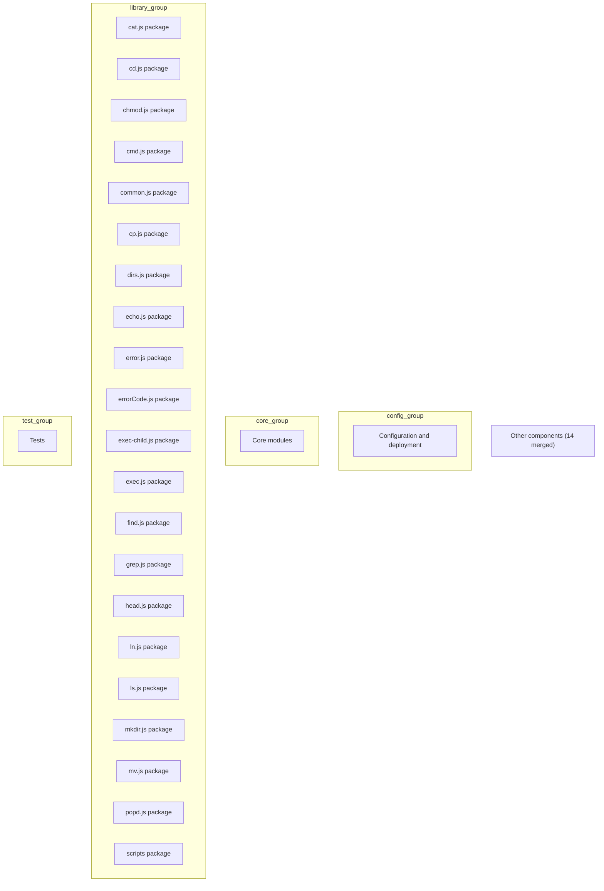

# Architecture report: shelljs/shelljs

> Automated static analysis. **Observed** = directly seen in files/imports/AST; **Inferred** = interpretation from that evidence. Repository code was not executed.

## 1. Repository at a glance

| Item | Value |
| --- | --- |
| Repository | shelljs/shelljs |
| Description | :shell: Portable Unix shell commands for Node.js |
| Language | JavaScript |
| Stars | 14400 |
| Licence | BSD-3-Clause |
| Analysed commit / branch | 060e8ac15aa32b1311db15c5e12cd64016637932 / main |
| Framework(s) | None detected |
| Files analysed | 170 |
| Components | 38 |

## 2. Architecture in one minute

shelljs/shelljs - :shell: Portable Unix shell commands for Node.js. This repository was analysed statically from 170 file(s) (0 Python). Detected technologies (observed from imports/manifests): GitHub Actions. Files are grouped into 38 component(s): cat.js package, cd.js package, chmod.js package, cmd.js package, common.js package, Configuration and deployment, Core modules, cp.js package. Findings below distinguish observed facts from inferred interpretation.

## 3. High-level block diagram

## 4. Main components

### cat.js package (`cat_js`)

- **Kind:** library
- **Status:** Observed
- **Confidence:** 0.85
- **Responsibility:** Groups 1 file(s) under cat.js package (observed from repository paths and static analysis).
- **Paths:** `src/cat.js`
- **Evidence:** [src/cat.js](https://github.com/shelljs/shelljs/blob/060e8ac15aa32b1311db15c5e12cd64016637932/src/cat.js)

### cd.js package (`cd_js`)

- **Kind:** library
- **Status:** Observed
- **Confidence:** 0.85
- **Responsibility:** Groups 1 file(s) under cd.js package (observed from repository paths and static analysis).
- **Paths:** `src/cd.js`
- **Evidence:** [src/cd.js](https://github.com/shelljs/shelljs/blob/060e8ac15aa32b1311db15c5e12cd64016637932/src/cd.js)

### chmod.js package (`chmod_js`)

- **Kind:** library
- **Status:** Observed
- **Confidence:** 0.85
- **Responsibility:** Groups 1 file(s) under chmod.js package (observed from repository paths and static analysis).
- **Paths:** `src/chmod.js`
- **Evidence:** [src/chmod.js](https://github.com/shelljs/shelljs/blob/060e8ac15aa32b1311db15c5e12cd64016637932/src/chmod.js)

### cmd.js package (`cmd_js`)

- **Kind:** library
- **Status:** Observed
- **Confidence:** 0.85
- **Responsibility:** Groups 1 file(s) under cmd.js package (observed from repository paths and static analysis).
- **Paths:** `src/cmd.js`
- **Evidence:** [src/cmd.js](https://github.com/shelljs/shelljs/blob/060e8ac15aa32b1311db15c5e12cd64016637932/src/cmd.js)

### common.js package (`common_js`)

- **Kind:** library
- **Status:** Observed
- **Confidence:** 0.85
- **Responsibility:** Groups 1 file(s) under common.js package (observed from repository paths and static analysis).
- **Paths:** `src/common.js`
- **Evidence:** [src/common.js](https://github.com/shelljs/shelljs/blob/060e8ac15aa32b1311db15c5e12cd64016637932/src/common.js)

### Configuration and deployment (`config`)

- **Kind:** config
- **Status:** Observed
- **Confidence:** 0.85
- **Responsibility:** Groups 1 file(s) under configuration and deployment (observed from repository paths and static analysis).
- **Paths:** `package.json`
- **Evidence:** [package.json](https://github.com/shelljs/shelljs/blob/060e8ac15aa32b1311db15c5e12cd64016637932/package.json)

### Core modules (`core`)

- **Kind:** core
- **Status:** Observed
- **Confidence:** 0.85
- **Responsibility:** Groups 4 file(s) under core modules (observed from repository paths and static analysis).
- **Paths:** `global.js`, `make.js`, `plugin.js`, `shell.js`
- **Evidence:** [global.js](https://github.com/shelljs/shelljs/blob/060e8ac15aa32b1311db15c5e12cd64016637932/global.js); [make.js](https://github.com/shelljs/shelljs/blob/060e8ac15aa32b1311db15c5e12cd64016637932/make.js); [plugin.js](https://github.com/shelljs/shelljs/blob/060e8ac15aa32b1311db15c5e12cd64016637932/plugin.js); [shell.js](https://github.com/shelljs/shelljs/blob/060e8ac15aa32b1311db15c5e12cd64016637932/shell.js)

### cp.js package (`cp_js`)

- **Kind:** library
- **Status:** Observed
- **Confidence:** 0.85
- **Responsibility:** Groups 1 file(s) under cp.js package (observed from repository paths and static analysis).
- **Paths:** `src/cp.js`
- **Evidence:** [src/cp.js](https://github.com/shelljs/shelljs/blob/060e8ac15aa32b1311db15c5e12cd64016637932/src/cp.js)

### dirs.js package (`dirs_js`)

- **Kind:** library
- **Status:** Observed
- **Confidence:** 0.85
- **Responsibility:** Groups 1 file(s) under dirs.js package (observed from repository paths and static analysis).
- **Paths:** `src/dirs.js`
- **Evidence:** [src/dirs.js](https://github.com/shelljs/shelljs/blob/060e8ac15aa32b1311db15c5e12cd64016637932/src/dirs.js)

### echo.js package (`echo_js`)

- **Kind:** library
- **Status:** Observed
- **Confidence:** 0.85
- **Responsibility:** Groups 1 file(s) under echo.js package (observed from repository paths and static analysis).
- **Paths:** `src/echo.js`
- **Evidence:** [src/echo.js](https://github.com/shelljs/shelljs/blob/060e8ac15aa32b1311db15c5e12cd64016637932/src/echo.js)

### error.js package (`error_js`)

- **Kind:** library
- **Status:** Observed
- **Confidence:** 0.85
- **Responsibility:** Groups 1 file(s) under error.js package (observed from repository paths and static analysis).
- **Paths:** `src/error.js`
- **Evidence:** [src/error.js](https://github.com/shelljs/shelljs/blob/060e8ac15aa32b1311db15c5e12cd64016637932/src/error.js)

### errorCode.js package (`errorcode_js`)

- **Kind:** library
- **Status:** Observed
- **Confidence:** 0.85
- **Responsibility:** Groups 1 file(s) under errorcode.js package (observed from repository paths and static analysis).
- **Paths:** `src/errorCode.js`
- **Evidence:** [src/errorCode.js](https://github.com/shelljs/shelljs/blob/060e8ac15aa32b1311db15c5e12cd64016637932/src/errorCode.js)

### exec-child.js package (`exec_child_js`)

- **Kind:** library
- **Status:** Observed
- **Confidence:** 0.85
- **Responsibility:** Groups 1 file(s) under exec-child.js package (observed from repository paths and static analysis).
- **Paths:** `src/exec-child.js`
- **Evidence:** [src/exec-child.js](https://github.com/shelljs/shelljs/blob/060e8ac15aa32b1311db15c5e12cd64016637932/src/exec-child.js)

### exec.js package (`exec_js`)

- **Kind:** library
- **Status:** Observed
- **Confidence:** 0.85
- **Responsibility:** Groups 1 file(s) under exec.js package (observed from repository paths and static analysis).
- **Paths:** `src/exec.js`
- **Evidence:** [src/exec.js](https://github.com/shelljs/shelljs/blob/060e8ac15aa32b1311db15c5e12cd64016637932/src/exec.js)

### find.js package (`find_js`)

- **Kind:** library
- **Status:** Observed
- **Confidence:** 0.85
- **Responsibility:** Groups 1 file(s) under find.js package (observed from repository paths and static analysis).
- **Paths:** `src/find.js`
- **Evidence:** [src/find.js](https://github.com/shelljs/shelljs/blob/060e8ac15aa32b1311db15c5e12cd64016637932/src/find.js)

### grep.js package (`grep_js`)

- **Kind:** library
- **Status:** Observed
- **Confidence:** 0.85
- **Responsibility:** Groups 1 file(s) under grep.js package (observed from repository paths and static analysis).
- **Paths:** `src/grep.js`
- **Evidence:** [src/grep.js](https://github.com/shelljs/shelljs/blob/060e8ac15aa32b1311db15c5e12cd64016637932/src/grep.js)

### head.js package (`head_js`)

- **Kind:** library
- **Status:** Observed
- **Confidence:** 0.85
- **Responsibility:** Groups 1 file(s) under head.js package (observed from repository paths and static analysis).
- **Paths:** `src/head.js`
- **Evidence:** [src/head.js](https://github.com/shelljs/shelljs/blob/060e8ac15aa32b1311db15c5e12cd64016637932/src/head.js)

### ln.js package (`ln_js`)

- **Kind:** library
- **Status:** Observed
- **Confidence:** 0.85
- **Responsibility:** Groups 1 file(s) under ln.js package (observed from repository paths and static analysis).
- **Paths:** `src/ln.js`
- **Evidence:** [src/ln.js](https://github.com/shelljs/shelljs/blob/060e8ac15aa32b1311db15c5e12cd64016637932/src/ln.js)

### ls.js package (`ls_js`)

- **Kind:** library
- **Status:** Observed
- **Confidence:** 0.85
- **Responsibility:** Groups 1 file(s) under ls.js package (observed from repository paths and static analysis).
- **Paths:** `src/ls.js`
- **Evidence:** [src/ls.js](https://github.com/shelljs/shelljs/blob/060e8ac15aa32b1311db15c5e12cd64016637932/src/ls.js)

### mkdir.js package (`mkdir_js`)

- **Kind:** library
- **Status:** Observed
- **Confidence:** 0.85
- **Responsibility:** Groups 1 file(s) under mkdir.js package (observed from repository paths and static analysis).
- **Paths:** `src/mkdir.js`
- **Evidence:** [src/mkdir.js](https://github.com/shelljs/shelljs/blob/060e8ac15aa32b1311db15c5e12cd64016637932/src/mkdir.js)

### mv.js package (`mv_js`)

- **Kind:** library
- **Status:** Observed
- **Confidence:** 0.85
- **Responsibility:** Groups 1 file(s) under mv.js package (observed from repository paths and static analysis).
- **Paths:** `src/mv.js`
- **Evidence:** [src/mv.js](https://github.com/shelljs/shelljs/blob/060e8ac15aa32b1311db15c5e12cd64016637932/src/mv.js)

### popd.js package (`popd_js`)

- **Kind:** library
- **Status:** Observed
- **Confidence:** 0.85
- **Responsibility:** Groups 1 file(s) under popd.js package (observed from repository paths and static analysis).
- **Paths:** `src/popd.js`
- **Evidence:** [src/popd.js](https://github.com/shelljs/shelljs/blob/060e8ac15aa32b1311db15c5e12cd64016637932/src/popd.js)

### pushd.js package (`pushd_js`)

- **Kind:** library
- **Status:** Observed
- **Confidence:** 0.85
- **Responsibility:** Groups 1 file(s) under pushd.js package (observed from repository paths and static analysis).
- **Paths:** `src/pushd.js`
- **Evidence:** [src/pushd.js](https://github.com/shelljs/shelljs/blob/060e8ac15aa32b1311db15c5e12cd64016637932/src/pushd.js)

### pwd.js package (`pwd_js`)

- **Kind:** library
- **Status:** Observed
- **Confidence:** 0.85
- **Responsibility:** Groups 1 file(s) under pwd.js package (observed from repository paths and static analysis).
- **Paths:** `src/pwd.js`
- **Evidence:** [src/pwd.js](https://github.com/shelljs/shelljs/blob/060e8ac15aa32b1311db15c5e12cd64016637932/src/pwd.js)

### rm.js package (`rm_js`)

- **Kind:** library
- **Status:** Observed
- **Confidence:** 0.85
- **Responsibility:** Groups 1 file(s) under rm.js package (observed from repository paths and static analysis).
- **Paths:** `src/rm.js`
- **Evidence:** [src/rm.js](https://github.com/shelljs/shelljs/blob/060e8ac15aa32b1311db15c5e12cd64016637932/src/rm.js)

### scripts package (`scripts`)

- **Kind:** library
- **Status:** Observed
- **Confidence:** 0.85
- **Responsibility:** Groups 2 file(s) under scripts package (observed from repository paths and static analysis).
- **Paths:** `scripts/check-node-support.js`, `scripts/generate-docs.js`
- **Evidence:** [scripts/check-node-support.js](https://github.com/shelljs/shelljs/blob/060e8ac15aa32b1311db15c5e12cd64016637932/scripts/check-node-support.js); [scripts/generate-docs.js](https://github.com/shelljs/shelljs/blob/060e8ac15aa32b1311db15c5e12cd64016637932/scripts/generate-docs.js)

### sed.js package (`sed_js`)

- **Kind:** library
- **Status:** Observed
- **Confidence:** 0.85
- **Responsibility:** Groups 1 file(s) under sed.js package (observed from repository paths and static analysis).
- **Paths:** `src/sed.js`
- **Evidence:** [src/sed.js](https://github.com/shelljs/shelljs/blob/060e8ac15aa32b1311db15c5e12cd64016637932/src/sed.js)

### set.js package (`set_js`)

- **Kind:** library
- **Status:** Observed
- **Confidence:** 0.85
- **Responsibility:** Groups 1 file(s) under set.js package (observed from repository paths and static analysis).
- **Paths:** `src/set.js`
- **Evidence:** [src/set.js](https://github.com/shelljs/shelljs/blob/060e8ac15aa32b1311db15c5e12cd64016637932/src/set.js)

### sort.js package (`sort_js`)

- **Kind:** library
- **Status:** Observed
- **Confidence:** 0.85
- **Responsibility:** Groups 1 file(s) under sort.js package (observed from repository paths and static analysis).
- **Paths:** `src/sort.js`
- **Evidence:** [src/sort.js](https://github.com/shelljs/shelljs/blob/060e8ac15aa32b1311db15c5e12cd64016637932/src/sort.js)

### tail.js package (`tail_js`)

- **Kind:** library
- **Status:** Observed
- **Confidence:** 0.85
- **Responsibility:** Groups 1 file(s) under tail.js package (observed from repository paths and static analysis).
- **Paths:** `src/tail.js`
- **Evidence:** [src/tail.js](https://github.com/shelljs/shelljs/blob/060e8ac15aa32b1311db15c5e12cd64016637932/src/tail.js)

### tempdir.js package (`tempdir_js`)

- **Kind:** library
- **Status:** Observed
- **Confidence:** 0.85
- **Responsibility:** Groups 1 file(s) under tempdir.js package (observed from repository paths and static analysis).
- **Paths:** `src/tempdir.js`
- **Evidence:** [src/tempdir.js](https://github.com/shelljs/shelljs/blob/060e8ac15aa32b1311db15c5e12cd64016637932/src/tempdir.js)

### test.js package (`test_js`)

- **Kind:** library
- **Status:** Observed
- **Confidence:** 0.85
- **Responsibility:** Groups 1 file(s) under test.js package (observed from repository paths and static analysis).
- **Paths:** `src/test.js`
- **Evidence:** [src/test.js](https://github.com/shelljs/shelljs/blob/060e8ac15aa32b1311db15c5e12cd64016637932/src/test.js)

### Tests (`tests`)

- **Kind:** test
- **Status:** Observed
- **Confidence:** 0.85
- **Responsibility:** Groups 116 file(s) under tests (observed from repository paths and static analysis).
- **Paths:** `test/.eslintrc.json`, `test/cat.js`, `test/cd.js`, `test/chmod.js`, `test/cmd.js`, `test/common.js`, `test/config.js`, `test/cp.js`, `test/dirs.js`, `test/docs.js`, `test/echo.js`, `test/env.js`, `test/exec.js`, `test/exit.js`, `test/find.js`, `test/global.js`, `test/grep.js`, `test/head.js`, `test/ln.js`, `test/ls.js`, `test/mkdir.js`, `test/mv.js`, `test/pipe.js`, `test/plugin.js`, `test/popd.js`, `test/pushd.js`, `test/pwd.js`, `test/resources/a.txt`, `test/resources/cat/file1`, `test/resources/cat/file2`, `test/resources/cat/file3`, `test/resources/cat/file4`, `test/resources/cat/file5`, `test/resources/chmod/a/b/c/.gitignore`, `test/resources/chmod/b/a/b/.gitignore`, `test/resources/chmod/c/a/b/.gitignore`, `test/resources/chmod/file1`, `test/resources/chmod/xdir/deep/file`, `test/resources/chmod/xdir/file`, `test/resources/cp-mode-bits/executable`, `test/resources/cp/a`, `test/resources/cp/b`, `test/resources/cp/dir_a/z`, `test/resources/cp/dir_b/dir_b_a/dir_b_a_a/z`, `test/resources/cp/fakeLinks/file.txt`, `test/resources/cp/fakeLinks/sym.lnk`, `test/resources/cp/file1`, `test/resources/cp/links/file.txt`, `test/resources/exec/slow.js`, `test/resources/external/node_script.js`, `test/resources/file1`, `test/resources/file1.js`, `test/resources/file1.txt`, `test/resources/file2`, `test/resources/file2.js`, `test/resources/file2.txt`, `test/resources/find/.hidden`, `test/resources/find/a`, `test/resources/find/b`, `test/resources/find/dir1/a_dir1`, `test/resources/find/dir1/dir11/a_dir11`, `test/resources/find/dir2/a_dir1`, `test/resources/grep/case1`, `test/resources/grep/case1.js`, `test/resources/grep/case1.txt`, `test/resources/grep/file`, `test/resources/grep/file2`, `test/resources/grep/file3`, `test/resources/head/file1.txt`, `test/resources/head/file2.txt`, `test/resources/head/shortfile1`, `test/resources/head/shortfile2`, `test/resources/issue44/main.js`, `test/resources/ls/.hidden_dir/nada`, `test/resources/ls/.hidden_file`, `test/resources/ls/a_dir/.hidden_dir/nada`, `test/resources/ls/a_dir/b_dir/z`, `test/resources/ls/a_dir/nada`, `test/resources/ls/file1`, `test/resources/ls/file1.js`, `test/resources/ls/file2`, `test/resources/ls/file2.js`, `test/resources/ls/filename(with)[chars$]^that.must+be-escaped`, `test/resources/pushd/a/dummy`, `test/resources/pushd/b/c/dummy`, `test/resources/rm/a_dir/a_file`, `test/resources/sed/empty.txt`, `test/resources/sort/file1`, `test/resources/sort/file2`, `test/resources/sort/sorted`, `test/resources/sort/sortedDashN`, `test/resources/uniq/file1`, `test/resources/uniq/file1c`, `test/resources/uniq/file1d`, `test/resources/uniq/file1t`, `test/resources/uniq/file1u`, `test/resources/uniq/file2`, `test/resources/uniq/file2u`, `test/resources/uniq/file3`, `test/resources/uniq/pipe`, `test/resources/uniq/pipeSorted`, `test/resources/which/node`, `test/rm.js`, `test/sed.js`, `test/set.js`, `test/sort.js`, `test/tail.js`, `test/tempdir.js`, `test/test.js`, `test/to.js`, `test/toEnd.js`, `test/touch.js`, `test/uniq.js`, `test/utils/mocks.js`, `test/utils/utils.js`, `test/which.js`
- **Evidence:** [test/.eslintrc.json](https://github.com/shelljs/shelljs/blob/060e8ac15aa32b1311db15c5e12cd64016637932/test/.eslintrc.json); [test/cat.js](https://github.com/shelljs/shelljs/blob/060e8ac15aa32b1311db15c5e12cd64016637932/test/cat.js); [test/cd.js](https://github.com/shelljs/shelljs/blob/060e8ac15aa32b1311db15c5e12cd64016637932/test/cd.js); [test/chmod.js](https://github.com/shelljs/shelljs/blob/060e8ac15aa32b1311db15c5e12cd64016637932/test/chmod.js); [test/cmd.js](https://github.com/shelljs/shelljs/blob/060e8ac15aa32b1311db15c5e12cd64016637932/test/cmd.js); [test/common.js](https://github.com/shelljs/shelljs/blob/060e8ac15aa32b1311db15c5e12cd64016637932/test/common.js); [test/config.js](https://github.com/shelljs/shelljs/blob/060e8ac15aa32b1311db15c5e12cd64016637932/test/config.js); [test/cp.js](https://github.com/shelljs/shelljs/blob/060e8ac15aa32b1311db15c5e12cd64016637932/test/cp.js)

### to.js package (`to_js`)

- **Kind:** library
- **Status:** Observed
- **Confidence:** 0.85
- **Responsibility:** Groups 1 file(s) under to.js package (observed from repository paths and static analysis).
- **Paths:** `src/to.js`
- **Evidence:** [src/to.js](https://github.com/shelljs/shelljs/blob/060e8ac15aa32b1311db15c5e12cd64016637932/src/to.js)

### toEnd.js package (`toend_js`)

- **Kind:** library
- **Status:** Observed
- **Confidence:** 0.85
- **Responsibility:** Groups 1 file(s) under toend.js package (observed from repository paths and static analysis).
- **Paths:** `src/toEnd.js`
- **Evidence:** [src/toEnd.js](https://github.com/shelljs/shelljs/blob/060e8ac15aa32b1311db15c5e12cd64016637932/src/toEnd.js)

### touch.js package (`touch_js`)

- **Kind:** library
- **Status:** Observed
- **Confidence:** 0.85
- **Responsibility:** Groups 1 file(s) under touch.js package (observed from repository paths and static analysis).
- **Paths:** `src/touch.js`
- **Evidence:** [src/touch.js](https://github.com/shelljs/shelljs/blob/060e8ac15aa32b1311db15c5e12cd64016637932/src/touch.js)

### uniq.js package (`uniq_js`)

- **Kind:** library
- **Status:** Observed
- **Confidence:** 0.85
- **Responsibility:** Groups 1 file(s) under uniq.js package (observed from repository paths and static analysis).
- **Paths:** `src/uniq.js`
- **Evidence:** [src/uniq.js](https://github.com/shelljs/shelljs/blob/060e8ac15aa32b1311db15c5e12cd64016637932/src/uniq.js)

### which.js package (`which_js`)

- **Kind:** library
- **Status:** Observed
- **Confidence:** 0.85
- **Responsibility:** Groups 1 file(s) under which.js package (observed from repository paths and static analysis).
- **Paths:** `src/which.js`
- **Evidence:** [src/which.js](https://github.com/shelljs/shelljs/blob/060e8ac15aa32b1311db15c5e12cd64016637932/src/which.js)

## 5. Execution flow

**Observed** entry point(s):

- [shell.js](https://github.com/shelljs/shelljs/blob/060e8ac15aa32b1311db15c5e12cd64016637932/shell.js)

Representative flow (derived from observed entry points and the import graph; steps beyond the entry point are **Inferred**):

1. Execution starts at an observed entry point listed above, if present.
2. No internal import relationships between components were observed.

## 6. Project structure

### `(root)`

- `.editorconfig` - config (247 bytes)
- `.eslintignore` - other (71 bytes)
- `.eslintrc.json` - config (1492 bytes)
- `.gitattributes` - other (14 bytes)
- `.gitignore` - other (164 bytes)
- `CHANGELOG.md` - docs (83254 bytes)
- `CONTRIBUTING.md` - docs (1070 bytes)
- `LICENSE` - docs (1532 bytes)
- `README.md` - docs (27348 bytes)
- `RELEASE.md` - docs (512 bytes)
- `global.js` - source, JavaScript (353 bytes)
- `make.js` - source, JavaScript (1322 bytes)
- `package.json` - manifest (2108 bytes)
- `plugin.js` - source, JavaScript (480 bytes)
- `shell.js` - source, JavaScript (5221 bytes)

### `.github`

- `.github/ISSUE_TEMPLATE.md` - docs (392 bytes)
- `.github/SECURITY.md` - docs (1395 bytes)
- `.github/workflows/main.yml` - ci, YAML (878 bytes)

### `scripts`

- `scripts/check-node-support.js` - source, JavaScript (3019 bytes)
- `scripts/generate-docs.js` - source, JavaScript (1939 bytes)

### `src`

- `src/cat.js` - source, JavaScript (1864 bytes)
- `src/cd.js` - source, JavaScript (1006 bytes)
- `src/chmod.js` - source, JavaScript (7165 bytes)
- `src/cmd.js` - source, JavaScript (4949 bytes)
- `src/common.js` - source, JavaScript (17467 bytes)
- `src/cp.js` - source, JavaScript (10399 bytes)
- `src/dirs.js` - source, JavaScript (5682 bytes)
- `src/echo.js` - source, JavaScript (1361 bytes)
- `src/error.js` - source, JavaScript (451 bytes)
- `src/errorCode.js` - source, JavaScript (199 bytes)
- `src/exec-child.js` - source, JavaScript (1989 bytes)
- `src/exec.js` - source, JavaScript (8448 bytes)
- `src/find.js` - source, JavaScript (1672 bytes)
- `src/grep.js` - source, JavaScript (6434 bytes)
- `src/head.js` - source, JavaScript (2739 bytes)
- `src/ln.js` - source, JavaScript (1966 bytes)
- `src/ls.js` - source, JavaScript (5060 bytes)
- `src/mkdir.js` - source, JavaScript (2747 bytes)
- `src/mv.js` - source, JavaScript (3694 bytes)
- `src/popd.js` - source, JavaScript (15 bytes)
- `src/pushd.js` - source, JavaScript (15 bytes)
- `src/pwd.js` - source, JavaScript (314 bytes)
- `src/rm.js` - source, JavaScript (5668 bytes)
- `src/sed.js` - source, JavaScript (2901 bytes)
- `src/set.js` - source, JavaScript (1361 bytes)
- `src/sort.js` - source, JavaScript (2626 bytes)
- `src/tail.js` - source, JavaScript (2336 bytes)
- `src/tempdir.js` - source, JavaScript (2253 bytes)
- `src/test.js` - source, JavaScript (2095 bytes)
- `src/to.js` - source, JavaScript (1054 bytes)
- `src/toEnd.js` - source, JavaScript (1012 bytes)
- `src/touch.js` - source, JavaScript (3037 bytes)
- `src/uniq.js` - source, JavaScript (2605 bytes)
- `src/which.js` - source, JavaScript (3593 bytes)

### `test`

- `test/.eslintrc.json` - test (1155 bytes)
- `test/cat.js` - test, JavaScript (3347 bytes)
- `test/cd.js` - test, JavaScript (2651 bytes)
- `test/chmod.js` - test, JavaScript (10239 bytes)
- `test/cmd.js` - test, JavaScript (8350 bytes)
- `test/common.js` - test, JavaScript (9413 bytes)
- `test/config.js` - test, JavaScript (9607 bytes)
- `test/cp.js` - test, JavaScript (39293 bytes)
- `test/dirs.js` - test, JavaScript (797 bytes)
- `test/docs.js` - test, JavaScript (301 bytes)
- `test/echo.js` - test, JavaScript (4059 bytes)
- `test/env.js` - test, JavaScript (329 bytes)
- `test/exec.js` - test, JavaScript (8541 bytes)
- `test/exit.js` - test, JavaScript (1500 bytes)
- `test/find.js` - test, JavaScript (2050 bytes)
- `test/global.js` - test, JavaScript (1161 bytes)
- `test/grep.js` - test, JavaScript (11658 bytes)
- `test/head.js` - test, JavaScript (7268 bytes)
- `test/ln.js` - test, JavaScript (6246 bytes)
- `test/ls.js` - test, JavaScript (17627 bytes)
- `test/mkdir.js` - test, JavaScript (7007 bytes)
- `test/mv.js` - test, JavaScript (6754 bytes)
- `test/pipe.js` - test, JavaScript (2312 bytes)
- `test/plugin.js` - test, JavaScript (4126 bytes)
- `test/popd.js` - test, JavaScript (3857 bytes)
- `test/pushd.js` - test, JavaScript (10381 bytes)
- `test/pwd.js` - test, JavaScript (797 bytes)
- `test/resources/a.txt` - test (100 bytes)
- `test/resources/cat/file1` - test (6 bytes)
- `test/resources/cat/file2` - test (6 bytes)
- `test/resources/cat/file3` - test (5 bytes)
- `test/resources/cat/file4` - test (108 bytes)
- `test/resources/cat/file5` - test (0 bytes)
- `test/resources/chmod/a/b/c/.gitignore` - test (0 bytes)
- `test/resources/chmod/b/a/b/.gitignore` - test (0 bytes)
- `test/resources/chmod/c/a/b/.gitignore` - test (0 bytes)
- `test/resources/chmod/file1` - test (61 bytes)
- `test/resources/chmod/xdir/deep/file` - test (7 bytes)
- `test/resources/chmod/xdir/file` - test (7 bytes)
- `test/resources/cp-mode-bits/executable` - test (4 bytes)
- `test/resources/cp/a` - test (5 bytes)
- `test/resources/cp/b` - test (5 bytes)
- `test/resources/cp/dir_a/z` - test (5 bytes)
- `test/resources/cp/dir_b/dir_b_a/dir_b_a_a/z` - test (5 bytes)
- `test/resources/cp/fakeLinks/file.txt` - test (15 bytes)
- `test/resources/cp/fakeLinks/sym.lnk` - test (19 bytes)
- `test/resources/cp/file1` - test (6 bytes)
- `test/resources/cp/links/file.txt` - test (15 bytes)
- `test/resources/exec/slow.js` - test, JavaScript (125 bytes)
- `test/resources/external/node_script.js` - test, JavaScript (34 bytes)
- `test/resources/file1` - test (5 bytes)
- `test/resources/file1.js` - test, JavaScript (5 bytes)
- `test/resources/file1.txt` - test (6 bytes)
- `test/resources/file2` - test (5 bytes)
- `test/resources/file2.js` - test, JavaScript (5 bytes)
- `test/resources/file2.txt` - test (6 bytes)
- `test/resources/find/.hidden` - test (5 bytes)
- `test/resources/find/a` - test (5 bytes)
- `test/resources/find/b` - test (5 bytes)
- `test/resources/find/dir1/a_dir1` - test (5 bytes)
- `test/resources/find/dir1/dir11/a_dir11` - test (5 bytes)
- `test/resources/find/dir2/a_dir1` - test (5 bytes)
- `test/resources/grep/case1` - test (6 bytes)
- `test/resources/grep/case1.js` - test, JavaScript (6 bytes)
- `test/resources/grep/case1.txt` - test (6 bytes)
- `test/resources/grep/file` - test (77 bytes)
- `test/resources/grep/file2` - test (10 bytes)
- `test/resources/grep/file3` - test (136 bytes)
- `test/resources/head/file1.txt` - test (441 bytes)
- `test/resources/head/file2.txt` - test (441 bytes)
- `test/resources/head/shortfile1` - test (7 bytes)
- `test/resources/head/shortfile2` - test (7 bytes)
- `test/resources/issue44/main.js` - test, JavaScript (3 bytes)
- `test/resources/ls/.hidden_dir/nada` - test (5 bytes)
- `test/resources/ls/.hidden_file` - test (5 bytes)
- `test/resources/ls/a_dir/.hidden_dir/nada` - test (4 bytes)
- `test/resources/ls/a_dir/b_dir/z` - test (5 bytes)
- `test/resources/ls/a_dir/nada` - test (5 bytes)
- `test/resources/ls/file1` - test (5 bytes)
- `test/resources/ls/file1.js` - test, JavaScript (5 bytes)
- `test/resources/ls/file2` - test (5 bytes)
- `test/resources/ls/file2.js` - test, JavaScript (5 bytes)
- `test/resources/ls/filename(with)[chars$]^that.must+be-escaped` - test (5 bytes)
- `test/resources/pushd/a/dummy` - test (3 bytes)
- `test/resources/pushd/b/c/dummy` - test (3 bytes)
- `test/resources/rm/a_dir/a_file` - test (5 bytes)
- `test/resources/sed/empty.txt` - test (0 bytes)
- `test/resources/sort/file1` - test (98 bytes)
- `test/resources/sort/file2` - test (98 bytes)
- `test/resources/sort/sorted` - test (98 bytes)
- `test/resources/sort/sortedDashN` - test (98 bytes)
- `test/resources/uniq/file1` - test (16 bytes)
- `test/resources/uniq/file1c` - test (36 bytes)
- `test/resources/uniq/file1d` - test (4 bytes)
- `test/resources/uniq/file1t` - test (12 bytes)
- `test/resources/uniq/file1u` - test (12 bytes)
- `test/resources/uniq/file2` - test (16 bytes)
- `test/resources/uniq/file2u` - test (12 bytes)
- `test/resources/uniq/file3` - test (12 bytes)
- `test/resources/uniq/pipe` - test (200 bytes)
- `test/resources/uniq/pipeSorted` - test (36 bytes)
- `test/resources/which/node` - test (29 bytes)
- `test/rm.js` - test, JavaScript (10919 bytes)
- `test/sed.js` - test, JavaScript (5845 bytes)
- `test/set.js` - test, JavaScript (2647 bytes)
- `test/sort.js` - test, JavaScript (5337 bytes)
- `test/tail.js` - test, JavaScript (6696 bytes)
- `test/tempdir.js` - test, JavaScript (608 bytes)
- `test/test.js` - test, JavaScript (2956 bytes)
- `test/to.js` - test, JavaScript (1476 bytes)
- `test/toEnd.js` - test, JavaScript (2230 bytes)
- `test/touch.js` - test, JavaScript (5767 bytes)
- `test/uniq.js` - test, JavaScript (2972 bytes)
- `test/utils/mocks.js` - test, JavaScript (1334 bytes)
- `test/utils/utils.js` - test, JavaScript (2269 bytes)
- `test/which.js` - test, JavaScript (2914 bytes)

## 7. Key dependencies and integrations

| Name | Category | Status | Confidence | Evidence |
| --- | --- | --- | --- | --- |
| GitHub Actions | ci | Observed | 0.85 | [.github/workflows/main.yml](https://github.com/shelljs/shelljs/blob/060e8ac15aa32b1311db15c5e12cd64016637932/.github/workflows/main.yml) |

## 8. Data and state

No database, cache, queue, or persistent-state usage was observed in the analysed files. State handling, if any, may be in-memory or in files that were not analysed.

## 9. Configuration and deployment clues

- `.editorconfig` (config)
- `.eslintrc.json` (config)
- `.github/workflows/main.yml` (ci)
- `package.json` (manifest)

## 10. Design observations

- Tests are present alongside source code (Observed from test file paths).

These observations are interpretations (**Inferred**) of the observed structure, not guarantees about runtime design.

## 11. Limitations and unknowns

- Static analysis only: repository code was not executed, installed, or imported at runtime.
- Components and relationships are inferred from file paths, imports, and AST structure; runtime behaviour, dynamic imports, and reflection may not be visible.
- No clear application entry point was observed in the analysed files.
- Repository text was treated as untrusted data; no instructions found in repository files were followed, and likely secret values were redacted/excluded.
- JavaScript and TypeScript files were inventoried from paths and package manifests. They were not parsed with a full language AST, and repository code was not executed.

## 12. Source references

- [.github/workflows/main.yml](https://github.com/shelljs/shelljs/blob/060e8ac15aa32b1311db15c5e12cd64016637932/.github/workflows/main.yml)
- [global.js](https://github.com/shelljs/shelljs/blob/060e8ac15aa32b1311db15c5e12cd64016637932/global.js)
- [make.js](https://github.com/shelljs/shelljs/blob/060e8ac15aa32b1311db15c5e12cd64016637932/make.js)
- [package.json](https://github.com/shelljs/shelljs/blob/060e8ac15aa32b1311db15c5e12cd64016637932/package.json)
- [plugin.js](https://github.com/shelljs/shelljs/blob/060e8ac15aa32b1311db15c5e12cd64016637932/plugin.js)
- [scripts/check-node-support.js](https://github.com/shelljs/shelljs/blob/060e8ac15aa32b1311db15c5e12cd64016637932/scripts/check-node-support.js)
- [scripts/generate-docs.js](https://github.com/shelljs/shelljs/blob/060e8ac15aa32b1311db15c5e12cd64016637932/scripts/generate-docs.js)
- [shell.js](https://github.com/shelljs/shelljs/blob/060e8ac15aa32b1311db15c5e12cd64016637932/shell.js)
- [src/cat.js](https://github.com/shelljs/shelljs/blob/060e8ac15aa32b1311db15c5e12cd64016637932/src/cat.js)
- [src/cd.js](https://github.com/shelljs/shelljs/blob/060e8ac15aa32b1311db15c5e12cd64016637932/src/cd.js)
- [src/chmod.js](https://github.com/shelljs/shelljs/blob/060e8ac15aa32b1311db15c5e12cd64016637932/src/chmod.js)
- [src/cmd.js](https://github.com/shelljs/shelljs/blob/060e8ac15aa32b1311db15c5e12cd64016637932/src/cmd.js)
- [src/common.js](https://github.com/shelljs/shelljs/blob/060e8ac15aa32b1311db15c5e12cd64016637932/src/common.js)
- [src/cp.js](https://github.com/shelljs/shelljs/blob/060e8ac15aa32b1311db15c5e12cd64016637932/src/cp.js)
- [src/dirs.js](https://github.com/shelljs/shelljs/blob/060e8ac15aa32b1311db15c5e12cd64016637932/src/dirs.js)
- [src/echo.js](https://github.com/shelljs/shelljs/blob/060e8ac15aa32b1311db15c5e12cd64016637932/src/echo.js)
- [src/error.js](https://github.com/shelljs/shelljs/blob/060e8ac15aa32b1311db15c5e12cd64016637932/src/error.js)
- [src/errorCode.js](https://github.com/shelljs/shelljs/blob/060e8ac15aa32b1311db15c5e12cd64016637932/src/errorCode.js)
- [src/exec-child.js](https://github.com/shelljs/shelljs/blob/060e8ac15aa32b1311db15c5e12cd64016637932/src/exec-child.js)
- [src/exec.js](https://github.com/shelljs/shelljs/blob/060e8ac15aa32b1311db15c5e12cd64016637932/src/exec.js)
- [src/find.js](https://github.com/shelljs/shelljs/blob/060e8ac15aa32b1311db15c5e12cd64016637932/src/find.js)
- [src/grep.js](https://github.com/shelljs/shelljs/blob/060e8ac15aa32b1311db15c5e12cd64016637932/src/grep.js)
- [src/head.js](https://github.com/shelljs/shelljs/blob/060e8ac15aa32b1311db15c5e12cd64016637932/src/head.js)
- [src/ln.js](https://github.com/shelljs/shelljs/blob/060e8ac15aa32b1311db15c5e12cd64016637932/src/ln.js)
- [src/ls.js](https://github.com/shelljs/shelljs/blob/060e8ac15aa32b1311db15c5e12cd64016637932/src/ls.js)
- [src/mkdir.js](https://github.com/shelljs/shelljs/blob/060e8ac15aa32b1311db15c5e12cd64016637932/src/mkdir.js)
- [src/mv.js](https://github.com/shelljs/shelljs/blob/060e8ac15aa32b1311db15c5e12cd64016637932/src/mv.js)
- [src/popd.js](https://github.com/shelljs/shelljs/blob/060e8ac15aa32b1311db15c5e12cd64016637932/src/popd.js)
- [src/pushd.js](https://github.com/shelljs/shelljs/blob/060e8ac15aa32b1311db15c5e12cd64016637932/src/pushd.js)
- [src/pwd.js](https://github.com/shelljs/shelljs/blob/060e8ac15aa32b1311db15c5e12cd64016637932/src/pwd.js)
- [src/rm.js](https://github.com/shelljs/shelljs/blob/060e8ac15aa32b1311db15c5e12cd64016637932/src/rm.js)
- [src/sed.js](https://github.com/shelljs/shelljs/blob/060e8ac15aa32b1311db15c5e12cd64016637932/src/sed.js)
- [src/set.js](https://github.com/shelljs/shelljs/blob/060e8ac15aa32b1311db15c5e12cd64016637932/src/set.js)
- [src/sort.js](https://github.com/shelljs/shelljs/blob/060e8ac15aa32b1311db15c5e12cd64016637932/src/sort.js)
- [src/tail.js](https://github.com/shelljs/shelljs/blob/060e8ac15aa32b1311db15c5e12cd64016637932/src/tail.js)
- [src/tempdir.js](https://github.com/shelljs/shelljs/blob/060e8ac15aa32b1311db15c5e12cd64016637932/src/tempdir.js)
- [src/test.js](https://github.com/shelljs/shelljs/blob/060e8ac15aa32b1311db15c5e12cd64016637932/src/test.js)
- [src/to.js](https://github.com/shelljs/shelljs/blob/060e8ac15aa32b1311db15c5e12cd64016637932/src/to.js)
- [src/toEnd.js](https://github.com/shelljs/shelljs/blob/060e8ac15aa32b1311db15c5e12cd64016637932/src/toEnd.js)
- [src/touch.js](https://github.com/shelljs/shelljs/blob/060e8ac15aa32b1311db15c5e12cd64016637932/src/touch.js)
- [src/uniq.js](https://github.com/shelljs/shelljs/blob/060e8ac15aa32b1311db15c5e12cd64016637932/src/uniq.js)
- [src/which.js](https://github.com/shelljs/shelljs/blob/060e8ac15aa32b1311db15c5e12cd64016637932/src/which.js)
- [test/.eslintrc.json](https://github.com/shelljs/shelljs/blob/060e8ac15aa32b1311db15c5e12cd64016637932/test/.eslintrc.json)
- [test/cat.js](https://github.com/shelljs/shelljs/blob/060e8ac15aa32b1311db15c5e12cd64016637932/test/cat.js)
- [test/cd.js](https://github.com/shelljs/shelljs/blob/060e8ac15aa32b1311db15c5e12cd64016637932/test/cd.js)
- [test/chmod.js](https://github.com/shelljs/shelljs/blob/060e8ac15aa32b1311db15c5e12cd64016637932/test/chmod.js)
- [test/cmd.js](https://github.com/shelljs/shelljs/blob/060e8ac15aa32b1311db15c5e12cd64016637932/test/cmd.js)
- [test/common.js](https://github.com/shelljs/shelljs/blob/060e8ac15aa32b1311db15c5e12cd64016637932/test/common.js)
- [test/config.js](https://github.com/shelljs/shelljs/blob/060e8ac15aa32b1311db15c5e12cd64016637932/test/config.js)
- [test/cp.js](https://github.com/shelljs/shelljs/blob/060e8ac15aa32b1311db15c5e12cd64016637932/test/cp.js)
