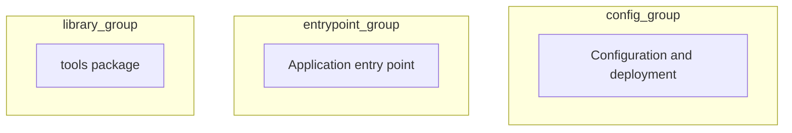

# Architecture report: shimohq/chinese-programmer-wrong-pronunciation

> Automated static analysis. **Observed** = directly seen in files/imports/AST; **Inferred** = interpretation from that evidence. Repository code was not executed.

## 1. Repository at a glance

| Item | Value |
| --- | --- |
| Repository | shimohq/chinese-programmer-wrong-pronunciation |
| Description | 中国程序员容易发音错误的单词 |
| Language | JavaScript |
| Stars | 23376 |
| Licence | Not detected |
| Analysed commit / branch | 1f04534b8d12f1bb5977cc683caceb7d1f393033 / master |
| Framework(s) | None detected |
| Files analysed | 21 |
| Components | 3 |

## 2. Architecture in one minute

shimohq/chinese-programmer-wrong-pronunciation - 中国程序员容易发音错误的单词. This repository was analysed statically from 21 file(s) (1 Python). Detected technologies (observed from imports/manifests): no known frameworks/libraries. Files are grouped into 3 component(s): Configuration and deployment, Application entry point, tools package. Observed entry point(s): tools/addword.py. Findings below distinguish observed facts from inferred interpretation.

## 3. High-level block diagram

## 4. Main components

### Configuration and deployment (`config`)

- **Kind:** config
- **Status:** Observed
- **Confidence:** 0.85
- **Responsibility:** Groups 3 file(s) under configuration and deployment (observed from repository paths and static analysis).
- **Paths:** `tools/chromium_extension/manifest.json`, `tools/chromium_extension/package.json`, `tools/chromium_extension/rules/remove_content_security_policy.json`
- **Evidence:** [tools/chromium_extension/manifest.json](https://github.com/shimohq/chinese-programmer-wrong-pronunciation/blob/1f04534b8d12f1bb5977cc683caceb7d1f393033/tools/chromium_extension/manifest.json); [tools/chromium_extension/package.json](https://github.com/shimohq/chinese-programmer-wrong-pronunciation/blob/1f04534b8d12f1bb5977cc683caceb7d1f393033/tools/chromium_extension/package.json); [tools/chromium_extension/rules/remove_content_security_policy.json](https://github.com/shimohq/chinese-programmer-wrong-pronunciation/blob/1f04534b8d12f1bb5977cc683caceb7d1f393033/tools/chromium_extension/rules/remove_content_security_policy.json)

### Application entry point (`entrypoint`)

- **Kind:** entrypoint
- **Status:** Observed
- **Confidence:** 0.85
- **Responsibility:** Groups 1 file(s) under application entry point (observed from repository paths and static analysis). Observed top-level functions: get_pronunciations, main.
- **Paths:** `tools/addword.py`
- **Evidence:** [tools/addword.py:13](https://github.com/shimohq/chinese-programmer-wrong-pronunciation/blob/1f04534b8d12f1bb5977cc683caceb7d1f393033/tools/addword.py#L13)

### tools package (`tools`)

- **Kind:** library
- **Status:** Observed
- **Confidence:** 0.85
- **Responsibility:** Groups 8 file(s) under tools package (observed from repository paths and static analysis).
- **Paths:** `tools/chromium_extension/format-code.sh`, `tools/chromium_extension/js/app/box.js`, `tools/chromium_extension/js/app/components.js`, `tools/chromium_extension/js/app/init.js`, `tools/chromium_extension/js/app/pretty-box.js`, `tools/chromium_extension/js/app/search-engine.js`, `tools/chromium_extension/js/app/utils.js`, `tools/chromium_extension/js/content-script.js`
- **Evidence:** [tools/chromium_extension/format-code.sh](https://github.com/shimohq/chinese-programmer-wrong-pronunciation/blob/1f04534b8d12f1bb5977cc683caceb7d1f393033/tools/chromium_extension/format-code.sh); [tools/chromium_extension/js/app/box.js](https://github.com/shimohq/chinese-programmer-wrong-pronunciation/blob/1f04534b8d12f1bb5977cc683caceb7d1f393033/tools/chromium_extension/js/app/box.js); [tools/chromium_extension/js/app/components.js](https://github.com/shimohq/chinese-programmer-wrong-pronunciation/blob/1f04534b8d12f1bb5977cc683caceb7d1f393033/tools/chromium_extension/js/app/components.js); [tools/chromium_extension/js/app/init.js](https://github.com/shimohq/chinese-programmer-wrong-pronunciation/blob/1f04534b8d12f1bb5977cc683caceb7d1f393033/tools/chromium_extension/js/app/init.js); [tools/chromium_extension/js/app/pretty-box.js](https://github.com/shimohq/chinese-programmer-wrong-pronunciation/blob/1f04534b8d12f1bb5977cc683caceb7d1f393033/tools/chromium_extension/js/app/pretty-box.js); [tools/chromium_extension/js/app/search-engine.js](https://github.com/shimohq/chinese-programmer-wrong-pronunciation/blob/1f04534b8d12f1bb5977cc683caceb7d1f393033/tools/chromium_extension/js/app/search-engine.js); [tools/chromium_extension/js/app/utils.js](https://github.com/shimohq/chinese-programmer-wrong-pronunciation/blob/1f04534b8d12f1bb5977cc683caceb7d1f393033/tools/chromium_extension/js/app/utils.js); [tools/chromium_extension/js/content-script.js](https://github.com/shimohq/chinese-programmer-wrong-pronunciation/blob/1f04534b8d12f1bb5977cc683caceb7d1f393033/tools/chromium_extension/js/content-script.js)

## 5. Execution flow

**Observed** entry point(s):

- [tools/addword.py:51](https://github.com/shimohq/chinese-programmer-wrong-pronunciation/blob/1f04534b8d12f1bb5977cc683caceb7d1f393033/tools/addword.py#L51)

Representative flow (derived from observed entry points and the import graph; steps beyond the entry point are **Inferred**):

1. Execution starts at an observed entry point listed above, if present.
2. No internal import relationships between components were observed.

## 6. Project structure

### `(root)`

- `.editorconfig` - config (672 bytes)
- `.gitignore` - other (126 bytes)
- `README.md` - docs (43148 bytes)

### `.github`

- `.github/PULL_REQUEST_TEMPLATE.md` - docs (684 bytes)

### `tools`

- `tools/addword.py` - source, Python (1785 bytes)
- `tools/chromium_extension/README.md` - docs (1373 bytes)
- `tools/chromium_extension/css/app.css` - other (1279 bytes)
- `tools/chromium_extension/format-code.sh` - source, Shell (97 bytes)
- `tools/chromium_extension/images/README.md` - docs (417 bytes)
- `tools/chromium_extension/js/app/box.js` - source, JavaScript (1234 bytes)
- `tools/chromium_extension/js/app/components.js` - source, JavaScript (7318 bytes)
- `tools/chromium_extension/js/app/init.js` - source, JavaScript (2946 bytes)
- `tools/chromium_extension/js/app/pretty-box.js` - source, JavaScript (1810 bytes)
- `tools/chromium_extension/js/app/search-engine.js` - source, JavaScript (564 bytes)
- `tools/chromium_extension/js/app/utils.js` - source, JavaScript (2548 bytes)
- `tools/chromium_extension/js/content-script.js` - source, JavaScript (102 bytes)
- `tools/chromium_extension/manifest.json` - config (1265 bytes)
- `tools/chromium_extension/package.json` - manifest (348 bytes)
- `tools/chromium_extension/rules/remove_content_security_policy.json` - config (2082 bytes)
- `tools/chromium_extension/web-components/README.md` - docs (113 bytes)
- `tools/chromium_extension/web-components/x-custom-box.html` - other (157 bytes)

## 7. Key dependencies and integrations

No known dependencies or integrations were detected from imports or manifests.

## 8. Data and state

No database, cache, queue, or persistent-state usage was observed in the analysed files. State handling, if any, may be in-memory or in files that were not analysed.

## 9. Configuration and deployment clues

- `.editorconfig` (config)
- `tools/chromium_extension/manifest.json` (config)
- `tools/chromium_extension/package.json` (manifest)
- `tools/chromium_extension/rules/remove_content_security_policy.json` (config)

## 10. Design observations

- An entry/API layer is separated from other code (Inferred from paths and decorators).

These observations are interpretations (**Inferred**) of the observed structure, not guarantees about runtime design.

## 11. Limitations and unknowns

- Static analysis only: repository code was not executed, installed, or imported at runtime.
- Components and relationships are inferred from file paths, imports, and AST structure; runtime behaviour, dynamic imports, and reflection may not be visible.
- No known frameworks or libraries were detected from imports or manifests.
- Repository text was treated as untrusted data; no instructions found in repository files were followed, and likely secret values were redacted/excluded.

## 12. Source references

- [tools/addword.py:13](https://github.com/shimohq/chinese-programmer-wrong-pronunciation/blob/1f04534b8d12f1bb5977cc683caceb7d1f393033/tools/addword.py#L13)
- [tools/addword.py:51](https://github.com/shimohq/chinese-programmer-wrong-pronunciation/blob/1f04534b8d12f1bb5977cc683caceb7d1f393033/tools/addword.py#L51)
- [tools/chromium_extension/format-code.sh](https://github.com/shimohq/chinese-programmer-wrong-pronunciation/blob/1f04534b8d12f1bb5977cc683caceb7d1f393033/tools/chromium_extension/format-code.sh)
- [tools/chromium_extension/js/app/box.js](https://github.com/shimohq/chinese-programmer-wrong-pronunciation/blob/1f04534b8d12f1bb5977cc683caceb7d1f393033/tools/chromium_extension/js/app/box.js)
- [tools/chromium_extension/js/app/components.js](https://github.com/shimohq/chinese-programmer-wrong-pronunciation/blob/1f04534b8d12f1bb5977cc683caceb7d1f393033/tools/chromium_extension/js/app/components.js)
- [tools/chromium_extension/js/app/init.js](https://github.com/shimohq/chinese-programmer-wrong-pronunciation/blob/1f04534b8d12f1bb5977cc683caceb7d1f393033/tools/chromium_extension/js/app/init.js)
- [tools/chromium_extension/js/app/pretty-box.js](https://github.com/shimohq/chinese-programmer-wrong-pronunciation/blob/1f04534b8d12f1bb5977cc683caceb7d1f393033/tools/chromium_extension/js/app/pretty-box.js)
- [tools/chromium_extension/js/app/search-engine.js](https://github.com/shimohq/chinese-programmer-wrong-pronunciation/blob/1f04534b8d12f1bb5977cc683caceb7d1f393033/tools/chromium_extension/js/app/search-engine.js)
- [tools/chromium_extension/js/app/utils.js](https://github.com/shimohq/chinese-programmer-wrong-pronunciation/blob/1f04534b8d12f1bb5977cc683caceb7d1f393033/tools/chromium_extension/js/app/utils.js)
- [tools/chromium_extension/js/content-script.js](https://github.com/shimohq/chinese-programmer-wrong-pronunciation/blob/1f04534b8d12f1bb5977cc683caceb7d1f393033/tools/chromium_extension/js/content-script.js)
- [tools/chromium_extension/manifest.json](https://github.com/shimohq/chinese-programmer-wrong-pronunciation/blob/1f04534b8d12f1bb5977cc683caceb7d1f393033/tools/chromium_extension/manifest.json)
- [tools/chromium_extension/package.json](https://github.com/shimohq/chinese-programmer-wrong-pronunciation/blob/1f04534b8d12f1bb5977cc683caceb7d1f393033/tools/chromium_extension/package.json)
- [tools/chromium_extension/rules/remove_content_security_policy.json](https://github.com/shimohq/chinese-programmer-wrong-pronunciation/blob/1f04534b8d12f1bb5977cc683caceb7d1f393033/tools/chromium_extension/rules/remove_content_security_policy.json)
