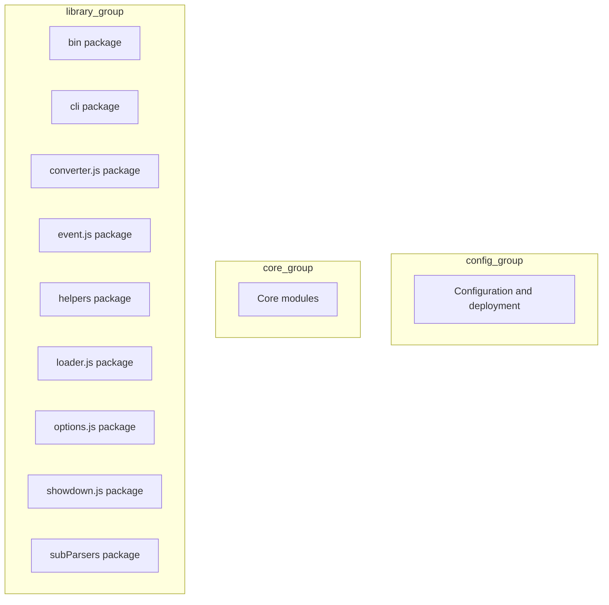

# Architecture report: showdownjs/showdown

> Automated static analysis. **Observed** = directly seen in files/imports/AST; **Inferred** = interpretation from that evidence. Repository code was not executed.

## 1. Repository at a glance

| Item | Value |
| --- | --- |
| Repository | showdownjs/showdown |
| Description | A bidirectional Markdown to HTML to Markdown converter written in Javascript |
| Language | JavaScript |
| Stars | 14881 |
| Licence | MIT |
| Analysed commit / branch | d1a8d16344b855ea2f37677ee8a9e0cc2c597ea4 / master |
| Framework(s) | None detected |
| Files analysed | 132 |
| Components | 11 |

## 2. Architecture in one minute

showdownjs/showdown - A bidirectional Markdown to HTML to Markdown converter written in Javascript. This repository was analysed statically from 132 file(s) (0 Python). Detected technologies (observed from imports/manifests): GitHub Actions, Vitest. Files are grouped into 11 component(s): bin package, cli package, Configuration and deployment, converter.js package, Core modules, event.js package, helpers package, loader.js package. Findings below distinguish observed facts from inferred interpretation.

## 3. High-level block diagram

## 4. Main components

### bin package (`bin`)

- **Kind:** library
- **Status:** Observed
- **Confidence:** 0.85
- **Responsibility:** Groups 1 file(s) under bin package (observed from repository paths and static analysis).
- **Paths:** `bin/showdown.js`
- **Evidence:** [bin/showdown.js](https://github.com/showdownjs/showdown/blob/d1a8d16344b855ea2f37677ee8a9e0cc2c597ea4/bin/showdown.js)

### cli package (`cli`)

- **Kind:** library
- **Status:** Observed
- **Confidence:** 0.85
- **Responsibility:** Groups 1 file(s) under cli package (observed from repository paths and static analysis).
- **Paths:** `src/cli/cli.js`
- **Evidence:** [src/cli/cli.js](https://github.com/showdownjs/showdown/blob/d1a8d16344b855ea2f37677ee8a9e0cc2c597ea4/src/cli/cli.js)

### Configuration and deployment (`config`)

- **Kind:** config
- **Status:** Observed
- **Confidence:** 0.85
- **Responsibility:** Groups 4 file(s) under configuration and deployment (observed from repository paths and static analysis).
- **Paths:** `bower.json`, `browserstack.yml`, `mkdocs.yml`, `package.json`
- **Evidence:** [bower.json](https://github.com/showdownjs/showdown/blob/d1a8d16344b855ea2f37677ee8a9e0cc2c597ea4/bower.json); [browserstack.yml](https://github.com/showdownjs/showdown/blob/d1a8d16344b855ea2f37677ee8a9e0cc2c597ea4/browserstack.yml); [mkdocs.yml](https://github.com/showdownjs/showdown/blob/d1a8d16344b855ea2f37677ee8a9e0cc2c597ea4/mkdocs.yml); [package.json](https://github.com/showdownjs/showdown/blob/d1a8d16344b855ea2f37677ee8a9e0cc2c597ea4/package.json)

### converter.js package (`converter_js`)

- **Kind:** library
- **Status:** Observed
- **Confidence:** 0.85
- **Responsibility:** Groups 1 file(s) under converter.js package (observed from repository paths and static analysis).
- **Paths:** `src/converter.js`
- **Evidence:** [src/converter.js](https://github.com/showdownjs/showdown/blob/d1a8d16344b855ea2f37677ee8a9e0cc2c597ea4/src/converter.js)

### Core modules (`core`)

- **Kind:** core
- **Status:** Observed
- **Confidence:** 0.85
- **Responsibility:** Groups 3 file(s) under core modules (observed from repository paths and static analysis).
- **Paths:** `playwright.bstack.config.js`, `vitest.browser.config.mjs`, `vitest.config.mjs`
- **Evidence:** [playwright.bstack.config.js](https://github.com/showdownjs/showdown/blob/d1a8d16344b855ea2f37677ee8a9e0cc2c597ea4/playwright.bstack.config.js); [vitest.browser.config.mjs](https://github.com/showdownjs/showdown/blob/d1a8d16344b855ea2f37677ee8a9e0cc2c597ea4/vitest.browser.config.mjs); [vitest.config.mjs](https://github.com/showdownjs/showdown/blob/d1a8d16344b855ea2f37677ee8a9e0cc2c597ea4/vitest.config.mjs)

### event.js package (`event_js`)

- **Kind:** library
- **Status:** Observed
- **Confidence:** 0.85
- **Responsibility:** Groups 1 file(s) under event.js package (observed from repository paths and static analysis).
- **Paths:** `src/event.js`
- **Evidence:** [src/event.js](https://github.com/showdownjs/showdown/blob/d1a8d16344b855ea2f37677ee8a9e0cc2c597ea4/src/event.js)

### helpers package (`helpers`)

- **Kind:** library
- **Status:** Observed
- **Confidence:** 0.85
- **Responsibility:** Groups 17 file(s) under helpers package (observed from repository paths and static analysis).
- **Paths:** `src/helpers/commonmark.js`, `src/helpers/emojis.js`, `src/helpers/encodeCode.js`, `src/helpers/escapes.js`, `src/helpers/gfmAutolinks.js`, `src/helpers/hashBlock.js`, `src/helpers/hashHTMLBlocks.js`, `src/helpers/hashHTMLSpans.js`, `src/helpers/htmlEntities.js`, `src/helpers/lazyDocument.js`, `src/helpers/markdownEscapes.js`, `src/helpers/misc.js`, `src/helpers/regexes.js`, `src/helpers/text.js`, `src/helpers/types.js`, `src/helpers/unhashHTMLSpans.js`, `src/helpers/url.js`
- **Evidence:** [src/helpers/commonmark.js](https://github.com/showdownjs/showdown/blob/d1a8d16344b855ea2f37677ee8a9e0cc2c597ea4/src/helpers/commonmark.js); [src/helpers/emojis.js](https://github.com/showdownjs/showdown/blob/d1a8d16344b855ea2f37677ee8a9e0cc2c597ea4/src/helpers/emojis.js); [src/helpers/encodeCode.js](https://github.com/showdownjs/showdown/blob/d1a8d16344b855ea2f37677ee8a9e0cc2c597ea4/src/helpers/encodeCode.js); [src/helpers/escapes.js](https://github.com/showdownjs/showdown/blob/d1a8d16344b855ea2f37677ee8a9e0cc2c597ea4/src/helpers/escapes.js); [src/helpers/gfmAutolinks.js](https://github.com/showdownjs/showdown/blob/d1a8d16344b855ea2f37677ee8a9e0cc2c597ea4/src/helpers/gfmAutolinks.js); [src/helpers/hashBlock.js](https://github.com/showdownjs/showdown/blob/d1a8d16344b855ea2f37677ee8a9e0cc2c597ea4/src/helpers/hashBlock.js); [src/helpers/hashHTMLBlocks.js](https://github.com/showdownjs/showdown/blob/d1a8d16344b855ea2f37677ee8a9e0cc2c597ea4/src/helpers/hashHTMLBlocks.js); [src/helpers/hashHTMLSpans.js](https://github.com/showdownjs/showdown/blob/d1a8d16344b855ea2f37677ee8a9e0cc2c597ea4/src/helpers/hashHTMLSpans.js)

### loader.js package (`loader_js`)

- **Kind:** library
- **Status:** Observed
- **Confidence:** 0.85
- **Responsibility:** Groups 1 file(s) under loader.js package (observed from repository paths and static analysis).
- **Paths:** `src/loader.js`
- **Evidence:** [src/loader.js](https://github.com/showdownjs/showdown/blob/d1a8d16344b855ea2f37677ee8a9e0cc2c597ea4/src/loader.js)

### options.js package (`options_js`)

- **Kind:** library
- **Status:** Observed
- **Confidence:** 0.85
- **Responsibility:** Groups 1 file(s) under options.js package (observed from repository paths and static analysis).
- **Paths:** `src/options.js`
- **Evidence:** [src/options.js](https://github.com/showdownjs/showdown/blob/d1a8d16344b855ea2f37677ee8a9e0cc2c597ea4/src/options.js)

### showdown.js package (`showdown_js`)

- **Kind:** library
- **Status:** Observed
- **Confidence:** 0.85
- **Responsibility:** Groups 1 file(s) under showdown.js package (observed from repository paths and static analysis).
- **Paths:** `src/showdown.js`
- **Evidence:** [src/showdown.js](https://github.com/showdownjs/showdown/blob/d1a8d16344b855ea2f37677ee8a9e0cc2c597ea4/src/showdown.js)

### subParsers package (`subparsers`)

- **Kind:** library
- **Status:** Observed
- **Confidence:** 0.85
- **Responsibility:** Groups 55 file(s) under subparsers package (observed from repository paths and static analysis).
- **Paths:** `src/subParsers/makehtml/autolink.js`, `src/subParsers/makehtml/backslash.js`, `src/subParsers/makehtml/blockGamut.js`, `src/subParsers/makehtml/blockquote.js`, `src/subParsers/makehtml/codeBlock.js`, `src/subParsers/makehtml/codeSpan.js`, `src/subParsers/makehtml/completeHTMLDocument.js`, `src/subParsers/makehtml/decodeEntities.js`, `src/subParsers/makehtml/disallowedHtmlTags.js`, `src/subParsers/makehtml/ellipsis.js`, `src/subParsers/makehtml/emoji.js`, `src/subParsers/makehtml/emphasis.js`, `src/subParsers/makehtml/entity.js`, `src/subParsers/makehtml/footnotes.js`, `src/subParsers/makehtml/ghMentions.js`, `src/subParsers/makehtml/githubCodeBlock.js`, `src/subParsers/makehtml/hardLineBreaks.js`, `src/subParsers/makehtml/heading.js`, `src/subParsers/makehtml/horizontalRule.js`, `src/subParsers/makehtml/htmlBlock.js`, `src/subParsers/makehtml/image.js`, `src/subParsers/makehtml/link.js`, `src/subParsers/makehtml/list.js`, `src/subParsers/makehtml/metadata.js`, `src/subParsers/makehtml/nakedUrl.js`, `src/subParsers/makehtml/paragraphs.js`, `src/subParsers/makehtml/rawHtml.js`, `src/subParsers/makehtml/spanGamut.js`, `src/subParsers/makehtml/strikethrough.js`, `src/subParsers/makehtml/stripLinkDefinitions.js`, `src/subParsers/makehtml/table.js`, `src/subParsers/makehtml/taskListItem.js`, `src/subParsers/makehtml/underline.js`, `src/subParsers/makemarkdown/blockquote.js`, `src/subParsers/makemarkdown/break.js`, `src/subParsers/makemarkdown/codeBlock.js`, `src/subParsers/makemarkdown/codeSpan.js`, `src/subParsers/makemarkdown/emphasis.js`, `src/subParsers/makemarkdown/footnotes.js`, `src/subParsers/makemarkdown/header.js`, `src/subParsers/makemarkdown/hr.js`, `src/subParsers/makemarkdown/image.js`, `src/subParsers/makemarkdown/input.js`, `src/subParsers/makemarkdown/links.js`, `src/subParsers/makemarkdown/list.js`, `src/subParsers/makemarkdown/listItem.js`, `src/subParsers/makemarkdown/node.js`, `src/subParsers/makemarkdown/paragraph.js`, `src/subParsers/makemarkdown/pre.js`, `src/subParsers/makemarkdown/strikethrough.js`, `src/subParsers/makemarkdown/strong.js`, `src/subParsers/makemarkdown/table.js`, `src/subParsers/makemarkdown/tableCell.js`, `src/subParsers/makemarkdown/txt.js`, `src/subParsers/makemarkdown/underline.js`
- **Evidence:** [src/subParsers/makehtml/autolink.js](https://github.com/showdownjs/showdown/blob/d1a8d16344b855ea2f37677ee8a9e0cc2c597ea4/src/subParsers/makehtml/autolink.js); [src/subParsers/makehtml/backslash.js](https://github.com/showdownjs/showdown/blob/d1a8d16344b855ea2f37677ee8a9e0cc2c597ea4/src/subParsers/makehtml/backslash.js); [src/subParsers/makehtml/blockGamut.js](https://github.com/showdownjs/showdown/blob/d1a8d16344b855ea2f37677ee8a9e0cc2c597ea4/src/subParsers/makehtml/blockGamut.js); [src/subParsers/makehtml/blockquote.js](https://github.com/showdownjs/showdown/blob/d1a8d16344b855ea2f37677ee8a9e0cc2c597ea4/src/subParsers/makehtml/blockquote.js); [src/subParsers/makehtml/codeBlock.js](https://github.com/showdownjs/showdown/blob/d1a8d16344b855ea2f37677ee8a9e0cc2c597ea4/src/subParsers/makehtml/codeBlock.js); [src/subParsers/makehtml/codeSpan.js](https://github.com/showdownjs/showdown/blob/d1a8d16344b855ea2f37677ee8a9e0cc2c597ea4/src/subParsers/makehtml/codeSpan.js); [src/subParsers/makehtml/completeHTMLDocument.js](https://github.com/showdownjs/showdown/blob/d1a8d16344b855ea2f37677ee8a9e0cc2c597ea4/src/subParsers/makehtml/completeHTMLDocument.js); [src/subParsers/makehtml/decodeEntities.js](https://github.com/showdownjs/showdown/blob/d1a8d16344b855ea2f37677ee8a9e0cc2c597ea4/src/subParsers/makehtml/decodeEntities.js)

## 5. Execution flow

**Observed** entry point(s):

- [bin/showdown.js](https://github.com/showdownjs/showdown/blob/d1a8d16344b855ea2f37677ee8a9e0cc2c597ea4/bin/showdown.js)

Representative flow (derived from observed entry points and the import graph; steps beyond the entry point are **Inferred**):

1. Execution starts at an observed entry point listed above, if present.
2. No internal import relationships between components were observed.

## 6. Project structure

### `(root)`

- `CHANGELOG.md` - docs (70360 bytes)
- `CONTRIBUTING.md` - docs (2745 bytes)
- `DONATIONS.md` - docs (1315 bytes)
- `LICENSE` - docs (1072 bytes)
- `README.md` - docs (23291 bytes)
- `SECURITY.md` - docs (3183 bytes)
- `TASKS.TODO.md` - docs (5886 bytes)
- `bower.json` - config (812 bytes)
- `browserstack.yml` - config (865 bytes)
- `mkdocs.yml` - config (1720 bytes)
- `package.json` - manifest (3026 bytes)
- `playwright.bstack.config.js` - source, JavaScript (403 bytes)
- `vitest.browser.config.mjs` - source, JavaScript (1349 bytes)
- `vitest.config.mjs` - source, JavaScript (1119 bytes)

### `.github`

- `.github/dependabot.yml` - config (536 bytes)
- `.github/workflows/browser.yml` - ci, YAML (843 bytes)
- `.github/workflows/browserstack.yml` - ci, YAML (1390 bytes)
- `.github/workflows/codeql-analysis.yml` - ci, YAML (2535 bytes)
- `.github/workflows/docs.yml` - ci, YAML (1202 bytes)
- `.github/workflows/node.linux.yml` - ci, YAML (1209 bytes)
- `.github/workflows/node.win.yml` - ci, YAML (968 bytes)

### `bin`

- `bin/showdown.js` - source, JavaScript (12774 bytes)

### `docs`

- `docs/api-reference.md` - docs (7217 bytes)
- `docs/assets/extra.css` - docs (858 bytes)
- `docs/cli.md` - docs (11197 bytes)
- `docs/commonmark.md` - docs (9577 bytes)
- `docs/contribution-guide.md` - docs (3196 bytes)
- `docs/create-extension.md` - docs (12500 bytes)
- `docs/credits.md` - docs (1682 bytes)
- `docs/event-system.md` - docs (39181 bytes)
- `docs/extensions-list.md` - docs (1048 bytes)
- `docs/extensions.md` - docs (2592 bytes)
- `docs/flavors.md` - docs (3897 bytes)
- `docs/gfm.md` - docs (3604 bytes)
- `docs/html-to-markdown.md` - docs (9531 bytes)
- `docs/index.md` - docs (4431 bytes)
- `docs/integrations.md` - docs (675 bytes)
- `docs/local-development.md` - docs (1395 bytes)
- `docs/markdown-syntax.md` - docs (10333 bytes)
- `docs/markdown-to-html.md` - docs (3204 bytes)
- `docs/options.md` - docs (23411 bytes)
- `docs/original.md` - docs (1856 bytes)
- `docs/quickstart.md` - docs (3216 bytes)
- `docs/requirements.txt` - manifest (268 bytes)
- `docs/syntax-overview.md` - docs (8819 bytes)
- `docs/tutorials/add-default-class-to-html.md` - docs (1660 bytes)
- `docs/tutorials/index.md` - docs (249 bytes)
- `docs/tutorials/markdown-editor-with-showdown.md` - docs (4051 bytes)
- `docs/tutorials/use-both-extension-types-together.md` - docs (3543 bytes)
- `docs/xss.md` - docs (11039 bytes)

### `overrides`

- `overrides/partials/nav.html` - other (1315 bytes)

### `specs`

- `specs/comparison.md` - docs (26194 bytes)
- `specs/original.md` - docs (56082 bytes)
- `specs/showdown.md` - docs (87918 bytes)

### `src`

- `src/cli/cli.js` - source, JavaScript (30110 bytes)
- `src/converter.js` - source, JavaScript (25921 bytes)
- `src/event.js` - source, JavaScript (13006 bytes)
- `src/helpers/commonmark.js` - source, JavaScript (10237 bytes)
- `src/helpers/emojis.js` - source, JavaScript (71464 bytes)
- `src/helpers/encodeCode.js` - source, JavaScript (1107 bytes)
- `src/helpers/escapes.js` - source, JavaScript (3718 bytes)
- `src/helpers/gfmAutolinks.js` - source, JavaScript (7085 bytes)
- `src/helpers/hashBlock.js` - source, JavaScript (628 bytes)
- `src/helpers/hashHTMLBlocks.js` - source, JavaScript (4637 bytes)
- `src/helpers/hashHTMLSpans.js` - source, JavaScript (3848 bytes)
- `src/helpers/htmlEntities.js` - source, JavaScript (42002 bytes)
- `src/helpers/lazyDocument.js` - source, JavaScript (2696 bytes)
- `src/helpers/markdownEscapes.js` - source, JavaScript (1345 bytes)
- `src/helpers/misc.js` - source, JavaScript (6279 bytes)
- `src/helpers/regexes.js` - source, JavaScript (2715 bytes)
- `src/helpers/text.js` - source, JavaScript (10639 bytes)
- `src/helpers/types.js` - source, JavaScript (3136 bytes)
- `src/helpers/unhashHTMLSpans.js` - source, JavaScript (1507 bytes)
- `src/helpers/url.js` - source, JavaScript (6415 bytes)
- `src/loader.js` - source, JavaScript (876 bytes)
- `src/options.js` - source, JavaScript (7176 bytes)
- `src/showdown.js` - source, JavaScript (10381 bytes)
- `src/subParsers/makehtml/autolink.js` - source, JavaScript (6455 bytes)
- `src/subParsers/makehtml/backslash.js` - source, JavaScript (3436 bytes)
- `src/subParsers/makehtml/blockGamut.js` - source, JavaScript (3019 bytes)
- `src/subParsers/makehtml/blockquote.js` - source, JavaScript (9079 bytes)
- `src/subParsers/makehtml/codeBlock.js` - source, JavaScript (2852 bytes)
- `src/subParsers/makehtml/codeSpan.js` - source, JavaScript (5853 bytes)
- `src/subParsers/makehtml/completeHTMLDocument.js` - source, JavaScript (2710 bytes)
- `src/subParsers/makehtml/decodeEntities.js` - source, JavaScript (1727 bytes)
- `src/subParsers/makehtml/disallowedHtmlTags.js` - source, JavaScript (6143 bytes)
- `src/subParsers/makehtml/ellipsis.js` - source, JavaScript (2644 bytes)
- `src/subParsers/makehtml/emoji.js` - source, JavaScript (6522 bytes)
- `src/subParsers/makehtml/emphasis.js` - source, JavaScript (6388 bytes)
- `src/subParsers/makehtml/entity.js` - source, JavaScript (3172 bytes)
- `src/subParsers/makehtml/footnotes.js` - source, JavaScript (12624 bytes)
- `src/subParsers/makehtml/ghMentions.js` - source, JavaScript (8031 bytes)
- `src/subParsers/makehtml/githubCodeBlock.js` - source, JavaScript (7656 bytes)
- `src/subParsers/makehtml/hardLineBreaks.js` - source, JavaScript (4778 bytes)
- `src/subParsers/makehtml/heading.js` - source, JavaScript (20807 bytes)
- `src/subParsers/makehtml/horizontalRule.js` - source, JavaScript (4678 bytes)
- `src/subParsers/makehtml/htmlBlock.js` - source, JavaScript (19681 bytes)
- `src/subParsers/makehtml/image.js` - source, JavaScript (4636 bytes)
- `src/subParsers/makehtml/link.js` - source, JavaScript (11769 bytes)
- `src/subParsers/makehtml/list.js` - source, JavaScript (27531 bytes)
- `src/subParsers/makehtml/metadata.js` - source, JavaScript (3322 bytes)
- `src/subParsers/makehtml/nakedUrl.js` - source, JavaScript (14893 bytes)
- `src/subParsers/makehtml/paragraphs.js` - source, JavaScript (4771 bytes)
- `src/subParsers/makehtml/rawHtml.js` - source, JavaScript (9506 bytes)
- `src/subParsers/makehtml/spanGamut.js` - source, JavaScript (34997 bytes)
- `src/subParsers/makehtml/strikethrough.js` - source, JavaScript (10573 bytes)
- `src/subParsers/makehtml/stripLinkDefinitions.js` - source, JavaScript (12122 bytes)
- `src/subParsers/makehtml/table.js` - source, JavaScript (11830 bytes)
- `src/subParsers/makehtml/taskListItem.js` - source, JavaScript (3614 bytes)
- `src/subParsers/makehtml/underline.js` - source, JavaScript (7532 bytes)
- `src/subParsers/makemarkdown/blockquote.js` - source, JavaScript (1580 bytes)
- `src/subParsers/makemarkdown/break.js` - source, JavaScript (1124 bytes)
- `src/subParsers/makemarkdown/codeBlock.js` - source, JavaScript (1925 bytes)
- `src/subParsers/makemarkdown/codeSpan.js` - source, JavaScript (1735 bytes)
- `src/subParsers/makemarkdown/emphasis.js` - source, JavaScript (2787 bytes)
- `src/subParsers/makemarkdown/footnotes.js` - source, JavaScript (3701 bytes)
- `src/subParsers/makemarkdown/header.js` - source, JavaScript (1662 bytes)
- `src/subParsers/makemarkdown/hr.js` - source, JavaScript (1110 bytes)
- `src/subParsers/makemarkdown/image.js` - source, JavaScript (3250 bytes)
- `src/subParsers/makemarkdown/input.js` - source, JavaScript (3809 bytes)
- `src/subParsers/makemarkdown/links.js` - source, JavaScript (3066 bytes)
- `src/subParsers/makemarkdown/list.js` - source, JavaScript (2101 bytes)
- `src/subParsers/makemarkdown/listItem.js` - source, JavaScript (2233 bytes)
- `src/subParsers/makemarkdown/node.js` - source, JavaScript (9054 bytes)
- `src/subParsers/makemarkdown/paragraph.js` - source, JavaScript (1461 bytes)
- `src/subParsers/makemarkdown/pre.js` - source, JavaScript (1262 bytes)
- `src/subParsers/makemarkdown/strikethrough.js` - source, JavaScript (828 bytes)
- `src/subParsers/makemarkdown/strong.js` - source, JavaScript (785 bytes)
- `src/subParsers/makemarkdown/table.js` - source, JavaScript (7538 bytes)
- `src/subParsers/makemarkdown/tableCell.js` - source, JavaScript (1434 bytes)
- `src/subParsers/makemarkdown/txt.js` - source, JavaScript (3518 bytes)
- `src/subParsers/makemarkdown/underline.js` - source, JavaScript (1053 bytes)

## 7. Key dependencies and integrations

| Name | Category | Status | Confidence | Evidence |
| --- | --- | --- | --- | --- |
| GitHub Actions | ci | Observed | 0.90 | [.github/workflows/browser.yml](https://github.com/showdownjs/showdown/blob/d1a8d16344b855ea2f37677ee8a9e0cc2c597ea4/.github/workflows/browser.yml); [.github/workflows/browserstack.yml](https://github.com/showdownjs/showdown/blob/d1a8d16344b855ea2f37677ee8a9e0cc2c597ea4/.github/workflows/browserstack.yml); [.github/workflows/codeql-analysis.yml](https://github.com/showdownjs/showdown/blob/d1a8d16344b855ea2f37677ee8a9e0cc2c597ea4/.github/workflows/codeql-analysis.yml); [.github/workflows/docs.yml](https://github.com/showdownjs/showdown/blob/d1a8d16344b855ea2f37677ee8a9e0cc2c597ea4/.github/workflows/docs.yml) |
| Vitest | tooling | Observed | 0.85 | [package.json:63](https://github.com/showdownjs/showdown/blob/d1a8d16344b855ea2f37677ee8a9e0cc2c597ea4/package.json#L63) |

## 8. Data and state

No database, cache, queue, or persistent-state usage was observed in the analysed files. State handling, if any, may be in-memory or in files that were not analysed.

## 9. Configuration and deployment clues

- `.github/dependabot.yml` (config)
- `.github/workflows/browser.yml` (ci)
- `.github/workflows/browserstack.yml` (ci)
- `.github/workflows/codeql-analysis.yml` (ci)
- `.github/workflows/docs.yml` (ci)
- `.github/workflows/node.linux.yml` (ci)
- `.github/workflows/node.win.yml` (ci)
- `bower.json` (config)
- `browserstack.yml` (config)
- `docs/requirements.txt` (manifest)
- `mkdocs.yml` (config)
- `package.json` (manifest)

## 10. Design observations

- No strong design patterns could be established from the available evidence.

These observations are interpretations (**Inferred**) of the observed structure, not guarantees about runtime design.

## 11. Limitations and unknowns

- Static analysis only: repository code was not executed, installed, or imported at runtime.
- Components and relationships are inferred from file paths, imports, and AST structure; runtime behaviour, dynamic imports, and reflection may not be visible.
- No clear application entry point was observed in the analysed files.
- Repository text was treated as untrusted data; no instructions found in repository files were followed, and likely secret values were redacted/excluded.
- JavaScript and TypeScript files were inventoried from paths and package manifests. They were not parsed with a full language AST, and repository code was not executed.

## 12. Source references

- [.github/workflows/browser.yml](https://github.com/showdownjs/showdown/blob/d1a8d16344b855ea2f37677ee8a9e0cc2c597ea4/.github/workflows/browser.yml)
- [.github/workflows/browserstack.yml](https://github.com/showdownjs/showdown/blob/d1a8d16344b855ea2f37677ee8a9e0cc2c597ea4/.github/workflows/browserstack.yml)
- [.github/workflows/codeql-analysis.yml](https://github.com/showdownjs/showdown/blob/d1a8d16344b855ea2f37677ee8a9e0cc2c597ea4/.github/workflows/codeql-analysis.yml)
- [.github/workflows/docs.yml](https://github.com/showdownjs/showdown/blob/d1a8d16344b855ea2f37677ee8a9e0cc2c597ea4/.github/workflows/docs.yml)
- [.github/workflows/node.linux.yml](https://github.com/showdownjs/showdown/blob/d1a8d16344b855ea2f37677ee8a9e0cc2c597ea4/.github/workflows/node.linux.yml)
- [.github/workflows/node.win.yml](https://github.com/showdownjs/showdown/blob/d1a8d16344b855ea2f37677ee8a9e0cc2c597ea4/.github/workflows/node.win.yml)
- [bin/showdown.js](https://github.com/showdownjs/showdown/blob/d1a8d16344b855ea2f37677ee8a9e0cc2c597ea4/bin/showdown.js)
- [bower.json](https://github.com/showdownjs/showdown/blob/d1a8d16344b855ea2f37677ee8a9e0cc2c597ea4/bower.json)
- [browserstack.yml](https://github.com/showdownjs/showdown/blob/d1a8d16344b855ea2f37677ee8a9e0cc2c597ea4/browserstack.yml)
- [mkdocs.yml](https://github.com/showdownjs/showdown/blob/d1a8d16344b855ea2f37677ee8a9e0cc2c597ea4/mkdocs.yml)
- [package.json](https://github.com/showdownjs/showdown/blob/d1a8d16344b855ea2f37677ee8a9e0cc2c597ea4/package.json)
- [package.json:63](https://github.com/showdownjs/showdown/blob/d1a8d16344b855ea2f37677ee8a9e0cc2c597ea4/package.json#L63)
- [playwright.bstack.config.js](https://github.com/showdownjs/showdown/blob/d1a8d16344b855ea2f37677ee8a9e0cc2c597ea4/playwright.bstack.config.js)
- [src/cli/cli.js](https://github.com/showdownjs/showdown/blob/d1a8d16344b855ea2f37677ee8a9e0cc2c597ea4/src/cli/cli.js)
- [src/converter.js](https://github.com/showdownjs/showdown/blob/d1a8d16344b855ea2f37677ee8a9e0cc2c597ea4/src/converter.js)
- [src/event.js](https://github.com/showdownjs/showdown/blob/d1a8d16344b855ea2f37677ee8a9e0cc2c597ea4/src/event.js)
- [src/helpers/commonmark.js](https://github.com/showdownjs/showdown/blob/d1a8d16344b855ea2f37677ee8a9e0cc2c597ea4/src/helpers/commonmark.js)
- [src/helpers/emojis.js](https://github.com/showdownjs/showdown/blob/d1a8d16344b855ea2f37677ee8a9e0cc2c597ea4/src/helpers/emojis.js)
- [src/helpers/encodeCode.js](https://github.com/showdownjs/showdown/blob/d1a8d16344b855ea2f37677ee8a9e0cc2c597ea4/src/helpers/encodeCode.js)
- [src/helpers/escapes.js](https://github.com/showdownjs/showdown/blob/d1a8d16344b855ea2f37677ee8a9e0cc2c597ea4/src/helpers/escapes.js)
- [src/helpers/gfmAutolinks.js](https://github.com/showdownjs/showdown/blob/d1a8d16344b855ea2f37677ee8a9e0cc2c597ea4/src/helpers/gfmAutolinks.js)
- [src/helpers/hashBlock.js](https://github.com/showdownjs/showdown/blob/d1a8d16344b855ea2f37677ee8a9e0cc2c597ea4/src/helpers/hashBlock.js)
- [src/helpers/hashHTMLBlocks.js](https://github.com/showdownjs/showdown/blob/d1a8d16344b855ea2f37677ee8a9e0cc2c597ea4/src/helpers/hashHTMLBlocks.js)
- [src/helpers/hashHTMLSpans.js](https://github.com/showdownjs/showdown/blob/d1a8d16344b855ea2f37677ee8a9e0cc2c597ea4/src/helpers/hashHTMLSpans.js)
- [src/loader.js](https://github.com/showdownjs/showdown/blob/d1a8d16344b855ea2f37677ee8a9e0cc2c597ea4/src/loader.js)
- [src/options.js](https://github.com/showdownjs/showdown/blob/d1a8d16344b855ea2f37677ee8a9e0cc2c597ea4/src/options.js)
- [src/showdown.js](https://github.com/showdownjs/showdown/blob/d1a8d16344b855ea2f37677ee8a9e0cc2c597ea4/src/showdown.js)
- [src/subParsers/makehtml/autolink.js](https://github.com/showdownjs/showdown/blob/d1a8d16344b855ea2f37677ee8a9e0cc2c597ea4/src/subParsers/makehtml/autolink.js)
- [src/subParsers/makehtml/backslash.js](https://github.com/showdownjs/showdown/blob/d1a8d16344b855ea2f37677ee8a9e0cc2c597ea4/src/subParsers/makehtml/backslash.js)
- [src/subParsers/makehtml/blockGamut.js](https://github.com/showdownjs/showdown/blob/d1a8d16344b855ea2f37677ee8a9e0cc2c597ea4/src/subParsers/makehtml/blockGamut.js)
- [src/subParsers/makehtml/blockquote.js](https://github.com/showdownjs/showdown/blob/d1a8d16344b855ea2f37677ee8a9e0cc2c597ea4/src/subParsers/makehtml/blockquote.js)
- [src/subParsers/makehtml/codeBlock.js](https://github.com/showdownjs/showdown/blob/d1a8d16344b855ea2f37677ee8a9e0cc2c597ea4/src/subParsers/makehtml/codeBlock.js)
- [src/subParsers/makehtml/codeSpan.js](https://github.com/showdownjs/showdown/blob/d1a8d16344b855ea2f37677ee8a9e0cc2c597ea4/src/subParsers/makehtml/codeSpan.js)
- [src/subParsers/makehtml/completeHTMLDocument.js](https://github.com/showdownjs/showdown/blob/d1a8d16344b855ea2f37677ee8a9e0cc2c597ea4/src/subParsers/makehtml/completeHTMLDocument.js)
- [src/subParsers/makehtml/decodeEntities.js](https://github.com/showdownjs/showdown/blob/d1a8d16344b855ea2f37677ee8a9e0cc2c597ea4/src/subParsers/makehtml/decodeEntities.js)
- [vitest.browser.config.mjs](https://github.com/showdownjs/showdown/blob/d1a8d16344b855ea2f37677ee8a9e0cc2c597ea4/vitest.browser.config.mjs)
- [vitest.config.mjs](https://github.com/showdownjs/showdown/blob/d1a8d16344b855ea2f37677ee8a9e0cc2c597ea4/vitest.config.mjs)
