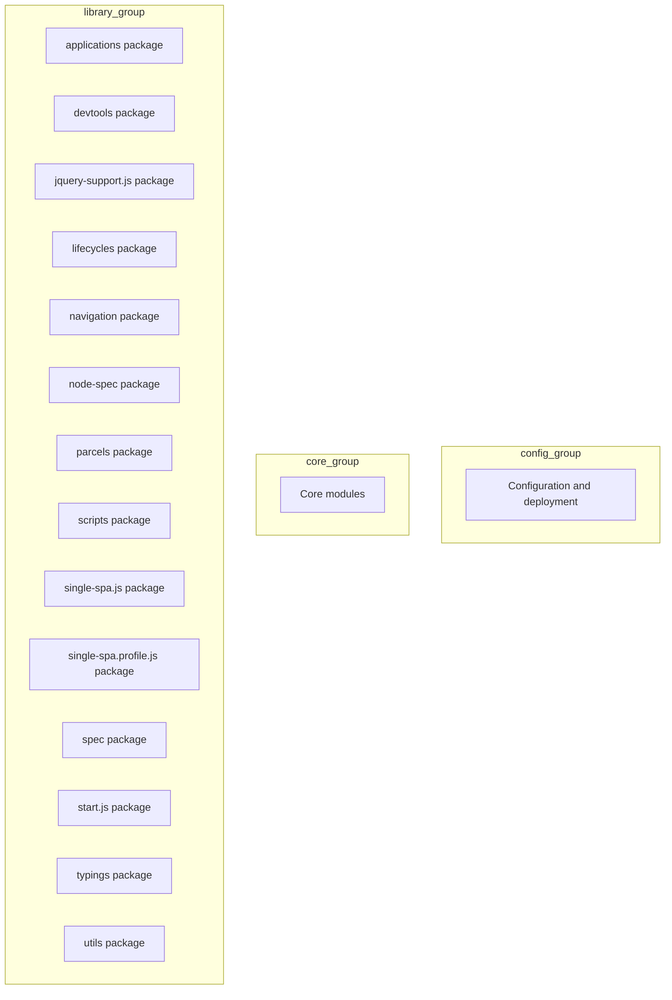

# Architecture report: single-spa/single-spa

> Automated static analysis. **Observed** = directly seen in files/imports/AST; **Inferred** = interpretation from that evidence. Repository code was not executed.

## 1. Repository at a glance

| Item | Value |
| --- | --- |
| Repository | single-spa/single-spa |
| Description | The router for easy microfrontends |
| Language | JavaScript |
| Stars | 13882 |
| Licence | Other |
| Analysed commit / branch | 297483c11265050542d7ef107d14c44936c51883 / main |
| Framework(s) | None detected |
| Files analysed | 153 |
| Components | 16 |

## 2. Architecture in one minute

single-spa/single-spa - The router for easy microfrontends. This repository was analysed statically from 153 file(s) (0 Python). Detected technologies (observed from imports/manifests): GitHub Actions, Jest. Files are grouped into 16 component(s): applications package, Configuration and deployment, Core modules, devtools package, jquery-support.js package, lifecycles package, navigation package, node-spec package. Findings below distinguish observed facts from inferred interpretation.

## 3. High-level block diagram

## 4. Main components

### applications package (`applications`)

- **Kind:** library
- **Status:** Observed
- **Confidence:** 0.85
- **Responsibility:** Groups 4 file(s) under applications package (observed from repository paths and static analysis).
- **Paths:** `src/applications/app-errors.js`, `src/applications/app.helpers.js`, `src/applications/apps.js`, `src/applications/timeouts.js`
- **Evidence:** [src/applications/app-errors.js](https://github.com/single-spa/single-spa/blob/297483c11265050542d7ef107d14c44936c51883/src/applications/app-errors.js); [src/applications/app.helpers.js](https://github.com/single-spa/single-spa/blob/297483c11265050542d7ef107d14c44936c51883/src/applications/app.helpers.js); [src/applications/apps.js](https://github.com/single-spa/single-spa/blob/297483c11265050542d7ef107d14c44936c51883/src/applications/apps.js); [src/applications/timeouts.js](https://github.com/single-spa/single-spa/blob/297483c11265050542d7ef107d14c44936c51883/src/applications/timeouts.js)

### Configuration and deployment (`config`)

- **Kind:** config
- **Status:** Observed
- **Confidence:** 0.85
- **Responsibility:** Groups 1 file(s) under configuration and deployment (observed from repository paths and static analysis).
- **Paths:** `package.json`
- **Evidence:** [package.json](https://github.com/single-spa/single-spa/blob/297483c11265050542d7ef107d14c44936c51883/package.json)

### Core modules (`core`)

- **Kind:** core
- **Status:** Observed
- **Confidence:** 0.85
- **Responsibility:** Groups 3 file(s) under core modules (observed from repository paths and static analysis).
- **Paths:** `jest-browser.config.js`, `jest-node.config.js`, `rollup.config.js`
- **Evidence:** [jest-browser.config.js](https://github.com/single-spa/single-spa/blob/297483c11265050542d7ef107d14c44936c51883/jest-browser.config.js); [jest-node.config.js](https://github.com/single-spa/single-spa/blob/297483c11265050542d7ef107d14c44936c51883/jest-node.config.js); [rollup.config.js](https://github.com/single-spa/single-spa/blob/297483c11265050542d7ef107d14c44936c51883/rollup.config.js)

### devtools package (`devtools`)

- **Kind:** library
- **Status:** Observed
- **Confidence:** 0.85
- **Responsibility:** Groups 3 file(s) under devtools package (observed from repository paths and static analysis).
- **Paths:** `src/devtools/devtools.js`, `src/devtools/profiler-api.js`, `src/devtools/profiler.js`
- **Evidence:** [src/devtools/devtools.js](https://github.com/single-spa/single-spa/blob/297483c11265050542d7ef107d14c44936c51883/src/devtools/devtools.js); [src/devtools/profiler-api.js](https://github.com/single-spa/single-spa/blob/297483c11265050542d7ef107d14c44936c51883/src/devtools/profiler-api.js); [src/devtools/profiler.js](https://github.com/single-spa/single-spa/blob/297483c11265050542d7ef107d14c44936c51883/src/devtools/profiler.js)

### jquery-support.js package (`jquery_support_js`)

- **Kind:** library
- **Status:** Observed
- **Confidence:** 0.85
- **Responsibility:** Groups 1 file(s) under jquery-support.js package (observed from repository paths and static analysis).
- **Paths:** `src/jquery-support.js`
- **Evidence:** [src/jquery-support.js](https://github.com/single-spa/single-spa/blob/297483c11265050542d7ef107d14c44936c51883/src/jquery-support.js)

### lifecycles package (`lifecycles`)

- **Kind:** library
- **Status:** Observed
- **Confidence:** 0.85
- **Responsibility:** Groups 8 file(s) under lifecycles package (observed from repository paths and static analysis).
- **Paths:** `src/lifecycles/bootstrap.js`, `src/lifecycles/lifecycle.helpers.js`, `src/lifecycles/load.js`, `src/lifecycles/mount.js`, `src/lifecycles/prop.helpers.js`, `src/lifecycles/unload.js`, `src/lifecycles/unmount.js`, `src/lifecycles/update.js`
- **Evidence:** [src/lifecycles/bootstrap.js](https://github.com/single-spa/single-spa/blob/297483c11265050542d7ef107d14c44936c51883/src/lifecycles/bootstrap.js); [src/lifecycles/lifecycle.helpers.js](https://github.com/single-spa/single-spa/blob/297483c11265050542d7ef107d14c44936c51883/src/lifecycles/lifecycle.helpers.js); [src/lifecycles/load.js](https://github.com/single-spa/single-spa/blob/297483c11265050542d7ef107d14c44936c51883/src/lifecycles/load.js); [src/lifecycles/mount.js](https://github.com/single-spa/single-spa/blob/297483c11265050542d7ef107d14c44936c51883/src/lifecycles/mount.js); [src/lifecycles/prop.helpers.js](https://github.com/single-spa/single-spa/blob/297483c11265050542d7ef107d14c44936c51883/src/lifecycles/prop.helpers.js); [src/lifecycles/unload.js](https://github.com/single-spa/single-spa/blob/297483c11265050542d7ef107d14c44936c51883/src/lifecycles/unload.js); [src/lifecycles/unmount.js](https://github.com/single-spa/single-spa/blob/297483c11265050542d7ef107d14c44936c51883/src/lifecycles/unmount.js); [src/lifecycles/update.js](https://github.com/single-spa/single-spa/blob/297483c11265050542d7ef107d14c44936c51883/src/lifecycles/update.js)

### navigation package (`navigation`)

- **Kind:** library
- **Status:** Observed
- **Confidence:** 0.85
- **Responsibility:** Groups 2 file(s) under navigation package (observed from repository paths and static analysis).
- **Paths:** `src/navigation/navigation-events.js`, `src/navigation/reroute.js`
- **Evidence:** [src/navigation/navigation-events.js](https://github.com/single-spa/single-spa/blob/297483c11265050542d7ef107d14c44936c51883/src/navigation/navigation-events.js); [src/navigation/reroute.js](https://github.com/single-spa/single-spa/blob/297483c11265050542d7ef107d14c44936c51883/src/navigation/reroute.js)

### node-spec package (`node_spec`)

- **Kind:** library
- **Status:** Observed
- **Confidence:** 0.85
- **Responsibility:** Groups 1 file(s) under node-spec package (observed from repository paths and static analysis).
- **Paths:** `node-spec/nodejs.spec.js`
- **Evidence:** [node-spec/nodejs.spec.js](https://github.com/single-spa/single-spa/blob/297483c11265050542d7ef107d14c44936c51883/node-spec/nodejs.spec.js)

### parcels package (`parcels`)

- **Kind:** library
- **Status:** Observed
- **Confidence:** 0.85
- **Responsibility:** Groups 1 file(s) under parcels package (observed from repository paths and static analysis).
- **Paths:** `src/parcels/mount-parcel.js`
- **Evidence:** [src/parcels/mount-parcel.js](https://github.com/single-spa/single-spa/blob/297483c11265050542d7ef107d14c44936c51883/src/parcels/mount-parcel.js)

### scripts package (`scripts`)

- **Kind:** library
- **Status:** Observed
- **Confidence:** 0.85
- **Responsibility:** Groups 1 file(s) under scripts package (observed from repository paths and static analysis).
- **Paths:** `scripts/copy-types.js`
- **Evidence:** [scripts/copy-types.js](https://github.com/single-spa/single-spa/blob/297483c11265050542d7ef107d14c44936c51883/scripts/copy-types.js)

### single-spa.js package (`single_spa_js`)

- **Kind:** library
- **Status:** Observed
- **Confidence:** 0.85
- **Responsibility:** Groups 1 file(s) under single-spa.js package (observed from repository paths and static analysis).
- **Paths:** `src/single-spa.js`
- **Evidence:** [src/single-spa.js](https://github.com/single-spa/single-spa/blob/297483c11265050542d7ef107d14c44936c51883/src/single-spa.js)

### single-spa.profile.js package (`single_spa_profile_js`)

- **Kind:** library
- **Status:** Observed
- **Confidence:** 0.85
- **Responsibility:** Groups 1 file(s) under single-spa.profile.js package (observed from repository paths and static analysis).
- **Paths:** `src/single-spa.profile.js`
- **Evidence:** [src/single-spa.profile.js](https://github.com/single-spa/single-spa/blob/297483c11265050542d7ef107d14c44936c51883/src/single-spa.profile.js)

### spec package (`spec`)

- **Kind:** library
- **Status:** Observed
- **Confidence:** 0.85
- **Responsibility:** Groups 89 file(s) under spec package (observed from repository paths and static analysis).
- **Paths:** `spec/apis/app-names.spec.js`, `spec/apis/check-activity-functions.spec.js`, `spec/apis/delayed-start-popstate.spec.js`, `spec/apis/error-handlers.spec.js`, `spec/apis/event-listeners.spec.js`, `spec/apis/first-mount.spec.js`, `spec/apis/multiple-instances.spec.js`, `spec/apis/navigate-before-patch-history.spec.js`, `spec/apis/navigate-to-url.spec.js`, `spec/apis/patch-history-api.spec.js`, `spec/apis/path-to-active-when.spec.js`, `spec/apis/register-application.spec.js`, `spec/apis/single-spa-events-api.spec.js`, `spec/apis/start-api.spec.js`, `spec/apis/timeout-apis.spec.js`, `spec/apis/unregister-application.spec.js`, `spec/apis/url-reroute-only-default.spec.js`, `spec/apis/url-reroute-only-false.spec.js`, `spec/apps/bootstrap-rejects/bootstrap-rejects.app.js`, `spec/apps/bootstrap-rejects/bootstrap-rejects.spec.js`, `spec/apps/bootstrap-times-out-dies/bootstrap-times-out-dies.app.js`, `spec/apps/bootstrap-times-out-dies/bootstrap-times-out-dies.spec.js`, `spec/apps/bootstrap-times-out/bootstrap-times-out.app.js`, `spec/apps/bootstrap-times-out/bootstrap-times-out.spec.js`, `spec/apps/delayed-start/delayed-start.app.js`, `spec/apps/delayed-start/delayed-start.spec.js`, `spec/apps/empty-array-lifecycles/empty-array-lifecycles.app.js`, `spec/apps/empty-array-lifecycles/empty-array-lifecycles.spec.js`, `spec/apps/happy-active-when/happy-active-when.app.js`, `spec/apps/happy-active-when/happy-active-when.spec.js`, `spec/apps/happy-basic/happy-basic.app.js`, `spec/apps/happy-basic/happy-basic.spec.js`, `spec/apps/happy-register-object/happy-register-object.app.js`, `spec/apps/happy-register-object/happy-register-object.spec.js`, `spec/apps/happy-unload/happy-unload.app.js`, `spec/apps/happy-unload/happy-unload.spec.js`, `spec/apps/invalid-bootstrap/invalid-bootstrap.app.js`, `spec/apps/invalid-bootstrap/invalid-bootstrap.spec.js`, `spec/apps/invalid-load-function/invalid-load-function.spec.js`, `spec/apps/invalid-mount/invalid-mount.app.js`, `spec/apps/invalid-mount/invalid-mount.spec.js`, `spec/apps/invalid-no-mount/invalid-no-mount.app.js`, `spec/apps/invalid-no-mount/invalid-no-mount.spec.js`, `spec/apps/invalid-no-unmount/invalid-no-unmount.app.js`, `spec/apps/invalid-no-unmount/invalid-no-unmount.spec.js`, `spec/apps/invalid-unload/invalid-unload.app.js`, `spec/apps/invalid-unload/invalid-unload.spec.js`, `spec/apps/invalid-unmount/invalid-unmount.app.js`, `spec/apps/invalid-unmount/invalid-unmount.spec.js`, `spec/apps/lifecycle-props-function/lifecycle-props-function.app.js`, `spec/apps/lifecycle-props-function/lifecycle-props-function.spec.js`, `spec/apps/lifecycle-props/lifecycle-props.app.js`, `spec/apps/lifecycle-props/lifecycle-props.spec.js`, `spec/apps/load-error/load-error.spec.js`, `spec/apps/mount-before-other-loads/mount-before-other-loads.spec.js`, `spec/apps/mount-fails/mount-fails.app.js`, `spec/apps/mount-fails/mount-fails.spec.js`, `spec/apps/mount-rejects/mount-rejects.app.js`, `spec/apps/mount-rejects/mount-rejects.spec.js`, `spec/apps/mount-times-out-dies/mount-times-out-dies.app.js`, `spec/apps/mount-times-out-dies/mount-times-out-dies.spec.js`, `spec/apps/mount-times-out/mount-times-out.app.js`, `spec/apps/mount-times-out/mount-times-out.spec.js`, `spec/apps/mounting-status/mounting-status.app.js`, `spec/apps/mounting-status/mounting-status.spec.js`, `spec/apps/multiple-lifecycle-functions/multiple-lifecycle-functions.app.js`, `spec/apps/multiple-lifecycle-functions/multiple-lifecycle-functions.spec.js`, `spec/apps/no-bootstrap/no-bootstrap.app.js`, `spec/apps/no-bootstrap/no-bootstrap.spec.js`, `spec/apps/no-object-prototype/no-object-prototype.spec.js`, `spec/apps/partial-rerouting/partial-rerouting.spec.js`, `spec/apps/profiler-basic/profiler-basic.spec.js`, `spec/apps/profiler-basic/profiler-routing-no-start.spec.js`, `spec/apps/profiler-basic/profiler-routing-start.spec.js`, `spec/apps/register-with-object/register-with-object.spec.js`, `spec/apps/returns-non-native-promise/returns-non-native-promise.app.js`, `spec/apps/returns-non-native-promise/returns-non-native-promise.spec.js`, `spec/apps/unmount-rejects/unmount-rejects.app.js`, `spec/apps/unmount-rejects/unmount-rejects.spec.js`, `spec/apps/unmount-times-out-dies/unmount-times-out-dies.app.js`, `spec/apps/unmount-times-out-dies/unmount-times-out-dies.spec.js`, `spec/apps/unmount-times-out/unmount-times-out.app.js`, `spec/apps/unmount-times-out/unmount-times-out.spec.js`, `spec/apps/warning-timeouts/warning-timeouts.app.js`, `spec/apps/warning-timeouts/warning-timeouts.spec.js`, `spec/parcels/app-mounts-parcel.spec.js`, `spec/parcels/mount-root-parcel.spec.js`, `spec/parcels/parcel-error-handlers.spec.js`, `spec/parcels/parcel-mounts-parcel.spec.js`
- **Evidence:** [spec/apis/app-names.spec.js](https://github.com/single-spa/single-spa/blob/297483c11265050542d7ef107d14c44936c51883/spec/apis/app-names.spec.js); [spec/apis/check-activity-functions.spec.js](https://github.com/single-spa/single-spa/blob/297483c11265050542d7ef107d14c44936c51883/spec/apis/check-activity-functions.spec.js); [spec/apis/delayed-start-popstate.spec.js](https://github.com/single-spa/single-spa/blob/297483c11265050542d7ef107d14c44936c51883/spec/apis/delayed-start-popstate.spec.js); [spec/apis/error-handlers.spec.js](https://github.com/single-spa/single-spa/blob/297483c11265050542d7ef107d14c44936c51883/spec/apis/error-handlers.spec.js); [spec/apis/event-listeners.spec.js](https://github.com/single-spa/single-spa/blob/297483c11265050542d7ef107d14c44936c51883/spec/apis/event-listeners.spec.js); [spec/apis/first-mount.spec.js](https://github.com/single-spa/single-spa/blob/297483c11265050542d7ef107d14c44936c51883/spec/apis/first-mount.spec.js); [spec/apis/multiple-instances.spec.js](https://github.com/single-spa/single-spa/blob/297483c11265050542d7ef107d14c44936c51883/spec/apis/multiple-instances.spec.js); [spec/apis/navigate-before-patch-history.spec.js](https://github.com/single-spa/single-spa/blob/297483c11265050542d7ef107d14c44936c51883/spec/apis/navigate-before-patch-history.spec.js)

### start.js package (`start_js`)

- **Kind:** library
- **Status:** Observed
- **Confidence:** 0.85
- **Responsibility:** Groups 1 file(s) under start.js package (observed from repository paths and static analysis).
- **Paths:** `src/start.js`
- **Evidence:** [src/start.js](https://github.com/single-spa/single-spa/blob/297483c11265050542d7ef107d14c44936c51883/src/start.js)

### typings package (`typings`)

- **Kind:** library
- **Status:** Observed
- **Confidence:** 0.85
- **Responsibility:** Groups 2 file(s) under typings package (observed from repository paths and static analysis).
- **Paths:** `typings/single-spa.d.ts`, `typings/single-spa.test-d.ts`
- **Evidence:** [typings/single-spa.d.ts](https://github.com/single-spa/single-spa/blob/297483c11265050542d7ef107d14c44936c51883/typings/single-spa.d.ts); [typings/single-spa.test-d.ts](https://github.com/single-spa/single-spa/blob/297483c11265050542d7ef107d14c44936c51883/typings/single-spa.test-d.ts)

### utils package (`utils`)

- **Kind:** library
- **Status:** Observed
- **Confidence:** 0.85
- **Responsibility:** Groups 3 file(s) under utils package (observed from repository paths and static analysis).
- **Paths:** `src/utils/assign.js`, `src/utils/find.js`, `src/utils/runtime-environment.js`
- **Evidence:** [src/utils/assign.js](https://github.com/single-spa/single-spa/blob/297483c11265050542d7ef107d14c44936c51883/src/utils/assign.js); [src/utils/find.js](https://github.com/single-spa/single-spa/blob/297483c11265050542d7ef107d14c44936c51883/src/utils/find.js); [src/utils/runtime-environment.js](https://github.com/single-spa/single-spa/blob/297483c11265050542d7ef107d14c44936c51883/src/utils/runtime-environment.js)

## 5. Execution flow

No entry point was observed; the startup flow below is therefore limited.

Representative flow (derived from observed entry points and the import graph; steps beyond the entry point are **Inferred**):

1. Execution starts at an observed entry point listed above, if present.
2. No internal import relationships between components were observed.

## 6. Project structure

### `(root)`

- `.babelrc` - other (669 bytes)
- `.eslintrc` - other (1019 bytes)
- `.gitignore` - other (205 bytes)
- `.npmignore` - other (5 bytes)
- `.prettierignore` - other (83 bytes)
- `.prettierrc.json` - config (3 bytes)
- `CHANGELOG.md` - docs (1318 bytes)
- `CODE_OF_CONDUCT.md` - docs (263 bytes)
- `CONTRIBUTING.md` - docs (226 bytes)
- `LICENSE` - docs (1069 bytes)
- `README.md` - docs (4247 bytes)
- `jest-browser.config.js` - source, JavaScript (217 bytes)
- `jest-node.config.js` - source, JavaScript (260 bytes)
- `package.json` - manifest (4171 bytes)
- `rollup.config.js` - source, JavaScript (3016 bytes)

### `.changeset`

- `.changeset/README.md` - docs (510 bytes)
- `.changeset/clean-bags-jog.md` - docs (8 bytes)
- `.changeset/config.json` - config (329 bytes)
- `.changeset/violet-jokes-add.md` - docs (8 bytes)

### `.github`

- `.github/FUNDING.yml` - config (581 bytes)
- `.github/ISSUE_TEMPLATE/bugs-or-questions.md` - docs (636 bytes)
- `.github/ISSUE_TEMPLATE/config.yml` - config (313 bytes)
- `.github/workflows/build-and-test.yml` - ci, YAML (688 bytes)

### `.husky`

- `.husky/pre-commit` - other (78 bytes)

### `docs`

- `docs/README.md` - docs (173 bytes)
- `docs/applications.md` - docs (165 bytes)
- `docs/migrating-existing-spas.md` - docs (169 bytes)
- `docs/parcel-api.md` - docs (159 bytes)
- `docs/parcels.md` - docs (157 bytes)
- `docs/root-application.md` - docs (381 bytes)
- `docs/separating-applications.md` - docs (189 bytes)
- `docs/single-spa-api.md` - docs (147 bytes)
- `docs/single-spa-config.md` - docs (163 bytes)
- `docs/single-spa-ecosystem.md` - docs (165 bytes)

### `examples`

- `examples/README.md` - docs (82 bytes)

### `node-spec`

- `node-spec/nodejs.spec.js` - source, JavaScript (1343 bytes)

### `scripts`

- `scripts/copy-types.js` - source, JavaScript (530 bytes)

### `spec`

- `spec/apis/app-names.spec.js` - source, JavaScript (818 bytes)
- `spec/apis/check-activity-functions.spec.js` - source, JavaScript (3483 bytes)
- `spec/apis/delayed-start-popstate.spec.js` - source, JavaScript (1003 bytes)
- `spec/apis/error-handlers.spec.js` - source, JavaScript (5035 bytes)
- `spec/apis/event-listeners.spec.js` - source, JavaScript (5364 bytes)
- `spec/apis/first-mount.spec.js` - source, JavaScript (1322 bytes)
- `spec/apis/multiple-instances.spec.js` - source, JavaScript (802 bytes)
- `spec/apis/navigate-before-patch-history.spec.js` - source, JavaScript (644 bytes)
- `spec/apis/navigate-to-url.spec.js` - source, JavaScript (7101 bytes)
- `spec/apis/patch-history-api.spec.js` - source, JavaScript (1006 bytes)
- `spec/apis/path-to-active-when.spec.js` - source, JavaScript (6075 bytes)
- `spec/apis/register-application.spec.js` - source, JavaScript (7243 bytes)
- `spec/apis/single-spa-events-api.spec.js` - source, JavaScript (25219 bytes)
- `spec/apis/start-api.spec.js` - source, JavaScript (623 bytes)
- `spec/apis/timeout-apis.spec.js` - source, JavaScript (6764 bytes)
- `spec/apis/unregister-application.spec.js` - source, JavaScript (2102 bytes)
- `spec/apis/url-reroute-only-default.spec.js` - source, JavaScript (617 bytes)
- `spec/apis/url-reroute-only-false.spec.js` - source, JavaScript (670 bytes)
- `spec/apps/bootstrap-rejects/bootstrap-rejects.app.js` - source, JavaScript (625 bytes)
- `spec/apps/bootstrap-rejects/bootstrap-rejects.spec.js` - source, JavaScript (1208 bytes)
- `spec/apps/bootstrap-times-out-dies/bootstrap-times-out-dies.app.js` - source, JavaScript (664 bytes)
- `spec/apps/bootstrap-times-out-dies/bootstrap-times-out-dies.spec.js` - source, JavaScript (1260 bytes)
- `spec/apps/bootstrap-times-out/bootstrap-times-out.app.js` - source, JavaScript (665 bytes)
- `spec/apps/bootstrap-times-out/bootstrap-times-out.spec.js` - source, JavaScript (1244 bytes)
- `spec/apps/delayed-start/delayed-start.app.js` - source, JavaScript (107 bytes)
- `spec/apps/delayed-start/delayed-start.spec.js` - source, JavaScript (1565 bytes)
- `spec/apps/empty-array-lifecycles/empty-array-lifecycles.app.js` - source, JavaScript (81 bytes)
- `spec/apps/empty-array-lifecycles/empty-array-lifecycles.spec.js` - source, JavaScript (939 bytes)
- `spec/apps/happy-active-when/happy-active-when.app.js` - source, JavaScript (390 bytes)
- `spec/apps/happy-active-when/happy-active-when.spec.js` - source, JavaScript (1929 bytes)
- `spec/apps/happy-basic/happy-basic.app.js` - source, JavaScript (390 bytes)
- `spec/apps/happy-basic/happy-basic.spec.js` - source, JavaScript (1188 bytes)
- `spec/apps/happy-register-object/happy-register-object.app.js` - source, JavaScript (390 bytes)
- `spec/apps/happy-register-object/happy-register-object.spec.js` - source, JavaScript (1312 bytes)
- `spec/apps/happy-unload/happy-unload.app.js` - source, JavaScript (795 bytes)
- `spec/apps/happy-unload/happy-unload.spec.js` - source, JavaScript (10486 bytes)
- `spec/apps/invalid-bootstrap/invalid-bootstrap.app.js` - source, JavaScript (530 bytes)
- `spec/apps/invalid-bootstrap/invalid-bootstrap.spec.js` - source, JavaScript (1206 bytes)
- `spec/apps/invalid-load-function/invalid-load-function.spec.js` - source, JavaScript (3949 bytes)
- `spec/apps/invalid-mount/invalid-mount.app.js` - source, JavaScript (648 bytes)
- `spec/apps/invalid-mount/invalid-mount.spec.js` - source, JavaScript (1418 bytes)
- `spec/apps/invalid-no-mount/invalid-no-mount.app.js` - source, JavaScript (333 bytes)
- `spec/apps/invalid-no-mount/invalid-no-mount.spec.js` - source, JavaScript (1044 bytes)
- `spec/apps/invalid-no-unmount/invalid-no-unmount.app.js` - source, JavaScript (432 bytes)
- `spec/apps/invalid-no-unmount/invalid-no-unmount.spec.js` - source, JavaScript (1125 bytes)
- `spec/apps/invalid-unload/invalid-unload.app.js` - source, JavaScript (842 bytes)
- `spec/apps/invalid-unload/invalid-unload.spec.js` - source, JavaScript (1990 bytes)
- `spec/apps/invalid-unmount/invalid-unmount.app.js` - source, JavaScript (616 bytes)
- `spec/apps/invalid-unmount/invalid-unmount.spec.js` - source, JavaScript (2247 bytes)
- `spec/apps/lifecycle-props-function/lifecycle-props-function.app.js` - source, JavaScript (751 bytes)
- `spec/apps/lifecycle-props-function/lifecycle-props-function.spec.js` - source, JavaScript (5423 bytes)
- `spec/apps/lifecycle-props/lifecycle-props.app.js` - source, JavaScript (751 bytes)
- `spec/apps/lifecycle-props/lifecycle-props.spec.js` - source, JavaScript (2438 bytes)
- `spec/apps/load-error/load-error.spec.js` - source, JavaScript (3265 bytes)
- `spec/apps/mount-before-other-loads/mount-before-other-loads.spec.js` - source, JavaScript (1979 bytes)
- `spec/apps/mount-fails/mount-fails.app.js` - source, JavaScript (632 bytes)
- `spec/apps/mount-fails/mount-fails.spec.js` - source, JavaScript (1611 bytes)
- `spec/apps/mount-rejects/mount-rejects.app.js` - source, JavaScript (687 bytes)
- `spec/apps/mount-rejects/mount-rejects.spec.js` - source, JavaScript (1456 bytes)
- `spec/apps/mount-times-out-dies/mount-times-out-dies.app.js` - source, JavaScript (648 bytes)
- `spec/apps/mount-times-out-dies/mount-times-out-dies.spec.js` - source, JavaScript (1173 bytes)
- `spec/apps/mount-times-out/mount-times-out.app.js` - source, JavaScript (649 bytes)
- `spec/apps/mount-times-out/mount-times-out.spec.js` - source, JavaScript (1145 bytes)
- `spec/apps/mounting-status/mounting-status.app.js` - source, JavaScript (313 bytes)
- `spec/apps/mounting-status/mounting-status.spec.js` - source, JavaScript (1310 bytes)
- `spec/apps/multiple-lifecycle-functions/multiple-lifecycle-functions.app.js` - source, JavaScript (3812 bytes)
- `spec/apps/multiple-lifecycle-functions/multiple-lifecycle-functions.spec.js` - source, JavaScript (1538 bytes)
- `spec/apps/no-bootstrap/no-bootstrap.app.js` - source, JavaScript (69 bytes)
- `spec/apps/no-bootstrap/no-bootstrap.spec.js` - source, JavaScript (733 bytes)
- `spec/apps/no-object-prototype/no-object-prototype.spec.js` - source, JavaScript (1008 bytes)
- `spec/apps/partial-rerouting/partial-rerouting.spec.js` - source, JavaScript (3397 bytes)
- `spec/apps/profiler-basic/profiler-basic.spec.js` - source, JavaScript (10469 bytes)
- `spec/apps/profiler-basic/profiler-routing-no-start.spec.js` - source, JavaScript (1953 bytes)
- `spec/apps/profiler-basic/profiler-routing-start.spec.js` - source, JavaScript (2716 bytes)
- `spec/apps/register-with-object/register-with-object.spec.js` - source, JavaScript (1343 bytes)
- `spec/apps/returns-non-native-promise/returns-non-native-promise.app.js` - source, JavaScript (734 bytes)
- `spec/apps/returns-non-native-promise/returns-non-native-promise.spec.js` - source, JavaScript (1314 bytes)
- `spec/apps/unmount-rejects/unmount-rejects.app.js` - source, JavaScript (630 bytes)
- `spec/apps/unmount-rejects/unmount-rejects.spec.js` - source, JavaScript (1959 bytes)
- `spec/apps/unmount-times-out-dies/unmount-times-out-dies.app.js` - source, JavaScript (725 bytes)
- `spec/apps/unmount-times-out-dies/unmount-times-out-dies.spec.js` - source, JavaScript (1576 bytes)
- `spec/apps/unmount-times-out/unmount-times-out.app.js` - source, JavaScript (726 bytes)
- `spec/apps/unmount-times-out/unmount-times-out.spec.js` - source, JavaScript (1514 bytes)
- `spec/apps/warning-timeouts/warning-timeouts.app.js` - source, JavaScript (812 bytes)
- `spec/apps/warning-timeouts/warning-timeouts.spec.js` - source, JavaScript (3194 bytes)
- `spec/parcels/app-mounts-parcel.spec.js` - source, JavaScript (10119 bytes)
- `spec/parcels/mount-root-parcel.spec.js` - source, JavaScript (5370 bytes)
- `spec/parcels/parcel-error-handlers.spec.js` - source, JavaScript (10796 bytes)
- `spec/parcels/parcel-mounts-parcel.spec.js` - source, JavaScript (3965 bytes)

### `src`

- `src/applications/app-errors.js` - source, JavaScript (2616 bytes)
- `src/applications/app.helpers.js` - source, JavaScript (1087 bytes)
- `src/applications/apps.js` - source, JavaScript (13970 bytes)
- `src/applications/timeouts.js` - source, JavaScript (4388 bytes)
- `src/devtools/devtools.js` - source, JavaScript (490 bytes)
- `src/devtools/profiler-api.js` - source, JavaScript (49 bytes)
- `src/devtools/profiler.js` - source, JavaScript (533 bytes)
- `src/jquery-support.js` - source, JavaScript (1516 bytes)
- `src/lifecycles/bootstrap.js` - source, JavaScript (1774 bytes)
- `src/lifecycles/lifecycle.helpers.js` - source, JavaScript (1504 bytes)
- `src/lifecycles/load.js` - source, JavaScript (5473 bytes)
- `src/lifecycles/mount.js` - source, JavaScript (2591 bytes)
- `src/lifecycles/prop.helpers.js` - source, JavaScript (1114 bytes)
- `src/lifecycles/unload.js` - source, JavaScript (3315 bytes)
- `src/lifecycles/unmount.js` - source, JavaScript (2674 bytes)
- `src/lifecycles/update.js` - source, JavaScript (1648 bytes)
- `src/navigation/navigation-events.js` - source, JavaScript (7136 bytes)
- `src/navigation/reroute.js` - source, JavaScript (13722 bytes)
- `src/parcels/mount-parcel.js` - source, JavaScript (7455 bytes)
- `src/single-spa.js` - source, JavaScript (1190 bytes)
- `src/single-spa.profile.js` - source, JavaScript (78 bytes)
- `src/start.js` - source, JavaScript (373 bytes)
- `src/utils/assign.js` - source, JavaScript (457 bytes)
- `src/utils/find.js` - source, JavaScript (266 bytes)
- `src/utils/runtime-environment.js` - source, JavaScript (58 bytes)

### `typings`

- `typings/single-spa.d.ts` - source, TypeScript (7249 bytes)
- `typings/single-spa.test-d.ts` - source, TypeScript (2709 bytes)

## 7. Key dependencies and integrations

| Name | Category | Status | Confidence | Evidence |
| --- | --- | --- | --- | --- |
| GitHub Actions | ci | Observed | 0.85 | [.github/workflows/build-and-test.yml](https://github.com/single-spa/single-spa/blob/297483c11265050542d7ef107d14c44936c51883/.github/workflows/build-and-test.yml) |
| Jest | tooling | Observed | 0.85 | [package.json:57](https://github.com/single-spa/single-spa/blob/297483c11265050542d7ef107d14c44936c51883/package.json#L57) |

## 8. Data and state

No database, cache, queue, or persistent-state usage was observed in the analysed files. State handling, if any, may be in-memory or in files that were not analysed.

## 9. Configuration and deployment clues

- `.changeset/config.json` (config)
- `.github/FUNDING.yml` (config)
- `.github/ISSUE_TEMPLATE/config.yml` (config)
- `.github/workflows/build-and-test.yml` (ci)
- `.prettierrc.json` (config)
- `package.json` (manifest)

## 10. Design observations

- No strong design patterns could be established from the available evidence.

These observations are interpretations (**Inferred**) of the observed structure, not guarantees about runtime design.

## 11. Limitations and unknowns

- Static analysis only: repository code was not executed, installed, or imported at runtime.
- Components and relationships are inferred from file paths, imports, and AST structure; runtime behaviour, dynamic imports, and reflection may not be visible.
- No clear application entry point was observed in the analysed files.
- Repository text was treated as untrusted data; no instructions found in repository files were followed, and likely secret values were redacted/excluded.
- JavaScript and TypeScript files were inventoried from paths and package manifests. They were not parsed with a full language AST, and repository code was not executed.

## 12. Source references

- [.github/workflows/build-and-test.yml](https://github.com/single-spa/single-spa/blob/297483c11265050542d7ef107d14c44936c51883/.github/workflows/build-and-test.yml)
- [jest-browser.config.js](https://github.com/single-spa/single-spa/blob/297483c11265050542d7ef107d14c44936c51883/jest-browser.config.js)
- [jest-node.config.js](https://github.com/single-spa/single-spa/blob/297483c11265050542d7ef107d14c44936c51883/jest-node.config.js)
- [node-spec/nodejs.spec.js](https://github.com/single-spa/single-spa/blob/297483c11265050542d7ef107d14c44936c51883/node-spec/nodejs.spec.js)
- [package.json](https://github.com/single-spa/single-spa/blob/297483c11265050542d7ef107d14c44936c51883/package.json)
- [package.json:57](https://github.com/single-spa/single-spa/blob/297483c11265050542d7ef107d14c44936c51883/package.json#L57)
- [rollup.config.js](https://github.com/single-spa/single-spa/blob/297483c11265050542d7ef107d14c44936c51883/rollup.config.js)
- [scripts/copy-types.js](https://github.com/single-spa/single-spa/blob/297483c11265050542d7ef107d14c44936c51883/scripts/copy-types.js)
- [spec/apis/app-names.spec.js](https://github.com/single-spa/single-spa/blob/297483c11265050542d7ef107d14c44936c51883/spec/apis/app-names.spec.js)
- [spec/apis/check-activity-functions.spec.js](https://github.com/single-spa/single-spa/blob/297483c11265050542d7ef107d14c44936c51883/spec/apis/check-activity-functions.spec.js)
- [spec/apis/delayed-start-popstate.spec.js](https://github.com/single-spa/single-spa/blob/297483c11265050542d7ef107d14c44936c51883/spec/apis/delayed-start-popstate.spec.js)
- [spec/apis/error-handlers.spec.js](https://github.com/single-spa/single-spa/blob/297483c11265050542d7ef107d14c44936c51883/spec/apis/error-handlers.spec.js)
- [spec/apis/event-listeners.spec.js](https://github.com/single-spa/single-spa/blob/297483c11265050542d7ef107d14c44936c51883/spec/apis/event-listeners.spec.js)
- [spec/apis/first-mount.spec.js](https://github.com/single-spa/single-spa/blob/297483c11265050542d7ef107d14c44936c51883/spec/apis/first-mount.spec.js)
- [spec/apis/multiple-instances.spec.js](https://github.com/single-spa/single-spa/blob/297483c11265050542d7ef107d14c44936c51883/spec/apis/multiple-instances.spec.js)
- [spec/apis/navigate-before-patch-history.spec.js](https://github.com/single-spa/single-spa/blob/297483c11265050542d7ef107d14c44936c51883/spec/apis/navigate-before-patch-history.spec.js)
- [src/applications/app-errors.js](https://github.com/single-spa/single-spa/blob/297483c11265050542d7ef107d14c44936c51883/src/applications/app-errors.js)
- [src/applications/app.helpers.js](https://github.com/single-spa/single-spa/blob/297483c11265050542d7ef107d14c44936c51883/src/applications/app.helpers.js)
- [src/applications/apps.js](https://github.com/single-spa/single-spa/blob/297483c11265050542d7ef107d14c44936c51883/src/applications/apps.js)
- [src/applications/timeouts.js](https://github.com/single-spa/single-spa/blob/297483c11265050542d7ef107d14c44936c51883/src/applications/timeouts.js)
- [src/devtools/devtools.js](https://github.com/single-spa/single-spa/blob/297483c11265050542d7ef107d14c44936c51883/src/devtools/devtools.js)
- [src/devtools/profiler-api.js](https://github.com/single-spa/single-spa/blob/297483c11265050542d7ef107d14c44936c51883/src/devtools/profiler-api.js)
- [src/devtools/profiler.js](https://github.com/single-spa/single-spa/blob/297483c11265050542d7ef107d14c44936c51883/src/devtools/profiler.js)
- [src/jquery-support.js](https://github.com/single-spa/single-spa/blob/297483c11265050542d7ef107d14c44936c51883/src/jquery-support.js)
- [src/lifecycles/bootstrap.js](https://github.com/single-spa/single-spa/blob/297483c11265050542d7ef107d14c44936c51883/src/lifecycles/bootstrap.js)
- [src/lifecycles/lifecycle.helpers.js](https://github.com/single-spa/single-spa/blob/297483c11265050542d7ef107d14c44936c51883/src/lifecycles/lifecycle.helpers.js)
- [src/lifecycles/load.js](https://github.com/single-spa/single-spa/blob/297483c11265050542d7ef107d14c44936c51883/src/lifecycles/load.js)
- [src/lifecycles/mount.js](https://github.com/single-spa/single-spa/blob/297483c11265050542d7ef107d14c44936c51883/src/lifecycles/mount.js)
- [src/lifecycles/prop.helpers.js](https://github.com/single-spa/single-spa/blob/297483c11265050542d7ef107d14c44936c51883/src/lifecycles/prop.helpers.js)
- [src/lifecycles/unload.js](https://github.com/single-spa/single-spa/blob/297483c11265050542d7ef107d14c44936c51883/src/lifecycles/unload.js)
- [src/lifecycles/unmount.js](https://github.com/single-spa/single-spa/blob/297483c11265050542d7ef107d14c44936c51883/src/lifecycles/unmount.js)
- [src/lifecycles/update.js](https://github.com/single-spa/single-spa/blob/297483c11265050542d7ef107d14c44936c51883/src/lifecycles/update.js)
- [src/navigation/navigation-events.js](https://github.com/single-spa/single-spa/blob/297483c11265050542d7ef107d14c44936c51883/src/navigation/navigation-events.js)
- [src/navigation/reroute.js](https://github.com/single-spa/single-spa/blob/297483c11265050542d7ef107d14c44936c51883/src/navigation/reroute.js)
- [src/parcels/mount-parcel.js](https://github.com/single-spa/single-spa/blob/297483c11265050542d7ef107d14c44936c51883/src/parcels/mount-parcel.js)
- [src/single-spa.js](https://github.com/single-spa/single-spa/blob/297483c11265050542d7ef107d14c44936c51883/src/single-spa.js)
- [src/single-spa.profile.js](https://github.com/single-spa/single-spa/blob/297483c11265050542d7ef107d14c44936c51883/src/single-spa.profile.js)
- [src/start.js](https://github.com/single-spa/single-spa/blob/297483c11265050542d7ef107d14c44936c51883/src/start.js)
- [src/utils/assign.js](https://github.com/single-spa/single-spa/blob/297483c11265050542d7ef107d14c44936c51883/src/utils/assign.js)
- [src/utils/find.js](https://github.com/single-spa/single-spa/blob/297483c11265050542d7ef107d14c44936c51883/src/utils/find.js)
- [src/utils/runtime-environment.js](https://github.com/single-spa/single-spa/blob/297483c11265050542d7ef107d14c44936c51883/src/utils/runtime-environment.js)
- [typings/single-spa.d.ts](https://github.com/single-spa/single-spa/blob/297483c11265050542d7ef107d14c44936c51883/typings/single-spa.d.ts)
- [typings/single-spa.test-d.ts](https://github.com/single-spa/single-spa/blob/297483c11265050542d7ef107d14c44936c51883/typings/single-spa.test-d.ts)
